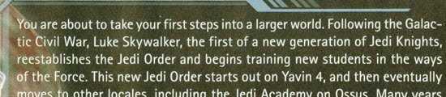
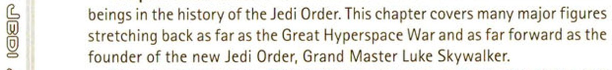

# Owner Material 028 — Jedi Academy Training Manual (WotC, 2009): Front matter and Introduction

- **Source:** *Star Wars Roleplaying Game Saga Edition: Jedi Academy Training Manual* by Rodney Thompson, Eric Cagle, Patrick Stutzman and Robert Wieland (Wizards of the Coast, 2009). Licensed Legends RPG supplement, framed as a guide for students at the Jedi Academy on Ossus (Legacy era). Owner-queued scan (161 PDF pages, image-only; OCR'd on the box), read in full 2026-10-28 including sidebars, captions and stat blocks. The scan stays box-only and is **not** published.
- **Quotes:** verbatim as printed, cited "Jedi Academy Training Manual, p.X" by **printed** page (printed page = scan page − 1). Sidebars and captions are marked **sidebar/caption**; Saga Edition statistics are marked **stat block** and **RPG mechanics (weaker source)**. Each quote has a crop of the printed passage directly under it.
- **Weight:** secondary source. The prose summarises the novels and comics; game statistics are mechanics, not canon feats, and rank lowest. See README § How much weight.
- **Not in this book:** Kyp Durron, Gantoris, Streen, Kam Solusar, Admiral Daala, the Sun Crusher and Tionne are not named anywhere in it (both OCR passes searched, fuzzy matching).

## front matter (unnumbered) (scan page sp001)

- Scope: Front cover: Obi-Wan Kenobi, Luke Skywalker, Mara Jade and duelling Jedi; authors Rodney Thompson, Eric Cagle, Patrick Stutzman, Robert Wieland.
- Scope note: no power, skill or lore statement on this page beyond the summary above.

## front matter (unnumbered) (scan page sp002)

- Scope: Title page (faded art).
- Scope note: no power, skill or lore statement on this page beyond the summary above.

## front matter (unnumbered) (scan page sp003)

- Scope: Credits and legal page.
- Scope note: no power, skill or lore statement on this page beyond the summary above.

## front matter (unnumbered) (scan page sp004)

- Scope: Contents.
- Scope note: no power, skill or lore statement on this page beyond the summary above.

## p.4 (scan page sp005)

- Scope: Introduction chapter-opener art.
- Scope note: no power, skill or lore statement on this page beyond the summary above.

## p.5 (scan page sp006)

- Scope: Introduction: a larger world — Luke refounds the Order; book scope across eras (Kol Skywalker mentioned).

- **Luke Skywalker** — Introduction — Luke refounds the Order: "Following the Galactic Civil War, Luke Skywalker, the first of a new generation of Jedi Knights, reestablishes the Jedi Order and begins training new students in the ways of the Force." Source: Jedi Academy Training Manual, p.5
  

## p.6 (scan page sp007)

- Scope: Introduction: courses of study, what you need to play, Message from the Faculty: exchange courses / independent study.

- **Luke Skywalker** — Introduction — Chapter 5 scope: "This chapter covers many major figures stretching back as far as the Great Hyperspace War and as far forward as the founder of the new Jedi Order, Grand Master Luke Skywalker." Source: Jedi Academy Training Manual, p.6
  

## p.7 (scan page sp008)

- Scope: Introduction sidebars: Holocron Lessons, Beware the Dark Side, Whispers of the Sith Spirit (how the book's voice boxes work).
- Scope note: no power, skill or lore statement on this page beyond the summary above.

