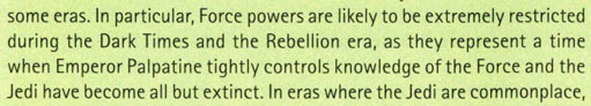

# Owner Material 028 — Jedi Academy Training Manual (WotC, 2009): Chapter I: Power of the Force

- **Source:** *Star Wars Roleplaying Game Saga Edition: Jedi Academy Training Manual* by Rodney Thompson, Eric Cagle, Patrick Stutzman and Robert Wieland (Wizards of the Coast, 2009). Licensed Legends RPG supplement, framed as a guide for students at the Jedi Academy on Ossus (Legacy era). Owner-queued scan (161 PDF pages, image-only; OCR'd on the box), read in full 2026-10-28 including sidebars, captions and stat blocks. The scan stays box-only and is **not** published.
- **Quotes:** verbatim as printed, cited "Jedi Academy Training Manual, p.X" by **printed** page (printed page = scan page − 1). Sidebars and captions are marked **sidebar/caption**; Saga Edition statistics are marked **stat block** and **RPG mechanics (weaker source)**. Each quote has a crop of the printed passage directly under it.
- **Weight:** secondary source. The prose summarises the novels and comics; game statistics are mechanics, not canon feats, and rank lowest. See README § How much weight.
- **Not in this book:** Kyp Durron, Gantoris, Streen, Kam Solusar, Admiral Daala, the Sun Crusher and Tionne are not named anywhere in it (both OCR passes searched, fuzzy matching).

## p.8 (scan page sp009)

- Scope: Chapter I: Power of the Force — chapter-opener art.
- Scope note: no power, skill or lore statement on this page beyond the summary above.

## p.9 (scan page sp010)

- Scope: Chapter I intro: Jedi archetypes and Force traditions (art: two Jedi women).
- Scope note: no power, skill or lore statement on this page beyond the summary above.

## p.10–13 (scan page sp011–sp014)

- Scope: Skills: Use the Force; Force regimens (awaken sensitivity, oxygen bottle, quiet the mind, telekinetic practice, lightsaber training, sparring, training remote); Holocron Lesson: The Twin Suns; Message from the Faculty boxes. RPG mechanics; no named-character feats.
- Scope note: no power, skill or lore statement on this page beyond the summary above.

## p.14–23 (scan page sp015–sp024)

- Scope: Force talents and talent trees (Alter, Control, Dark Side, Sense, Guardian Spirit, Force adept, Beastwarden, Mystic, Telepath, Jedi Knight trees, Sith Alchemy, Dark Armor), Holocron Lesson: The Great Hunt, optional daily Force points rule; feats. RPG mechanics; captions are generic (Kel Dor Sith Lord, Sith guardian spirit on Korriban).
- Scope note: no power, skill or lore statement on this page beyond the summary above.

## p.24–27 (scan page sp025–sp028)

- Scope: New Force powers (convection, crucitorn, cryokinesis, drain energy, fold space, Force track, inertia, etc.) with Message from the Faculty boxes (move object, line of sight). RPG mechanics; no named-character feats.
- Scope note: no power, skill or lore statement on this page beyond the summary above.

## p.28 (scan page sp029)

- Scope: Force powers (plant surge, thought bomb) and sidebar The Force Through the Ages — Palpatine's control of Force lore in the Dark Times.

- **Palpatine (Darth Sidious)** — The Force Through the Ages (sidebar) — Palpatine's control of Force lore: "Force powers are likely to be extremely restricted during the Dark Times and the Rebellion era, as they represent a time when Emperor Palpatine tightly controls knowledge of the Force and the Jedi have become all but extinct." Source: Jedi Academy Training Manual, p.28, sidebar/caption
  

## p.29–37 (scan page sp030–sp038)

- Scope: Lightsaber form powers (assured strike … unhindered charge), Message from the Faculty: saber locks, Force techniques and improved powers. RPG mechanics; no named-character feats.
- Scope note: no power, skill or lore statement on this page beyond the summary above.

