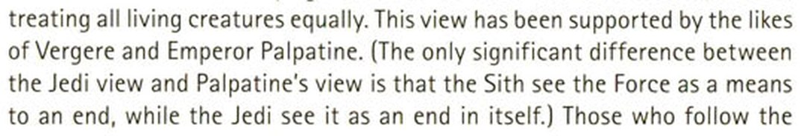
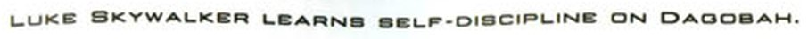
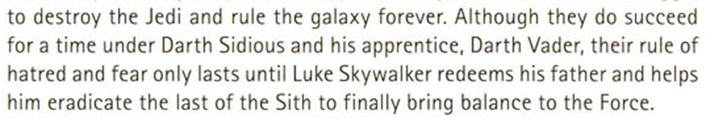
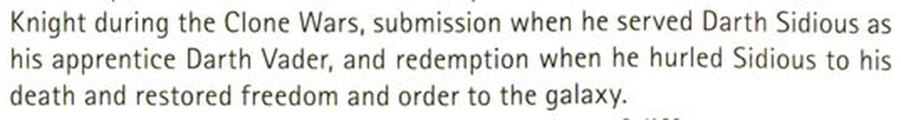
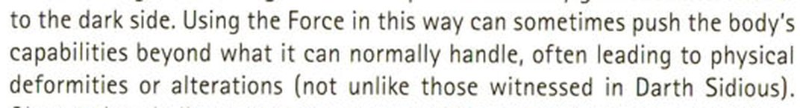

# Owner Material 028 — Jedi Academy Training Manual (WotC, 2009): Chapter II: Philosophy

- **Source:** *Star Wars Roleplaying Game Saga Edition: Jedi Academy Training Manual* by Rodney Thompson, Eric Cagle, Patrick Stutzman and Robert Wieland (Wizards of the Coast, 2009). Licensed Legends RPG supplement, framed as a guide for students at the Jedi Academy on Ossus (Legacy era). Owner-queued scan (161 PDF pages, image-only; OCR'd on the box), read in full 2026-10-28 including sidebars, captions and stat blocks. The scan stays box-only and is **not** published.
- **Quotes:** verbatim as printed, cited "Jedi Academy Training Manual, p.X" by **printed** page (printed page = scan page − 1). Sidebars and captions are marked **sidebar/caption**; Saga Edition statistics are marked **stat block** and **RPG mechanics (weaker source)**. Each quote has a crop of the printed passage directly under it.
- **Weight:** secondary source. The prose summarises the novels and comics; game statistics are mechanics, not canon feats, and rank lowest. See README § How much weight.
- **Not in this book:** Kyp Durron, Gantoris, Streen, Kam Solusar, Admiral Daala, the Sun Crusher and Tionne are not named anywhere in it (both OCR passes searched, fuzzy matching).

## p.38 (scan page sp039)

- Scope: Chapter II: Philosophy — chapter-opener art.
- Scope note: no power, skill or lore statement on this page beyond the summary above.

## p.39 (scan page sp040)

- Scope: Chapter II intro: the Force ties the saga together (Palpatine, Anakin).
- Scope note: no power, skill or lore statement on this page beyond the summary above.

## p.40 (scan page sp041)

- Scope: Aspects of the Force: light side, Jedi Code, Living vs Unifying Force (Vergere and Palpatine).

- **Palpatine (Darth Sidious)** — Aspects of the Force — Unifying Force: "This view has been supported by the likes of Vergere and Emperor Palpatine. (The only significant difference between the Jedi view and Palpatine's view is that the Sith see the Force as a means to an end, while the Jedi see it as an end in itself.)" Source: Jedi Academy Training Manual, p.40
  

## p.41 (scan page sp042)

- Scope: Philosophy continued; art caption: Luke learns self-discipline on Dagobah.

- **Luke Skywalker** — art caption: "LUKE SKYWALKER LEARNS SELF-DISCIPLINE ON DAGOBAH." Source: Jedi Academy Training Manual, p.41, sidebar/caption
  

## p.42 (scan page sp043)

- Scope: Whispers of the Sith Spirit: Shades of Darkness (Sith philosophy sidebar).
- Scope note: no power, skill or lore statement on this page beyond the summary above.

## p.43 (scan page sp044)

- Scope: Padawans and apprentices: obtaining a Padawan, benefits of training (Kenobi training Anakin and Luke).
- Scope note: no power, skill or lore statement on this page beyond the summary above.

## p.44 (scan page sp045)

- Scope: Achieving knighthood; the dark side and the Sith (Sidious, Vader, Luke); the four-stage dark path (Anakin).

- **Palpatine (Darth Sidious); Darth Vader (Anakin Skywalker); Luke Skywalker** — The Dark Side — the Sith: "Although they do succeed for a time under Darth Sidious and his apprentice, Darth Vader, their rule of hatred and fear only lasts until Luke Skywalker redeems his father and helps him eradicate the last of the Sith to finally bring balance to the Force." Source: Jedi Academy Training Manual, p.44
  
- **Darth Vader (Anakin Skywalker); Palpatine (Darth Sidious)** — The Dark Path — Anakin's four stages: "submission when he served Darth Sidious as his apprentice Darth Vader, and redemption when he hurled Sidious to his death and restored freedom and order to the galaxy." Source: Jedi Academy Training Manual, p.44
  

## p.45–47 (scan page sp046–sp048)

- Scope: Variations on the dark side, optional rules, applications of the Force (alter, control, sense), influence of the dark side (berserker rage, Sidious's deformities).

- **Palpatine (Darth Sidious)** — Influence of the Dark Side — berserker rage and deformity: "Using the Force in this way can sometimes push the body's capabilities beyond what it can normally handle, often leading to physical deformities or alterations (not unlike those witnessed in Darth Sidious)." Source: Jedi Academy Training Manual, p.47
  

