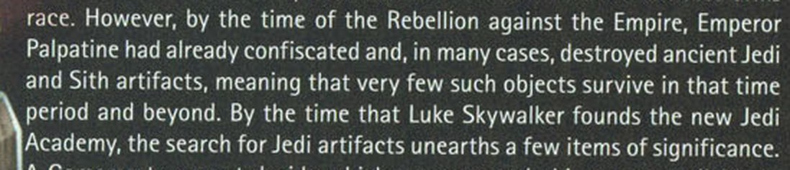
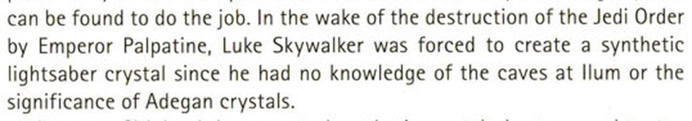

# Owner Material 028 — Jedi Academy Training Manual (WotC, 2009): Chapter III: Equipment and Artifacts

- **Source:** *Star Wars Roleplaying Game Saga Edition: Jedi Academy Training Manual* by Rodney Thompson, Eric Cagle, Patrick Stutzman and Robert Wieland (Wizards of the Coast, 2009). Licensed Legends RPG supplement, framed as a guide for students at the Jedi Academy on Ossus (Legacy era). Owner-queued scan (161 PDF pages, image-only; OCR'd on the box), read in full 2026-10-28 including sidebars, captions and stat blocks. The scan stays box-only and is **not** published.
- **Quotes:** verbatim as printed, cited "Jedi Academy Training Manual, p.X" by **printed** page (printed page = scan page − 1). Sidebars and captions are marked **sidebar/caption**; Saga Edition statistics are marked **stat block** and **RPG mechanics (weaker source)**. Each quote has a crop of the printed passage directly under it.
- **Weight:** secondary source. The prose summarises the novels and comics; game statistics are mechanics, not canon feats, and rank lowest. See README § How much weight.
- **Not in this book:** Kyp Durron, Gantoris, Streen, Kam Solusar, Admiral Daala, the Sun Crusher and Tionne are not named anywhere in it (both OCR passes searched, fuzzy matching).

## p.48 (scan page sp049)

- Scope: Chapter III: Equipment & Artifacts — chapter-opener art.
- Scope note: no power, skill or lore statement on this page beyond the summary above.

## p.49 (scan page sp050)

- Scope: Chapter III intro: artifacts by era (Palpatine's purge of artifacts, Luke's academy).

- **Palpatine (Darth Sidious); Luke Skywalker** — Equipment & Artifacts — eras: "by the time of the Rebellion against the Empire, Emperor Palpatine had already confiscated and, in many cases, destroyed ancient Jedi and Sith artifacts, meaning that very few such objects survive in that time period and beyond. By the time that Luke Skywalker founds the new Jedi Academy, the search for Jedi artifacts unearths a few items of significance." Source: Jedi Academy Training Manual, p.49
  

## p.50–55 (scan page sp051–sp056)

- Scope: Melee weapons: lightsaber variants (guard shoto, dual-phase, lightsaber pike, lightwhip), weapon tables, advanced lightsaber construction, crystals. RPG mechanics.
- Scope note: no power, skill or lore statement on this page beyond the summary above.

## p.56 (scan page sp057)

- Scope: Lightsaber crystals: Adegan crystals, Message from the Faculty: crystals in training lightsabers, synthetic crystals (Luke's synthetic crystal).

- **Luke Skywalker** — Synthetic Crystals — Luke's lightsaber: "In the wake of the destruction of the Jedi Order by Emperor Palpatine, Luke Skywalker was forced to create a synthetic lightsaber crystal since he had no knowledge of the caves at Ilum or the significance of Adegan crystals." Source: Jedi Academy Training Manual, p.56
  

## p.57–59 (scan page sp058–sp060)

- Scope: Whispers of the Sith Spirit: synthetic crystals; traditional jewels; Holocron Lesson; extremely rare crystals; Message from the Faculty: krayt dragon pearls. Lore on crystals only.
- Scope note: no power, skill or lore statement on this page beyond the summary above.

## p.60–63 (scan page sp061–sp064)

- Scope: Lightsaber modifications; exotic weapons; armour (orbalisk armour); other equipment; Message from the Faculty: Jedi in armour. RPG mechanics.
- Scope note: no power, skill or lore statement on this page beyond the summary above.

## p.64–69 (scan page sp065–sp070)

- Scope: Sith battle harness, subelectronic converter, universal energy cage; holocrons (using, lost powers, retraining, in combat, creating, gatekeepers); Whispers: Sith holocrons; Sith amulet, Sith poison, Sith talismans, Message from the Faculty: the Muur Talisman.
- Scope note: no power, skill or lore statement on this page beyond the summary above.

