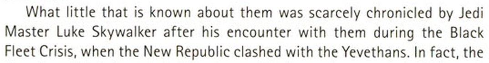
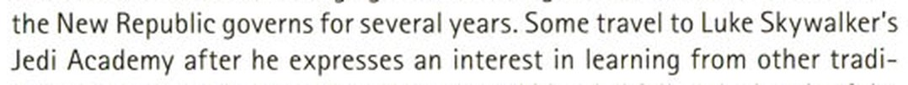

# Owner Material 028 — Jedi Academy Training Manual (WotC, 2009): Chapter IV: Affiliated Programs

- **Source:** *Star Wars Roleplaying Game Saga Edition: Jedi Academy Training Manual* by Rodney Thompson, Eric Cagle, Patrick Stutzman and Robert Wieland (Wizards of the Coast, 2009). Licensed Legends RPG supplement, framed as a guide for students at the Jedi Academy on Ossus (Legacy era). Owner-queued scan (161 PDF pages, image-only; OCR'd on the box), read in full 2026-10-28 including sidebars, captions and stat blocks. The scan stays box-only and is **not** published.
- **Quotes:** verbatim as printed, cited "Jedi Academy Training Manual, p.X" by **printed** page (printed page = scan page − 1). Sidebars and captions are marked **sidebar/caption**; Saga Edition statistics are marked **stat block** and **RPG mechanics (weaker source)**. Each quote has a crop of the printed passage directly under it.
- **Weight:** secondary source. The prose summarises the novels and comics; game statistics are mechanics, not canon feats, and rank lowest. See README § How much weight.
- **Not in this book:** Kyp Durron, Gantoris, Streen, Kam Solusar, Admiral Daala, the Sun Crusher and Tionne are not named anywhere in it (both OCR passes searched, fuzzy matching).

## p.70 (scan page sp071)

- Scope: Chapter IV: Affiliated Programs — chapter-opener art.
- Scope note: no power, skill or lore statement on this page beyond the summary above.

## p.71–91 (scan page sp072–sp092)

- Scope: Affiliated Force traditions with location, philosophy, build notes and talent trees: Aing-Tii monks, Baran Do sages, Fallanassi/White Current (Luke and Jacen), Iron Knights, Matukai (Luke's academy), Seyugi Dervishes, Shapers of Kro Var, Tyia, Wardens of the Sky, Zeison Sha. RPG mechanics plus tradition lore.

- **Luke Skywalker** — Fallanassi — Luke's encounter: "What little that is known about them was scarcely chronicled by Jedi Master Luke Skywalker after his encounter with them during the Black Fleet Crisis" Source: Jedi Academy Training Manual, p.76
  
- **Luke Skywalker** — Matukai — at Luke's academy: "Some travel to Luke Skywalker's Jedi Academy after he expresses an interest in learning from other traditions." Source: Jedi Academy Training Manual, p.80
  

