# Owner Material 028 — Jedi Academy Training Manual (WotC, 2009): Chapter V: Instructors and Alumni

- **Source:** *Star Wars Roleplaying Game Saga Edition: Jedi Academy Training Manual* by Rodney Thompson, Eric Cagle, Patrick Stutzman and Robert Wieland (Wizards of the Coast, 2009). Licensed Legends RPG supplement, framed as a guide for students at the Jedi Academy on Ossus (Legacy era). Owner-queued scan (161 PDF pages, image-only; OCR'd on the box), read in full 2026-10-28 including sidebars, captions and stat blocks. The scan stays box-only and is **not** published.
- **Quotes:** verbatim as printed, cited "Jedi Academy Training Manual, p.X" by **printed** page (printed page = scan page − 1). Sidebars and captions are marked **sidebar/caption**; Saga Edition statistics are marked **stat block** and **RPG mechanics (weaker source)**. Each quote has a crop of the printed passage directly under it.
- **Weight:** secondary source. The prose summarises the novels and comics; game statistics are mechanics, not canon feats, and rank lowest. See README § How much weight.
- **Not in this book:** Kyp Durron, Gantoris, Streen, Kam Solusar, Admiral Daala, the Sun Crusher and Tionne are not named anywhere in it (both OCR passes searched, fuzzy matching).

## p.92 (scan page sp093)

- Scope: Chapter V: Instructors & Alumni — chapter-opener art.
- Scope note: no power, skill or lore statement on this page beyond the summary above.

## p.93 (scan page sp094)

- Scope: Chapter V intro.
- Scope note: no power, skill or lore statement on this page beyond the summary above.

## p.94–96 (scan page sp095–sp097)

- Scope: Anoon Bondara, Arca Jeth (first Battle Meditation), Cay Qel-Droma stat blocks and lore.
- Scope note: no power, skill or lore statement on this page beyond the summary above.

## p.97 (scan page sp098)

- Scope: Cilghal: stat block and lore (Mon Mothma possessed by Exar Kun; midwife to Mara).

- **Cilghal; Exar Kun** — Cilghal — saving Mon Mothma: "She proves instrumental in saving the life of New Republic Chief-of-State Mon Mothma, who is possessed by the dark side spirit of Exar Kun." Source: Jedi Academy Training Manual, p.97
  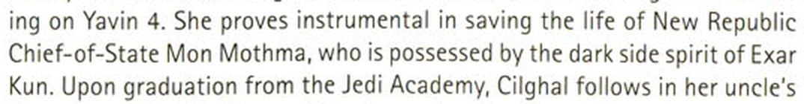
- **Cilghal; Mara Jade Skywalker** — Cilghal — NJO: "She eventually becomes the obstetrician and midwife to Mara Jade Skywalker and a loyal friend to that family, in addition to being a dedicated Jedi Master." Source: Jedi Academy Training Manual, p.97
  

## p.98–99 (scan page sp099–sp100)

- Scope: Corran Horn and Dace Diath: stat blocks and lore.
- Scope note: no power, skill or lore statement on this page beyond the summary above.

## p.100 (scan page sp101)

- Scope: Grand Master Luke Skywalker: CL 20 stat block, career summary (Thrawn, Joruus, Mara, the clone Emperor, Yuuzhan Vong) and encounter notes; portrait caption.

- **Luke Skywalker** — Grand Master Luke Skywalker — stat block, level and class — RPG mechanics (weaker source): "Grand Master Luke Skywalker CL 20 Medium Human scout 1/Jedi 7/ace pilot 2/Jedi Knight 5/Jedi Master 5" Source: Jedi Academy Training Manual, p.100, stat block
  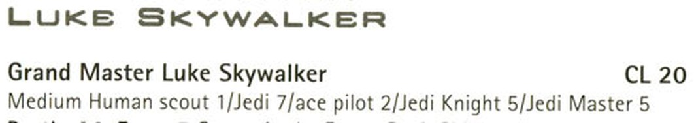
- **Luke Skywalker** — Grand Master Luke Skywalker — stat block, defences and attacks — RPG mechanics (weaker source): "hp 167; Threshold 36 Immune fear effects Speed 6 squares Melee lightsaber +25 (2d8+15) or Melee lightsaber +20/+20 (2d8+15) with Double Attack or Melee shoto +25 (2d6+15)" Source: Jedi Academy Training Manual, p.100, stat block
  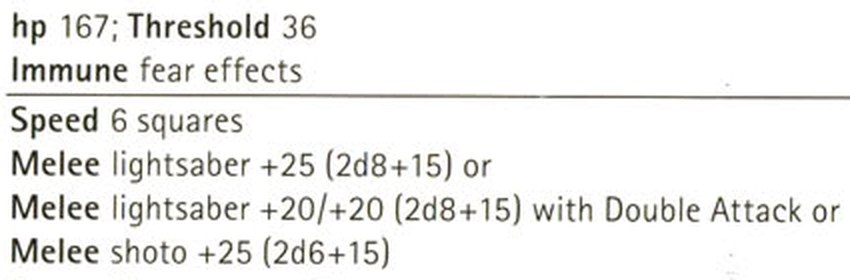
- **Luke Skywalker** — Grand Master Luke Skywalker — stat block, Force powers — RPG mechanics (weaker source): "Force Powers Known (Use the Force +29): battle strike, farseeing, fluid riposte, Force disarm, Force grip, Force slam, inspire, mind trick, move object, rebuke (2), surge Force Secrets Devastating Power, Distant Power, Multitarget Power, Quicken Power, Shaped Power" Source: Jedi Academy Training Manual, p.100, stat block
  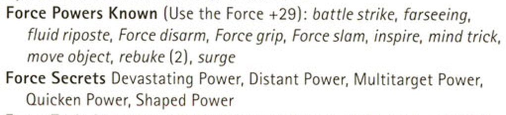
- **Luke Skywalker** — Grand Master Luke Skywalker — stat block, talents — RPG mechanics (weaker source): "Talents Ataru, Block, Deflect, Djem So, Elusive Dogfighter, Evasion, Force Pilot, Immerse Another, Redirect Shot, Severing Strike, Weapon Specialization (lightsabers), White Current Adept" Source: Jedi Academy Training Manual, p.100, stat block
  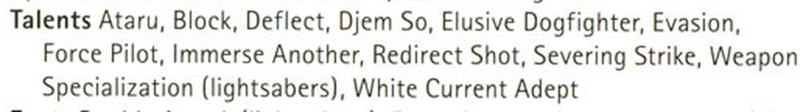
- **Luke Skywalker** — Grand Master Luke Skywalker — stat block, skills and gear — RPG mechanics (weaker source): "Pilot +29, Ride +18, Stealth +29, Survival +18, Use the Force +29 Possessions lightsaber (self-built), shoto (self-built), Jedi robes, comlink" Source: Jedi Academy Training Manual, p.100, stat block
  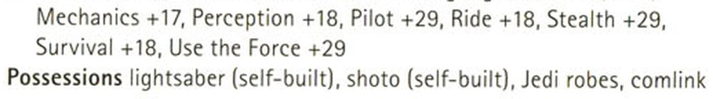
- **Luke Skywalker; Grand Admiral Thrawn; Joruus C'baoth; Mara Jade Skywalker** — Grand Master Luke Skywalker — Thrawn era: "Skywalker is faced with two threats related to Thrawn. One is a mad clone of the old Jedi Master Jorus C'Baoth. The clone "Joruus" tempts Skywalker toward the dark side but is defeated. The other threat is Mara Jade, an assassin with her sights set on Luke Skywalker." Source: Jedi Academy Training Manual, p.100
  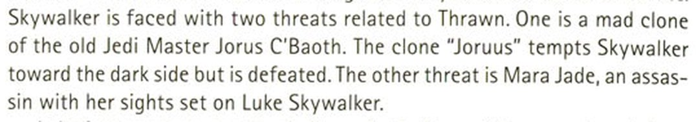
- **Luke Skywalker; Palpatine (Darth Sidious); Leia Organa Solo** — Grand Master Luke Skywalker — Dark Empire: "The Emperor's clone succeeds where Palpatine failed and turns Skywalker to the dark side for a brief time. However, the intervention of his sister, Leia Organa-Solo, brings Luke back from the darkness, whereupon he defeats Palpatine's clone." Source: Jedi Academy Training Manual, p.100
  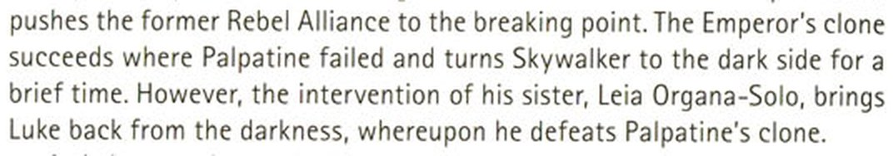
- **Luke Skywalker** — Grand Master Luke Skywalker — the title: "Luke reluctantly takes the title of Grand Master, but to everyone he meets, from the most respected senator to the lowliest droid, he is still simply "Luke."" Source: Jedi Academy Training Manual, p.100
  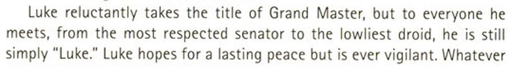
- **Luke Skywalker** — Grand Master Skywalker Encounters — power level: "This is Luke Skywalker at the height of his powers. Although he is the most powerful Jedi in the galaxy after the Yuuzhan Vong invasion, the battles with the Yuuzhan Vong humble him. Heroes meeting Grand Master Skywalker should be awed by his power but impressed by his humility." Source: Jedi Academy Training Manual, p.100
  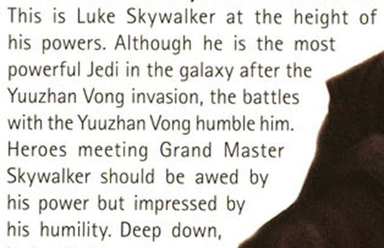

## p.101–102 (scan page sp102–sp103)

- Scope: Kieran Halcyon (student of Luke) and Kyle Katarn (contrast with Luke): stat blocks and lore.

- **Luke Skywalker** — Kieran Halcyon — student of Luke: "on Yavin 4, where he is briefly a student under Luke Skywalker." Source: Jedi Academy Training Manual, p.101
  
- **Luke Skywalker; Kyle Katarn** — Kyle Katarn — contrast with Luke: "While Skywalker mastered the force through empathy and feeling, Katarn did so through discipline and will." Source: Jedi Academy Training Manual, p.102
  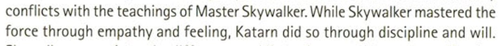

## p.103 (scan page sp104)

- Scope: Mara Jade Skywalker: CL 17 stat block, career and encounter notes; portrait.

- **Mara Jade Skywalker** — Mara Jade Skywalker — stat block, level and class — RPG mechanics (weaker source): "Mara Jade Skywalker CL 17 Medium Human soldier 7/Force adept 5/Jedi Knight 3/Jedi Master 2" Source: Jedi Academy Training Manual, p.103, stat block
  
- **Mara Jade Skywalker** — Mara Jade Skywalker — stat block, defences and attacks — RPG mechanics (weaker source): "hp 160; Threshold 32 Immune fear effects Speed 6 squares Melee lightsaber +22 (2d8+16) or Melee lightsaber +17 (2d8+16) with Double Attack or Ranged heavy blaster pistol +22 (3d6+10)" Source: Jedi Academy Training Manual, p.103, stat block
  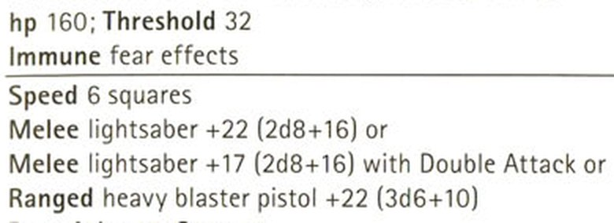
- **Mara Jade Skywalker** — Mara Jade Skywalker — stat block, Force powers and talents — RPG mechanics (weaker source): "Force Powers Known (Use the Force +17): battle strike (2), Force thrust (2), mind trick, move object (2), surge Force Secrets Devastating Power" Source: Jedi Academy Training Manual, p.103, stat block
  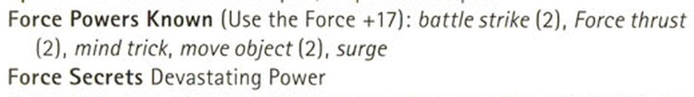
- **Mara Jade Skywalker; Palpatine (Darth Sidious)** — Mara Jade Skywalker — Emperor's Hand: "She begins her career as one of the Emperor's personal Force-trained assassins, although, unlike most of his servants, she only kills out of necessity. Highly talented, Mara trains in combat with the Imperial Royal Guard and receives personal tutelage in the Force from the Emperor himself." Source: Jedi Academy Training Manual, p.103
  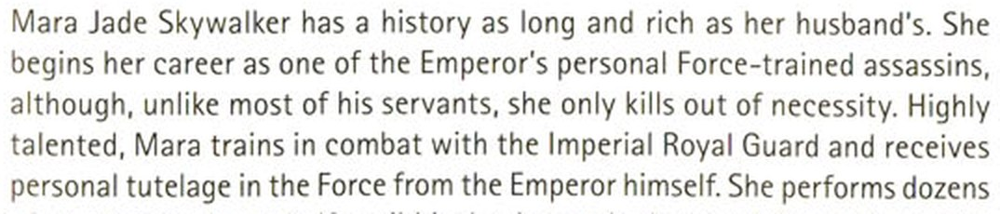
- **Mara Jade Skywalker; Palpatine (Darth Sidious); Luke Skywalker** — Mara Jade Skywalker — the last command: "The Emperor's dying telepathic command to kill Luke Skywalker sets her destiny in a different direction." Source: Jedi Academy Training Manual, p.103
  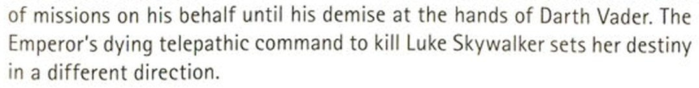
- **Mara Jade Skywalker; Luke Skywalker** — Mara Jade Skywalker — kills Luke's clone: "She manages to "complete" her mission by killing a clone of Luke Skywalker." Source: Jedi Academy Training Manual, p.103
  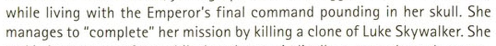
- **Mara Jade Skywalker** — Mara Jade Skywalker Encounters — danger level: "Her skills as an infiltrator and assassin, combined with her formidable skills with the Force and the lightsaber, make her an extremely dangerous opponent." Source: Jedi Academy Training Manual, p.103
  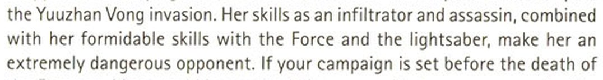

## p.104–110 (scan page sp105–sp111)

- Scope: Nomi Sunrider, Odan-Urr, Ooroo, Oss Willum (Exar Kun's recruit), Shoaneb Culu, Thon, Tott Doneeta: stat blocks, species traits sidebars and lore.

- **Exar Kun** — Oss Willum — Exar Kun's recruits: "Exar Kun convinces Oss and several other impressionable Jedi that the Jedi Order has denied them the key to victory in battle." Source: Jedi Academy Training Manual, p.107
  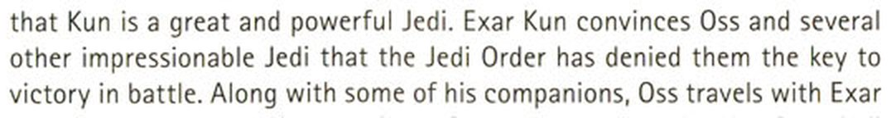
- **Exar Kun** — Oss Willum — the smashed holocron: "Oss travels with Exar Kun to Yavin 4, where Kun smashes a Sith holocron he had stolen from Jedi Master Odan-Urr. The fragments pierce Oss Willum's flesh, causing him to be possessed by Sith spirits." Source: Jedi Academy Training Manual, p.107
  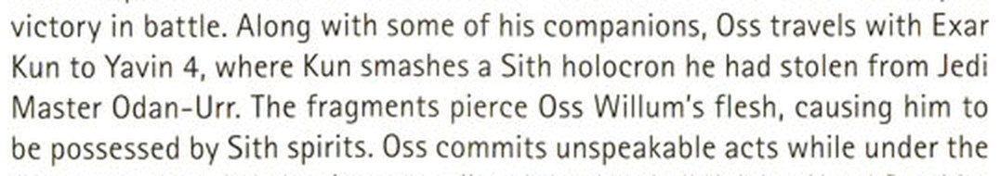

## p.111 (scan page sp112)

- Scope: Vodo-Siosk Baas: stat block and lore (Exar Kun his apprentice; Kun kills him); Holocron Lesson: Krevaaki species traits.

- **Exar Kun; Vodo-Siosk Baas** — Vodo-Siosk Baas — Kun's swordsmanship: "His strongest apprentice, however, is a young pupil named Exar Kun. Kun's skill with a lightsaber is so great that he claimed victory over his master many times when they sparred together." Source: Jedi Academy Training Manual, p.111
  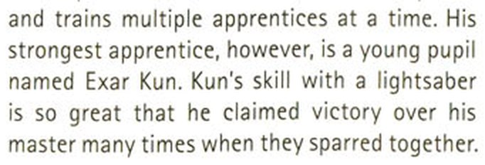
- **Exar Kun; Freedon Nadd** — Vodo-Siosk Baas — Nadd breaks Kun: "Kun ventures to Dxun and enters the tomb of Freedon Nadd. The dark spirit of Freedon Nadd directs Exar Kun to travel to Korriban, where Nadd attacks Kun and shatters every bone in his body." Source: Jedi Academy Training Manual, p.111
  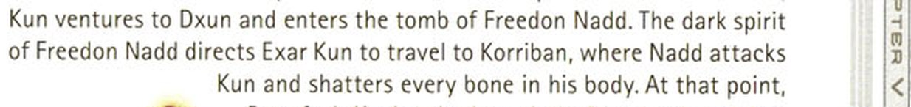
- **Exar Kun; Vodo-Siosk Baas** — Vodo-Siosk Baas — killed by Kun: "Exar Kun interrupts the proceedings and challenges Baas in combat—a duel that costs Master Baas his life." Source: Jedi Academy Training Manual, p.111
  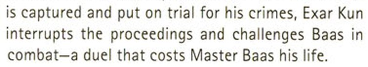

