# Owner Material 028 — Jedi Academy Training Manual (WotC, 2009): Chapter VI: Dangers of Study

- **Source:** *Star Wars Roleplaying Game Saga Edition: Jedi Academy Training Manual* by Rodney Thompson, Eric Cagle, Patrick Stutzman and Robert Wieland (Wizards of the Coast, 2009). Licensed Legends RPG supplement, framed as a guide for students at the Jedi Academy on Ossus (Legacy era). Owner-queued scan (161 PDF pages, image-only; OCR'd on the box), read in full 2026-10-28 including sidebars, captions and stat blocks. The scan stays box-only and is **not** published.
- **Quotes:** verbatim as printed, cited "Jedi Academy Training Manual, p.X" by **printed** page (printed page = scan page − 1). Sidebars and captions are marked **sidebar/caption**; Saga Edition statistics are marked **stat block** and **RPG mechanics (weaker source)**. Each quote has a crop of the printed passage directly under it.
- **Weight:** secondary source. The prose summarises the novels and comics; game statistics are mechanics, not canon feats, and rank lowest. See README § How much weight.
- **Not in this book:** Kyp Durron, Gantoris, Streen, Kam Solusar, Admiral Daala, the Sun Crusher and Tionne are not named anywhere in it (both OCR passes searched, fuzzy matching).

## p.112 (scan page sp113)

- Scope: Chapter VI: Dangers of Study — chapter-opener art.
- Scope note: no power, skill or lore statement on this page beyond the summary above.

## p.113 (scan page sp114)

- Scope: Chapter VI intro; dark siders section opener.
- Scope note: no power, skill or lore statement on this page beyond the summary above.

## p.114–115 (scan page sp115–sp116)

- Scope: Azrakel (Palpatine's experiments) and the Blackguard: stat blocks and lore.
- Scope note: no power, skill or lore statement on this page beyond the summary above.

## p.116 (scan page sp117)

- Scope: Brakiss: CL 11 stat block, career (Luke's academy, Kueller, Shadow Academy, death) and encounter notes; portrait.

- **Brakiss** — Brakiss — stat block, level and class — RPG mechanics (weaker source): "Brakiss CL 11 Medium Human Noble 1/Jedi 7/Force adept 3 Force 7; Dark Side 10" Source: Jedi Academy Training Manual, p.116, stat block
  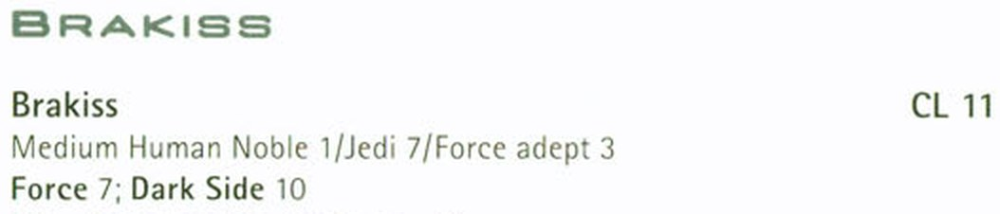
- **Brakiss** — Brakiss — stat block, defences and attacks — RPG mechanics (weaker source): "hp 77; Threshold 24 Speed 6 squares Melee lightsaber +12 (2d8+6) or Melee lightsaber +7/+7 (2d8+6) with Double Attack" Source: Jedi Academy Training Manual, p.116, stat block
  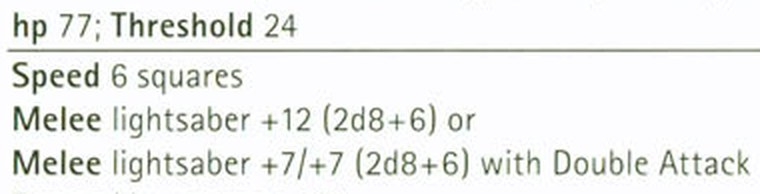
- **Brakiss** — Brakiss — stat block, Force powers — RPG mechanics (weaker source): "Force Powers Known (Use the Force +18): Force lightning, mind trick, move object, rebuke (2), vital transfer" Source: Jedi Academy Training Manual, p.116, stat block
  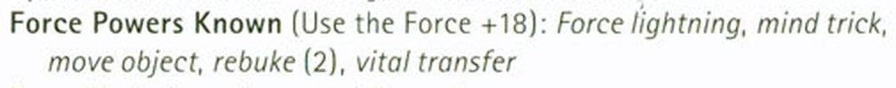
- **Brakiss; Luke Skywalker** — Brakiss — at Luke's academy: "Brakiss, on the other hand, actually holds true potential with the Force, and, despite having already begun down the path to the dark side, Skywalker allows him to stay, convinced that he can lead Brakiss down the path of the light side. Despite all of Skywalker's efforts and training, Brakiss proves Luke wrong and flees from the academy." Source: Jedi Academy Training Manual, p.116
  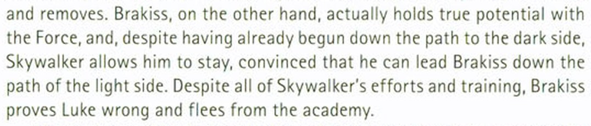
- **Brakiss; Kueller** — Brakiss — with Kueller and the Second Imperium: "Brakiss immediately swears his allegiance to the Second Imperium and begins building an academy equal to Skywalker's but devoted entirely to the dark side." Source: Jedi Academy Training Manual, p.116
  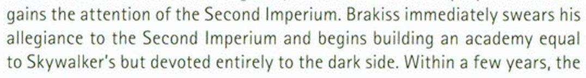
- **Brakiss; Palpatine (Darth Sidious)** — Brakiss — death: "Brakiss is ordered by Palpatine to destroy the Jedi once and for all. Once again Brakiss fails, and he dies shortly after returning to the Shadow Academy when Palpatine's Royal Guards set off explosive charges planted in the station." Source: Jedi Academy Training Manual, p.116
  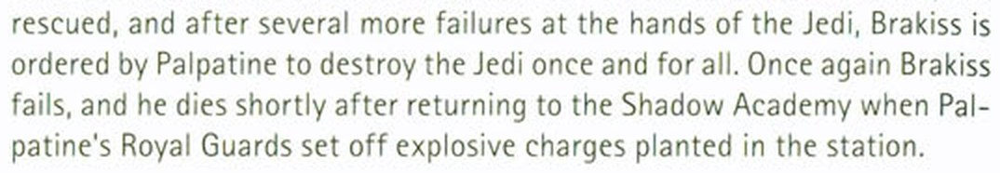

## p.117 (scan page sp118)

- Scope: Carnor Jax: stat block and lore (Royal Guard, sabotages Palpatine's clones).

- **Carnor Jax; Palpatine (Darth Sidious)** — Carnor Jax — sabotaging the clones: "When Palpatine returns in one of his cloned bodies, Jax rejoins the Royal Guard to better arrange the clone's assassination and bribes the Emperor's physician into sabotaging the remaining clones." Source: Jedi Academy Training Manual, p.117
  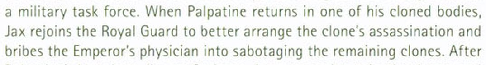

## p.118–119 (scan page sp119–sp120)

- Scope: Dark side spirit template (Sadow, Nadd, Exar Kun, Palpatine); Holocron Lesson: destroying a dark side spirit.

- **Exar Kun; Palpatine (Darth Sidious)** — Dark Side Spirit (template) — examples: "Naga Sadow, Freedon Nadd, and Exar Kun are just a few examples of former Sith Lords who have maintained a spiritual presence in the galaxy years and even centuries after they were thought to be dead. Even Emperor Palpatine manages to avoid permanent death for a while through means unknown to the vast majority of the galaxy's populace." Source: Jedi Academy Training Manual, p.118
  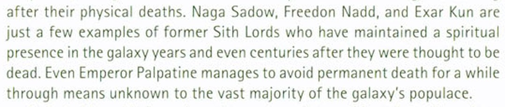
- **Exar Kun** — Dark Side Spirit (template) — Kun's anchor: "Exar Kun was almost always found on Yavin 4 within the Massassi ruins, where he absorbed the life force of the entire Massassi race." Source: Jedi Academy Training Manual, p.118
  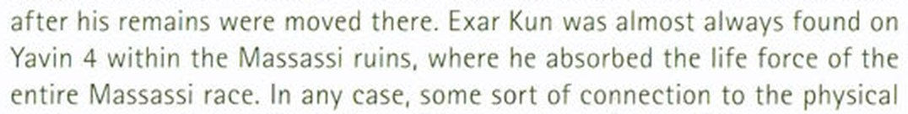

## p.120 (scan page sp121)

- Scope: Hethrir: stat block and lore (Reborn, Han, Leia and Luke rescue the Solo children).

- **Han Solo; Leia Organa Solo; Luke Skywalker** — Hethrir — rescue of the Solo children: "However, Han Solo, his wife Leia, and Luke Skywalker join with Rillao and manage to rescue the abductees, although Anakin is nearly lost." Source: Jedi Academy Training Manual, p.120
  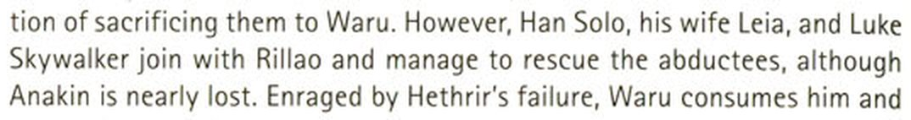
- **Luke Skywalker; Kyle Katarn** — Hethrir — the Reborn: "However, the Reborn are defeated by Luke Skywalker and Kyle Katarn." Source: Jedi Academy Training Manual, p.120
  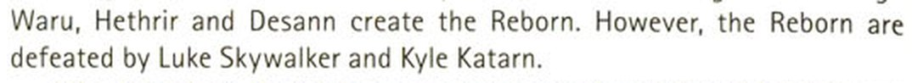

## p.121 (scan page sp122)

- Scope: Irek Ismaren / Lord Nyax: stat block and lore (Luke, Mara, Tahiri).

- **Luke Skywalker; Mara Jade Skywalker** — Lord Nyax — sealed in a pit: "Luke Skywalker, Mara Jade Skywalker, and Tahiri Veila encounter Lord Nyax and seal him in a pit, but he escapes." Source: Jedi Academy Training Manual, p.121
  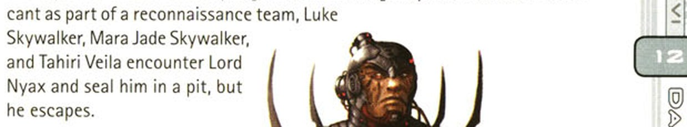

## p.122 (scan page sp123)

- Scope: Kueller: stat block and lore (Brakiss; twice defeats Luke; shot by Leia).

- **Brakiss; Kueller** — Kueller — recruits Brakiss: "he encounters Brakiss, who also trained under Skywalker and was emotionally torn when forced to confront his inner demons. Kueller repairs Brakiss's damaged psyche and brings him into the fold by assigning him to supervise a droid factory on Telti." Source: Jedi Academy Training Manual, p.122
  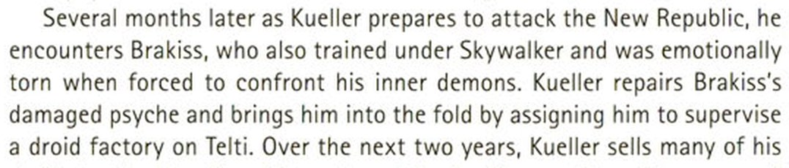
- **Kueller; Luke Skywalker** — Kueller — first duel: "After defeating Skywalker in a lightsaber duel on Pydyr and imprisoning him to use as bait for Leia Organa-Solo." Source: Jedi Academy Training Manual, p.122
  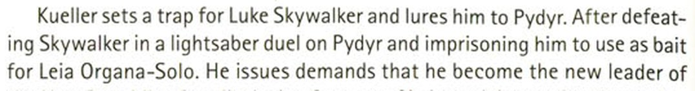
- **Kueller; Luke Skywalker; Leia Organa Solo** — Kueller — second duel and death: "Kueller defeats the Jedi Master again and is about to strike him down when the untimely arrival of a ysalamir cancels his Force abilities. With most of his defenses down, Leia shoots and kills Kueller." Source: Jedi Academy Training Manual, p.122
  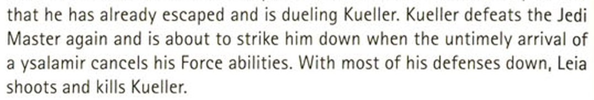

## p.123 (scan page sp124)

- Scope: Massassi abomination (Exar Kun's Sith alchemy): stat block and lore.

- **Exar Kun** — Massassi Abomination — Kun's Sith alchemy: "Massassi abominations are created by Exar Kun using Sith alchemy. Using primitive Massassi warriors from Yavin 4 as "stock," Exar Kun infuses his hideous creations with some of his own physical makeup." Source: Jedi Academy Training Manual, p.123
  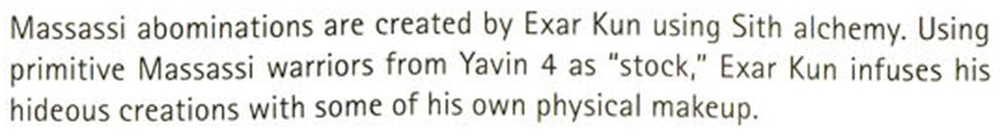

## p.124–126 (scan page sp125–sp127)

- Scope: Nightsister of Dathomir (the Emperor's blockade), Prophet of the Dark Side (Sidious), Sedriss (the Emperor and his clones; hunts Luke): stat blocks and lore.

- **Palpatine (Darth Sidious)** — Nightsister of Dathomir — the Emperor and Dathomir: "After the Emperor's rumored visit to Dathomir, an Imperial blockade is established around the planet, and all spaceworthy craft on the planet's surface are destroyed." Source: Jedi Academy Training Manual, p.124
  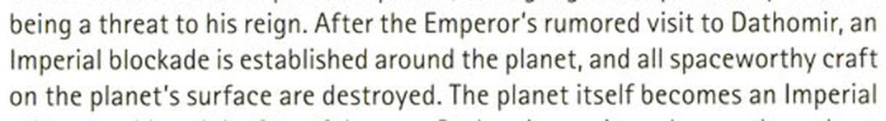
- **Palpatine (Darth Sidious)** — Prophet of the Dark Side — origin: "the Sith Lord known as Darth Sidious knows that he cannot wipe out the Jedi with a single decisive blow. He plots the extermination of the remaining Jedi by forming a group he calls the Prophets of the Dark Side." Source: Jedi Academy Training Manual, p.125
  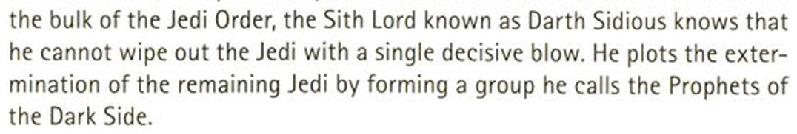
- **Palpatine (Darth Sidious)** — Sedriss — the Emperor's persuasion: "Subjected to the Emperor's unique style of persuasion, Qaga Lok vows to serve Palpatine for the rest of his life and changes his name to Sedriss." Source: Jedi Academy Training Manual, p.126
  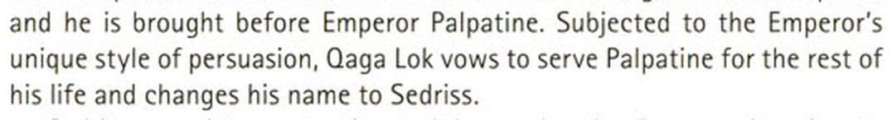
- **Palpatine (Darth Sidious); Luke Skywalker; Ood Bnar** — Sedriss — hunting Luke: "The last of the Emperor's clones orders Sedriss to bring Luke Skywalker to Byss alive. Sedriss eventually tracks Luke to Ossus, only to be killed by Jedi Master Ood Bnar." Source: Jedi Academy Training Manual, p.126
  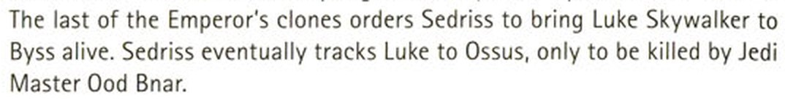

## p.127 (scan page sp128)

- Scope: Shadow Academy student: stat blocks and lore (Brakiss).

- **Brakiss; Luke Skywalker** — Shadow Academy Student — Brakiss: "One of Luke Skywalker's early failures as leader of the New Jedi Order is Brakiss." Source: Jedi Academy Training Manual, p.127
  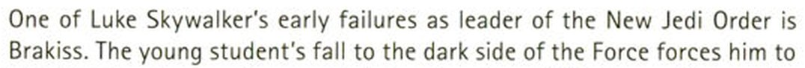
- **Brakiss** — Shadow Academy Student — Brakiss's pawns: "Time and again, Brakiss uses his students as pawns in his plans to eradicate the Jedi." Source: Jedi Academy Training Manual, p.127
  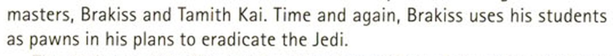

## p.128–130 (scan page sp129–sp131)

- Scope: Sorcerer of Tund, Tamith Kai (assists Brakiss), Xanatos: stat blocks and lore.

- **Brakiss; Luke Skywalker; Lowbacca** — Tamith Kai — Lowbacca rescued: "Lowbacca ceases to trust her, and before long he's rescued from the Shadow Academy by Luke Skywalker and his fellow Jedi." Source: Jedi Academy Training Manual, p.129
  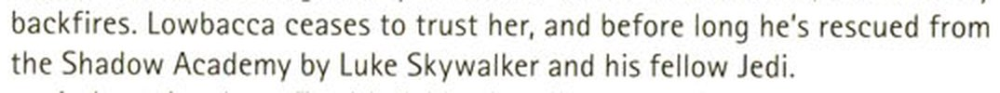

## p.131 (scan page sp132)

- Scope: Beasts: battle hydra (Exar Kun's creation).

- **Exar Kun** — Battle Hydra — Kun's creation: "Battle hydras are the result of Sith Lord Exar Kun's experimentation with Sith alchemy." Source: Jedi Academy Training Manual, p.131
  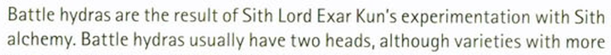

## p.132–147 (scan page sp133–sp148)

- Scope: Beasts: beck-tori, chrysalis rancor (Palpatine on Byss), derriphan, droch, Dxun tomb beast, hssiss, marsh haunt, nighthunter, shyrack, silooth, Sith warbird, Sith wyrm, storm beast, taozin, terentatek, tuk'ata (Exar Kun's guardians). RPG stat blocks.

- **Palpatine (Darth Sidious)** — Chrysalis Beast — Palpatine's rancors: "Among those Sith known to create and deploy chrysalis beasts is Emperor Palpatine. He did so at his Imperial citadel on Byss." Source: Jedi Academy Training Manual, p.133
  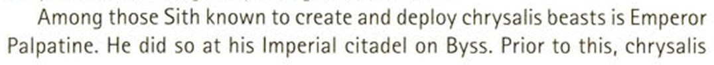
- **Exar Kun** — Tuk'ata — Kun's guardians: "They become a favorite of Exar Kun, who often assigns the creatures to protect Sith holdings across the galaxy." Source: Jedi Academy Training Manual, p.147
  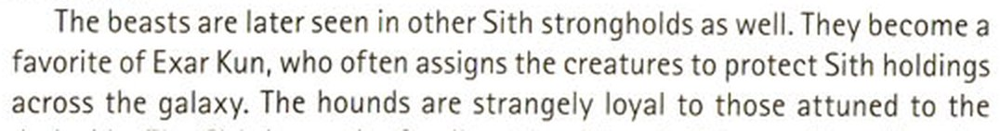

