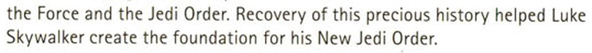
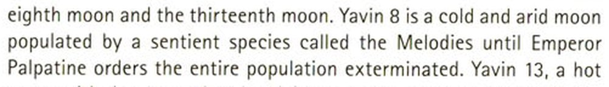
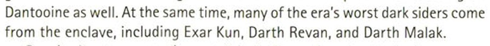
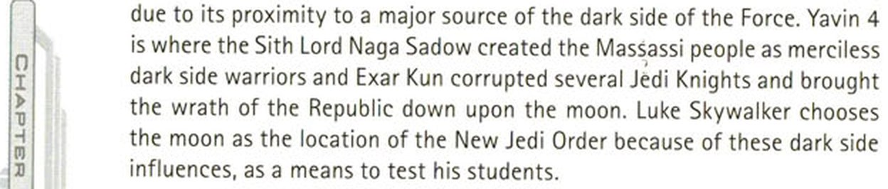
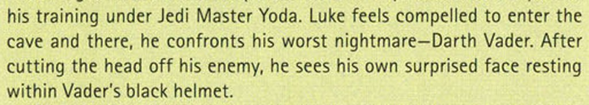
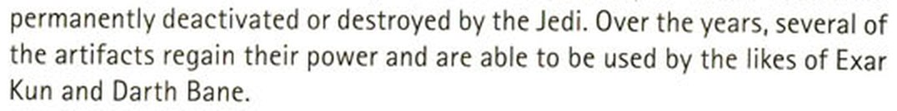
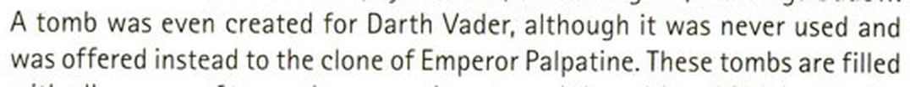

# Owner Material 028 — Jedi Academy Training Manual (WotC, 2009): Chapter VII: Studying Abroad, and back cover

- **Source:** *Star Wars Roleplaying Game Saga Edition: Jedi Academy Training Manual* by Rodney Thompson, Eric Cagle, Patrick Stutzman and Robert Wieland (Wizards of the Coast, 2009). Licensed Legends RPG supplement, framed as a guide for students at the Jedi Academy on Ossus (Legacy era). Owner-queued scan (161 PDF pages, image-only; OCR'd on the box), read in full 2026-10-28 including sidebars, captions and stat blocks. The scan stays box-only and is **not** published.
- **Quotes:** verbatim as printed, cited "Jedi Academy Training Manual, p.X" by **printed** page (printed page = scan page − 1). Sidebars and captions are marked **sidebar/caption**; Saga Edition statistics are marked **stat block** and **RPG mechanics (weaker source)**. Each quote has a crop of the printed passage directly under it.
- **Weight:** secondary source. The prose summarises the novels and comics; game statistics are mechanics, not canon feats, and rank lowest. See README § How much weight.
- **Not in this book:** Kyp Durron, Gantoris, Streen, Kam Solusar, Admiral Daala, the Sun Crusher and Tionne are not named anywhere in it (both OCR passes searched, fuzzy matching).

## p.148 (scan page sp149)

- Scope: Chapter VII: Studying Abroad — chapter-opener art.
- Scope note: no power, skill or lore statement on this page beyond the summary above.

## p.149 (scan page sp150)

- Scope: Chapter VII intro: places in the light, areas of darkness.
- Scope note: no power, skill or lore statement on this page beyond the summary above.

## p.150 (scan page sp151)

- Scope: Chu'unthor (helped Luke found his order); Message from the Faculty: adventure hooks.

- **Luke Skywalker** — Chu'unthor — Luke's foundation: "Recovery of this precious history helped Luke Skywalker create the foundation for his New Jedi Order." Source: Jedi Academy Training Manual, p.150
  

## p.151–155 (scan page sp152–sp156)

- Scope: Jedi temples and academies: Dantooine, Ossus, Yavin 4 (why Luke chose it), Valley of the Jedi / Ruusan; Message from the Faculty: Jedi Temple and Valley of the Jedi adventure hooks; DC knowledge tables.

- **Palpatine (Darth Sidious)** — Yavin — Yavin 8: "Yavin 8 is a cold and arid moon populated by a sentient species called the Melodies until Emperor Palpatine orders the entire population exterminated." Source: Jedi Academy Training Manual, p.152
  
- **Exar Kun** — Dantooine enclave — dark siders: "At the same time, many of the era's worst dark siders come from the enclave, including Exar Kun, Darth Revan, and Darth Malak." Source: Jedi Academy Training Manual, p.153
  
- **Exar Kun; Luke Skywalker** — Yavin 4 Jedi Academy — why Yavin 4: "Yavin 4 is where the Sith Lord Naga Sadow created the Massassi people as merciless dark side warriors and Exar Kun corrupted several Jedi Knights and brought the wrath of the Republic down upon the moon. Luke Skywalker chooses the moon as the location of the New Jedi Order because of these dark side influences, as a means to test his students." Source: Jedi Academy Training Manual, p.154
  

## p.156 (scan page sp157)

- Scope: Dark side sites; Holocron Lesson: the Cave on Dagobah (Luke and the Vader vision); site power levels.

- **Luke Skywalker; Darth Vader (Anakin Skywalker)** — Holocron Lesson: The Cave on Dagobah (sidebar): "Luke feels compelled to enter the cave and there, he confronts his worst nightmare—Darth Vader. After cutting the head off his enemy, he sees his own surprised face resting within Vader's black helmet." Source: Jedi Academy Training Manual, p.156, sidebar/caption
  

## p.157–159 (scan page sp158–sp160)

- Scope: Dxun and Korriban: notable locations, inhabitants, Message from the Faculty adventure hooks, Valley of the Dark Lords (Vader's tomb offered to the clone Emperor).

- **Exar Kun; Darth Bane** — Korriban — Nadd's repository: "Over the years, several of the artifacts regain their power and are able to be used by the likes of Exar Kun and Darth Bane." Source: Jedi Academy Training Manual, p.158
  
- **Darth Vader (Anakin Skywalker); Palpatine (Darth Sidious)** — Korriban — Valley of the Dark Lords: "A tomb was even created for Darth Vader, although it was never used and was offered instead to the clone of Emperor Palpatine." Source: Jedi Academy Training Manual, p.159
  

## back cover (scan page sp161)

- Scope: Back cover: "Mind what you have learned. Save you, it can." and book blurb.
- Scope note: no power, skill or lore statement on this page beyond the summary above.

