# Owner Material 028 — Star Wars Saga Edition: Jedi Academy Training Manual (WotC, 2009): power-scaling and lore notes

**Read 2026-10-28** (Oct 28, 2026). Item 5 of the owner's Jedi Academy queue, after the trilogy (026) and *The New Essential Chronology* (027). The owner asked for full secondary-source treatment: every page, including side boxes and top-right boxes, verbatim quotes with page numbers, a cropped image under each quote, and per-character merges.

- **Book:** *Star Wars Roleplaying Game Saga Edition: Jedi Academy Training Manual* by Rodney Thompson, Eric Cagle, Patrick Stutzman and Robert Wieland (Wizards of the Coast, 2009). An RPG supplement framed as a guide for students at the Jedi Academy on Ossus in the Legacy era. It has seven chapters: Power of the Force, Philosophy, Equipment & Artifacts, Affiliated Programs, Instructors & Alumni, Dangers of Study, and Studying Abroad.
- **What the file is:** a 161-page PDF scan, one printed page per PDF page, image only (**no text layer**). Printed page = PDF page − 1; this was checked against the page tabs throughout.
- **Raw copy:** box only, `[local path]`. It is **not** published to GitHub.

**Status: primary read by us.**
- **All 161 PDF pages were read**: covers, credits, contents, introduction, all seven chapters and the back cover. Each page was viewed, and Tesseract OCR was run twice (3× upscale, then a background-normalised pass). The per-page scope log is box-only (`scope.log`, `PROGRESS.md`).
- **Side boxes:** all sidebars ("Holocron Lesson", "The Force Through the Ages", encounter boxes) and all captions were read. **3** quotes come from sidebars or captions (marked **sidebar/caption**). **11** quotes come from Saga Edition stat blocks (marked **stat block — RPG mechanics (weaker source)**).
- **Quotes:** **70** verbatim quotes, cited "Jedi Academy Training Manual, p.X" by **printed** page. Each quote has a crop of the printed passage directly under it (`quotes/`, 70 JPEGs). Crops were made by matching OCR words. Every crop was checked by eye, and one was re-cut by hand.
- **Per-character merges:** entries were merged into `characters/<slug>.md` by the build (source `mat-jatm-<chapter>`, tagged `[Legends · Jedi Academy Training Manual (Saga Edition, 2009)]`).
- **Not in this book:** Kyp Durron, Gantoris, Streen, Kam Solusar, Admiral Daala, the Sun Crusher and Tionne are not named anywhere in it. Both OCR passes were searched with fuzzy matching. Han and Leia appear only in plot summaries, and Thrawn appears once.

## How much weight these entries carry

- **Secondary source.** A licensed Legends RPG book that summarises the novels and comics. It ranks **below** the works it summarises (for the Jedi Academy events, the trilogy in 026), and alongside or slightly below *The New Essential Chronology* (027).
- **Stat blocks are the weakest evidence.** Saga Edition numbers (CL, hit points, Use the Force bonus, talents) are game balance, not canon feats. They are useful only as a rough ranking inside the same book: Luke CL 20, Mara CL 17, Brakiss CL 11.
- The prose's value is in **framing statements**, for example:
  - Luke is "the most powerful Jedi in the galaxy after the Yuuzhan Vong invasion" (p.100).
  - Mara is "an extremely dangerous opponent" (p.103).
  - Exar Kun's "skill with a lightsaber is so great that he claimed victory over his master many times" (p.111).

## Files (8 section notes, in book order)

| File | PDF pages | Quotes | What it is |
|---|---|---|---|
| `00-front-matter-introduction.md` | 1–8 | 2 | Front matter and Introduction |
| `01-ch1-power-of-the-force.md` | 9–38 | 1 | Chapter I: Power of the Force |
| `02-ch2-philosophy.md` | 39–48 | 5 | Chapter II: Philosophy |
| `03-ch3-equipment-and-artifacts.md` | 49–70 | 2 | Chapter III: Equipment and Artifacts |
| `04-ch4-affiliated-programs.md` | 71–92 | 2 | Chapter IV: Affiliated Programs |
| `05-ch5-instructors-and-alumni.md` | 93–112 | 25 | Chapter V: Instructors and Alumni |
| `06-ch6-dangers-of-study.md` | 113–148 | 26 | Chapter VI: Dangers of Study |
| `07-ch7-studying-abroad-back-cover.md` | 149–161 | 7 | Chapter VII: Studying Abroad, and back cover |

Each section note goes page by page (`## p.X (scan page spNNN)`). Runs of rules-only pages are grouped as `p.X–Y`. Each page or run has a Scope line saying what is on it (including sidebars and captions), then every quote in page order, with the characters it is about in bold. Pages with nothing to log say so.

## Per-character highlights (power and skill statements)

- **Luke Skywalker**
  - "This is Luke Skywalker at the height of his powers. Although he is the most powerful Jedi in the galaxy after the Yuuzhan Vong invasion, the battles with the Yuuzhan Vong humble him. Heroes meeting Grand Master Skywalker should be awed by his power but impressed by his humility." Source: Jedi Academy Training Manual, p.100
    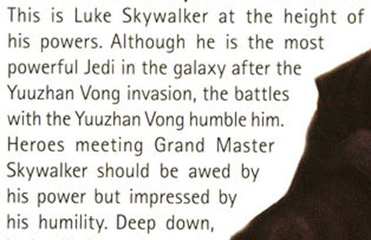
  - "The Emperor's clone succeeds where Palpatine failed and turns Skywalker to the dark side for a brief time. However, the intervention of his sister, Leia Organa-Solo, brings Luke back from the darkness, whereupon he defeats Palpatine's clone." Source: Jedi Academy Training Manual, p.100
    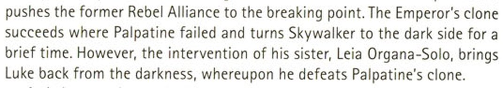
  - "Skywalker is faced with two threats related to Thrawn. One is a mad clone of the old Jedi Master Jorus C'Baoth. The clone "Joruus" tempts Skywalker toward the dark side but is defeated. The other threat is Mara Jade, an assassin with her sights set on Luke Skywalker." Source: Jedi Academy Training Manual, p.100
    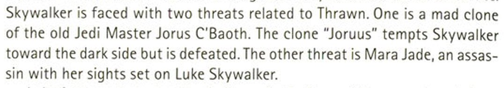
  - "Following the Galactic Civil War, Luke Skywalker, the first of a new generation of Jedi Knights, reestablishes the Jedi Order and begins training new students in the ways of the Force." Source: Jedi Academy Training Manual, p.5
    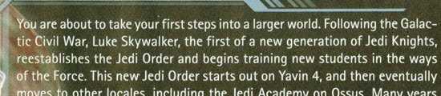
  - "Luke feels compelled to enter the cave and there, he confronts his worst nightmare—Darth Vader. After cutting the head off his enemy, he sees his own surprised face resting within Vader's black helmet." Source: Jedi Academy Training Manual, p.156, sidebar/caption
    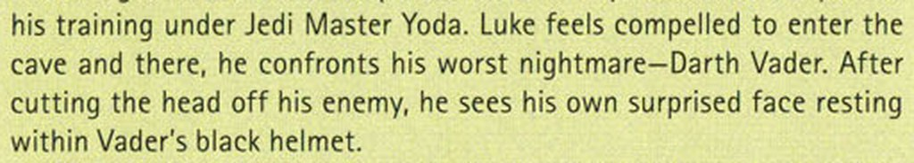
  - "After defeating Skywalker in a lightsaber duel on Pydyr and imprisoning him to use as bait for Leia Organa-Solo." Source: Jedi Academy Training Manual, p.122
    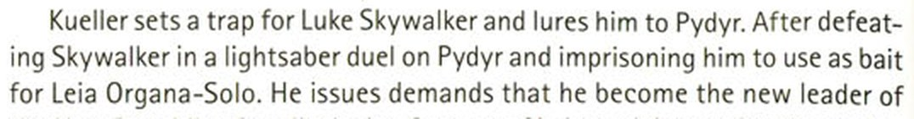
  - "Kueller defeats the Jedi Master again and is about to strike him down when the untimely arrival of a ysalamir cancels his Force abilities. With most of his defenses down, Leia shoots and kills Kueller." Source: Jedi Academy Training Manual, p.122
    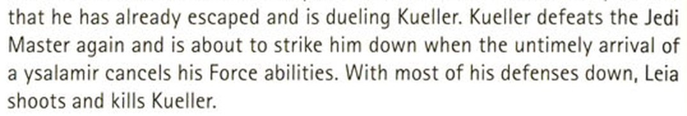
  - "Grand Master Luke Skywalker CL 20 Medium Human scout 1/Jedi 7/ace pilot 2/Jedi Knight 5/Jedi Master 5" Source: Jedi Academy Training Manual, p.100, stat block — RPG mechanics (weaker source)
    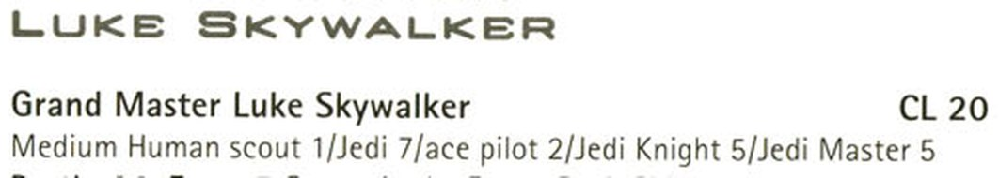
  - "Force Powers Known (Use the Force +29): battle strike, farseeing, fluid riposte, Force disarm, Force grip, Force slam, inspire, mind trick, move object, rebuke (2), surge Force Secrets Devastating Power, Distant Power, Multitarget Power, Quicken Power, Shaped Power" Source: Jedi Academy Training Manual, p.100, stat block — RPG mechanics (weaker source)
    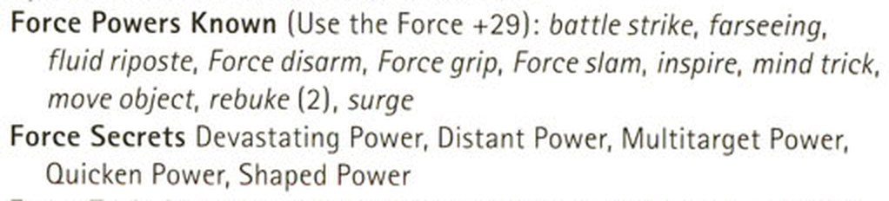
- **Exar Kun**
  - "His strongest apprentice, however, is a young pupil named Exar Kun. Kun's skill with a lightsaber is so great that he claimed victory over his master many times when they sparred together." Source: Jedi Academy Training Manual, p.111
    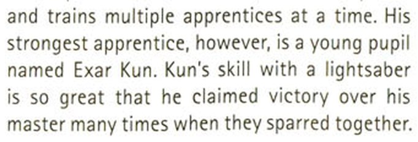
  - "Kun ventures to Dxun and enters the tomb of Freedon Nadd. The dark spirit of Freedon Nadd directs Exar Kun to travel to Korriban, where Nadd attacks Kun and shatters every bone in his body." Source: Jedi Academy Training Manual, p.111
    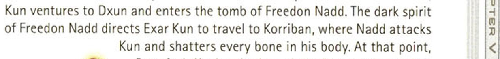
  - "Exar Kun interrupts the proceedings and challenges Baas in combat—a duel that costs Master Baas his life." Source: Jedi Academy Training Manual, p.111
    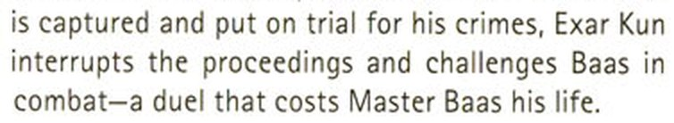
  - "Exar Kun was almost always found on Yavin 4 within the Massassi ruins, where he absorbed the life force of the entire Massassi race." Source: Jedi Academy Training Manual, p.118
    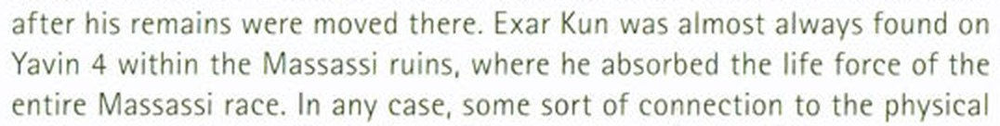
  - "Massassi abominations are created by Exar Kun using Sith alchemy. Using primitive Massassi warriors from Yavin 4 as "stock," Exar Kun infuses his hideous creations with some of his own physical makeup." Source: Jedi Academy Training Manual, p.123
    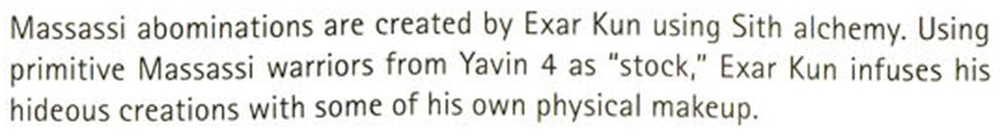
  - "Oss travels with Exar Kun to Yavin 4, where Kun smashes a Sith holocron he had stolen from Jedi Master Odan-Urr. The fragments pierce Oss Willum's flesh, causing him to be possessed by Sith spirits." Source: Jedi Academy Training Manual, p.107
    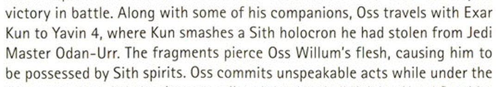
- **Brakiss**
  - "Brakiss, on the other hand, actually holds true potential with the Force, and, despite having already begun down the path to the dark side, Skywalker allows him to stay, convinced that he can lead Brakiss down the path of the light side. Despite all of Skywalker's efforts and training, Brakiss proves Luke wrong and flees from the academy." Source: Jedi Academy Training Manual, p.116
    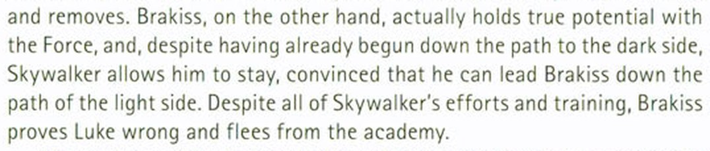
  - "Brakiss immediately swears his allegiance to the Second Imperium and begins building an academy equal to Skywalker's but devoted entirely to the dark side." Source: Jedi Academy Training Manual, p.116
    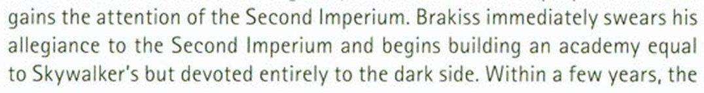
  - "Brakiss is ordered by Palpatine to destroy the Jedi once and for all. Once again Brakiss fails, and he dies shortly after returning to the Shadow Academy when Palpatine's Royal Guards set off explosive charges planted in the station." Source: Jedi Academy Training Manual, p.116
    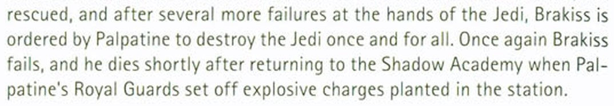
  - "Lowbacca ceases to trust her, and before long he's rescued from the Shadow Academy by Luke Skywalker and his fellow Jedi." Source: Jedi Academy Training Manual, p.129
    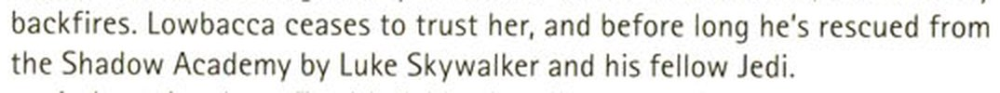
  - "Brakiss CL 11 Medium Human Noble 1/Jedi 7/Force adept 3 Force 7; Dark Side 10" Source: Jedi Academy Training Manual, p.116, stat block — RPG mechanics (weaker source)
    
  - "Force Powers Known (Use the Force +18): Force lightning, mind trick, move object, rebuke (2), vital transfer" Source: Jedi Academy Training Manual, p.116, stat block — RPG mechanics (weaker source)
    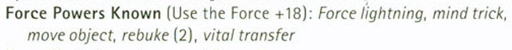
- **Mara Jade Skywalker**
  - "Her skills as an infiltrator and assassin, combined with her formidable skills with the Force and the lightsaber, make her an extremely dangerous opponent." Source: Jedi Academy Training Manual, p.103
    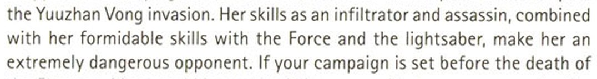
  - "She begins her career as one of the Emperor's personal Force-trained assassins, although, unlike most of his servants, she only kills out of necessity. Highly talented, Mara trains in combat with the Imperial Royal Guard and receives personal tutelage in the Force from the Emperor himself." Source: Jedi Academy Training Manual, p.103
    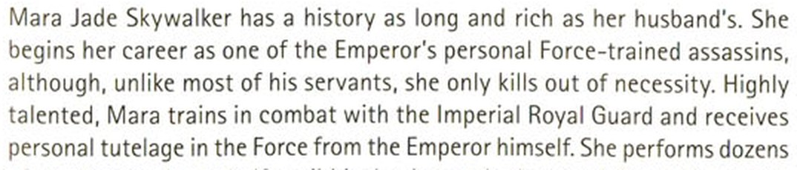
  - "The Emperor's dying telepathic command to kill Luke Skywalker sets her destiny in a different direction." Source: Jedi Academy Training Manual, p.103
    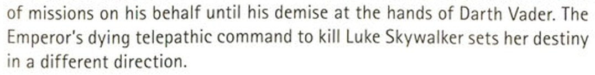
  - "She manages to "complete" her mission by killing a clone of Luke Skywalker." Source: Jedi Academy Training Manual, p.103
    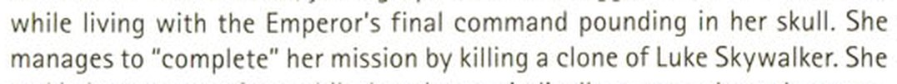
  - "Mara Jade Skywalker CL 17 Medium Human soldier 7/Force adept 5/Jedi Knight 3/Jedi Master 2" Source: Jedi Academy Training Manual, p.103, stat block — RPG mechanics (weaker source)
    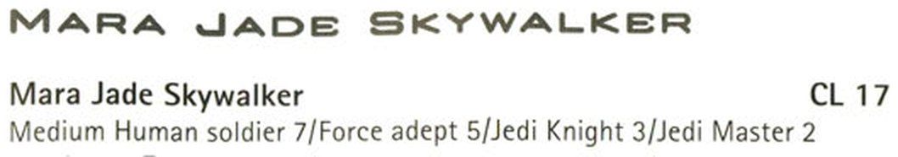
  - "Force Powers Known (Use the Force +17): battle strike (2), Force thrust (2), mind trick, move object (2), surge Force Secrets Devastating Power" Source: Jedi Academy Training Manual, p.103, stat block — RPG mechanics (weaker source)
    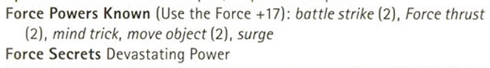
- **Han Solo and Leia Organa Solo**
  - "However, Han Solo, his wife Leia, and Luke Skywalker join with Rillao and manage to rescue the abductees, although Anakin is nearly lost." Source: Jedi Academy Training Manual, p.120
    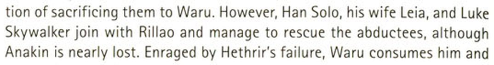
  - "Kueller defeats the Jedi Master again and is about to strike him down when the untimely arrival of a ysalamir cancels his Force abilities. With most of his defenses down, Leia shoots and kills Kueller." Source: Jedi Academy Training Manual, p.122
    
  - "The Emperor's clone succeeds where Palpatine failed and turns Skywalker to the dark side for a brief time. However, the intervention of his sister, Leia Organa-Solo, brings Luke back from the darkness, whereupon he defeats Palpatine's clone." Source: Jedi Academy Training Manual, p.100
    
- **Grand Admiral Thrawn**
  - "Skywalker is faced with two threats related to Thrawn. One is a mad clone of the old Jedi Master Jorus C'Baoth. The clone "Joruus" tempts Skywalker toward the dark side but is defeated. The other threat is Mara Jade, an assassin with her sights set on Luke Skywalker." Source: Jedi Academy Training Manual, p.100
    
- **Palpatine (Darth Sidious)**
  - "Force powers are likely to be extremely restricted during the Dark Times and the Rebellion era, as they represent a time when Emperor Palpatine tightly controls knowledge of the Force and the Jedi have become all but extinct." Source: Jedi Academy Training Manual, p.28, sidebar/caption
    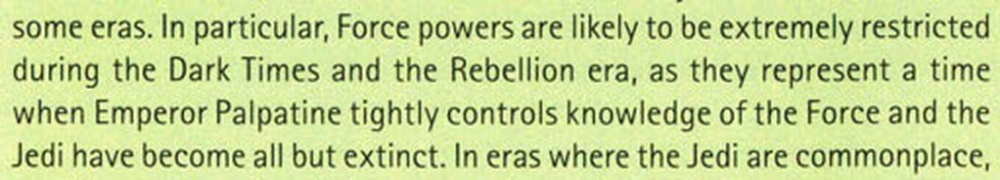
  - "Although they do succeed for a time under Darth Sidious and his apprentice, Darth Vader, their rule of hatred and fear only lasts until Luke Skywalker redeems his father and helps him eradicate the last of the Sith to finally bring balance to the Force." Source: Jedi Academy Training Manual, p.44
    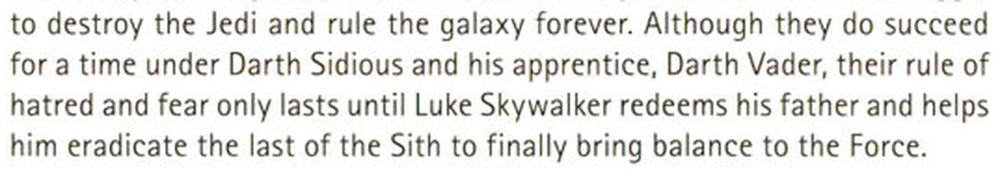
  - "Subjected to the Emperor's unique style of persuasion, Qaga Lok vows to serve Palpatine for the rest of his life and changes his name to Sedriss." Source: Jedi Academy Training Manual, p.126
    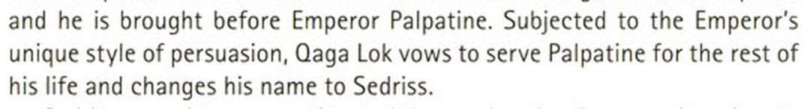
  - "Among those Sith known to create and deploy chrysalis beasts is Emperor Palpatine. He did so at his Imperial citadel on Byss." Source: Jedi Academy Training Manual, p.133
    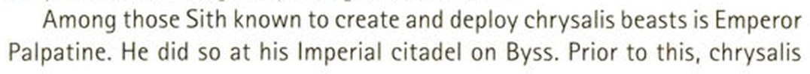
  - "A tomb was even created for Darth Vader, although it was never used and was offered instead to the clone of Emperor Palpatine." Source: Jedi Academy Training Manual, p.159
    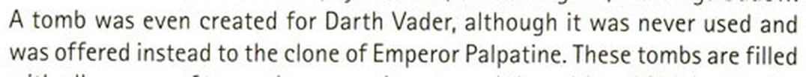
  - "When Palpatine returns in one of his cloned bodies, Jax rejoins the Royal Guard to better arrange the clone's assassination and bribes the Emperor's physician into sabotaging the remaining clones." Source: Jedi Academy Training Manual, p.117
    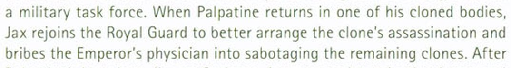
