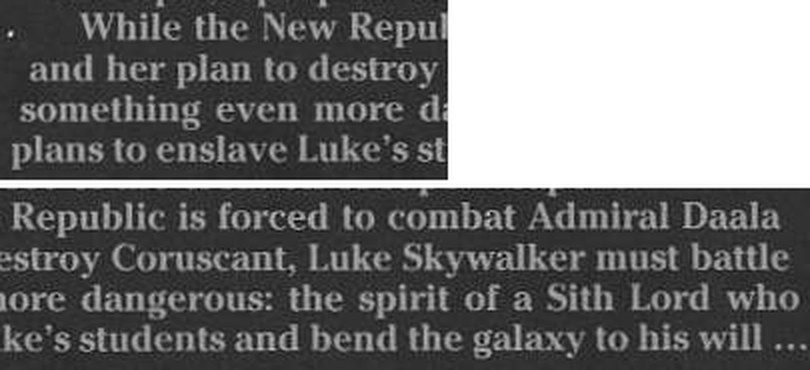

# Owner Material 029 — The Jedi Academy Sourcebook (WEG, 1996): Front matter (covers, credits, contents)

- **Source:** *The Jedi Academy Sourcebook* by Paul Sudlow (West End Games, April 1996; WEG 40114). Licensed Legends Star Wars Roleplaying Game (d6) companion to Kevin J. Anderson's Jedi Academy trilogy. Scan from the d6holocron archive (145 PDF pages, image-only; OCR'd on the box), read in full 2026-10-28 including sidebars, captions, fiction excerpts and stat blocks. The scan stays box-only and is **not** published.
- **Quotes:** verbatim as printed (obvious OCR slips corrected against the page image), cited "The Jedi Academy Sourcebook, p.X" by **printed** page (printed page = scan page − 1). Sidebars, captions and fiction excerpts are marked **sidebar/caption**; d6 statistics are marked **stat block** and **RPG mechanics (weaker source)**. Each quote has a crop of the printed passage directly under it.
- **Weight:** secondary source. The prose summarises the trilogy (026), which outranks it; d6 game statistics are mechanics, not canon feats, and rank lowest. See README § How much weight.

## front matter (unnumbered) (scan page sp001)

- Scope: Front cover (cover art, title).
- Scope note: no power, skill or lore statement about the tracked characters on this page beyond the summary above.

## inside front cover (scan page sp002)

- Scope: Inside cover blurb: the New Republic, Daala's plan to destroy Coruscant, and the Sith Lord's spirit.

- **Admiral Daala; Luke Skywalker; Exar Kun** — Inside cover blurb: "While the New Republic is forced to combat Admiral Daala and her plan to destroy Coruscant, Luke Skywalker must battle something even more dangerous: the spirit of a Sith Lord who plans to enslave Luke's students and bend the galaxy to his will." Source: The Jedi Academy Sourcebook, inside front cover, sidebar/caption
  

## front matter (unnumbered) (scan page sp003)

- Scope: Credits (design Paul Sudlow; dedication to Brian Daley; © 1996 Lucasfilm; first printing April 1996).
- Scope note: no power, skill or lore statement about the tracked characters on this page beyond the summary above.

## front matter (unnumbered) (scan page sp004)

- Scope: Title page.
- Scope note: no power, skill or lore statement about the tracked characters on this page beyond the summary above.

## front matter (unnumbered) (scan page sp005)

- Scope: Table of contents (Chapters One–Fourteen).
- Scope note: no power, skill or lore statement about the tracked characters on this page beyond the summary above.

