# Owner Material 029 — The Jedi Academy Sourcebook (WEG, 1996): Chapter One: The New Republic

- **Source:** *The Jedi Academy Sourcebook* by Paul Sudlow (West End Games, April 1996; WEG 40114). Licensed Legends Star Wars Roleplaying Game (d6) companion to Kevin J. Anderson's Jedi Academy trilogy. Scan from the d6holocron archive (145 PDF pages, image-only; OCR'd on the box), read in full 2026-10-28 including sidebars, captions, fiction excerpts and stat blocks. The scan stays box-only and is **not** published.
- **Quotes:** verbatim as printed (obvious OCR slips corrected against the page image), cited "The Jedi Academy Sourcebook, p.X" by **printed** page (printed page = scan page − 1). Sidebars, captions and fiction excerpts are marked **sidebar/caption**; d6 statistics are marked **stat block** and **RPG mechanics (weaker source)**. Each quote has a crop of the printed passage directly under it.
- **Weight:** secondary source. The prose summarises the trilogy (026), which outranks it; d6 game statistics are mechanics, not canon feats, and rank lowest. See README § How much weight.

## p.5 (scan page sp006)

- Scope: Chapter One: The New Republic — state of the New Republic, Mon Mothma's foreign policy; Mon Mothma profile.
- Scope note: no power, skill or lore statement about the tracked characters on this page beyond the summary above.

## p.6 (scan page sp007)

- Scope: Sidebar: Mon Mothma's address to the Senate, "A Paradigm Shift".
- Scope note: no power, skill or lore statement about the tracked characters on this page beyond the summary above.

## p.7 (scan page sp008)

- Scope: Inner Council and High Command sidebar; Mon Mothma stat block.
- Scope note: no power, skill or lore statement about the tracked characters on this page beyond the summary above.

## p.8 (scan page sp009)

- Scope: Nano viruses sidebar; Admiral Ackbar profile (Vortex crash, Daala's attack on Mon Calamari, Anoth rescue).
- Scope note: no power, skill or lore statement about the tracked characters on this page beyond the summary above.

## p.9 (scan page sp010)

- Scope: Full-page illustration (New Republic leaders).
- Scope note: no power, skill or lore statement about the tracked characters on this page beyond the summary above.

## p.10 (scan page sp011)

- Scope: Ackbar stat block; Leia Organa Solo profile and stat block (Force skills).

- **Leia Organa Solo; Luke Skywalker** — Leia Organa Solo — Jedi training: "She feels guilty for not devoting more time to her Jedi training, but it takes a definite back seat to her professional duties and family time. Luke has said nothing, but Leia knows that he worries about her lack of progress." Source: The Jedi Academy Sourcebook, p.10
  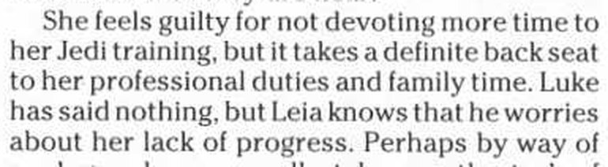
- **Leia Organa Solo** — Leia Organa Solo — stat block, Force skills (RPG mechanics) — RPG mechanics (weaker source): "Force Skills: Control 5D+1, sense 4D+2, alter 3D" Source: The Jedi Academy Sourcebook, p.10, stat block
  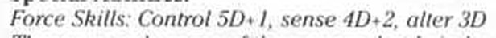
- **Leia Organa Solo** — Leia Organa Solo — stat block, combat skills (RPG mechanics) — RPG mechanics (weaker source): "Blaster 9D, blaster artillery 4D+1, brawling parry 5D+2," Source: The Jedi Academy Sourcebook, p.10, stat block
  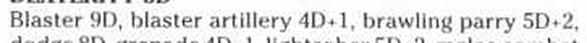

## p.11 (scan page sp012)

- Scope: Han Solo profile (Kessel, Kyp, the Sun Crusher) and stat block; Jacen and Jaina profile begins.

- **Han Solo; Kyp Durron; Sun Crusher** — Han Solo — bringing Kyp back: "When the Sith-maddened young man begins his one-man crusade against the Empire with the Sun Crusher, Han successfully uses his bond with him to bring Kyp back from the edge of the abyss." Source: The Jedi Academy Sourcebook, p.11
  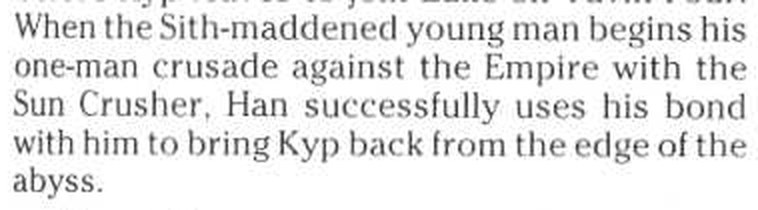
- **Han Solo; Kyp Durron** — Han Solo — meeting Kyp on Kessel: "While in the mines, Han encounters a young man named Kyp Durron. As Roa took Han under his wing, Han in turn befriends Kyp and forges a mentor-like bond with the young man." Source: The Jedi Academy Sourcebook, p.11
  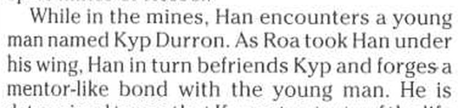
- **Han Solo** — Han Solo — stat block, combat skills (RPG mechanics) — RPG mechanics (weaker source): "Blaster 8D+2, blaster: blaster rifle 5D+1, blaster: heavy blaster pistol 10D+1," Source: The Jedi Academy Sourcebook, p.11, stat block
  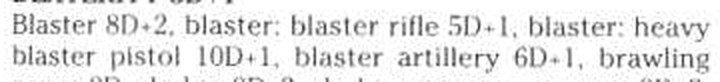

## p.12 (scan page sp013)

- Scope: Jacen and Jaina (protecting Luke on Yavin 4); Anakin Solo; Chewbacca profile and stat block begins.

- **Jacen Solo; Jaina Solo; Exar Kun; Luke Skywalker** — Jacen and Jaina Solo — protecting Luke: "They immediately demonstrate a sensitivity for detecting the non-corporeal presences of Exar Kun and Luke in the complex, and play a key role in protecting Luke from the Sith Lord's attacks on Luke and the others." Source: The Jedi Academy Sourcebook, p.12
  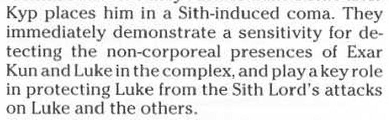
- **Anakin Solo; Palpatine (Darth Sidious)** — Anakin Solo — Force strength: "He has already demonstrated that he is strong in the Force. Even as an unborn child he helped his mother and uncle defeat the reborn Emperor," Source: The Jedi Academy Sourcebook, p.12
  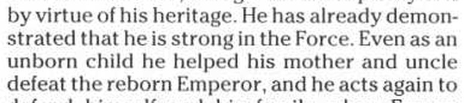

## p.13 (scan page sp014)

- Scope: Chewbacca stat block; Winter profile (Anoth defence) and stat block; Artoo-Detoo profile begins.

- **Luke Skywalker; Kyp Durron** — Artoo-Detoo — guarding Luke: "He accompanies Luke and Lando to Kessel, and guards Luke's defenseless body on Yavin Four after Kyp places him in a Sith coma." Source: The Jedi Academy Sourcebook, p.13
  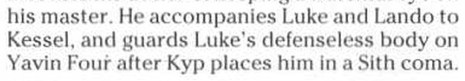

## p.14 (scan page sp015)

- Scope: Fiction sidebar "A Change of Command" (Ackbar recruits Wedge to the Army); Artoo-Detoo stat block.
- Scope note: no power, skill or lore statement about the tracked characters on this page beyond the summary above.

## p.15 (scan page sp016)

- Scope: "A Change of Command" continued; Artoo equipment; C-3PO profile (twins, Maw raid).
- Scope note: no power, skill or lore statement about the tracked characters on this page beyond the summary above.

## p.16 (scan page sp017)

- Scope: C-3PO stat block; General Wedge Antilles profile (Qwi Xux, Kyp's attack on Qwi) and stat block.

- **Kyp Durron; Luke Skywalker; Qwi Xux** — General Wedge Antilles — Kyp and Qwi Xux: "Only later can he accept Luke's gentle argument that if he, a Jedi Master, could not stand up to Kyp's Sith-augmented powers, Wedge could not be expected to do so when Kyp came for Qwi Xux." Source: The Jedi Academy Sourcebook, p.16
  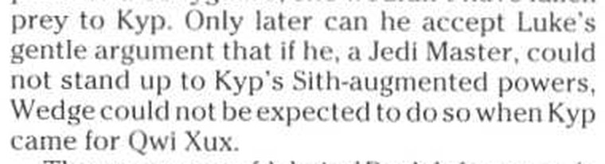

## p.17 (scan page sp018)

- Scope: Wedge stat block end; General Jan Dodonna and General Crix Madine profiles and stat blocks (Madine opposes the Sun Crusher).
- Scope note: no power, skill or lore statement about the tracked characters on this page beyond the summary above.

## p.18 (scan page sp019)

- Scope: Senator Garm Bel Iblis profile (the Sun Crusher plan) and stat block; Senator Hrekin Thorm.

- **Sun Crusher** — Senator Garm Bel Iblis — the Sun Crusher plan: "When presented with the awesome power of the Sun Crusher, Bel Iblis is sure that it represents a solution everyone will be able to support." Source: The Jedi Academy Sourcebook, p.18
  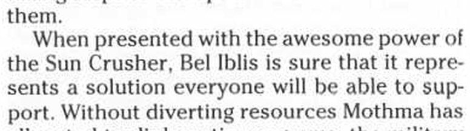

## p.19 (scan page sp020)

- Scope: Thorm stat end; Captain Tresk Ortola; Terpfen profile (Carida implants, Furgan, Anoth walker battle).
- Scope note: no power, skill or lore statement about the tracked characters on this page beyond the summary above.

## p.20 (scan page sp021)

- Scope: Sidebar: Imperial Organic Implants; Terpfen profile end and stat block.
- Scope note: no power, skill or lore statement about the tracked characters on this page beyond the summary above.

## p.21 (scan page sp022)

- Scope: Fiction sidebar "Cutting Ties" (Leia sends her Noghri home); Terpfen stat block end.
- Scope note: no power, skill or lore statement about the tracked characters on this page beyond the summary above.

