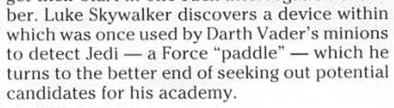

# Owner Material 029 — The Jedi Academy Sourcebook (WEG, 1996): Chapter Two: Coruscant

- **Source:** *The Jedi Academy Sourcebook* by Paul Sudlow (West End Games, April 1996; WEG 40114). Licensed Legends Star Wars Roleplaying Game (d6) companion to Kevin J. Anderson's Jedi Academy trilogy. Scan from the d6holocron archive (145 PDF pages, image-only; OCR'd on the box), read in full 2026-10-28 including sidebars, captions, fiction excerpts and stat blocks. The scan stays box-only and is **not** published.
- **Quotes:** verbatim as printed (obvious OCR slips corrected against the page image), cited "The Jedi Academy Sourcebook, p.X" by **printed** page (printed page = scan page − 1). Sidebars, captions and fiction excerpts are marked **sidebar/caption**; d6 statistics are marked **stat block** and **RPG mechanics (weaker source)**. Each quote has a crop of the printed passage directly under it.
- **Weight:** secondary source. The prose summarises the trilogy (026), which outranks it; d6 game statistics are mechanics, not canon feats, and rank lowest. See README § How much weight.

## p.22 (scan page sp023)

- Scope: Chapter Two: Coruscant — the planet's recovery; Coruscant planet stats.
- Scope note: no power, skill or lore statement about the tracked characters on this page beyond the summary above.

## p.23 (scan page sp024)

- Scope: Imperial City; sidebar: Imperial construction droids (art credit Ray Lederer).
- Scope note: no power, skill or lore statement about the tracked characters on this page beyond the summary above.

## p.24 (scan page sp025)

- Scope: The Imperial Palace; Imperial Information Center; Palace Traffic Control Center.
- Scope note: no power, skill or lore statement about the tracked characters on this page beyond the summary above.

## p.25 (scan page sp026)

- Scope: Panoramic Projection Room; Palace repair bays; Senate chambers; Imperial interrogation chambers (Luke finds the Force "paddle"); the Undercity begins.

- **Luke Skywalker; Darth Vader (Anakin Skywalker)** — The Imperial Interrogation Chambers — the Force paddle: "Luke Skywalker discovers a device within which was once used by Darth Vader's minions to detect Jedi — a Force "paddle" — which he turns to the better end of seeking out potential candidates for his academy." Source: The Jedi Academy Sourcebook, p.25
  

## p.26 (scan page sp027)

- Scope: Full-page illustration (Imperial City).
- Scope note: no power, skill or lore statement about the tracked characters on this page beyond the summary above.

## p.27 (scan page sp028)

- Scope: The Undercity; Coruscani ogre and stat block.
- Scope note: no power, skill or lore statement about the tracked characters on this page beyond the summary above.

## p.28 (scan page sp029)

- Scope: King Daykim stat block and capsule (portrait).
- Scope note: no power, skill or lore statement about the tracked characters on this page beyond the summary above.

## p.29 (scan page sp030)

- Scope: Daykim's Kingdom (Jacen and Jaina in the Undercity).
- Scope note: no power, skill or lore statement about the tracked characters on this page beyond the summary above.

