# Owner Material 029 — The Jedi Academy Sourcebook (WEG, 1996): Chapter Three: The Jedi Academy

- **Source:** *The Jedi Academy Sourcebook* by Paul Sudlow (West End Games, April 1996; WEG 40114). Licensed Legends Star Wars Roleplaying Game (d6) companion to Kevin J. Anderson's Jedi Academy trilogy. Scan from the d6holocron archive (145 PDF pages, image-only; OCR'd on the box), read in full 2026-10-28 including sidebars, captions, fiction excerpts and stat blocks. The scan stays box-only and is **not** published.
- **Quotes:** verbatim as printed (obvious OCR slips corrected against the page image), cited "The Jedi Academy Sourcebook, p.X" by **printed** page (printed page = scan page − 1). Sidebars, captions and fiction excerpts are marked **sidebar/caption**; d6 statistics are marked **stat block** and **RPG mechanics (weaker source)**. Each quote has a crop of the printed passage directly under it.
- **Weight:** secondary source. The prose summarises the trilogy (026), which outranks it; d6 game statistics are mechanics, not canon feats, and rank lowest. See README § How much weight.

## p.30 (scan page sp031)

- Scope: Chapter Three: The Jedi Academy — the Jedi search begins; fiction sidebar "Reflections" (Luke on the roof terrace).

- **Luke Skywalker; Mara Jade Skywalker; Kirana Ti; Kam Solusar** — The Jedi Search Begins: "He has encountered several potential Jedi in his travels, among them Mara Jade, Kirana Ti and Kam Solusar." Source: The Jedi Academy Sourcebook, p.30
  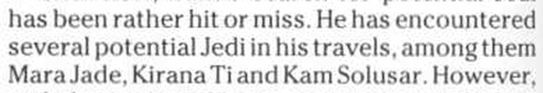
- **Luke Skywalker; Palpatine (Darth Sidious)** — Reflections (fiction sidebar) — Luke's real duty: "Once upon a time, in a more naive and optimistic period of his life, Luke had supposed that his responsibilities as the last of the Jedi would end with the death of the Emperor. Only as the New Republic matured had he come to realize that defeating the Emperor was but a simple task next to his real duty... restoring the Order of Jedi Knights." Source: The Jedi Academy Sourcebook, p.30, sidebar/caption
  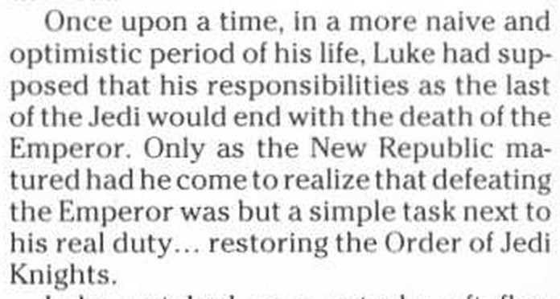

## p.31 (scan page sp032)

- Scope: Birth of a Jedi academy (twelve students, Yavin Four); "Reflections" continued; sidebar: "The Jedi Praxeum" speech; Jedi training.

- **Luke Skywalker** — Birth of a Jedi Academy: "After a time, Luke succeeds in gathering together twelve students who are willing to learn how to harness the powers they have in the service of the New Republic." Source: The Jedi Academy Sourcebook, p.31
  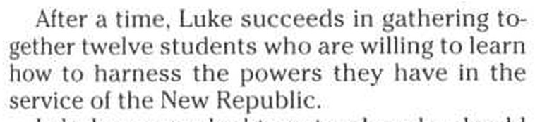
- **Luke Skywalker** — Birth of a Jedi Academy — fear of a Force storm: "He is concerned that his students might unleash something like a Force storm while experimenting with the Force, and he doesn't want any bystanders harmed." Source: The Jedi Academy Sourcebook, p.31
  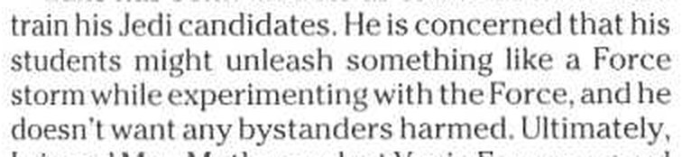

## p.32 (scan page sp033)

- Scope: Jedi training (Holocron, Kam Solusar's school); Holocron sidebar "The Dangers of Training Jedi" (Bodo Baas); the dangers of training Jedi; Luke Skywalker profile begins.

- **Luke Skywalker; Kam Solusar** — Jedi Training — Kam Solusar's school: "He also draws on the Jedi training Kam Solusar received as a young man, because his master, Ranik Solusar, came from a different school of Jedi training than did Obi-Wan and Yoda." Source: The Jedi Academy Sourcebook, p.32
  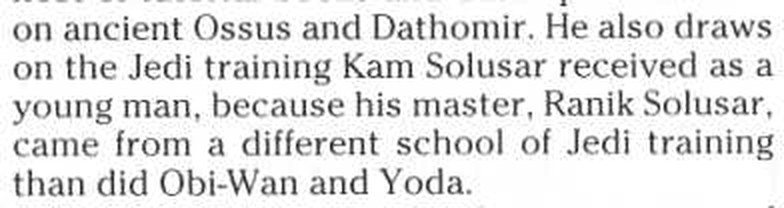
- **Exar Kun** — The Dangers of Training Jedi — the cautionary tale: "Every Jedi disciple soon heard the dreadful cautionary tale of the gifted Jedi Exar Kun, and how he was lost to the dark side by an arrogant belief that he could embrace Sith teachings and not be dominated." Source: The Jedi Academy Sourcebook, p.32
  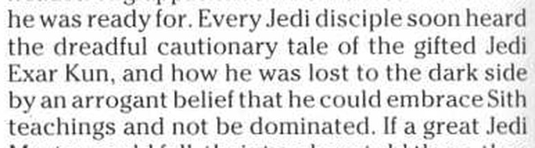
- **Luke Skywalker; Gantoris; Kyp Durron** — The Dangers of Training Jedi — missed warning signs: "He misses the warning signs that Gantoris and Kyp, impatient with Luke's apparent reluctance to teach them the "true" Jedi secrets, are moving into dangerous orbits." Source: The Jedi Academy Sourcebook, p.32
  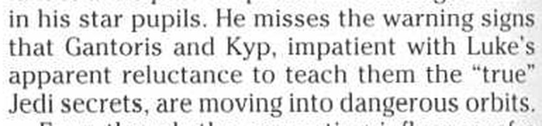
- **Exar Kun; Luke Skywalker** — The Dangers of Training Jedi — a power as great as Exar Kun: "Even though the corrupting influence of a power as great as Exar Kun is a special case not anticipated by most Jedi teachers, Luke comes out of the experience with a new respect for the awesome responsibility that comes with being the teacher of a new generation of Jedi." Source: The Jedi Academy Sourcebook, p.32
  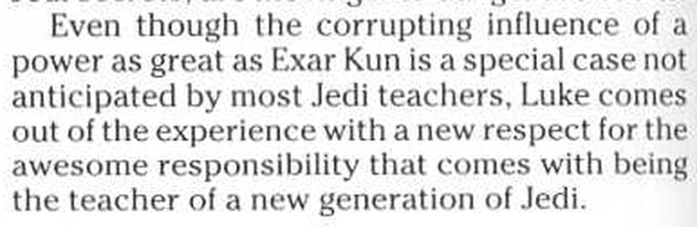

## p.33 (scan page sp034)

- Scope: Full-page illustration (Luke Skywalker).
- Scope note: no power, skill or lore statement about the tracked characters on this page beyond the summary above.

## p.34 (scan page sp035)

- Scope: Luke Skywalker profile (the coma, Exar Kun, Kyp's penance) and stat block; Gantoris profile begins.

- **Luke Skywalker; Joruus C'baoth; Palpatine (Darth Sidious)** — Luke Skywalker — caution as a teacher: "his recent experiences with Joruus C'baoth and the resurrected Emperor make him cautious." Source: The Jedi Academy Sourcebook, p.34
  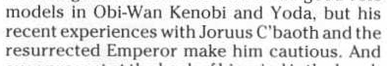
- **Kyp Durron; Exar Kun; Luke Skywalker** — Luke Skywalker — the coma: "By augmenting his power with that of Kun, Kyp places Luke in a deep coma from which even the best New Republic doctors cannot awaken him." Source: The Jedi Academy Sourcebook, p.34
  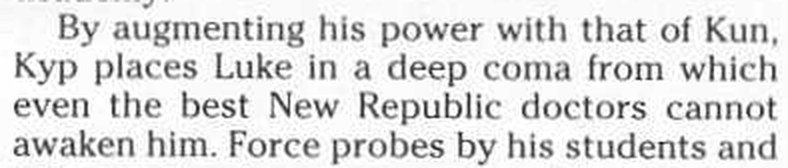
- **Exar Kun; Luke Skywalker** — Luke Skywalker — the students defeat Kun: "While Kun believes that he can now corrupt Luke's students, it is they that prove to be the stronger. Together they defeat Kun, and revive Luke." Source: The Jedi Academy Sourcebook, p.34
  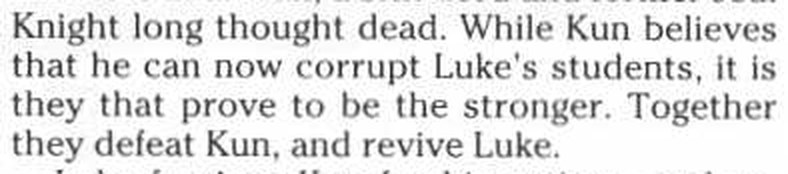
- **Luke Skywalker; Kyp Durron; Sun Crusher** — Luke Skywalker — Kyp's penance: "Luke forgives Kyp for his actions, and accepts him back as a student, but requires of him a penance —Kyp must cast the Sun Crusher into the Maw." Source: The Jedi Academy Sourcebook, p.34
  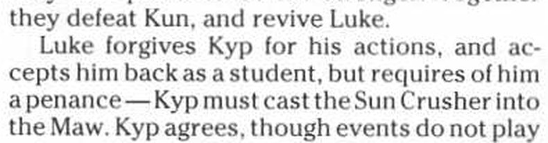
- **Luke Skywalker** — Luke Skywalker — stat block, combat skills (RPG mechanics) — RPG mechanics (weaker source): "Blaster 6D+2, brawling parry 6D+2, dodge 9D, melee combat 5D+2, melee parry 10D+2, lightsaber 11D" Source: The Jedi Academy Sourcebook, p.34, stat block
  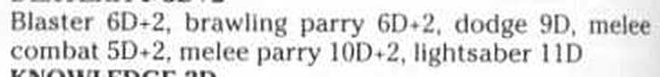
- **Luke Skywalker** — Luke Skywalker — stat block, Force skills (RPG mechanics) — RPG mechanics (weaker source): "Force Skills: Control 13D+1, sense 11D+1, alter 10D+2" Source: The Jedi Academy Sourcebook, p.34, stat block
  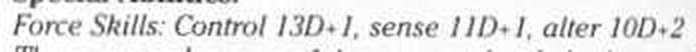
- **Luke Skywalker** — Luke Skywalker — stat block, Force powers (RPG mechanics) — RPG mechanics (weaker source): "Control, Sense and Alter: Affect mind, doppleganger**, force harmony**, telekinetic kill*" Source: The Jedi Academy Sourcebook, p.34, stat block
  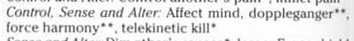
- **Luke Skywalker** — Luke Skywalker — stat block, Force and Dark Side Points (RPG mechanics) — RPG mechanics (weaker source): "Force Points: 7 Dark Side Points: 3 Character Points: 24" Source: The Jedi Academy Sourcebook, p.34, stat block
  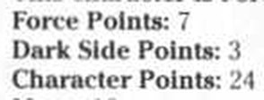
- **Gantoris** — Gantoris — childhood: "On several occasions, he was able to sense impending groundquakes, and once miraculously survived an avalanche that killed all the other children in his play group." Source: The Jedi Academy Sourcebook, p.34
  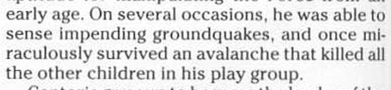

## p.35 (scan page sp036)

- Scope: Gantoris profile (Kun, duel with Luke, death) and stat block; Kyp Durron profile begins.

- **Gantoris; Exar Kun; Luke Skywalker** — Gantoris — Kun's tutelage: "The shade of Kun easily convinces Gantoris that Luke is withholding Jedi secrets from him, secrets which he tells Gantoris that he is ready to learn." Source: The Jedi Academy Sourcebook, p.35
  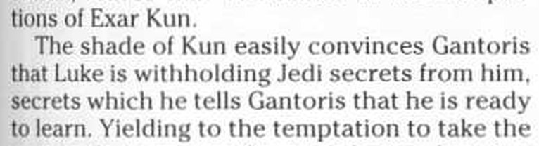
- **Gantoris; Luke Skywalker** — Gantoris — duel with Luke: "Ultimately, he grows bold enough in his new forbidden powers to challenge Luke to a duel. When Luke defeats him, he begins to suspect that he has taken the wrong path to achieve the goals he is seeking." Source: The Jedi Academy Sourcebook, p.35
  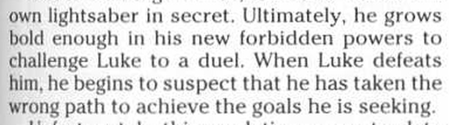
- **Gantoris; Exar Kun** — Gantoris — death: "However, Kun easily goads Gantoris into striking out at him with his passions, by taunting him with a vision of the Eol Sha colonists dying. In resisting Kun with his anger, Gantoris is burned to ashes," Source: The Jedi Academy Sourcebook, p.35
  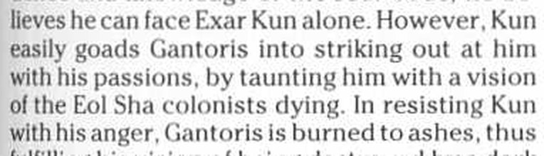
- **Gantoris; Exar Kun** — Gantoris — stat block, Force skills (RPG mechanics) — RPG mechanics (weaker source): "Force Skills: Control 4D, sense 4D+1, alter 2D These are only some of the powers that Gantoris has demonstrated. His abilities were unnaturally augmented by Exar Kun." Source: The Jedi Academy Sourcebook, p.35, stat block
  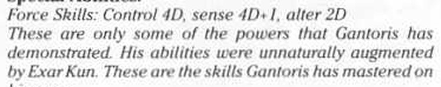
- **Gantoris** — Gantoris — stat block, equipment (RPG mechanics) — RPG mechanics (weaker source): "Equipment: Knapsack, Jedi cloak, double-bladed lightsaber (6D), knife (STR+1D)" Source: The Jedi Academy Sourcebook, p.35, stat block
  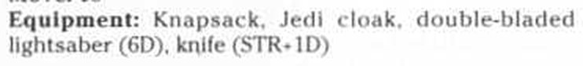
- **Kyp Durron** — Kyp Durron — Vima-Da-Boda: "Kyp knows he has a talent for the Force, thanks to a provident encounter with a strange old woman named Vima-Da-Boda." Source: The Jedi Academy Sourcebook, p.35
  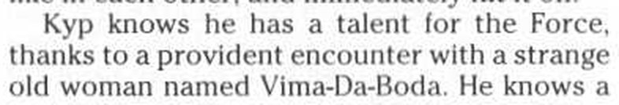

## p.36 (scan page sp037)

- Scope: Kyp Durron profile (Exar Kun, the Sun Crusher, Carida, Qwi Xux, penance) and stat block.

- **Kyp Durron** — Kyp Durron — at the academy: "There, he immerses himself in work, and within days has surpassed the achievements of the other Jedi students." Source: The Jedi Academy Sourcebook, p.36
  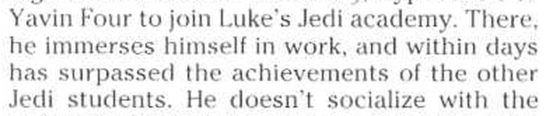
- **Kyp Durron; Exar Kun** — Kyp Durron — the Sith as a greater power: "Kyp believes that the powers of the Sith, as revealed by Exar Kun, is the source of a greater power." Source: The Jedi Academy Sourcebook, p.36
  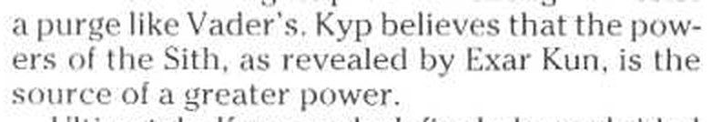
- **Kyp Durron; Exar Kun; Luke Skywalker; Sun Crusher** — Kyp Durron — defying Luke: "Ultimately, Kyp openly defies Luke, and aided by Exar Kun's power, places the Jedi Master in a deep trance. He steals the Sun Crusher, which had been cast into the heart of the Yavin gas giant." Source: The Jedi Academy Sourcebook, p.36
  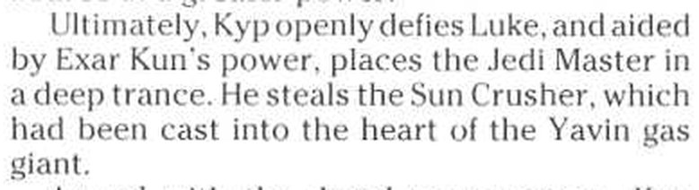
- **Kyp Durron; Sun Crusher; Admiral Daala** — Kyp Durron — the Sun Crusher rampage: "He destroys one of Daala's Star Destroyers, destroys Carida in a failed attempt to rescue his brother, and goes on to destroy a major Imperial depot in a peripheral Imperial Core system." Source: The Jedi Academy Sourcebook, p.36
  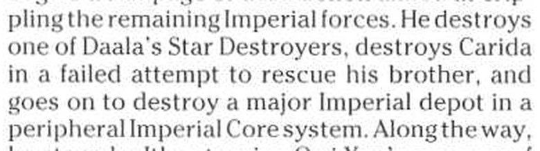
- **Kyp Durron; Qwi Xux; Sun Crusher** — Kyp Durron — Qwi Xux's memory: "Along the way, he stops by Ithor to wipe Qwi Xux's memory of the Sun Crusher and all knowledge she used to invent it." Source: The Jedi Academy Sourcebook, p.36
  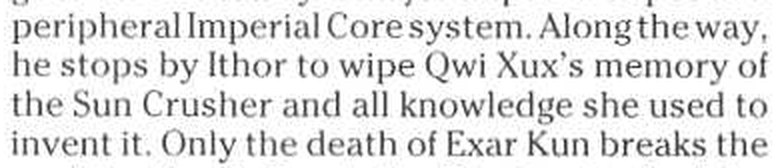
- **Kyp Durron; Exar Kun** — Kyp Durron — freed by Kun's death: "Only the death of Exar Kun breaks the spell that holds Kyp in thrall to the shade of the ancient Sith Lord." Source: The Jedi Academy Sourcebook, p.36
  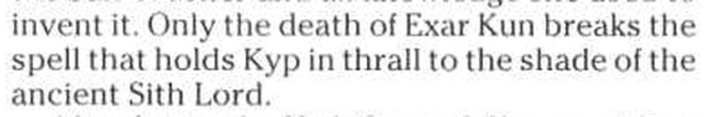
- **Kyp Durron; Luke Skywalker** — Kyp Durron — tested by the dark side: "Luke tells him that he has been tested by his journey into the dark side, and may have emerged a stronger Jedi for it." Source: The Jedi Academy Sourcebook, p.36
  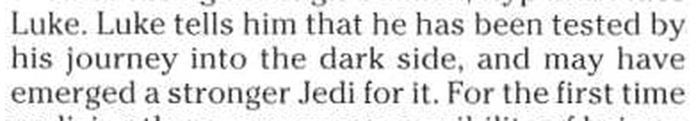
- **Kyp Durron; Luke Skywalker** — Kyp Durron — Jedi Knight: "When he re-emerges from the temple, Luke welcomes him as a Jedi Knight." Source: The Jedi Academy Sourcebook, p.36
  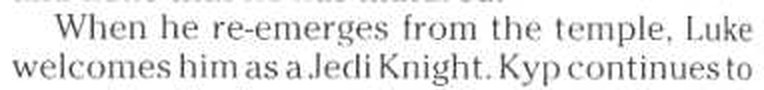
- **Kyp Durron** — Kyp Durron — stat block, combat skills (RPG mechanics) — RPG mechanics (weaker source): "Blaster 3D+2, dodge 4D+2, lightsaber 5D, melee parry 4D," Source: The Jedi Academy Sourcebook, p.36, stat block
  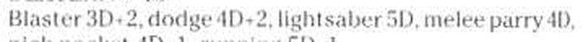
- **Kyp Durron; Sun Crusher** — Kyp Durron — stat block, Sun Crusher piloting (RPG mechanics) — RPG mechanics (weaker source): "starfighter piloting 4D+1, starfighter piloting: Sun Crusher 4D+2," Source: The Jedi Academy Sourcebook, p.36, stat block
  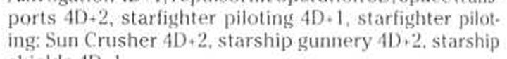
- **Kyp Durron; Exar Kun** — Kyp Durron — stat block, Force skills (RPG mechanics) — RPG mechanics (weaker source): "Force Skills: Control 5D+2, sense 5D, alter 3D+2 These are only some of the powers that Kyp has demonstrated. His abilities were unnaturally augmented by Exar Kun." Source: The Jedi Academy Sourcebook, p.36, stat block
  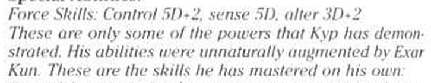
- **Kyp Durron** — Kyp Durron — stat block, Force powers (RPG mechanics) — RPG mechanics (weaker source): "Control and Alter: Aura of uneasiness, Force lightning" Source: The Jedi Academy Sourcebook, p.36, stat block
  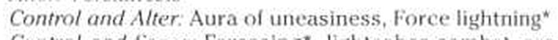
- **Kyp Durron** — Kyp Durron — stat block, Force powers, all three skills (RPG mechanics) — RPG mechanics (weaker source): "Control, Sense and Alter: Affect mind, control mind*, drain life energy, telekinetic kill*" Source: The Jedi Academy Sourcebook, p.36, stat block
  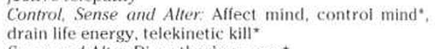

## p.37 (scan page sp038)

- Scope: Streen profile (Force wind attack on Luke, shielding the group) and stat block.

- **Streen; Exar Kun** — Streen — sensing Kun: "Streen's sensitivity in the Force allows him to detect Exar Kun's presence." Source: The Jedi Academy Sourcebook, p.37
  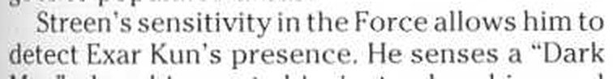
- **Streen; Exar Kun; Luke Skywalker; Kirana Ti** — Streen — the Force wind attack on Luke: "Empowered by Kun, Streen attacks Luke's sleeping body by creating a force of wind which lifts Luke up toward the skylight in the room. He is not aware of what he is doing, and ceases as soon as Kirana Ti tackles him and breaks his trance." Source: The Jedi Academy Sourcebook, p.37
  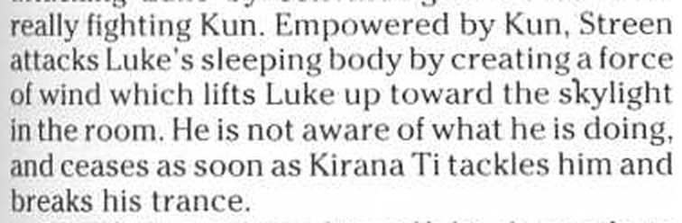
- **Streen; Exar Kun** — Streen — shielding the group: "It is Streen who protects the group from Kun's throat-constricting attack while they work to defeat the ancient Sith Lord." Source: The Jedi Academy Sourcebook, p.37
  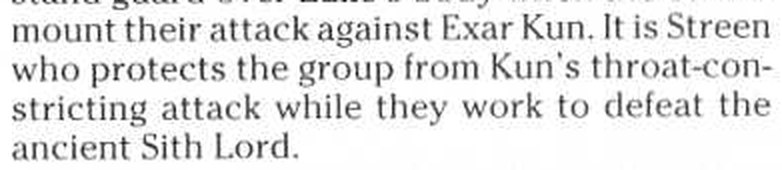
- **Streen** — Streen — stat block, Force skills (RPG mechanics) — RPG mechanics (weaker source): "Force Skills: Control 3D+1, sense 4D, alter 4D" Source: The Jedi Academy Sourcebook, p.37, stat block
  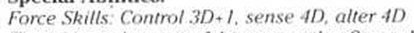

## p.38 (scan page sp039)

- Scope: Streen stat block end; Kirana Ti profile and stat block; Dorsk 81 profile and stat block.

- **Streen** — Streen — stat block, Force powers (RPG mechanics) — RPG mechanics (weaker source): "Sense and alter: Force wind" Source: The Jedi Academy Sourcebook, p.38, stat block
  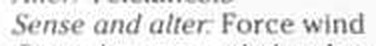
- **Kirana Ti** — Kirana Ti — warrior and Force-wielder: "She is a warrior as well as a Force-wielder," Source: The Jedi Academy Sourcebook, p.38
  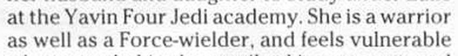

## p.39 (scan page sp040)

- Scope: Dorsk 81 stat block end; Kam Solusar profile and stat block; Tionne profile begins.

- **Kam Solusar; Darth Vader (Anakin Skywalker)** — Kam Solusar — the purge: "Ranik fell at the hands of Lord Darth Vader, and Kam himself barely escaped the Imperial inquisition." Source: The Jedi Academy Sourcebook, p.39
  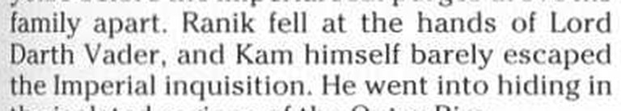
- **Kam Solusar; Luke Skywalker; Kyp Durron** — Kam Solusar — brush with the dark side: "Like Luke and Kyp, Kam has had his brush with the dark side of the Force. While in exile, he was captured and tortured by evil Jedi, and twisted to serve the dark side. Luke won him back over to the light side, and brought him back to the Core to serve as his apprentice." Source: The Jedi Academy Sourcebook, p.39
  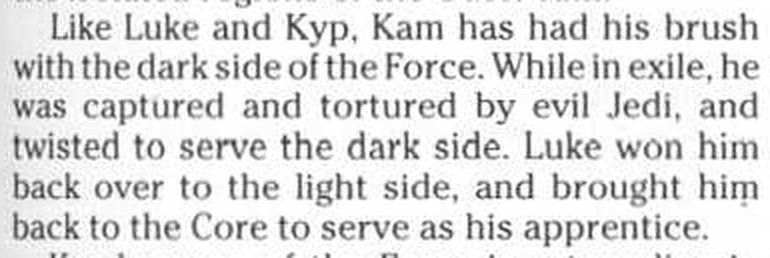
- **Kam Solusar** — Kam Solusar — uneven grasp of the Force: "Kam's grasp of the Force is astounding in some areas, and remarkably weak in others, because he was forced to leave his master before he could complete his training." Source: The Jedi Academy Sourcebook, p.39
  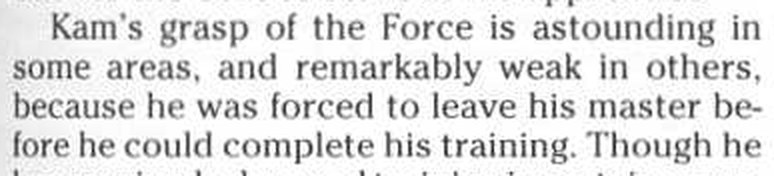
- **Kam Solusar** — Kam Solusar — stat block, combat skills (RPG mechanics) — RPG mechanics (weaker source): "Blaster 6D+2, brawling parry 5D, dodge 5D+2, lightsaber 5D, melee combat 5D+2," Source: The Jedi Academy Sourcebook, p.39, stat block
  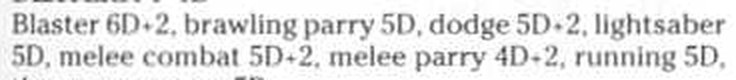
- **Kam Solusar** — Kam Solusar — stat block, Force skills (RPG mechanics) — RPG mechanics (weaker source): "Force Skills: Control 2D+2, sense 4D+1, alter 6D" Source: The Jedi Academy Sourcebook, p.39, stat block
  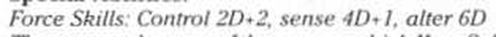
- **Tionne** — Tionne — Force strength: "Though she is not particularly powerful in the Force, her enthusiasm and devotion to the Jedi cause is very infectious and strong." Source: The Jedi Academy Sourcebook, p.39
  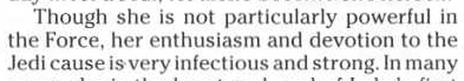

## p.40 (scan page sp041)

- Scope: Tionne (Holocron, research on Kun) and stat block; Ambassador Cilghal profile (death-sight, healing Mon Mothma) and stat block.

- **Tionne; Exar Kun** — Tionne — researching Kun: "She discovers the accounts of the Great Sith War, and learns that though Kun was far more powerful than any one other Jedi of the time, a combined force had defeated him." Source: The Jedi Academy Sourcebook, p.40
  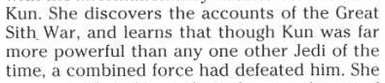
- **Tionne; Exar Kun** — Tionne — Kun's lone resource: "She supposes that the students have a chance of defeating him, since Kun no longer has his servants to draw on for power. He is his only resource." Source: The Jedi Academy Sourcebook, p.40
  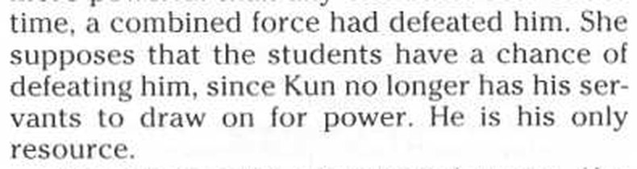
- **Cilghal; Admiral Daala** — Ambassador Cilghal — the death-sight: "When Admiral Daala attacks Calamari, Cilghal reveals a unique Force-driven talent for predicting which combatants are about to die." Source: The Jedi Academy Sourcebook, p.40
  
- **Cilghal; Luke Skywalker** — Ambassador Cilghal — leader of the students: "In the aftermath of Luke's fall, Cilghal emerges as the leader of the Jedi students, despite her status as the newest disciple." Source: The Jedi Academy Sourcebook, p.40
  
- **Cilghal** — Ambassador Cilghal — healing Mon Mothma: "After hours and hours of isolating and ejecting each molecule of the virus, she succeeds in restoring the great leader to health." Source: The Jedi Academy Sourcebook, p.40
  

## p.41 (scan page sp042)

- Scope: Cilghal's special ability and Force skills; Yavin Four planet stats; the Massassi ruins; the Grand Temple.

- **Exar Kun** — The Massassi Ruins — Sith focal points: "They were designed to serve as focal points for a Sith Lord's power, and Kun found them indispensable in boosting his power sufficiently to work dark miracles." Source: The Jedi Academy Sourcebook, p.41
  
- **Exar Kun** — The Massassi Ruins — the Jedi assault: "When the Jedi came to fight Kun, they razed most of the structures on the planet in the battle." Source: The Jedi Academy Sourcebook, p.41
  

## p.42 (scan page sp043)

- Scope: Grand audience chamber; war room; underground spring; the Dark Temple (Exar Kun statue); New Force Powers: Contort/Escape.

- **Luke Skywalker; Exar Kun** — The Underground Spring — mutual protection: "Luke uses the spring to teach his students to protect themselves and one another against the heat. The cooperative lesson of mutual support is one the students find a ready application for in opposing Exar Kun." Source: The Jedi Academy Sourcebook, p.42
  
- **Exar Kun** — The Dark Temple — a funnel for the Force: "The figure is Exar Kun, He had designed the temple to be an angular funnel to concentrate the Force, in a configuration which would enhance the powers of Sith rituals." Source: The Jedi Academy Sourcebook, p.42
  

## p.43 (scan page sp044)

- Scope: Full-page illustration (Yavin Four temple).
- Scope note: no power, skill or lore statement about the tracked characters on this page beyond the summary above.

## p.44 (scan page sp045)

- Scope: New Force powers: force of will, remove fatigue, beast languages.
- Scope note: no power, skill or lore statement about the tracked characters on this page beyond the summary above.

## p.45 (scan page sp046)

- Scope: New Force powers: predict natural disaster, sense Force potential (novel excerpt, Luke probing Kyp), shift sense.

- **Luke Skywalker; Kyp Durron** — Sense Force Potential — quoted novel excerpt: "He pushed — and suddenly found himself hurled backward, tossed aside like a piece of fluff in a Bespin wind storm. He landed flat on his back on the other side of the room, gasping," Source: The Jedi Academy Sourcebook, p.45, sidebar/caption
  

## p.46 (scan page sp047)

- Scope: New Force powers: translation, weather sense, detoxify poison in another, remove another's fatigue, lesser Force shield (novel excerpt).

- **Luke Skywalker** — Lesser Force Shield — quoted novel excerpt: "Luke shielded his exposed flesh from the scalding droplets and waited for the blast to dwindle." Source: The Jedi Academy Sourcebook, p.46, sidebar/caption
  

## p.47 (scan page sp048)

- Scope: Lesser Force shield effect; projected fighting (art credit Storn Cook).
- Scope note: no power, skill or lore statement about the tracked characters on this page beyond the summary above.

