# Owner Material 029 — The Jedi Academy Sourcebook (WEG, 1996): Chapter Four: Echoes of the Sith

- **Source:** *The Jedi Academy Sourcebook* by Paul Sudlow (West End Games, April 1996; WEG 40114). Licensed Legends Star Wars Roleplaying Game (d6) companion to Kevin J. Anderson's Jedi Academy trilogy. Scan from the d6holocron archive (145 PDF pages, image-only; OCR'd on the box), read in full 2026-10-28 including sidebars, captions, fiction excerpts and stat blocks. The scan stays box-only and is **not** published.
- **Quotes:** verbatim as printed (obvious OCR slips corrected against the page image), cited "The Jedi Academy Sourcebook, p.X" by **printed** page (printed page = scan page − 1). Sidebars, captions and fiction excerpts are marked **sidebar/caption**; d6 statistics are marked **stat block** and **RPG mechanics (weaker source)**. Each quote has a crop of the printed passage directly under it.
- **Weight:** secondary source. The prose summarises the trilogy (026), which outranks it; d6 game statistics are mechanics, not canon feats, and rank lowest. See README § How much weight.

## p.48 (scan page sp049)

- Scope: Chapter Four: Echoes of the Sith — the seduction of Exar Kun; the Great Sith War.

- **Exar Kun; Freedon Nadd** — The Seduction of Exar Kun — Nadd: "Kun agreed, sure that he could use Nadd without himself being used." Source: The Jedi Academy Sourcebook, p.48
  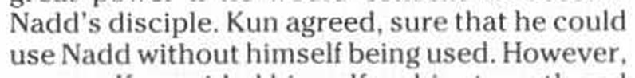
- **Exar Kun; Freedon Nadd** — The Seduction of Exar Kun — destroying Nadd: "There, Exar Kun fully embraced the dark side and destroyed Freedon Nadd." Source: The Jedi Academy Sourcebook, p.48
  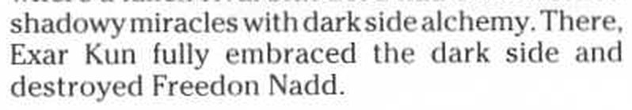
- **Exar Kun** — The Seduction of Exar Kun — first Dark Lord of the Sith: "With this knowledge Exar Kun established a vast and powerful brotherhood and claimed the title of the first Dark Lord of the Sith." Source: The Jedi Academy Sourcebook, p.48
  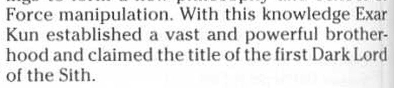
- **Exar Kun; Ulic Qel-Droma** — The Great Sith War: "Joining forces with another powerful Jedi, Ulic Qel-Droma, Kun worked his invisible threads into the fabric of the Old Republic, bringing the Jedi Order to the brink of ruin through treachery and his distorted abilities with the Force." Source: The Jedi Academy Sourcebook, p.48
  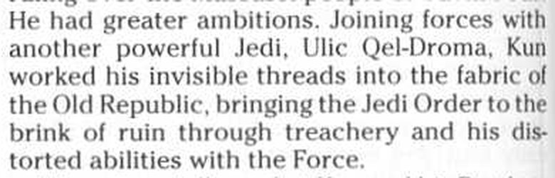
- **Exar Kun** — The Great Sith War — trapping his spirit: "When the Jedi combined their might and came to Kun's retreat on Yavin Four to fight him, they unleashed such power that Kun had to drain every last one of his Massassi slaves just to trap his spirit within his temples — to survive so that one day he could come back." Source: The Jedi Academy Sourcebook, p.48
  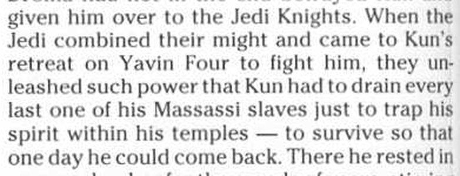

## p.49 (scan page sp050)

- Scope: The return of Exar Kun (Gantoris, Kyp, Streen, the final battle); Sith powers introduction.

- **Exar Kun; Luke Skywalker** — The Return of Exar Kun — Luke too powerful: "To his surprise, Kun recognizes the leader to be the same man who had visited Yavin Four years earlier, now much more powerful in the Force. Too powerful, for the moment, for Kun to tackle." Source: The Jedi Academy Sourcebook, p.49
  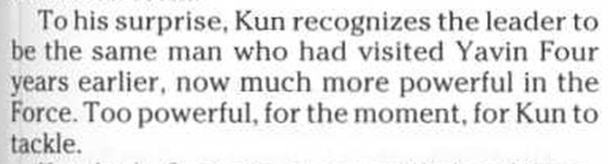
- **Exar Kun; Luke Skywalker** — The Return of Exar Kun — posing as Anakin Skywalker: "Kun, posing as Anakin Skywalker, appears to Luke and attempts to pull him toward the forbidden Sith teachings by tempting him to use Sith power to seize control of the New Republic and destroy the Empire. Realizing that this shade is not that of his father, Luke rejects the offer." Source: The Jedi Academy Sourcebook, p.49
  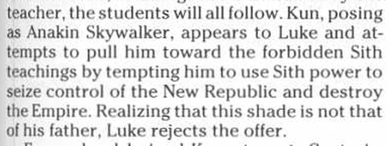
- **Exar Kun; Gantoris** — The Return of Exar Kun — draining Gantoris: "Realizing that Gantoris is no longer his, Kun utterly drains him to provide himself a reserve of energy to last until he can subvert more students." Source: The Jedi Academy Sourcebook, p.49
  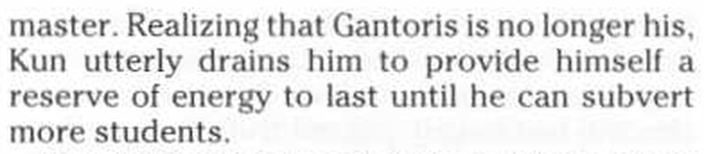
- **Kyp Durron; Gantoris; Exar Kun** — The Return of Exar Kun — Kyp the ideal subject: "Moreover, he is far more powerful than the Eol Sha leader, and young enough to be overconfident and naive." Source: The Jedi Academy Sourcebook, p.49
  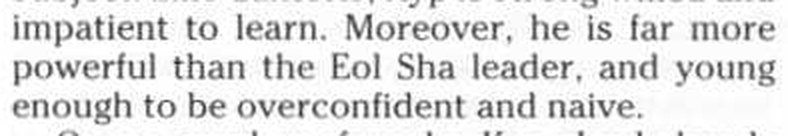
- **Exar Kun; Kyp Durron** — The Return of Exar Kun — control over Kyp: "He grows very powerful on Kyp's hate, and soon his hold on Kyp is so complete that he can send Kyp beyond the planet to do his will and still retain control over his subject." Source: The Jedi Academy Sourcebook, p.49
  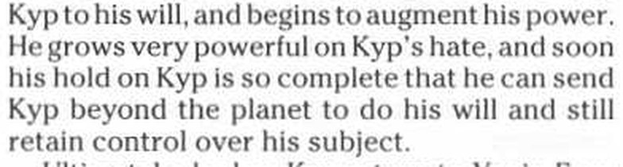
- **Exar Kun; Kyp Durron; Luke Skywalker; Sun Crusher** — The Return of Exar Kun — bolstering Kyp against Luke: "Ultimately, he has Kyp return to Yavin Four and helps him reclaim the Sun Crusher. He also bolsters Kyp's talents to allow him to defeat Luke and place him in a coma." Source: The Jedi Academy Sourcebook, p.49
  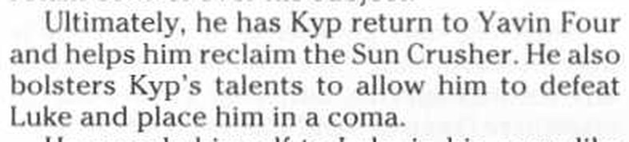
- **Exar Kun; Kyp Durron; Streen; Gantoris** — The Return of Exar Kun — Kun's boast: "He boasts that he already owns Kyp and Streen, and destroyed Gantoris." Source: The Jedi Academy Sourcebook, p.49
  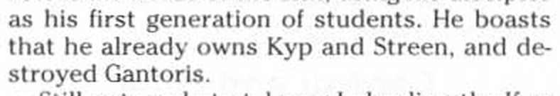
- **Exar Kun; Luke Skywalker; Leia Organa Solo** — The Return of Exar Kun — attempts on Luke's body: "Still not ready to take on Luke directly, Kun makes several attempts on Luke's body. Each attack is thwarted by the Jedi students and Leia." Source: The Jedi Academy Sourcebook, p.49
  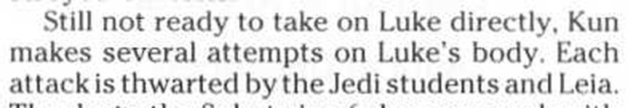
- **Exar Kun; Kirana Ti; Streen; Vodo-Siosk Baas; Luke Skywalker** — The Return of Exar Kun — the final blow: "Kirana Ti and Streen jointly deliver the final blow, using the lightsabers of Luke and Gantoris to destroy Exar" Source: The Jedi Academy Sourcebook, p.49
  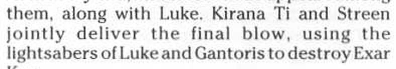

## p.50 (scan page sp051)

- Scope: Sith powers: aura of uneasiness, electronic manipulation, Force wind; drain life energy begins.

- **Exar Kun; Kyp Durron; Gantoris; Streen** — Sith Powers — channelled through the students: "Exar Kun himself possessed a great many other dark powers that he was unable to harness without the energy he needed to fuel his disembodied will. Some of these powers he was able to channel through Kyp, Gantoris, and Streen to achieve his ends." Source: The Jedi Academy Sourcebook, p.50
  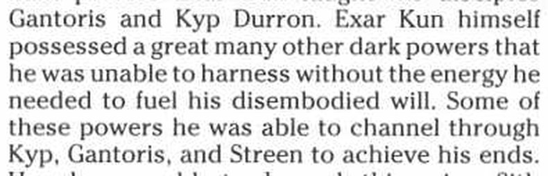
- **Darth Vader (Anakin Skywalker)** — Sith Powers — Vader's knowledge: "(keep in mind that even Lord Vader, himself a Dark Lord of the Sith, did not know all there is to know of the Sith powers)." Source: The Jedi Academy Sourcebook, p.50
  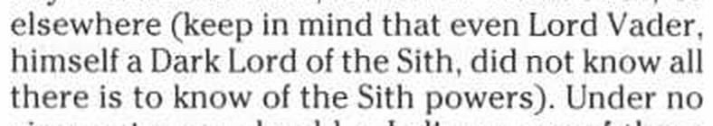
- **Kyp Durron; Exar Kun** — Aura of Uneasiness — quoted novel excerpt: "He consciously exuded a shadow of uneasiness around him so that lower creatures had no incentive to come nearer. Exar Kun had taught him that trick" Source: The Jedi Academy Sourcebook, p.50, sidebar/caption
  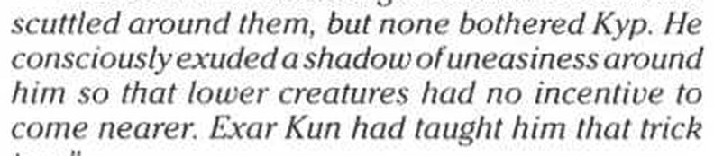
- **Kyp Durron; Sun Crusher** — Electronic Manipulation — quoted novel excerpt: "In outrage Kyp found the power to send a burst of controlling thought through the integrated circuits in the Sun Crusher's computer." Source: The Jedi Academy Sourcebook, p.50, sidebar/caption
  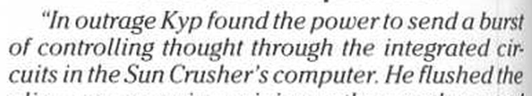
- **Streen** — Force Wind — effect: "This power allows the Sith to manipulate and channel air currents to form powerful and destructive tornadoes which can lift people bodily up into the air and fling them about." Source: The Jedi Academy Sourcebook, p.50
  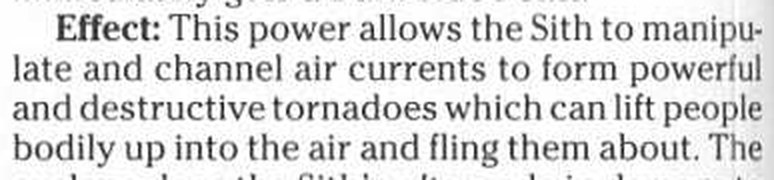

## p.51 (scan page sp052)

- Scope: Sith powers: drain life energy (cont.), memory wipe.

- **Kyp Durron; Qwi Xux** — Memory Wipe — Sith power effect: "This dreadful power allows a Sith to sift through another person's mind, and destroy all knowledge of specific events or learned skills." Source: The Jedi Academy Sourcebook, p.51
  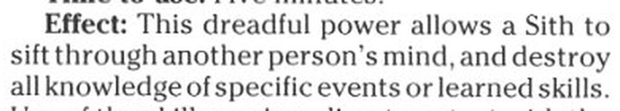

