# Owner Material 029 — The Jedi Academy Sourcebook (WEG, 1996): Chapter Five: Forces of the Empire

- **Source:** *The Jedi Academy Sourcebook* by Paul Sudlow (West End Games, April 1996; WEG 40114). Licensed Legends Star Wars Roleplaying Game (d6) companion to Kevin J. Anderson's Jedi Academy trilogy. Scan from the d6holocron archive (145 PDF pages, image-only; OCR'd on the box), read in full 2026-10-28 including sidebars, captions, fiction excerpts and stat blocks. The scan stays box-only and is **not** published.
- **Quotes:** verbatim as printed (obvious OCR slips corrected against the page image), cited "The Jedi Academy Sourcebook, p.X" by **printed** page (printed page = scan page − 1). Sidebars, captions and fiction excerpts are marked **sidebar/caption**; d6 statistics are marked **stat block** and **RPG mechanics (weaker source)**. Each quote has a crop of the printed passage directly under it.
- **Weight:** secondary source. The prose summarises the trilogy (026), which outranks it; d6 game statistics are mechanics, not canon feats, and rank lowest. See README § How much weight.

## p.52 (scan page sp053)

- Scope: Chapter Five: Forces of the Empire — the Imperial Core systems (Thrawn, the reborn Emperor); Ambassador Furgan profile begins.

- **Grand Admiral Thrawn; Leia Organa Solo** — The Imperial Core Systems — Thrawn's legacy: "The arrival of Grand Admiral Thrawn exacerbated these fears, and it was very difficult for New Republic diplomats, led by Mon Mothma and Leia Organa Solo, to woo worlds into the New Republic fold even after his defeat at Bilbringi." Source: The Jedi Academy Sourcebook, p.52
  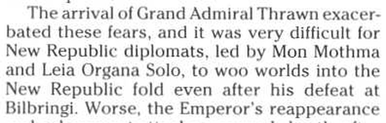
- **Palpatine (Darth Sidious)** — The Imperial Core Systems — the reborn Emperor's campaigns: "During the Emperor's latest campaigns, the New Republic suffered mightily, reduced once again to a band of Rebels." Source: The Jedi Academy Sourcebook, p.52
  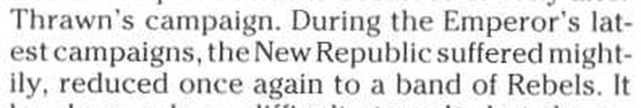
- **Palpatine (Darth Sidious)** — The Imperial Core Systems — the warlords' hope: "Their greatest hope rose and died in the form of the resurrected Emperor." Source: The Jedi Academy Sourcebook, p.52
  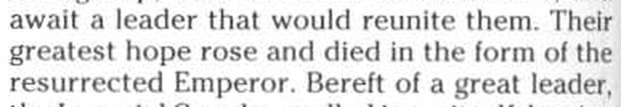

## p.53 (scan page sp054)

- Scope: Furgan's plot (Terpfen, Mon Mothma's nano virus, Anoth).

- **Ambassador Furgan** — Ambassador Furgan — his plan: "He envisions himself as the man who will forge a new Empire from the ashes of the old, with a grandson or granddaughter of Darth Vader on the throne and himself as foster parent and "helpful" regent." Source: The Jedi Academy Sourcebook, p.53
  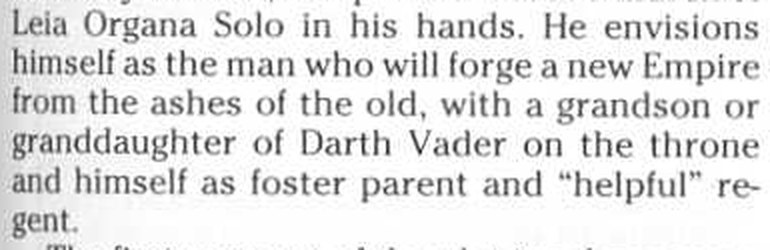
- **Ambassador Furgan** — Ambassador Furgan — poisoning Mon Mothma: "Furgan himself travels to Coruscant to inoculate Mothma with the nano virus by throwing a drink containing the contaminant into her face at a diplomatic function," Source: The Jedi Academy Sourcebook, p.53
  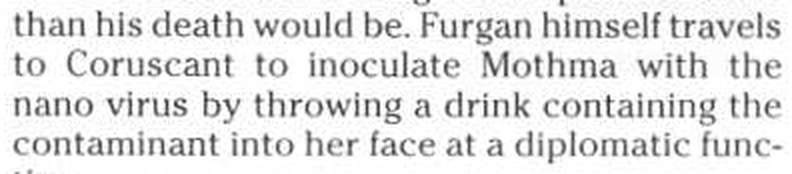

## p.54 (scan page sp055)

- Scope: Furgan (Carida, Anoth raid, death) and stat block; Colonel Ardax profile and stat block.

- **Ambassador Furgan; Kyp Durron; Sun Crusher** — Ambassador Furgan — the destruction of Carida: "In attempting to capture the Sun Crusher, Furgan goads Kyp into launching one of his system-destroying torpedoes into the Caridan sun." Source: The Jedi Academy Sourcebook, p.54
  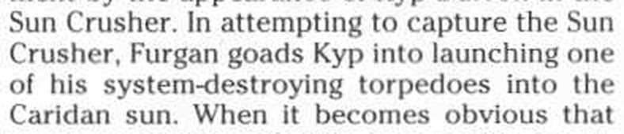
- **Anakin Solo; Ambassador Furgan; Terpfen** — Ambassador Furgan — Anakin's rescue: "For a moment, an impasse holds, until young Anakin causes a power droid to distract Furgan long enough for Terpfen to snatch the baby away." Source: The Jedi Academy Sourcebook, p.54
  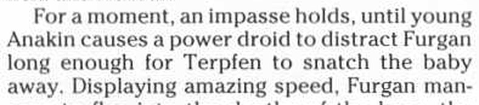
- **Ambassador Furgan; Terpfen** — Ambassador Furgan — death: "Furgan attempts to flee in one of the spider walkers, but is destroyed by Terpfen before he can escape the area." Source: The Jedi Academy Sourcebook, p.54
  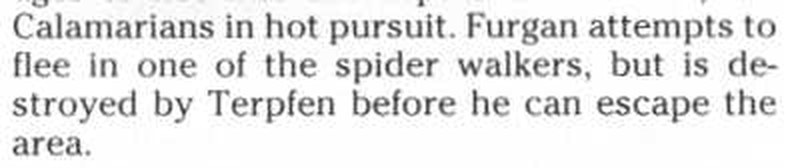

## p.55 (scan page sp056)

- Scope: Lieutenant Dauren; Trooper 2112 (Zeth Durron) profile and stat block.

- **Kyp Durron; Sun Crusher** — Trooper 2112 (Zeth Durron) — Carida: "Kyp grabs him with the tractor beam, and is on the verge of opening the cockpit and getting Zeth himself, when the sun explodes, destroying Carida and Zeth." Source: The Jedi Academy Sourcebook, p.55
  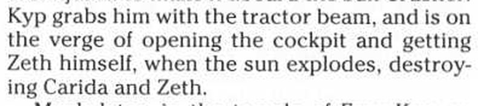
- **Kyp Durron; Exar Kun** — Trooper 2112 (Zeth Durron) — in Kun's temple: "Much later, in the temple of Exar Kun on Yavin IV, Zeth appears before Kyp to thank his brother for freeing him from the Imperials." Source: The Jedi Academy Sourcebook, p.55
  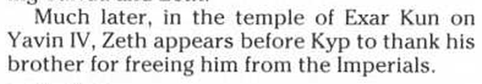

## p.56 (scan page sp057)

- Scope: Zeth stat end; Admiral Daala profile (Tarkin, the Sun Crusher, Calamari, Cauldron Nebula).

- **Admiral Daala** — Admiral Daala — as a cadet: "As a cadet, she pushed herself to her physical and mental limits, and occasionally beyond. She excelled in every curriculum, and used her strategic skills to wipe out entire navies in wargames." Source: The Jedi Academy Sourcebook, p.56
  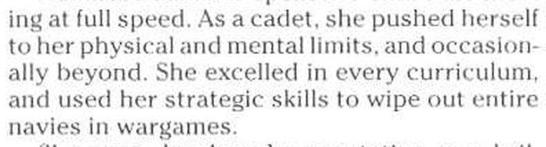
- **Admiral Daala** — Admiral Daala — Tarkin's protege: "She absorbed every lesson Tarkin taught her, and came to analyze every scenario and situation in light of how he might respond to it." Source: The Jedi Academy Sourcebook, p.56
  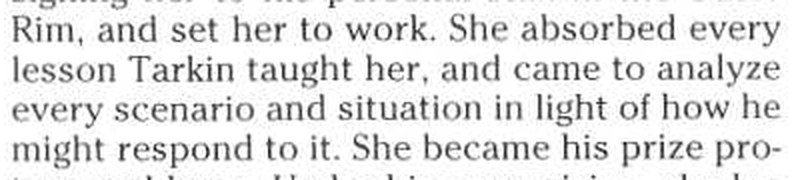
- **Admiral Daala** — Admiral Daala — rank: "He promoted her to admiral, making her one of the only females to reach that rank in the Imperial Navy." Source: The Jedi Academy Sourcebook, p.56
  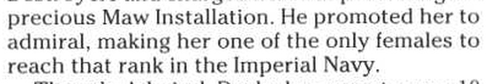
- **Admiral Daala** — Admiral Daala — theory versus experience: "Daala soon learns that an aptitude for theory is no substitute for experience. Her inability to alter her plans to take into account the unexpected is instrumental in her eventual downfall." Source: The Jedi Academy Sourcebook, p.56
  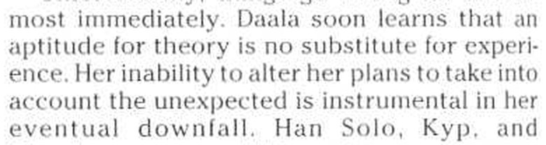
- **Admiral Daala; Han Solo; Kyp Durron; Chewbacca; Sun Crusher** — Admiral Daala — loss of the Sun Crusher: "Han Solo, Kyp, and Chewbacca escape with her prize superweapon, the Sun Crusher, and destroy the Hydra, one of her four Star Destroyers." Source: The Jedi Academy Sourcebook, p.56
  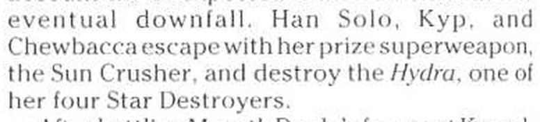
- **Admiral Daala** — Admiral Daala — Calamari: "Her plan is tactically flawless, but it reveals her greatest weakness: her tendency to rely on Tarkin's strategies rather than her own instincts." Source: The Jedi Academy Sourcebook, p.56
  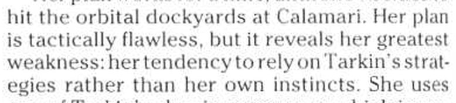
- **Admiral Daala** — Admiral Daala — the Coruscant plan: "She resolves to strike at Coruscant itself, ramming the stripped-down Star Destroyer Basilisk into Imperial City at full speed, leveling buildings for thousands of kilometers, and causing drastic damage to the crust of the planet." Source: The Jedi Academy Sourcebook, p.56
  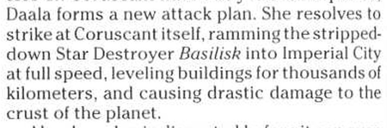
- **Admiral Daala; Kyp Durron; Sun Crusher** — Admiral Daala — the Cauldron Nebula: "Kyp appears in the staging area piloting the Sun Crusher, and uses it to detonate the nebula her fleet is hiding in. She barely escapes, and the Basilisk is vaporized by the expanding explosion." Source: The Jedi Academy Sourcebook, p.56
  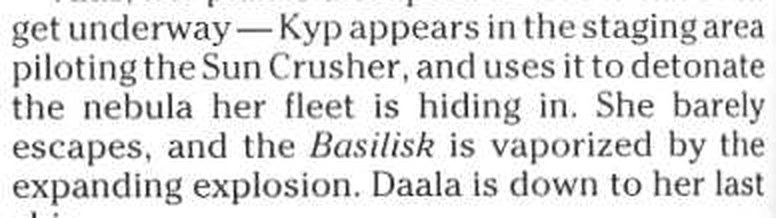

## p.57 (scan page sp058)

- Scope: Sidebar: Admiral Daala's Fleet; Daala profile end (Maw battle); Daala stat block.

- **Admiral Daala** — Admiral Daala's Fleet (sidebar): "The four ships each have 60 turbolaser batteries, 60 ion cannons and 10 tractor beam projectors." Source: The Jedi Academy Sourcebook, p.57, sidebar/caption
  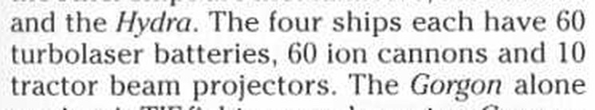
- **Admiral Daala** — Admiral Daala's Fleet (sidebar) — firepower: "The four capital ships represent an awesome concentration of firepower, and at the height of Imperial power were considered more than enough to handle any non-Imperial force which might stumble into the Maw." Source: The Jedi Academy Sourcebook, p.57, sidebar/caption
  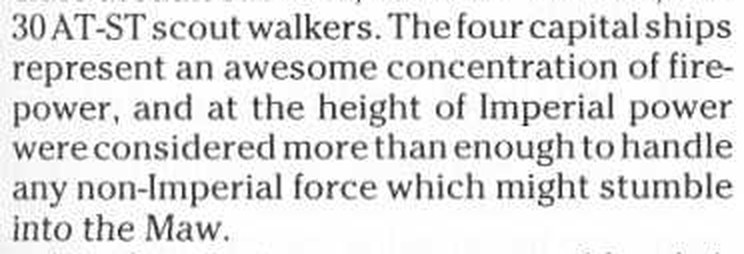
- **Admiral Daala** — Admiral Daala — return to the Maw: "Daala returns to the Maw resolved to defend it to the death." Source: The Jedi Academy Sourcebook, p.57
  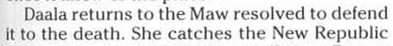
- **Admiral Daala** — Admiral Daala — stat block, combat skills (RPG mechanics) — RPG mechanics (weaker source): "Blaster 5D, blaster: blaster pistol 6D+2, blaster artillery 4D, brawling parry 7D, dodge 6D," Source: The Jedi Academy Sourcebook, p.57, stat block
  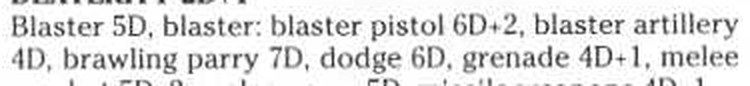
- **Admiral Daala** — Admiral Daala — stat block, tactics (RPG mechanics) — RPG mechanics (weaker source): "tactics: fleets 8D+1, tactics: ground assault tactics 7D+1, tactics: starfighters 8D+2," Source: The Jedi Academy Sourcebook, p.57, stat block
  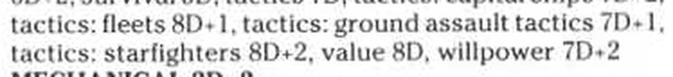

## p.58 (scan page sp059)

- Scope: Daala stat end; Commander Kratas; Captain Sten Thanas (Hydra rammed by the Sun Crusher).

- **Admiral Daala** — Admiral Daala — stat block, Force and Dark Side Points (RPG mechanics) — RPG mechanics (weaker source): "Force Points: 3 Dark Side Points: 19" Source: The Jedi Academy Sourcebook, p.58, stat block
  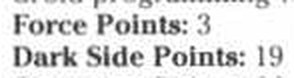
- **Sun Crusher** — Captain Sten Thanas — the Hydra: "Unfortunately, Thanas' promising career is cut short when the escaping Rebels ram his ship with the Sun Crusher. It drifts into a black hole and is destroyed." Source: The Jedi Academy Sourcebook, p.58
  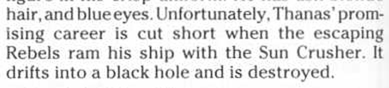

## p.59 (scan page sp060)

- Scope: Thanas stat end; Captain Brusc; Captain Mullinore (Basilisk destroyed) (art credit Storn Cook).

- **Sun Crusher; Admiral Daala** — Captain Mullinore — the Basilisk: "because his ship is destroyed in a Sun Crusher-induced explosion before Daala's force can approach Coruscant." Source: The Jedi Academy Sourcebook, p.59
  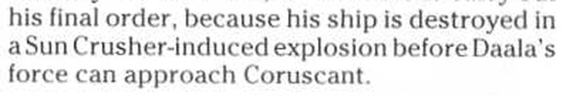

## p.60 (scan page sp061)

- Scope: Mullinore stat block; General Odosk profile.
- Scope note: no power, skill or lore statement about the tracked characters on this page beyond the summary above.

## p.61 (scan page sp062)

- Scope: Odosk stat block.
- Scope note: no power, skill or lore statement about the tracked characters on this page beyond the summary above.

