# Owner Material 029 — The Jedi Academy Sourcebook (WEG, 1996): Chapter Six: Maw Installation

- **Source:** *The Jedi Academy Sourcebook* by Paul Sudlow (West End Games, April 1996; WEG 40114). Licensed Legends Star Wars Roleplaying Game (d6) companion to Kevin J. Anderson's Jedi Academy trilogy. Scan from the d6holocron archive (145 PDF pages, image-only; OCR'd on the box), read in full 2026-10-28 including sidebars, captions, fiction excerpts and stat blocks. The scan stays box-only and is **not** published.
- **Quotes:** verbatim as printed (obvious OCR slips corrected against the page image), cited "The Jedi Academy Sourcebook, p.X" by **printed** page (printed page = scan page − 1). Sidebars, captions and fiction excerpts are marked **sidebar/caption**; d6 statistics are marked **stat block** and **RPG mechanics (weaker source)**. Each quote has a crop of the printed passage directly under it.
- **Weight:** secondary source. The prose summarises the trilogy (026), which outranks it; d6 game statistics are mechanics, not canon feats, and rank lowest. See README § How much weight.

## p.62 (scan page sp063)

- Scope: Chapter Six: Maw Installation — the Maw Cluster; Tarkin's discovery; Maw Installation begins.
- Scope note: no power, skill or lore statement about the tracked characters on this page beyond the summary above.

## p.63 (scan page sp064)

- Scope: Full-page illustration (Maw Installation).
- Scope note: no power, skill or lore statement about the tracked characters on this page beyond the summary above.

## p.64 (scan page sp065)

- Scope: Sidebar: Navigating in the Maw; Maw Installation staff recruitment.
- Scope note: no power, skill or lore statement about the tracked characters on this page beyond the summary above.

## p.65 (scan page sp066)

- Scope: Tarkin's secrecy (workers sent into a black hole; hidden from Palpatine); layout: Hub, lab modules (Lab E: Sun Crusher), Imperial Garrison.

- **Admiral Daala** — Maw Installation — the workers' fate: "Daala herself had recalibrated their navicomputers to deliver them to their dooms" Source: The Jedi Academy Sourcebook, p.65
  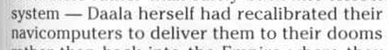
- **Palpatine (Darth Sidious); Admiral Daala** — Maw Installation — secret from the Emperor: "Tarkin and Daala believed that Palpatine never did learn the location of Maw Installation." Source: The Jedi Academy Sourcebook, p.65
  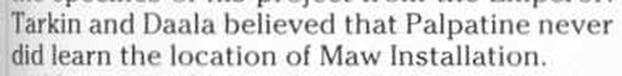

## p.66 (scan page sp067)

- Scope: Maw Installation map; garrison; power plant.

- **Sun Crusher; Qwi Xux** — Sun Crusher — development cost: "Each of its innovative features, from its molecular armor to its resonance torpedoes, cost as much to develop as the original Death Star superlaser. The Sun Crusher project was headed by Qwi Xux, who also contributed some of its design features." Source: The Jedi Academy Sourcebook, p.66
  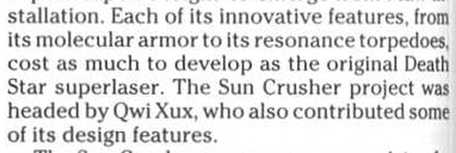

## p.67 (scan page sp068)

- Scope: Sidebar: The Prototype Death Star (diagram, stat block; art credit Troy Vigil).

- **Tol Sivron; Sun Crusher** — The Prototype Death Star (sidebar) — its end: "Alas, Sivron — blinded by a desire to recapture the Sun Crusher — manages to pilot the terror weapon beyond the event horizon and into oblivion." Source: The Jedi Academy Sourcebook, p.67, sidebar/caption
  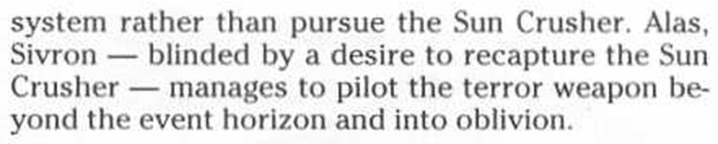

## p.68 (scan page sp069)

- Scope: Sun Crusher diagram; Sun Crusher description and stat block.

- **Sun Crusher** — Sun Crusher — resonance torpedoes: "modulated resonance torpedoes capable of destroying stars. The torpedo detonation triggers a chain reaction in the core of the target sun, igniting a supernova even in low-mass stars. The resulting blast destroys the entire system over a period of several hours." Source: The Jedi Academy Sourcebook, p.68
  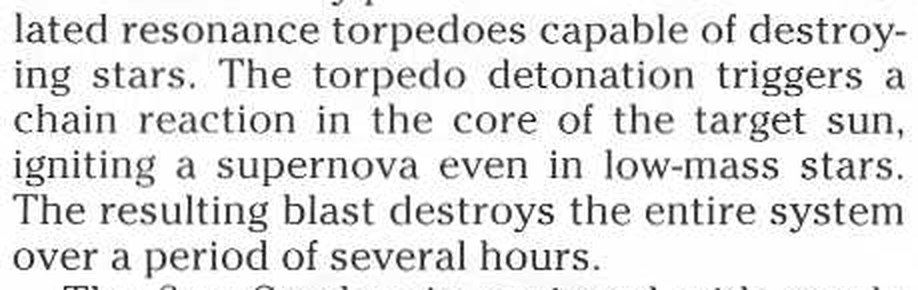
- **Sun Crusher** — Sun Crusher — quantum armor: "The Sun Crusher is equipped with nearly impregnable quantum armor so it can fulfill its mission without regard to the fleet that might be arrayed against it." Source: The Jedi Academy Sourcebook, p.68
  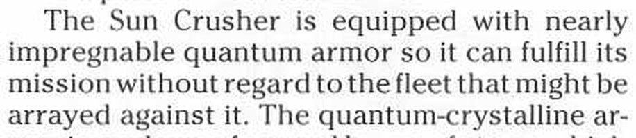
- **Sun Crusher** — Sun Crusher — surviving its own blast: "The armor is strong enough that the Sun Crusher has a good chance of surviving even if it gets caught in the blast radius of its resonance torpedoes, as long as it is far enough from the exploding star to avoid the worst of the shock wave." Source: The Jedi Academy Sourcebook, p.68
  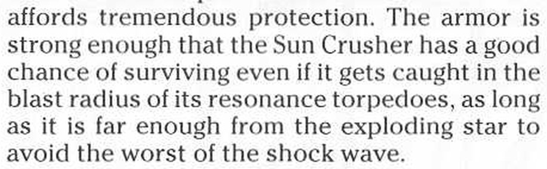
- **Sun Crusher** — Sun Crusher — size and armament: "The ship is also highly maneuverable and small enough to escape notice on many standard system-wide scans. It is lightly armed in the event that it encounters resistance — eight small lasers provide 360-degree coverage." Source: The Jedi Academy Sourcebook, p.68
  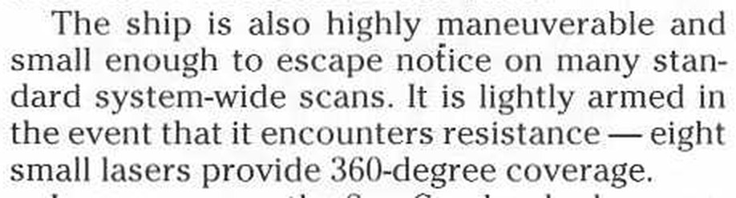
- **Sun Crusher** — Sun Crusher — stat block, hull (RPG mechanics) — RPG mechanics (weaker source): "Hull: 50D Shields: 1D" Source: The Jedi Academy Sourcebook, p.68, stat block
  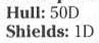
- **Sun Crusher** — Sun Crusher — stat block, torpedoes (RPG mechanics) — RPG mechanics (weaker source): "Weapons: Eleven Resonance Torpedoes*" Source: The Jedi Academy Sourcebook, p.68, stat block
  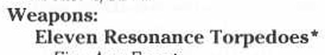
- **Sun Crusher** — Sun Crusher — stat block, torpedo note (RPG mechanics) — RPG mechanics (weaker source): "When fired into a star, the torpedo's sophisticated tracking system guarantees impact with a star, and its devastating impact on a star has very little to do with its explosive or kinetic power — it simply triggers a chain reaction which ignites a supernova, destroying the star and anything in the system." Source: The Jedi Academy Sourcebook, p.68, stat block
  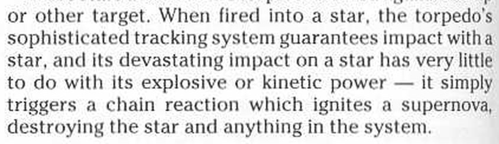

## p.69 (scan page sp070)

- Scope: Other Maw projects (World Devastators); Metal-Crystal Phase Shifter and stat block; Maw security.
- Scope note: no power, skill or lore statement about the tracked characters on this page beyond the summary above.

## p.70 (scan page sp071)

- Scope: Maw stormtroopers; Maw Installation personnel; Tol Sivron profile.
- Scope note: no power, skill or lore statement about the tracked characters on this page beyond the summary above.

## p.71 (scan page sp072)

- Scope: Maw Installation organizational chart (art credit Brian Schomburg).
- Scope note: no power, skill or lore statement about the tracked characters on this page beyond the summary above.

## p.72 (scan page sp073)

- Scope: Tol Sivron's death and stat block; Doxin profile and stat block.

- **Tol Sivron; Kyp Durron; Sun Crusher** — Tol Sivron — death: "In pursuing Kyp in the Sun Crusher, he is lured beyond the event horizon, and is slain along with most of his remaining scientists when the Death Star is sucked down into the black hole." Source: The Jedi Academy Sourcebook, p.72
  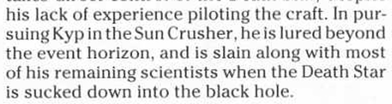

## p.73 (scan page sp074)

- Scope: Doxin stat end; Golanda profile (Sun Crusher torpedoes) (art credit Storn Cook).

- **Sun Crusher** — Golanda — the Sun Crusher's torpedoes: "Golanda's division developed the torpedoes and targeting systems which deliver the Sun Crusher's payload to its target destination," Source: The Jedi Academy Sourcebook, p.73
  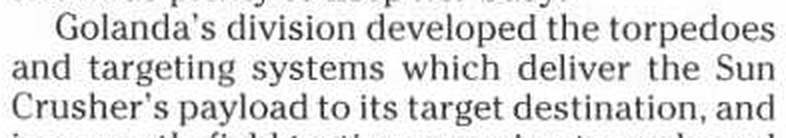

## p.74 (scan page sp075)

- Scope: Golanda stat block; Yemm profile and stat block.
- Scope note: no power, skill or lore statement about the tracked characters on this page beyond the summary above.

## p.75 (scan page sp076)

- Scope: Yemm stat end; Qwi Xux profile (the Sun Crusher, Kyp's memory wipe) and stat block.

- **Qwi Xux** — Qwi Xux — Tarkin's training program: "Of the 10 Omwati children who entered the program, only Qwi made it through all the training." Source: The Jedi Academy Sourcebook, p.75
  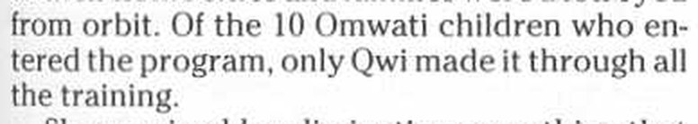
- **Qwi Xux; Sun Crusher** — Qwi Xux — championing destruction of the Sun Crusher: "When Qwi defects to the New Republic, she goes before the New Republic Assembly to champion the destruction of the Sun Crusher." Source: The Jedi Academy Sourcebook, p.75
  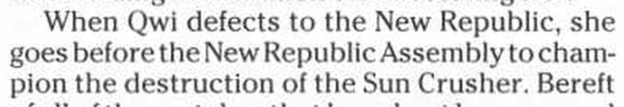
- **Kyp Durron; Qwi Xux; Sun Crusher** — Qwi Xux — Kyp's memory wipe: "Kyp Durron finds her there, and using Sith powers, drains her mind of all she knew of the Sun Crusher." Source: The Jedi Academy Sourcebook, p.75
  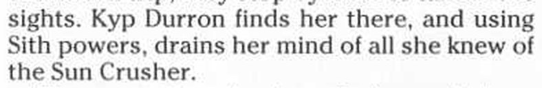

## p.76 (scan page sp077)

- Scope: Qwi stat end; Wermyn; Captain Fredja.
- Scope note: no power, skill or lore statement about the tracked characters on this page beyond the summary above.

## p.77 (scan page sp078)

- Scope: Fredja (Kyp lures the Death Star) and stat block; Grodon Lakky and stat block (art credit Ray Lederer).

- **Kyp Durron; Tol Sivron** — Captain Fredja — Kyp lures the Death Star: "This works reasonably well until Kyp Durron taunts Sivron past rational thought and lures the Death Star and its passengers to their doom." Source: The Jedi Academy Sourcebook, p.77
  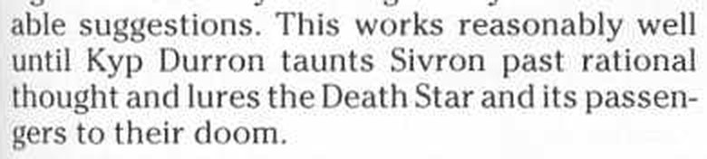

## p.78 (scan page sp079)

- Scope: Sidebar: The Wookiee Slaves; Nawruun profile and stat block.
- Scope note: no power, skill or lore statement about the tracked characters on this page beyond the summary above.

## p.79 (scan page sp080)

- Scope: Nawruun stat block end.
- Scope note: no power, skill or lore statement about the tracked characters on this page beyond the summary above.

