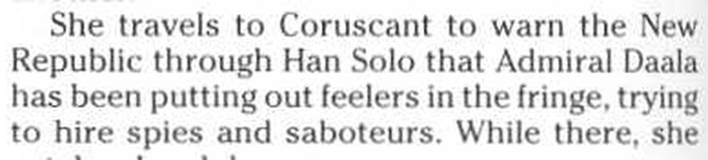
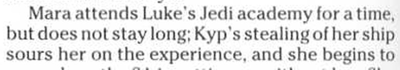
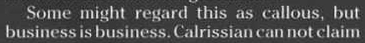
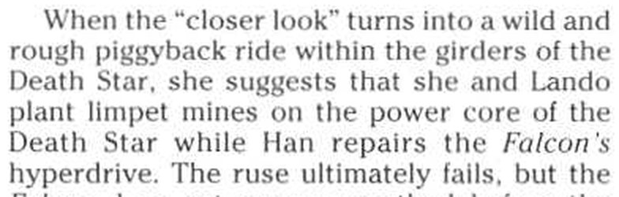
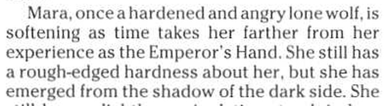
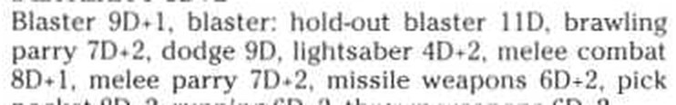
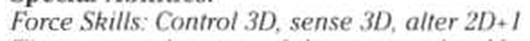
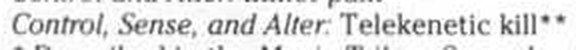
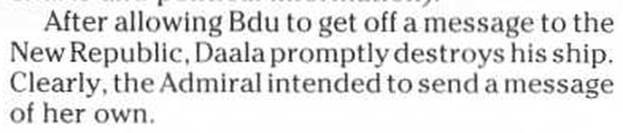

# Owner Material 029 — The Jedi Academy Sourcebook (WEG, 1996): Chapter Seven: The Fringe

- **Source:** *The Jedi Academy Sourcebook* by Paul Sudlow (West End Games, April 1996; WEG 40114). Licensed Legends Star Wars Roleplaying Game (d6) companion to Kevin J. Anderson's Jedi Academy trilogy. Scan from the d6holocron archive (145 PDF pages, image-only; OCR'd on the box), read in full 2026-10-28 including sidebars, captions, fiction excerpts and stat blocks. The scan stays box-only and is **not** published.
- **Quotes:** verbatim as printed (obvious OCR slips corrected against the page image), cited "The Jedi Academy Sourcebook, p.X" by **printed** page (printed page = scan page − 1). Sidebars, captions and fiction excerpts are marked **sidebar/caption**; d6 statistics are marked **stat block** and **RPG mechanics (weaker source)**. Each quote has a crop of the printed passage directly under it.
- **Weight:** secondary source. The prose summarises the trilogy (026), which outranks it; d6 game statistics are mechanics, not canon feats, and rank lowest. See README § How much weight.

## p.80 (scan page sp081)

- Scope: Chapter Seven: The Fringe — the fringe; the Smugglers' Alliance; Mara Jade profile.

- **Mara Jade Skywalker; Han Solo; Admiral Daala** — Mara Jade — warning the New Republic: "She travels to Coruscant to warn the New Republic through Han Solo that Admiral Daala has been putting out feelers in the fringe, trying to hire spies and saboteurs." Source: The Jedi Academy Sourcebook, p.80
  
- **Mara Jade Skywalker; Luke Skywalker; Kyp Durron** — Mara Jade — at the Jedi academy: "Mara attends Luke's Jedi academy for a time, but does not stay long; Kyp's stealing of her ship sours her on the experience," Source: The Jedi Academy Sourcebook, p.80
  

## p.81 (scan page sp082)

- Scope: Sidebar: Mara Jade's memo to the Smugglers' Alliance leadership (Kessel, Lando).

- **Mara Jade Skywalker** — Mara Jade's report to the Smugglers' Alliance (sidebar): "Some might regard this as callous, but business is business." Source: The Jedi Academy Sourcebook, p.81, sidebar/caption
  

## p.82 (scan page sp083)

- Scope: Mara Jade (Death Star limpet mines, the Emperor's Hand) and stat block (art credit Storn Cook).

- **Mara Jade Skywalker; Han Solo** — Mara Jade — aboard the Death Star: "When the "closer look" turns into a wild and rough piggyback ride within the girders of the Death Star, she suggests that she and Lando plant limpet mines on the power core of the Death Star while Han repairs the Falcon's hyperdrive." Source: The Jedi Academy Sourcebook, p.82
  
- **Mara Jade Skywalker; Palpatine (Darth Sidious)** — Mara Jade — out of the dark side's shadow: "Mara, once a hardened and angry lone wolf, is softening as time takes her farther from her experience as the Emperor's Hand. She still has a rough-edged hardness about her, but she has emerged from the shadow of the dark side." Source: The Jedi Academy Sourcebook, p.82
  
- **Mara Jade Skywalker** — Mara Jade — stat block, combat skills (RPG mechanics) — RPG mechanics (weaker source): "Blaster 9D+1, blaster: hold-out blaster 11D, brawling parry 7D+2, dodge 9D, lightsaber 4D+2, melee combat 8D+1, melee parry 7D+2," Source: The Jedi Academy Sourcebook, p.82, stat block
  
- **Mara Jade Skywalker** — Mara Jade — stat block, Force skills (RPG mechanics) — RPG mechanics (weaker source): "Force Skills: Control 3D, sense 3D, alter 2D+1" Source: The Jedi Academy Sourcebook, p.82, stat block
  

## p.83 (scan page sp084)

- Scope: Mara stat end; Ghent profile and stat block; T'nun Bdu profile (Daala destroys his ship) and stat block.

- **Mara Jade Skywalker** — Mara Jade — stat block, Force powers (RPG mechanics) — RPG mechanics (weaker source): "Control, Sense, and Alter: Telekenetic kill**" Source: The Jedi Academy Sourcebook, p.83, stat block
  
- **Admiral Daala** — T'nun Bdu — Daala's message: "After allowing Bdu to get off a message to the New Republic, Daala promptly destroys his ship. Clearly, the Admiral intended to send a message of her own." Source: The Jedi Academy Sourcebook, p.83
  

## p.84 (scan page sp085)

- Scope: Bdu special abilities; CBX-9 protocol droid and stat block.
- Scope note: no power, skill or lore statement about the tracked characters on this page beyond the summary above.

