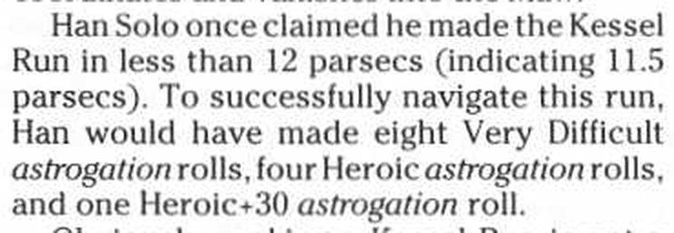
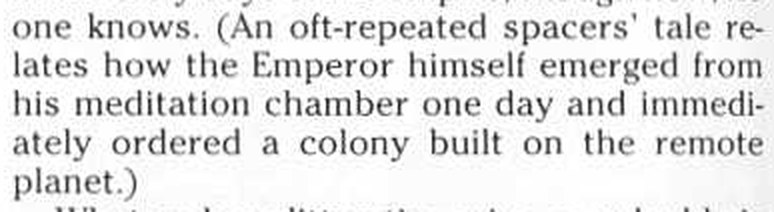
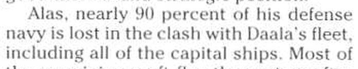
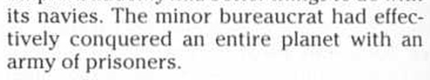
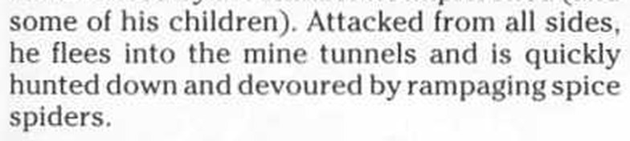
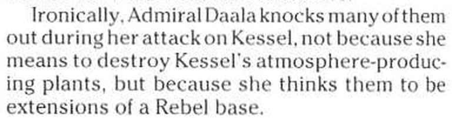

# Owner Material 029 — The Jedi Academy Sourcebook (WEG, 1996): Chapter Eight: Kessel

- **Source:** *The Jedi Academy Sourcebook* by Paul Sudlow (West End Games, April 1996; WEG 40114). Licensed Legends Star Wars Roleplaying Game (d6) companion to Kevin J. Anderson's Jedi Academy trilogy. Scan from the d6holocron archive (145 PDF pages, image-only; OCR'd on the box), read in full 2026-10-28 including sidebars, captions, fiction excerpts and stat blocks. The scan stays box-only and is **not** published.
- **Quotes:** verbatim as printed (obvious OCR slips corrected against the page image), cited "The Jedi Academy Sourcebook, p.X" by **printed** page (printed page = scan page − 1). Sidebars, captions and fiction excerpts are marked **sidebar/caption**; d6 statistics are marked **stat block** and **RPG mechanics (weaker source)**. Each quote has a crop of the printed passage directly under it.
- **Weight:** secondary source. The prose summarises the trilogy (026), which outranks it; d6 game statistics are mechanics, not canon feats, and rank lowest. See README § How much weight.

## p.85 (scan page sp086)

- Scope: Chapter Eight: Kessel — the Kessel system; sidebar: The Kessel Run (Han's 12-parsec claim in game terms).

- **Han Solo** — The Kessel Run (sidebar) — Han's claim: "Han Solo once claimed he made the Kessel Run in less than 12 parsecs (indicating 11.5 parsecs). To successfully navigate this run, Han would have made eight Very Difficult astrogation rolls, four Heroic astrogation rolls, and one Heroic+30 astrogation roll." Source: The Jedi Academy Sourcebook, p.85, sidebar/caption
  

## p.86 (scan page sp087)

- Scope: Kessel system planets; glitterstim spice (art credit Ray Lederer).

- **Palpatine (Darth Sidious)** — Glitterstim Spice — the Emperor's colony: "(An oft-repeated spacers' tale relates how the Emperor himself emerged from his meditation chamber one day and immediately ordered a colony built on the remote planet.)" Source: The Jedi Academy Sourcebook, p.86
  

## p.87 (scan page sp088)

- Scope: Sidebar: Using Glitterstim in the Game; glitterstim mining; the garrison moon.
- Scope note: no power, skill or lore statement about the tracked characters on this page beyond the summary above.

## p.88 (scan page sp089)

- Scope: Sidebar: Doole's Defense Fleet; garrison moon stats; Kessel.

- **Admiral Daala; Moruth Doole** — Doole's Defense Fleet (sidebar): "Alas, nearly 90 percent of his defense navy is lost in the clash with Daala's fleet, including all of the capital ships." Source: The Jedi Academy Sourcebook, p.88, sidebar/caption
  

## p.89 (scan page sp090)

- Scope: Kessel radiation and planet stats; Moruth Doole profile (art credit Ray Lederer).
- Scope note: no power, skill or lore statement about the tracked characters on this page beyond the summary above.

## p.90 (scan page sp091)

- Scope: Sidebar: Doole's Rise to Power (Han, Jabba, prison revolt); Doole's plans.

- **Moruth Doole** — Doole's Rise to Power (sidebar): "The minor bureaucrat had effectively conquered an entire planet with an army of prisoners." Source: The Jedi Academy Sourcebook, p.90, sidebar/caption
  

## p.91 (scan page sp092)

- Scope: Doole's downfall and stat block; Skynxnex and stat block; Boss Roke begins.

- **Moruth Doole** — Moruth Doole — death: "Attacked from all sides, he flees into the mine tunnels and is quickly hunted down and devoured by rampaging spice spiders." Source: The Jedi Academy Sourcebook, p.91
  

## p.92 (scan page sp093)

- Scope: Boss Roke (death in the mines) and stat block; Imperial Correction Facility (art credit Storn Cook).
- Scope note: no power, skill or lore statement about the tracked characters on this page beyond the summary above.

## p.93 (scan page sp094)

- Scope: Correction Facility: administration, the carbonite warden, prison blocks, Doole's private wing, spice processing.
- Scope note: no power, skill or lore statement about the tracked characters on this page beyond the summary above.

## p.94 (scan page sp095)

- Scope: Doole's larvae; atmosphere towers (Daala's attack); the spice mines begin.

- **Admiral Daala** — Atmosphere Towers — Daala's attack: "Ironically, Admiral Daala knocks many of them out during her attack on Kessel, not because she means to destroy Kessel's atmosphere-producing plants, but because she thinks them to be extensions of a Rebel base." Source: The Jedi Academy Sourcebook, p.94
  

## p.95 (scan page sp096)

- Scope: Spice mines: mine shafts, mustering rooms, tunnels.
- Scope note: no power, skill or lore statement about the tracked characters on this page beyond the summary above.

