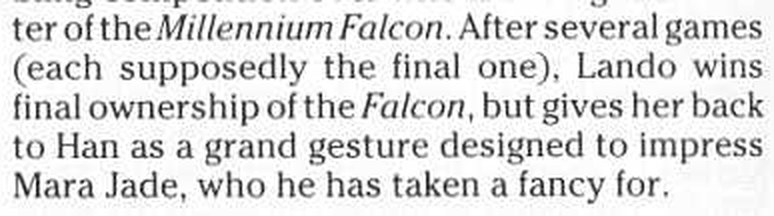

# Owner Material 029 — The Jedi Academy Sourcebook (WEG, 1996): Chapter Nine: The Independent Class

- **Source:** *The Jedi Academy Sourcebook* by Paul Sudlow (West End Games, April 1996; WEG 40114). Licensed Legends Star Wars Roleplaying Game (d6) companion to Kevin J. Anderson's Jedi Academy trilogy. Scan from the d6holocron archive (145 PDF pages, image-only; OCR'd on the box), read in full 2026-10-28 including sidebars, captions, fiction excerpts and stat blocks. The scan stays box-only and is **not** published.
- **Quotes:** verbatim as printed (obvious OCR slips corrected against the page image), cited "The Jedi Academy Sourcebook, p.X" by **printed** page (printed page = scan page − 1). Sidebars, captions and fiction excerpts are marked **sidebar/caption**; d6 statistics are marked **stat block** and **RPG mechanics (weaker source)**. Each quote has a crop of the printed passage directly under it.
- **Weight:** secondary source. The prose summarises the trilogy (026), which outranks it; d6 game statistics are mechanics, not canon feats, and rank lowest. See README § How much weight.

## p.96 (scan page sp097)

- Scope: Chapter Nine: The Independent Class — Lando Calrissian profile (Tymmo, the Falcon wager).

- **Han Solo; Lando Calrissian; Mara Jade Skywalker** — Lando Calrissian — the Falcon wager: "After several games (each supposedly the final one), Lando wins final ownership of the Falcon, but gives her back to Han as a grand gesture designed to impress Mara Jade, who he has taken a fancy for," Source: The Jedi Academy Sourcebook, p.96
  

## p.97 (scan page sp098)

- Scope: Lando (Kessel, Mara) and stat block (art credit Ray Lederer).
- Scope note: no power, skill or lore statement about the tracked characters on this page beyond the summary above.

## p.98 (scan page sp099)

- Scope: Lando stat end; Slish Fondine and stat block; Duchess Mistal and stat block.
- Scope note: no power, skill or lore statement about the tracked characters on this page beyond the summary above.

## p.99 (scan page sp100)

- Scope: Dack (Tymmo) profile and stat block (art credit Storn Cook).
- Scope note: no power, skill or lore statement about the tracked characters on this page beyond the summary above.

