# Owner Material 029 — The Jedi Academy Sourcebook (WEG, 1996): Chapter Ten: Planets

- **Source:** *The Jedi Academy Sourcebook* by Paul Sudlow (West End Games, April 1996; WEG 40114). Licensed Legends Star Wars Roleplaying Game (d6) companion to Kevin J. Anderson's Jedi Academy trilogy. Scan from the d6holocron archive (145 PDF pages, image-only; OCR'd on the box), read in full 2026-10-28 including sidebars, captions, fiction excerpts and stat blocks. The scan stays box-only and is **not** published.
- **Quotes:** verbatim as printed (obvious OCR slips corrected against the page image), cited "The Jedi Academy Sourcebook, p.X" by **printed** page (printed page = scan page − 1). Sidebars, captions and fiction excerpts are marked **sidebar/caption**; d6 statistics are marked **stat block** and **RPG mechanics (weaker source)**. Each quote has a crop of the printed passage directly under it.
- **Weight:** secondary source. The prose summarises the trilogy (026), which outranks it; d6 game statistics are mechanics, not canon feats, and rank lowest. See README § How much weight.

## p.100 (scan page sp101)

- Scope: Chapter Ten: Planets — Anoth and Anoth Base (computer-core trap).
- Scope note: no power, skill or lore statement about the tracked characters on this page beyond the summary above.

## p.101 (scan page sp102)

- Scope: Sidebar: Establishment of Anoth Base; battle droids; Bespin; Tibannoplis.

- **Leia Organa Solo; Luke Skywalker; Palpatine (Darth Sidious)** — Establishment of Anoth Base (sidebar): "she and Luke Skywalker immediately appreciated the need to protect them from harm —the Empire was far from defeated, and the capture of a young Jedi child by one of Palpatine's remaining Dark Adepts might prove disastrous to the future of the New Republic." Source: The Jedi Academy Sourcebook, p.101, sidebar/caption
  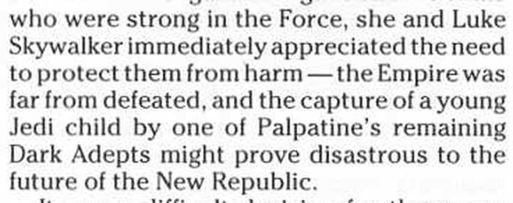

## p.102 (scan page sp103)

- Scope: Anoth Base main level (FIDO, hangars, ops, living suites); Tibannoplis cont.
- Scope note: no power, skill or lore statement about the tracked characters on this page beyond the summary above.

## p.103 (scan page sp104)

- Scope: Anoth Base floorplan.
- Scope note: no power, skill or lore statement about the tracked characters on this page beyond the summary above.

## p.104 (scan page sp105)

- Scope: Full-page illustration.
- Scope note: no power, skill or lore statement about the tracked characters on this page beyond the summary above.

## p.105 (scan page sp106)

- Scope: Tibannoplis end; Mon Calamari (World Devastator damage) and stats; orbital shipyards (art credit Storn Cook).
- Scope note: no power, skill or lore statement about the tracked characters on this page beyond the summary above.

## p.106 (scan page sp107)

- Scope: Shipyards (Startide sacrificed vs Daala); Foamwander City; Mkbuto Seatree Preserve.

- **Admiral Daala; Admiral Ackbar** — Mon Calamari Orbital Shipyards — the Startide: "the only ship to survive the attack of a year ago was the Startide, which is only a few months from completion when Admiral Ackbar sacrifices it to stave off Admiral Daala's attack on the shipyards." Source: The Jedi Academy Sourcebook, p.106
  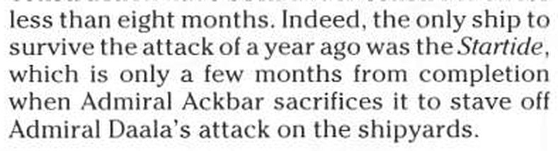

## p.107 (scan page sp108)

- Scope: Sidebar: Leia's datapad log (the twins, Gantoris, Luke's coma, the Knowledge Bank).

- **Leia Organa Solo; Gantoris; Luke Skywalker; Exar Kun** — Leia's datapad personal log (sidebar): "I'm very worried about having the twins here while whatever destroyed Gantoris and put Luke in a coma is still at large. Sometimes I can feel a sudden chill pass through me, as if something evil is watching me." Source: The Jedi Academy Sourcebook, p.107, sidebar/caption
  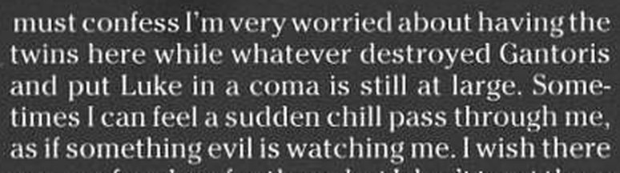

## p.108 (scan page sp109)

- Scope: Ackbar's seapod (diagram); Carida begins.
- Scope note: no power, skill or lore statement about the tracked characters on this page beyond the summary above.

## p.109 (scan page sp110)

- Scope: Carida (Furgan, destroyed by Kyp and the Sun Crusher) and stats; Military Academy of Carida (art credit Storn Cook).

- **Grand Admiral Thrawn; Palpatine (Darth Sidious)** — Carida — loyal to the Empire: "Even though Grand Admiral Thrawn is dead and Palpatine overthrown, Carida refuses to be wooed into the New Republic camp." Source: The Jedi Academy Sourcebook, p.109
  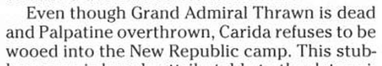
- **Kyp Durron; Sun Crusher; Ambassador Furgan** — Carida — destroyed: "Alas, none of his defenses can save Carida from an exploding sun, as Furgan learns when Kyp destroys the system with the Sun Crusher." Source: The Jedi Academy Sourcebook, p.109
  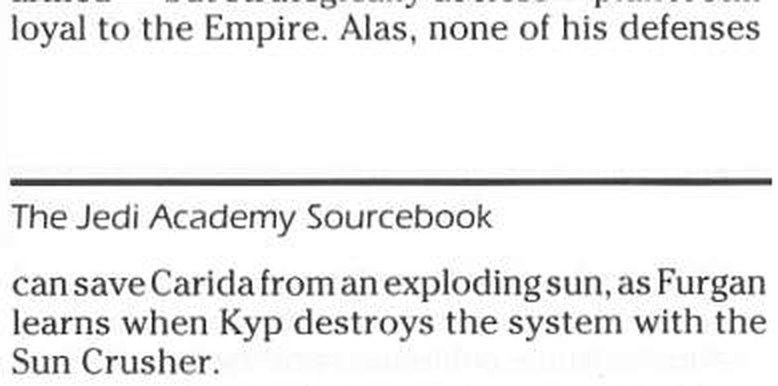

## p.110 (scan page sp111)

- Scope: Academy citadel; Dantooine and stats.
- Scope note: no power, skill or lore statement about the tracked characters on this page beyond the summary above.

## p.111 (scan page sp112)

- Scope: Eol Sha colony on Dantooine destroyed by Daala; Deyer (crushed by Palpatine) and stats; Eol Sha begins.

- **Admiral Daala** — Dantooine — the Eol Sha colony wiped out: "Unfortunately for the colonists, Admiral Daala intercepted a supply ship enroute to Dantooine, and decided to send a message to the New Republic by wiping out the fledgling colony." Source: The Jedi Academy Sourcebook, p.111
  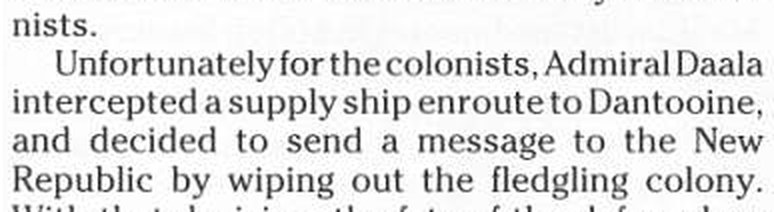
- **Admiral Daala** — Dantooine — no survivors: "There were no survivors, and nothing is left of the colony but scorched earth." Source: The Jedi Academy Sourcebook, p.111
  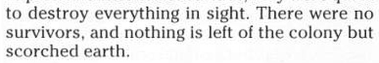
- **Palpatine (Darth Sidious)** — Deyer — crushed by Palpatine: "Palpatine crushed the "dissidents" utterly, overrunning the entire colony, and scattering the people to various penal centers." Source: The Jedi Academy Sourcebook, p.111
  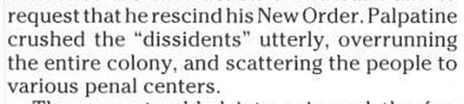

## p.112 (scan page sp113)

- Scope: Eol Sha (Gantoris's colony, evacuation) and stats; Umgul.

- **Luke Skywalker; Gantoris** — Eol Sha — Luke's visit: "By the time Luke visits the settlement in search of a Jedi candidate, less than 40 colonists remain, lead by Gantoris," Source: The Jedi Academy Sourcebook, p.112
  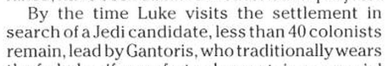
- **Admiral Daala** — Eol Sha — the colonists' fate: "Unhappily, it turns out that they would have lived longer on Eol Sha than their new world of Dantooine, where they become examples of Admiral Daala's cruelty and ambition." Source: The Jedi Academy Sourcebook, p.112
  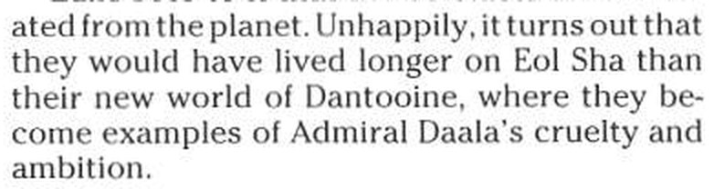

## p.113 (scan page sp114)

- Scope: Umgul stats; Umgul City (art credit Brian Schomburg).
- Scope note: no power, skill or lore statement about the tracked characters on this page beyond the summary above.

## p.114 (scan page sp115)

- Scope: Umgul City; Fondine Blob Raceways.
- Scope note: no power, skill or lore statement about the tracked characters on this page beyond the summary above.

## p.115 (scan page sp116)

- Scope: Full-page illustration (blob races).
- Scope note: no power, skill or lore statement about the tracked characters on this page beyond the summary above.

## p.116 (scan page sp117)

- Scope: Raceways; blobstacle course; Vortex begins (art credit Storn Cook).
- Scope note: no power, skill or lore statement about the tracked characters on this page beyond the summary above.

## p.117 (scan page sp118)

- Scope: Vortex; sidebar: Vors and stats.
- Scope note: no power, skill or lore statement about the tracked characters on this page beyond the summary above.

## p.118 (scan page sp119)

- Scope: Cathedral of Winds (silenced under Palpatine; destroyed by the B-wing crash; rebuilt).

- **Palpatine (Darth Sidious)** — Cathedral of Winds — silenced: "The music of the winds ceased when Senator Palpatine announced his New Order and declared himself Emperor." Source: The Jedi Academy Sourcebook, p.118
  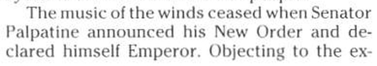

