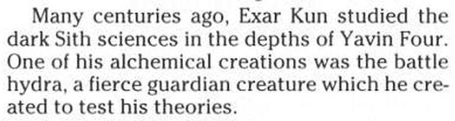
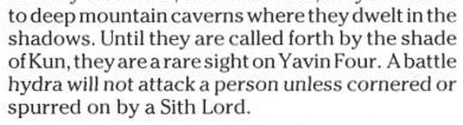

# Owner Material 029 — The Jedi Academy Sourcebook (WEG, 1996): Chapter Eleven: Creatures

- **Source:** *The Jedi Academy Sourcebook* by Paul Sudlow (West End Games, April 1996; WEG 40114). Licensed Legends Star Wars Roleplaying Game (d6) companion to Kevin J. Anderson's Jedi Academy trilogy. Scan from the d6holocron archive (145 PDF pages, image-only; OCR'd on the box), read in full 2026-10-28 including sidebars, captions, fiction excerpts and stat blocks. The scan stays box-only and is **not** published.
- **Quotes:** verbatim as printed (obvious OCR slips corrected against the page image), cited "The Jedi Academy Sourcebook, p.X" by **printed** page (printed page = scan page − 1). Sidebars, captions and fiction excerpts are marked **sidebar/caption**; d6 statistics are marked **stat block** and **RPG mechanics (weaker source)**. Each quote has a crop of the printed passage directly under it.
- **Weight:** secondary source. The prose summarises the trilogy (026), which outranks it; d6 game statistics are mechanics, not canon feats, and rank lowest. See README § How much weight.

## p.119 (scan page sp120)

- Scope: Chapter Eleven: Creatures — battle hydra (Exar Kun's creation) (art credit Jon Dollar).

- **Exar Kun** — Battle Hydra — Kun's creation: "Many centuries ago, Exar Kun studied the dark Sith sciences in the depths of Yavin Four. One of his alchemical creations was the battle hydra, a fierce guardian creature which he created to test his theories." Source: The Jedi Academy Sourcebook, p.119
  
- **Exar Kun** — Battle Hydra — called by Kun's shade: "Until they are called forth by the shade of Kun, they are a rare sight on Yavin Four. A battle hydra will not attack a person unless cornered or spurred on by a Sith Lord." Source: The Jedi Academy Sourcebook, p.119
  

## p.120 (scan page sp121)

- Scope: Battle hydra stats; bogey; granite slug (art credit Storn Cook).
- Scope note: no power, skill or lore statement about the tracked characters on this page beyond the summary above.

## p.121 (scan page sp122)

- Scope: Krakana; lava dragon; piranha beetle.
- Scope note: no power, skill or lore statement about the tracked characters on this page beyond the summary above.

## p.122 (scan page sp123)

- Scope: Full-page illustration.
- Scope note: no power, skill or lore statement about the tracked characters on this page beyond the summary above.

## p.123 (scan page sp124)

- Scope: Piranha beetle end; ratidillo; spice spider (art credit Storn Cook).
- Scope note: no power, skill or lore statement about the tracked characters on this page beyond the summary above.

## p.124 (scan page sp125)

- Scope: Spice spider stats; Umgullan racing blob.
- Scope note: no power, skill or lore statement about the tracked characters on this page beyond the summary above.

