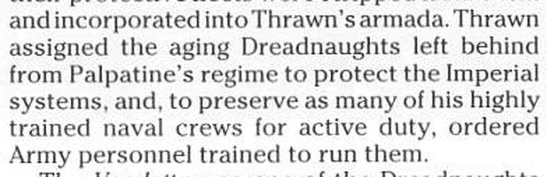

# Owner Material 029 — The Jedi Academy Sourcebook (WEG, 1996): Chapter Twelve: Starships

- **Source:** *The Jedi Academy Sourcebook* by Paul Sudlow (West End Games, April 1996; WEG 40114). Licensed Legends Star Wars Roleplaying Game (d6) companion to Kevin J. Anderson's Jedi Academy trilogy. Scan from the d6holocron archive (145 PDF pages, image-only; OCR'd on the box), read in full 2026-10-28 including sidebars, captions, fiction excerpts and stat blocks. The scan stays box-only and is **not** published.
- **Quotes:** verbatim as printed (obvious OCR slips corrected against the page image), cited "The Jedi Academy Sourcebook, p.X" by **printed** page (printed page = scan page − 1). Sidebars, captions and fiction excerpts are marked **sidebar/caption**; d6 statistics are marked **stat block** and **RPG mechanics (weaker source)**. Each quote has a crop of the printed passage directly under it.
- **Weight:** secondary source. The prose summarises the trilogy (026), which outranks it; d6 game statistics are mechanics, not canon feats, and rank lowest. See README § How much weight.

## p.125 (scan page sp126)

- Scope: Chapter Twelve: Starships — T-65AC4 X-wing; expanded B-wings.
- Scope note: no power, skill or lore statement about the tracked characters on this page beyond the summary above.

## p.126 (scan page sp127)

- Scope: B-wing/E2; sidebar: Ackbar's personal B-wing (Terpfen's sabotage); B-wing/E stats.
- Scope note: no power, skill or lore statement about the tracked characters on this page beyond the summary above.

## p.127 (scan page sp128)

- Scope: Hornet Interceptor (art credit Ray Lederer).
- Scope note: no power, skill or lore statement about the tracked characters on this page beyond the summary above.

## p.128 (scan page sp129)

- Scope: Hornet diagram and stats (art credit Troy Vigil).
- Scope note: no power, skill or lore statement about the tracked characters on this page beyond the summary above.

## p.129 (scan page sp130)

- Scope: Super TIE stats; Svelte-class Imperial shuttle ("the Lord Vader") and diagram.
- Scope note: no power, skill or lore statement about the tracked characters on this page beyond the summary above.

## p.130 (scan page sp131)

- Scope: Svelte stats; Capital Ships; Vibre-class assault cruiser (art credit Troy Vigil).
- Scope note: no power, skill or lore statement about the tracked characters on this page beyond the summary above.

## p.131 (scan page sp132)

- Scope: Assault cruiser stats.
- Scope note: no power, skill or lore statement about the tracked characters on this page beyond the summary above.

## p.132 (scan page sp133)

- Scope: The Vendetta (Thrawn's Dreadnaughts, Ardax, destroyed at Anoth) and stats; the Galactic Voyager begins.

- **Grand Admiral Thrawn** — The Vendetta — Thrawn's Dreadnaughts: "Thrawn assigned the aging Dreadnaughts left behind from Palpatine's regime to protect the Imperial systems, and, to preserve as many of his highly trained naval crews for active duty, ordered Army personnel trained to run them." Source: The Jedi Academy Sourcebook, p.132
  

## p.133 (scan page sp134)

- Scope: Galactic Voyager and stats.
- Scope note: no power, skill or lore statement about the tracked characters on this page beyond the summary above.

## p.134 (scan page sp135)

- Scope: The Yavaris and stats (art credit Ray Lederer).
- Scope note: no power, skill or lore statement about the tracked characters on this page beyond the summary above.

## p.135 (scan page sp136)

- Scope: Yavaris weapons.
- Scope note: no power, skill or lore statement about the tracked characters on this page beyond the summary above.

