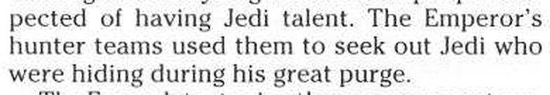
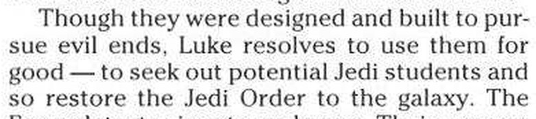
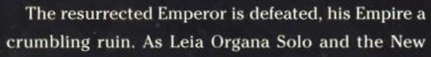
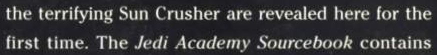

# Owner Material 029 — The Jedi Academy Sourcebook (WEG, 1996): Chapter Fourteen: Equipment and Droids, and back cover

- **Source:** *The Jedi Academy Sourcebook* by Paul Sudlow (West End Games, April 1996; WEG 40114). Licensed Legends Star Wars Roleplaying Game (d6) companion to Kevin J. Anderson's Jedi Academy trilogy. Scan from the d6holocron archive (145 PDF pages, image-only; OCR'd on the box), read in full 2026-10-28 including sidebars, captions, fiction excerpts and stat blocks. The scan stays box-only and is **not** published.
- **Quotes:** verbatim as printed (obvious OCR slips corrected against the page image), cited "The Jedi Academy Sourcebook, p.X" by **printed** page (printed page = scan page − 1). Sidebars, captions and fiction excerpts are marked **sidebar/caption**; d6 statistics are marked **stat block** and **RPG mechanics (weaker source)**. Each quote has a crop of the printed passage directly under it.
- **Weight:** secondary source. The prose summarises the trilogy (026), which outranks it; d6 game statistics are mechanics, not canon feats, and rank lowest. See README § How much weight.

## p.140 (scan page sp141)

- Scope: Chapter Fourteen: Equipment and Droids — Force detector (the purge; Luke's use); organic gill; stun cuffs.

- **Palpatine (Darth Sidious)** — Force Detector — the purge: "The Emperor's hunter teams used them to seek out Jedi who were hiding during his great purge." Source: The Jedi Academy Sourcebook, p.140
  
- **Luke Skywalker** — Force Detector — Luke's use: "Though they were designed and built to pursue evil ends, Luke resolves to use them for good — to seek out potential Jedi students and so restore the Jedi Order to the galaxy." Source: The Jedi Academy Sourcebook, p.140
  

## p.141 (scan page sp142)

- Scope: Stun cuffs stats; Imperial City maintenance droid; Imperial prison medical droid; TDL nanny droid.
- Scope note: no power, skill or lore statement about the tracked characters on this page beyond the summary above.

## p.142 (scan page sp143)

- Scope: Full-page illustration.
- Scope note: no power, skill or lore statement about the tracked characters on this page beyond the summary above.

## p.143 (scan page sp144)

- Scope: TDL stats; FIDO and stats (art credit Ray Lederer).
- Scope note: no power, skill or lore statement about the tracked characters on this page beyond the summary above.

## back cover (scan page sp145)

- Scope: Back cover blurb.

- **Palpatine (Darth Sidious)** — Back cover blurb: "The resurrected Emperor is defeated, his Empire a crumbling ruin." Source: The Jedi Academy Sourcebook, back cover, sidebar/caption
  
- **Sun Crusher** — Back cover blurb: "the terrifying Sun Crusher are revealed here for the first time." Source: The Jedi Academy Sourcebook, back cover, sidebar/caption
  

