# Owner Material 029 — The Jedi Academy Sourcebook (WEG, 1996): power-scaling and lore notes

**Read 2026-10-28** (Oct 28, 2026). Item 6 of the owner's Jedi Academy queue, after the trilogy (026), *The New Essential Chronology* (027) and the *Jedi Academy Training Manual* (028). The owner asked for full secondary-source treatment: every page, including side boxes and top-right boxes, verbatim quotes with page numbers, a cropped image under each quote, and per-character merges.

- **Book:** *The Jedi Academy Sourcebook* by Paul Sudlow (West End Games, first printing April 1996; WEG 40114). A Star Wars Roleplaying Game (d6, Second Edition) companion to Kevin J. Anderson's Jedi Academy trilogy. It has fourteen chapters: The New Republic, Coruscant, The Jedi Academy, Echoes of the Sith, Forces of the Empire, Maw Installation, The Fringe, Kessel, The Independent Class, Planets, Creatures, Starships, Vehicles, and Equipment and Droids.
- **Which file:** the owner's link (d6holocron `WEG40042.pdf`) turned out to be *Han Solo and the Corporate Sector Sourcebook*, a different book. The Jedi Academy Sourcebook is WEG 40114. It was retrieved from the Internet Archive's copy of the same d6holocron downloads folder (`WEG40114.pdf`), because the live site did not serve it. The mislinked book is kept box-only and was not processed.
- **What the file is:** a 145-page PDF scan, one printed page per PDF page, image only (**no text layer**). Printed page = PDF page − 1; this was checked against the page footers throughout.
- **Raw copy:** box only, `[local path]`. It is **not** published to GitHub.

**Status: primary read by us.**
- **All 145 PDF pages were read**: covers, credits, contents, all fourteen chapters and the back cover. Tesseract OCR was run twice (3× upscale, then a background-normalised pass), and pages were checked against the images. The per-page scope log is box-only (`scope.log`, `PROGRESS.md`).
- **Side boxes:** all sidebars (fiction excerpts, memos, datapad entries, fleet and history boxes, the Kessel Run box) and captions were read. **17** quotes come from sidebars, captions or blurbs (marked **sidebar/caption**). **27** quotes come from d6 stat blocks (marked **stat block — RPG mechanics (weaker source)**).
- **Quotes:** **169** verbatim quotes, cited "The Jedi Academy Sourcebook, p.X" by **printed** page. Obvious OCR slips were corrected against the page image. Each quote has a crop of the printed passage directly under it (`quotes/`, 169 JPEGs). Crops were made by matching OCR words (best of the two passes), and every crop was checked by eye on contact sheets.
- **Per-character merges:** entries were merged into `characters/<slug>.md` by the build (source `mat-jas-<chapter>`, tagged `[Legends · The Jedi Academy Sourcebook (WEG, 1996)]`).
- **Not in this book:** Brakiss is not named anywhere in it (both OCR passes searched). Every other tracked figure appears: Luke, Exar Kun, Kyp, Gantoris, Streen, Kam Solusar, Daala, Han, Leia, Mara, the Sun Crusher, Thrawn and Palpatine.

## How much weight these entries carry

- **Secondary source.** A licensed Legends RPG book written as a companion to the trilogy. It ranks **below** the novels it summarises (026), and alongside *The New Essential Chronology* (027) and the *Jedi Academy Training Manual* (028).
- **Stat blocks are the weakest evidence.** d6 numbers (skill dice, Force skills, Force Points, Dark Side Points) are game balance, not canon feats. They are useful only as a rough ranking inside the same book. For example, Luke's Force skills are Control 13D+1, sense 11D+1, alter 10D+2, against Kyp's Control 5D+2, sense 5D, alter 3D+2.
- The prose's value is in **framing statements**, for example:
  - Kun "was far more powerful than any one other Jedi of his time" (p.40).
  - Kyp "within days has surpassed the achievements of the other Jedi students" (p.36).
  - The Sun Crusher "cost as much to develop as the original Death Star superlaser" (p.66).

## Files (15 section notes, in book order)

| File | PDF pages | Quotes | What it is |
|---|---|---|---|
| `00-front-matter.md` | 1–5 | 1 | Front matter (covers, credits, contents) |
| `01-ch1-the-new-republic.md` | 6–22 | 11 | Chapter One: The New Republic |
| `02-ch2-coruscant.md` | 23–30 | 1 | Chapter Two: Coruscant |
| `03-ch3-the-jedi-academy.md` | 31–48 | 59 | Chapter Three: The Jedi Academy |
| `04-ch4-echoes-of-the-sith.md` | 49–52 | 20 | Chapter Four: Echoes of the Sith |
| `05-ch5-forces-of-the-empire.md` | 53–62 | 26 | Chapter Five: Forces of the Empire |
| `06-ch6-maw-installation.md` | 63–80 | 17 | Chapter Six: Maw Installation |
| `07-ch7-the-fringe.md` | 81–85 | 9 | Chapter Seven: The Fringe |
| `08-ch8-kessel.md` | 86–96 | 6 | Chapter Eight: Kessel |
| `09-ch9-the-independent-class.md` | 97–100 | 1 | Chapter Nine: The Independent Class |
| `10-ch10-planets.md` | 101–119 | 11 | Chapter Ten: Planets |
| `11-ch11-creatures.md` | 120–125 | 2 | Chapter Eleven: Creatures |
| `12-ch12-starships.md` | 126–136 | 1 | Chapter Twelve: Starships |
| `13-ch13-vehicles.md` | 137–140 | 0 | Chapter Thirteen: Vehicles |
| `14-ch14-equipment-droids-back-cover.md` | 141–145 | 4 | Chapter Fourteen: Equipment and Droids, and back cover |

Each section note goes page by page (`## p.X (scan page spNNN)`). Each page has a Scope line saying what is on it (including sidebars and captions), then every quote in page order, with the characters it is about in bold. Pages with nothing to log say so.

## Per-character highlights (power and skill statements)

- **Luke Skywalker**
  - "After a time, Luke succeeds in gathering together twelve students who are willing to learn how to harness the powers they have in the service of the New Republic." Source: The Jedi Academy Sourcebook, p.31
    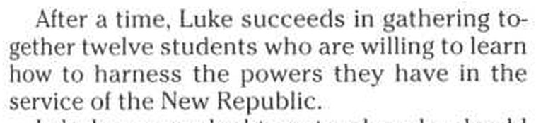
  - "Even though the corrupting influence of a power as great as Exar Kun is a special case not anticipated by most Jedi teachers, Luke comes out of the experience with a new respect for the awesome responsibility that comes with being the teacher of a new generation of Jedi." Source: The Jedi Academy Sourcebook, p.32
    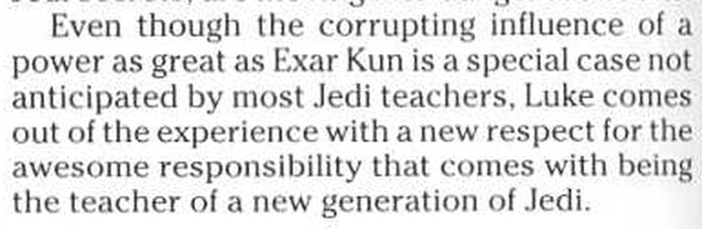
  - "By augmenting his power with that of Kun, Kyp places Luke in a deep coma from which even the best New Republic doctors cannot awaken him." Source: The Jedi Academy Sourcebook, p.34
    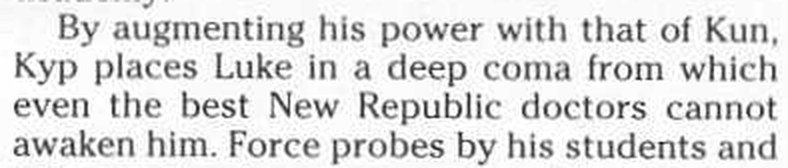
  - "Luke shielded his exposed flesh from the scalding droplets and waited for the blast to dwindle." Source: The Jedi Academy Sourcebook, p.46, sidebar/caption
    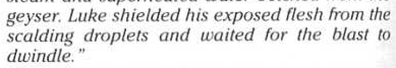
  - "Though they were designed and built to pursue evil ends, Luke resolves to use them for good — to seek out potential Jedi students and so restore the Jedi Order to the galaxy." Source: The Jedi Academy Sourcebook, p.140
    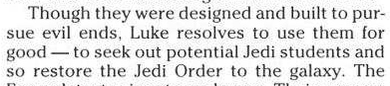
  - "Blaster 6D+2, brawling parry 6D+2, dodge 9D, melee combat 5D+2, melee parry 10D+2, lightsaber 11D" Source: The Jedi Academy Sourcebook, p.34, stat block — RPG mechanics (weaker source)
    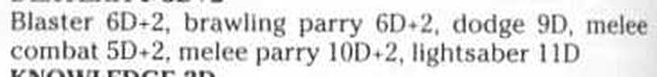
  - "Force Skills: Control 13D+1, sense 11D+1, alter 10D+2" Source: The Jedi Academy Sourcebook, p.34, stat block — RPG mechanics (weaker source)
    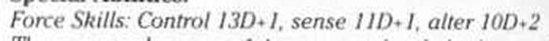
  - "Control, Sense and Alter: Affect mind, doppleganger**, force harmony**, telekinetic kill*" Source: The Jedi Academy Sourcebook, p.34, stat block — RPG mechanics (weaker source)
    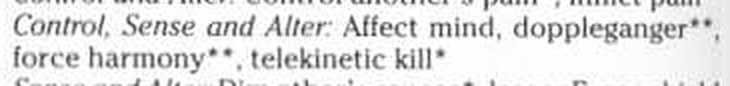
- **Exar Kun**
  - "With this knowledge Exar Kun established a vast and powerful brotherhood and claimed the title of the first Dark Lord of the Sith." Source: The Jedi Academy Sourcebook, p.48
    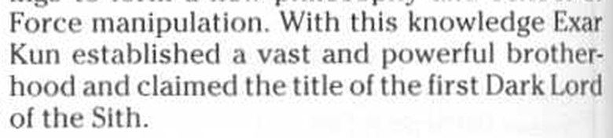
  - "When the Jedi combined their might and came to Kun's retreat on Yavin Four to fight him, they unleashed such power that Kun had to drain every last one of his Massassi slaves just to trap his spirit within his temples — to survive so that one day he could come back." Source: The Jedi Academy Sourcebook, p.48
    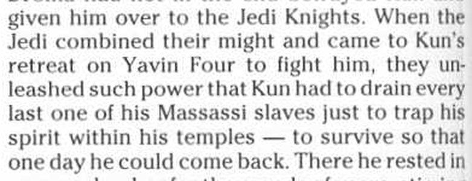
  - "The figure is Exar Kun, He had designed the temple to be an angular funnel to concentrate the Force, in a configuration which would enhance the powers of Sith rituals." Source: The Jedi Academy Sourcebook, p.42
    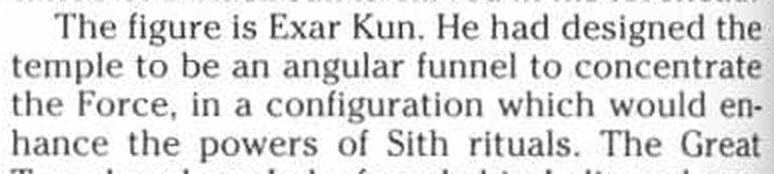
  - "To his surprise, Kun recognizes the leader to be the same man who had visited Yavin Four years earlier, now much more powerful in the Force. Too powerful, for the moment, for Kun to tackle." Source: The Jedi Academy Sourcebook, p.49
    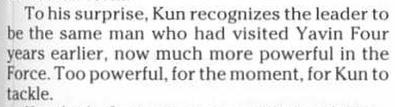
  - "Exar Kun himself possessed a great many other dark powers that he was unable to harness without the energy he needed to fuel his disembodied will. Some of these powers he was able to channel through Kyp, Gantoris, and Streen to achieve his ends." Source: The Jedi Academy Sourcebook, p.50
    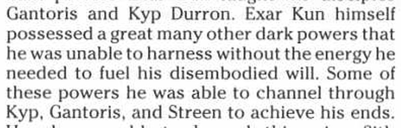
  - "There, Exar Kun fully embraced the dark side and destroyed Freedon Nadd." Source: The Jedi Academy Sourcebook, p.48
    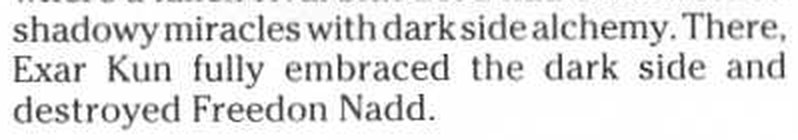
  - "Many centuries ago, Exar Kun studied the dark Sith sciences in the depths of Yavin Four. One of his alchemical creations was the battle hydra, a fierce guardian creature which he created to test his theories." Source: The Jedi Academy Sourcebook, p.119
    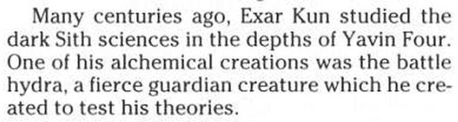
- **Kyp Durron**
  - "There, he immerses himself in work, and within days has surpassed the achievements of the other Jedi students." Source: The Jedi Academy Sourcebook, p.36
    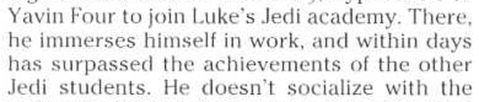
  - "He destroys one of Daala's Star Destroyers, destroys Carida in a failed attempt to rescue his brother, and goes on to destroy a major Imperial depot in a peripheral Imperial Core system." Source: The Jedi Academy Sourcebook, p.36
    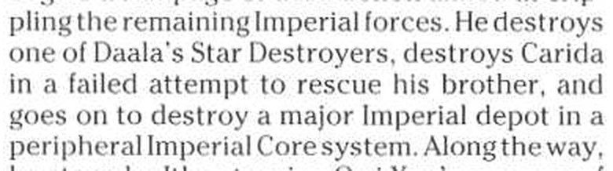
  - "In outrage Kyp found the power to send a burst of controlling thought through the integrated circuits in the Sun Crusher's computer." Source: The Jedi Academy Sourcebook, p.50, sidebar/caption
    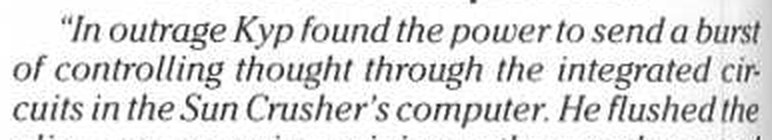
  - "He consciously exuded a shadow of uneasiness around him so that lower creatures had no incentive to come nearer. Exar Kun had taught him that trick" Source: The Jedi Academy Sourcebook, p.50, sidebar/caption
    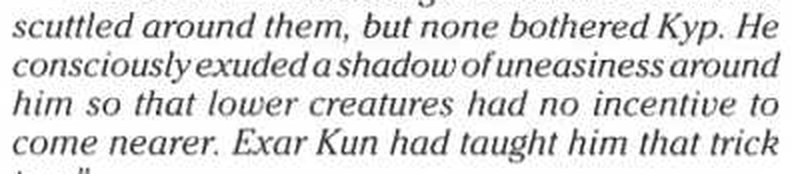
  - "He grows very powerful on Kyp's hate, and soon his hold on Kyp is so complete that he can send Kyp beyond the planet to do his will and still retain control over his subject." Source: The Jedi Academy Sourcebook, p.49
    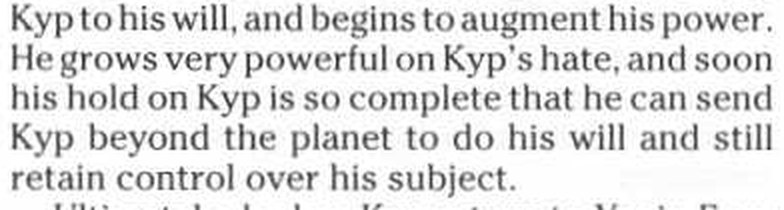
  - "This dreadful power allows a Sith to sift through another person's mind, and destroy all knowledge of specific events or learned skills." Source: The Jedi Academy Sourcebook, p.51
    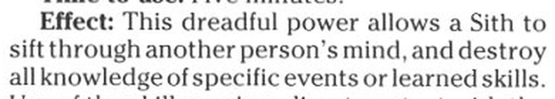
  - "Force Skills: Control 5D+2, sense 5D, alter 3D+2 These are only some of the powers that Kyp has demonstrated. His abilities were unnaturally augmented by Exar Kun." Source: The Jedi Academy Sourcebook, p.36, stat block — RPG mechanics (weaker source)
    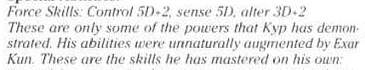
- **Gantoris**
  - "On several occasions, he was able to sense impending groundquakes, and once miraculously survived an avalanche that killed all the other children in his play group." Source: The Jedi Academy Sourcebook, p.34
    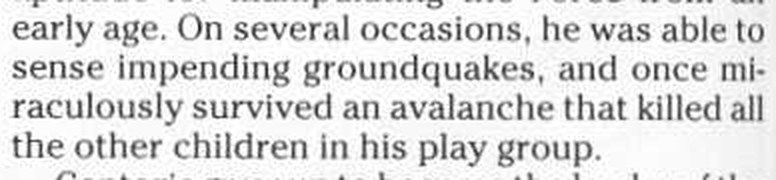
  - "Ultimately, he grows bold enough in his new forbidden powers to challenge Luke to a duel. When Luke defeats him, he begins to suspect that he has taken the wrong path to achieve the goals he is seeking." Source: The Jedi Academy Sourcebook, p.35
    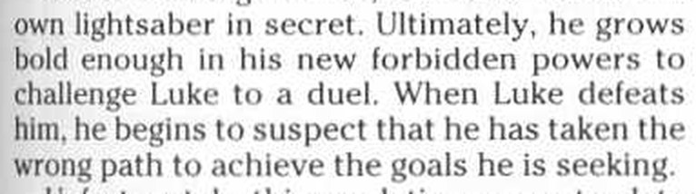
  - "However, Kun easily goads Gantoris into striking out at him with his passions, by taunting him with a vision of the Eol Sha colonists dying. In resisting Kun with his anger, Gantoris is burned to ashes," Source: The Jedi Academy Sourcebook, p.35
    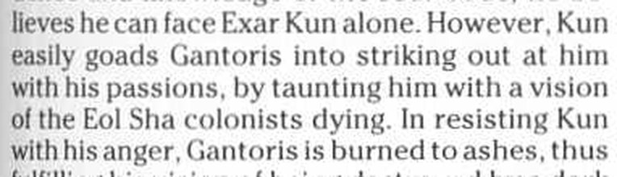
  - "Realizing that Gantoris is no longer his, Kun utterly drains him to provide himself a reserve of energy to last until he can subvert more students." Source: The Jedi Academy Sourcebook, p.49
    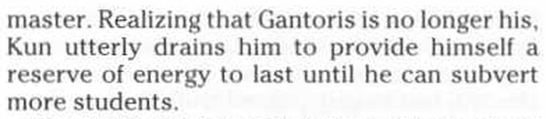
- **Streen**
  - "Empowered by Kun, Streen attacks Luke's sleeping body by creating a force of wind which lifts Luke up toward the skylight in the room. He is not aware of what he is doing, and ceases as soon as Kirana Ti tackles him and breaks his trance." Source: The Jedi Academy Sourcebook, p.37
    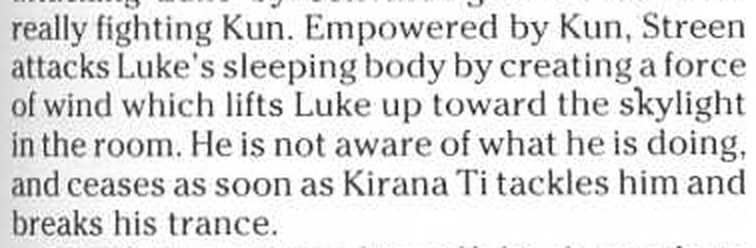
  - "It is Streen who protects the group from Kun's throat-constricting attack while they work to defeat the ancient Sith Lord." Source: The Jedi Academy Sourcebook, p.37
    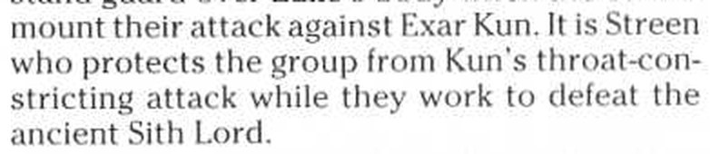
  - "This power allows the Sith to manipulate and channel air currents to form powerful and destructive tornadoes which can lift people bodily up into the air and fling them about." Source: The Jedi Academy Sourcebook, p.50
    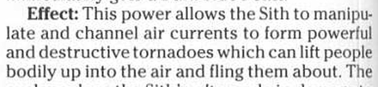
  - "Force Skills: Control 3D+1, sense 4D, alter 4D" Source: The Jedi Academy Sourcebook, p.37, stat block — RPG mechanics (weaker source)
    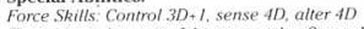
- **Kam Solusar**
  - "Kam's grasp of the Force is astounding in some areas, and remarkably weak in others, because he was forced to leave his master before he could complete his training." Source: The Jedi Academy Sourcebook, p.39
    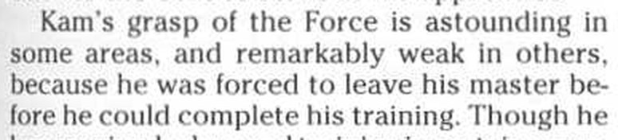
  - "Ranik fell at the hands of Lord Darth Vader, and Kam himself barely escaped the Imperial inquisition." Source: The Jedi Academy Sourcebook, p.39
    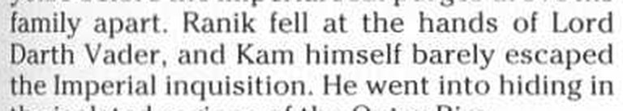
  - "Like Luke and Kyp, Kam has had his brush with the dark side of the Force. While in exile, he was captured and tortured by evil Jedi, and twisted to serve the dark side. Luke won him back over to the light side, and brought him back to the Core to serve as his apprentice." Source: The Jedi Academy Sourcebook, p.39
    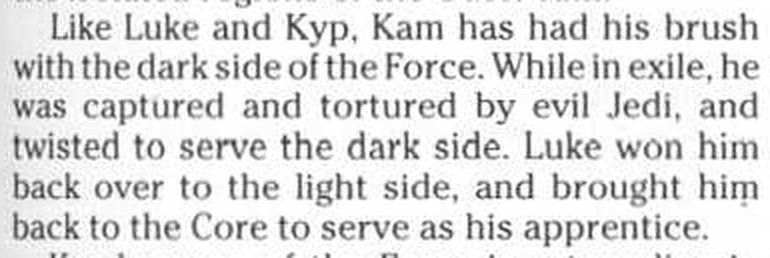
  - "Force Skills: Control 2D+2, sense 4D+1, alter 6D" Source: The Jedi Academy Sourcebook, p.39, stat block — RPG mechanics (weaker source)
    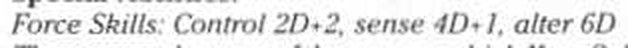
- **Admiral Daala**
  - "As a cadet, she pushed herself to her physical and mental limits, and occasionally beyond. She excelled in every curriculum, and used her strategic skills to wipe out entire navies in wargames." Source: The Jedi Academy Sourcebook, p.56
    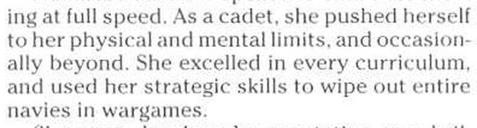
  - "She absorbed every lesson Tarkin taught her, and came to analyze every scenario and situation in light of how he might respond to it." Source: The Jedi Academy Sourcebook, p.56
    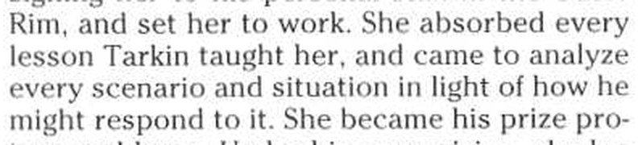
  - "She resolves to strike at Coruscant itself, ramming the stripped-down Star Destroyer Basilisk into Imperial City at full speed, leveling buildings for thousands of kilometers, and causing drastic damage to the crust of the planet." Source: The Jedi Academy Sourcebook, p.56
    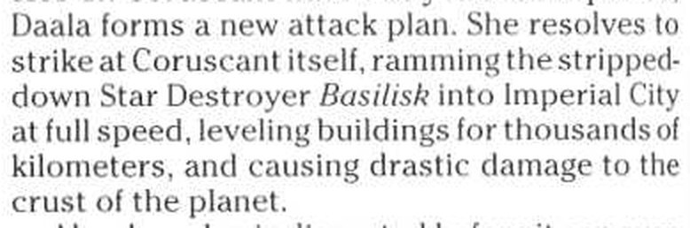
  - "Unfortunately for the colonists, Admiral Daala intercepted a supply ship enroute to Dantooine, and decided to send a message to the New Republic by wiping out the fledgling colony." Source: The Jedi Academy Sourcebook, p.111
    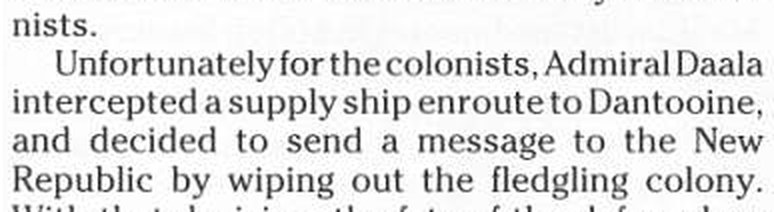
  - "Her plan is tactically flawless, but it reveals her greatest weakness: her tendency to rely on Tarkin's strategies rather than her own instincts." Source: The Jedi Academy Sourcebook, p.56
    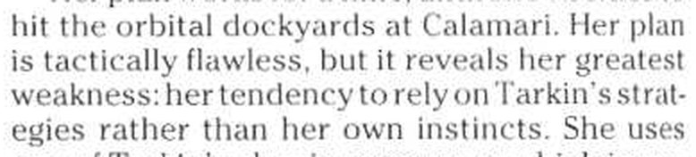
  - "Blaster 5D, blaster: blaster pistol 6D+2, blaster artillery 4D, brawling parry 7D, dodge 6D," Source: The Jedi Academy Sourcebook, p.57, stat block — RPG mechanics (weaker source)
    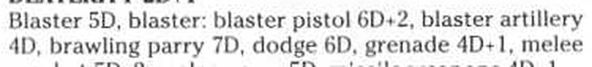
  - "tactics: fleets 8D+1, tactics: ground assault tactics 7D+1, tactics: starfighters 8D+2," Source: The Jedi Academy Sourcebook, p.57, stat block — RPG mechanics (weaker source)
    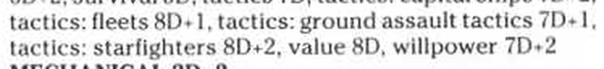
- **Han Solo**
  - "While in the mines, Han encounters a young man named Kyp Durron. As Roa took Han under his wing, Han in turn befriends Kyp and forges a mentor-like bond with the young man." Source: The Jedi Academy Sourcebook, p.11
    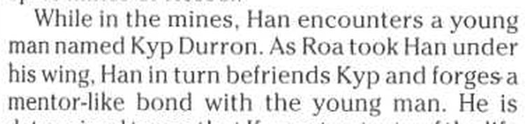
  - "Han Solo once claimed he made the Kessel Run in less than 12 parsecs (indicating 11.5 parsecs). To successfully navigate this run, Han would have made eight Very Difficult astrogation rolls, four Heroic astrogation rolls, and one Heroic+30 astrogation roll." Source: The Jedi Academy Sourcebook, p.85, sidebar/caption
    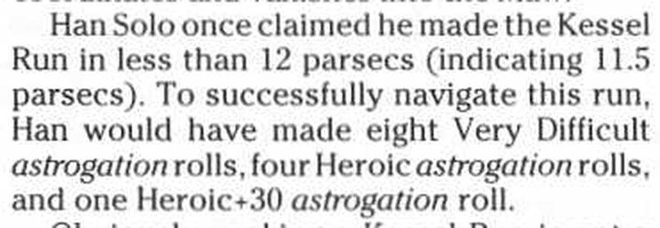
  - "Blaster 8D+2, blaster: blaster rifle 5D+1, blaster: heavy blaster pistol 10D+1," Source: The Jedi Academy Sourcebook, p.11, stat block — RPG mechanics (weaker source)
    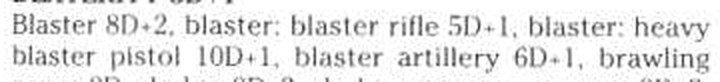
- **Leia Organa Solo**
  - "She feels guilty for not devoting more time to her Jedi training, but it takes a definite back seat to her professional duties and family time. Luke has said nothing, but Leia knows that he worries about her lack of progress." Source: The Jedi Academy Sourcebook, p.10
    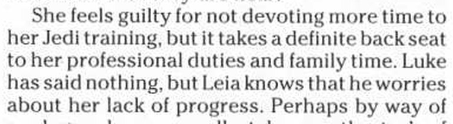
  - "I'm very worried about having the twins here while whatever destroyed Gantoris and put Luke in a coma is still at large. Sometimes I can feel a sudden chill pass through me, as if something evil is watching me." Source: The Jedi Academy Sourcebook, p.107, sidebar/caption
    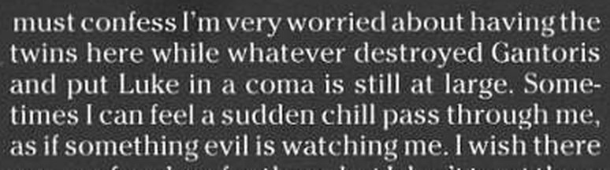
  - "Force Skills: Control 5D+1, sense 4D+2, alter 3D" Source: The Jedi Academy Sourcebook, p.10, stat block — RPG mechanics (weaker source)
    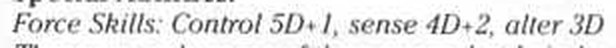
- **Mara Jade**
  - "When the "closer look" turns into a wild and rough piggyback ride within the girders of the Death Star, she suggests that she and Lando plant limpet mines on the power core of the Death Star while Han repairs the Falcon's hyperdrive." Source: The Jedi Academy Sourcebook, p.82
    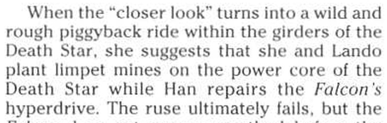
  - "Mara, once a hardened and angry lone wolf, is softening as time takes her farther from her experience as the Emperor's Hand. She still has a rough-edged hardness about her, but she has emerged from the shadow of the dark side." Source: The Jedi Academy Sourcebook, p.82
    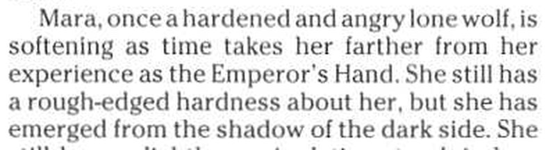
  - "Blaster 9D+1, blaster: hold-out blaster 11D, brawling parry 7D+2, dodge 9D, lightsaber 4D+2, melee combat 8D+1, melee parry 7D+2," Source: The Jedi Academy Sourcebook, p.82, stat block — RPG mechanics (weaker source)
    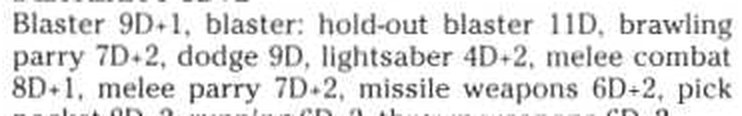
  - "Control, Sense, and Alter: Telekenetic kill**" Source: The Jedi Academy Sourcebook, p.83, stat block — RPG mechanics (weaker source)
    
- **Sun Crusher**
  - "Each of its innovative features, from its molecular armor to its resonance torpedoes, cost as much to develop as the original Death Star superlaser. The Sun Crusher project was headed by Qwi Xux, who also contributed some of its design features." Source: The Jedi Academy Sourcebook, p.66
    
  - "modulated resonance torpedoes capable of destroying stars. The torpedo detonation triggers a chain reaction in the core of the target sun, igniting a supernova even in low-mass stars. The resulting blast destroys the entire system over a period of several hours." Source: The Jedi Academy Sourcebook, p.68
    
  - "The Sun Crusher is equipped with nearly impregnable quantum armor so it can fulfill its mission without regard to the fleet that might be arrayed against it." Source: The Jedi Academy Sourcebook, p.68
    
  - "The armor is strong enough that the Sun Crusher has a good chance of surviving even if it gets caught in the blast radius of its resonance torpedoes, as long as it is far enough from the exploding star to avoid the worst of the shock wave." Source: The Jedi Academy Sourcebook, p.68
    
  - "Hull: 50D Shields: 1D" Source: The Jedi Academy Sourcebook, p.68, stat block — RPG mechanics (weaker source)
    
  - "When fired into a star, the torpedo's sophisticated tracking system guarantees impact with a star, and its devastating impact on a star has very little to do with its explosive or kinetic power — it simply triggers a chain reaction which ignites a supernova, destroying the star and anything in the system." Source: The Jedi Academy Sourcebook, p.68, stat block — RPG mechanics (weaker source)
    
- **Grand Admiral Thrawn**
  - "The arrival of Grand Admiral Thrawn exacerbated these fears, and it was very difficult for New Republic diplomats, led by Mon Mothma and Leia Organa Solo, to woo worlds into the New Republic fold even after his defeat at Bilbringi." Source: The Jedi Academy Sourcebook, p.52
    
  - "Even though Grand Admiral Thrawn is dead and Palpatine overthrown, Carida refuses to be wooed into the New Republic camp." Source: The Jedi Academy Sourcebook, p.109
    
  - "Thrawn assigned the aging Dreadnaughts left behind from Palpatine's regime to protect the Imperial systems, and, to preserve as many of his highly trained naval crews for active duty, ordered Army personnel trained to run them." Source: The Jedi Academy Sourcebook, p.132
    
- **Palpatine (Darth Sidious)**
  - "He has already demonstrated that he is strong in the Force. Even as an unborn child he helped his mother and uncle defeat the reborn Emperor," Source: The Jedi Academy Sourcebook, p.12
    
  - "During the Emperor's latest campaigns, the New Republic suffered mightily, reduced once again to a band of Rebels." Source: The Jedi Academy Sourcebook, p.52
    
  - "Their greatest hope rose and died in the form of the resurrected Emperor." Source: The Jedi Academy Sourcebook, p.52
    
  - "(An oft-repeated spacers' tale relates how the Emperor himself emerged from his meditation chamber one day and immediately ordered a colony built on the remote planet.)" Source: The Jedi Academy Sourcebook, p.86
    
  - "The Emperor's hunter teams used them to seek out Jedi who were hiding during his great purge." Source: The Jedi Academy Sourcebook, p.140
    
