# Owner Material 030 — The Complete Star Wars Encyclopedia, Vol. I (A–G): scan pages 1–40

- **Source:** *The Complete Star Wars Encyclopedia* by Stephen J. Sansweet and Pablo Hidalgo, with Bob Vitas, Daniel Wallace, Chris Cassidy, Mary Franklin and Josh Kushins (Del Rey, 2008), 3 vols. Secondary source (licensed Legends reference). Scan OCR'd on the box; the scan stays box-only and is **not** published.
- **Method:** every scanned page was OCR'd and machine-screened sentence by sentence for power-relevant statements (fights, kills, defeats, Force feats, rankings, superweapons) that name a character on our roster; each kept sentence is quoted verbatim from the OCR text and has a crop of the printed passage directly under it. Pages with nothing power-relevant are still listed with what is on them.
- **Citation:** "The Complete Star Wars Encyclopedia, Vol. I, p.X" by printed page ("scan p.X" where no printed number applies). **Weight:** Lucasfilm-licensed encyclopedia: a secondary, in-universe summary of Legends (and some film) material. It sums up feats from novels, comics and games; where the original story is in our notes, that source is the stronger citation.

## scan p.1 (scan page 1)

Page contents: 10 words, 4 paragraphs | headings/entries: 

## scan p.2 (scan page 2)

Page contents: 243 words, 16 paragraphs | headings/entries: 

## scan p.3 (scan page 3)

Page contents: 3 words, 3 paragraphs | headings/entries: 

## scan p.4 (scan page 4)

Page contents: 0 words, 0 paragraphs | headings/entries: 

## scan p.5 (scan page 5)

Page contents: 36 words, 8 paragraphs | headings/entries: 

## scan p.6 (scan page 6)

Page contents: 84 words, 7 paragraphs | headings/entries: 

## scan p.7 (scan page 7)

Page contents: 2 words, 2 paragraphs | headings/entries: 

## scan p.8 (scan page 8)

Page contents: 1 words, 1 paragraphs | headings/entries: 

## scan p.9 (scan page 9)

Page contents: 556 words, 13 paragraphs | headings/entries: About

## scan p.10 (scan page 10)

Page contents: 417 words, 10 paragraphs | headings/entries: 

## scan p.11 (scan page 11)

Page contents: 348 words, 17 paragraphs | headings/entries: 

## scan p.12 (scan page 12)

Page contents: 5 words, 1 paragraphs | headings/entries: 

## scan p.13 (scan page 13)

Page contents: 10 words, 2 paragraphs | headings/entries: 

## scan p.14 (scan page 14)

Page contents: 338 words, 14 paragraphs | headings/entries: 

- **General Grievous; Count Dooku**: "19 say ¢ The First Galactic Empire: The Clone Wars ended with the defeat of the Separatist Council and the deaths of General Grievous and Count Dooku." Source: The Complete Star Wars Encyclopedia, Vol. I, scan p.14
  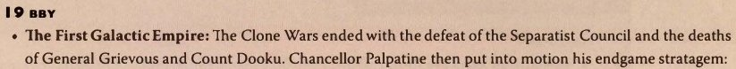
- **Palpatine (Darth Sidious)**: "The resulting slaughter nearly wiped out the Jedi Order, and Palpatine—who in truth was Sith Lord Darth Sidious—consolidated his power as Emperor." Source: The Complete Star Wars Encyclopedia, Vol. I, scan p.14
  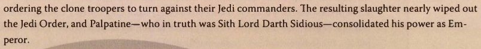

## scan p.15 (scan page 15)

Page contents: 417 words, 18 paragraphs | headings/entries: 

- **Luke Skywalker**: "Luke Skywalker's Jedi Order was instrumental in defeating the Yuuzhan Vong, who were relocated to the living planet Zonama Sekot." Source: The Complete Star Wars Encyclopedia, Vol. I, scan p.15
  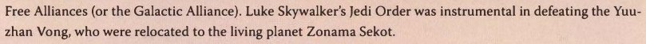

## p.1 (scan page 16)

Page contents: 4 words, 3 paragraphs | headings/entries: 

## p.2 (scan page 17)

Page contents: 0 words, 0 paragraphs | headings/entries: 

## p.3 (scan page 18)

Page contents: 564 words, 32 paragraphs | headings/entries: A-10; A-121; Al4; A-17; A-175; A2, A3; A-24 Sleuth; A-3PO; A-3TO; A-30; A-5DS; A68 Market; A-6 Interceptor

## p.4 (scan page 19)

Page contents: 990 words, 34 paragraphs | headings/entries: A-77; A-89; A-9 Vigilance Interceptor; A99 Aquata Breather; AA-12X; AA-23, Detention Block; AA-589; AAA-2; Aabe, Peita; Aach; AAD-4; Aaeton; Aaida; Aak, Senator Ask; Aalagar; Aalto; Aalun, Syron

- **Yoda**: "Yoda easily destroyed the droid." Source: The Complete Star Wars Encyclopedia, Vol. I, p.4
  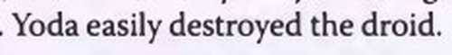
- **Grand Admiral Thrawn**: "A-9 Vigilance Interceptor An Imperial short-range starfighter that was introduced about six years after the Battle of Endor, soon after Grand Admiral Thrawn's defeat." Source: The Complete Star Wars Encyclopedia, Vol. I, p.4
  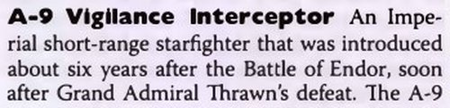

## p.5 (scan page 20)

Page contents: 862 words, 27 paragraphs | headings/entries: Aama, Major; Aargau; Aargau Medical Observer Corps; Aargonar; Aarn; Aavman Extravagance; Aay'han; AB-4

## p.6 (scan page 21)

Page contents: 1024 words, 39 paragraphs | headings/entries: AB-6; Abaarian; Abadaner; Aban; Abano; Abanol; Abbaji; Ab'Bshingh; Abdi-Badawzi; Abek's Station; Aber; Abersaith Canyon; Abesmi; Abhean; Able-1707; Clone Wars, unit; Able-472; Ables; Ab'Lon, Tereb; Abo Dreth; Abolisher; Abominor; Abonshee; Aboukir; Abrax

- **Grand Admiral Thrawn**: "Ultimately thwarted by Rebel agents, Aban emerged years later as captain of the Star Destroyer Bellicose in Grand Admiral Thrawn's forces." Source: The Complete Star Wars Encyclopedia, Vol. I, p.6
  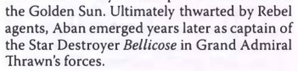
- **Obi-Wan Kenobi**: "Able-472 One of the Muunilinst 10 clone troopers who worked with General Obi-Wan Kenobi to defeat Durge and his IG lancer droid forces." Source: The Complete Star Wars Encyclopedia, Vol. I, p.6
  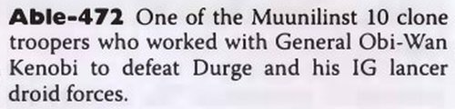

## p.7 (scan page 22)

Page contents: 1005 words, 39 paragraphs | headings/entries: Abraxas; Abraxin; Abregado Moocher; Abregado-rae; Abric; Abridon; Abrihom; Abrogator; Absit; Absolutes; Ab'Ugartte; Abya, Sybegh; Abyss, Naboo; Abyss, the; Abyssin; Academy, the; Acamma, Veril; ACC-7

## p.8 (scan page 23)

Page contents: 766 words, 39 paragraphs | headings/entries: Acceptance; Access Chute; Accolux Township; Accu, Paddy; Accuser; Accutronics; A-Cee; Ace Entertainment Corporation; Ace Squadron Pash Cracken's; Acey; Ac'fren Spur; Achillea

## p.9 (scan page 24)

Page contents: 1004 words, 28 paragraphs | headings/entries: Acib, Y'ull; Acilaris; Ackbar Slash; Ackdool, Commander

- **Admiral Ackbar**: "Ackbar, who like other Mon Calamari had salmon-colored skin, large bulbous yelloworange eyes, and webbed hands and feet, was the leader of Coral Depths City when Imperial forces invaded and nearly destroyed his planet." Source: The Complete Star Wars Encyclopedia, Vol. I, p.9
  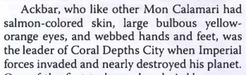
- **Admiral Ackbar; Grand Moff Tarkin**: "One of the first to be enslaved, Ackbar eventually became an interpreter for Grand Moff Tarkin." Source: The Complete Star Wars Encyclopedia, Vol. I, p.9
  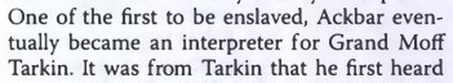
- **Leia Organa Solo; Admiral Ackbar**: "During a rendezvous with Princess Leia Organa shortly before the Battle of Hoth, Ackbar's modified bulk freighter was destroyed by the Empire." Source: The Complete Star Wars Encyclopedia, Vol. I, p.9
  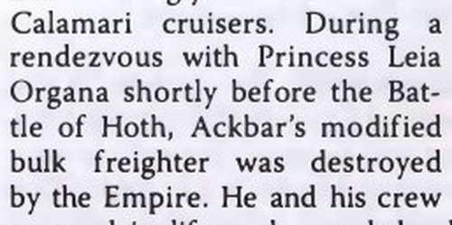
- **Admiral Ackbar**: "Following the defeat of the Empire at Endor, Ackbar maintained a key position in the command hierarchy of the Alliance of Free Planets, and the New Republic that followed." Source: The Complete Star Wars Encyclopedia, Vol. I, p.9
  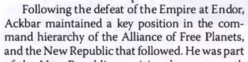
- **Admiral Ackbar**: "Following the defeat of the cloned Emperor, Ackbar's personal starfighter was sabotaged, which caused him to have a terrible accident on the planet of Vortex, where many innocent Vors were killed." Source: The Complete Star Wars Encyclopedia, Vol. I, p.9
  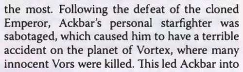

## p.10 (scan page 25)

Page contents: 951 words, 37 paragraphs | headings/entries: Acklay Chopper; Ackii; Ackmena; Acquisitor; Acre's Spaceport; Acros-Krik; Ac'siel; Action Tidings; ActionWorld; Actrion, Chom; Adamant; Adamantine; Adanar; Adarakh; Adare, Terena

- **Jaina Solo; Jacen Solo (Darth Caedus)**: "The attack was led by onetime TIE fighter pilot Qorl, who had crashed in the jungles of Yavin 4 but survived until he was discovered by Jaina and Jacen Solo two decades later." Source: The Complete Star Wars Encyclopedia, Vol. I, p.10
  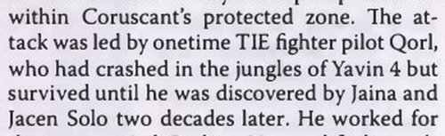
- **Leia Organa Solo; Ben Skywalker**: "Adarakh was killed by Yuuzhan Vong collaborator Vigi Shesh on Coruscant while he was trying to defend Leia and the infant Ben Skywalker." Source: The Complete Star Wars Encyclopedia, Vol. I, p.10
  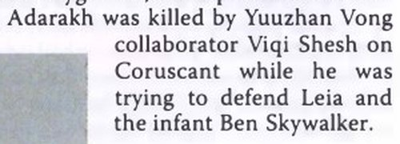

## p.11 (scan page 26)

Page contents: 1010 words, 38 paragraphs | headings/entries: Adarion; Adas, King; Adasca, Aurora; Adasca, Eighth Lord Arkoh; Adascopolis; Adascorp; Addie, Boz; Adebsu; Adelimaa'j, Enton; Adem'thorn, Senator Yeb Yeb; A'den, Senior Clone Commander; Adim; Adi's Rest; Adiss, Cane; Adjudicator; Adjustment; Admiral Ackbar

- **Admiral Ackbar** — entry/section: Admiral Ackbar: "Admiral Ackbar A Galactic Alliance Star Destroyer and flagship of the Fifth Fleet under the command of Admiral Nek Bwua'tu." Source: The Complete Star Wars Encyclopedia, Vol. I, p.11
  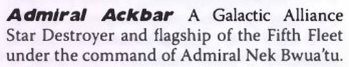

## p.12 (scan page 27)

Page contents: 1043 words, 29 paragraphs | headings/entries: Admonitor; Adnama; ADO-8; Adoliu, Nalia; Adostic Arms; Adriana; A'driannamieq Mountains; A-DSD; Adumar; Adumari

- **Grand Admiral Thrawn**: "Admonitor An Imperial Star Destroyer used by Thrawn when he held the rank of admiral." Source: The Complete Star Wars Encyclopedia, Vol. I, p.12
  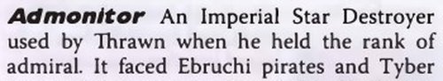

## p.13 (scan page 28)

Page contents: 1005 words, 46 paragraphs | headings/entries: Adventurer; Advisory Council, New Republic; Advora; Aebea; Aefan; AEG-77 Vigo; Aemele; Aeradin; Aeramaxis; Aeran; Aereen; Aerie Command; Aeten Il; AF-119; Afarathu; Affa; Affric, High Lord; Affytechan

## p.14 (scan page 29)

Page contents: 1035 words, 32 paragraphs | headings/entries: Afit, Zeen; Afterburners; Afyon, Captain; Agamar; Agao; Agapos; Agar, Ereen; Ag Circuit; Aggregator; Aggressor-class Star Destroyer; Aggressor Wing; Agira, Nyrat; Agonizer

- **Leia Organa Solo**: "Afyon, Captain A native of Alderaan, Afyon heeded Princess Leia Organa's call to join the Rebellion after the Empire destroyed his family, friends, and entire planet." Source: The Complete Star Wars Encyclopedia, Vol. I, p.14
  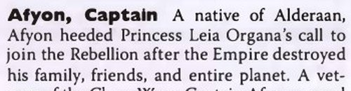

## p.15 (scan page 30)

Page contents: 1052 words, 40 paragraphs | headings/entries: Agonizer-6; Agony's Child; Agorn, Sar; Agridorn; Agrilat; Agriworid-2079; Aguilae; AH-50; Ahakista; Ahazi; Ahk'laht; Ahr's Dive; Ahsoka; Aia; Ajc; Aida; Aidus; Ailon Nova Guard

- **Leia Organa Solo**: "Ahk'laht createda diplomatic incident when, in protecting Leia, he struck down an intimidating Barabel ambassador." Source: The Complete Star Wars Encyclopedia, Vol. I, p.15
  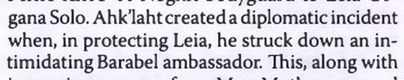

## p.16 (scan page 31)

Page contents: 961 words, 36 paragraphs | headings/entries: AirStraeker; Airten, Sergeant; Aiwha Squad; Aken; Akh'laht; A.J.; Akim's Munch; AJTD-6; Akala, Eg'ros; Akanah; Akanseh; Ak-Buz; Aken

## p.17 (scan page 32)

Page contents: 939 words, 36 paragraphs | headings/entries: A'Kla, Releqy; Elegos; Akobi, Commander; Ak-rev; Akrit'tar; A/KT; Alaala; Alain, Private; Alakatha; Alater-ka; Alaphoe Gardens; Alaric, King; Alaris Prime; Alashan; Alater, Captain Osted; Alater-ka

- **Corran Horn**: "In the end, Shedao Shai betrayed A'kla: He killed the Senator and prepared his corpse in the appropriate Yuuzhan Vong manner, returning the artistically decorated skeleton to Corran Horn on Ithor." Source: The Complete Star Wars Encyclopedia, Vol. I, p.17
  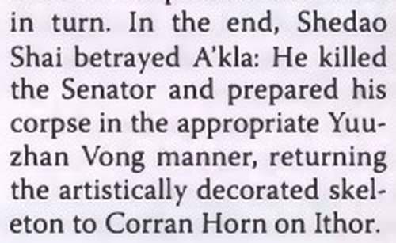
- **Yoda**: "He attempted to kill Yoda, but Yoda killed him instead." Source: The Complete Star Wars Encyclopedia, Vol. I, p.17
  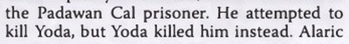

## p.18 (scan page 33)

Page contents: 844 words, 28 paragraphs | headings/entries: AL-BRT-34-X3; Alcorn, Tomay; Alder; Alder, Cal; Aldera; Alderaan

## p.19 (scan page 34)

Page contents: 955 words, 34 paragraphs | headings/entries: Alderaan Biotics; Alderaanian Oversea; Royal Engimeers; Alderaan University; Aldo Spach; Aldraig IV; Aldrete, Agrippa; Aldrete, Alya; Aldrete, Celana; Aleco; Aleema; Aleen; Aleena; Alfex Cargo Stacks; Alfi; Algar

- **Leia Organa Solo**: "Alderaan Princess Leia Organa named her personal space yacht for the destroyed planet where she grew up." Source: The Complete Star Wars Encyclopedia, Vol. I, p.19
  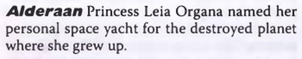

## p.20 (scan page 35)

Page contents: 1254 words, 34 paragraphs | headings/entries: Algara Il; Algeran Faction; Algic Current; Algnadesh Ship Graveyards; Algowinn, Kel; Algrann; AlGray, Lady; Ali-Alann; Alien Combine; Alien League; Alien Protection Zone; Alima, Captain; Alion; Ali-Vor; Allana; Allara; Allashane, Jess; Allegiance; Allegiant; All-Human Free-For-All

- **Lando Calrissian**: "The Allegiance was destroyed in an audacious maneuver by the Emancipator, a captured Star Destroyer commanded by Lando Calrissian." Source: The Complete Star Wars Encyclopedia, Vol. I, p.20
  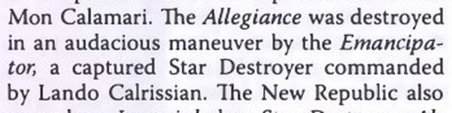

## p.21 (scan page 36)

Page contents: 1007 words, 23 paragraphs | headings/entries: Alliance Fleet Command; Alliance High Command; Alliance Intelligence; Allic, Lord

- **Han Solo**: "When Han Solo was about 17 years old, he survived the Free-For-All after being caught cheating at cards." Source: The Complete Star Wars Encyclopedia, Vol. I, p.21
  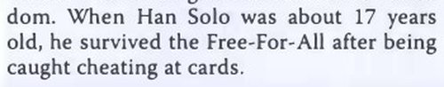

## p.22 (scan page 37)

Page contents: 768 words, 27 paragraphs | headings/entries: Allied Tion; All Planets Market; All Planets Relief Fund

## p.23 (scan page 38)

Page contents: 803 words, 33 paragraphs | headings/entries: 

## p.24 (scan page 39)

Page contents: 725 words, 27 paragraphs | headings/entries: Allum, Vivendi; Alimania; Almas; Alole; Aloo, Sim; Alora

- **Luke Skywalker**: "During one raid, the parents of Dolph, a young Jedi trainee of Luke Skywalker, were killed in a particularly brutal fashion." Source: The Complete Star Wars Encyclopedia, Vol. I, p.24
  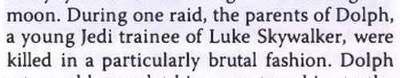
- **Leia Organa Solo; Kueller; Luke Skywalker**: "The New Republic launched an offensive, the Battle of Almania, and Leia eventually killed a weakened Kueller with a blaster shot while he was battling Luke." Source: The Complete Star Wars Encyclopedia, Vol. I, p.24
  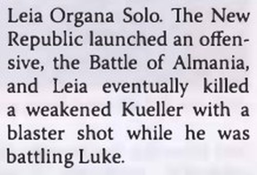

## p.25 (scan page 40)

Page contents: 1086 words, 31 paragraphs | headings/entries: Alpha-02; Alpha Blue; Alpha Red; Alpheridies; Alrix, Rees; Alsakan; Altis, Djinn

- **Jaden Korr**: "She was discovered and defeated by the Jedi Jaden Korr on Taspir III." Source: The Complete Star Wars Encyclopedia, Vol. I, p.25
  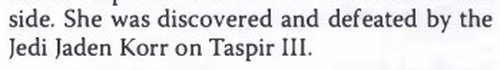
- **Obi-Wan Kenobi**: "Alpha continued to serve with Kenobi and Skywalker on Jabiim, where he and Obi- Wan were presumed killed in an AT-AT explosion." Source: The Complete Star Wars Encyclopedia, Vol. I, p.25
  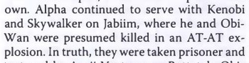
