# Owner Material 030 — The Complete Star Wars Encyclopedia, Vol. I (A–G): scan pages 41–80

- **Source:** *The Complete Star Wars Encyclopedia* by Stephen J. Sansweet and Pablo Hidalgo, with Bob Vitas, Daniel Wallace, Chris Cassidy, Mary Franklin and Josh Kushins (Del Rey, 2008), 3 vols. Secondary source (licensed Legends reference). Scan OCR'd on the box; the scan stays box-only and is **not** published.
- **Method:** every scanned page was OCR'd and machine-screened sentence by sentence for power-relevant statements (fights, kills, defeats, Force feats, rankings, superweapons) that name a character on our roster; each kept sentence is quoted verbatim from the OCR text and has a crop of the printed passage directly under it. Pages with nothing power-relevant are still listed with what is on them.
- **Citation:** "The Complete Star Wars Encyclopedia, Vol. I, p.X" by printed page ("scan p.X" where no printed number applies). **Weight:** Lucasfilm-licensed encyclopedia: a secondary, in-universe summary of Legends (and some film) material. It sums up feats from novels, comics and games; where the original story is in our notes, that source is the stronger citation.

## p.26 (scan page 41)

Page contents: 1039 words, 35 paragraphs | headings/entries: Alya; Alyssia; Amaltanna; Amamanam; Amanaman; Amaran; Amberdawn; Amanda Fallow; Ambria; Amedda, Mas

## p.27 (scan page 42)

Page contents: 818 words, 24 paragraphs | headings/entries: Amee; Amelia; Ament; Amerce; Amfar

## p.28 (scan page 43)

Page contents: 1024 words, 31 paragraphs | headings/entries: 

- **Padmé Amidala; Darth Vader (Anakin Skywalker)**: "Faced with overwhelming evidence of her mortality, Padmé lowered her emotional guard and professed her love to Anakin." Source: The Complete Star Wars Encyclopedia, Vol. I, p.28
  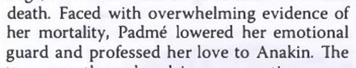
- **Darth Vader (Anakin Skywalker); Padmé Amidala**: "Anakin raised his hand and caught Padmé in a telekinetic chokehold." Source: The Complete Star Wars Encyclopedia, Vol. I, p.28
  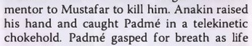

## p.29 (scan page 44)

Page contents: 982 words, 31 paragraphs | headings/entries: Amithest, Mari; Ammuud; Ammuud Swooper; Amorphiian; Ampliquen; Am-Shak; Analysis Bureau; Anarrad Pit

- **Anakin Solo**: "Anakin Solo was an Imperial II-class Star Destroyer painted black, fitted with a cloaking device and a gravitywell projector." Source: The Complete Star Wars Encyclopedia, Vol. I, p.29
  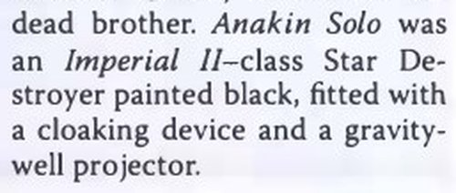

## p.30 (scan page 45)

Page contents: 1124 words, 25 paragraphs | headings/entries: Anaxes; Anchorhead; Anchoron; Anda; Andara; Andeddu, Darth; Ando; Andona, Mari'ha; Ando Prime; Andosha Il; Andray, Moff

- **Grand Admiral Thrawn; Leia Organa Solo**: "The smuggler Talon Karrde posted men on Anchoron in an unsuccessful search for Grand Admiral Thrawn's traffic in clones, and Leia Organa Solo, in her attempts to locate an Imperial spy, planted a false report stating that a Star Destroyer had been spotted near the planet." Source: The Complete Star Wars Encyclopedia, Vol. I, p.30
  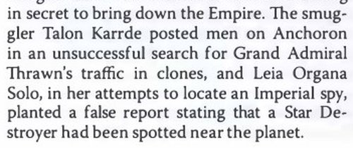
- **Darth Andeddu; Roan Fel; Darth Krayt** — entry/section: Andeddu, Darth: "Over a century later, during the time of Roan Fel's empire, Darth Krayt was in possession of Andeddu's holocron." Source: The Complete Star Wars Encyclopedia, Vol. I, p.30
  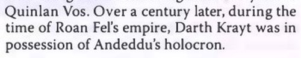

## p.31 (scan page 46)

Page contents: 976 words, 32 paragraphs | headings/entries: Andrevea; AndroosinLiann; Andur; Anglebay Station; Angiethorn, Darial; Anis; Anjiliae; Ankura; Antlage; Annaj; Annealer; Annihilator; Anno, Klossi

- **Luke Skywalker**: "Anduvil alerted Luke Skywalker about an Imperial biological weapons test on Tatooine, and together the two of them destroyed an Imperial lab that was perfecting a genetically modified strain of Bledsoe's disease." Source: The Complete Star Wars Encyclopedia, Vol. I, p.31
  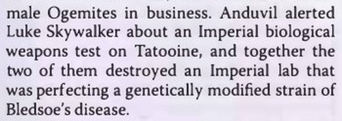
- **Beilert Valance**: "Valance returned with his crew to wipe out the entire facility, ensuring that no records of his surgery remained." Source: The Complete Star Wars Encyclopedia, Vol. I, p.31
  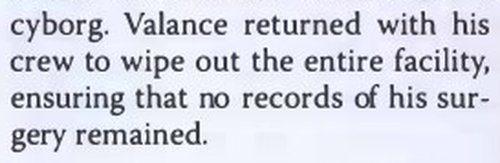
- **Roan Shryne**: "Anno, Klossi A Chalactan Jedi who survived Order 66, she joined up with similar survivors led by Roan Shryne." Source: The Complete Star Wars Encyclopedia, Vol. I, p.31
  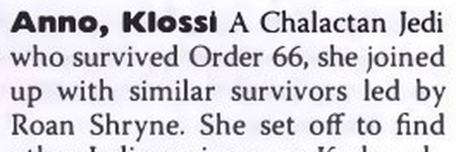

## p.32 (scan page 47)

Page contents: 1077 words, 26 paragraphs | headings/entries: Annon, Blix; Annoo; Annoo-dat; Anobis; Anor, Nom

## p.33 (scan page 48)

Page contents: 1347 words, 24 paragraphs | headings/entries: Anor, Phaa; Anoth; Anselm; Anselmi; Ansion; Ansta; Antana, Soara; Antares Six; Antarian Rangers

- **Mara Jade Skywalker**: "Attempting to escape the conflict, Anor was instead defeated and captured by Mara Jade Skywalker." Source: The Complete Star Wars Encyclopedia, Vol. I, p.33
  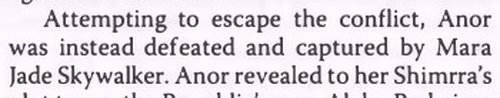
- **Antares Draco; Lando Calrissian** — entry/section: Antares Six: "Antares Six One of two New Republic escort frigates that accompanied the Millennium Falcon to Coruscant to rescue the crew of the Liberator, the Antares Six saved Lando Calrissian and Wedge Antilles after their Star Destroyer, Emancipator, was destroyed by an Imperial World Devastator." Source: The Complete Star Wars Encyclopedia, Vol. I, p.33
  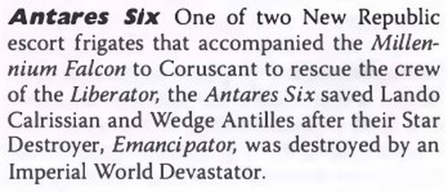

## p.34 (scan page 49)

Page contents: 1057 words, 21 paragraphs | headings/entries: Anteevy; Antemeridias; Antha-Kres; Anticeptin-D; Antilles, Bail; Antilles, Corellia; Antilles, lella Wessiri

## p.35 (scan page 50)

Page contents: 1105 words, 19 paragraphs | headings/entries: Antilles, Jon; Antilles, Raymus; Antilles, Syal; Antilles, Wedge

- **Leia Organa Solo; Darth Vader (Anakin Skywalker)**: "A loyal guard to Leia, he died protecting her identity when Darth Vader boarded the Tantive IV and strangled the captain." Source: The Complete Star Wars Encyclopedia, Vol. I, p.35
  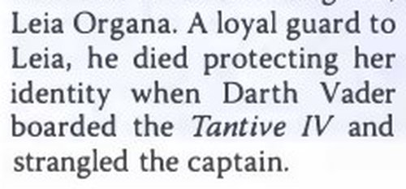
- **Grand Admiral Thrawn**: "Following the defeat of Grand Admiral Thrawn five years after the Battle of Endor, Antilles agreed to accept the rank of general on the condition that he could still lead Rogue Squadron." Source: The Complete Star Wars Encyclopedia, Vol. I, p.35
  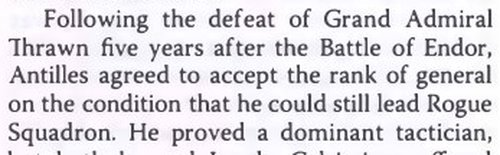

## p.36 (scan page 51)

Page contents: 957 words, 24 paragraphs | headings/entries: Antilles, Zena; Antin, Dr. Amie; Antipose; Anti-Sedition Provision; Anton; Antone; Antonin, Vigo; Anujo, Celiheim; Anvil

- **Darth Vader (Anakin Skywalker)**: "Vader killed Lands and imprisoned Dr. Antin and Olin; Flume escaped to warn the other members of the Eleven." Source: The Complete Star Wars Encyclopedia, Vol. I, p.36
  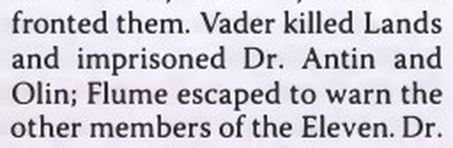
- **Jango Fett**: "Antonin's forces were no match for Jango Fett." Source: The Complete Star Wars Encyclopedia, Vol. I, p.36
  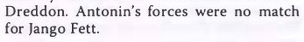
- **General Grievous**: "Anvil One of many Galactic Republic Acclamator assault transports destroyed at Duro by General Grievous's task force during the Clone Wars." Source: The Complete Star Wars Encyclopedia, Vol. I, p.36
  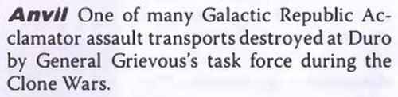

## p.37 (scan page 52)

Page contents: 946 words, 27 paragraphs | headings/entries: Anx; Aora, Aruk Besadii; Apailana, Queen; Anywhere Room; Apatros; Aphran IV; Apla, Chik; Ap-Liewf, Gwellib

- **Kir Kanos**: "Kir Kanos used an APA-5 droid to fly the scimitar bomber that defeated the Star Destoyer Emperor's Revenge." Source: The Complete Star Wars Encyclopedia, Vol. I, p.37
  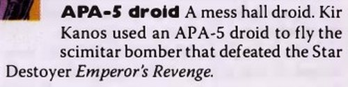

## p.38 (scan page 53)

Page contents: 1070 words, 31 paragraphs | headings/entries: Apprentice Legislature; Apprentice Tournament; Aqinos, Master; Aqualish; Aquaris; Arabanth; Arakkus, Dr.; Arakyd Industries

- **Roan Shryne**: "Appo was killed by Roan Shryne on Kashyyyk." Source: The Complete Star Wars Encyclopedia, Vol. I, p.38
  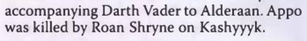
- **Han Solo**: "He was killed in an explosion after Han Solo ignited a negatron charge to free his Millennium Falcon from the gravitational pull of the star." Source: The Complete Star Wars Encyclopedia, Vol. I, p.38
  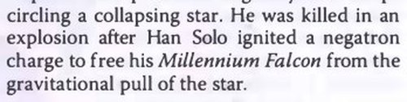

## p.39 (scan page 54)

Page contents: 1129 words, 38 paragraphs | headings/entries: Ar'alani, Admiral; Aralia; Koffi Arana Aramadia; Aramb; Arana, Koffi; Arastide, Senator; Arber, Lieutenant; Arbo; Arbo Maze; Arbor, Jenna Zan; Area

- **Darth Vader (Anakin Skywalker)**: "Darth Vader arrived to dispatch the Jedi and killed Arana." Source: The Complete Star Wars Encyclopedia, Vol. I, p.39
  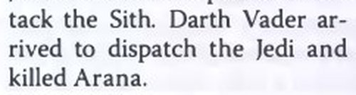
- **Qui-Gon Jinn**: "Wanting a more powerful test subject, she kidnapped Jedi Master Qui-Gon Jinn and subjected him to painful study at her secret research facility on Simpla-12." Source: The Complete Star Wars Encyclopedia, Vol. I, p.39
  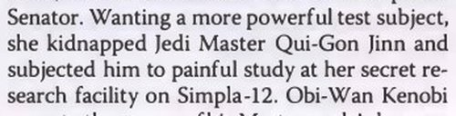

## p.40 (scan page 55)

Page contents: 1023 words, 47 paragraphs | headings/entries: Arca Company; Arcasite, Mol; Arc Hammer; Arch Canyon; Archimar, Dr.; Architects; Arcona; Arcona Mineral Harvest Corporation; Arda Il; Ardal; Ardan, Lieutenant Commander; Ardax, Colonel; Ardele, Feylis; Ardiff, Captain; Ardie, Captain; Ardos; ARE; ARENA-7580; Argai

- **Kyle Katarn**: "The Arc Hammer was General Rom Mohc's flagship until it was destroyed by Rebel agent Kyle Katarn." Source: The Complete Star Wars Encyclopedia, Vol. I, p.40
  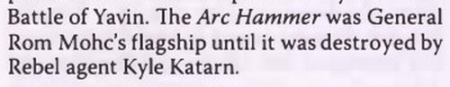

## p.41 (scan page 56)

Page contents: 1200 words, 27 paragraphs | headings/entries: Argenhald Base; Argente, Passel; Argo Moon; Argon, Grand Moff; Argona, Captain; Argor; Argyus, Captain; Ariarch-17; Arica; Aridka; Aridus; Ariela; Arisster, Dr. Movac; Aristocra; Arkania; Arkanian

- **Darth Vader (Anakin Skywalker)**: "He was killed by Darth Vader on Mustafar." Source: The Complete Star Wars Encyclopedia, Vol. I, p.41
  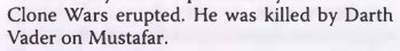
- **Grand Admiral Thrawn**: "Argona questioned the necessity of moving three Star Destroyers to Bothawui on a long-term mission without direct support—until Disra brought out a "resurrected" Thrawn, played by the con artist Flim." Source: The Complete Star Wars Encyclopedia, Vol. I, p.41
  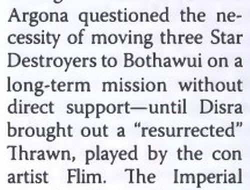
- **Asajj Ventress**: "The treacherous captain killed his own Senate Guards, but once his task was completed, Asajj Ventress coldly killed him." Source: The Complete Star Wars Encyclopedia, Vol. I, p.41
  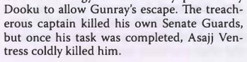

## p.42 (scan page 57)

Page contents: 1114 words, 36 paragraphs | headings/entries: Arkanian Legacy; Arkanian Microtechnologies; Arkanian Offshoot; Arkmen, Onie; Ari, Colonel; ARLEF; Armalat; ArMek; Armistice; Arnet, Lieutenant; Arnjak, Baljos; Arnothian, General

- **Lord Kaan**: "After a lengthy campaign on Ruusan, both opposing forces were wiped out by Lord Kaan's thought bomb weapon." Source: The Complete Star Wars Encyclopedia, Vol. I, p.42
  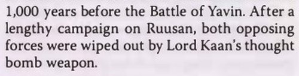

## p.43 (scan page 58)

Page contents: 1180 words, 36 paragraphs | headings/entries: Arnthout; A'roFilter; Arorua; Aros, Lady; Arrant, Jurnel; Arrestor; Arrizza; Arrogantus, Serji-X; Arr'yka, Lieutenant; Ar-Six; Art Beyond Dying; Artoo-Detoo; Artus Prime; Aruh, Suung; AruMed; Aruza; Aryon, Governor Tour

- **Qui-Gon Jinn; Obi-Wan Kenobi**: "Arorua The Jedi Council sent Qui-Gon Jinn and 13-year-old Obi-Wan Kenobi to this isolated jungle planet, home to many exotic and deadly creatures, including the squollyhawlk and the legendary silan." Source: The Complete Star Wars Encyclopedia, Vol. I, p.43
  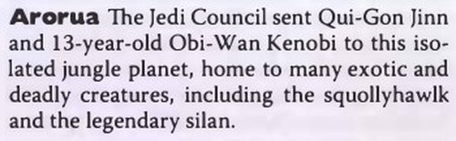

## p.44 (scan page 59)

Page contents: 1201 words, 33 paragraphs | headings/entries: Arzid; Asani, Wil; Asation; Aseca, Boc; Asha; Ashaad, Sergeant; Ashas Ree; Ashel, Tok; Ash'ett; Ashgad, Seti; Ashla; Ashpidar, Captain

- **Kyle Katarn**: "Kyle Katarn defeated him in the Valley of the Jedi." Source: The Complete Star Wars Encyclopedia, Vol. I, p.44
  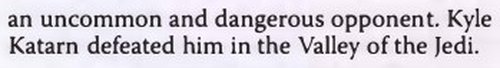

## p.45 (scan page 60)

Page contents: 1147 words, 27 paragraphs | headings/entries: Askaj; Askajian; Askol, Bok; Asmeru; ASP; Assant, Darsha; Assassins' Guild

- **Leia Organa Solo**: "Another, an Eliminator model 434, tried to kill Princess Leia Organa on Coruscant, but it was destroyed by Prince Isolder's bodyguard Captain Astarta." Source: The Complete Star Wars Encyclopedia, Vol. I, p.45
  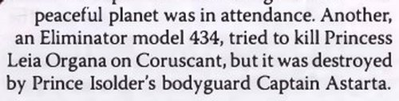

## p.46 (scan page 61)

Page contents: 1205 words, 31 paragraphs | headings/entries: Assembler; Astarta, Captain; Astrolabe; Astrotours Limited; Asylum; AT3 Directive; Atali; AT-AR; AT-AT; AT-CT; Atgar SpaceDefense Corporation; Athacorr, Commander Dias; AT-HE; Athega; AT-IC; Atin; AT-KT; Atoko, Admiral

## p.47 (scan page 62)

Page contents: 1179 words, 38 paragraphs | headings/entries: Atori, Master Otias; AT-PT; Atraken; At'raoth; Atris; Atrisia; AT-ST; Attack Pattern Delta; Attark; AT-TE; Attichitcuk; Atuarre; AT-XT; Atzerri; Auben

## p.48 (scan page 63)

Page contents: 924 words, 75 paragraphs | headings/entries: Aunuanna; Aurea; Aurebesh; Aurek Company; Aurodium Sword; Aurorient Express; Auset, Ausar; Autem, Lissa; Autem, Reymet

- **Qui-Gon Jinn; Obi-Wan Kenobi**: "Jedi Master Qui-Gon Jinn and Padawan Obi-Wan Kenobi did what they could to protect the liner, and though they successfully thwarted both the terrorists and the pirates, the ship nonetheless exploded from a core bomb placed by disgruntled crew members." Source: The Complete Star Wars Encyclopedia, Vol. I, p.48
  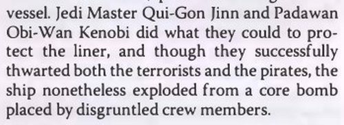

## p.49 (scan page 64)

Page contents: 1045 words, 32 paragraphs | headings/entries: Autem, Sagoro; Autem, Venco; Authority Cash Voucher; Authority Data Center; Auyemesh; AV-6R7; Avarice; Avarik, Corporal; Avatar Orbital Platform

- **Shaak Ti; Quinlan Vos**: "During the Clone Wars, Sagoro escaped imprisonment on Brentaal IV and helped Jedi Shaak Ti and Quinlan Vos defeat Confederacy forces there, earning him immunity for past crimes." Source: The Complete Star Wars Encyclopedia, Vol. I, p.49
  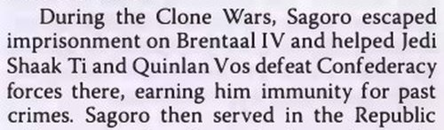
- **Kueller**: "Its population was destroyed by the dark sider who called himself Kueller 13 years after the Battle of Endor." Source: The Complete Star Wars Encyclopedia, Vol. I, p.49
  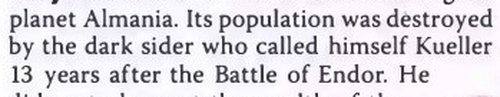

## p.50 (scan page 65)

Page contents: 909 words, 28 paragraphs | headings/entries: Avengeance; Avenger; Averam; Aves; A Vrassa; AVVA; Awmetth, Veedaaz; Axmis, Tavion; AX/RX; Axxila

- **Kyle Katarn**: "Kyle Katarn defeated her in a lightsaber duel but chose to spare her life, demonstrating his adherence to the light side of the Force." Source: The Complete Star Wars Encyclopedia, Vol. I, p.50
  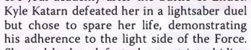
- **Marka Ragnos**: "Shamed by her defeat, she went into hiding and emerged some time later as part of the Disciples of Ragnos." Source: The Complete Star Wars Encyclopedia, Vol. I, p.50
  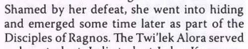
- **Marka Ragnos**: "Briefly possessed by Ragnos, Axmis wielded incredible power, yet she was still defeated by Korr." Source: The Complete Star Wars Encyclopedia, Vol. I, p.50
  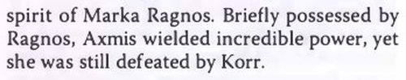
- **Tholme; Aayla Secura**: "A surprise attack by Tholme and Aayla Secura then destroyed the droid." Source: The Complete Star Wars Encyclopedia, Vol. I, p.50
  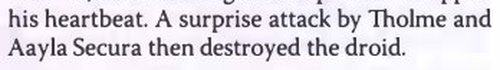

## p.51 (scan page 66)

Page contents: 930 words, 20 paragraphs | headings/entries: Ayelixe/Kronbing Textiles; Ayrou; Azbeth, Sister; Azbrian; Azgoghk; Azool; Azrakel; Azure; Azur-Jamin, Daye; Azur-Jamin, Tam; Azzameen, Ace

## p.52 (scan page 67)

Page contents: 0 words, 0 paragraphs | headings/entries: 

## p.53 (scan page 68)

Page contents: 645 words, 26 paragraphs | headings/entries: B3NK; B-9D7; Baab, Fema; Baab, Umjing; Baanu Kor; Baanu Miir; Baanu Rass; Baas, Bodo; Baas, Master Vodo-Siosk

- **Leia Organa Solo; Luke Skywalker; Palpatine (Darth Sidious)**: "A warning about her own future sent Leia to help Luke Skywalker destroy the clone of Palpatine." Source: The Complete Star Wars Encyclopedia, Vol. I, p.53
  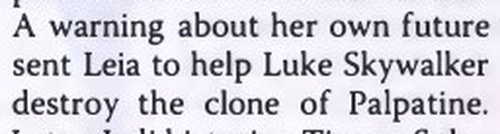
- **Vodo-Siosk Baas**: "Later, the spirit of Vodo-Siosk Baas, along with Skywalker and his trainees, destroyed Kun forever." Source: The Complete Star Wars Encyclopedia, Vol. I, p.53
  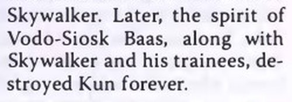

## p.54 (scan page 69)

Page contents: 874 words, 35 paragraphs | headings/entries: Baba, Ponda; Babali; Babbadod; Babo, Admiral; Bacca, Great; Bachenkall, Warrant Officer; Bacta Squad

- **Obi-Wan Kenobi**: "With a quick draw of his lightsaber, Kenobi slashed Evazan's chest and severed Baba's right arm at the elbow." Source: The Complete Star Wars Encyclopedia, Vol. I, p.54
  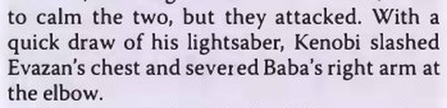

## p.55 (scan page 70)

Page contents: 1106 words, 33 paragraphs | headings/entries: Badeleg, Cho; Badji; Badlands, Kamarian; Bador; Badure, Alexsandr; Baffle; Baftu; Baga; Bagmim; Bagwa, Hermione; Bagy, Dugo; Bail Organa; Baiuntu; Baji; Baker, Mayor

- **Prince Xizor; Palpatine (Darth Sidious)**: "Seeking to curry favor as well as personal gain, the criminal mastermind Prince Xizor notified Emperor Palpatine of the base, which also was near the main facilities of Ororo Transportation, a major competitor of Xizor's company, XTS, and a front for the rival Tenloss Syndicate." Source: The Complete Star Wars Encyclopedia, Vol. I, p.55
  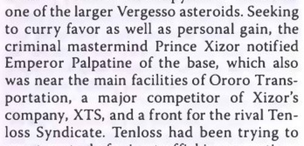
- **Darth Vader (Anakin Skywalker)**: "Acting on the Emperor's orders, Darth Vader destroyed the Rebel base, along with Ororo Transportation." Source: The Complete Star Wars Encyclopedia, Vol. I, p.55
  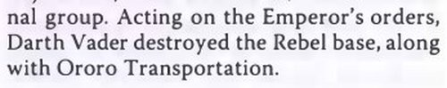

## p.56 (scan page 71)

Page contents: 1122 words, 28 paragraphs | headings/entries: Bakleeda; Baktoid Armor Workshop; Balamak; Balancesheet; Balawai; Bal'demnic; Ballow-Reese, Bendodi; Balmorra

- **Darth Vader (Anakin Skywalker)**: "Adar Tallon devised a battle plan that earned him the title Victor of Balamak in which Anakin Skywalker destroyed a Separatist jamming craft." Source: The Complete Star Wars Encyclopedia, Vol. I, p.56
  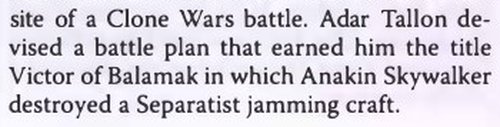

## p.57 (scan page 72)

Page contents: 930 words, 26 paragraphs | headings/entries: Balmorra Run; Balosar; Baltizaar; Baltke; Balu, Predne; Banai, Rakir; Bandeam, Sors; Bando Gora; Bandon, Darth; Bane, Cad

- **Sors Bandeam; Darth Vader (Anakin Skywalker)** — entry/section: Bandeam, Sors: "Bandeam, Sors A frightened human youngling killed in Darth Vader's attack on the Jedi Temple after Order 66." Source: The Complete Star Wars Encyclopedia, Vol. I, p.57
  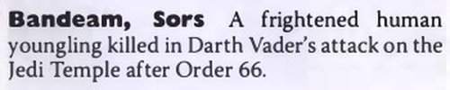
- **Count Dooku; Jango Fett**: "To that end, Dooku hired rival bounty hunters Jango Fett and Montross to track down Vosa." Source: The Complete Star Wars Encyclopedia, Vol. I, p.57
  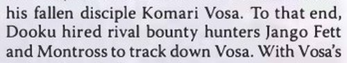
- **Count Dooku**: "With Vosa's defeat, Bando Gora disintegrated as a threat, and Fett proved himself capable enough in Dooku's eyes to become the template of the Republic's clone army." Source: The Complete Star Wars Encyclopedia, Vol. I, p.57
  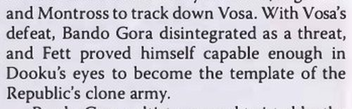
- **Darth Bandon; Darth Malak; Revan; Bastila Shan** — entry/section: Bandon, Darth: "Malak dispatched Bandon to stop the mindwiped Revan and Bastila Shan's search for the Star Forge, and Revan slew Bandon." Source: The Complete Star Wars Encyclopedia, Vol. I, p.57
  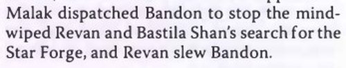

## p.58 (scan page 73)

Page contents: 1029 words, 28 paragraphs | headings/entries: Bane, Darth; Bane's Heart; Banjeer, Admiral; Banjeer, Boss; Banking Clan

- **Sirak**: "Dessel quickly excelled in the Sith arts, but his brashness led him to challenge far more powerful colleagues like ace pupil Sirak, who gravely injured Dessel." Source: The Complete Star Wars Encyclopedia, Vol. I, p.58
  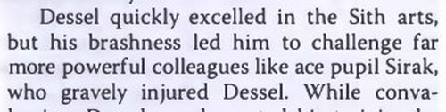
- **Sirak**: "Dessel challenged Sirak and this time bested him, but stopped short of delivering a killing blow." Source: The Complete Star Wars Encyclopedia, Vol. I, p.58
  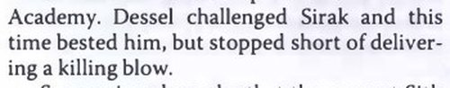
- **Lord Kaan**: "When Kaan used Bane's knowledge to create and detonate the thought bomb, the resulting cataclysm destroyed the Jedi and Sith armies, leaving Bane the sole Sith survivor." Source: The Complete Star Wars Encyclopedia, Vol. I, p.58
  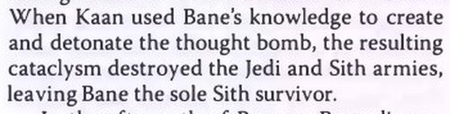
- **Kir Kanos**: "Bounty hunter Kenix Kil (in truth, the Royal Guard Kir Kanos) infiltrated Banjeer's organization and wiped out many of his hunters." Source: The Complete Star Wars Encyclopedia, Vol. I, p.58
  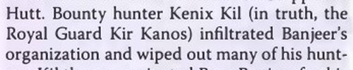

## p.59 (scan page 74)

Page contents: 844 words, 27 paragraphs | headings/entries: Ban'n, Farquil; Banolt, Lirin; Banoosh-Walores; Bantha Blaster; Bantha Burrows; Banvhar Station; Banz

## p.60 (scan page 75)

Page contents: 835 words, 33 paragraphs | headings/entries: Baobab, Mungo; Baobab Archives; Bao-Dur; Barab J; Baraboo; Barad, Vol; Barada; Baragwin

## p.61 (scan page 76)

Page contents: 833 words, 42 paragraphs | headings/entries: Barak, Koth; Baraka, Admiral Arikakon; Barakas, Brakka; Baralou; Baramorra; Baran Do; Baran Wu Station; Baranta, Bozzie; Barderia; Bardo; Bardrin Group; Barefoot Squadron; Barer, Wasser; Barezz, Arlen; Barezz, Ingleman; Barezz, Lieutenant Wynn; Barezz, Mar; Bargain Hunter; Bar Gane, Senator Edcel; Bargos; Barhu; Barich, Sergeant; Baritha

## p.62 (scan page 77)

Page contents: 938 words, 36 paragraphs | headings/entries: Barkale, Governor; Barkbone, Reginald; Barkhesh; Barkhimkh; Bar-Kooda; Barlok; Barney; Baron's Hed; Baroonda; Barr, Lieutenant; Barra-Rona-Ban; Barrek, Daakman; Barris, Mosh; Barron, Plure; Barsoom Boulevard; Bartam, Grand Moff; Barth; Barthis, Captain Elsen

- **Mara Jade Skywalker**: "Barkale, Governor An Imperial officer on Kintoni who embezzled from the sector treasury, he was tracked down and killed by Mara Jade, the Emperor's Hand, for his treachery." Source: The Complete Star Wars Encyclopedia, Vol. I, p.62
  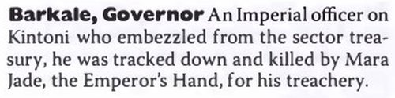
- **General Grievous**: "He and his Padawan Sha'a Gi were among the first Jedi killed by General Grievous." Source: The Complete Star Wars Encyclopedia, Vol. I, p.62
  

## p.63 (scan page 78)

Page contents: 1185 words, 35 paragraphs | headings/entries: Bartyn's Landing; Baruk, Reelo; Barukka; Barundi; Barzon, Carl; Bas, Colonel; Basbakhan; Base Delta Zero; Basic; Basilisk; Baskarn; Basso; Bast, Chief Moradmin; Bast Castle; Basteel; Bastra, Gil; Batch, Grand Admiral Martio; Batcheela

- **Admiral Daala**: "Basilisk Commanded by Captain Mullinore, the Basilisk was one of Admiral Daala's four Star Destroyers." Source: The Complete Star Wars Encyclopedia, Vol. I, p.63
  
- **Kyp Durron; Sun Crusher (superweapon)**: "The Basilisk was destroyed when Kyp Durron detonated the Cauldron Nebula with the Sun Crusher superweapon." Source: The Complete Star Wars Encyclopedia, Vol. I, p.63
  

## p.64 (scan page 79)

Page contents: 953 words, 27 paragraphs | headings/entries: Bathrobe Brigade; Batorine; Ba'tra, General

- **Darth Vader (Anakin Skywalker)**: "The efforts of Bravo Squadron, and Anakin Skywalker in particular, destroyed the Droid Control Ship, thereby rendering the army useless." Source: The Complete Star Wars Encyclopedia, Vol. I, p.64
  
- **Exar Kun; Naga Sadow**: "The battle hydra was an example of Exar Kun's alchemical mastery and Naga Sadow's dark legacy." Source: The Complete Star Wars Encyclopedia, Vol. I, p.64
  
- **Boba Fett**: "A thousand BL units armed with AAP-II blaster boxes fought in the front lines, and most were destroyed at Norval IL BL-17 was a Battle Legionnaire that served Boba Fett in the Empire's early days." Source: The Complete Star Wars Encyclopedia, Vol. I, p.64
  
- **Palpatine (Darth Sidious); Lumiya; Jacen Solo (Darth Caedus)**: "Sith battle meditation was a comparatively rare discipline, though Darth Sidious, Lumiya, and Darth Caedus proved capable of it." Source: The Complete Star Wars Encyclopedia, Vol. I, p.64
  

## p.65 (scan page 80)

Page contents: 980 words, 43 paragraphs | headings/entries: Bava; Bavakar; Bavion, Jith; Bavo Six; Bayaar; Bayts, Master Soon; Bazaar; Bazarre; Bazierre, First Sergeant Tak; Bearsh; Bearus, Chairman; Mountains; Beast-Lord

- **General Grievous**: "Bayts was killed by General Grievous." Source: The Complete Star Wars Encyclopedia, Vol. I, p.65
  
- **Jacen Solo (Darth Caedus)**: "Isolder refused and Caedus angrily strangled him with the Force, then ordered the Beam Racer destroyed." Source: The Complete Star Wars Encyclopedia, Vol. I, p.65
  
- **Luke Skywalker; Mara Jade Skywalker**: "The Chiss, along with Luke Skywalker and Mara Jade, were able to defeat Bearsh." Source: The Complete Star Wars Encyclopedia, Vol. I, p.65
  
- **Aayla Secura**: "The Ewoks asked for Aayla's help in slaying the beast, and she killed it by crushing it with stalactites." Source: The Complete Star Wars Encyclopedia, Vol. I, p.65
  
