# Owner Material 030 — The Complete Star Wars Encyclopedia, Vol. I (A–G): scan pages 81–120

- **Source:** *The Complete Star Wars Encyclopedia* by Stephen J. Sansweet and Pablo Hidalgo, with Bob Vitas, Daniel Wallace, Chris Cassidy, Mary Franklin and Josh Kushins (Del Rey, 2008), 3 vols. Secondary source (licensed Legends reference). Scan OCR'd on the box; the scan stays box-only and is **not** published.
- **Method:** every scanned page was OCR'd and machine-screened sentence by sentence for power-relevant statements (fights, kills, defeats, Force feats, rankings, superweapons) that name a character on our roster; each kept sentence is quoted verbatim from the OCR text and has a crop of the printed passage directly under it. Pages with nothing power-relevant are still listed with what is on them.
- **Citation:** "The Complete Star Wars Encyclopedia, Vol. I, p.X" by printed page ("scan p.X" where no printed number applies). **Weight:** Lucasfilm-licensed encyclopedia: a secondary, in-universe summary of Legends (and some film) material. It sums up feats from novels, comics and games; where the original story is in our notes, that source is the stronger citation.

## p.66 (scan page 81)

Page contents: 799 words, 36 paragraphs | headings/entries: Beater; Bebo, Kevreb; BedaGorog; Bedamyr, General; Beedo; Beedo, Aldar; Beeline, Zip; Beelyath; Been, Rep; Bees, Nem; Beetle Nebula; Beez, Sergeant; Beezer, Corporal; Beggar's Canyon

- **Greedo; Han Solo**: "Beedo A relative of Greedo from the Tetsus clan, he took the bounty hunter's place in Jabba the Hutt's gang after Greedo was killed by Han Solo at the Mos Eisley cantina." Source: The Complete Star Wars Encyclopedia, Vol. I, p.66
  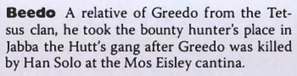

## p.67 (scan page 82)

Page contents: 1005 words, 30 paragraphs | headings/entries: Behareh Spaceport; Beheboth; Beidio, Brother; Beil, Archyr; Beju, Primce; Bek, Nizuc; Bekam, Koril; Bekan, Chall; Bel; Bel, Adol; Belasco; Bela Vistal; Belaya; Belazura; Belderone

## p.68 (scan page 83)

Page contents: 1150 words, 26 paragraphs | headings/entries: Beldon's Eye; Belgaroth; Bel Iblis, Garm; Believers

- **Leia Organa Solo**: "His downfall came when he engaged Chief of State Leia Organa Solo ina lightsaber duel, and she killed him." Source: The Complete Star Wars Encyclopedia, Vol. I, p.68
  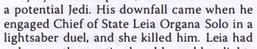
- **Grand Admiral Thrawn**: "Upon Grand Admiral Thrawn's defeat, Bel Iblis remained a prominent fixture in the New Republic hierarchy." Source: The Complete Star Wars Encyclopedia, Vol. I, p.68
  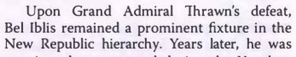

## p.69 (scan page 84)

Page contents: 1157 words, 29 paragraphs | headings/entries: Beling, Hran; Belkadan; Bell, Admiral Areta; Bellassa; Bellican; Belsavis; Belsmuth Il; Belsus; Belthu; Belt-Runner Jf; Beltway; Bemos, Moff

- **Palpatine (Darth Sidious)**: "Some 18 years before the Battle of Yavin, the Emperor commissioned the battlemoon Eye of Palpatine to wipe out the Jedi enclave, but the ship never arrived." Source: The Complete Star Wars Encyclopedia, Vol. I, p.69
  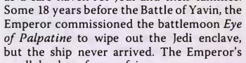

## p.70 (scan page 85)

Page contents: 970 words, 36 paragraphs | headings/entries: Bendon, Senator Tendau; Bendone; Bene; Benevolent Jif; Benevolent Guide; Bengat; Ben's Mesa; Bentro, Admiral; Berchest; Berda; Berenko, Omar; Bergruufta Clan; Berit, Commander; Beroya; Berrida, General; Beruss, Avan

- **Darth Vader (Anakin Skywalker); Cin Drallig**: "When Darth Vader and his clone troopers attacked the Jedi Temple the night of Order 66, Vader choked Bene with one hand while he dueled Drallig with the other." Source: The Complete Star Wars Encyclopedia, Vol. I, p.70
  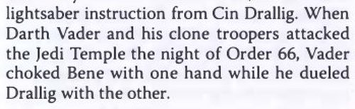
- **Anakin Solo**: "Berda The nickname of the tactical computer aboard the Star Destroyer Anakin Solo, operated by a squad of Bith programmers." Source: The Complete Star Wars Encyclopedia, Vol. I, p.70
  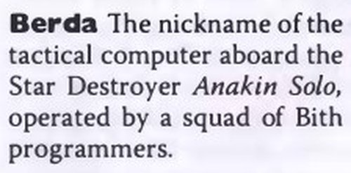

## p.71 (scan page 86)

Page contents: 1066 words, 20 paragraphs | headings/entries: Bervin; Besa, Eryl; Besalisk; BesGas Three; Besh

## p.72 (scan page 87)

Page contents: 1011 words, 28 paragraphs | headings/entries: Best Chance; Besum; Beta Company; Bethal; Bet's Off; Beviin, Goran; Bewil, Captain; Bex, Captain; Bex, Rasha; Bey; Bey, Commander Zalin

## p.73 (scan page 88)

Page contents: 1040 words, 39 paragraphs | headings/entries: Beyele; Bezim; BG-J38; Bhul, Kasdakh; Bialy, Sargeant; Bidamount; Big Gizz; Big Nasty Free-For- All; Big Snarl; Biivren; Bilar; '5 Bilbringi; Bildor's Canyon; Billaba, Depa; Billane, Jonava

- **Jacen Solo (Darth Caedus)**: "Much to Caedus's pleasure, Bhao was killed in the Mandalorian attack on the Nickel One asteroid, where a group of Moffs had convened to finalize their takeover of Verpine factories." Source: The Complete Star Wars Encyclopedia, Vol. I, p.73
  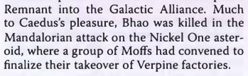

## p.74 (scan page 89)

Page contents: 976 words, 31 paragraphs | headings/entries: Billibanmgo; Bimm; Bimmiel; Bimmisaari; Binalie, Corf; Binmalu; Binder; Bindo, Jolee

- **Admiral Ackbar**: "When Admiral Ackbar defeated Krennel, the Binder's crew surrendered." Source: The Complete Star Wars Encyclopedia, Vol. I, p.74
  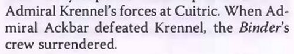

## p.75 (scan page 90)

Page contents: 1067 words, 24 paragraphs | headings/entries: Bin-Garda-Zon; Bini; Binks, Jar Jar; BioCruiser; Biodisposal Pit

- **Ki-Adi-Mundi**: "After Ki-Adi-Mundi defeated the raider chief, Bin-Garda-Zon attempted to challenge the Jedi Knight, but he was easily defeated." Source: The Complete Star Wars Encyclopedia, Vol. I, p.75
  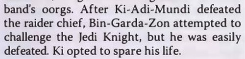
- **Anakin Solo**: "Biodisposal Pit The unflattering name given to the medical disposal center located aboard the Star Destroyer Anakin Solo." Source: The Complete Star Wars Encyclopedia, Vol. I, p.75
  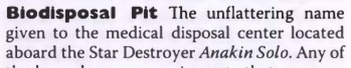

## p.76 (scan page 91)

Page contents: 1055 words, 36 paragraphs | headings/entries: Birt, Captain Ninora; Biscuit Baron; Bissillirus; Bitas, Vob; Biter; Bith; Bix; Bjalin, Tedris; Bjornsons; BL-17; Black Asp; Biack Bantha; Black Fleet

## p.77 (scan page 92)

Page contents: 1216 words, 31 paragraphs | headings/entries: Black Four; Blackhole; Black Ice; Blackmoon; Black Nebula; Black Nine; Blackscales; Black Three; Blacktooth

- **Admiral Daala**: "Four Victory-class Star Destroyers hooked up with Daala's warlords in the Deep Core, and two of the most advanced Star Destroyers, as well as the experimental weapons test bed EX-E chose to join Admiral Pellaeon's shrinking empire in the Outer Rim." Source: The Complete Star Wars Encyclopedia, Vol. I, p.77
  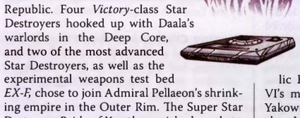
- **Luke Skywalker**: "Under the alias Lord Shadowspawn, he led the Imperial resistance on the planet Mindor, before being defeated by Luke Skywalker and the armies of the New Republic, a little over a year after the Battle of Endor." Source: The Complete Star Wars Encyclopedia, Vol. I, p.77
  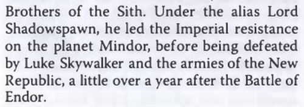
- **Darth Maul**: "Decades earlier, Darth Maul infiltrated Black Sun and killed its then-leader Alexi Garyn." Source: The Complete Star Wars Encyclopedia, Vol. I, p.77
  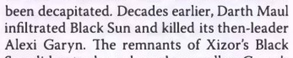

## p.78 (scan page 93)

Page contents: 1200 words, 35 paragraphs | headings/entries: Black Two; Black Vulkars; Blackwater Systems; BlasTech Industries; Blazing Claw; Bledsoe, Dr.; Biendin, Jerrol; Blendri

## p.79 (scan page 94)

Page contents: 1160 words, 46 paragraphs | headings/entries: Blenjeel; B'Leph, Tholote; Blessings; Bley-san; Blim, Lieutenant Geff; Blimph; Blin, Vildar; Blissex, Walex; Blista-Vanee, Kren; Blizzard Force; Blood Carver

- **Kaird; Bleyd**: "Black Sun agent Kaird killed Bleyd." Source: The Complete Star Wars Encyclopedia, Vol. I, p.79
  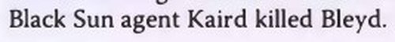
- **Boba Fett**: "After Boba Fett killed Libkath, Ygabba believed that Bley-san could help the children find their families." Source: The Complete Star Wars Encyclopedia, Vol. I, p.79
  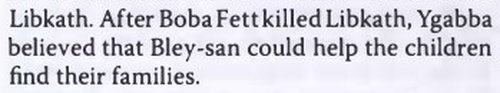
- **Kir Kanos**: "Blim was killed by Sish Sadeet mere seconds before he could shoot Kanos." Source: The Complete Star Wars Encyclopedia, Vol. I, p.79
  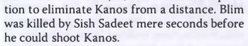
- **Lando Calrissian**: "By the time Lando left the planet, Quaffug's stranglehold on its trade was over and the Alliance could deal with the planet's native Jokhalli directly." Source: The Complete Star Wars Encyclopedia, Vol. I, p.79
  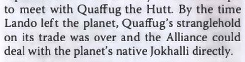
- **Luke Skywalker**: "Blizzard 4, commanded by Colonel Starck, was single-handedly downed by Luke Skywalker." Source: The Complete Star Wars Encyclopedia, Vol. I, p.79
  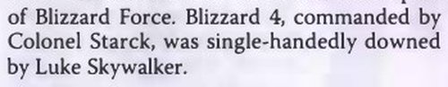

## p.80 (scan page 95)

Page contents: 1230 words, 30 paragraphs | headings/entries: Blood Razors; Blood Sacrifice; Bloor, Melivosh; Blorga; Blount, Lieutenant; Blue, Anchor; Blue, Deliah; Blue, Sinewy Ana

- **Boba Fett**: "They were then wiped out by Boba Fett's Mandalorian supercommandos." Source: The Complete Star Wars Encyclopedia, Vol. I, p.80
  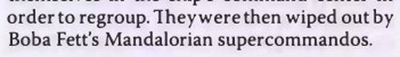
- **Kueller**: "Davis, a man whom Blue secretly loved, was killed in one of Kueller's bombing attacks, and she then told Solo everything she knew about the operation." Source: The Complete Star Wars Encyclopedia, Vol. I, p.80
  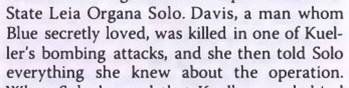

## p.81 (scan page 96)

Page contents: 1154 words, 34 paragraphs | headings/entries: Blue Brubb; Blue Desert People; Blue Flame; Blue Max; Blue Nebula; Bluescale; Blue Slipper; Blue Squad; Blue Squadron; Blue Wing

## p.82 (scan page 97)

Page contents: 949 words, 34 paragraphs | headings/entries: Bnach; Bnar, Master Ood; Bobb, Feskitt; Bobek; Bobissia, Ony; Bobolo Baker's All-Bith Band; Boc; Bocce; Boda, Ashka; Boga; Bodonawieedo, Doda

- **Ood Bnar; Ulic Qel-Droma** — entry/section: Bnar, Master Ood: "He also advised Ulic Qel-Droma when the Jedi Knight foolishly planned to join the evil Krath cult in order to destroy it from within." Source: The Complete Star Wars Encyclopedia, Vol. I, p.82
  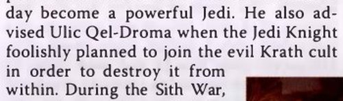
- **Ood Bnar** — entry/section: Bnar, Master Ood: "During the Sith War, when the cataclysm that destroyed the Cron Cluster threatened the planet Ossus, Ood initiated a life-cycle change, transforming into a mighty tree with extended roots to protect an underground cache of ancient lightsabers." Source: The Complete Star Wars Encyclopedia, Vol. I, p.82
  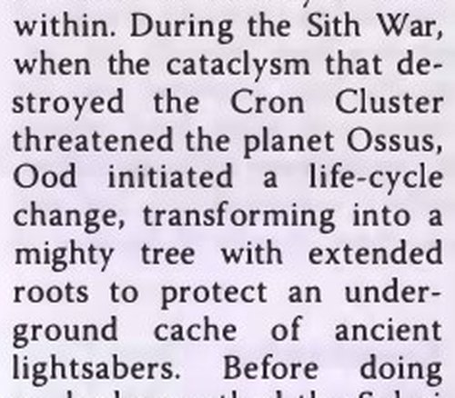
- **Ood Bnar** — entry/section: Bnar, Master Ood: "He ultimately sacrificed himself to destroy the evil Imperial Military Executor Sedriss." Source: The Complete Star Wars Encyclopedia, Vol. I, p.82
  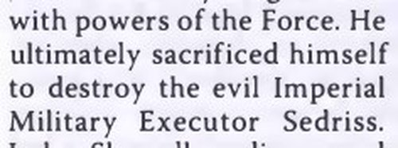

## p.83 (scan page 98)

Page contents: 1240 words, 30 paragraphs | headings/entries: Bogden; Bogen, Senator Ab'el; Boiny; Bok; Bok, Aidan; Bok, Captain; B'oiba; Bold, Dorovio; Boldheart; Bolide; Bollux; Bolpa, Mosko; Bolpuhr

- **Qui-Gon Jinn**: "Boiny then worked with Qui-Gon Jinn to stop Matalis, but was shot and killed." Source: The Complete Star Wars Encyclopedia, Vol. I, p.83
  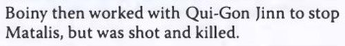
- **Quinlan Vos**: "Tsyr was beheaded by Vos, giving Bok further reason to hate the Jedi." Source: The Complete Star Wars Encyclopedia, Vol. I, p.83
  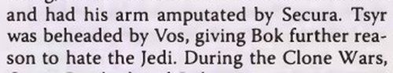
- **Darth Vader (Anakin Skywalker)**: "Bok, Aidan A Jedi tasked with guarding the ancient Jedi library on Nespis VIII, he was killed by Darth Vader during the rise of the Empire." Source: The Complete Star Wars Encyclopedia, Vol. I, p.83
  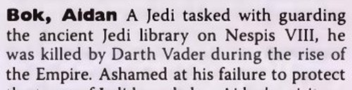
- **Qui-Gon Jinn**: "He later turned on the Jedi, leading a Moggonite ambush that Qui-Gon put down easily; Mosko was killed by Jinn." Source: The Complete Star Wars Encyclopedia, Vol. I, p.83
  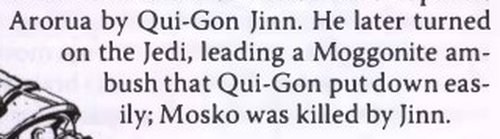

## p.84 (scan page 99)

Page contents: 1004 words, 34 paragraphs | headings/entries: Bolt, Dud; Boltrunian; Bombaasa, Crev; Bombaasa, Ulfor; Bomis Koori IV; Bomlas; Bompreil; Bonadan; Bondara, Anoon

## p.85 (scan page 100)

Page contents: 1051 words, 32 paragraphs | headings/entries: Bondo; Bonearm, Dace; Bonearm, Uz; Boneyard Rendezvous; Bongomeken Cooperative; Booda, Fenn; Boog; Booldrum; Boon, Brookish; Boonta

- **Anoon Bondara; Darth Maul** — entry/section: Bondara, Anoon: "Seeing that he could not hope to defeat Maul, Bondara sabotaged Maul's speeder and died when caught in the resulting explosion." Source: The Complete Star Wars Encyclopedia, Vol. I, p.85
  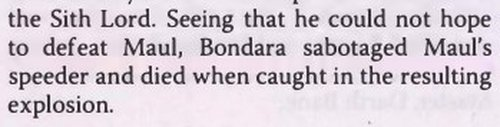

## p.86 (scan page 101)

Page contents: 997 words, 32 paragraphs | headings/entries: Boonta Eve Classic; Boordii; Boorn, Keog; Boost; Borao; Borcorash; Borderland Regions; Bordon; Borean, Kell; Borellos Base; Borgo Prime; Borin, Danz

- **Sev'rance Tann**: "Boorka the Hutt A Hutt rival to Jabba the Hutt on Tatooine near Mos Osnoe, he allied himself with Sev'Rance Tann during the Clone Wars." Source: The Complete Star Wars Encyclopedia, Vol. I, p.86
  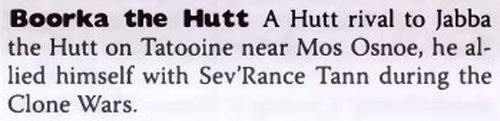
- **Darth Zannah; Darth Bane**: "Unbeknownst to all aboard, Rain was actually Zannah, a Sith Lord in training, and she killed Bordon and his sons before making her way to Onderon to reunite with her new Master, Darth Bane." Source: The Complete Star Wars Encyclopedia, Vol. I, p.86
  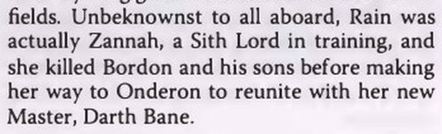
- **Greedo**: "That was a good thing, Danz Borin learned just a minute later, as Solo killed Greedo with a blaster shot." Source: The Complete Star Wars Encyclopedia, Vol. I, p.86
  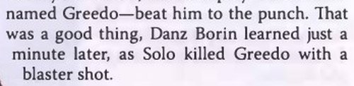

## p.87 (scan page 102)

Page contents: 1152 words, 22 paragraphs | headings/entries: Borlov; Bornaryn Trading Company; Borno; Borofir; Borokii; Borosk; Borstel Galactic Defense; Bortrek, Captain; Bos, Cypher; BoShek

- **Han Solo**: "Shortly before the Battle of Yavin, BoShek and his ship Infinity beat Han Solo's time for the Kessel Run, then destroyed four pursuing TIE fighters." Source: The Complete Star Wars Encyclopedia, Vol. I, p.87
  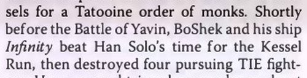

## p.88 (scan page 103)

Page contents: 1122 words, 35 paragraphs | headings/entries: Bossk; Bostuco, Captain; Botajef; Both, Deneb; Bothan

- **Bossk** — entry/section: Bossk: "Although he managed to corner the pair several times, these encounters always resulted in Bossk's defeat and humiliation." Source: The Complete Star Wars Encyclopedia, Vol. I, p.88
  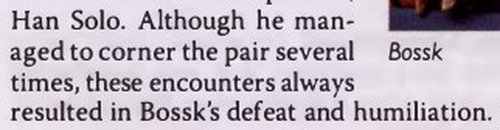
- **Bossk; Luke Skywalker; Leia Organa Solo** — entry/section: Bossk: "Bossk then spent some time in Jabba's palace, but fled the Hutt's sail barge before Luke Skywalker and Princess Leia destroyed the craft." Source: The Complete Star Wars Encyclopedia, Vol. I, p.88
  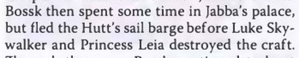

## p.89 (scan page 104)

Page contents: 1066 words, 34 paragraphs | headings/entries: Bothawui; Bothu, Z'meer; Boton, Neibur; Botor Enclave; Bounty Hunters' Guild; Bouri, Omo; Boushh

## p.90 (scan page 105)

Page contents: 1173 words, 37 paragraphs | headings/entries: Bovark, Mingo; Bovo Yagen; Bow; Bow, Commander; Boz; Boz Pity; Bozzie; Bpfassh; BR-037 1; Brachnis Chorios; Bradan, Lieutenant; Bragkis; Brainiac

- **Darth Vader (Anakin Skywalker)**: "Bow, Commander A clone commander who saved Darth Vader from being killed by Jedi Knights on Kessel after the events of Order 66." Source: The Complete Star Wars Encyclopedia, Vol. I, p.90
  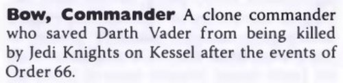
- **Boba Fett**: "Boz A short Lizling, he vowed revenge on Boba Fett after the bounty hunter killed his friend Ry-Kooda." Source: The Complete Star Wars Encyclopedia, Vol. I, p.90
  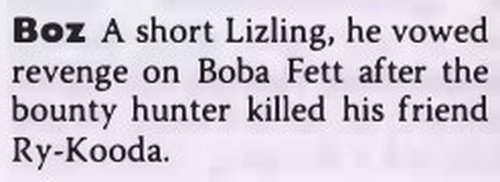

## p.91 (scan page 106)

Page contents: 1163 words, 26 paragraphs | headings/entries: Bralor, Rav; Braisin; Brand, King Empatojayos; Brandei, Captain; Brandes, Hela; Branon, John D.; Brarun, Durgard; Brasck

- **Brakiss**: "The station managed to escape to a new hiding place, but the leaders of the Second Imperium, fed up with Brakiss's failures, detonated the explosives aboard, and he was killed." Source: The Complete Star Wars Encyclopedia, Vol. I, p.91
  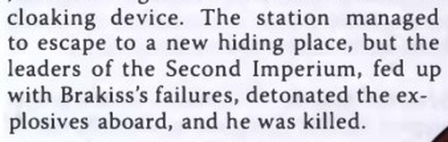

## p.92 (scan page 107)

Page contents: 1157 words, 35 paragraphs | headings/entries: Brashaa; Brashin, Grand General Malcor; Brask Oto Command Station; Brattakin, Movo; Braxis, Senator; Brazzo

## p.93 (scan page 108)

Page contents: 1216 words, 36 paragraphs | headings/entries: Breela; Breemu, Bana; Breetha, Tamaktis; Breil'lya, Tav; Breise, Garth; Bre'lya, Saiga; Bremen, Jak; Bren, Governor Malvander; Bren, Taggor; Bria; Briamma; Bridger, Waldan; Brie, Shira; Briggia; Brighteyes, Slique; Bright Flight; Bright Hope; Bright Jewel Cluster

- **Shaak Ti**: "The initial attack against Brentaal proved disastrous until Jedi Master Shaak Ti was able to lead an insertion team that killed Tok and sabotaged Brentaal's defenses." Source: The Complete Star Wars Encyclopedia, Vol. I, p.93
  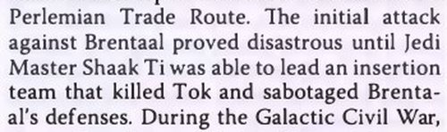
- **General Grievous**: "Bridger, Waldan A Jedi Master remarkable for his well-muscled build and preference for a San-Ni staff over a lightsaber, he was killed by General Grievous on Togoria during the Clone Wars." Source: The Complete Star Wars Encyclopedia, Vol. I, p.93
  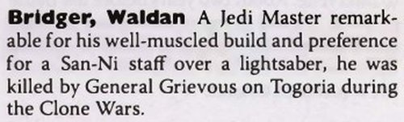

## p.94 (scan page 109)

Page contents: 1124 words, 35 paragraphs | headings/entries: Brightwater, Korlo; Brigia; Brill, Governor Foga; Brilliant; Brilistow, Commander; Brilnilim, Colonel; Bringbit, Lillea; Briquaion, Noa; Brodo Asogi; Brodogon Consortium; Brogar; Brolis, Clone Commander; Brolo, Prefect Dooje; Brit, Major Olander; Bron; Brizzit; Brong; Broadside

- **Han Solo**: "Briil twins Former associates of Han Solo, they were killed in a fight with an Imperial cruiser on patrol near the Tion Hegemony." Source: The Complete Star Wars Encyclopedia, Vol. I, p.94
  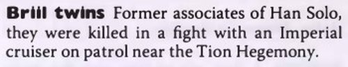

## p.95 (scan page 110)

Page contents: 975 words, 32 paragraphs | headings/entries: Brooks Propulsion Devices; Bror Tower Three; Brownstar; Bruckman, Sergeant; Bruit, Patch; Brun, Deca; Brusc, Captain; Bryndar; Bryx

- **Lord Kaan; Darth Bane**: "Rather than surrender, Lord Kaan triggered a "thought bomb,' which annihilated every last member of the Army of Light and the Brotherhood of Darkness, leaving Darth Bane behind to secretly rebuild the Sith Order in a new guise." Source: The Complete Star Wars Encyclopedia, Vol. I, p.95
  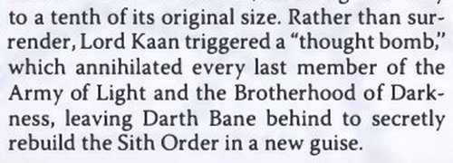
- **Admiral Daala**: "Brusc, Captain The captain of the Star Destroyer Manticore, he served under the command of Admiral Daala." Source: The Complete Star Wars Encyclopedia, Vol. I, p.95
  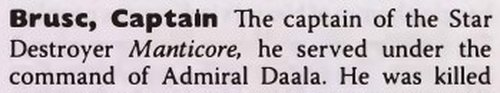

## p.96 (scan page 111)

Page contents: 1100 words, 19 paragraphs | headings/entries: Bular, Councilman; BT-445; Bu, Candabrine

- **Darth Vader (Anakin Skywalker)**: "Bular, Councilman A politician on Ahakista killed by Darth Vader for failing to stop a Rebel plot." Source: The Complete Star Wars Encyclopedia, Vol. I, p.96
  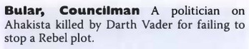

## p.97 (scan page 112)

Page contents: 1110 words, 33 paragraphs | headings/entries: Bundim; Bunduki; Bunji, Big; Bur; Bur, Wac; Bur'lorr; Burning Pride; Burr, Waks; Burren, Tal; Burrk; Burs, Bron; Burtola, J. K.; Bushforb, Slyther; Buuper Torsckil Abbey Devices; Buzk, Commander Sev

- **Oppo Rancisis**: "During the prolonged siege at Saleucami, Bulg killed venerated Jedi Master Oppo Rancisis." Source: The Complete Star Wars Encyclopedia, Vol. I, p.97
  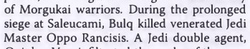
- **Quinlan Vos**: "A Jedi double agent, Quinlan Vos, infiltrated the ranks of the acolytes and slew Bulg in turn." Source: The Complete Star Wars Encyclopedia, Vol. I, p.97
  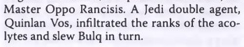

## p.98 (scan page 113)

Page contents: 716 words, 24 paragraphs | headings/entries: Buzzzer; Bwua'tu, Nek

## p.99 (scan page 114)

Page contents: 1031 words, 24 paragraphs | headings/entries: B'wuf; Byblos; Byblos Drive Yards; Bycha, General; Bylissura, Rallicema; Byrom; Byrt; Bzorn, Captain

- **Jacen Solo (Darth Caedus)**: "Solo, who had taken on the title of Darth Caedus, ordered the officer to track down the fleets that had harassed his actions at the Nickel One asteroid and destroy them." Source: The Complete Star Wars Encyclopedia, Vol. I, p.99
  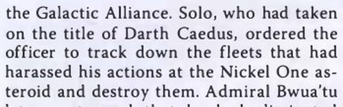
- **Jacen Solo (Darth Caedus); Luke Skywalker**: "However, after Caedus was killed and the Imperial Moffs surrendered to Jedi Grand Master Luke Skywalker, Admiral Bwua'tu was forced to stand down and break off his attacks." Source: The Complete Star Wars Encyclopedia, Vol. I, p.99
  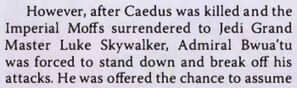
- **Marka Ragnos**: "Eight years later, during Tavion Axmis's campaign to resurrect the spirit of long-dead Sith Lord Marka Ragnos, she ventured to the rocky remains of Byss to siphon dark side energy for use in her cult rituals." Source: The Complete Star Wars Encyclopedia, Vol. I, p.99
  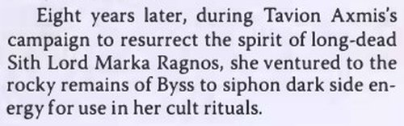

## p.100 (scan page 115)

Page contents: 0 words, 0 paragraphs | headings/entries: 

## p.101 (scan page 116)

Page contents: 749 words, 17 paragraphs | headings/entries: 

## p.102 (scan page 117)

Page contents: 1004 words, 22 paragraphs | headings/entries: C-3PX; C-3TC

- **Leia Organa Solo**: "The two droids were aboard Princess Leia Organa's consular vessel when it was attacked by an Imperial Star Destroyer due to suspected Rebel actions." Source: The Complete Star Wars Encyclopedia, Vol. I, p.102
  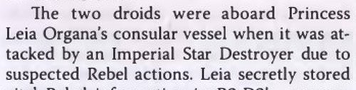
- **C-3PX; Darth Maul** — entry/section: C-3PX: "Though Maul defeated the Bartokks, he was unable to retrieve C-3PX." Source: The Complete Star Wars Encyclopedia, Vol. I, p.102
  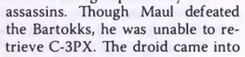
- **C-3PX** — entry/section: C-3PX: "C-3PX took pity on C-3PO, who was pitted in a fight to the death in a droid arena; when he substituted himself for C-3PO he allowed himself to be destroyed." Source: The Complete Star Wars Encyclopedia, Vol. I, p.102
  

## p.103 (scan page 118)

Page contents: 930 words, 28 paragraphs | headings/entries: C-5MO; C-73 Tracker; C8-42; Caaldra_; Caamas; Caamasi; Caarimon; Cabal, the; Caba'Zan_; Cabbel, Lieutenant; Cadaman, Senator Tanner

- **Mara Jade Skywalker**: "Following a trail of embezzeled funds, the Emperor's Hand Mara Jade discovered the plot and began an intense pursuit of Caaldra, which finally ended on the sector capital Shelkonwa, where Caaldra died when his own blasterfire was deflected from Jade's lightsaber blade." Source: The Complete Star Wars Encyclopedia, Vol. I, p.103
  

## p.104 (scan page 119)

Page contents: 1013 words, 41 paragraphs | headings/entries: Cadgel Meadows; Cadinth; Cadmir, Jerem; Cadomai; Caedus, Darth; Cag, Captain; Cai; Cailshh; Wars.; Cairnwick, Drun; Cakhmaim; Calamar; Calamari; Calculator; Calders, Major; Caleb; Calfa-5; Calibop; Cal-i-Vaun

- **Anakin Solo**: "In the Galactic Alliance war against the Corellian Confederation, Cakhmaim and Meewalh were killed while manning the Millennium Falcon's turrets when the ship sustained direct hits from the Star Destroyer Anakin Solo." Source: The Complete Star Wars Encyclopedia, Vol. I, p.104
  
- **Yoda**: "After Tyffix was killed on Thustra, Cal accompanied Yoda as the Jedi Master attempted to make peace with King Alaric." Source: The Complete Star Wars Encyclopedia, Vol. I, p.104
  

## p.105 (scan page 120)

Page contents: 992 words, 30 paragraphs | headings/entries: Calixte, Moff Nyna; Callen, Vi; Calliose; Callista; Callum, Trey; Caina Muun; Calocour Heights

- **Lando Calrissian**: "Piloting the Falcon, Lando, along with Wedge Antilles in an X-wing fighter, destroyed the Empire's second Death Star battle station." Source: The Complete Star Wars Encyclopedia, Vol. I, p.105
  
