# Owner Material 030 — The Complete Star Wars Encyclopedia, Vol. I (A–G): scan pages 121–160

- **Source:** *The Complete Star Wars Encyclopedia* by Stephen J. Sansweet and Pablo Hidalgo, with Bob Vitas, Daniel Wallace, Chris Cassidy, Mary Franklin and Josh Kushins (Del Rey, 2008), 3 vols. Secondary source (licensed Legends reference). Scan OCR'd on the box; the scan stays box-only and is **not** published.
- **Method:** every scanned page was OCR'd and machine-screened sentence by sentence for power-relevant statements (fights, kills, defeats, Force feats, rankings, superweapons) that name a character on our roster; each kept sentence is quoted verbatim from the OCR text and has a crop of the printed passage directly under it. Pages with nothing power-relevant are still listed with what is on them.
- **Citation:** "The Complete Star Wars Encyclopedia, Vol. I, p.X" by printed page ("scan p.X" where no printed number applies). **Weight:** Lucasfilm-licensed encyclopedia: a secondary, in-universe summary of Legends (and some film) material. It sums up feats from novels, comics and games; where the original story is in our notes, that source is the stronger citation.

## p.106 (scan page 121)

Page contents: 1022 words, 24 paragraphs | headings/entries: Cal-Seti; Caltrop 5; Caluula; Camarata; Camas, Iri; Cam'Co, Jer'Jo; Camie; Campaign Against Republic Militarization; Camper; Camp Four; Cana, King; Canavar, Onyeth

- **Luke Skywalker; Leia Organa Solo**: "He helped Luke Skywalker find recruits for his Jedi academy, rescued Leia at least once more, got involved in several dubious moneymaking schemes, crashed at least two converted Imperial Star Destroyers, helped put down major threats to the New Republic, and won—and lost—a dozen fortunes." Source: The Complete Star Wars Encyclopedia, Vol. I, p.106
  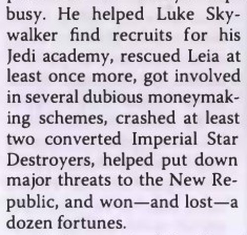

## p.107 (scan page 122)

Page contents: 1118 words, 30 paragraphs | headings/entries: Candaserri; Cant, Devin; Canu; Canyonade; CAP-2 Captivator; Capital Powers Act; Capo; Cappie; Caprioril; Captison, Gaeriel

- **Han Solo; Chewbacca; Luke Skywalker; Leia Organa Solo**: "He was killed in the line of duty when Han Solo, Chewbacca, and Luke Skywalker freed Leia." Source: The Complete Star Wars Encyclopedia, Vol. I, p.107
  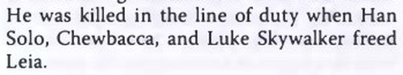

## p.108 (scan page 123)

Page contents: 1099 words, 38 paragraphs | headings/entries: Captison, Yeorg; Caramm V; Carannia; Caravan; Caravel; Carbanti United Electronics; Carbos Thirteen; Carconth; Car'das, Jorj; Cardooine

## p.109 (scan page 124)

Page contents: 1083 words, 25 paragraphs | headings/entries: Carid, Baitan; Carida; Carida Nebula; Carivus, Xandel; Carl; Carison, Sergeant Brooks; Car'n, Lirin; Carniss, Melina; Carosi Xil; Carr, Malik

- **Kyp Durron; Sun Crusher (superweapon)**: "Carida was destroyed when Jedi Kyp Durron caused its star to go nova through the use of an Imperial superweapon, the Sun Crusher." Source: The Complete Star Wars Encyclopedia, Vol. I, p.109
  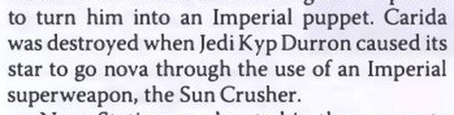
- **Kyp Durron; Sun Crusher (superweapon)**: "Carida Nebula The collection of crimson dust and space gases marked the remains of the Carida system, which was destroyed when Kyp Durron used the Sun Crusher to cause its primary star to achieve supernova." Source: The Complete Star Wars Encyclopedia, Vol. I, p.109
  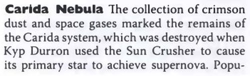
- **Kir Kanos**: "But his new position made him a target for both Grappa the Hutt and Kir Kanos, who eventually tracked down the traitor and killed him." Source: The Complete Star Wars Encyclopedia, Vol. I, p.109
  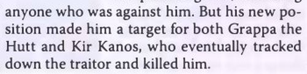

## p.110 (scan page 125)

Page contents: 1001 words, 25 paragraphs | headings/entries: Carr, Yomin; Carratos; Carrick, Zayne; Carsan, Captain; Carson, Farley; Cartann; Cartao; Cartariun; Carvin, General Paltr; Cascardi Mountains; Casement

- **Zayne Carrick** — entry/section: Carrick, Zayne: "In a preemptive strike, they killed their students, except Zayne." Source: The Complete Star Wars Encyclopedia, Vol. I, p.110
  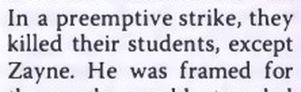

## p.111 (scan page 126)

Page contents: 917 words, 25 paragraphs | headings/entries: Casfield 6; Casio, Gerney; Cass, Officer; Cassandran Worlds; Cassel, Lieutenant Gil; Castell; Casuistie; Catch; Catchhawks; Cathar; Cathor Hills; Catier Walkway; Cato Neimoidia

- **Leia Organa Solo; Admiral Ackbar**: "But on a fateful diplomatic journey with Princess Leia Organa Solo as passenger, Admiral Ackbar's personal B-wing fighter crashed into the cathedral, destroying it and killing hundreds of Vors." Source: The Complete Star Wars Encyclopedia, Vol. I, p.111
  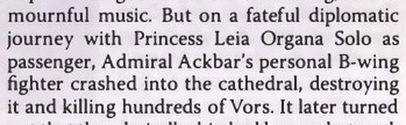

## p.112 (scan page 127)

Page contents: 1120 words, 28 paragraphs | headings/entries: Catuman; Caudle, Master; Cauldron, the; Caulfmar, Governor; Cavalcade; Caveel, Spinda; Cav'Saran, Chief; Cawa; Cayr, Lieutenant Telsij; Cazne'olan; CB-3D

- **Admiral Daala; Kyp Durron; Sun Crusher (superweapon)**: "The gas clouds and electromagnetic radiation in the nebula made an ideal hiding place for Admiral Daala's Star Destroyers, until Jedi student Kyp Durron caused all seven stars to go nova through his use of the Empire's own secret superweapon, the Sun Crusher." Source: The Complete Star Wars Encyclopedia, Vol. I, p.112
  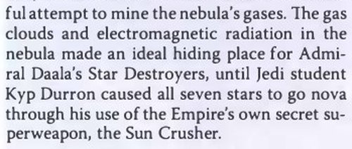

## p.113 (scan page 128)

Page contents: 1127 words, 40 paragraphs | headings/entries: CBX-9; CC-80/88-2199; CCIR; CE-3K; Cecius, Lieutenant; CeeCee; Ceel, General Tobler; Cejansij; Cel, Lieutenant

- **Grand Admiral Thrawn; Joruus C'baoth**: "Thrawn's cunning tactics made short work of the vessels, though in his rage over seeing his dream destroyed, C'baoth reached out with the dark side of the Force and attempted to strangle Thrawn." Source: The Complete Star Wars Encyclopedia, Vol. I, p.113
  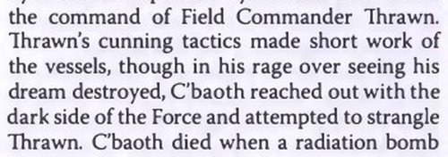
- **Luke Skywalker; Mara Jade Skywalker**: "Luke faced his mindless doppelganger, but it was Mara Jade who eventually killed Luuke Skywalker." Source: The Complete Star Wars Encyclopedia, Vol. I, p.113
  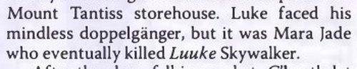
- **Luke Skywalker**: "CE-3K A protocol droid who attended to Luke Skywalker on New Alderaan during the resurrected Emperor's campaign of terror." Source: The Complete Star Wars Encyclopedia, Vol. I, p.113
  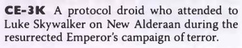

## p.114 (scan page 129)

Page contents: 1241 words, 27 paragraphs | headings/entries: Celador Sash; Celchu, Tycho

- **Lando Calrissian**: "With his own ship out of commission, he flew an A-wing as Green Three and lured Imperials away from Wedge Antilles and Lando Calrissian while they made a run at destroying the second Death Star." Source: The Complete Star Wars Encyclopedia, Vol. I, p.114
  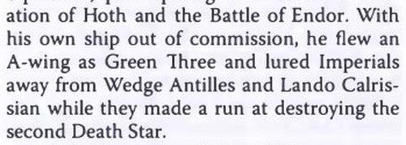
- **Winter Celchu**: "Winter's gift became a silent curse, for she could never shake the memories of her departed friends and destroyed world." Source: The Complete Star Wars Encyclopedia, Vol. I, p.114
  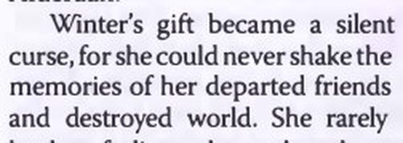
- **Winter Celchu**: "As a Rebel special forces operative, Winter crossed paths with Rogue Squadron following the defeat of the Empire at Endor." Source: The Complete Star Wars Encyclopedia, Vol. I, p.114
  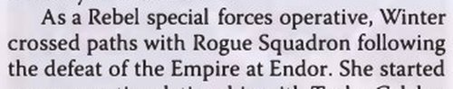
- **Winter Celchu**: "At first, Winter relied on Noghri bodyguards to help safeguard the children, but when Imperial threats escalated following the resurrected Emperor's destructive campaign against the New Republic, greater precautions were taken." Source: The Complete Star Wars Encyclopedia, Vol. I, p.114
  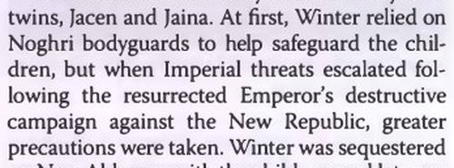
- **Leia Organa Solo**: "Imperials were defeated, and Han and Leia decided to keep the family together rather than hide the children." Source: The Complete Star Wars Encyclopedia, Vol. I, p.114
  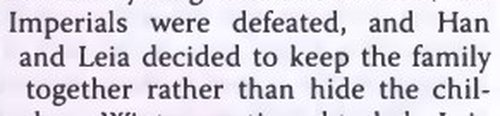

## p.115 (scan page 130)

Page contents: 1184 words, 23 paragraphs | headings/entries: Celegian; Celestials; Celia; Celso, Nikaede; Celwik, Jynne; Celz, Alysun; Centares; Centerpoint Party; Centerpoint Station

- **Luke Skywalker**: "The moon survived the conquest of Coruscant by the Yuuzhan Vong, and later became a training facility used by the new Jedi Order established by Luke Skywalker." Source: The Complete Star Wars Encyclopedia, Vol. I, p.115
  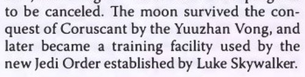

## p.116 (scan page 131)

Page contents: 1227 words, 24 paragraphs | headings/entries: Central Control Computer; Centralia Memorial Spaceport; Centrality; Central Posting Service; Ceousa, General; Cerasi; Cerea; Cerulian, Thame; Cestus Cybernetics

- **Luke Skywalker**: "He didn't know that infiltrators on behalf of Luke Skywalker, including Dr. Toval Seyah, had sabotaged the station so that Vibro's last act destroyed Centerpoint and everything within a 250-kilometer radius of the blast." Source: The Complete Star Wars Encyclopedia, Vol. I, p.116
  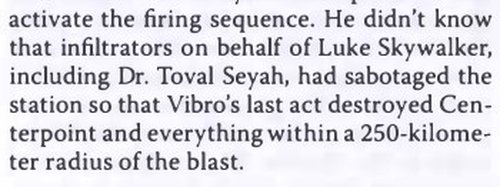
- **Darth Vader (Anakin Skywalker)**: "The Central Control Computer used at the Battle of Naboo was destroyed when Anakin Skywalker blew up the Droid Control Ship's reactor." Source: The Complete Star Wars Encyclopedia, Vol. I, p.116
  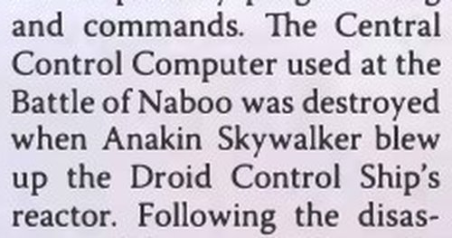

## p.117 (scan page 132)

Page contents: 900 words, 39 paragraphs | headings/entries: CF9 Crossfire; C-Foroon; C-Gosf; Cha, Kadiah; Cha, Wyrpuuk; Cha'a; Chaan, Supreme Commander; Chaastern Four; Chad 111; Chaf; Chaf'ees'aklaio; Chaf Envoy; Chaf Exalted; Chagrian; Chainly, Captain

## p.118 (scan page 133)

Page contents: 947 words, 31 paragraphs | headings/entries: Chakra; Chalacta; Chalcedon; Chaico; Chalk; Chalion, Tohri; Chaimun; Cham; Chamberlyn, Lieutenant; Chamma, Master; Champala; Champion

- **Mara Jade Skywalker**: "Chakra This Jeodu guard worked for Prince Dequc and was killed by Mara Jade." Source: The Complete Star Wars Encyclopedia, Vol. I, p.118
  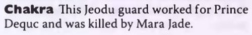
- **Plo Koon**: "Plo Koon used challat eaters from Mount Avos to defeat the Stark Commercial Combine army during the Stark Hyperspace Conflict." Source: The Complete Star Wars Encyclopedia, Vol. I, p.118
  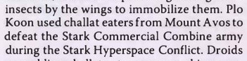

## p.119 (scan page 134)

Page contents: 1044 words, 31 paragraphs | headings/entries: Champion Squadron; Chan, Travia; Chan, Wenton; Chancellor; Chancellor Palpatine Spaceport; Chandrila; Chandrila; Chandrila Defense Fieet; Chandrila Moon; Chandrila Skies; Chang; Change, the; Chant, Gannod; Chanzari; Charal

## p.120 (scan page 135)

Page contents: 1186 words, 35 paragraphs | headings/entries: Ch'arb, Lieutenant; Charbi City; Chariot LAV; Charmath; Charny, Kiel; Charr, Senator; Charros IV; Charubah; Chasa; ChaseX; Chasin City; Chasin Document; Chatak, Bol; Chateau Malreaux; Chatos Academy; Chatrunis, Larisselle

- **Darth Vader (Anakin Skywalker)**: "As punishment, the Emperor's new enforcer, Darth Vader, arrived on Murkhana and cut down several clone troopers." Source: The Complete Star Wars Encyclopedia, Vol. I, p.120
  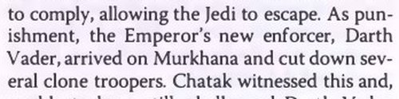
- **Darth Vader (Anakin Skywalker)**: "Though she scored a wound on Vader, she was disarmed and decapitated by the Dark Lord." Source: The Complete Star Wars Encyclopedia, Vol. I, p.120
  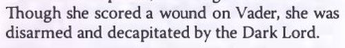

## p.121 (scan page 136)

Page contents: 1024 words, 42 paragraphs | headings/entries: Chayka; Chaykin Cluster; Chazrach; Cheb, Admiral; Checksum; Chedak Communications; Chedgar; Cheel, Nalan; Cheklev; Chelik; Chell, Benwick; Chem; Chempat Engineered Defenses; Chenati, Tarrence; Chenini; Chenlambec; Chersilk; Chevin

- **Kyp Durron**: "Chem This young pilot, a member of Kyp's Dozen, was killed during the Yuuzhan Vong invasion of Coruscant." Source: The Complete Star Wars Encyclopedia, Vol. I, p.121
  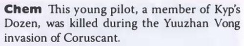

## p.122 (scan page 137)

Page contents: 956 words, 28 paragraphs | headings/entries: Chewbacca

- **Chewbacca** — entry/section: Chewbacca: "Although the Falcon's upkeep was a labor of love, many a time Chewie unleashed his legendary temper on the recalcitrant freighter, banging his massive furry hands against delicate components that refused to behave." Source: The Complete Star Wars Encyclopedia, Vol. I, p.122
  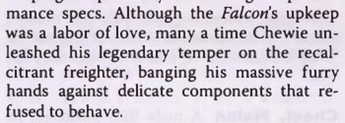

## p.123 (scan page 138)

Page contents: 1003 words, 26 paragraphs | headings/entries: Ch'hodos; Chian; Chiewab Amalgamated Pharmaceuticals; Chiftonage, Beryl; Chihdo; Childsen, Lieutenant Shann; Chimaera; Chin; Chine-kal, Commander; Chip

- **Chewbacca; Han Solo** — entry/section: Chewbacca: "Chewbacca and Han Solo were a well-known smuggling duo whose exploits became legendary." Source: The Complete Star Wars Encyclopedia, Vol. I, p.123
  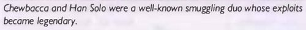
- **Han Solo; Leia Organa Solo; Luke Skywalker**: "Chihdo helped Duel in a con that he pulled on Han Solo, Princess Leia Organa, and Luke Skywalker, on the planet Stenos shortly after the Battle of Yavin." Source: The Complete Star Wars Encyclopedia, Vol. I, p.123
  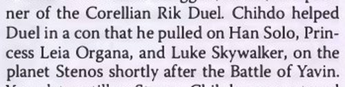
- **Leia Organa Solo**: "He was killed aboard the Death Star during the rescue of Princess Leia Organa." Source: The Complete Star Wars Encyclopedia, Vol. I, p.123
  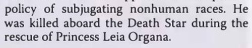
- **Kyp Durron**: "The Créche was attacked at Kalarba by Kyp Durron's squadron, and Chine-kal was forced to flee to Fondor, where his ship was obliterated by a blast from Centerpoint Station." Source: The Complete Star Wars Encyclopedia, Vol. I, p.123
  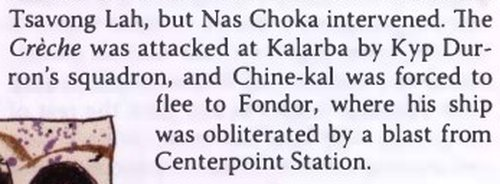

## p.124 (scan page 139)

Page contents: 1058 words, 28 paragraphs | headings/entries: Chirpa, Chief; Chiss

## p.125 (scan page 140)

Page contents: 1219 words, 38 paragraphs | headings/entries: Chistori; Chituhr; Chivkyrie, Yeeru; Chizzik, Pax; Ch'no; Choard, Governor Barshnis; Choba; Choco; ChoFi, Senator; Choi, Tsui; Choka, Nas; Chokk; Cholganna; Chosen; Chowall, Ruke; Chreev

- **Darth Vader (Anakin Skywalker)**: "During this meeting, Darth Vader and the 5Olst Legion arrived and killed the survivors." Source: The Complete Star Wars Encyclopedia, Vol. I, p.125
  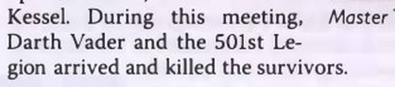

## p.126 (scan page 141)

Page contents: 985 words, 40 paragraphs | headings/entries: Chrellis; Christophsis; Chroma Zed; Chronelle, Titi; Chros-filik; Chryya; Chuff, Pelleus; Chuhkyvi; Chukha-Trok; Chume, Ta'a; Chun, Bruck; Chun, Kad; Chun, Vox; Chung, Nep; Ch'Unkk, Spearmaster

- **Darth Vader (Anakin Skywalker); Ahsoka Tano**: "With the help of Anakin's new Padawan, Ahsoka Tano, the Jedi were able to lower the energy shield protecting the Separatist army and defeat their forces." Source: The Complete Star Wars Encyclopedia, Vol. I, p.126
  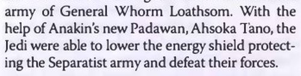
- **Qui-Gon Jinn; Obi-Wan Kenobi**: "When Xanatos's plot threatened to destroy the Jedi Temple, Qui-Gon Jinn and Obi-Wan sprang into action." Source: The Complete Star Wars Encyclopedia, Vol. I, p.126
  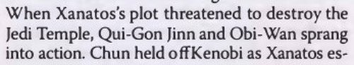

## p.127 (scan page 142)

Page contents: 1299 words, 28 paragraphs | headings/entries: Chunky; Chusker, Vu; Chuundar; Chyler, Tian; Cilghal; Cilpar; Cindar; Cimnagar

- **Cilghal** — entry/section: Cilghal: "She aided in the plan to defeat Kun, then departed Yavin 4 for her most difficult mission: healing the dying Mon Mothma." Source: The Complete Star Wars Encyclopedia, Vol. I, p.127
  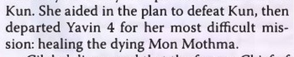

## p.128 (scan page 143)

Page contents: 1089 words, 38 paragraphs | headings/entries: Circumtore; Circus Horrificus; CIS; Cis Jammer Prototype; CiS Shadowfeed; Citadel Station; City Bigspace; Ciutric Hegemony; Claatuvac Guild; Clabburn; Clak'dor IV; Clantaani; Clarani; Clays; Cley, Usu

- **Obi-Wan Kenobi; Darth Vader (Anakin Skywalker)**: "It was Kenobi's apprentice, Anakin Skywalker, who delivered the missile volley that destroyed the jamming craft." Source: The Complete Star Wars Encyclopedia, Vol. I, p.128
  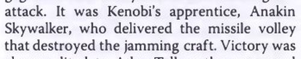

## p.129 (scan page 144)

Page contents: 1021 words, 26 paragraphs | headings/entries: Clezo, Vigo; Clink

- **Palpatine (Darth Sidious)**: "Emperor Palpatine used the Spaarti method to create a cache of clone duplicates of his body, in a twisted bid to achieve practical immortality." Source: The Complete Star Wars Encyclopedia, Vol. I, p.129
  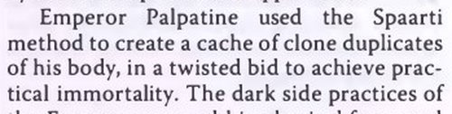

## p.130 (scan page 145)

Page contents: 695 words, 21 paragraphs | headings/entries: Clone Keepers

## p.131 (scan page 146)

Page contents: 890 words, 27 paragraphs | headings/entries: Clone Wars; Cioud

## p.132 (scan page 147)

Page contents: 991 words, 42 paragraphs | headings/entries: Cloud City; Clynn, Lieutenant; CMC-22 Mining Facility; Cloud-Mother; C'ndros, Kal'Faini; Cnorec, Lord; Coachelle Prime; Cobak; Cobalt Station; Cobra; Coby, Prince; CoCo Town; Codex

- **Janek Sunber**: "Sunber overpowered the bully but never | earned his respect." Source: The Complete Star Wars Encyclopedia, Vol. I, p.132
  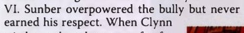

## p.133 (scan page 148)

Page contents: 944 words, 34 paragraphs | headings/entries: Cognus, Darth; Cohasset Rover; Cohl, Arwen; Col, Yurf; Colf, Lieutenant; Colicoid; Collaborator; Collo Fauale Pass; Collus

## p.134 (scan page 149)

Page contents: 933 words, 36 paragraphs | headings/entries: Colonial Games; Colonies, the; Colony, The; Colony; Colton, Jeremoch; Colu, Gorton; Column; Columus; CoMar Combat Systems; Combat Guild; Combat Moon

## p.135 (scan page 150)

Page contents: 963 words, 35 paragraphs | headings/entries: Combined Clans; COMETS-Q; Comet Squadron; Comkin Five; Commando Team; Commenor; Commodore, the

## p.136 (scan page 151)

Page contents: 1209 words, 34 paragraphs | headings/entries: Commonality, the; Common Charter; Commons, the; Compass Star; Compeer; CompForce; Computerized Combat Predictor; Comra; Conclave, the

- **Admiral Ackbar; Leia Organa Solo**: "It was during one such festival that a ship carrying Admiral Ackbar and Princess Leia Organa Solo crashed into and destroyed the cathedral, killing hundreds of Vors." Source: The Complete Star Wars Encyclopedia, Vol. I, p.136
  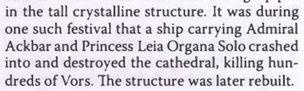

## p.137 (scan page 152)

Page contents: 1092 words, 32 paragraphs | headings/entries: Concordian; Concorkill, Sweitt; Condi

- **Palpatine (Darth Sidious); Darth Vader (Anakin Skywalker)**: "When Palpatine assumed absolute control of the galaxy, he ordered Darth Vader to destroy the council." Source: The Complete Star Wars Encyclopedia, Vol. I, p.137
  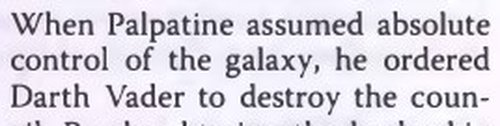

## p.138 (scan page 153)

Page contents: 1059 words, 33 paragraphs | headings/entries: Confederation, the; Confiscation Authority; Coniel; Conner Ship Systems; Conno; Conor, Goure; Conqueror Assault Ship; Conquest; Consolidated Shipping; Constrainer; Constrictor; Contemplanys Hermi; Contender Squadron; Contingency Deployment Profile

## p.139 (scan page 154)

Page contents: 946 words, 31 paragraphs | headings/entries: Contispex, Supreme Chancellor; Contruum; Convarion, Ait; COO-2180; Coome, R'yet; Galactic Time; Coorr, Senator Ronet; Cophrigin V; Copperline; Copycat Pod; Coral Depths City; Coral Fin

## p.140 (scan page 155)

Page contents: 1082 words, 27 paragraphs | headings/entries: Coral Vanda; Corbantis; Cordé; Corde, Morrigan; CorDuro Shipping; Core Founders; Core Galaxy Systems; Corellia

## p.141 (scan page 156)

Page contents: 1166 words, 32 paragraphs | headings/entries: 

## p.142 (scan page 157)

Page contents: 968 words, 37 paragraphs | headings/entries: Corellia Mining Corporation; Corellian Arms; Corellian Bloodstripe; Corellian Confederation; Corellian Defense Force; Corellian Jumpmaster 5000; Corellian Port Control; Corellian Run; Corellian Sanctuary

- **Jacen Solo (Darth Caedus)**: "With Caedus killed in a lightsaber duel with his twin sister, the war came to an end and all sides agreed to sign a peace treaty." Source: The Complete Star Wars Encyclopedia, Vol. I, p.142
  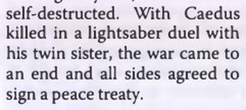

## p.143 (scan page 158)

Page contents: 1267 words, 30 paragraphs | headings/entries: Corellian Slip; Corellian Treaty; Corellian Way; Corellia Star; Corewatch; Core Worlds; Core Worlds Security Act; Core Worlds Travel Clearance; Corey, Swilla; Corgan, Colonel; Cories, Niklas; Coriolis

## p.144 (scan page 159)

Page contents: 1093 words, 23 paragraphs | headings/entries: Cornelius, Dr.; Corobb, Roron; Coronet; Coronet; Corporate Alliance; Corporate Sector

## p.145 (scan page 160)

Page contents: 1301 words, 30 paragraphs | headings/entries: Corpulentus; Corr; Corridan; Corrsk; Corrupter; Corsair; Cort, Farl; Cortelila

- **Lowbacca**: "Lowbacca then overpowered Corrsk and blew him out of an air lock." Source: The Complete Star Wars Encyclopedia, Vol. I, p.145
  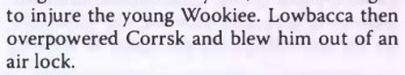
