# Owner Material 030 — The Complete Star Wars Encyclopedia, Vol. I (A–G): scan pages 161–200

- **Source:** *The Complete Star Wars Encyclopedia* by Stephen J. Sansweet and Pablo Hidalgo, with Bob Vitas, Daniel Wallace, Chris Cassidy, Mary Franklin and Josh Kushins (Del Rey, 2008), 3 vols. Secondary source (licensed Legends reference). Scan OCR'd on the box; the scan stays box-only and is **not** published.
- **Method:** every scanned page was OCR'd and machine-screened sentence by sentence for power-relevant statements (fights, kills, defeats, Force feats, rankings, superweapons) that name a character on our roster; each kept sentence is quoted verbatim from the OCR text and has a crop of the printed passage directly under it. Pages with nothing power-relevant are still listed with what is on them.
- **Citation:** "The Complete Star Wars Encyclopedia, Vol. I, p.X" by printed page ("scan p.X" where no printed number applies). **Weight:** Lucasfilm-licensed encyclopedia: a secondary, in-universe summary of Legends (and some film) material. It sums up feats from novels, comics and games; where the original story is in our notes, that source is the stronger citation.

## p.146 (scan page 161)

Page contents: 891 words, 26 paragraphs | headings/entries: Corulag; Corusca Circus; Corusea Fire

- **Darth Vader (Anakin Skywalker)**: "Anakin Skywalker destroyed the principal facility manufacturing these droids on Metalorn." Source: The Complete Star Wars Encyclopedia, Vol. I, p.146
  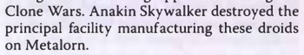
- **Admiral Ackbar**: "Corusea Fire A Victory-class Star Destroyer dispatched under the command of Admiral Ackbar to liberate Ciutric from Prince- Admiral Krennel." Source: The Complete Star Wars Encyclopedia, Vol. I, p.146
  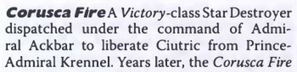

## p.147 (scan page 162)

Page contents: 744 words, 23 paragraphs | headings/entries: Coruscant Guard

- **Grand Admiral Thrawn**: "After Grand Admiral Thrawn's failed bid to recapture Coruscant, the Imperials rallied by staging a devastating attack on the capital." Source: The Complete Star Wars Encyclopedia, Vol. I, p.147
  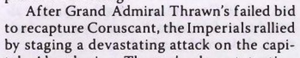
- **General Grievous**: "Though the Confederacy was defeated in this battle, General Grievous escaped to the Outer Rim, and the Clone Wars continued for a while longer." Source: The Complete Star Wars Encyclopedia, Vol. I, p.147
  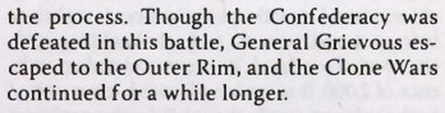

## p.148 (scan page 163)

Page contents: 1254 words, 38 paragraphs | headings/entries: Coruscant Opera House; Coruscant Park; Coruscant Prime; Coruscant Weather Control Network; Corvis; Corvis Minor; Cosmic Balance; Cosmic Egg; Cosmic Turbine; Cothron, Lieutenant; Cotin; Council Rock

## p.149 (scan page 164)

Page contents: 1046 words, 30 paragraphs | headings/entries: Courage; Courage; Courkrus; Courteous; Covenant, the; Covis, Spane; Cov-Prim, Alexis; Cowall, Tetran

- **Joruus C'baoth**: "General Covell died on the planet Wayland after the mad clone Jedi, Joruus C'baoth, destroyed his mind." Source: The Complete Star Wars Encyclopedia, Vol. I, p.149
  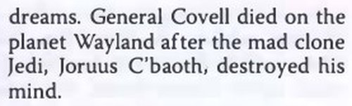
- **Zayne Carrick**: "As a preventive measure, the Covenant killed all of the graduating Padawans, but one resourceful student, Zayne Carrick, escaped." Source: The Complete Star Wars Encyclopedia, Vol. I, p.149
  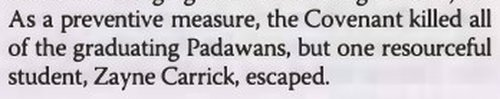

## p.150 (scan page 165)

Page contents: 1103 words, 33 paragraphs | headings/entries: Cowl Crucible; Coy, Admiral; Coynite; Crab, Finious; Cracken, General Airen; Cracken, Pash

- **Darth Vader (Anakin Skywalker)**: "Coy, Admiral The commander of the Imperial Star Destroyer Mathayus, he questioned Darth Vader about the use of the Star Destroyer for a mission to hunt down a single fugitive." Source: The Complete Star Wars Encyclopedia, Vol. I, p.150
  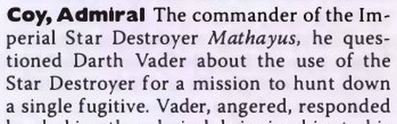

## p.151 (scan page 166)

Page contents: 1158 words, 29 paragraphs | headings/entries: Crado; Cranscoc; Cravus, Lord; Craw, Dictator-Forever; CRC-09/571; Creative Surgery; Créche; Cree'Ar, Dr. Dassid

- **Crado; Aleema Keto** — entry/section: Crado: "Crado was killed along with dark sider Aleema ina multiple supernova eruption that they triggered." Source: The Complete Star Wars Encyclopedia, Vol. I, p.151
  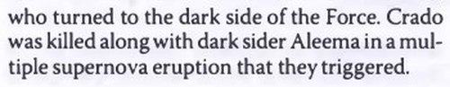
- **Obi-Wan Kenobi; Darth Vader (Anakin Skywalker)**: "Obi-Wan Kenobi and Anakin Skywalker destroyed the key crawl-carrier development facility on Drago before this droid could be widely deployed." Source: The Complete Star Wars Encyclopedia, Vol. I, p.151
  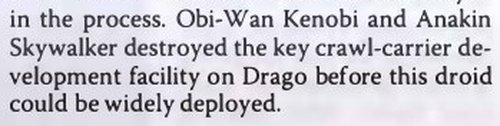
- **Kar Vastor**: "CRC-09/571 was killed by warlord Kar Vastor." Source: The Complete Star Wars Encyclopedia, Vol. I, p.151
  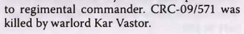
- **Kyp Durron**: "Ganner Rhysode, rescued by Kyp, slew the yammosk with his lightsaber, leading to the death of the ship." Source: The Complete Star Wars Encyclopedia, Vol. I, p.151
  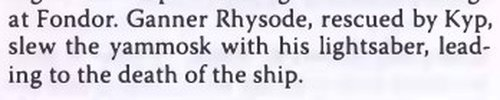

## p.152 (scan page 167)

Page contents: 1078 words, 49 paragraphs | headings/entries: Creed, the; Creel, Pleader Iving; Créme D'infame; Cremlevian War; Crespin, General Edor; Cressa, Supreme Chancellor; Creterk, Rievale; Crevasse City; Creysis; Crimmins; Crimpler; Crimson Jack; Crimson Nova; Crion; Crockagor

## p.153 (scan page 168)

Page contents: 1085 words, 35 paragraphs | headings/entries: Croke; Cronal; Cronus, Colonel; Crooked-Tail; Crossings, the; Crote, Senator; Crowal, Moff; Crseih Research Station; Crumb, Salacious 8B.; Crustai; Cryalina; Crying Room; Crynyd; Crynyd, Arvel; CryoBan

- **Aleema Keto**: "Aleema activated an ancient Sith weapon and ripped the core from one of the stars, hurling it at the Jedi fleet and destroying it." Source: The Complete Star Wars Encyclopedia, Vol. I, p.153
  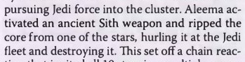
- **Han Solo**: "Crynyd An Imperial-class Star Destroyer captured, refitted, and renamed by the New Republic for a famed Alliance pilot, it was part of the fleet assigned to Han Solo and the Mon Remonda during the hunt for Warlord Zsinj." Source: The Complete Star Wars Encyclopedia, Vol. I, p.153
  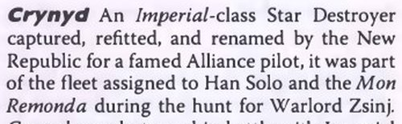

## p.154 (scan page 169)

Page contents: 1040 words, 42 paragraphs | headings/entries: Cryptanalysis Department; Crypt Master; Crystal Cave; Crystal Jewel; Crystal Reef; Csilla; CT-0000/1 010; CT-0 14/783; CT-19/39; CT-36/73 2; CT-41/14-0301; CT-43/76-9255; CT-44/444; CT-4/619; CT-5 108/8843; CT-52/89-9204; CT-53/21-8778; CT-5/501

## p.155 (scan page 170)

Page contents: 1252 words, 35 paragraphs | headings/entries: CT-55/1 1-9009; CT-57/11-9048; CT-65/91-6210; CT-6734; CT-6/774; CT-802; CT-80/88-3009; CT-914; CT-915; CT-96/298; C'taunmar, General; Cuf, Pedric; Cuipernam; Cuis, Sa; Cujicor; Cularin

- **Plo Koon**: "CT-8770, CT-8910 Two out of 141 clone troopers killed on Cato Neimoidia when Plo Koon crashed his Jedi starfighter into a clone staging area." Source: The Complete Star Wars Encyclopedia, Vol. I, p.155
  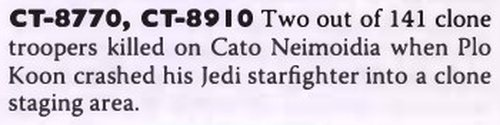
- **Darth Maul**: "Cudgel (2) The name of the Duelist Elite dueling droid that Darth Maul once trained against and destroyed." Source: The Complete Star Wars Encyclopedia, Vol. I, p.155
  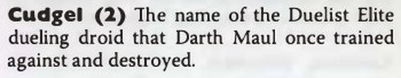
- **Palpatine (Darth Sidious); Darth Vader (Anakin Skywalker)**: "Their bid to assassinate Palpatine was cut short when Darth Vader destroyed the clones." Source: The Complete Star Wars Encyclopedia, Vol. I, p.155
  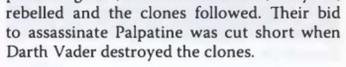

## p.156 (scan page 171)

Page contents: 1183 words, 28 paragraphs | headings/entries: Culu, Shoaneb; Cundertol, Molierre; Curi; Curich Engineering; Cuthallox; Cuthus, Naroon; Cutup; Cuvil, Pir; Cuvir, Lord; Cuy'val Dar; Cyax

## p.157 (scan page 172)

Page contents: 1156 words, 27 paragraphs | headings/entries: Cyborg Operations; Cyborrea; Cycer, Del; Cygnus Spaceworks; Cyndra; Cyrillia; CZ-1; Czerka Corporation; Czethros; Czycz, Stauz

- **Darth Zannah**: "Paak tried to kill Zannah, but the shot was deflected back and killed him." Source: The Complete Star Wars Encyclopedia, Vol. I, p.157
  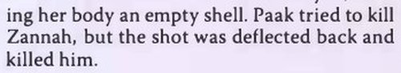
- **Jacen Solo (Darth Caedus); Jaina Solo**: "He worked secretly to activate his scattered sleeper cells to rebuild Black Sun to its former glory, but was ultimately defeated thanks to the efforts of Jacen and Jaina Solo and their friends." Source: The Complete Star Wars Encyclopedia, Vol. I, p.157
  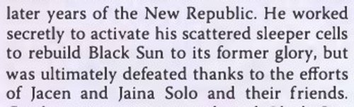
- **Darth Vader (Anakin Skywalker)**: "Tark confronted Vader, but the Dark Lord was able to defeat and decapitate the powerful alien warrior." Source: The Complete Star Wars Encyclopedia, Vol. I, p.157
  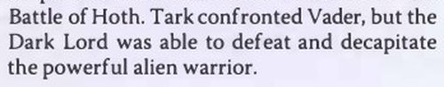

## p.158 (scan page 173)

Page contents: 0 words, 0 paragraphs | headings/entries: 

## p.159 (scan page 174)

Page contents: 905 words, 27 paragraphs | headings/entries: D-127X; D25D; D-34; D-4; D435; D-4R5; D516; D6; 16-66; D-89; D-AO2

- **Grand Moff Tarkin; Admiral Daala**: "It was Tarkin's influence that allowed Daala to ascend to the rank of admiral, and he placed her in command of a quartet of Imperial Star Destroyers patrolling the Outer Rim Territories." Source: The Complete Star Wars Encyclopedia, Vol. I, p.159
  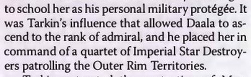
- **Sun Crusher (superweapon)**: "The trio broke free of the installation, managing in the process to capture one of the most powerful superweapons in development, the Sun Crusher." Source: The Complete Star Wars Encyclopedia, Vol. I, p.159
  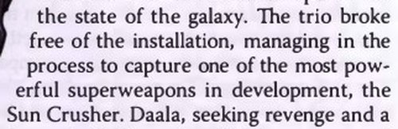

## p.160 (scan page 175)

Page contents: 1196 words, 35 paragraphs | headings/entries: D'a Alin, Joveh; Daal, Raymas; Daan; D'aarmont; Dab, Notha; Dac; Dachat

- **Admiral Daala; Luke Skywalker**: "With Gilad Pellaeon at her side, Daala took command of the Super Star Destroyer Knight Hammer and engaged in an ill-advised strike against Luke Skywalker's Jedi academy on Yavin 4." Source: The Complete Star Wars Encyclopedia, Vol. I, p.160
  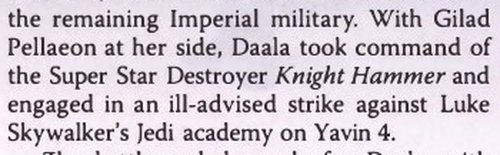

## p.161 (scan page 176)

Page contents: 998 words, 36 paragraphs | headings/entries: Dactyl; Dade, Lilla; Daeshara'cor; Da'Gara, Prefect; Dagobah; Dagore, Winfrid; Dagro; Dagu; Dahai, Tedn; Dahl

- **Han Solo**: "Torm betrayed and killed Rekkon but was later killed by Han Solo." Source: The Complete Star Wars Encyclopedia, Vol. I, p.161
  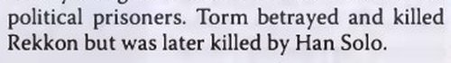
- **Luke Skywalker**: "He died when New Republic forces led by Luke Skywalker attacked Helska and destroyed the powerful, deadly yammosk." Source: The Complete Star Wars Encyclopedia, Vol. I, p.161
  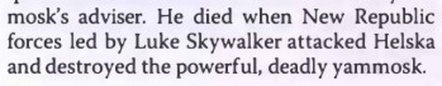
- **Darth Vader (Anakin Skywalker)**: "He discovered a secret Separatist base that he was able to destroy with the help of Anakin Skywalker." Source: The Complete Star Wars Encyclopedia, Vol. I, p.161
  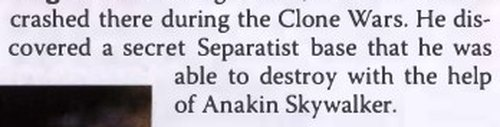

## p.162 (scan page 177)

Page contents: 998 words, 42 paragraphs | headings/entries: Daily Galaxy; Daine, Cubber; Daine, Zindra; Dainsom, Imperial Trooper Guard; Dajus, Jessa; Dakar; Dakhan, Shar; D'akul, Shada; Dal, Ghithra; Dal, Rarta; Daihney, Hric; Dalliance; Dallin, Jace; Dallows, Rhys; Dalonbian, Tobbert; Dairon Five; Daluuj

- **Han Solo; Leia Organa Solo**: "Dalla the Hutt A Hutt from whom Han Solo borrowed money—using the Millennium Falcon as collateral—to buy Leia Organa Solo a planet forthe refugees who were offworld when the Empire destroyed the planet Alderaan." Source: The Complete Star Wars Encyclopedia, Vol. I, p.162
  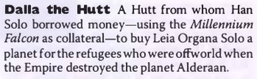
- **Darth Vader (Anakin Skywalker)**: "Darth Vader detected his disloyalty and killed him with the Force." Source: The Complete Star Wars Encyclopedia, Vol. I, p.162
  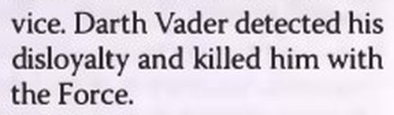

## p.163 (scan page 178)

Page contents: 1191 words, 41 paragraphs | headings/entries: Damaya; Dameerd, Tun; Dammant Killers; Damonite Yors-B; Dampner, Toy; D'an, Barquin; Danalis; Dancing Goddess; Dane; Dané; Dangor, Ars

- **Anakin Solo; Tahiri Veila**: "After the rescue of Anakin Solo and Tahiri Veila, the damuteks on Yavin 4 were destroyed by Talon Karrde's fleet and the Errant Venture." Source: The Complete Star Wars Encyclopedia, Vol. I, p.163
  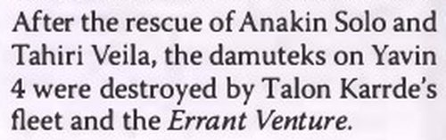

## p.164 (scan page 179)

Page contents: 1013 words, 28 paragraphs | headings/entries: Dani; Danid, Burr; Dankin; Dan'kre, Liska; Danlé, Theomet; Dann, Sohn; Danod, Murr; Danoo, Immi; Danta, Iry; Dantari; Dantels, Nera; Dantooine; Dantooine Squadron; Dantos, Vigos; Danu, Giddean

- **Lumiya**: "She was grievously injured by the Dark Lady Lumiya, and while she survived, she was a changed person." Source: The Complete Star Wars Encyclopedia, Vol. I, p.164
  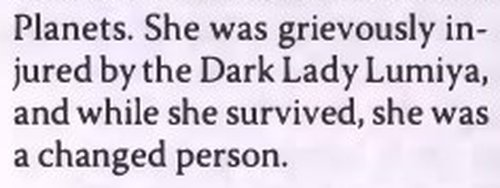
- **Darth Vader (Anakin Skywalker)**: "Danid was pitted against Darth Vader and killed as a demonstration of the need for further training." Source: The Complete Star Wars Encyclopedia, Vol. I, p.164
  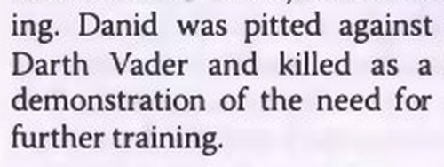
- **Darth Malak**: "Darth Malak destroyed the enclave, though its ruins remained for millennia." Source: The Complete Star Wars Encyclopedia, Vol. I, p.164
  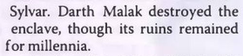

## p.165 (scan page 180)

Page contents: 1313 words, 35 paragraphs | headings/entries: Danva, Joclad; Danyawarra; Daplona; Dar, Chu-Gon; Dar, Ingo; Daragon, Gav; Daragon, Jori; Daragon, Led; Darak; Darb, Sergeant Whelmo; Darc, Artel; Darcc, Moff; Darda; Dardo, Vigo; Dare, Sigel; Dareb

- **Phow Ji**: "Danva, Joclad A Jedi Knight skilled in the martial arts, he entered a teras kasi competition just prior to the Clone Wars and was defeated by the fierce Phow Ji." Source: The Complete Star Wars Encyclopedia, Vol. I, p.165
  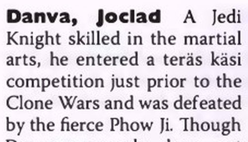
- **Naga Sadow**: "In the conflict, Gav's former friend, Aarrba the Hutt, was killed and Gav realized that he had made a grave error in trusting Naga Sadow." Source: The Complete Star Wars Encyclopedia, Vol. I, p.165
  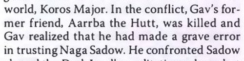
- **Anakin Solo; Jacen Solo (Darth Caedus); Luke Skywalker**: "Darb, Sergeant Whelmo A sergeant in the security detail assigned to the maiden voyage of the Star Destroyer Anakin Solo, he was ordered by Jacen Solo to accompany Luke Skywalker and his entourage to the ship's Situation Room fora meeting with Tenel Ka." Source: The Complete Star Wars Encyclopedia, Vol. I, p.165
  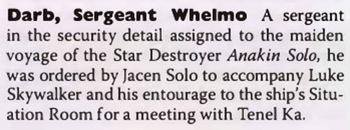
- **Shaak Ti**: "Darc, Artel A Separatist dark sider defeated by Shaak Ti during the Clone Wars." Source: The Complete Star Wars Encyclopedia, Vol. I, p.165
  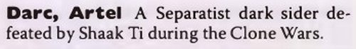

## p.166 (scan page 181)

Page contents: 1106 words, 35 paragraphs | headings/entries: Darepp; Dargulli; Darillian, Captain Zurel; Daring; Daring Way; Daritha; Dark Age; Dark Curse; Darker, the; Dark Force Nebula; Dark Holocron; Dark Jedi; Darkknell; Dark, Knire

- **Chewbacca**: "The Darker eventually was defeated by Chewbacca, who threw the being into the force screen, destroying him and the underground city." Source: The Complete Star Wars Encyclopedia, Vol. I, p.166
  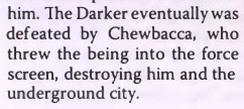

## p.167 (scan page 182)

Page contents: 1176 words, 32 paragraphs | headings/entries: Darklighter, Biggs; Darklighter, Gavin

- **Luke Skywalker; Darth Vader (Anakin Skywalker)**: "As Red Three to Luke's Red Five, he destroyed several TIE fighters before finally being taken out by a blast from Darth Vader's TIE fighter." Source: The Complete Star Wars Encyclopedia, Vol. I, p.167
  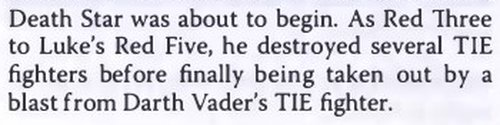

## p.168 (scan page 183)

Page contents: 1114 words, 38 paragraphs | headings/entries: Darklighter, Rasca; Darklighter, Sera Faleur; Darklighter, Silya; Darklighter, Trepler; Darkmere, Brigadier Colin; Dark Nest; Dark Reaper; Darksaber Project; Dark Side Compendium; Darkstaff; Darkstar, Shannur

- **Luke Skywalker; Plo Koon**: "In the devastating Swarm War that followed, Luke Skywalker brought an end to the Dark Nest by defeating Lomi Plo in combat." Source: The Complete Star Wars Encyclopedia, Vol. I, p.168
  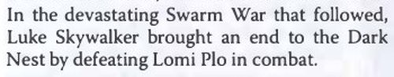
- **Darth Vader (Anakin Skywalker)**: "Reaper, Anakin heard Qel-Droma's voice advising him on how to defeat it." Source: The Complete Star Wars Encyclopedia, Vol. I, p.168
  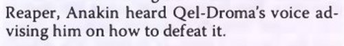
- **Luke Skywalker; Leia Organa Solo**: "He had completed three volumes of a proposed several-hundred-volume set before being defeated by Luke Skywalker and Princess Leia Organa Solo." Source: The Complete Star Wars Encyclopedia, Vol. I, p.168
  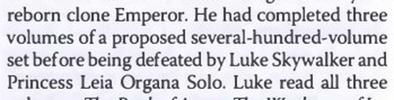

## p.169 (scan page 184)

Page contents: 1196 words, 38 paragraphs | headings/entries: Dark Star Hellions; DarkStryder; Dark Sword Squadron; Darktrin, Fimm; Dark Underlord; Darkvenge; Dark Woman; D'armon, Pav

- **Dark Underlord** — entry/section: Dark Underlord: "He eventually was defeated by Mandalorian mercenaries." Source: The Complete Star Wars Encyclopedia, Vol. I, p.169
  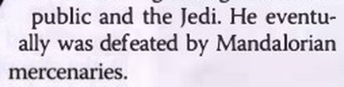
- **An'ya Kuro (Dark Woman)** — entry/section: Dark Woman: "His entire unit was wiped out at the Battle of Geonosis and he was reassigned to Omega Squad." Source: The Complete Star Wars Encyclopedia, Vol. I, p.169
  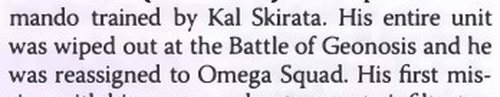

## p.170 (scan page 185)

Page contents: 1236 words, 33 paragraphs | headings/entries: Darnada, Vigo; Daroe; Daron; Daroon, Miro; Dar'Or; Darovit; Darpen, Tomer; Darron, Commander Vict; Darsana, Senator; Darsk, Ris; Dart; Darté, Roblio; Darth

- **Darth Maul**: "Darth Maul then destroyed Darnada's space station, though he did allow Aga Nasa to escape." Source: The Complete Star Wars Encyclopedia, Vol. I, p.170
  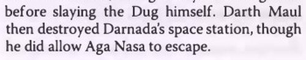
- **Darth Zannah**: "After Caleb healed Bane, Zannah killed Caleb and used the Force to drive Darovit mad." Source: The Complete Star Wars Encyclopedia, Vol. I, p.170
  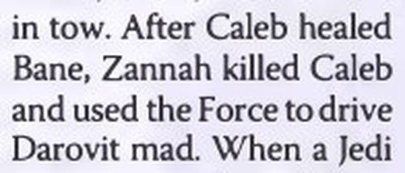

## p.171 (scan page 186)

Page contents: 16 words, 6 paragraphs | headings/entries: 

## p.172 (scan page 187)

Page contents: 1171 words, 34 paragraphs | headings/entries: Darys, Ameesa; Darzu, Belia; Das, Runck; Dashbalar; Dashta Mountains; D'asima, Paloma; Da Soocha; Dasoor Challenge; Dassid; Dassyne, General Oro

- **Luke Skywalker; Darth Vader (Anakin Skywalker); Palpatine (Darth Sidious)**: "When Luke Skywalker was able to bring Anakin Skywalker back to the light and defeat Darth Sidious, the line of Sith was broken and balance was restored to the Force." Source: The Complete Star Wars Encyclopedia, Vol. I, p.172
  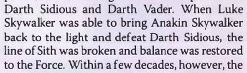
- **Belia Darzu; Darth Bane** — entry/section: Darzu, Belia: "Darzu was killed by the Mecrosa Order, but centuries later Darth Bane uncovered her holocron on Tython." Source: The Complete Star Wars Encyclopedia, Vol. I, p.172
  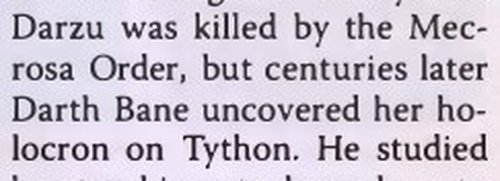
- **Obi-Wan Kenobi; Darth Vader (Anakin Skywalker)**: "During the Clone Wars, he was a military leader for the Separatists until his defeat by Obi-Wan Kenobi and Anakin Skywalker on Bomis Korri IV." Source: The Complete Star Wars Encyclopedia, Vol. I, p.172
  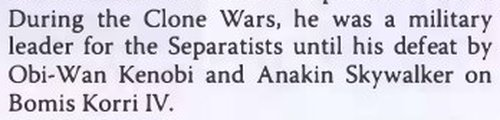

## p.173 (scan page 188)

Page contents: 1091 words, 35 paragraphs | headings/entries: D'Asta, Baron Ragez; D'Asta, Feena; Datar; Datch, Tarrin; Dathcha

- **Quinlan Vos**: "Vos defeated Zalem's plot to use the Infinity Gate to destroy Coruscant." Source: The Complete Star Wars Encyclopedia, Vol. I, p.173
  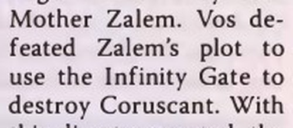
- **Gethzerion**: "Gethzerion, he ordered all the prison's ships destroyed to prevent her from leaving the planet." Source: The Complete Star Wars Encyclopedia, Vol. I, p.173
  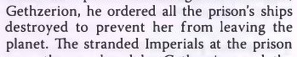
- **Gethzerion**: "The stranded Imperials at the prison were then enslaved by Gethzerion and the other Nightsisters." Source: The Complete Star Wars Encyclopedia, Vol. I, p.173
  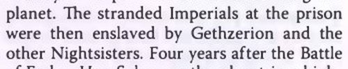

## p.174 (scan page 189)

Page contents: 998 words, 37 paragraphs | headings/entries: Dathomir Station; Datum District; Daupherm Planet States; Dauren, Lieutenant; Dave; Daver Kuat; Davin, Cort; Davip, Commander Eldo; Davis; Dawferim Selfhood States; Dawn, Raleigh; Dawn Beat; Dawson

- **Roan Fel**: "Dauntless (2) A Pellaeon-class Super Star Destroyer, part of the new Empire's fleet during the time of Emperor Roan Fel." Source: The Complete Star Wars Encyclopedia, Vol. I, p.174
  
- **Kueller**: "Davis was later killed in one of the bombings by the Dark Jedi Kueller." Source: The Complete Star Wars Encyclopedia, Vol. I, p.174
  

## p.175 (scan page 190)

Page contents: 791 words, 41 paragraphs | headings/entries: Daykim, Onibald; Daysong; Daystar Craft; Dazon, Hem; DD; DD-11A; Dbarian; DC-15; DD-19 Overseer; Dead Forest; DC-17; Dead Sector; Dead Zone; D/Crypt Information Services; Deak

## p.176 (scan page 191)

Page contents: 951 words, 27 paragraphs | headings/entries: Dean, Mother; Death; Death Hurdles; Death's Head; Death Squadron

- **Jango Fett**: "Jango Fett destroyed the vessel, forcing Vizsla to eject in an escape pod." Source: The Complete Star Wars Encyclopedia, Vol. I, p.176
  
- **Grand Admiral Thrawn**: "Death's Head An Imperial Star Destroyer, it was commanded by Captain Harbid as part of Grand Admiral Thrawn's armada." Source: The Complete Star Wars Encyclopedia, Vol. I, p.176
  
- **Grand Moff Tarkin**: "Sienar's technical genius foresaw that a moon-sized battle station was feasible, but it was Tarkin who understood how it could be applied to enforce order in the galaxy." Source: The Complete Star Wars Encyclopedia, Vol. I, p.176
  
- **Leia Organa Solo**: "Later it was used to destroy Princess Leia Organa's home planet, Alderaan, causing the instant death of billions of sentient beings." Source: The Complete Star Wars Encyclopedia, Vol. I, p.176
  

## p.177 (scan page 192)

Page contents: 1000 words, 30 paragraphs | headings/entries: Death Watch; Debbikin; Debbie Agreement; Debit-101; Debnoli; Deboota, Dr. Hira; Dec, Captain Anf; Deception Sect

- **Luke Skywalker**: "So, guided by the Force, Luke Skywalker was able to destroy this powerful weapon by firing proton torpedoes down an unshielded exhaust vent." Source: The Complete Star Wars Encyclopedia, Vol. I, p.177
  
- **Palpatine (Darth Sidious)**: "Emperor Palpatine allowed the Alliance's Bothan spies to learn the location of the Death Star, but never revealed that the superlaser on the incomplete station was fully operational." Source: The Complete Star Wars Encyclopedia, Vol. I, p.177
  
- **Kyp Durron; Sun Crusher (superweapon)**: "The prototype finally was destroyed when Kyp Durron, piloting the Sun Crusher, lured the Imperial weapon into one of the Maw's black holes, where it was smashed by gravitational forces." Source: The Complete Star Wars Encyclopedia, Vol. I, p.177
  

## p.178 (scan page 193)

Page contents: 1014 words, 40 paragraphs | headings/entries: Decimator; Decisive; Declann, Grand Admiral Nial; Republic; Decoy Squad Five; Deega, Senator; Deegan, Lieutenant; Deej; Deela; Deep Core; Deepcore Lounge; Deep Core Security Zone; Deeto; Deevers, Moss; Deevis, Captain; Defano, Dasha; Defeen

- **Sev'rance Tann**: "Sev'Rance Tann oversaw the development of the tank on the manufacturing planet of Krant, until the facilities were destroyed by Jedi Master Echuu Shen-Jon and his clone troopers." Source: The Complete Star Wars Encyclopedia, Vol. I, p.178
  
- **Janek Sunber; Luke Skywalker**: "Instead, he railed at Sunber and the Imperials, claiming that Luke Skywalker—the man who'd single-handedly destroyed the first Death Star—would eventually detroy the Empire as well." Source: The Complete Star Wars Encyclopedia, Vol. I, p.178
  

## p.179 (scan page 194)

Page contents: 850 words, 29 paragraphs | headings/entries: Defender Droid; Defender Wing; Defiance; Defiant; Deget, Opula

- **Darth Vader (Anakin Skywalker)**: "Defender (2) A Venator Star Destroyer, part of Anakin Skywalker's fleet at Ryloth during the Clone Wars." Source: The Complete Star Wars Encyclopedia, Vol. I, p.179
  
- **Jacen Solo (Darth Caedus)**: "In the wake of the Battle of Bastion, the Defiant was equipped with a gravitic amplitude modulator and reprogrammed by Jacen Solo and the Galactic Alliance to allow Imperial forces to destroy a Yuuzhan Vong yammosk." Source: The Complete Star Wars Encyclopedia, Vol. I, p.179
  

## p.180 (scan page 195)

Page contents: 844 words, 30 paragraphs | headings/entries: Deila; Dejock, Ensign; Dekluun, Commander; Deko Neimoidia; Delaya; Delaluna; Delbaeth, Ivixa; Deickis, Rannd; Del Dihe, Hebanh; Delantine; Delari Prime

- **Obi-Wan Kenobi**: "After the elders of the Daan and Melida were defeated, Deila was named to the new government's Young Security Squad, serving as Obi-Wan Kenobi's second in command." Source: The Complete Star Wars Encyclopedia, Vol. I, p.180
  

## p.181 (scan page 196)

Page contents: 1029 words, 29 paragraphs | headings/entries: Deleta; Delevar, Corporal; Dellalt; Delliso, Gizor; Delpho; Delpin, Genna; Delrakkin; Delrian; Delstar, Commander Owen

- **Han Solo**: "During one of Han Solo's early adventures, Xim's robots were activated by the Survivors and wiped out a contract-labor mining camp before the robots were destroyed." Source: The Complete Star Wars Encyclopedia, Vol. I, p.181
  
- **Jaina Solo**: "When Serpa tried to capture and harm the younglings there, Delpho was overpowered by Jaina Solo, who was working with Zekk and Jagged Fel to free the students." Source: The Complete Star Wars Encyclopedia, Vol. I, p.181
  

## p.182 (scan page 197)

Page contents: 959 words, 32 paragraphs | headings/entries: Delta Squad; Delta Source; Delund; Delvardus, Superior General; Demagol; Dembaline; Demici; Deminar, Ilko; Demise; Demmings, Commander; Demoal, Lan; Democratic Alliance; Demolisher

## p.183 (scan page 198)

Page contents: 948 words, 30 paragraphs | headings/entries: Denab; Denali; Denarii Nova; Dendo, Kapp; Deneba; Denetrus; Dengar; Denid, Prince; Denna; Denna, Dams

- **Obi-Wan Kenobi**: "Denetrus A young Telosian man who helped Obi-Wan Kenobi and Qui-G on Jinn bring down Xanatos and destroy the game called Katharsis." Source: The Complete Star Wars Encyclopedia, Vol. I, p.183
  

## p.184 (scan page 199)

Page contents: 1126 words, 37 paragraphs | headings/entries: Dennogra; Denon; Dentaal; Deo; Deo, Sisseri; De'Ono, Luther; Depp, Orun; Deppo; De-Purteen; Dequc, Lord; Derapha; Derdram, Corporal; Derek; Derida, Duenna; Derida, Guerra; Derida, Paxxi; Dering, Aarno; Derlin, Bren

## p.185 (scan page 200)

Page contents: 1160 words, 38 paragraphs | headings/entries: Derlin, Galen; Derra IV; Derral; Derricote, General Evir; Derrin; Dervis, Major; Desann; Desanne, Commander; Deserving Gem; Desevro; Desh, Reck; Desilijic; Desnand, lo; Desolate

- **Galen Marek** — entry/section: Derlin, Galen: "He was survived by his son, Bren Derlin, who became an officer in the Rebel Alliance." Source: The Complete Star Wars Encyclopedia, Vol. I, p.185
  
- **Corran Horn**: "He encountered Rogue Squadron pilot Corran Horn there and attempted to kill him, but was himself killed by Horn with the assistance of Jan Dodonna." Source: The Complete Star Wars Encyclopedia, Vol. I, p.185
  
- **Kyle Katarn**: "Desann eventually was slain by Kyle Katarn." Source: The Complete Star Wars Encyclopedia, Vol. I, p.185
  
