# Owner Material 030 — The Complete Star Wars Encyclopedia, Vol. I (A–G): scan pages 201–240

- **Source:** *The Complete Star Wars Encyclopedia* by Stephen J. Sansweet and Pablo Hidalgo, with Bob Vitas, Daniel Wallace, Chris Cassidy, Mary Franklin and Josh Kushins (Del Rey, 2008), 3 vols. Secondary source (licensed Legends reference). Scan OCR'd on the box; the scan stays box-only and is **not** published.
- **Method:** every scanned page was OCR'd and machine-screened sentence by sentence for power-relevant statements (fights, kills, defeats, Force feats, rankings, superweapons) that name a character on our roster; each kept sentence is quoted verbatim from the OCR text and has a crop of the printed passage directly under it. Pages with nothing power-relevant are still listed with what is on them.
- **Citation:** "The Complete Star Wars Encyclopedia, Vol. I, p.X" by printed page ("scan p.X" where no printed number applies). **Weight:** Lucasfilm-licensed encyclopedia: a secondary, in-universe summary of Legends (and some film) material. It sums up feats from novels, comics and games; where the original story is in our notes, that source is the stronger citation.

## p.186 (scan page 201)

Page contents: 1047 words, 26 paragraphs | headings/entries: Desolator; Desolous, Darth; Despayre; Desrini District; Dessel; Destab; Destiny; Destrillion; Detention Block AA-23; Devaron; Devastator

- **Lando Calrissian**: "Calrissian evacuated as many of the citizens as he could, with most fleeing to Dantooine on their way to the Core. destroyer droid See droideka." Source: The Complete Star Wars Encyclopedia, Vol. I, p.186
  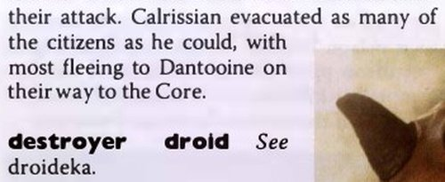

## p.187 (scan page 202)

Page contents: 884 words, 34 paragraphs | headings/entries: Deverin, Lun; Devil's Doorknob, the; Devis, Captain Mynar; Deviss, Clone Commander; Deviia, Admiral; Devlikk; Devon Four; Devonian; Dewback; Dewback's Burden; Dewlannamapia; Dex; Dex's Diner; Deyer Colony

- **Leia Organa Solo**: "After he ran into Han and Leia Organa Solo at the medical facility treating Eelysa, Dex was shot and killed in the ensuing firefight." Source: The Complete Star Wars Encyclopedia, Vol. I, p.187
  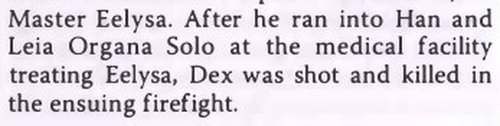

## p.188 (scan page 203)

Page contents: 900 words, 30 paragraphs | headings/entries: Dezsetes, Second Officer; D'harhan; Dharrg, Shunta Osarian; Dha Werda Verda; Dhol, Lady; Dhur, Den; Diado; Diamala; Diamond; Diath, Dace; Diath, Nico

- **Darth Vader (Anakin Skywalker)**: "She conspired with the Guild of Vindicators to entrap Darth Vader, but the Dark Lord not only bested the Vindicators but killed Dhol with a deft move in the game." Source: The Complete Star Wars Encyclopedia, Vol. I, p.188
  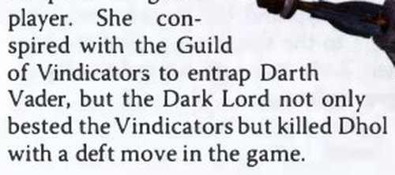

## p.189 (scan page 204)

Page contents: 1043 words, 41 paragraphs | headings/entries: Diath, Sidrona; Diath, Tae; Di Blinth, Jesson; Dica; Dice, Marit; Dicken; Dielle, Renxis; Difusal, Tor; Digisee Gaming Floor; Dikasterar, Ryannar N'on; Diktat; Dil, Celot Ratua; Dil, Cilia; Dil, Jaren; Dilonexa XXII; Ding

- **Dace Diath**: "Diath, Sidrona A Jedi Master and father of Jedi Dace Diath, he was killed in the Battle of Basilisk some 4,000 years before the Galactic Civil War." Source: The Complete Star Wars Encyclopedia, Vol. I, p.189
  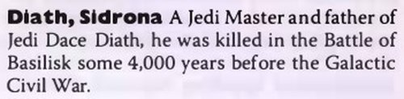
- **Qui-Gon Jinn; Obi-Wan Kenobi**: "Dil, Cilia A political dissident who rebelled against the ruling Guardians on Junction 5, she escaped imprisonment and was helped by Qui-Gon Jinn and Obi-Wan Kenobi in her efforts to steal the plans of the Annihilator superweapon." Source: The Complete Star Wars Encyclopedia, Vol. I, p.189
  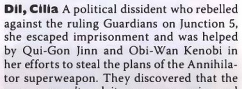

## p.190 (scan page 205)

Page contents: 1038 words, 33 paragraphs | headings/entries: Ding, Hanna; Dinger; Dinko; Dinlo; Dinn, Nelani; Dinnid, Oph Nar; Dio, Lexi; Diolian; Dionisio, Temo; Diori, Borga Besadii; Diplomat Hotel; Directors, the; Direption

- **Jacen Solo (Darth Caedus); Ben Skywalker**: "To that end, Jacen killed Nelani Dinn and altered Ben Skywalker's memories of the events." Source: The Complete Star Wars Encyclopedia, Vol. I, p.190
  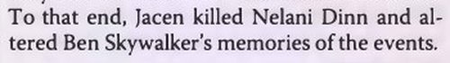

## p.191 (scan page 206)

Page contents: 1122 words, 22 paragraphs | headings/entries: Disra, Moff Vilim; Distant Rainbow; Distombe, By't; Distra; Divas; Diversity Alliance; Divinian, Bog; Divinian, Lune Oddo

- **Jaden Korr; Marka Ragnos**: "Jedi Knight Jaden Korr defeated Axmis and her cult on Korriban, preventing the return of Ragnos." Source: The Complete Star Wars Encyclopedia, Vol. I, p.191
  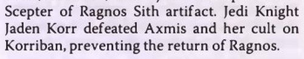

## p.192 (scan page 207)

Page contents: 1218 words, 39 paragraphs | headings/entries: Dix; Di Yuni, Winna; Dizz, Lob; DJ-88; Djem So; Djirra, Lieutenant; Djo, Mother Augwynne; DL-44; Diarit, Aerin; Diarit, Erisi

## p.193 (scan page 208)

Page contents: 1006 words, 43 paragraphs | headings/entries: DL-X2; Dnalvec; D'nec, R'kik; D'Nore, Lieutenant; DNX-NI; Doallyn, Sergeant; Doaskin; Dobah; Dobbatek; Dobbs; Dobido; Dobo Brother's Emporium; Dobonold, Artonian; Dobreed, Lama; Docker; Dod, Lott

- **Corran Horn**: "Dlarit was then ordered to provide cover for Isard's shuttle as she attempted to escape, but her TIE was destroyed by Corran Horn." Source: The Complete Star Wars Encyclopedia, Vol. I, p.193
  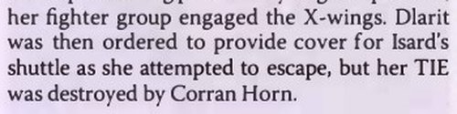

## p.194 (scan page 209)

Page contents: 917 words, 26 paragraphs | headings/entries: Dodann, Temiet; Dodecapolis; Dodonna; Dodonna, Admiral Forn; Dodonna, Vrad; Dodonna's Pride; Dodz; Doellin

- **Darth Vader (Anakin Skywalker)**: "Dodonna, Vrad The son of General Jan Dodonna, he at first retreated from an encounter with Darth Vader's new Super Star Destroyer, the Executor." Source: The Complete Star Wars Encyclopedia, Vol. I, p.194
  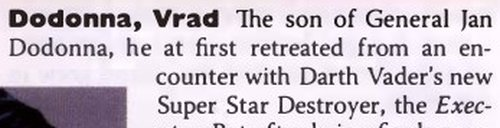

## p.195 (scan page 210)

Page contents: 806 words, 42 paragraphs | headings/entries: Dohu VII; Dofine, Daulitay; Doigon; Doil, Kohn; Dojah, Nars; DOKAW; Dokes, Oakie; Dokrett, Captain Voba; Dogder, Ghitsa; Oakie Dokes Dogo; Dogot, Captain Ors; Doldrums; Doli; Doliq, Reesa; Dolis 3; Doima, Grunda; D'olop Range

- **Palpatine (Darth Sidious); Darth Vader (Anakin Skywalker)**: "Despite questioning Darth Sidious's invasion plans, Dofine remained in commandof the flagship until it was destroyed by Anakin Skywalker." Source: The Complete Star Wars Encyclopedia, Vol. I, p.195
  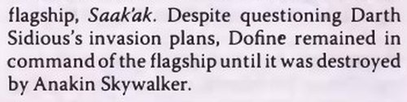

## p.196 (scan page 211)

Page contents: 888 words, 24 paragraphs | headings/entries: Doloria; Dolovite; Dolph; Dolphe, Corporal Porro; Doluff, Lob; Domains, Yuuzhan Vong; Dom-Bradden; Dominion; Dometown; Dominus; Domegrin; Domisari; Dominance

- **Lando Calrissian**: "Doluff invited Calrissian to a sabacc game on Oseon 6845, but circumstances caused Calrissian to be arrested for possession of a weapon." Source: The Complete Star Wars Encyclopedia, Vol. I, p.196
  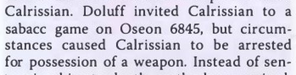

## p.197 (scan page 212)

Page contents: 908 words, 36 paragraphs | headings/entries: Domitree; Dommaro, Lieutenant Gorsick; Domna, Sevan; Don, Tox; Do'naal; Donba, Ten-Abu; Doneeta; Doneeta, Shaala; Doneeta, Tott; Donabelle, Lysire; Doneeta, Tuulaa; Doni, Miranda; Donkuwah; Donn, Castinm; Donos, Lieutenant Myn; Donovia; Dontamo; Doodnik

- **Kyle Katarn**: "Donar ill, Nathan A rival of Kyle Katarn's at the Imperial Academy on Carida, he and his father Governor Dol Donar II were killed when the captured Rebel droid A- Cee self-destructed." Source: The Complete Star Wars Encyclopedia, Vol. I, p.197
  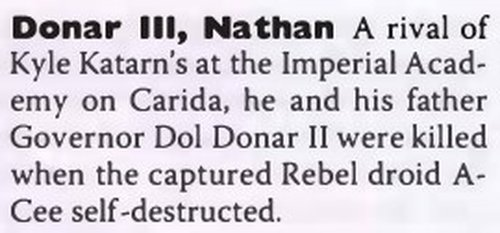
- **Sylvar; Tott Doneeta**: "Accompanied by Sylvar on his return to Ryloth, Tott Doneeta later was instrumental in reaching a peaceful resolution between his clan and the R'lyek, a rival clan." Source: The Complete Star Wars Encyclopedia, Vol. I, p.197
  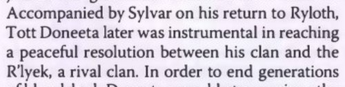
- **Darth Talon**: "Donos, Lieutenant Myn A male Corellian fighter pilot and marksman, he was leader of Talon Squadron until it was wiped out during an ambush at Gravan VII." Source: The Complete Star Wars Encyclopedia, Vol. I, p.197
  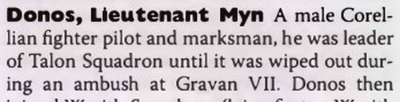

## p.198 (scan page 213)

Page contents: 1248 words, 25 paragraphs | headings/entries: Dooku, Count

- **Count Dooku; Qui-Gon Jinn** — entry/section: Dooku, Count: "Angered by Nod, Dooku attacked him and nearly killed him, but Qui-Gon prevented his Master from giving in to his dark impulses." Source: The Complete Star Wars Encyclopedia, Vol. I, p.198
  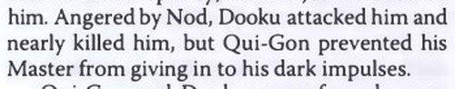
- **Count Dooku** — entry/section: Dooku, Count: "The two Jedi challenged Dooku to a lightsaber duel, but Dooku's masterful skills in old-style lightsaber combat made short work of the younger combatants." Source: The Complete Star Wars Encyclopedia, Vol. I, p.198
  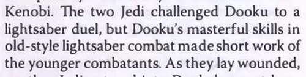

## p.199 (scan page 214)

Page contents: 1208 words, 31 paragraphs | headings/entries: Doole, Moruth; Doole, Tee-ubo; Doolis; Doomgiver; Doomsied; D'oon, T'chooka; Doori-Doori

- **Count Dooku** — entry/section: Dooku, Count: "Once again Dooku dueled with the Jedi pair." Source: The Complete Star Wars Encyclopedia, Vol. I, p.199
  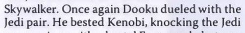
- **Count Dooku; Obi-Wan Kenobi** — entry/section: Dooku, Count: "He bested Kenobi, knocking the Jedi unconscious with a brutal Force push, but was unable to overpower Skywalker." Source: The Complete Star Wars Encyclopedia, Vol. I, p.199
  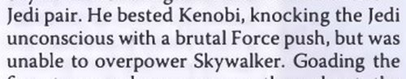
- **Count Dooku; Darth Vader (Anakin Skywalker)** — entry/section: Dooku, Count: "Goading the fiery-tempered young man throughout the duel, Dooku thought he had the upper hand until Anakin outmaneuvered him." Source: The Complete Star Wars Encyclopedia, Vol. I, p.199
  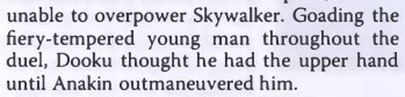
- **Count Dooku** — entry/section: Dooku, Count: "Skywalker severed both of Dooku's hands and snatched the Sith Lord's red-bladed weapon." Source: The Complete Star Wars Encyclopedia, Vol. I, p.199
  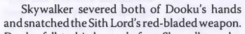
- **Count Dooku** — entry/section: Dooku, Count: "This understanding awakened in him as Skywalker crossed his blades, severing Dooku's head." Source: The Complete Star Wars Encyclopedia, Vol. I, p.199
  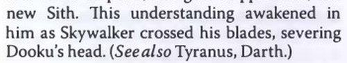
- **Kyle Katarn; Luke Skywalker**: "Kyle Katarn infiltrated the ship during its assault of Luke Skywalker's Jedi praxeum on Yavin 4, disabling its shield generators, which allowed Rogue Squadron to destroy the vessel." Source: The Complete Star Wars Encyclopedia, Vol. I, p.199
  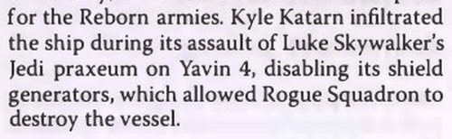

## p.200 (scan page 215)

Page contents: 1105 words, 47 paragraphs | headings/entries: Doornik-1142; Doornik-207; Doornik-3 19; Dop, Moppo; Dopey; Dorajan; Dorak; Doran, Kell; Doran, Kissek; Dorande; Doran Star; Dorenian Beshniquel; Doriana, Kinman; Dorian Quill; Dorin; Dorits, Lasio; Dorja, Commander Vana; Dorlo; Dorion Il; Dorma; Dormé

- **Grand Admiral Thrawn**: "Dorja survived the death of Thrawn as well as the various warlords who attempted to lead the Empire thereafter." Source: The Complete Star Wars Encyclopedia, Vol. I, p.200
  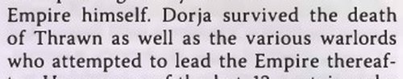

## p.201 (scan page 216)

Page contents: 982 words, 29 paragraphs | headings/entries: Dorn; Dorr, Sholh; Dorr-Femi-Bonmi; Dorn, Vikar; Dornea; Dorsk 81; Dorsk 82; Doruggan, Conn; Dorum; Dorun

- **Darth Maladi**: "Dorn returned to Sith space, and was killed by Maladi for his failure." Source: The Complete Star Wars Encyclopedia, Vol. I, p.201
  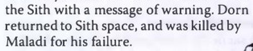
- **Luke Skywalker**: "Together they found a way to destroy Kun for all time and restore Luke's spirit to his body." Source: The Complete Star Wars Encyclopedia, Vol. I, p.201
  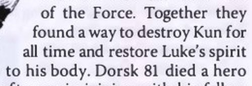
- **Dorsk 81** — entry/section: Dorsk 81: "Dorsk 81 died a hero after again joining with his fellow Jedi and channeling their combined powers through himself to create a Force storm that pushed an entire fleet of attacking Imperial Star Destroyers nearly out of the Yavin system." Source: The Complete Star Wars Encyclopedia, Vol. I, p.201
  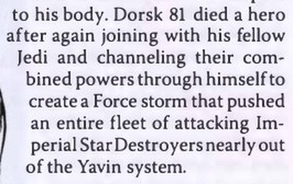

## p.202 (scan page 217)

Page contents: 1032 words, 35 paragraphs | headings/entries: Dorvalla; Dosh; Doshao, Subaitern; Dosuun; Double Worlders; Double-X; Doughty; Douglas II; Doum, Mag; Dovlis, Captain Reldo; Dovos, Shas; Dow, Helina; Dowager Queen

- **Darth Vader (Anakin Skywalker)**: "Kiros overpowered Doum, and forced the ship to collide with Darth Vader's Star Destroyer." Source: The Complete Star Wars Encyclopedia, Vol. I, p.202
  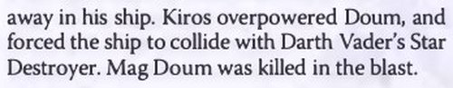

## p.203 (scan page 218)

Page contents: 1120 words, 27 paragraphs | headings/entries: Dowd, Bilman; Dowmeia, Tundra; Downfolk; Downrush Falls; Downstorm; Dox, Commander; Dox, Garil; Doxin, Paldis; Dozen-and-Two Avengers; D'Pow, Vianna; Dpso; DR9YI9a; Dr'aan; Draay, Barrison; Draay, Krynda

- **Darth Vader (Anakin Skywalker)**: "Having wiped out what he assumed to be the last of his people, and then being discovered in his treasonous acts, Dox begged Vader to kill him." Source: The Complete Star Wars Encyclopedia, Vol. I, p.203
  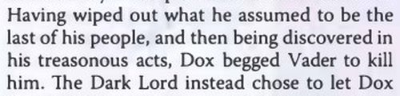
- **Lucien Draay**: "He was killed in the Great Sith War, and survived by his wife, Krynda, and son, Lucien." Source: The Complete Star Wars Encyclopedia, Vol. I, p.203
  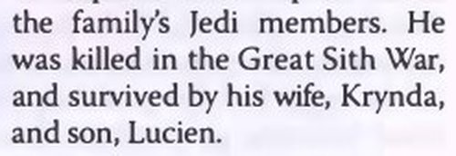

## p.204 (scan page 219)

Page contents: 997 words, 32 paragraphs | headings/entries: Draay, Lucien; Dracmus; Draco, Antares; Draco, Valin; Dracos; D'rag; Draggle, Skeck; Dragon Cave

- **Lucien Draay; Zayne Carrick** — entry/section: Draay, Lucien: "When a vision of the future showed that one of their students would rise to bring unparalleled destruction to the galaxy and the Jedi, they preemptively slaughtered their graduating class, but Lucien's Padawan, Zayne Carrick, escaped." Source: The Complete Star Wars Encyclopedia, Vol. I, p.204
  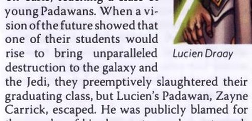

## p.205 (scan page 220)

Page contents: 1004 words, 36 paragraphs | headings/entries: Dragon's Spine; Dragon's Teeth; Draisini; Drake, Major Breslin; Drake, Senator Ivor; Draklor; Drako; Drang; Drann, Par; DRAPAC; Drark, Jovan; Drask, General; Drathul, High Prefect; Dravis; Dravvad, Cheich

- **Sev'rance Tann**: "Drakas,Jor A Twi'lek Jedi Knight whocommanded the Republic base at Mount Corvast on Sarapin, he was slain in battle by Sev'Rance Tann during the Clone Wars." Source: The Complete Star Wars Encyclopedia, Vol. I, p.205
  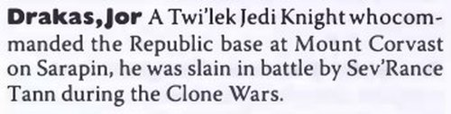

## p.206 (scan page 221)

Page contents: 1127 words, 30 paragraphs | headings/entries: Draygo, Vykk; Drayk; Drayneen; Drayson, Admiral Hiram; Drayson, Bhindi; Drazin, Corporal; Dream Emporium; Drearian Defense Conglomerate; Drebble, Barpotomous

- **Darth Vader (Anakin Skywalker)**: "Anakin Skywalker defeated Prax and his Dreadnought on Thule." Source: The Complete Star Wars Encyclopedia, Vol. I, p.206
  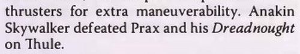

## p.207 (scan page 222)

Page contents: 873 words, 29 paragraphs | headings/entries: Dreebo; Dreel; Dreena; Dreflin, Major; Drei, Tho-Mes; Dreighton Nebula; Drelll; Drelosyn, Corporal; Dremon, Jull; Dremulae; Dren-garen, Taym

## p.208 (scan page 223)

Page contents: 1040 words, 48 paragraphs | headings/entries: Dreshdae; Drevan, Freon; Drev'starn; Drewwa; Drexel; Dragon Lords.; Lords.; Drexx, Bezz; Dreyf, Commander; Drig, Gorb; Drinking Cup; DRK-1

## p.209 (scan page 224)

Page contents: 846 words, 31 paragraphs | headings/entries: Droe; Droekle; Droga, Jeng; Droid Abolitionist Movement; Droidbait, Trooper; Droid Control Ship

- **Darth Vader (Anakin Skywalker)**: "Such battleships were extremely difficult to damage, but Anakin Skywalker destroyed one over Naboo when he flew into the vessel's hangar and accidentally targeted its main reactor with proton torpedoes." Source: The Complete Star Wars Encyclopedia, Vol. I, p.209
  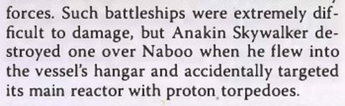

## p.210 (scan page 225)

Page contents: 1009 words, 33 paragraphs | headings/entries: Droid Uprising, the; Droma; Dromath, Rade; Drome, Captain; Drommel, Admiral Gaen; Dromund Kaas

## p.211 (scan page 226)

Page contents: 871 words, 33 paragraphs | headings/entries: Drongar; Droog'an, Commander; Droon, Admiral; Droon, Iigpek; Dros, G'hinji; Drost, General Theol; Dru, Dall Thara; Druckenwell; Drudonna; Drufeys; Drunost; Dr'xureretue; Drybal

- **Darth Vader (Anakin Skywalker)**: "Jix then brought Droon to Coruscant, where the admiral was killed by Darth Vader." Source: The Complete Star Wars Encyclopedia, Vol. I, p.211
  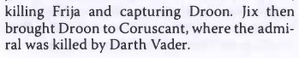

## p.212 (scan page 227)

Page contents: 1044 words, 43 paragraphs | headings/entries: Dryon, High Priest; Drysso, Joak; DS-1 81-3; DS-181-4; DS-29-4; DS-3-12; DS-55-2; DS-55-6; DS-61-2; DS-6 1-3; DS-61-9; DS-73-3; DS-75-5; D/Square Decoder; DSS-0956; DSU; Du, Ur-Sema

- **General Grievous**: "She was killed by General Grievous, one of the first Jedi to fall to the cyborg alien." Source: The Complete Star Wars Encyclopedia, Vol. I, p.212
  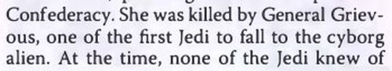

## p.213 (scan page 228)

Page contents: 828 words, 30 paragraphs | headings/entries: Dua, Pa; Duaba, Trinto; D'uat, Xufal; Dubrava; Dubrillion; Duegad, Niado; Duel, Rik; Duelist Elite; Duff-Jikab; Dug

- **Han Solo**: "Duel, Rik A smuggler, captain of the Moon Shadow, and con artist of Corellian origin, Duel was one of Han Solo's oldest associates." Source: The Complete Star Wars Encyclopedia, Vol. I, p.213
  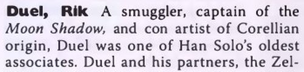
- **Luke Skywalker**: "He explained the situation and got the Rebel heroes to help him uncover Vol. After Luke Skywalker found the statue, Duel double-crossed him and took it." Source: The Complete Star Wars Encyclopedia, Vol. I, p.213
  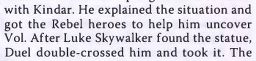
- **Bossk; IG-88**: "Duel helped the Rebels shake off pursuit from a syndicate of hunters led by Bossk and IG-88." Source: The Complete Star Wars Encyclopedia, Vol. I, p.213
  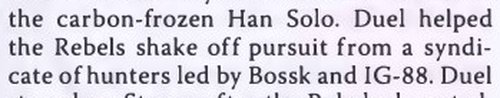
- **Luke Skywalker**: "Rik Duel eventually became a member of the Alliance, receiving military training from Luke Skywalker." Source: The Complete Star Wars Encyclopedia, Vol. I, p.213
  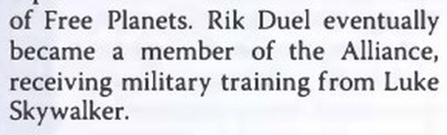
- **Darth Maul; Darth Vader (Anakin Skywalker)**: "Darth Maul, Darth Vader, and Raskar the pirate were known to spar against Duelist Elites." Source: The Complete Star Wars Encyclopedia, Vol. I, p.213
  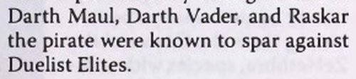
- **Lando Calrissian**: "If the prey survived for a day without being captured or killed—as Lando did—he or she was allowed to go free." Source: The Complete Star Wars Encyclopedia, Vol. I, p.213
  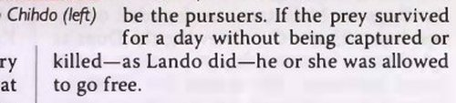

## p.214 (scan page 229)

Page contents: 922 words, 24 paragraphs | headings/entries: Duhma; D'ukal, Shada; D'ulin, Karoly; D'ulin, Manda; D'ulin, Naradan; Dulo, Neb; Dulon

## p.215 (scan page 230)

Page contents: 877 words, 28 paragraphs | headings/entries: Dunari; Duncan, Deadeye; Dune Sea; Dunhausen, Grand Moff; Dunn, Jono; Duptom, Ree; Dunter, Lysa; Dunwell, Captain; Duracrud

## p.216 (scan page 231)

Page contents: 997 words, 42 paragraphs | headings/entries: Dura-Kahn; Duranc, Ak; Durane, Giles; Durasha, Celia; Durastar; Durasteel Corporation; Dureya, Grand Moff; Durge

## p.217 (scan page 232)

Page contents: 1143 words, 31 paragraphs | headings/entries: Duris, G'Mai; Durkii Squadron; Durkish Corporation; Durkteel; Durm, Captain; Durmin, Tajis; Durnar; Duro Defense Force

- **Darth Vader (Anakin Skywalker)**: "Anakin Skywalker was finally able to destroy Durge in the final months of the Clone Wars by trapping him within an escape pod and directing it into the heart of a sun." Source: The Complete Star Wars Encyclopedia, Vol. I, p.217
  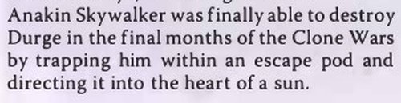

## p.218 (scan page 233)

Page contents: 1046 words, 24 paragraphs | headings/entries: Duroon

- **Kyp Durron; Admiral Daala**: "Kyp tracked down his most hated enemy, Admiral Daala, as she was about to attack Coruscant, and nearly destroyed her." Source: The Complete Star Wars Encyclopedia, Vol. I, p.218
  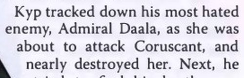
- **Kyp Durron; Han Solo; Lando Calrissian; Exar Kun**: "Later, as Kyp was about to destroy the Millennium Falcon with Han Solo and Lando Calrissian aboard, he was freed from Exar Kun's influence when the other Jedi trainees succeeded in destroying Kun's spirit." Source: The Complete Star Wars Encyclopedia, Vol. I, p.218
  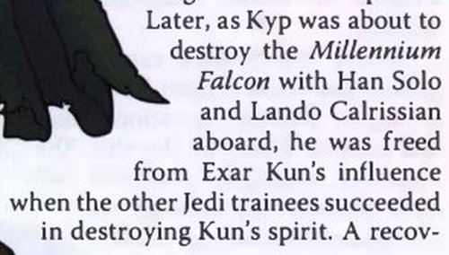
- **Sun Crusher (superweapon); Luke Skywalker; Kyp Durron; Admiral Daala**: "On their way to destroy the Sun Crusher once and for | all, Luke and Kyp ran into another battle with Admiral Daala." Source: The Complete Star Wars Encyclopedia, Vol. I, p.218
  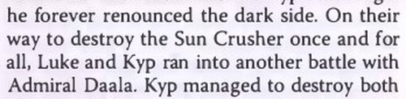
- **Kyp Durron; Sun Crusher (superweapon)**: "Kyp managed to destroy both the Sun Crusher and a prototype Death Star, barely escaping with his life." Source: The Complete Star Wars Encyclopedia, Vol. I, p.218
  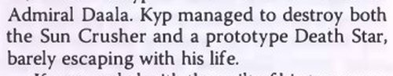

## p.219 (scan page 234)

Page contents: 1182 words, 28 paragraphs | headings/entries: Dur Sabon; Durundo; Duskhan League; Dust; Dustangle; Dustini; Dusty Duck; Dutch; Dutyfree; Duula; Duull, Vor; Duvel, Mayth; Duv-Horlo; Duvil; Duwan, Leig; Duwani Mechanical Products; DV-523; DV-692; D-V9

- **Jaina Solo**: "It wasn't a weapon, in fact, but a growing worldship that Durron and Jaina destroyed, and Jaina was furious at the older Jedi for his deception." Source: The Complete Star Wars Encyclopedia, Vol. I, p.219
  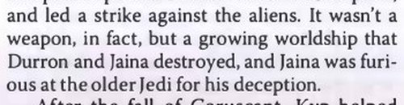
- **Kyp Durron**: "Years later, after the defeat of the Yuuzhan Vong and during the Swarm War, Kyp was one of the many Jedi who pledged their full support to Master Skywalker's new Jedi Order, despite the continued strife among the various Jedi Masters." Source: The Complete Star Wars Encyclopedia, Vol. I, p.219
  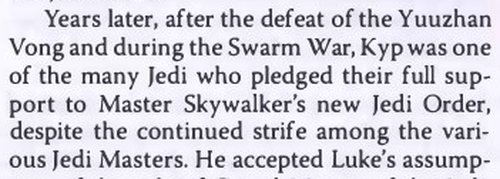
- **Darth Maul**: "Maul boarded the ship, looking for his quarry, and killed Dym in frustration." Source: The Complete Star Wars Encyclopedia, Vol. I, p.219
  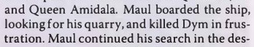

## p.220 (scan page 235)

Page contents: 928 words, 31 paragraphs | headings/entries: D'vouran; Dwan, Gulia; Dweem; D'Wopp; DwuirsinTabb; Dxo'In, Kid; Dx'ono, Ghic; Dxun; Dyer, Colonel; Dying Slowly; Dyll, Brullian; Dym, Aneesa; Dymek; Dyn, Tudrath

- **Queen Amanoa; Freedon Nadd**: "Some 4,000 years before the Galactic Civil War, after the evil Queen Amanoa oflziz was defeated by the Jedi, the inhabitants of Onderon built a Mandalorian iron tomb on Dxun to house the remains of their queen and of the Dark Jedi Freedon Nadd." Source: The Complete Star Wars Encyclopedia, Vol. I, p.220
  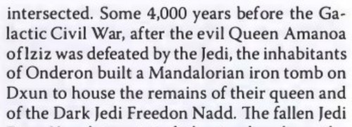
- **Darth Maul**: "Angry at his error, Maul cut down Aneesa and continued his search in the desert." Source: The Complete Star Wars Encyclopedia, Vol. I, p.220
  

## p.221 (scan page 236)

Page contents: 543 words, 20 paragraphs | headings/entries: Dynast; Dyne, Captain; Dyre, Rohlan; Dyur, Byalfin; Dza'tey, Girov; Dzavak Lakes

- **Palpatine (Darth Sidious)**: "On the verge of discovering the true identity of Darth Sidious, Dyne and his team were killed beneath 500 Republica." Source: The Complete Star Wars Encyclopedia, Vol. I, p.221
  
- **Luke Skywalker**: "After a series of confrontations, Dzym managed to obtain an escape ship, but with the help of Luke Skywalker and the planet's natural Force components, the ship and its passengers were destroyed." Source: The Complete Star Wars Encyclopedia, Vol. I, p.221
  

## p.222 (scan page 237)

Page contents: 1 words, 1 paragraphs | headings/entries: 

## p.223 (scan page 238)

Page contents: 644 words, 20 paragraphs | headings/entries: 1 1-17; 850.AA Public Service Headquarters; 8t88; Ei-6RA_; E-3PO

## p.224 (scan page 239)

Page contents: 1056 words, 42 paragraphs | headings/entries: E49D139.41; E522 Assassin; E9D8 Rebellion; Ealewon Electronics; Ean; East District Trail; Eastgate; East Minor; East Platform; Eastport; Easy Spacer; Eba; Ebareebaveebeedee, King; Ebbak; Ebe Crater Valley; Ebelt, Gorr Desilijic; Ebon Hawk; Mandalorian Wars.; Ebon Sea; Ebranite; Ebrihim; Ebsuk, Zubindi

- **Boba Fett; Han Solo**: "East Platform The landing platform used by Boba Fett on Cloud City when he took possession of the carbon-frozen Han Solo." Source: The Complete Star Wars Encyclopedia, Vol. I, p.224
  
- **Revan; Bastila Shan; Darth Malak**: "Ownership of the Ebon Hawk changed hands to the rehabilitated Revan and Carth Onasi after Davik was killed in an altercation following the rescue of Bastila Shan, shortly before Taris was destroyed by Darth Malak." Source: The Complete Star Wars Encyclopedia, Vol. I, p.224
  

## p.225 (scan page 240)

Page contents: 989 words, 41 paragraphs | headings/entries: Echani; Echnos; Echo, Trooper; Echo Base; Echo Flight; Echo Stations; Eckels, Dr. Joto; Eckener, Hugo

- **Palpatine (Darth Sidious)**: "Eclipse Upon his return six years after his presumed death at the Battle of Endor, the cloned Emperor Palpatine ordered the construction of a new weapon of terror: a 17.5kilometer-long Super Star Destroyer that would serve as his personal flagship." Source: The Complete Star Wars Encyclopedia, Vol. I, p.225
  
- **Luke Skywalker; Leia Organa Solo**: "As Luke and Leia escaped from the ship, the storms consumed and destroyed the vessel." Source: The Complete Star Wars Encyclopedia, Vol. I, p.225
  
