# Owner Material 030 — The Complete Star Wars Encyclopedia, Vol. I (A–G): scan pages 241–280

- **Source:** *The Complete Star Wars Encyclopedia* by Stephen J. Sansweet and Pablo Hidalgo, with Bob Vitas, Daniel Wallace, Chris Cassidy, Mary Franklin and Josh Kushins (Del Rey, 2008), 3 vols. Secondary source (licensed Legends reference). Scan OCR'd on the box; the scan stays box-only and is **not** published.
- **Method:** every scanned page was OCR'd and machine-screened sentence by sentence for power-relevant statements (fights, kills, defeats, Force feats, rankings, superweapons) that name a character on our roster; each kept sentence is quoted verbatim from the OCR text and has a crop of the printed passage directly under it. Pages with nothing power-relevant are still listed with what is on them.
- **Citation:** "The Complete Star Wars Encyclopedia, Vol. I, p.X" by printed page ("scan p.X" where no printed number applies). **Weight:** Lucasfilm-licensed encyclopedia: a secondary, in-universe summary of Legends (and some film) material. It sums up feats from novels, comics and games; where the original story is in our notes, that source is the stronger citation.

## p.226 (scan page 241)

Page contents: 1131 words, 36 paragraphs | headings/entries: Eclipse, the; Ecliptie; Ecliptic Evaders; Edan, Moff; Eddels; Eddicus, Anwis; Edge-9; Edian, Sergeant; Edic Bar; Edisser, Pont; Eekin, Sta-Den; Eekway, Chi; Eellayin; Eelysa; E-elz, Entoo Needaan; Eemon, Ado; Effhod, Zelebitha

## p.227 (scan page 242)

Page contents: 924 words, 31 paragraphs | headings/entries: EG-6; Egast, Keela; Ehjenia; Eiattu VI; Eicroth, Dr. Joi; Eighth Cortex; Eighth Fleet; Einblatz/Docker; Eirtaé; Eistern; Ejai, Lieutenant Colonel; Ejolus; Ekhrikhor

- **Grand Admiral Thrawn; Palpatine (Darth Sidious)**: "Later, after the defeat of Thrawn, Ekhrikhor was adamant that all the treasures within the storehouse be destroyed, as they were artifacts of Palpatine's evil reign." Source: The Complete Star Wars Encyclopedia, Vol. I, p.227
  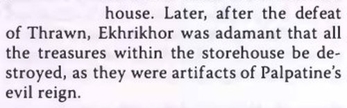

## p.228 (scan page 243)

Page contents: 1078 words, 42 paragraphs | headings/entries: Ekibo; E'kles, Allynic; Ekria; El, Tomia; Elarles; Elda; Eldon, Captain Darv; Ele, Jeswi

- **Han Solo**: "Not wanting her plan disrupted, Elan killed her Peace Brigade "rescuers" with the bo'tous weapon, an act that raised Han Solo's suspicions." Source: The Complete Star Wars Encyclopedia, Vol. I, p.228
  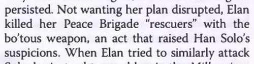
- **Darth Vader (Anakin Skywalker)**: "Ele, Jeswi A youngling killed by Darth Vader during the attack on the Jedi Temple." Source: The Complete Star Wars Encyclopedia, Vol. I, p.228
  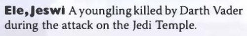

## p.229 (scan page 244)

Page contents: 1127 words, 42 paragraphs | headings/entries: Eleemosynary; Elegant Interlude; Elegant Wake; Elegin, Drost; Elegos; Elerion; Eleven, the; Eleven Star Marketing; Elfa; Elgrin, Tam; Elias, Kama; Eliey; Eliior; Elinda; Elis; Eliss, Tem; Elite, the; Elite Circle; Elkin; Ell, Zez-Kai

## p.230 (scan page 245)

Page contents: 948 words, 34 paragraphs | headings/entries: Ellé; Elliar, Lady; Ellsworth; Elmas Private Spaceport; Elom; Eloms; Eloy, Dr.; Elrood; Elsek, Sergeant; Eishandruu Pica; Elsinore-Cordova; Eluthan

- **Grand Admiral Thrawn**: "Five years after the Battle of Endor, a New Republic task force crewed by Elomin was wiped out near the Obroa-skai system when Grand Admiral Thrawn used a tactic that the Elomin were psychologically incapable of defending against." Source: The Complete Star Wars Encyclopedia, Vol. I, p.230
  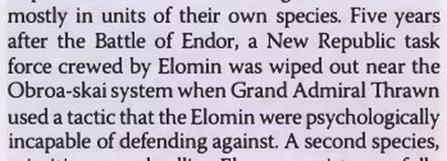

## p.231 (scan page 246)

Page contents: 1207 words, 24 paragraphs | headings/entries: EM-1271; Emala; Embassies Row; Emente; Emergency; Emergency Measures Act

- **Jacen Solo (Darth Caedus); Anakin Solo**: "Jacen Solo kept it in a secret location and later installed it aboard the Star Destroyer Anakin Solo." Source: The Complete Star Wars Encyclopedia, Vol. I, p.231
  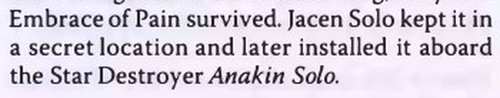

## p.232 (scan page 247)

Page contents: 1029 words, 31 paragraphs | headings/entries: Emergency Powers Act; Eminence; Eminent Domiciles; Emita; Emkay; Em/'liy; Emperor Palpatine Surgical Reconstruction Center; Emperor's Citadel, The; Emperor's Disciple; Emperor's Hand

## p.233 (scan page 248)

Page contents: 1060 words, 33 paragraphs | headings/entries: Emperor's Inner Circle, the; Emperor's Revenge; Emperor's Royal Guard; Emperor's Shadow; Emperor's Shadow Guard; Emperor's Shield; Emperor's Sword; Emperor's Way

- **Carnor Jax**: "Emperor's Revenge An Imperial Star Destroyer under the command of Carnor Jax that also served as his flagship." Source: The Complete Star Wars Encyclopedia, Vol. I, p.233
  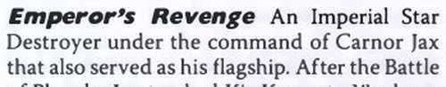
- **Palpatine (Darth Sidious)**: "After the death of the resurrected Palpatine, all remaining guardsmen returned to their training center on Yinchorr to mourn the final loss of the Emperor." Source: The Complete Star Wars Encyclopedia, Vol. I, p.233
  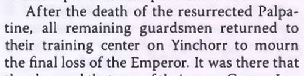

## p.234 (scan page 249)

Page contents: 899 words, 37 paragraphs | headings/entries: Emperor's Wisdom; Empire; Empire, the; Empire Day; Empire Reborn; Empirical; Empress' Diadem; Empyrean; Em Teedee; En, Rii'ke; Enmacca

## p.235 (scan page 250)

Page contents: 918 words, 35 paragraphs | headings/entries: Enanrum, Kime; Enara; Enceri; Enchanter; Enclave; Encyclopedia Galactica; Endar Spire; Endless Hour, the; Endocott, Ebe; Endor, Battle of

## p.236 (scan page 251)

Page contents: 891 words, 31 paragraphs | headings/entries: Endor Gate; Endorian Port

## p.237 (scan page 252)

Page contents: 1103 words, 31 paragraphs | headings/entries: Enforcer; Enfield, Sergeant Major; Enforcer; Engret; Enisca; Enjikket; Ennth; E'noro, Senator; Ensa; Ensolica; Entraila

## p.238 (scan page 253)

Page contents: 1053 words, 25 paragraphs | headings/entries: En' Tra'Sol; Entymal; Eol Sha; Eon; Eos; Epicanthix; Eport; Eppon

## p.239 (scan page 254)

Page contents: 1143 words, 35 paragraphs | headings/entries: Eprill; Epsilon Company; EQ3; Equani; Erased, the; Erdan; Eredenn; Erg Es 992; Ergo; Eriadu; Erinnie; Eritha; Er'Kit; Ern, Minister Ciran; Errat, Mali; Errinung'ka; Ervic, Seteem; Eryon; Erysthes; Esau's Ridge

- **Kyle Katarn**: "Kyle Katarn boarded a smuggler's ship at Ergo in order to sneak his way onto the Super Star Destroyer Executor." Source: The Complete Star Wars Encyclopedia, Vol. I, p.239
  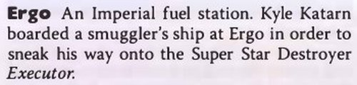

## p.240 (scan page 255)

Page contents: 982 words, 34 paragraphs | headings/entries: Escalion; Escarte; Eschen, Garnu Hral; Esfandia; Esh, Niiriit; Esh, Shoon-mi; Esok; Espara, Moreem; Espo; Esral'sa'Nikto; Essada, Bin; Essence

## p.241 (scan page 256)

Page contents: 1016 words, 22 paragraphs | headings/entries: Essence Stealer; Essenton; Ession; Estillo, isplourrdacartha; Estillo, Prince Harrandatha; Estornii, Senator Eeusu; Estosh; Estral

## p.242 (scan page 257)

Page contents: 963 words, 34 paragraphs | headings/entries: Ethda, Zee; Etherhawk; Etherway; E'thinaa; Ettam; Ettarue Arm; Ettene, Everen; Etti 1V; Etyyy; Euceron; Eusebus

## p.243 (scan page 258)

Page contents: 1020 words, 31 paragraphs | headings/entries: Evan; Evan-Ott; Evanrue; Evax; Evazan, Dr.; EverAlert; Evocar; Evocii

## p.244 (scan page 259)

Page contents: 698 words, 17 paragraphs | headings/entries: Ewane

## p.245 (scan page 260)

Page contents: 981 words, 27 paragraphs | headings/entries: Exactor; Exchange, the; Executioner's Row; Executor; Executrix; Exelbrok; EX-F; ExGal-4; ExGal Society; Exhibition Day; Exile, the; Exiles, the; Exis Station

## p.246 (scan page 261)

Page contents: 1013 words, 29 paragraphs | headings/entries: Exmoor; Exocron; Exedeen; Exodo Il; Exozone; Expansionist Period; Expeditious; Exquisite Death; Exten-dee; Extolied, the; Exultation; E'Y-Akh Desert; Eyan, Lieutenant Jart; Eyefire, Shoto

- **Admiral Ackbar**: "Eyan, Lieutenant Jart A New Republic officer and Twi'lek, he was brainwashed by Warlord Zsinj to assassinate Admiral Ackbar but was stopped and killed by Voort SaBinring." Source: The Complete Star Wars Encyclopedia, Vol. I, p.246
  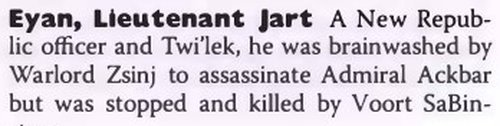

## p.247 (scan page 262)

Page contents: 717 words, 21 paragraphs | headings/entries: Eye-on-U; Eyttyn, Kol; Eyvind; Eyyl; Ezak; Ezjenk; Ezrakh

- **Luke Skywalker**: "Some eight years after the Battle of Endor, Luke Skywalker was drawn to the battlemoon's hiding place deep within a nebulous gas cloud in the asteroid-choked Moonflower Nebula." Source: The Complete Star Wars Encyclopedia, Vol. I, p.247
  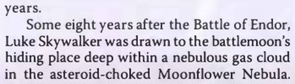
- **Leia Organa Solo**: "Ezrakh One of Leia Organa Solo's Noghri bodyguards during her mission to the Chorios systems, he was killed by the Death Seed plague." Source: The Complete Star Wars Encyclopedia, Vol. I, p.247
  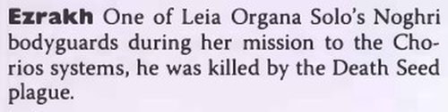

## p.248 (scan page 263)

Page contents: 0 words, 0 paragraphs | headings/entries: 

## p.249 (scan page 264)

Page contents: 743 words, 18 paragraphs | headings/entries: 4-LOM; 4list Elite Corps; 407th Stormtrooper Division; 442nd Siege Battalion; 4B-X

## p.250 (scan page 265)

Page contents: 1105 words, 35 paragraphs | headings/entries: 5-A; 5D6-RAZ7; 5P8; F-22

- **Grand Admiral Thrawn**: "Knowing the value of symbols, it was Grand Admiral Thrawn who resurrected the designation SOJst forthe stormtrooper units protecting the Empire of the Hand." Source: The Complete Star Wars Encyclopedia, Vol. I, p.250
  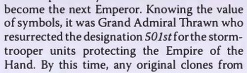

## p.251 (scan page 266)

Page contents: 839 words, 48 paragraphs | headings/entries: Fac, Sun; Fabreth Medical Biochemicals; Fabrin; Fabritech; Fadden; Fadoop; Fahraark; Faie, Commander; Fain, Thul; Fair Gale

## p.252 (scan page 267)

Page contents: 916 words, 28 paragraphs | headings/entries: Fairwind; Falang Minor; Falanthas, Minister Mokka; Falcariae; Falco, Captain; Falcon Base; Faleur, Reina; Faleur, Sera; Faiken, Rorax; Fall, Euraana; Fallanassi; Fallanji; Falleen

## p.253 (scan page 268)

Page contents: 851 words, 22 paragraphs | headings/entries: Falon, Mellora; Falsswon; Fait, Corrun; Famutus

- **Prince Xizor; Darth Vader (Anakin Skywalker)**: "Xizor, at the time possibly the third most powerful man in the galaxy after the Emperor and Vader, vowed vengeance on the Dark Lord, but ended up on the losing side of a battle to the death." Source: The Complete Star Wars Encyclopedia, Vol. I, p.253
  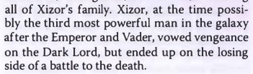
- **Darth Vader (Anakin Skywalker); Prince Xizor**: "It was the pride and joy of the crime king, but during a final showdown with Darth Vader, the Dark Lord ordered a Star Destroyer to annihilate Xizor's skyhook." Source: The Complete Star Wars Encyclopedia, Vol. I, p.253
  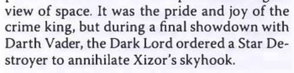
- **Darth Vader (Anakin Skywalker)**: "She helped him capture Anakin Skywalker and at one point challenged Anakin to a duel." Source: The Complete Star Wars Encyclopedia, Vol. I, p.253
  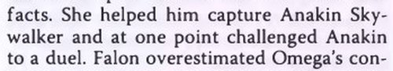

## p.254 (scan page 269)

Page contents: 1021 words, 28 paragraphs | headings/entries: Fandar; Fandi, Nort; Fane, Captain; Fangol; Fantome; Far, Jonra; Farana; Farang; Fara's Belt; Farboon; Farbreini MicroElectronics Limited; Far Distance; Fardreamer, Cole; Farfalla, Lord Valenthyne

## p.255 (scan page 270)

Page contents: 1146 words, 28 paragraphs | headings/entries: Fargane; Farghul; Farlander, Keyan; Farlander, Kitha; Farlight; Farng

- **Valenthyne Farfalla** — entry/section: Farfalla, Lord Valenthyne: "Within the ancient edifice, the Sith Lords attacked the Jedi team, and Bane beheaded Farfalla." Source: The Complete Star Wars Encyclopedia, Vol. I, p.255
  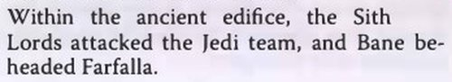

## p.256 (scan page 271)

Page contents: 1028 words, 36 paragraphs | headings/entries: Faron; Far Orbit; Far Outsiders; Farr, Onaconda; Farr, Samoc; Farrimmer Café; FarStar

## p.257 (scan page 272)

Page contents: 936 words, 32 paragraphs | headings/entries: Farstine; Far Thunder; Fasgo; Fass, Baddon; Fass, Egome; Fassa, Major; Fath, Bhu; Fay, Lampay

- **Egome Fass; Chewbacca** — entry/section: Fass, Egome: "He was reputed to rival the mighty Wookiee Chewbacca in both height and strength." Source: The Complete Star Wars Encyclopedia, Vol. I, p.257
  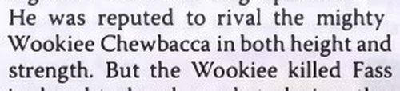

## p.258 (scan page 273)

Page contents: 1008 words, 31 paragraphs | headings/entries: Faytonni, Danni; Faz; Fé; FE-3PO; FE-9Q; Fedalle; Fed-Dub; Federation Basic; Fedje; Fee, Yoland; Feenicks VI

- **Palpatine (Darth Sidious)**: "Fé One of Queen Amidala's handmaidens, she was present when Chancellor Palpatine arrived on Naboo for the celebration following the defeat of the Trade Federation blockade." Source: The Complete Star Wars Encyclopedia, Vol. I, p.258
  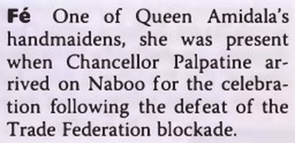
- **Darth Vader (Anakin Skywalker)**: "Fee, Yoland A Jedi who was responsible for the gardens of the Jedi Temple, he was killed in the great massacre by Darth Vader and the 50 1st clone troopers." Source: The Complete Star Wars Encyclopedia, Vol. I, p.258
  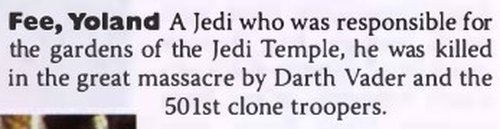

## p.259 (scan page 274)

Page contents: 1337 words, 27 paragraphs | headings/entries: Feethan Ottraw Scalable Assemblies; Fef; Fegel, Onjo; Fehern; Fehlaaur; Fein; Feiya; Fel, Cem; Fel, Chak; Fel, Cherith; Fel, Davin; Fel, Fyric; Fel, Jagged

- **Mara Jade Skywalker**: "Mara finally got to the bottom of a tangled plot by Formbi, with the help of Feesa, to get the Vagaari to attack the Chiss first, so that the Chiss could then take the moral high ground as they wiped out their archfoes." Source: The Complete Star Wars Encyclopedia, Vol. I, p.259
  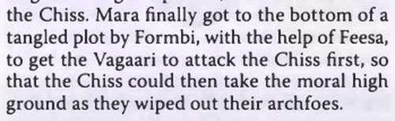

## p.260 (scan page 275)

Page contents: 1226 words, 24 paragraphs | headings/entries: Fel, Marasiah; Fel, Soontir

- **Jacen Solo (Darth Caedus); Luke Skywalker**: "With the eventual defeat of Darth Caedus—the former Jacen Solo—Luke Skywalker offered a splinter group of Imperial Moffs a chance to rejoin the Galactic Alliance provided they submit to the command and leadership of Jagged Fel." Source: The Complete Star Wars Encyclopedia, Vol. I, p.260
  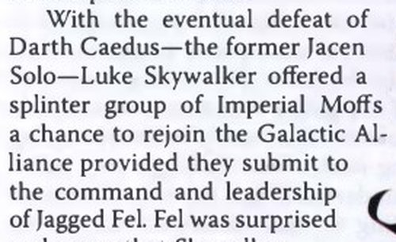
- **Darth Talon; Cade Skywalker**: "Darth Talon attacked again, but Cade and his friends defeated the Sith." Source: The Complete Star Wars Encyclopedia, Vol. I, p.260
  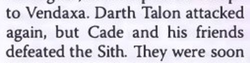
- **Darth Krayt**: "With help from loyalists, Fel retook control of the planet and began planning to destroy Darth Krayt's Sith Empire." Source: The Complete Star Wars Encyclopedia, Vol. I, p.260
  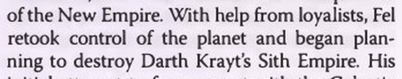

## p.261 (scan page 276)

Page contents: 1002 words, 27 paragraphs | headings/entries: Fel, Wynssa; Felacat; Felana; Fell Defender; Fellion; Fellon; Fellowship Plaza; Fein, Jedi Master; Felspern; Feith, Davin

- **Lucien Draay**: "But he and the other members of the Covenant foresaw that their present class of Padawans would become Sith Lords and exterminate the Jedi Order, so under the command of Jedi Master Lucien Draay, they plotted to kill the entire class at a ceremony that was supposed to initiate them as Jedi Knights." Source: The Complete Star Wars Encyclopedia, Vol. I, p.261
  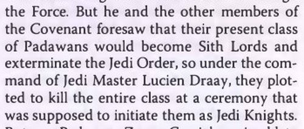

## p.262 (scan page 277)

Page contents: 1169 words, 27 paragraphs | headings/entries: Felyood, Captain Naz; Femon; Fen, Calk; Fenald; Fend'Allomin; Fenion

- **Aayla Secura**: "Jedi General Aayla Secura and the 327th Star Corps of clone troopers liberated them, and Jedi computer prodigy Ekria calculated that there was a chance to stop the spread of Shu Mai's toxins." Source: The Complete Star Wars Encyclopedia, Vol. I, p.262
  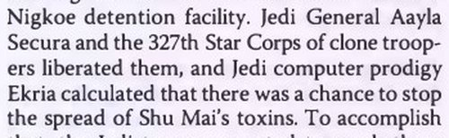
- **Palpatine (Darth Sidious)**: "Her family had been killed when the Imperial battlemoon Eye of Palpatine swept over her planet." Source: The Complete Star Wars Encyclopedia, Vol. I, p.262
  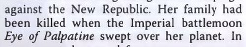
- **Kueller**: "Because she lacked confidence in him, Kueller killed her with his Force powers." Source: The Complete Star Wars Encyclopedia, Vol. I, p.262
  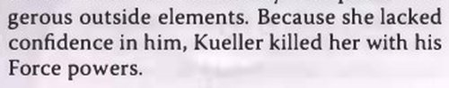

## p.263 (scan page 278)

Page contents: 1099 words, 27 paragraphs | headings/entries: Fenn, Fiav; Fenn, Rh'ajah; Fenn, Ro; Fenn, Swilja; Fenn, Tchaw; Fenoob, Feen; Fen'po; Fenson, Navy Trooper; Feps, Deggar; Feraa

## p.264 (scan page 279)

Page contents: 1286 words, 33 paragraphs | headings/entries: Feraleechi Onetime Loop; Ferals; Ferfer; Ferasi, Maris; Ferdas, Captain; Ferentina; Ferinn, Trennt; Ferionic Nebula; Ferlani, Luthus; Ferob, Captain; Ferra; Ferral, Justor; Ferret; Ferret, Orion

- **Jango Fett**: "Jango succeeded and got his bounty, but in the end strangled Fernooda to death as he and Wesell thwarted the plot." Source: The Complete Star Wars Encyclopedia, Vol. I, p.264
  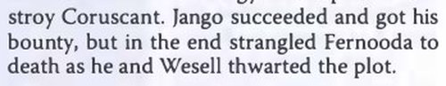
- **Grand Admiral Thrawn**: "Ferob, Captain An Imperial captain, he commanded the Victory-class Star Destroyer Iron Fist in the Unknown Regions under the watchful eye of Grand Admiral Thrawn." Source: The Complete Star Wars Encyclopedia, Vol. I, p.264
  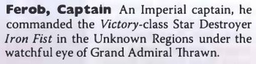

## p.265 (scan page 280)

Page contents: 1288 words, 33 paragraphs | headings/entries: Ferrhast; Ferrier, Niles; Ferros VI; Ferrous Aurora Nebula; Fersin; Fervse'dra Asteroid Belt; Ferxani; Fest

- **Lando Calrissian; Luke Skywalker; Grand Admiral Thrawn**: "Lando Calrissian and Luke Skywalker foiled Ferrier's plans to steal a few ships from the Sluis Van shipyards, but Ferrier was able to provide Thrawn with an even greater prize: the location of the legendary and longsought Katana fleet." Source: The Complete Star Wars Encyclopedia, Vol. I, p.265
  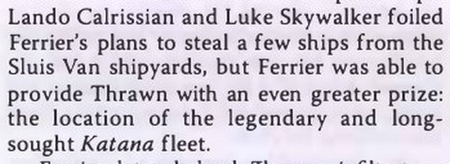
- **Grand Admiral Thrawn**: "Directly countermanding Thrawn's orders, he bribed Imperial Lieutenant Reynol Kosk into attacking the meeting, which resulted in Kosk and his entire squad getting killed." Source: The Complete Star Wars Encyclopedia, Vol. I, p.265
  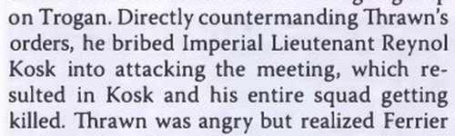
