# Owner Material 030 — The Complete Star Wars Encyclopedia, Vol. I (A–G): scan pages 281–320

- **Source:** *The Complete Star Wars Encyclopedia* by Stephen J. Sansweet and Pablo Hidalgo, with Bob Vitas, Daniel Wallace, Chris Cassidy, Mary Franklin and Josh Kushins (Del Rey, 2008), 3 vols. Secondary source (licensed Legends reference). Scan OCR'd on the box; the scan stays box-only and is **not** published.
- **Method:** every scanned page was OCR'd and machine-screened sentence by sentence for power-relevant statements (fights, kills, defeats, Force feats, rankings, superweapons) that name a character on our roster; each kept sentence is quoted verbatim from the OCR text and has a crop of the printed passage directly under it. Pages with nothing power-relevant are still listed with what is on them.
- **Citation:** "The Complete Star Wars Encyclopedia, Vol. I, p.X" by printed page ("scan p.X" where no printed number applies). **Weight:** Lucasfilm-licensed encyclopedia: a secondary, in-universe summary of Legends (and some film) material. It sums up feats from novels, comics and games; where the original story is in our notes, that source is the stronger citation.

## p.266 (scan page 281)

Page contents: 1138 words, 36 paragraphs | headings/entries: Feswin, Chau; Fett, Boba

- **Boba Fett** — entry/section: Fett, Boba: "He was a legendary bounty hunter, accepting warrants from both the Empire and the criminal underworld." Source: The Complete Star Wars Encyclopedia, Vol. I, p.266
  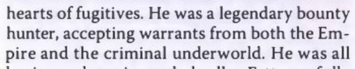
- **Jango Fett; Mace Windu**: "Jango entered the fray, only to be killed by Jedi Master Mace Windu." Source: The Complete Star Wars Encyclopedia, Vol. I, p.266
  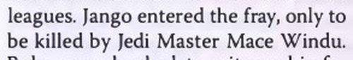

## p.267 (scan page 282)

Page contents: 1489 words, 22 paragraphs | headings/entries: Fett, Cassus

- **Boba Fett; Jacen Solo (Darth Caedus)** — entry/section: Fett, Boba: "It was then that they learned that Ailyn had been captured, tortured, and killed by Jacen Solo." Source: The Complete Star Wars Encyclopedia, Vol. I, p.267
  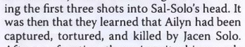
- **Jaina Solo; Jacen Solo (Darth Caedus)**: "Jaina Solo arrived on Mandalore asking for Fett's help in training her to defeat her brother Jacen, who by then had become Darth Caedus." Source: The Complete Star Wars Encyclopedia, Vol. I, p.267
  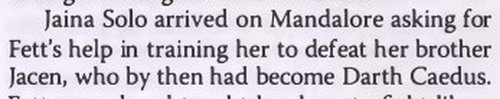
- **Admiral Daala**: "Daala called Fett's small task force into the battle to secure the Destroyer Bloodfin." Source: The Complete Star Wars Encyclopedia, Vol. I, p.267
  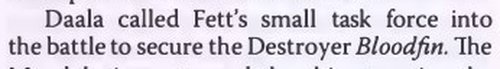

## p.268 (scan page 283)

Page contents: 1184 words, 18 paragraphs | headings/entries: Fett, Jango; Fevye'starn; Fex-M3; Fey'ja, Maja; Fey'jia, Torel

- **Jango Fett** — entry/section: Fett, Jango: "Jango Fett was orphaned at an early age, the son of simple Concord Dawn farmers killed by brutal marauders." Source: The Complete Star Wars Encyclopedia, Vol. I, p.268
  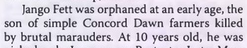
- **Jango Fett** — entry/section: Fett, Jango: "Though the Mandalorian supercommandos were wiped out by the Jedi Knights, Jango was one of the few left to still wear the armor." Source: The Complete Star Wars Encyclopedia, Vol. I, p.268
  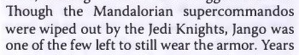
- **Obi-Wan Kenobi**: "Despite a barrage of Slave I's seismic charges, laser cannons, and missile attacks, Obi-Wan survived and continued shadowing the Fetts as they arrived on the barren planet's surface." Source: The Complete Star Wars Encyclopedia, Vol. I, p.268
  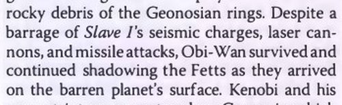
- **Jango Fett; Mace Windu** — entry/section: Fett, Jango: "His blaster skills killed several Jedi, but Jango was not quite prepared to face off against Jedi Master Mace Windu." Source: The Complete Star Wars Encyclopedia, Vol. I, p.268
  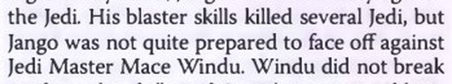
- **Jango Fett; Mace Windu** — entry/section: Fett, Jango: "Windu did not break stride as he deflected Jango's incoming blasts and swiftly cleaved off the hunter's head with a single stroke of his luminescent blade." Source: The Complete Star Wars Encyclopedia, Vol. I, p.268
  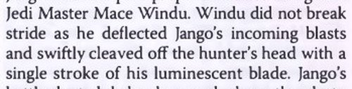

## p.269 (scan page 284)

Page contents: 1298 words, 23 paragraphs | headings/entries: Fey'lya's Pride; Feytihennasraof; Ffib; Fhilch, Grubbat; Fi; Fi

## p.270 (scan page 285)

Page contents: 1293 words, 29 paragraphs | headings/entries: Fia; FIBUA Operation; Fibuli; Fibuna, B'inka; Fida, Theen; Fiddani; Fidelis; Ventress.; Fidelity; Fidge; Fiery Ones

## p.271 (scan page 286)

Page contents: 1278 words, 24 paragraphs | headings/entries: Fifth Ruling Family; Figg, Lord Ecclessis; Figgis, Arner

- **Admiral Ackbar**: "During the blockade, the group was commanded by Admiral Nek Bwua'tu aboard the flagship Star Destroyer Admiral Ackbar." Source: The Complete Star Wars Encyclopedia, Vol. I, p.271
  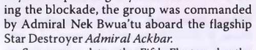

## p.272 (scan page 287)

Page contents: 1299 words, 24 paragraphs | headings/entries: Fik, Nor; Fil, Clone Commander; Filar-Nitzan; Filcher; Filiam; Filordi; Filordis; Filve; Fil'vye, Onoron; Final Redoubt; Financial Reform Act; Findos, Sentepeth

- **Kit Fisto; General Grievous**: "He was killed on the Vassek moon when Vebb and Kit Fisto searched the lair of General Grievous." Source: The Complete Star Wars Encyclopedia, Vol. I, p.272
  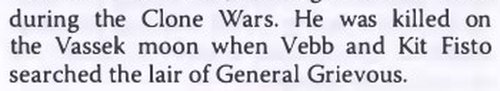
- **Grand Admiral Thrawn**: "Filve This planet was targeted by the Star Destroyer Judicator in a multipronged attack by Grand Admiral Thrawn that was intended to draw New Republic forces away from Ukio." Source: The Complete Star Wars Encyclopedia, Vol. I, p.272
  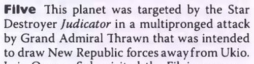

## p.273 (scan page 288)

Page contents: 1024 words, 32 paragraphs | headings/entries: Fing, Saluup; Fingal; Fird, Senator; Fireater

- **Grand Admiral Thrawn; Luke Skywalker**: "With the defeat of the Empire, he believed his career was over—until he was reactivated by Grand Admiral Thrawn, who wanted to monitor any possible activities of Luke Skywalker on the planet." Source: The Complete Star Wars Encyclopedia, Vol. I, p.273
  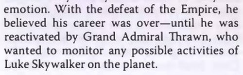

## p.274 (scan page 289)

Page contents: 1261 words, 23 paragraphs | headings/entries: Fireclaw; Fireclaw Horde; Firefolk; Firerider

## p.275 (scan page 290)

Page contents: 1095 words, 22 paragraphs | headings/entries: Firespray; Firespray-31; Firest, Colonel Ledick; Firestone, Wadie; Fire Team Three; Firethorn

- **Leia Organa Solo**: "The Firrerreos, humanoids with long, striped hair, were believed to have been annihilated, but Leia Organa Solo discovered there were colony ships carrying many natives in suspended animation." Source: The Complete Star Wars Encyclopedia, Vol. I, p.275
  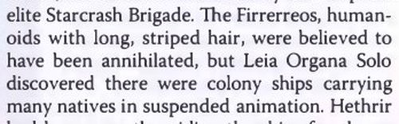

## p.276 (scan page 291)

Page contents: 1223 words, 30 paragraphs | headings/entries: Firrinree; Firro; First Administrator; First Citizen; First Fleet; First Sun Mobile Regiment; First Unification Wars; Firth, Aquelia; Firwirrung; Fishface; Fissona

## p.277 (scan page 292)

Page contents: 1417 words, 23 paragraphs | headings/entries: Fitca Prime; Fitch; Five Families; Five Masters Academy; Fiver; Fives, Trooper; Five World Party; Fivvie; Fivvi, Deksi; Fivvie, Ars; Fixer; Fixter, Marsh; Fiyarro

- **Palpatine (Darth Sidious); Kit Fisto; Mace Windu**: "However, the Jedi were unprepared for Palpatine's powers, and Fisto was quickly killed during the fighting, leaving Mace Windu to face Palpatine alone." Source: The Complete Star Wars Encyclopedia, Vol. I, p.277
  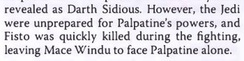

## p.278 (scan page 293)

Page contents: 1306 words, 16 paragraphs | headings/entries: Fizark, Sharina; Fizz, the; Fizzik; Fizzz; Flakax; Flagesso; FlakBlaster Ten; Flame; Flail, the; Flalios

## p.279 (scan page 294)

Page contents: 1131 words, 36 paragraphs | headings/entries: Flame-God; Flankers; Flarestar; Flash Fire; Flashpoint

## p.280 (scan page 295)

Page contents: 1322 words, 32 paragraphs | headings/entries: Flautis; Flax, Clive; Flax'Supt'ai; Fleet Protection Group; Fienn, Mich; Flennic, Moff Kurlen; Flerp, Zrim; Filet, Derren; Fleyars IV; Fligh; Flim

## p.281 (scan page 296)

Page contents: 1082 words, 32 paragraphs | headings/entries: Flint; Flip; Flirt; Flissar; Flitter; Flo

- **General Grievous**: "Flint A native of Belderone, Flint was the son of a Jedi Knight who had been killed by General Grievous during the Clone Wars." Source: The Complete Star Wars Encyclopedia, Vol. I, p.281
  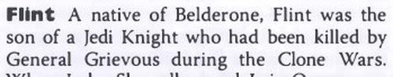
- **Lumiya**: "Many believed he had been killed by Lumiya." Source: The Complete Star Wars Encyclopedia, Vol. I, p.281
  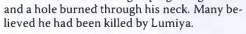
- **Palpatine (Darth Sidious)**: "Flo was separated from Dexter when the chef was forced to join the ranks of the Erased—those who wiped out all records of their existence and | went underground after Palpatine made himself | Emperor." Source: The Complete Star Wars Encyclopedia, Vol. I, p.281
  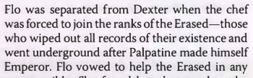

## p.282 (scan page 297)

Page contents: 1276 words, 33 paragraphs | headings/entries: Floating Rock Gardens; Flock, the; Floren; Floria; Floubettean; FLTCH R-I; Fluffy; Fluggriam; Flume, Tike

- **Ki-Adi-Mundi**: "Ki-Adi- Mundi was able to defeat FLTCH R-1l, and the droid was reprogrammed." Source: The Complete Star Wars Encyclopedia, Vol. I, p.282
  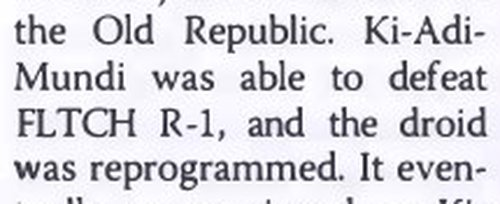

## p.283 (scan page 298)

Page contents: 1094 words, 22 paragraphs | headings/entries: Flurry; Fluwhaka; Flyer Through Spikes; Fly Eye; Flying Decks; Fnessal; Fnnbu; Foahl, Podiong; Foamwander City; Focela, Hyrim

- **Darth Vader (Anakin Skywalker)**: "He watched in silent horror as Vader killed Lands and took the doctor and Olin prisoner." Source: The Complete Star Wars Encyclopedia, Vol. I, p.283
  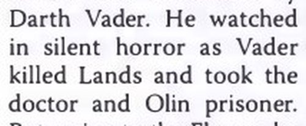
- **Master Thon; Nomi Sunrider**: "When Stonebone's men tried to murder Jedi Master Thon and Nomi Sunrider, Nomi used the Jedi battle meditation technique to force the pirates to turn on one another." Source: The Complete Star Wars Encyclopedia, Vol. I, p.283
  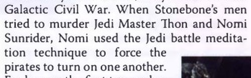

## p.284 (scan page 299)

Page contents: 1293 words, 31 paragraphs | headings/entries: Fodro; Fodurant; Foerost; Fogger; Fohargh; Fohlg; Fokask; Fol, Desric; Foless Crossroads; Folna; Folor; Fonada; Fondine, Slish; Fond Memory; Fondor

- **Darth Vader (Anakin Skywalker)**: "They declared that Darth Vader had been possessed by the spirit of Lord Nyax." Source: The Complete Star Wars Encyclopedia, Vol. I, p.284
  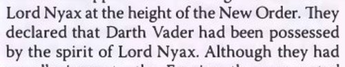
- **Darth Vader (Anakin Skywalker)**: "The Empire seized the Fondor yards and completed Darth Vader's Super Star Destroyer Executor there immediately following the Battle of Yavin." Source: The Complete Star Wars Encyclopedia, Vol. I, p.284
  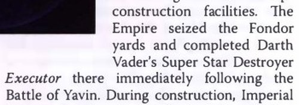

## p.285 (scan page 300)

Page contents: 1303 words, 25 paragraphs | headings/entries: Foolookoola; For'ali; Forb, Jonox; Forbidden

- **Jacen Solo (Darth Caedus)**: "After Jacen Solo's rise to power, he made it a priority to capture the shipyards or destroy them as punishment for the planet's rebellion." Source: The Complete Star Wars Encyclopedia, Vol. I, p.285
  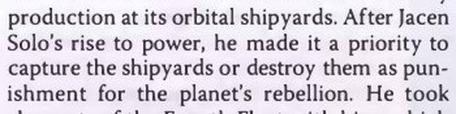
- **Yoda; Luke Skywalker**: ""If you once start down the dark path, forever will it dominate your destiny,' Yoda warned Luke Skywalker." Source: The Complete Star Wars Encyclopedia, Vol. I, p.285
  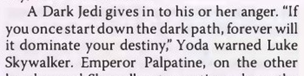

## p.286 (scan page 301)

Page contents: 1296 words, 25 paragraphs | headings/entries: 

## p.287 (scan page 302)

Page contents: 958 words, 26 paragraphs | headings/entries: 

- **Palpatine (Darth Sidious); Mace Windu; Yoda; Luke Skywalker**: "Force lightning A Force ability, such as that used by Emperor Palpatine against Jedi Masters Mace Windu, Yoda, and later Luke Skywalker, it consisted of blue bolts of pure energy that flew from the user's fingertips toward a target." Source: The Complete Star Wars Encyclopedia, Vol. I, p.287
  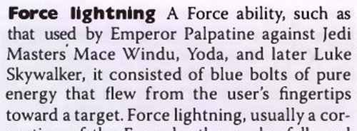
- **Saba Sebatyne**: "The technique originally was attempted by a strike team sent to Myrkr to destroy the voxyn queen and further refined by Saba Sebatyne." Source: The Complete Star Wars Encyclopedia, Vol. I, p.287
  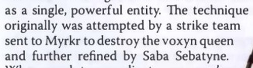

## p.288 (scan page 303)

Page contents: 1323 words, 25 paragraphs | headings/entries: For'deschel, Devan; Fordo; Fordox, Com; Forge, Inyri; Forge, Kassar; Forge, Lujayne; Forger; Fori, Vett

- **Palpatine (Darth Sidious)**: "Emperor Palpatine claimed the ability to create and control Force storms at will." Source: The Complete Star Wars Encyclopedia, Vol. I, p.288
  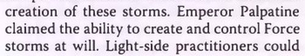
- **Ambassador Furgan; Darth Vader (Anakin Skywalker)**: "It destroyed half of the assault force sent by Caridan Ambassador Furgan to snatch young Anakin before being overwhelmed, and stalled the rest of the attackers long enough for reinforcements to arrive." Source: The Complete Star Wars Encyclopedia, Vol. I, p.288
  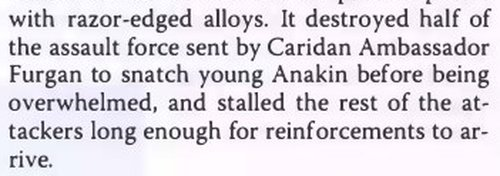
- **Palpatine (Darth Sidious)**: "Forger An Imperial-class Star Destroyer under the command of Davith Sconn, it suppressed a rebellion on Gra Ploven during Emperor Palpatine's reign by creating steam clouds that boiled alive 200,000 Ploven in three coastal cities." Source: The Complete Star Wars Encyclopedia, Vol. I, p.288
  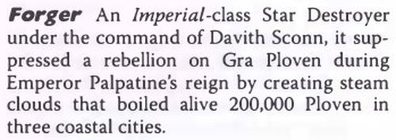

## p.289 (scan page 304)

Page contents: 667 words, 11 paragraphs | headings/entries: 

## p.290 (scan page 305)

Page contents: 1376 words, 24 paragraphs | headings/entries: Forma; Formayj; Formbi, Aristocra; Formos; Forn, Zelka; Forno, Jace; For'o; Forrth, Newar; Forry; Forsberg, Midnite; Forscan VI

- **Kit Fisto; Asajj Ventress**: "Forry helped Kit Fisto train the commandos of the Desert Wind terrorist group, and was among the survivors who managed to escape their lair when Asajj Ventress sent a group of infiltration droids to destroy them all." Source: The Complete Star Wars Encyclopedia, Vol. I, p.290
  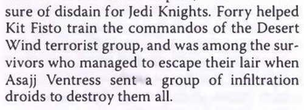

## p.291 (scan page 306)

Page contents: 1331 words, 21 paragraphs | headings/entries: Forswoth, Melanda; Fort Cravus; Forte, Siadem; Fort Nowhere; Fortress Baarlos; Fortress Kh'aris; Fortuna, Komadé; Fort Tusken; Fortune Seeker

- **Yoda**: "The only being sent to extract him was Jedi Master Yoda, who defeated a particularly cunning hailfire droid in order to protect their escape." Source: The Complete Star Wars Encyclopedia, Vol. I, p.291
  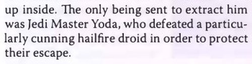
- **Darth Malak; Darth Krayt**: "A group of Jedi Knights, searching for clues as to the whereabouts of the Star Forge and Darth Malak, helped Komad Fortuna defeat a Krayt dragon that had been causing damage to his homestead." Source: The Complete Star Wars Encyclopedia, Vol. I, p.291
  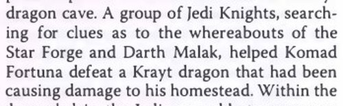

## p.292 (scan page 307)

Page contents: 931 words, 32 paragraphs | headings/entries: Fossyr, Irin; Foth, Dondo; Founder; Foundry; Four; Fourstar, Milo; Four-Den, Halka

- **General Grievous**: "The ship and its companions were all destroyed in battle, as General Grievous showed that he was a master tactician." Source: The Complete Star Wars Encyclopedia, Vol. I, p.292
  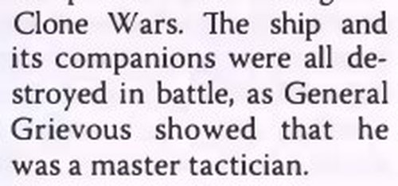

## p.293 (scan page 308)

Page contents: 994 words, 34 paragraphs | headings/entries: Fourth Attack Squadron; Fourth Fleet; Fox, Clone Commander; Fox, Trooper; Foxcatch; Foxtrain, Amaiza; Fozec; Fraal; Frac, Rolai; Fraig, L.; Francis, Dania

## p.294 (scan page 309)

Page contents: 1145 words, 21 paragraphs | headings/entries: Frame; Frayne; Frazier; Fredja; Freebird; Freeda; Freedom; Freedom; Freedom Convoy; Freedom's Messenger; Freedon Nadd Uprising

## p.295 (scan page 310)

Page contents: 1290 words, 27 paragraphs | headings/entries: Free Flight Dance Dome; Freeholders; Freejack; Free Lance; Freelies; Freely, Keets; Free Spacers Guild; Frego; FreiTek Incorporated; Freliq; Fremond Ill; Fremp, Anky; Frenzied River Clan; Fresia; Frewwil; Frex, Saidle

## p.296 (scan page 311)

Page contents: 1159 words, 27 paragraphs | headings/entries: Freyborn; Freyrr; Freyyr; Frickett; Frid; Friijillis; Fringe, the; Frisal; Frissk; Friyahrr; Friz Harammel

## p.297 (scan page 312)

Page contents: 1265 words, 28 paragraphs | headings/entries: Froswythe; Froz; Fromm, Tig; Frorral; Frossk; Frost, Alum; Fry, Bendu; Fry, Talesan

- **Boba Fett**: "He wanted Thall Joben and his friends killed for angering him, and so he employed Boba Fett to kill them in the speeder races on Boonta." Source: The Complete Star Wars Encyclopedia, Vol. I, p.297
  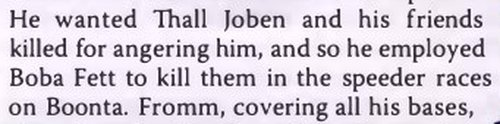

## p.298 (scan page 313)

Page contents: 1199 words, 35 paragraphs | headings/entries: Fuce, Commander; Fud; Fugazi; Fugo; Fuller, Kast; Fulkes; Fulminant; Fulmrick; Fumiyo; Furellas; Furgan, Ambassador; Furious; Furlag; Furloti, Teraeza

- **Jaxxon**: "He and Dafi captured Jaxxon on a backrocket planet, but the rabbit-like alien was rescued by Amaiza, who killed Dafi and Fud." Source: The Complete Star Wars Encyclopedia, Vol. I, p.298
  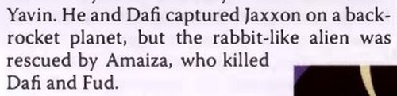
- **Ambassador Furgan** — entry/section: Furgan, Ambassador: "There his troops were faced with formidable challenges, although Furgan at one point was able to get his hands on the baby." Source: The Complete Star Wars Encyclopedia, Vol. I, p.298
  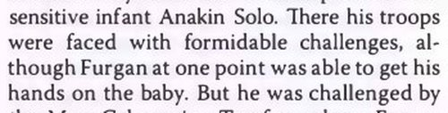

## p.299 (scan page 314)

Page contents: 988 words, 34 paragraphs | headings/entries: Fust, Bendix; Futility Station; Fusai; Fu'ulanh; Fuzzel

- **Lord Kaan**: "Like the rest of the Sith fleet, the Fury was crewed by individuals who were joined to the battle meditation of Lord Kaan, who directed the battle from the flagship Nightfall." Source: The Complete Star Wars Encyclopedia, Vol. I, p.299
  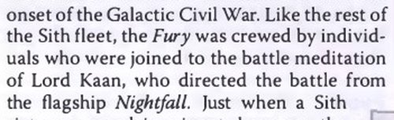
- **Lumiya**: "Fury (3) One of three /mperial-class Star Destroyers, it was under the command of Lumiya following the Battle of Endor." Source: The Complete Star Wars Encyclopedia, Vol. I, p.299
  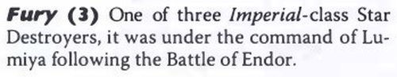

## p.300 (scan page 315)

Page contents: 945 words, 37 paragraphs | headings/entries: Fwiis; Fwillsving; FX-6; FX-7; Fybot, Waywa; Fynock

- **Rokur Gepta; Lando Calrissian**: "But after Gepta felt that he had finally achieved his goal of trapping Calrissian, he decided that Fybot had outlived his usefulness, and killed the avian being in cold blood." Source: The Complete Star Wars Encyclopedia, Vol. I, p.300
  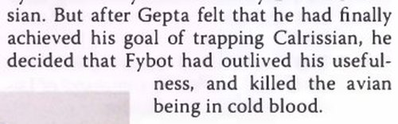

## p.301 (scan page 316)

Page contents: 681 words, 15 paragraphs | headings/entries: Fyodos; Fyre, Commander Silver; Fy-Tor-Ana; Fyyar, Galak

- **Darth Vader (Anakin Skywalker)**: "She died when the Jedi's hidden asteroid was destroyed as Darth Vader tested his new superweapon." Source: The Complete Star Wars Encyclopedia, Vol. I, p.301
  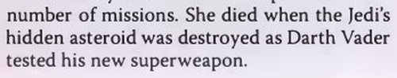

## p.302 (scan page 317)

Page contents: 0 words, 0 paragraphs | headings/entries: 

## p.303 (scan page 318)

Page contents: 799 words, 24 paragraphs | headings/entries: GO-16; G-138; G-1A

## p.304 (scan page 319)

Page contents: 1000 words, 35 paragraphs | headings/entries: G21; G2-3B; G-4; G47; G-59 Cannibalizer

## p.305 (scan page 320)

Page contents: 994 words, 43 paragraphs | headings/entries: G-5PO; G-62; G-79; G7-x; G8; G8-R3; G-8Y 5; G-9; GA-60s; Ga, Vaas; Gaaqu; Gaar; Gaarni; Gaartatha; Gaarx; Gaba- 18; Gabbard, Chine; Gabbera; Gab'borah; Gabby

