# Owner Material 030 — The Complete Star Wars Encyclopedia, Vol. I (A–G): scan pages 321–360

- **Source:** *The Complete Star Wars Encyclopedia* by Stephen J. Sansweet and Pablo Hidalgo, with Bob Vitas, Daniel Wallace, Chris Cassidy, Mary Franklin and Josh Kushins (Del Rey, 2008), 3 vols. Secondary source (licensed Legends reference). Scan OCR'd on the box; the scan stays box-only and is **not** published.
- **Method:** every scanned page was OCR'd and machine-screened sentence by sentence for power-relevant statements (fights, kills, defeats, Force feats, rankings, superweapons) that name a character on our roster; each kept sentence is quoted verbatim from the OCR text and has a crop of the printed passage directly under it. Pages with nothing power-relevant are still listed with what is on them.
- **Citation:** "The Complete Star Wars Encyclopedia, Vol. I, p.X" by printed page ("scan p.X" where no printed number applies). **Weight:** Lucasfilm-licensed encyclopedia: a secondary, in-universe summary of Legends (and some film) material. It sums up feats from novels, comics and games; where the original story is in our notes, that source is the stronger citation.

## p.306 (scan page 321)

Page contents: 1151 words, 31 paragraphs | headings/entries: Gabredor Ill; Gacerian; Gachoogai River; Gactimus; Gadaf; Gadan, Addath; Gadde; Gadget; Gados; Gadon 3; Gadrin; Gadrin Dump; Gadsle; Gaelin

## p.307 (scan page 322)

Page contents: 1019 words, 31 paragraphs | headings/entries: Gaff; Gatsa, the; Gaftikar; GAG; Gage, Captain; Gahenna; Gahg; Gaib; Gailea; Gailid; Gaios; G'ai Solem; Gait, Loowil

- **Luke Skywalker**: "He was killed at the Great Pit of Carkoon during the escape of Luke Skywalker and friends." Source: The Complete Star Wars Encyclopedia, Vol. I, p.307
  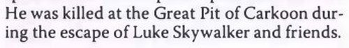

## p.308 (scan page 323)

Page contents: 1290 words, 31 paragraphs | headings/entries: Gaitzi; Gakfedd; Gal, Groex; Gal, Veren; Gala; Galaan; Galactic Alliance Defense Force; Galactic Alliance Guard; Galactic Alliance Intelligence Service; Galactic Alliance Senate; Galactic Center Medcenter; Galactic City; Galactic City SpeedPipe

## p.309 (scan page 324)

Page contents: 825 words, 28 paragraphs | headings/entries: Galactic Civil War; Galactic Constitution; Galactic Core; Galactic Corporate Policy League; Galactic Correctional Authority; Galactic Costume Extravaganza

- **Palpatine (Darth Sidious)**: "They did so at severe personal peril, and challenged the Empire and its formidable military might, all put into place by Emperor Palpatine, secretly Darth Sidious, a Dark Lord of the Sith." Source: The Complete Star Wars Encyclopedia, Vol. I, p.309
  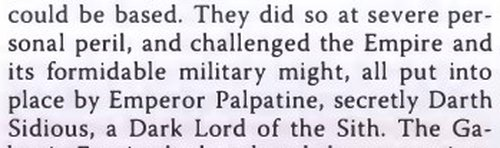

## p.310 (scan page 325)

Page contents: 1059 words, 31 paragraphs | headings/entries: Galactic Electronics; Galactic Empire, the; Galactic Encyclopedia, The; Galactic Exotics; Galactic Fair; Galactic Games; Galactic Great Seal; Galactic Guardian; Galactic HoloNet; Galactic Horizon; Galactic Justice Center; Galactic Loyalty Act; Galactic Marines; Galactic Medical Central; Galactic Museum; Galactic News Network; Galactic News Service; Galactic Patrol

- **Luke Skywalker**: "But even when the reborn Emperor tried to strike back from a hidden base on Byss, he could not defeat Luke Skywalker and the New Republic." Source: The Complete Star Wars Encyclopedia, Vol. I, p.310
  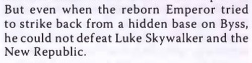

## p.311 (scan page 326)

Page contents: 814 words, 24 paragraphs | headings/entries: Galactic Polysapient Medical Center; Galactic Power Engineering; Galactic Radicals; Galactic Rebels; Galactic Registry; Galactic Representative Commission; Galactic Republic, the; Galactic Senate; Galactic Senate Chamber

## p.312 (scan page 327)

Page contents: 905 words, 24 paragraphs | headings/entries: Galactic Standard Time; Galae, Pash; Galak; Galiand; Galard Stables; Galas; Galasett; Galasol Strip

- **Obi-Wan Kenobi**: "Obi-Wan later took an active role in the planet's civil war, using the ship to help the Young destroy the deflection towers surrounding the capital city of Zehava." Source: The Complete Star Wars Encyclopedia, Vol. I, p.312
  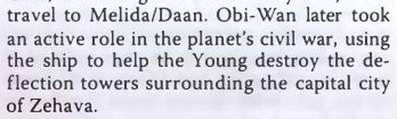

## p.313 (scan page 328)

Page contents: 441 words, 14 paragraphs | headings/entries: Galaxies Opera House

## p.314 (scan page 329)

Page contents: 912 words, 28 paragraphs | headings/entries: Galaxy-15; Galaxy Befuddled, A; Galaxy Chance; Galaxy Gladiator Federation; Galaxy Gun; Galaxy News Service; Galaxy Wanderer; Gale; Gale, Lord; Gale, Ratambo; Gale, Reina; Galen; Galentro Heavy Works; Galerha, Melik; Galey; GalFactorial; Gal'fian'deprisi

- **Lord Kaan**: "Gale, Lord One of the many Jedi Knights who gathered on Ruusan to fight against Lord Kaan and the Brotherhood of Darkness, he was killed in one of the early struggles against the Sith." Source: The Complete Star Wars Encyclopedia, Vol. I, p.314
  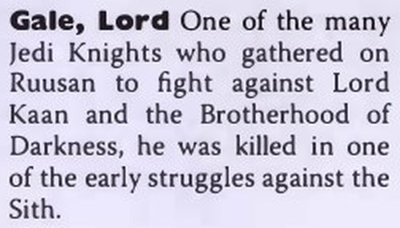

## p.315 (scan page 330)

Page contents: 884 words, 23 paragraphs | headings/entries: Galidraan; Galidyn; Gall; Gallada; Galladinium Galactic Exports; Gallamby, Daclif; Gallian; Gallandro

- **Jango Fett**: "Half of the Jedi task force was killed while the Mandalorians were wiped out—except for Jango Fett, who was turned over to the governor." Source: The Complete Star Wars Encyclopedia, Vol. I, p.315
  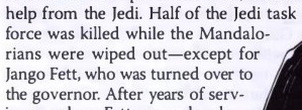
- **Gallandro** — entry/section: Gallandro: "Han found the treasure chambers and Gallandro challenged him to a duel." Source: The Complete Star Wars Encyclopedia, Vol. I, p.315
  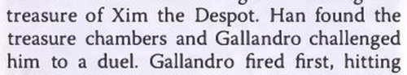

## p.316 (scan page 331)

Page contents: 1067 words, 28 paragraphs | headings/entries: Gallant Haven; Gallant Sun; Galle, Lieutenant; Gallinore

- **Gallandro** — entry/section: Gallandro: "It took part in the unsuccessful blockade of Doornik- 319, but survived the counterassault." Source: The Complete Star Wars Encyclopedia, Vol. I, p.316
  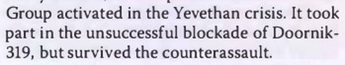
- **Jaina Solo**: "It was here that Jaina Solo and Sinsor Khal discovered the secrets of the Yuuzhan Vong coral implants that enslaved their victims." Source: The Complete Star Wars Encyclopedia, Vol. I, p.316
  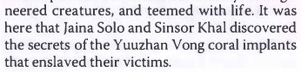

## p.317 (scan page 332)

Page contents: 1139 words, 45 paragraphs | headings/entries: Galliot; Gallo, Boss; Galion; Gallou, Rennie; Gainey, Lady; Galpos Il; Gal-Ram, Dor; Galt, Loowli; Galtea; Galu; Gaivoni 111; Gama, Tira; Gamandar; New Order.

- **Lando Calrissian**: "Eventually, it was destroyed by Lando Calrissian and Drebble." Source: The Complete Star Wars Encyclopedia, Vol. I, p.317
  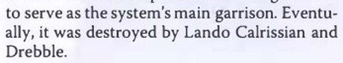

## p.318 (scan page 333)

Page contents: 945 words, 27 paragraphs | headings/entries: Gamb, Tord; Gamer; Gamgation; Gamine; Gamma Company; Gamma Corps; Gamma Station; Gammaiin; Gamor Run; Gamorrean

- **Grand Admiral Thrawn**: "Gamer An Alliance shuttle group, it was destroyed during the Galactic Civil War when it took part in the failed assassination of then- Vice Admiral Thrawn when he arrived at the NL-1 station." Source: The Complete Star Wars Encyclopedia, Vol. I, p.318
  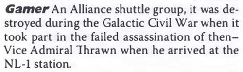
- **Mara Jade Skywalker**: "When Talon Karrde discovered the operation, Gamgalon nearly killed Karrde, but Mara Jade killed Gamgalon first." Source: The Complete Star Wars Encyclopedia, Vol. I, p.318
  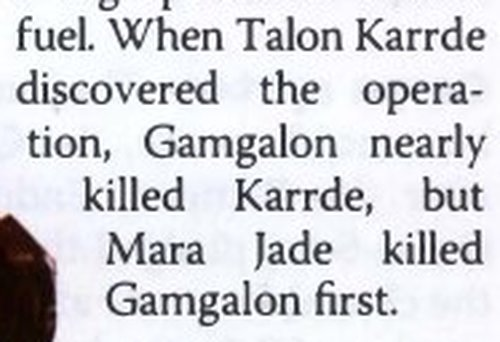

## p.319 (scan page 334)

Page contents: 1044 words, 24 paragraphs | headings/entries: Gamu; Ganar, Yith; Ganash; Gand; Gandan, Bey

## p.320 (scan page 335)

Page contents: 1075 words, 23 paragraphs | headings/entries: Gandder's Spin; Gandeal; Gandeid IV; Gandish, Phylo; Gandle Ott; Gandolo IV; Gandorthral Atmospherics; Gandril, Moff; Gandroff; Gandrossi VI; Ganeedé; Ganet; Ganji; Gank

## p.321 (scan page 336)

Page contents: 1174 words, 30 paragraphs | headings/entries: Gank Massacres; Ganlihk; Gann, Grand Moff; Gann, Mapper; Lieutenant; Ganner Squadron; Gant; Gant, Colonel Trenn; Gant, Toshan; Gantor, Tobin; Gantoris; Gantree, Fan; Ganz, Keejik; Gaph; Gap Nine

- **Boba Fett**: "Gann (2) A human male member of Nevo's assassin unit, he was killed by Boba Fett in a photo booth on Starstation 12." Source: The Complete Star Wars Encyclopedia, Vol. I, p.321
  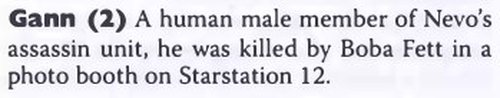
- **Gantoris** — entry/section: Gantoris: "Instead, Kun killed Gantoris, burning him from the inside out." Source: The Complete Star Wars Encyclopedia, Vol. I, p.321
  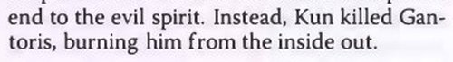

## p.322 (scan page 337)

Page contents: 964 words, 24 paragraphs | headings/entries: Gar; Garaint, Noval; Gardaji Rift; Garden Hall

## p.323 (scan page 338)

Page contents: 1188 words, 28 paragraphs | headings/entries: Garen IV; Garfin; Gargachykk; Gargan, Yarna d'al'; Gargon; Garhoon; Garindan

## p.324 (scan page 339)

Page contents: 1162 words, 36 paragraphs | headings/entries: Garland; Garn; Garn, Ril; Garn, Warleader; Garnatrope, Kelven; Garnet, Roark; Garnib; Garonnin, Lord; Garoos; Garos IV; Gar-oth, Lord; Garouk; Garowyn; Garqi

## p.325 (scan page 340)

Page contents: 1408 words, 20 paragraphs | headings/entries: Garr; Garr, Colonel Faltun; Garray; Garren, Ara; Garrett; Garrotine; Garrulan, Cash; Garrolkah; Garsi

## p.326 (scan page 341)

Page contents: 1061 words, 27 paragraphs | headings/entries: Gart; Gart, Breth; Gart, Ep; Gartogg; Garu, Lord; Garv; Garyn Raiders; Gasgano; Gass'kin, Mad; Gast, Dr. Edda

- **Mighella**: "Garyn surrounded himself with the strongest Vigos and even chose the Dathomir Witch Mighella as his personal bodyguard." Source: The Complete Star Wars Encyclopedia, Vol. I, p.326
  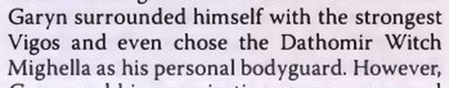

## p.327 (scan page 342)

Page contents: 1011 words, 31 paragraphs | headings/entries: Gast, Tuzin; Gastinin, Gar; Gasto; Gastrula; GAT-12h; Gate; Gateway; Gatherer 164; Gathering, the; Gatral; Gauch; Gaulus; Gauntlet

- **Lando Calrissian**: "Gauch One of the pilots who worked for Lando Calrissian in the asteroid belt known as Lando's Folly, he was one of the first pilots killed when the Yuuzhan Vong attacked Dubrillion." Source: The Complete Star Wars Encyclopedia, Vol. I, p.327
  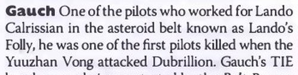

## p.328 (scan page 343)

Page contents: 1265 words, 33 paragraphs | headings/entries: Gauntlet Squadron; Gaurick; Gavrisom, Ponce; Gavryn; Gazaway, Dax; Gazurga; Gbu; G Cat; Gchalla; GDA-8; Gecee; GEC U47; Geddawai; Geeda; Geedon V

- **Palpatine (Darth Sidious)**: "Gauntlet Scanners Sensor arrays deployed along with a ring of Star Destroyers, they guarded the planet Byss during Emperor Palpatine's clonings." Source: The Complete Star Wars Encyclopedia, Vol. I, p.328
  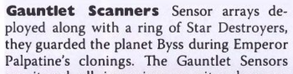

## p.329 (scan page 344)

Page contents: 1178 words, 26 paragraphs | headings/entries: Geen, Locus; Geezum; Geffen; Gefferon; Gegak; Geith; Gejjen, Dur; Gejjen, Nov; Gektl

## p.330 (scan page 345)

Page contents: 1028 words, 29 paragraphs | headings/entries: Gelesi; Gelgelar; Gellak, Gunmetal; Gellandi, Oora; Gelrood; Gelviddis Cluster; Geminor; Gemmer; Gen-6; Genarius; Genassa; Gen'Dai

- **Mace Windu**: "That enabled Windu to defeat the Separatist fleet and put an end to the Summertime War." Source: The Complete Star Wars Encyclopedia, Vol. I, p.330
  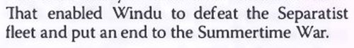

## p.331 (scan page 346)

Page contents: 1152 words, 30 paragraphs | headings/entries: Gendar; Gendarr, lolan; Genden, Lohn; Geneer, Duchess; General Crix Madine Military Reserve; General Good; General Marshoo's Eatery; General Ministry; Generet; Generis; Genesia; Genian; Genkal; Genon; Gentleman Caller; Genue; Geonosian

- **Palpatine (Darth Sidious)**: "Emperor Palpatine refused, and Genden destroyed the liner, killing all 10,000 passengers." Source: The Complete Star Wars Encyclopedia, Vol. I, p.331
  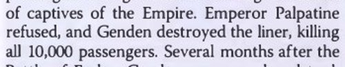
- **Grand Admiral Thrawn**: "The center was destroyed by Grand Admiral Thrawn's forces just prior to the Battle of Bilbringi." Source: The Complete Star Wars Encyclopedia, Vol. I, p.331
  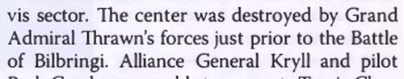

## p.332 (scan page 347)

Page contents: 928 words, 19 paragraphs | headings/entries: 

## p.333 (scan page 348)

Page contents: 895 words, 16 paragraphs | headings/entries: 

## p.334 (scan page 349)

Page contents: 859 words, 15 paragraphs | headings/entries: Gepparin; Gep's Grill; Gepta, Rokur; Geptun, Lorz

- **Obi-Wan Kenobi; Darth Vader (Anakin Skywalker); Padmé Amidala**: "Obi-Wan Kenobi, Anakin Skywalker, and Padmé Amidala were found guilty of espionage by Poggle the Lesser and were to be killed by deadly arena beasts." Source: The Complete Star Wars Encyclopedia, Vol. I, p.334
  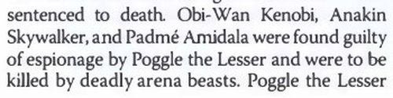
- **Rokur Gepta** — entry/section: Gepta, Rokur: "Rokur Gepta's arrogance and sheer malice led him to obliterate all living things on the planet." Source: The Complete Star Wars Encyclopedia, Vol. I, p.334
  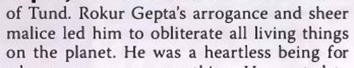
- **Rokur Gepta; Lando Calrissian** — entry/section: Gepta, Rokur: "Lando Calrissian battled Gepta and defeated him, in the process discovering that the Sorcerer was actually a vicious Croke—a small, snaillike being with hairy black legs that used illusion to make its way through life." Source: The Complete Star Wars Encyclopedia, Vol. I, p.334
  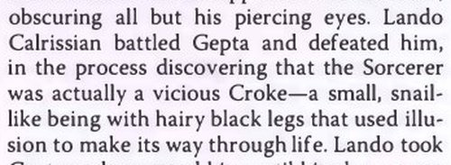

## p.335 (scan page 350)

Page contents: 1297 words, 25 paragraphs | headings/entries: Geran; Gerb; Gerevick; Gergris; Geridard; Geriel; Gerin; Geris VI; Gerraba; Gerrard V; Gervruche; Gesaril; Gessak, Mils; Gesse, Geska; Gestal, Noric; Gestron; Getelles, Moff

- **Meetra Surik**: "Gerevick was killed when he tried to attack the Exile and her party after they had discovered a wealth of information within the Enclave." Source: The Complete Star Wars Encyclopedia, Vol. I, p.335
  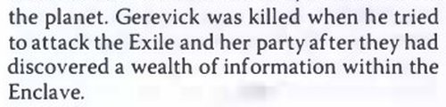

## p.336 (scan page 351)

Page contents: 955 words, 27 paragraphs | headings/entries: Gethzerion; Gettiarn; Gev, Mirta; Gevarak, Malindin; Gevarno Cluster; Gevtes, Pagda

- **Gethzerion** — entry/section: Gethzerion: "Despite this promise, Zsinj's men opened fire and destroyed both the ship and Gethzerion." Source: The Complete Star Wars Encyclopedia, Vol. I, p.336
  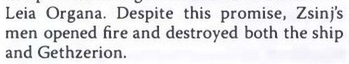

## p.337 (scan page 352)

Page contents: 1285 words, 28 paragraphs | headings/entries: Ghanol, Zam; Gharakh; Gharn; Gharon; Ghator, Sal; Ghazhak; Gheer, Trisdin; Ghem, Fasald; Ghent, Dhagon; Ghent, Zakarisz

- **Zayne Carrick**: "Only Zayne Carrick survived because of his late arrival." Source: The Complete Star Wars Encyclopedia, Vol. I, p.337
  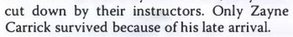
- **Luke Skywalker**: "The pair discovered Luke Skywalker's severed hand in the airways of Cloud City." Source: The Complete Star Wars Encyclopedia, Vol. I, p.337
  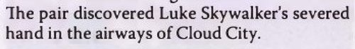
- **Darth Vader (Anakin Skywalker)**: "When Ghent survived a crash landing, Vader offered him a chance to train an elite squad of Imperial starfighter pilots aboard the Crucible." Source: The Complete Star Wars Encyclopedia, Vol. I, p.337
  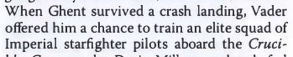

## p.338 (scan page 353)

Page contents: 1063 words, 36 paragraphs | headings/entries: Gherant; Ghi; Ghintee, Meeko; Ghoel; Ghomrassen; Ghon, Plessus; Ghorin; Ghorman's Honor; Ghost Jedi; Ghost Oasis

- **Darth Vader (Anakin Skywalker)**: "Ghost Oasis The Tusken Raider name for the campsite that Anakin Skywalker destroyed in an act of revenge for the Tusken torture of his mother, Shmi." Source: The Complete Star Wars Encyclopedia, Vol. I, p.338
  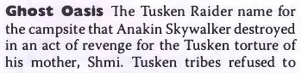

## p.339 (scan page 354)

Page contents: 972 words, 27 paragraphs | headings/entries: Ghrag Mercenaries; Ghraggka; Ghufran; Ghul, Forzi; Ghundrak; Gi, Klin-Fa; Gi, Sha'a; Gi/9

## p.340 (scan page 355)

Page contents: 1392 words, 26 paragraphs | headings/entries: Giat Nor; Gibb; Gibbela; Gibbs; Giel, Mils; Gifford, Dru; Gigoran; Giiett, Micah; Giju; Gilagimar; Gilamar, Mij

- **Luke Skywalker**: "Luke still managed to get a shot away and destroy the teezl." Source: The Complete Star Wars Encyclopedia, Vol. I, p.340
  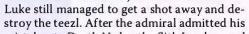
- **Leia Organa Solo**: "He triggered a reactor overload that would have destroyed Golrath as part of an improvised plan to capture Leia Organa." Source: The Complete Star Wars Encyclopedia, Vol. I, p.340
  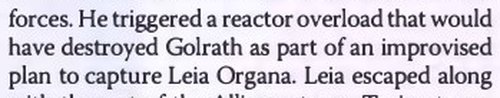

## p.341 (scan page 356)

Page contents: 1109 words, 21 paragraphs | headings/entries: Gilatter VUll; Gilded Claw; Gilded Thranta; Gilflyn; Gilfrome; Gilgam; Gillespee, Samuel Tomas; Gillia; Gilliana; Gilling; Gillmunn, Nolan; Gilimunn, Orliss

- **Joruus C'baoth**: "When C'baoth destroyed a slinker missile that was supposed to assassinate both Gilfrome and Passel Argente, C'baoth was securing mining rights for the Brolfi while protecting the Corporate Alliance's investments on Barlok." Source: The Complete Star Wars Encyclopedia, Vol. I, p.341
  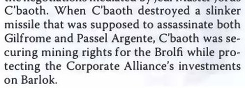
- **Luke Skywalker**: "When an Imperial ambush destroyed much of the Loyalist headquarters, Gillmunn and Luke Skywalker were captured and held for questioning by Commander Kraym." Source: The Complete Star Wars Encyclopedia, Vol. I, p.341
  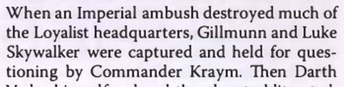
- **Darth Vader (Anakin Skywalker)**: "Then Darth Vader himself ordered the planet obliterated." Source: The Complete Star Wars Encyclopedia, Vol. I, p.341
  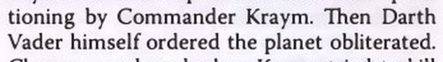
- **Darth Vader (Anakin Skywalker)**: "Anakin used a Force choke to get Gillmunn to drop his weapon." Source: The Complete Star Wars Encyclopedia, Vol. I, p.341
  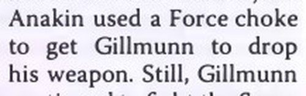

## p.342 (scan page 357)

Page contents: 1241 words, 26 paragraphs | headings/entries: Gilp; Gilyad, Bahm; Gimble, Lokk; Gimlet; Gimm; Gin; Ginbotham; Gingal; Ginger; Ginorra, Lexia; Ginzork, Peert; Gion, Dara; Gira; Giran; Girdun, Heol; Gistang, Jes

- **Lord Kaan**: "Ginger, like the rest of the Jedi, was killed when Lord Kaan activated his thought bomb." Source: The Complete Star Wars Encyclopedia, Vol. I, p.342
  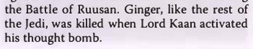
- **Jacen Solo (Darth Caedus)**: "Girdun was dismayed, but not upset, when Habuur was killed in Jacen Solo's attempt to use the Force to extract information from her." Source: The Complete Star Wars Encyclopedia, Vol. I, p.342
  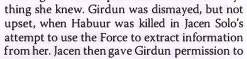

## p.343 (scan page 358)

Page contents: 1004 words, 27 paragraphs | headings/entries: Githany; Givens; Gizen, Uv; Gizer; Gjon, Honest; GK Oppressor

## p.344 (scan page 359)

Page contents: 1082 words, 34 paragraphs | headings/entries: Glaive; Glaive; Glakka; Glarret; Glarsaur; Glas; Glasfir'a'lik; Gla Soocha; Glass, Den Sait; Glass Mountain; Glauheim; Glave, Modigal; Glayyd, Mor; Glazer; GLD-M; Gleasry, Pharnis; Glee Anselm

- **Asajj Ventress; Obi-Wan Kenobi**: "Using her own lightsaber, Ventress beheaded Glaive before Obi-Wan could act." Source: The Complete Star Wars Encyclopedia, Vol. I, p.344
  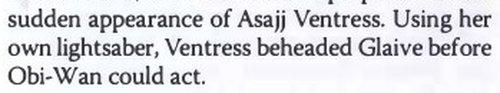

## p.345 (scan page 360)

Page contents: 1335 words, 26 paragraphs | headings/entries: Gleemort, Ghana; Glek, Salim; Glena; Gli, Darian; Glieh; Glidamir, Norrion; Glidrick, Stenn; Glitterstar

- **Quinlan Vos**: "After the energy spiders killed Asanté Vos, Quinlan Vos destroyed all the spiders in order to completely end the supply of glitteryll." Source: The Complete Star Wars Encyclopedia, Vol. I, p.345
  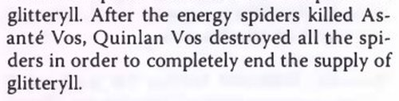
