# Owner Material 030 — The Complete Star Wars Encyclopedia, Vol. I (A–G): scan pages 361–398

- **Source:** *The Complete Star Wars Encyclopedia* by Stephen J. Sansweet and Pablo Hidalgo, with Bob Vitas, Daniel Wallace, Chris Cassidy, Mary Franklin and Josh Kushins (Del Rey, 2008), 3 vols. Secondary source (licensed Legends reference). Scan OCR'd on the box; the scan stays box-only and is **not** published.
- **Method:** every scanned page was OCR'd and machine-screened sentence by sentence for power-relevant statements (fights, kills, defeats, Force feats, rankings, superweapons) that name a character on our roster; each kept sentence is quoted verbatim from the OCR text and has a crop of the printed passage directly under it. Pages with nothing power-relevant are still listed with what is on them.
- **Citation:** "The Complete Star Wars Encyclopedia, Vol. I, p.X" by printed page ("scan p.X" where no printed number applies). **Weight:** Lucasfilm-licensed encyclopedia: a secondary, in-universe summary of Legends (and some film) material. It sums up feats from novels, comics and games; where the original story is in our notes, that source is the stronger citation.

## p.346 (scan page 361)

Page contents: 1121 words, 30 paragraphs | headings/entries: Glok, Dethro; Glom Tho; Gloom, Jervis; Glory; Glott; Glottal; Glova

- **Lando Calrissian; Han Solo; Chewbacca**: "Thirteen years after the Battle of Endor, Lando Calrissian was captured by Nandreeson and nearly killed before Han Solo and Chewbacca rescued him." Source: The Complete Star Wars Encyclopedia, Vol. I, p.346
  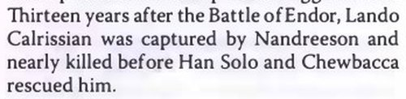

## p.347 (scan page 362)

Page contents: 1118 words, 23 paragraphs | headings/entries: Glovstoak; Glowpoint; GLTB-3 181; Gluss'sa'Nikto; Gluupor; GLX Firelance; Glynn, Cladus; Glynn-Beti

## p.348 (scan page 363)

Page contents: 1090 words, 30 paragraphs | headings/entries: G'mi Moa; Gnaden, Wom-Nii; G'Nagnib; Gnarkh; G'Neeznow; Gnisnal; G'nnoch; Gno, Senator; Gnosos

## p.349 (scan page 364)

Page contents: 1160 words, 37 paragraphs | headings/entries: G.O., the; Goa-Ato; Go-Corp/Utilitech; Godathi, Janu; Godatlhi, Palob; Godar; Goddess; Godendag; Godherdt; Godo

- **Greedo; Han Solo**: "He later brought Greedo to Tatooine, where the Rodian was killed by Han Solo." Source: The Complete Star Wars Encyclopedia, Vol. I, p.349
  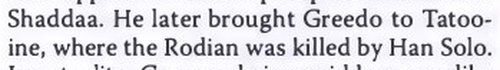
- **Dace Diath**: "After Dagore was taken captive by Dace Bonearm and IG-72, Godalhi took possession of the Moldy Crow and brought it back to the Alliance Dreadnaught New Hope." Source: The Complete Star Wars Encyclopedia, Vol. I, p.349
  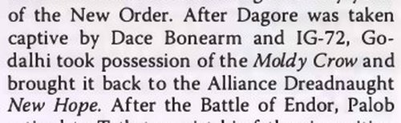

## p.350 (scan page 365)

Page contents: 952 words, 34 paragraphs | headings/entries: Godt; Goelitz; Gog, Borborygmus; Goir, Vill; Golan Hi Battle Station; Golan Ill Battle Station; Golan Arms; Golanda; Gold Devil

- **Gallandro**: "After much fighting, Goelitz was defeated by members of the Ylix militia, including the infamous gunman Gallandro." Source: The Complete Star Wars Encyclopedia, Vol. I, p.350
  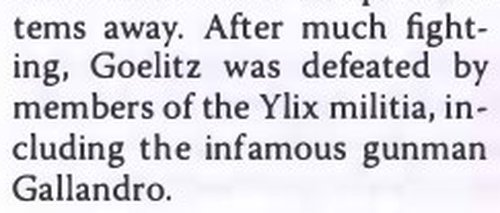
- **Leia Organa Solo**: "But Leia Organa was able to destroy it first, leaving Gogol to try to explain the loss to Imperial agents." Source: The Complete Star Wars Encyclopedia, Vol. I, p.350
  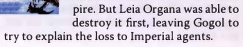

## p.351 (scan page 366)

Page contents: 809 words, 25 paragraphs | headings/entries: Golden Cuff, the; Golden Globe; Golden Orb; Goldenrod; Golden Slug; Golden Sun; Gold Five; Gold Fortress; Gold Four; Gold Six; Gold Squadron; Gold Three; Gold Two

## p.352 (scan page 367)

Page contents: 1017 words, 42 paragraphs | headings/entries: Gold Wing; Golfhan; Goliath; Goliath; Golkus; Golm; Golorno; Golrath; Gol Storn; Goithan, Bregius; Golthar's Sky; Goluud Corridor; Gonar; Gondry; Gonmore; Gonster; G'ont, Ickabel; Goot, Alfreda; Gopher; Gorath

- **Lando Calrissian**: "Gold Wing The Rebel Alliance starfighter battle group under the command of Gold Leader Lando Calrissian during the Battle of Endor, it was assigned the task of destroying the second Death Star." Source: The Complete Star Wars Encyclopedia, Vol. I, p.352
  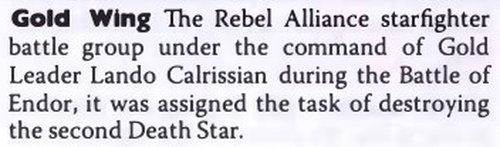
- **Leia Organa Solo**: "But Imperial Lieutenant Mils Giel triggered a reactor overload that destroyed Golrath Station as part of a failed plan to capture Leia Organa." Source: The Complete Star Wars Encyclopedia, Vol. I, p.352
  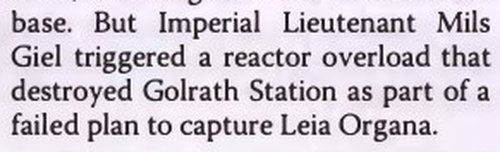

## p.353 (scan page 368)

Page contents: 1012 words, 34 paragraphs | headings/entries: Goravas; Gorbah; Gorc; Gordian Reach; Gordon, Herrit; Goren, Del; Gorev; Gorfan

- **Admiral Daala**: "Gorgon (#) An Imperial Star Destroyer, it was Admiral Daala's flagship, the last of her remaining original Star Destroyers." Source: The Complete Star Wars Encyclopedia, Vol. I, p.353
  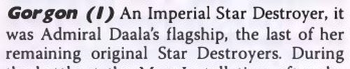

## p.354 (scan page 369)

Page contents: 1130 words, 28 paragraphs | headings/entries: Gorjaye, Ranna; Gormeo; Gornash, Prophet; Gorneesh, King; Gorno; Gorog; Gor-ravvus; Gorrlyn; Gorrm; Gorrt

- **Greedo**: "He was seemingly destroyed by the young Rodian bounty hunter Greedo on the spaceport moon of Nar Shaddaa, but later was repaired and eventually showed up in Mos Eisley." Source: The Complete Star Wars Encyclopedia, Vol. I, p.354
  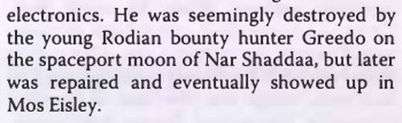
- **Luke Skywalker**: "Luke Skywalker and the new Jedi Order referred to the Gorog as the Dark Nest, and they believed that the Will of the Gorog nest was broken when Skywalker killed Welk in combat on Kr, but it became clear that this wasn't true." Source: The Complete Star Wars Encyclopedia, Vol. I, p.354
  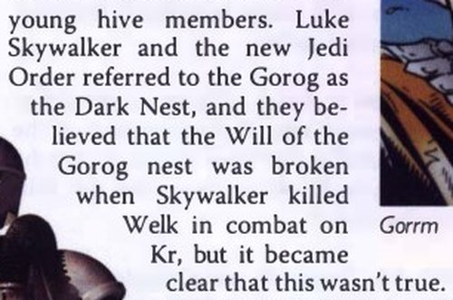
- **Luke Skywalker; Plo Koon**: "In a series of struggles, Luke managed to destroy Lomi Plo, then set out to confront UnuThul and force him to cut off his contact with the Killiks." Source: The Complete Star Wars Encyclopedia, Vol. I, p.354
  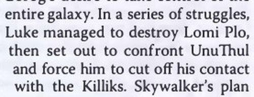
- **Alema Rar; Leia Organa Solo**: "But Alema Rar had survived her battle with Leia Organa Solo on Tenupe and considered herself the final member of the Gorog hive." Source: The Complete Star Wars Encyclopedia, Vol. I, p.354
  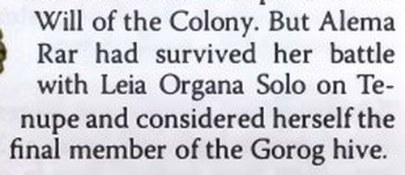
- **Chewbacca; Leia Organa Solo**: "The two were separated when the Empire enslaved the Wookiees, and Gorrlyn was widowed when Salporin died trying to protect Chewbacca and Leia Organa Solo on Kashyyyk." Source: The Complete Star Wars Encyclopedia, Vol. I, p.354
  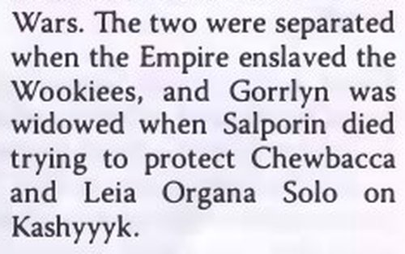
- **Naga Sadow**: "Gorrm was killed when Ssk Kahorr and the Starbreaker 12 were destroyed by Naga Sadow." Source: The Complete Star Wars Encyclopedia, Vol. I, p.354
  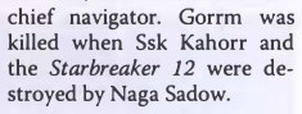

## p.355 (scan page 370)

Page contents: 978 words, 32 paragraphs | headings/entries: Gorsh; Gort; Gorth; Gorzima; Gospic, Feyn; Goss, Joreb; Gotab; Gotal; Go-To; Gottu

- **Darth Maul**: "Gorth was killed by Darth Maul when the Sith Lord captured Monchar." Source: The Complete Star Wars Encyclopedia, Vol. I, p.355
  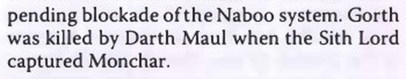

## p.356 (scan page 371)

Page contents: 976 words, 29 paragraphs | headings/entries: Goure; Govia, Rennt; Gowdawil; Goyoikin; Gozric; Graad; Graak; Gra'aton; Gracca; Gracus, Bor; Graeber, Dennix; Graemon; Graf, Admiral; Graff, Skent; Graffe, Jander; Gragra

## p.357 (scan page 372)

Page contents: 846 words, 22 paragraphs | headings/entries: Grahvess, Emd; Grakchawwaa, King; Grakko; Grakouine; Grallia Spaceport; Grammel, Captain-Supervisor; Gran

- **General Grievous**: "King Grakchawwaa was reluctant to join the war on either side and might have remained neutral—but then General Grievous killed his son, Prince Rikummee." Source: The Complete Star Wars Encyclopedia, Vol. I, p.357
  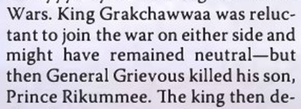
- **Boba Fett**: "Grakouine The site of a Rebel Alliance storage base, it was where the New Republic parked Boba Fett's ship, Slave I, after the bounty hunter was presumed killed by the Sarlacc on Tatooine." Source: The Complete Star Wars Encyclopedia, Vol. I, p.357
  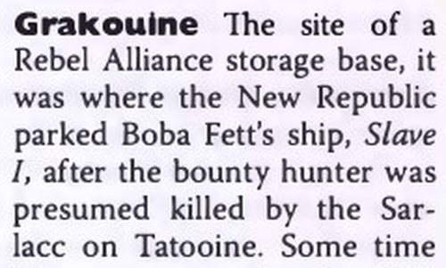

## p.358 (scan page 373)

Page contents: 927 words, 21 paragraphs | headings/entries: Grand Admiral; Grand Audience Chamber; Grand Concourse

- **Grand Admiral Thrawn**: "But there was a 13th Grand Admiral as well, a Chiss mastermind known as Thrawn, who filled the void left when Zaarin was killed during his own attempt to become Emperor." Source: The Complete Star Wars Encyclopedia, Vol. I, p.358
  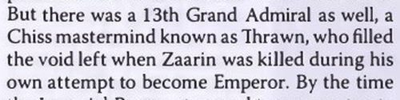

## p.359 (scan page 374)

Page contents: 1274 words, 32 paragraphs | headings/entries: Grand Dukha; Grand Imperial Union; Grand Isle; Grand Master; Grand Moff; Grand Reception Hall; Grand Vizier; Granit; Gra Ploven; Grappa; Grappler

- **Luke Skywalker**: "This delay allowed Rebel pilot Luke Skywalker to fire a proton torpedo into the station, setting off a chain reaction that caused it to explode." Source: The Complete Star Wars Encyclopedia, Vol. I, p.359
  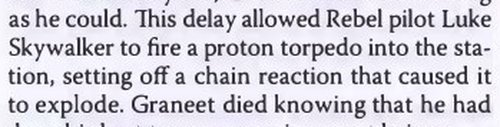
- **Palpatine (Darth Sidious)**: "Gra Ploven The homeworld of the Ploven species, it was nearly destroyed during the reign of Emperor Palpatine." Source: The Complete Star Wars Encyclopedia, Vol. I, p.359
  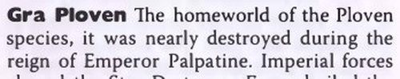

## p.360 (scan page 375)

Page contents: 1259 words, 40 paragraphs | headings/entries: Grappler; Grassling; Grave, Taxtro

- **Han Solo; Luke Skywalker; Chewbacca**: "The Graveyard was destroyed prior to the Battle of Hoth when Arakkus trapped Han Solo, Luke Skywalker, and Chewbacca aboard the Millennium Falcon." Source: The Complete Star Wars Encyclopedia, Vol. I, p.360
  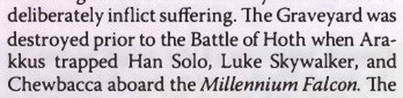

## p.361 (scan page 376)

Page contents: 1091 words, 30 paragraphs | headings/entries: Graviex Med; Gray, Aleson; Grayfeather Squadron; Gray Leader; Gray Pilgrim; Gray Squadron; Gray Two; Gray Wing; Great Canyon

## p.362 (scan page 377)

Page contents: 1168 words, 40 paragraphs | headings/entries: Great Canyon Clan; Great Council; Great Doctrine, the; Great Door, the; Great Downrush; Great Droid Revolution; Greater Hub Spaceport; Greater Plooriod Cluster; Great Flood; Great Hall; Great Heep; Great Holocron; Great Hunt

## p.363 (scan page 378)

Page contents: 922 words, 24 paragraphs | headings/entries: Great Hyperspace War; Great Manifest Period; Great Northern Forest; Great Ones; Great Plague

- **Odan-Urr**: "Meanwhile, Jedi Masters Odan-Urr and Ooroo tried unsuccessfully to use Jedi battle meditation on the advancing Massassi forces that swarmed the planet Coruscant, but soon realized that the majority of the opposing army was an illusion." Source: The Complete Star Wars Encyclopedia, Vol. I, p.363
  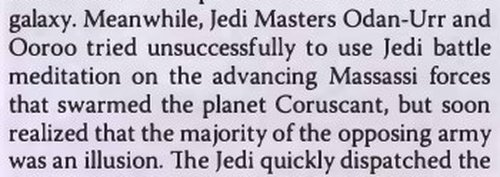
- **Naga Sadow**: "Meanwhile, Sadow defeated Kressh in an epic interstellar war in the Sith Empire, but his forces were unable to defend themselves against the might of Empress Teta's forces." Source: The Complete Star Wars Encyclopedia, Vol. I, p.363
  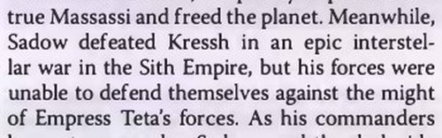
- **Darth Vader (Anakin Skywalker); Obi-Wan Kenobi**: "Orvos foresaw that Anakin Skywalker and Obi-Wan Kenobi would arrive on Nelvaan and uncover the truth behind the Great Mother's illness." Source: The Complete Star Wars Encyclopedia, Vol. I, p.363
  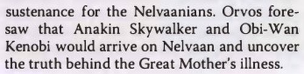

## p.364 (scan page 379)

Page contents: 1213 words, 28 paragraphs | headings/entries: Great Reunification; Great Ritual; Great River; Great Sacrifice; Great Schisms; Great Shell Dome; Great Sky Lord; Great Swarm

- **Palpatine (Darth Sidious)**: "Great Purge (2) A term used during the New Order to describe the Jedi Purge in which military forces supporting Emperor Palpatine wiped out nearly every Jedi Knight in the galaxy." Source: The Complete Star Wars Encyclopedia, Vol. I, p.364
  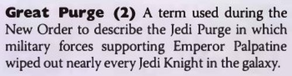
- **Exar Kun**: "There Exar Kun killed his former Jedi Master and ordered his followers to murder their Masters in turn." Source: The Complete Star Wars Encyclopedia, Vol. I, p.364
  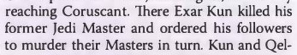
- **Nomi Sunrider**: "Kun was defeated on Ossus and fled to Yavin 4, while Qel-Droma was stripped of his connection to the Force by Nomi Sunrider." Source: The Complete Star Wars Encyclopedia, Vol. I, p.364
  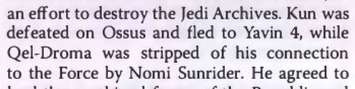

## p.365 (scan page 380)

Page contents: 897 words, 32 paragraphs | headings/entries: Great Well; Grebleips; Greck, Olag; Gree, Commander; Greeata; Greeb; Greeb-Streebling Cluster; Greedo

## p.366 (scan page 381)

Page contents: 1171 words, 26 paragraphs | headings/entries: Gree Enclave; Greelossk; Greenbark, Bomo

- **Guri; Prince Xizor**: "While Green was one of the smartest of the Vigos, he was also a traitor to Black Sun who was exposed and promptly executed by Guri, Xizor's human replica droid aide, who choked him to death." Source: The Complete Star Wars Encyclopedia, Vol. I, p.366
  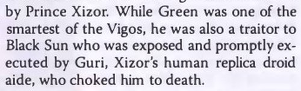

## p.367 (scan page 382)

Page contents: 1267 words, 32 paragraphs | headings/entries: Green Forge; Greenies; Green Watch; Green Wing; Green Wizard; Grees; Greeve; Greglik; Grejj; Grekk 9; Grendahi

- **Palpatine (Darth Sidious)**: "Green Leader (2) An X-wing fighter pilot, he was killed during the defense of Mon Calamari against Emperor Palpatine's World Devastators." Source: The Complete Star Wars Encyclopedia, Vol. I, p.367
  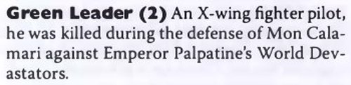
- **Boba Fett**: "Like Lieutenant Byrga, Grejj was killed when Boba Fett came to the planet to recover Rivo Xarran." Source: The Complete Star Wars Encyclopedia, Vol. I, p.367
  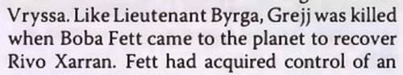

## p.368 (scan page 383)

Page contents: 1124 words, 36 paragraphs | headings/entries: Grendaju; Grendel; Grendu; Greni; Grenn, Dol; Grenna Base; Grey Damsel; Grentho; Grenwick; Greymark; Greyshade, Simon

- **Admiral Ackbar**: "A member of the Navy of the Galactic Alliance aboard the Admiral Ackbar as part of the starfighter command team, she acted under the orders of General Nek Bwua'tu during the blockade of the Murgo Choke about a year after the Qoribu crisis." Source: The Complete Star Wars Encyclopedia, Vol. I, p.368
  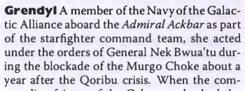
- **Kyle Katarn**: "Grentho was killed on Nar Shaddaa when 8t88 tried to eliminate Kyle Katarn." Source: The Complete Star Wars Encyclopedia, Vol. I, p.368
  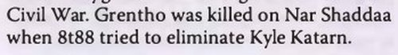

## p.369 (scan page 384)

Page contents: 997 words, 16 paragraphs | headings/entries: Grey Wolf; G'rho; Griann; Gribbet

- **Leia Organa Solo**: "Greyshade allowed Leia to leave, then killed Strom with a proton grenade before the Imperial officer could shoot him." Source: The Complete Star Wars Encyclopedia, Vol. I, p.369
  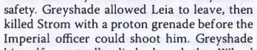
- **General Grievous**: "Grievous was a master strategist and weapons master and was one of a handful of beings who were known to have killed multiple Jedi Knights." Source: The Complete Star Wars Encyclopedia, Vol. I, p.369
  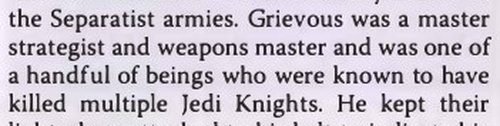
- **Count Dooku; General Grievous**: "Only the use of Force lightning by Count Dooku kept his heart beating, and Grievous was nursed back to health." Source: The Complete Star Wars Encyclopedia, Vol. I, p.369
  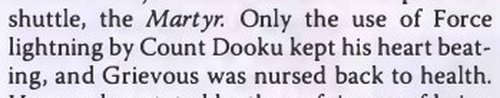
- **Count Dooku; General Grievous**: "Dooku himself was surprised when Grievous proved to be a student who surpassed other apprentices after mere weeks of training." Source: The Complete Star Wars Encyclopedia, Vol. I, p.369
  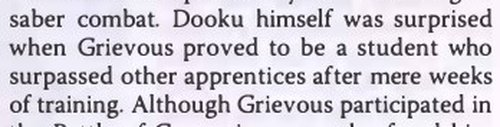
- **General Grievous**: "Although Grievous participated in the Battle of Geonosis, none who faced him survived to warn the Republic." Source: The Complete Star Wars Encyclopedia, Vol. I, p.369
  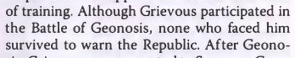

## p.370 (scan page 385)

Page contents: 752 words, 31 paragraphs | headings/entries: Griff, Amise; Griggs, Kane; Grigmin; Grigor; Gril, Pelina; Grimorg; Grimraker, Arns; Grimtaash; Grinner; Grinning Liar

- **General Grievous**: "With a volley of well-placed blaster shots, the Jedi Master was able to destroy Grievous and put an end to his reign of terror." Source: The Complete Star Wars Encyclopedia, Vol. I, p.370
  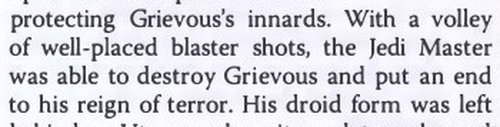
- **Darth Vader (Anakin Skywalker)**: "Griff, Amise A fleet admiral, he supervised construction of Darth Vader's Super-class Star Destroyer Executor." Source: The Complete Star Wars Encyclopedia, Vol. I, p.370
  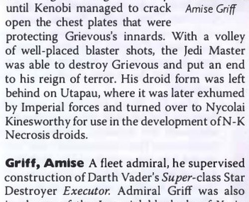
- **Han Solo; Chewbacca**: "He hired Han Solo and Chewbacca for a brief time before the pair became involved in the Galactic Civil War—but not before Solo upstaged and outclassed his boss during one last airshow." Source: The Complete Star Wars Encyclopedia, Vol. I, p.370
  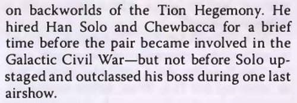

## p.371 (scan page 386)

Page contents: 1181 words, 35 paragraphs | headings/entries: Griv; Grizmalit; Grizzid; Grk'kkrs'arr; Griubb; Grobber; Grode; Groggin; Gron, Rolanda; Groshik; Groshim; Ground Base Seven; Grove, the; Growler; Grozbok; Groznik

- **Luke Skywalker**: "Groggin An Ugnaught, he discovered Luke Skywalker's severed hand in smelting core D on Bespin's Cloud City." Source: The Complete Star Wars Encyclopedia, Vol. I, p.371
  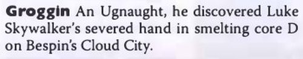
- **Palpatine (Darth Sidious)**: "The Sith could have killed an escaping Groodo and his son, but Darth Sidious decided to let them live in fear instead." Source: The Complete Star Wars Encyclopedia, Vol. I, p.371
  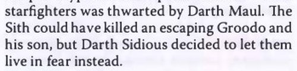

## p.372 (scan page 387)

Page contents: 1244 words, 30 paragraphs | headings/entries: Grrrwahrr; Grub Cave; Grubstake; Grudo; Grugara, Yara; Gruna; Grundakk; Grunger, Josef; Grunts; Grupp; Grynne, Phlygas; Gshkaath; GSi-21D

- **Palpatine (Darth Sidious)**: "Grunger, Josef One of the Imperial Grand Admirals still in power after the death of Emperor Palpatine, he commanded a fleet of 30 Star Destroyers." Source: The Complete Star Wars Encyclopedia, Vol. I, p.372
  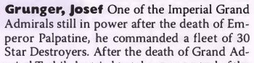

## p.373 (scan page 388)

Page contents: 1133 words, 35 paragraphs | headings/entries: G-station; Gthull, Kvag; Guania; Guanolta; Guanta; Guard; Guardian Corps; Guardian Mantis; Guardians

- **Joruus C'baoth**: "It was believed that the Guardian was killed by Joruus C'baoth when he arrived on Wayland." Source: The Complete Star Wars Encyclopedia, Vol. I, p.373
  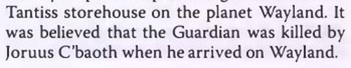

## p.374 (scan page 389)

Page contents: 1059 words, 35 paragraphs | headings/entries: Guardian Squadron; Guardstar; Guarja Shipyards; Guarlara; Gudb; Gueni; Guermessa; Guh'Rantt, Mikdanyell; Guide; Guides, the; Guild; Guldar, Ithoriak; Guldi, Drom; Gulley; Gul-Rah, Thanis; Gumbaeki; Gundar

- **General Grievous**: "Guarlara An Old Republic Venator-class Star Destroyer, it was one of many vessels that tried unsuccessfully to eliminate General Grievous's [Invisible Hand at the beginning of the Clone Wars." Source: The Complete Star Wars Encyclopedia, Vol. I, p.374
  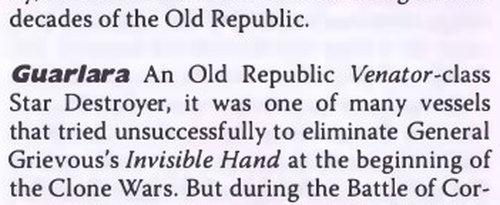
- **Darth Vader (Anakin Skywalker)**: "Guild of Vindicators A brotherhood of assassins, it tried to destroy Darth Vader during the Galactic Civil War." Source: The Complete Star Wars Encyclopedia, Vol. I, p.374
  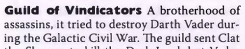

## p.375 (scan page 390)

Page contents: 910 words, 29 paragraphs | headings/entries: Gundy; Gungan

## p.376 (scan page 391)

Page contents: 921 words, 24 paragraphs | headings/entries: Gungan Grand Army; Gungis X Weapons; Guntar

## p.377 (scan page 392)

Page contents: 998 words, 25 paragraphs | headings/entries: Guo, Mars; Guri; Guris; Gurke

- **IG-88**: "IG-88 instilled his sentient programming in his equally deadly counterparts, killed the technicians who created him, and escaped to stage a galactic takeover." Source: The Complete Star Wars Encyclopedia, Vol. I, p.377
  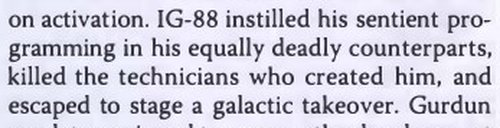
- **Guri; Prince Xizor** — entry/section: Guri: "She quickly became Xizor's top lieutenant, enforcing the crime lord's wishes and maintaining the dayto-day continuity of his enterprises...as she killed again and again." Source: The Complete Star Wars Encyclopedia, Vol. I, p.377
  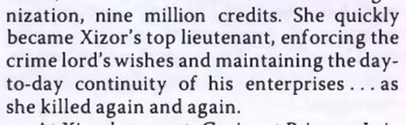
- **Guri; Luke Skywalker** — entry/section: Guri: "Luke agreed and overpowered Guri through the Force." Source: The Complete Star Wars Encyclopedia, Vol. I, p.377
  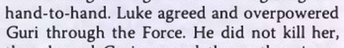
- **Guri; Darth Vader (Anakin Skywalker)** — entry/section: Guri: "He was killed over Coruscant when Darth Vader's Star Destroyer destroyed his skyhook; it was believed that Guri perished in the same explosion." Source: The Complete Star Wars Encyclopedia, Vol. I, p.377
  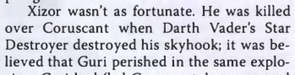

## p.378 (scan page 393)

Page contents: 870 words, 25 paragraphs | headings/entries: Gurtt, Tyresi; Gus Talon; Gus Treta; Guta-Nay; Guz, Brakko; Gwann; G'wenee; Gwig; G-wing; Gwori Revolutionary Industries; Gyad, Athadar; Gymsnor-3; Gyndine

- **Corran Horn**: "For her tactics in defeating the Harmzuay—which she acknowledged were really those of Rogue Squadron Jedi Corran Horn—she was promoted to True Invid and served aboard the Star Destroyer Jnvidious, which was controlled by Moff Leonia Tavira." Source: The Complete Star Wars Encyclopedia, Vol. I, p.378
  

## p.379 (scan page 394)

Page contents: 347 words, 11 paragraphs | headings/entries: Gysk; Gyuel; Gzin

- **Luke Skywalker**: "Luke Skywalker and the new Jedi Order used the planet as arendezvous point on their mission to destroy Centerpoint Station and rescue Allana, the daughter of the Hapan Queen Mother Tenel Ka." Source: The Complete Star Wars Encyclopedia, Vol. I, p.379
  

## p.380 (scan page 395)

Page contents: 3 words, 2 paragraphs | headings/entries: 

## p.381 (scan page 396)

Page contents: 8 words, 2 paragraphs | headings/entries: 

## p.382 (scan page 397)

Page contents: 0 words, 0 paragraphs | headings/entries: 

## p.383 (scan page 398)

Page contents: 0 words, 0 paragraphs | headings/entries: 

