# Owner Material 031 — The Complete Star Wars Encyclopedia, Vol. II (H–O): scan pages 1–40

- **Source:** *The Complete Star Wars Encyclopedia* by Stephen J. Sansweet and Pablo Hidalgo, with Bob Vitas, Daniel Wallace, Chris Cassidy, Mary Franklin and Josh Kushins (Del Rey, 2008), 3 vols. Secondary source (licensed Legends reference). Scan OCR'd on the box; the scan stays box-only and is **not** published.
- **Method:** every scanned page was OCR'd and machine-screened sentence by sentence for power-relevant statements (fights, kills, defeats, Force feats, rankings, superweapons) that name a character on our roster; each kept sentence is quoted verbatim from the OCR text and has a crop of the printed passage directly under it. Pages with nothing power-relevant are still listed with what is on them.
- **Citation:** "The Complete Star Wars Encyclopedia, Vol. II, p.X" by printed page ("scan p.X" where no printed number applies). **Weight:** Lucasfilm-licensed encyclopedia: a secondary, in-universe summary of Legends (and some film) material. It sums up feats from novels, comics and games; where the original story is in our notes, that source is the stronger citation.

## scan p.1 (scan page 1)

Page contents: 13 words, 4 paragraphs | headings/entries: 

## scan p.2 (scan page 2)

Page contents: 5 words, 3 paragraphs | headings/entries: 

## scan p.3 (scan page 3)

Page contents: 0 words, 0 paragraphs | headings/entries: 

## scan p.4 (scan page 4)

Page contents: 27 words, 6 paragraphs | headings/entries: 

## scan p.5 (scan page 5)

Page contents: 84 words, 8 paragraphs | headings/entries: 

## scan p.6 (scan page 6)

Page contents: 7 words, 2 paragraphs | headings/entries: 

## p.1 (scan page 7)

Page contents: 4 words, 3 paragraphs | headings/entries: 

## p.2 (scan page 8)

Page contents: 0 words, 0 paragraphs | headings/entries: 

## p.3 (scan page 9)

Page contents: 900 words, 33 paragraphs | headings/entries: H-10; H-12 Copter; HI.5; H2-1; H-3P0O; H-3POB.; H4; H449-B7; H4-5D; H4b; H-60 Tempest; H9; H-90; H-9PO; Ha, Kina; Haako, Rune

- **Jaina Solo; Jacen Solo (Darth Caedus)**: "Trooper H449-B7 was killed when Jaina Solo infiltrated the Nickel One facilities during her search for her brother Jacen, who had become Darth Caedus." Source: The Complete Star Wars Encyclopedia, Vol. II, p.3
  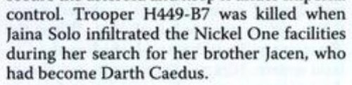

## p.4 (scan page 10)

Page contents: 1066 words, 26 paragraphs | headings/entries: Ha'andeelay, Rych; Haariden; Haariden, Darra; H'aas, Nab; Haas, Veneziano; Haashimut; Haash'n, Major; Haathi, T'Charek; Haazen

- **Palpatine (Darth Sidious); Darth Vader (Anakin Skywalker)**: "Haako was killed by Darth Sidious's new apprentice, Darth Vader, when the Sith Lords no longer had any need for their Separatist conspirators." Source: The Complete Star Wars Encyclopedia, Vol. II, p.4
  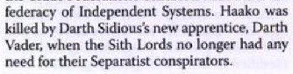
- **Lucien Draay**: "The attack on the Courageous at Serroco gave Lucien hope that Carrick had been killed or taken prisoner." Source: The Complete Star Wars Encyclopedia, Vol. II, p.4
  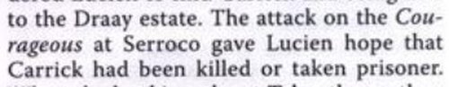

## p.5 (scan page 11)

Page contents: 1156 words, 31 paragraphs | headings/entries: Habassa If; Habat, Chodo; Habble, Mett; Hab Camber; Habeen; Habuur, Ailyn; Hachete; Hack, Turland; Hadiress Defense Systems, Limited; Hadocrassk; Hadrassi Emergency Medical Systems Technologies; Haduran, Captain

- **Darth Maul**: "Hachete The Duelist Elite droid that Darth Maul once trained against, it got its name because it was armed with a pair of hachete blades." Source: The Complete Star Wars Encyclopedia, Vol. II, p.5
  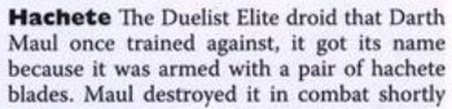
- **Darth Maul**: "Maul destroyed it in combat shortly before he was ordered to hunt down Hath Monchar." Source: The Complete Star Wars Encyclopedia, Vol. II, p.5
  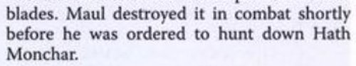
- **Palpatine (Darth Sidious)**: "After Poggle managed to win his own way out of the gladiator arena, he received the backing of Darth Sidious and eventually was able to defeat Hadiss." Source: The Complete Star Wars Encyclopedia, Vol. II, p.5
  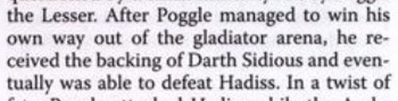

## p.6 (scan page 12)

Page contents: 994 words, 26 paragraphs | headings/entries: HAET-221; Haffrin; Haggleday; Hahrynyar; Hai, Korkeal; Hai, Resta Shug; Haik Expedition; Hailbrock, Jan; Hailey, Serra; Haime, Josek

## p.7 (scan page 13)

Page contents: 1208 words, 28 paragraphs | headings/entries: Haj; Hajial Chase; Hajj; Hak, Raad; Hakartha Station; Hakassi; Hakin; Hakoon, Schnil; Haku; Hal, Garthus; Hal, Leor; Hal, Tanis; Hala; Halabar; Halanit; Halbara

## p.8 (scan page 14)

Page contents: 1137 words, 33 paragraphs | headings/entries: Halbard; Halbeet, Jujiran; Halbegardia; Halbret; Halcyon; Halcyon, Nejaa; Halcyon, Scerra; Halcyon, Valin; Haldeen; Haleoda; Hale Return; Haley, Kylaena

## p.9 (scan page 15)

Page contents: 1016 words, 21 paragraphs | headings/entries: Half-Axe Pass; Halfback's Bluff; Halli; Halion, Rana; Halkans, Minister; Hall, Captain; Halla; Halle; Halleck

- **Darth Vader (Anakin Skywalker); Luke Skywalker**: "Once they located it and defeated Darth Vader, Halla admitted that she was a charlatan and gave the crystal to Luke." Source: The Complete Star Wars Encyclopedia, Vol. II, p.9
  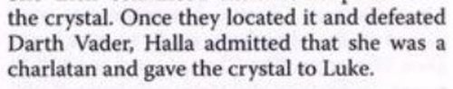

## p.10 (scan page 16)

Page contents: 1215 words, 41 paragraphs | headings/entries: Halley; Halleycraft; Halliikeenovich, S6n; Vong War.; Hallomar; Halirin IV

## p.11 (scan page 17)

Page contents: 1259 words, 37 paragraphs | headings/entries: Halim; Halmadé; Halmad Prime; Halmere; Halno'an; Halowan; Halpat; Halsek, Gilad; Halvala, Bethelia; Hamachil, Shaki; Hamadryas; Hamaical, Davar; Hamame, Vol; Haman, Gerta; Hamar-Chaktak; Hamaz; Hamelin; Hamiroz, Zaz; Hammax, Bijo

## p.12 (scan page 18)

Page contents: 1123 words, 27 paragraphs | headings/entries: Hammer Group; Hammerhead; Hammerhead; Hammer Squadron; Hammertong Project; Hammertree; Hamner, Kenth; Hamner Heavy Ores; Hamnet; Hampton; Hamud, Osaf; Hanadi, Cheriss ke; Hanare, Ronar; Hanchin

## p.13 (scan page 19)

Page contents: 1062 words, 27 paragraphs | headings/entries: Hanco; Hand, Pyr; Handa; Handmaiden Sisters; Handooine; Hand Pot, the; Handree; Hangar Hunters; Hanging Gardens

- **Obi-Wan Kenobi; Darth Vader (Anakin Skywalker)**: "Hanco and others helped Kenobi and Anakin Skywalker locate and destroy the last Separatist crawl-carrier before it could eliminate a village." Source: The Complete Star Wars Encyclopedia, Vol. II, p.13
  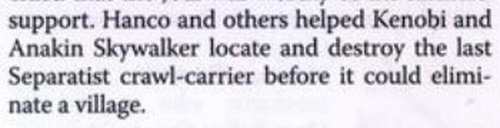

## p.14 (scan page 20)

Page contents: 968 words, 25 paragraphs | headings/entries: Hanging Moss Village; Hanging Valley; Hanharr; Hanna City; Hannad, Kile; Hannser, Captain; Hanofar; Ha'Nook, Jannie; Hanoon; Hans, Geordi; Hansel; Hansen FeatherTouch; Hansh; Hanson Mining Consolidated

- **Palpatine (Darth Sidious)**: "Hannad, Kile One of Emperor Palpatine's Royal Imperial Guards, he was among the few who survived the death of Palpatine's clones on Byss." Source: The Complete Star Wars Encyclopedia, Vol. II, p.14
  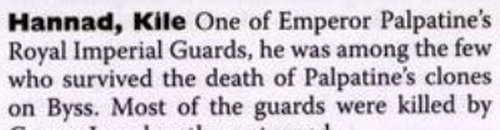
- **Carnor Jax**: "Most of the guards were killed by Carnor Jax when they returned to Yinchorr." Source: The Complete Star Wars Encyclopedia, Vol. II, p.14
  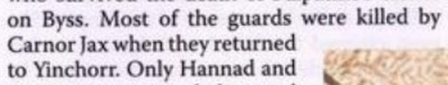
- **Jax Pavan; Kir Kanos**: "Hannad held off Jax's troops long enough for Kanos to escape, but eventually was overwhelmed and killed." Source: The Complete Star Wars Encyclopedia, Vol. II, p.14
  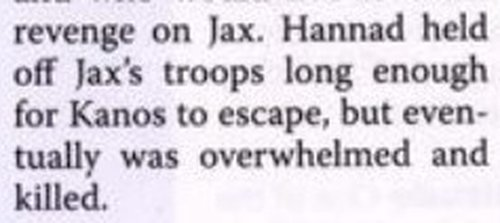
- **Palpatine (Darth Sidious)**: "It was said to be where Echuu Shen-Jon destroyed the Vor'Na'Tu sometime after the rise of Emperor Palpatine." Source: The Complete Star Wars Encyclopedia, Vol. II, p.14
  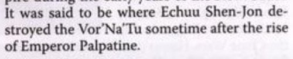
- **Darth Bane**: "But Hansh and a comrade, Lergan, were soon murdered by Darth Bane, who immolated their bodies in Force lightning." Source: The Complete Star Wars Encyclopedia, Vol. II, p.14
  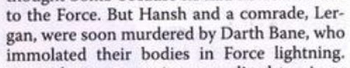

## p.15 (scan page 21)

Page contents: 1178 words, 37 paragraphs | headings/entries: Hansor, Madrix; Hantaq, Dab; Hante; Hanther, Tinian; Hanto Mountains; Hanugar; Hanx-Wargel; Haor Chall; Hapan; Hapan Consortium; Hapan Home Fleet

- **Jacen Solo (Darth Caedus); Luke Skywalker**: "Thanks to support from the Galactic Alliance's navy, the Home Fleet was able to defeat the Heritage Fleet, thereby keeping Tenel Ka on the throne, However, the Hapan Home Fleet was unable to regain much strength before Tenel Ka agreed to turn its control over to Jacen Solo, provided that he make peace with Jedi Grand Master Luke Skywalker." Source: The Complete Star Wars Encyclopedia, Vol. II, p.15
  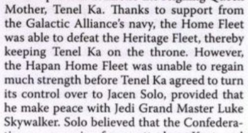

## p.16 (scan page 22)

Page contents: 1190 words, 25 paragraphs | headings/entries: Hapan Royal Guard; Hapan Water Dragon; Hapes Cluster; Hapes Consortium; Hapes Consortium Heritage Council; Hapin, Stano; Happer's Way; Happy

- **Leia Organa Solo**: "But when Leia Organa Solo pleaded with the Consortium for help in combating the Yuuzhan Vong, it took an honor duel between Prince Isolder and Archon Beed Thane to get the necessary support." Source: The Complete Star Wars Encyclopedia, Vol. II, p.16
  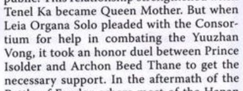

## p.17 (scan page 23)

Page contents: 1060 words, 34 paragraphs | headings/entries: Happy Blasters; Happy Dagger; Happy Failure; Happy Grove; Happy Hutt; Happy Nerf Herder; Happy's Landing Tavern; Happy Spacer; Haque, Mister; Har, Duran; Harak, Vreet; Ha-ran; Harand, Bleys; Harasser; Harazod; Har Binande

- **Darth Vader (Anakin Skywalker)**: "It deployed units during a Clone Wars battle on Alaris, and was destroyed by Anakin Skywalker." Source: The Complete Star Wars Encyclopedia, Vol. II, p.17
  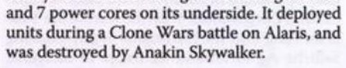

## p.18 (scan page 24)

Page contents: 1115 words, 34 paragraphs | headings/entries: Harbin-re; Harbright, Borert; Harbright, Dees; Harbright, Lady Seinia; Harch, Major; Hardfrost Base; Hard Heart Cantina; Hardly Worth Stealing; Hardon, Den; Hardpoint Squadron; Hardscrabble; Hard Sheil

- **Lord Kaan**: "When Sith Lord Kaan activated a thought bomb, Hardin's life force was drained from his body, but his suffering came to a sudden end when he was struck and killed by a falling stalactite." Source: The Complete Star Wars Encyclopedia, Vol. II, p.18
  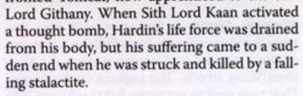

## p.19 (scan page 25)

Page contents: 1265 words, 30 paragraphs | headings/entries: Harix; Hariz; Hardwikk, Radd; Hareel, Dr. Andros; Harkas, Ran; Harf; Hargar; Har Gau; Hargeeva; Harkners-Balix 903; Harkness, Dirk; Harkov, Admiral; Hark'r, Captain; Harkul; Harta; Hartaan; Harlech, Captain

- **Luke Skywalker**: "Luke Skywalker, however, managed to free captured students and defeat Rahz." Source: The Complete Star Wars Encyclopedia, Vol. II, p.19
  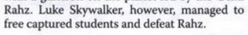
- **Darth Krayt**: "His injuries kept him out of the action when new recruit Anson Trask shot and killed Darth Krayt's personal liaison, Darth Maleval, after the Sith Lord demanded that Lieutenant Gil Cassel execute his own brother to prove his loyalty." Source: The Complete Star Wars Encyclopedia, Vol. II, p.19
  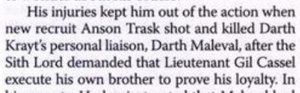
- **Lando Calrissian**: "He was shot and killed when Calrissian tried to escape Drogheda by taking the queen hostage." Source: The Complete Star Wars Encyclopedia, Vol. II, p.19
  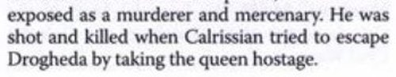

## p.20 (scan page 26)

Page contents: 1236 words, 33 paragraphs | headings/entries: Harlequin Station; Harles, Commander; Harleys, Dibien; Harloen; Harlow, Kend; Harlow, Moff; Harm; Harmae; H'Arman, Erk; Harmion, Halleb, K'yne, and Sarell; Harmon; Harmonia; Harmon Kizzlebrew; Harmony Glade; Harmony Hall; Harmony Lake; Harmzuay; Harn; Harnaidan; Harnik, Gates; Harno

- **Obi-Wan Kenobi**: "During the early stages of the Clone Wars, Obi-Wan Kenobi believed that he had defeated Durge in a tremendous battle outside Harnaidan, only to confront the bounty hunter again." Source: The Complete Star Wars Encyclopedia, Vol. II, p.20
  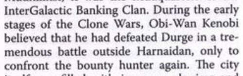

## p.21 (scan page 27)

Page contents: 1083 words, 26 paragraphs | headings/entries: Harns, Ela; Harona, Ijix; Haroot; Harous, Tolum; Harpago; Harpax; Harpori; Harpox; Harpy; Harra; Harrak, Colonel; Harrandarr; Harrandatha; Harrar

- **Darth Krul**: "Harpori A planet in the Mid Rim near the Balowa system, it was the site of a Duros settlement wiped out by Kaox Krul six months before the Battle of Ruusan." Source: The Complete Star Wars Encyclopedia, Vol. II, p.21
  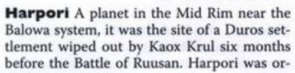
- **Tahiri Veila**: "After Tahiri Veila revealed that it had been Nom Anor who killed Nen Yim, Harrar swore to kill the former executor." Source: The Complete Star Wars Encyclopedia, Vol. II, p.21
  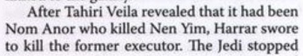

## p.22 (scan page 28)

Page contents: 1344 words, 30 paragraphs | headings/entries: Harravan; Harridan; Harrier; Harrin; Harrin, J. M.; Harrin Trade Corridor; Harris, Thurlow; Harrll; Harrod; Harrow; Harsh, Moff; Harsis; Harson, Moff Crin; Hart, Syndic Pandis

- **Leia Organa Solo**: "Harris and his plans were discovered by Prime Minister Cundertol and Han and Leia Organa Solo after an explosion ripped through the arena where the Keeramak was consecrating the planet." Source: The Complete Star Wars Encyclopedia, Vol. II, p.22
  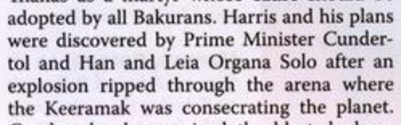
- **Mace Windu**: "In a move of blinding speed, Master Windu brought his weapon around in a wide arc, severing Harrll's head from his shoulders." Source: The Complete Star Wars Encyclopedia, Vol. II, p.22
  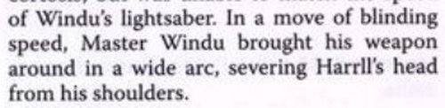

## p.23 (scan page 29)

Page contents: 1184 words, 42 paragraphs | headings/entries: Hartar, Plook; Harthan, Counselor; Harthan, Jake; Harthis, Major; Harthusa; Harthusa's Pride; Hartin; Hartzig; Haruspex; Haruun Kal; Harvest; Harvest Bay; Harvest Ceremony; Harvest Festival; Harvest Flyway; Harvest Moon; Harvest Moon Feast; Harvest-Nine

- **Set Harth**: "When he was forced to battle a stronger Sith magician for possession of the artifact, Set Harth drew additional energy from the dark side, then killed the Sith warrior's elderly servant in anger, after which he decided to become a Sith himself." Source: The Complete Star Wars Encyclopedia, Vol. II, p.23
  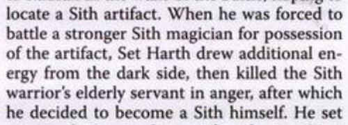

## p.24 (scan page 30)

Page contents: 1226 words, 27 paragraphs | headings/entries: Harvest Season; Harvos; Harza; Hash; HASH-19; Hask; Haskit; Haslam, Lieutenant Koris; Haslip, Dair; Hass, Osi; Hassk, Captain; Hassla'tak

- **Darth Vader (Anakin Skywalker)**: "When Anakin Skywalker arrived on Nelvaan during the Clone Wars, he destroyed the facility and freed the Nelvaanians." Source: The Complete Star Wars Encyclopedia, Vol. II, p.24
  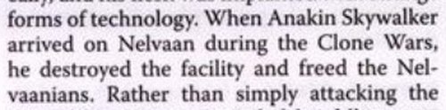

## p.25 (scan page 31)

Page contents: 1184 words, 36 paragraphs | headings/entries: Hasti; Hatabbas; Hatanga, Kortha; Hatch; Hatch; Hatchepants; Hatcher, B'ante; Hatchling; Hate; Hathan, Artzam; Hathrox Wl; Haug, Groff; Hauler 10; Hauler VI; Haumia; Haunted Straits; Hav; Havaal; Havath Minor; Havath Prime

## p.26 (scan page 32)

Page contents: 1187 words, 44 paragraphs | headings/entries: Havel, Matas; Haveland, Moff; Havelon; Haven; Haven; Haven, the; Haven Base; Haven Jace; Haverel, General Larr; Haverling; Havero, Jain; Havighasu, Hatirma; Havoes; Havok; Havor; HAVr AQ; Havricus; Havridam City

## p.27 (scan page 33)

Page contents: 907 words, 36 paragraphs | headings/entries: HAVt BS Juggernaut; HAVw A6 Juggernaut; Hawaka Islands; Hawaz, Major Rin; Hawj; Hawk Squadron; Hawkbat; Hawk-bat, the; Hawkbat Battalion; Hawkbat Gang; Hawk-bat Independent Space Force; Hawkbat's Perch; Hawkbat's Vigil; Hawra, Captain

## p.28 (scan page 34)

Page contents: 976 words, 33 paragraphs | headings/entries: Hawser, Major Liek; Hax, Pollux; Haxan, Serom; Haxim; Haylon, Vinzel; Hayviin, Commander; Hazzard; HB-9; H'broozin, Jook-jook; HBt-4; H'buk; HC-100; HD 5-D; H'drachi; Headache Bar; HeadBanger; Head Clan; Head Hunter

## p.29 (scan page 35)

Page contents: 1345 words, 28 paragraphs | headings/entries: Headon-S; Headows, Asran; Head Proctor; Headquarters, the; Headquarters Frigate; Healing Star; Hearth, Twilit

- **Yoda; Qui-Gon Jinn**: "At the time of the Melida/Daan Crisis, renegade Jedi Xanatos attempted to destroy the Jedi Temple and kill Yoda by stealing the crystals and putting them in the Temple's fusion furnace, but Qui-Gon Jinn was able to locate the crystals before disaster could occur." Source: The Complete Star Wars Encyclopedia, Vol. II, p.29
  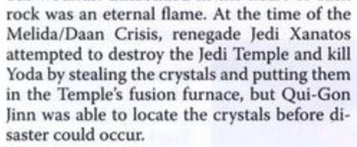

## p.30 (scan page 36)

Page contents: 944 words, 29 paragraphs | headings/entries: Heater; Heathe, Talie; Heavy-95; Heavy Annihilator; Heavy Lightning Rifle; Heavy Missile Platform; Heavy STAP; Heavy Tracker

- **Han Solo; Greedo**: "After Han Solo killed Greedo in the Mos Eisley cantina, Jabba ordered Heater to hire bounty hunters to bring Solo to justice." Source: The Complete Star Wars Encyclopedia, Vol. II, p.30
  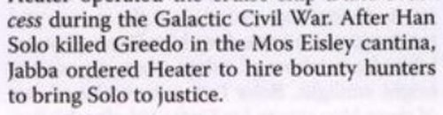

## p.31 (scan page 37)

Page contents: 1171 words, 32 paragraphs | headings/entries: Heavy Weapons Specialists; Hedji; Hebeth; Hebine Ring; Hebsly, Lieutenant; Hedda; Hedron, Mol; Heedon; Heedra, Moff; Heep, Dol; Heer, Noshy; Heff; Heffrin; Hefi; Heg; Hegerty, Soron; Heget, Colonel; Heggel, Admiral

- **Jaxxon**: "When Don- Wan Kihotay tried to defeat the beast in single combat, Hedji and Jaxxon decided to lend their assistance." Source: The Complete Star Wars Encyclopedia, Vol. II, p.31
  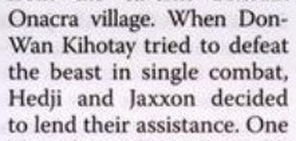

## p.32 (scan page 38)

Page contents: 1189 words, 36 paragraphs | headings/entries: Heiff, Vengnar; Heigren; Hejaran Castle; Hekula; Hela-Tan; Helb; Helisk; Hellcat; Helihoop

## p.33 (scan page 39)

Page contents: 1093 words, 30 paragraphs | headings/entries: Hell's Axe; Hell's Hammers; Heliwell; Helm; Helmet Squad; Heloan Yagen; Helot's Shackle; Helping Hand; Helrossi-principal Octratics; Helrot, Elis; Helska IV; Helthen Company; Helvan; Hemei IV; Hemes Arbora; Hemphawar, Stu; Henchman

## p.34 (scan page 40)

Page contents: 1070 words, 23 paragraphs | headings/entries: Heng, Machar; Hengin Ki-Tapp Wett Gon-far; Hennilrum; Hensworth, Lieutenant; Hentz, Khaleen; Heorem Complex; Heptalia; Herald; Herat; Herd, the

- **Quinlan Vos; Aayla Secura**: "Vos and his fellow Jedi Aayla Secura saved Hentz and killed Zenex." Source: The Complete Star Wars Encyclopedia, Vol. II, p.34
  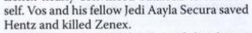
