# Owner Material 031 — The Complete Star Wars Encyclopedia, Vol. II (H–O): scan pages 41–80

- **Source:** *The Complete Star Wars Encyclopedia* by Stephen J. Sansweet and Pablo Hidalgo, with Bob Vitas, Daniel Wallace, Chris Cassidy, Mary Franklin and Josh Kushins (Del Rey, 2008), 3 vols. Secondary source (licensed Legends reference). Scan OCR'd on the box; the scan stays box-only and is **not** published.
- **Method:** every scanned page was OCR'd and machine-screened sentence by sentence for power-relevant statements (fights, kills, defeats, Force feats, rankings, superweapons) that name a character on our roster; each kept sentence is quoted verbatim from the OCR text and has a crop of the printed passage directly under it. Pages with nothing power-relevant are still listed with what is on them.
- **Citation:** "The Complete Star Wars Encyclopedia, Vol. II, p.X" by printed page ("scan p.X" where no printed number applies). **Weight:** Lucasfilm-licensed encyclopedia: a secondary, in-universe summary of Legends (and some film) material. It sums up feats from novels, comics and games; where the original story is in our notes, that source is the stronger citation.

## p.35 (scan page 41)

Page contents: 967 words, 23 paragraphs | headings/entries: Heresiarch; Heresiarchs; Hereven, Lieutenant; Heriston; Heritage Fleet; Heritage Squad; Herm, Qual'Do; Her Majesty's Commandos

- **Palpatine (Darth Sidious)**: "Heresiarch A Sovereign-class Star Destroyer, it was under construction when Emperor Palpatine's clone reemerged on Byss several years after the Battle of Endor." Source: The Complete Star Wars Encyclopedia, Vol. II, p.35
  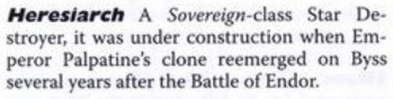

## p.36 (scan page 42)

Page contents: 1019 words, 31 paragraphs | headings/entries: Her Maternelience; Hermes; Hermos; Hern; Heroe's Slayer; Hero's Cross; Herr, Druuven; Herriar; Herzob; Hesoc; Hesperidium

## p.37 (scan page 43)

Page contents: 1059 words, 27 paragraphs | headings/entries: Hessler, Evan; Hestiv, General; HE-suit; Hesz, Tal; Het, Doton; Heth, Morturr; Hethar; Hethrir, Lord; Hetsime, Nala; Hett, A'Sharad

- **Meetra Surik**: "He won possession of the Twi'lek female Ramana from her boyfriend, Harra, and then later lost her to the Jedi Exile." Source: The Complete Star Wars Encyclopedia, Vol. II, p.37
  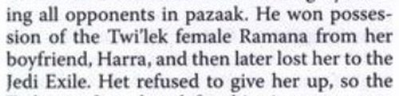
- **Meetra Surik**: "Het refused to give her up, so the Exile was forced to defeat him in one-on-one combat to secure Ramana's freedom." Source: The Complete Star Wars Encyclopedia, Vol. II, p.37
  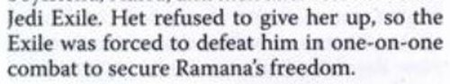

## p.38 (scan page 44)

Page contents: 1112 words, 24 paragraphs | headings/entries: Hett, Sharad; Hetton; Heurkea; Hev'sin; Hewat; Hewex, Major; Hexagon, the; Hextrophon, Arhul; Hexum'Baz

- **Darth Krayt** — entry/section: Hett, A'Sharad: "He honored her memory by completing the mission, allowing the Republic to retake Saleucami and destroy the Separatist cloning facilities beneath the planet's surface." Source: The Complete Star Wars Encyclopedia, Vol. II, p.38
  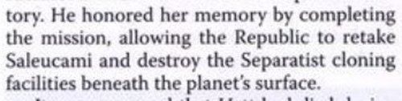
- **Darth Krayt** — entry/section: Hett, A'Sharad: "Following the guidance found in an ancient Sith Holocron, he eventually gave himself over to the power of the dark side, and became the Dark Lord known as Darth Krayt, a name honoring one of Tatooine's most formidable predators." Source: The Complete Star Wars Encyclopedia, Vol. II, p.38
  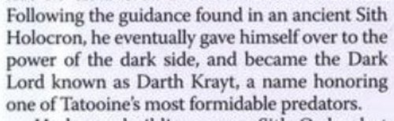
- **Belia Darzu; Darth Bane**: "He explained that he knew of Belia Darzu's fortress on Tython, and that he could show her skills that would help her defeat Darth Bane." Source: The Complete Star Wars Encyclopedia, Vol. II, p.38
  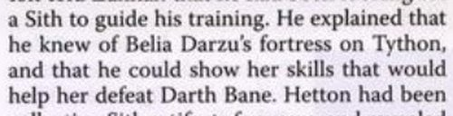
- **Darth Bane**: "They journeyed to Ambria, ostensibly to defeat Darth Bane, but the Sith Lord proved to be much stronger than Hetton had anticipated." Source: The Complete Star Wars Encyclopedia, Vol. II, p.38
  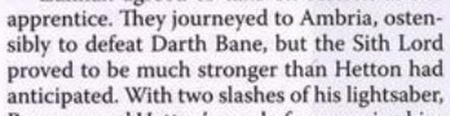

## p.39 (scan page 45)

Page contents: 1017 words, 41 paragraphs | headings/entries: Hezzoran, Lord; HG-21 1; HH-15; HH-4; Hhen; Hida, Nar; Hidden Beks; Hidden Daggers; Hidden Leader; Hidden Temple; Hierogryph, Marn

## p.40 (scan page 46)

Page contents: 1197 words, 40 paragraphs | headings/entries: Hi-fex; Hifron, Shiaer; Hig; Higgs; High Audience Chamber; High Cabinet; High Canir; High Chew; High Chunah; High Command; High Coordinator; High Coruscanti; High Council; High Festival; High Flight Beta Squadron; High Flight Squadron; High Galactic; HighGround RockyPiain TwentyKilometer Left; High Haven; High Hermit

## p.41 (scan page 47)

Page contents: 798 words, 28 paragraphs | headings/entries: High Hermit High Inquisitor; High Jedi General; Highland Green Washeteria; High Marshals; High Moff; Highport; High Prophet; High Protector; Highrolier; High Tongue; Hightower, Lieutenant Barlon; High Tower Boardroom; Hightower Conglomerate; High-Yield Universal Institutional Savings Account; Higron, Rodin; Hiicrop, Satnik

- **Jango Fett; Boba Fett**: "Jango Fett established one for his son Boba before he was killed on Geonosis." Source: The Complete Star Wars Encyclopedia, Vol. II, p.41
  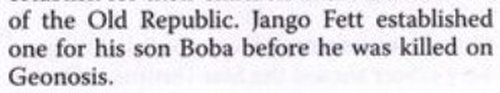

## p.42 (scan page 48)

Page contents: 1012 words, 26 paragraphs | headings/entries: Hiironi; Hiitian; Hija, Lieutenant; Hijarna; Hijoian Docks; Hikahi; Hikil; Hill, San; Hi'tlani, Toma; Hilly; Hilo; Hilse, Chad; Himar

- **Leia Organa Solo**: "Hija, Lieutenant The Imperial chief gunnery officer aboard the Star Destroyer Devastator, he was at his post when his ship overtook and captured the Tantive /V with Princess Leia Organa aboard." Source: The Complete Star Wars Encyclopedia, Vol. II, p.42
  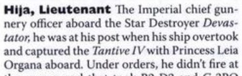

## p.43 (scan page 49)

Page contents: 942 words, 23 paragraphs | headings/entries: Himner; Himron, Major Molo; Hin; Hindred; Hinen; Hing, Tolan; Hininbirg; Hinter, Yarr; Hinthra; Hintivan Wl; Hirf, Qlaern; Hirken, Viceprex Mirkovig; Hirog; Hiromi; Hiroth Besh; Hirrtu

## p.44 (scan page 50)

Page contents: 1097 words, 29 paragraphs | headings/entries: Hirsi; Hirsoot; Hirth; His Celestial Highness; Hise, Gab'borah; Hise, Ygabba; His Glory; Hishyim; Hissal; Historical Battle Site Preservation Act; Historical Council; Hitak Harriers

## p.45 (scan page 51)

Page contents: 1173 words, 28 paragraphs | headings/entries: Hive Ball; Hive Mother; Hija, Astrinol; Hijaff; HK- 130; HK-24; HK-50

- **HK-47**: "During the Battle of Malachor, HK-47 rallied a group of HK-50 assassin droids to fight back and defeat GO-TO." Source: The Complete Star Wars Encyclopedia, Vol. II, p.45
  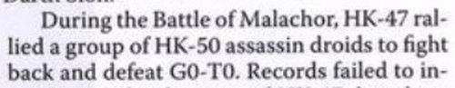

## p.46 (scan page 52)

Page contents: 965 words, 33 paragraphs | headings/entries: HK-77; Hkaeli; H'ken; H'kig; H'kig, the; HL-38; HL-444; HLAF-500; H'Lokk Consortium; HM-3

## p.47 (scan page 53)

Page contents: 1070 words, 27 paragraphs | headings/entries: Hnsi; HN-TRI; Hoar; Hoba, Daragi; Hoban; Hobat, Chandra; Hobbie; Hoberd, Nast; Hobiv, Dasken; Hobor; Hobyo

## p.48 (scan page 54)

Page contents: 1184 words, 39 paragraphs | headings/entries: Hocce; Hocekureem Sea; Hockaleg; Hoclaw, Captain; Hoctu, Drevveka; Hodge; Hodidiji; Ho'Din; Hodizwen, Bashinan; Hodo; Hodrix; Hoff; Hoff, Colby; Hoggon

## p.49 (scan page 55)

Page contents: 1086 words, 29 paragraphs | headings/entries: Hogra, Jamoh; Hoguss; Hoil; Hok; Hokan, Ghez; Hoke; Hokken, Dovish; Hokker; Holageus; Holda, Greeta; Holdan; Holdfast, Clegg; Holdout Flightknife

- **Sylvar**: "Hoggon believed that he would be venerated by the Jedi for killing Qel- Droma, and was surprised when Sylvar nearly killed him." Source: The Complete Star Wars Encyclopedia, Vol. II, p.49
  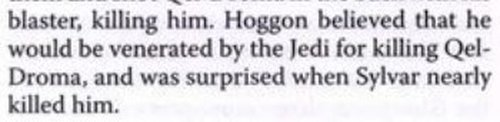

## p.50 (scan page 56)

Page contents: 939 words, 33 paragraphs | headings/entries: Hole In; Holgurn; Holiday Tower's; Hollast VIl; Hollieck, Grandon; Hollis, Lutin; Hollis, Sergeant Reyé; Holiow Mountains; Holiowtown; Holman, Deke

## p.51 (scan page 57)

Page contents: 1065 words, 36 paragraphs | headings/entries: Holo-Gaftikar Channel Ten; Hologlide Cam Droid

## p.52 (scan page 58)

Page contents: 819 words, 25 paragraphs | headings/entries: Hologram Fun World; HoloNet; HoloNet Entertainment; HoloNet Free Republic

## p.53 (scan page 59)

Page contents: 836 words, 40 paragraphs | headings/entries: Holorepository; Holowan, Hurlo; Holt, Admiral Arhul; Holwuff

- **Darth Vader (Anakin Skywalker)**: "During the Clone Wars, the Nelvaanians believed that they had finally encountered the holt kazet when Anakin Skywalker arrived on the planet and helped defeat the Separatists who had established a laboratory there." Source: The Complete Star Wars Encyclopedia, Vol. II, p.53
  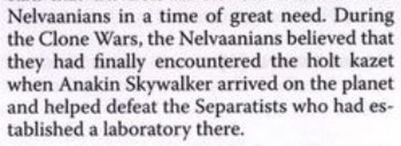

## p.54 (scan page 60)

Page contents: 957 words, 23 paragraphs | headings/entries: Holy Jaf; Homd-Resa; Home; Home Defense Strike Force; Home Fleet; Home; Home; Home Planet Mine; Home Planet Party; Homestar; Homestone; Homeworld Security Command

## p.55 (scan page 61)

Page contents: 1270 words, 28 paragraphs | headings/entries: Homon; Hon, Degred; Hondi, Panza; Honest Blim; Hong; Honi; Honiten; Honka; Honoghr; Honor; Honoran, Wren; Honorary Elder; Honor Clan; Hontho

- **Kyle Katarn**: "Hontho and his companions were killed by Kyle Katarn in his effort to capture 8t88." Source: The Complete Star Wars Encyclopedia, Vol. II, p.55
  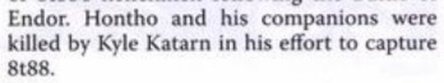

## p.56 (scan page 62)

Page contents: 1042 words, 24 paragraphs | headings/entries: Hoob, Mian; Hood, Willrow; Hoodish; Hoogra-D'En, Ort; Hoojib; Hool; Mammon Hoole Hool, Ch'Gang

## p.57 (scan page 63)

Page contents: 952 words, 37 paragraphs | headings/entries: Hope; Hooly; Hoom; Horansi; Hoona; Hoonta; Hoopster's Prank; Hoorrkhukk; Hoppawui; Hoover; Horak-mul

## p.58 (scan page 64)

Page contents: 1110 words, 23 paragraphs | headings/entries: Horch; Hord, Tulak; Hordon Cal; Horm, Threkin; Horme, Treva; Horn, Corran

- **Grand Admiral Thrawn; Palpatine (Darth Sidious)**: "Horn and Rogue Squadron spent time battling Grand Admiral Thrawn and the reborn Emperor Palpatine's forces at Coruscant; the home that he and Mirax built was one of the first victims of the falling Star Destroyer Liberator." Source: The Complete Star Wars Encyclopedia, Vol. II, p.58
  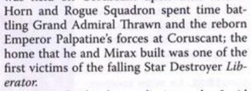
- **Corran Horn; Exar Kun** — entry/section: Horn, Corran: "He helped defeat the menace of Exar Kun's evil spirit, but in the final battle he suffered injuries that required extensive bacta treatments." Source: The Complete Star Wars Encyclopedia, Vol. II, p.58
  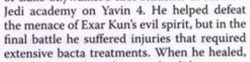
- **Luke Skywalker; Exar Kun**: "Luke did allow him one parting gesture: Horn destroyed Exar Kun's statue and temple on Yavin 4 with a volley of proton torpedoes, forever eliminating the focal point of Sith energy on the moon." Source: The Complete Star Wars Encyclopedia, Vol. II, p.58
  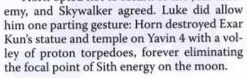

## p.59 (scan page 65)

Page contents: 1296 words, 21 paragraphs | headings/entries: Horn, Jyselila; Horn, Mirax Terrik; Horn, Valin

- **Corran Horn** — entry/section: Horn, Corran: "Horn eventually confronted Shedao Shai, and they agreed to a duel: Corran fighting for Ithor, and Shedao Shai for the remains of Mongei Shai." Source: The Complete Star Wars Encyclopedia, Vol. II, p.59
  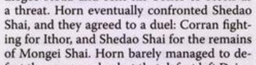
- **Jaina Solo; Jacen Solo (Darth Caedus)**: "Horn was there at the end, after Jaina Solo killed Caedus, and he helped lead 50 Jedi aboard the Super Star Destroyer Megador to dictate peace terms to the Moff Council on the ship." Source: The Complete Star Wars Encyclopedia, Vol. II, p.59
  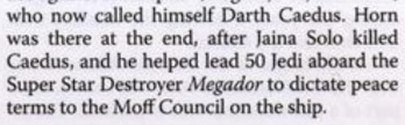
- **Palpatine (Darth Sidious)**: "After his father, the Jedi Master Nejaa Halcyon, was killed in the Clone Wars, Rostek Horn married Nejaa's widow and erased all information on the Halcyon family to hide the family from Emperor Palpatine." Source: The Complete Star Wars Encyclopedia, Vol. II, p.59
  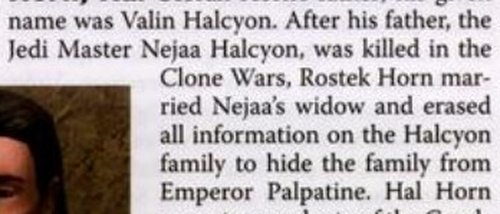

## p.60 (scan page 66)

Page contents: 1215 words, 38 paragraphs | headings/entries: Hornclaw; Hornet; Horob; Horodi; Horororibb; Horse; Horsea; Horska; Horst, Major; Hort, Moff; Horticar; Horvik

- **Kyle Katarn**: "Valin recovered just as Solo drove his lightsaber into Master Katarn's chest, and he rushed Solo alongside Kolir Hu'lya and Thann Mithric, However, the three Jedi were no match for Solo's control of the dark side of the Force." Source: The Complete Star Wars Encyclopedia, Vol. II, p.60
  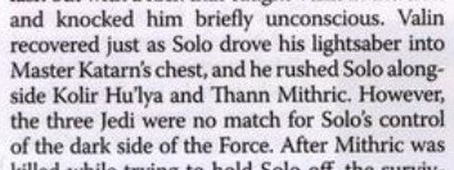
- **Kyp Durron**: "After a brief respite at a temporary Jedi base on the Forest Moon of Endor, Valin accompanied Kyp Durron on the successful mission to infiltrate and destroy Centerpoint Station." Source: The Complete Star Wars Encyclopedia, Vol. II, p.60
  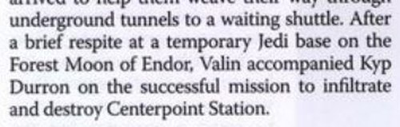

## p.61 (scan page 67)

Page contents: 1223 words, 30 paragraphs | headings/entries: Horvus; Hosk; Hosk Station; Hosrel XI; Hoszh_ Iszhir; Hotel Grand; Hoth, Lord; Hoth

- **Lord Kaan**: "Hoth, Lord This Jedi Master was the leader of the Army of Light, sent to Ruusan to defeat Lord Kaan and the Brotherhood of Darkness a thousand years before the Galactic Civil War." Source: The Complete Star Wars Encyclopedia, Vol. II, p.61
  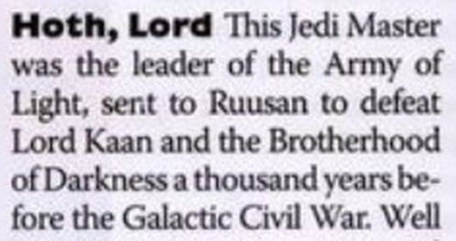
- **Lord Hoth**: "Well known as a master strategist and motivator, Lord Hoth had managed to defeat Sith opponents several times before his assignment on Ruusan, always seeming to score lastminute victories against all odds." Source: The Complete Star Wars Encyclopedia, Vol. II, p.61
  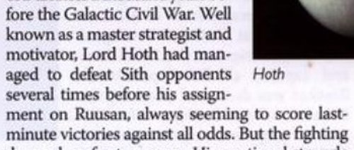
- **Darth Bane; Valenthyne Farfalla**: "In a strange twist of fate, when Darth Bane set in motion his own plans to destroy the Brotherhood of Darkness, Farfalla was able to break through the blockade and land his reinforcements, and the combined Jedi forces began to turn the tide." Source: The Complete Star Wars Encyclopedia, Vol. II, p.61
  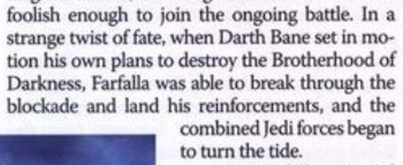
- **Darth Vader (Anakin Skywalker)**: "Echo Base eventually was discovered by an Imperial probe droid, leading to the defeat of the Rebels by Darth Vader's forces in the Battle of Hoth." Source: The Complete Star Wars Encyclopedia, Vol. II, p.61
  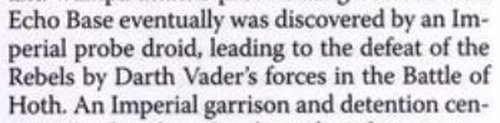
- **Luke Skywalker**: "Luke Skywalker and Callista, who happened to be on the planet, attempted to rescue the hunters, but the entire expedition was killed by the ice creatures, and Skywalker and Callista barely escaped with their lives." Source: The Complete Star Wars Encyclopedia, Vol. II, p.61
  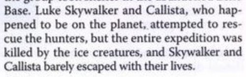

## p.62 (scan page 68)

Page contents: 1058 words, 20 paragraphs | headings/entries: Hoth, Battle of; Hoth's Brand; Hotise, Commander; Houche

## p.63 (scan page 69)

Page contents: 1158 words, 36 paragraphs | headings/entries: Houk; Houll; Hound's Tooth; House AlGray; House Sizhran; House Vandron; Hovan 99; Hovarb

- **Bossk; Chewbacca; Han Solo**: "Bossk purchased it after the Wookiee Chewbacca and Han Solo destroyed his previous ship on Gandolo IV." Source: The Complete Star Wars Encyclopedia, Vol. II, p.63
  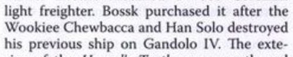
- **Dengar**: "The ship was nearly destroyed in an ambush, but was repaired and used by Dengar and Neelah to draw off Kodir of Kuhlvult's forces." Source: The Complete Star Wars Encyclopedia, Vol. II, p.63
  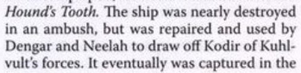

## p.64 (scan page 70)

Page contents: 1112 words, 33 paragraphs | headings/entries: Hovsgol Januul; How, Tey; Howler, Zo; Howlrunner; Howlrunner; Howzmin; Hoxha, Enver; Hoxz, Gumbrak; Hrakness, Choday; Hrannik; Hrasskis; Hronk

## p.65 (scan page 71)

Page contents: 882 words, 25 paragraphs | headings/entries: Hrosha-Gul; H'sishi; H.Tracker 16; Huarr, Ordith; Hub, the; Huba, Captain; Hudorra, Kai; Hudsol, Bob; Hue; Huey

## p.66 (scan page 72)

Page contents: 1154 words, 21 paragraphs | headings/entries: Huhk; Hui, Andoorni; Hujaan, Bolabo; Huk; Hu'lya, Kolir; Human High Culture; Human League; Humbarine

- **Kyle Katarn**: "She was injured when Solo used the Force to deflect a passing speeder into Katarn." Source: The Complete Star Wars Encyclopedia, Vol. II, p.66
  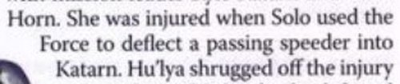
- **Kyle Katarn**: "Hu'lya shrugged off the injury and confronted Solo after he defeated Katarn in a lightsaber duel." Source: The Complete Star Wars Encyclopedia, Vol. II, p.66
  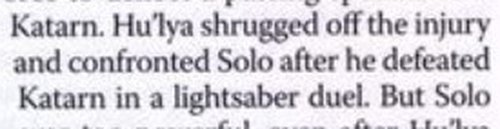

## p.67 (scan page 73)

Page contents: 1112 words, 32 paragraphs | headings/entries: Hume; Hundred-Year Darkness; Huntbird; Hunter; Hunter's Luck; Hunter Squadron; Geonosians.; Hurcha; Hurd's Moon

- **Grand Inquisitor Malorum**: "The settlement was attacked by agents of Malorum, and Hume was among those killed." Source: The Complete Star Wars Encyclopedia, Vol. II, p.67
  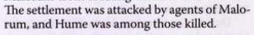
- **Darth Vader (Anakin Skywalker)**: "After Anakin Skywalker carried out a daring plan to rescue the hostages at the Intergalactic Communications Center, Admiral Hupsquoch was ordered to destroy the facility, rendering it useless to the Separatists." Source: The Complete Star Wars Encyclopedia, Vol. II, p.67
  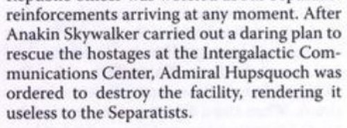

## p.68 (scan page 74)

Page contents: 1125 words, 31 paragraphs | headings/entries: Hurn; Hurst; Hutt Flats

- **Darth Bane**: "After Des was chosen for training as a Sith Lord and adopted the name Darth Bane, he came to realize that it had been his use of the dark side that had killed his father during a particularly bitter argument." Source: The Complete Star Wars Encyclopedia, Vol. II, p.68
  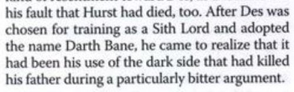

## p.69 (scan page 75)

Page contents: 1089 words, 40 paragraphs | headings/entries: Hutt Haven; Huwla, Xarrce; Huxley, Jerf; Hyabb; Hyb, Mal; Hydian Marauder; Hydian Way; Hydra; Hydra

- **Admiral Daala; Han Solo; Kyp Durron; Qwi Xux; Sun Crusher (superweapon)**: "Hydra One of Admiral Daala's four Star Destroyers protecting the Maw Installation, it was demolished when Han Solo, Kyp Durron, and Qwi Xux escaped the secret facility in the Sun Crusher seven years after the Battle of Endor." Source: The Complete Star Wars Encyclopedia, Vol. II, p.69
  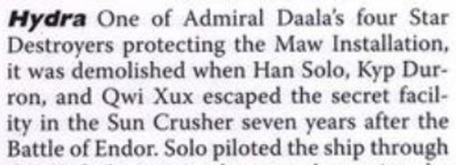

## p.70 (scan page 76)

Page contents: 1067 words, 21 paragraphs | headings/entries: Hyllyard City

## p.71 (scan page 77)

Page contents: 1001 words, 22 paragraphs | headings/entries: Hyperspace; Hyperspace Marauder; Hyperspace Navigator's Guild; Hypori; Hyrotii Engineering; Hyst, Rachalt; Hyx, Daino

- **General Grievous**: "A task force was dispatched to Hypori by the Jedi Council and the Army of the Republic, but much of it was destroyed by General Grievous before it could reach the surface." Source: The Complete Star Wars Encyclopedia, Vol. II, p.71
  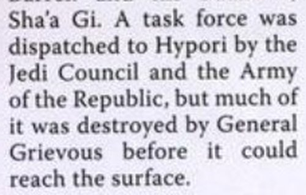

## p.72 (scan page 78)

Page contents: 0 words, 0 paragraphs | headings/entries: 

## p.73 (scan page 79)

Page contents: 761 words, 21 paragraphs | headings/entries: 12-AM3; 12-CG; 12F-5

## p.74 (scan page 80)

Page contents: 968 words, 26 paragraphs | headings/entries: Patt, Tinian; Vatt Armament; IBC; IBC Arcology; Ibegon, Dice; Ibes, Binn; Iibhaan'l; Ibleam

