# Owner Material 031 — The Complete Star Wars Encyclopedia, Vol. II (H–O): scan pages 81–120

- **Source:** *The Complete Star Wars Encyclopedia* by Stephen J. Sansweet and Pablo Hidalgo, with Bob Vitas, Daniel Wallace, Chris Cassidy, Mary Franklin and Josh Kushins (Del Rey, 2008), 3 vols. Secondary source (licensed Legends reference). Scan OCR'd on the box; the scan stays box-only and is **not** published.
- **Method:** every scanned page was OCR'd and machine-screened sentence by sentence for power-relevant statements (fights, kills, defeats, Force feats, rankings, superweapons) that name a character on our roster; each kept sentence is quoted verbatim from the OCR text and has a crop of the printed passage directly under it. Pages with nothing power-relevant are still listed with what is on them.
- **Citation:** "The Complete Star Wars Encyclopedia, Vol. II, p.X" by printed page ("scan p.X" where no printed number applies). **Weight:** Lucasfilm-licensed encyclopedia: a secondary, in-universe summary of Legends (and some film) material. It sums up feats from novels, comics and games; where the original story is in our notes, that source is the stronger citation.

## p.75 (scan page 81)

Page contents: 961 words, 25 paragraphs | headings/entries: Ice Edge Flightknife

## p.76 (scan page 82)

Page contents: 1157 words, 39 paragraphs | headings/entries: Iceman; Ice Station Beta; Ice Storm; Ichtor 8; Icicle, The; ICL; IC-M; 1-D-A; Idan, Belsed-Qan; Idanian, Jenos; Idd, Lonn; Iidellian Arrays

## p.77 (scan page 83)

Page contents: 1260 words, 32 paragraphs | headings/entries: Identifier; Idiot's Array; Iidis; Idyll

## p.78 (scan page 84)

Page contents: 1103 words, 25 paragraphs | headings/entries: IFF Confuser; IFT-T; IF T-X; IG-1

- **General Grievous**: "Grievous demanded that he be given a group of droids capable of defeating a Jedi Knight in combat." Source: The Complete Star Wars Encyclopedia, Vol. II, p.78
  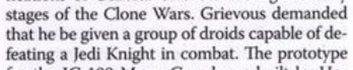

## p.79 (scan page 85)

Page contents: 1093 words, 24 paragraphs | headings/entries: 1G-227; 1G-72; 1G-86

- **General Grievous**: "The Magna- Guards also were given portions of Grievous's own combat programming, making them more than a match for most Jedi Knights." Source: The Complete Star Wars Encyclopedia, Vol. II, p.79
  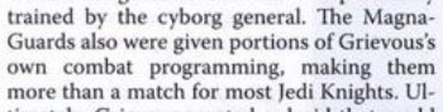
- **Obi-Wan Kenobi**: "Although IG-102 kept on fighting, Kenobi eventually severed all its limbs and reduced it to a worthless pile of scrap." Source: The Complete Star Wars Encyclopedia, Vol. II, p.79
  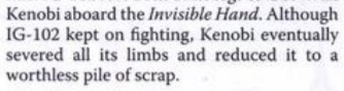
- **General Grievous; Count Dooku**: "1G-138: Destroyed by Grievous during his lightsaber instruction from Count Dooku." Source: The Complete Star Wars Encyclopedia, Vol. II, p.79
  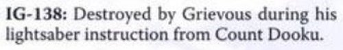
- **IG-88**: "IG-72, along with IG-88 and the other IG series droids, killed 23 members of the Holowan Laboratories staff during an escape." Source: The Complete Star Wars Encyclopedia, Vol. II, p.79
  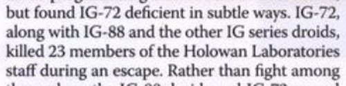
- **Han Solo**: "1G-88B was destroyed on Cloud City trying to intercept Han Solo." Source: The Complete Star Wars Encyclopedia, Vol. II, p.79
  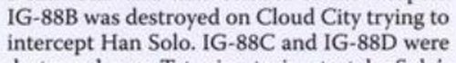

## p.80 (scan page 86)

Page contents: 1009 words, 28 paragraphs | headings/entries: IGBC; 1GO; IGt; Ig'zxyck Flare

## p.81 (scan page 87)

Page contents: 1021 words, 23 paragraphs | headings/entries: Ikas-Adno; Ikie, Bur'n; Ikova, Mia

## p.82 (scan page 88)

Page contents: 1204 words, 25 paragraphs | headings/entries: Ikree; ILC-905; ILF-5000; ILH-KK Cruiser

## p.83 (scan page 89)

Page contents: 1268 words, 44 paragraphs | headings/entries: Mic; Himardon; Wlusion Point

## p.84 (scan page 90)

Page contents: 991 words, 30 paragraphs | headings/entries: Ho, Plourr; Hona Hotel; IM4-099; IM-6; IMAC; Image Designer; Image-Rec Launcher; Imaharatronics; Iman, Senator J'mesk

- **Yoda; Luminara Unduli; Barriss Offee; Padmé Amidala**: "At the height of the Clone Wars, Separatist forces tried to capture Ilum and destroy the crystal mines, but they were defeated by Jedi Masters Yoda and Luminara Unduli, along with Barriss Offee and Padmé Amidala." Source: The Complete Star Wars Encyclopedia, Vol. II, p.84
  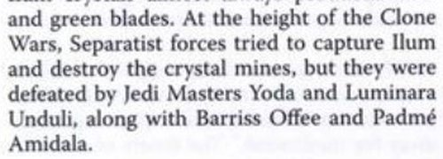
- **Luke Skywalker**: "The Jedi facilities on Ilum were destroyed during the Clone Wars, cutting off the source of lightsaber crystals for the Jedi of Luke Skywalker's Jedi praxeum." Source: The Complete Star Wars Encyclopedia, Vol. II, p.84
  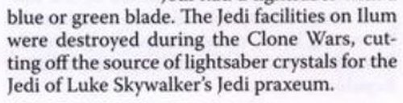

## p.85 (scan page 91)

Page contents: 1065 words, 29 paragraphs | headings/entries: Imbraani; Imdaar Alpha; Im'G'Twe Hills; Imina; Imiok; Iimmodet, General; Im'nel, Tresk; IMP-22; Impardiac; Impasse; Impavid

## p.86 (scan page 92)

Page contents: 958 words, 28 paragraphs | headings/entries: Impenetrable; IMPEREVI; Imperial Ii-class Star Destroyer

## p.87 (scan page 93)

Page contents: 1042 words, 38 paragraphs | headings/entries: Imperial Ballet Company; Imperial Building

## p.88 (scan page 94)

Page contents: 953 words, 26 paragraphs | headings/entries: Imperial City; Imperial City Naval Base; Imperial Civil War; Imperial ComplLink

## p.89 (scan page 95)

Page contents: 1049 words, 39 paragraphs | headings/entries: Imperial Diplomatic Corps

- **Grand Admiral Thrawn**: "However, with the defeat of Grand Admiral Thrawn, all evidence of the department was lost." Source: The Complete Star Wars Encyclopedia, Vol. II, p.89
  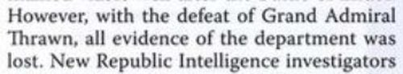

## p.90 (scan page 96)

Page contents: 1133 words, 32 paragraphs | headings/entries: Imperial Freight Complex; Imperial Gardens; Imperial Heritage Museum

## p.91 (scan page 97)

Page contents: 1001 words, 33 paragraphs | headings/entries: Imperial Information Center; Imperial Inquisitors; Imperial Interim Ruling Council; Imperial Irmenu Navy; Imperialist; Imperial Justice Court; Imperial Knight

- **Palpatine (Darth Sidious)**: "By controlling everything—from the military to financial systems—Palpatine kept the galaxy from suffering the corruption that destroyed the Old Republic." Source: The Complete Star Wars Encyclopedia, Vol. II, p.91
  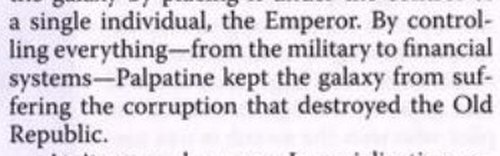

## p.92 (scan page 98)

Page contents: 910 words, 29 paragraphs | headings/entries: Imperial Lightning Battalion; Imperial Military Oversight Commission; Imperial Military Stop Loss Order; Imperial Mining Limited; Imperial Missionaries

## p.93 (scan page 99)

Page contents: 950 words, 23 paragraphs | headings/entries: Imperial Munitions; Imperial Naval Academy; Imperial Navy; Imperial News Network

## p.94 (scan page 100)

Page contents: 1037 words, 22 paragraphs | headings/entries: Imperial Opera Company; Imperial Palace Guard; Imperial Propaganda Bureau

- **Palpatine (Darth Sidious)**: "The Imperial Palace sprawled across the face of Imperial City, dominating the skyline with a huge, pyramidal outline that was believed to have been designed by Emperor Palpatine himself." Source: The Complete Star Wars Encyclopedia, Vol. II, p.94
  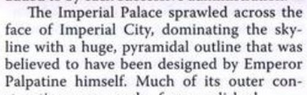
- **Palpatine (Darth Sidious); Luke Skywalker**: "Much of the oldest parts of the Palace were damaged by a Force storm sent by the reborn Emperor Palpatine to capture Luke Skywalker during the early years of the New Republic." Source: The Complete Star Wars Encyclopedia, Vol. II, p.94
  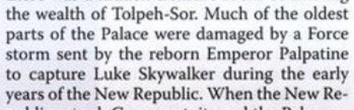

## p.95 (scan page 101)

Page contents: 817 words, 22 paragraphs | headings/entries: Imperial Relay Outpost V-798; Imperial Ruling Council; Imperial Science Division

## p.96 (scan page 102)

Page contents: 837 words, 23 paragraphs | headings/entries: Imperial Section 19; Imperial Security Authorization; Imperial-Sith War; Imperial Sleeper Cell Jenth-44

## p.97 (scan page 103)

Page contents: 933 words, 29 paragraphs | headings/entries: Imperial Special Training Corps; Imperial Star Destroyer; Imperial Starfleet; Imperial Stronghold; Imperial Transfer Post; Imperial Truth; Imperial University; Imperial Warlord; Imperial Xenodetic Survey; Imperial Zoological Agency; Imperial Zoological Gardens; Imperial Zoological Society; Imperieuse; Imperious

## p.98 (scan page 104)

Page contents: 1059 words, 31 paragraphs | headings/entries: Impeveri, Alina; Impeveri, Westa; Impounder; Improcco Company; Imru Ootmian

## p.99 (scan page 105)

Page contents: 1219 words, 43 paragraphs | headings/entries: Iimsatad; IMSLO; IMSU; Imthitill; IN-4; Ina; Ina'angs Star; Inace, Gol; Inad; Inaldra; Inamo; Indenture

## p.100 (scan page 106)

Page contents: 987 words, 37 paragraphs | headings/entries: Independent Shippers Association; Independent Traders' InfoNet; Indexer; Indictor; Indigo; Indigo, Nell; Indigo Squadron; Indiko; Indinor; Indobok; Indona; Indoumodo; Indrexu Spiral; Iindriummsegh, Verrinnefra B'thog

## p.101 (scan page 107)

Page contents: 1263 words, 30 paragraphs | headings/entries: Indu Council; Indupar; Indupar Nova; Induran; Indus; Indu San

- **Prince Xizor**: "Kuat of Kuat used one to hide the falsified recording he had made to frame Prince Xizor in the deaths of Owen and Beru Lars, but the droid was not delivered before its courier, Ree Duptom, was killed." Source: The Complete Star Wars Encyclopedia, Vol. II, p.101
  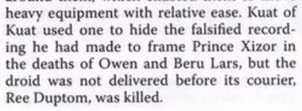
- **Yarael Poof**: "Poof died to keep the Infant from exploding, and the bounty hunters later returned the statue to Seylott." Source: The Complete Star Wars Encyclopedia, Vol. II, p.101
  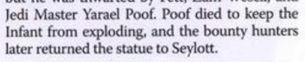

## p.102 (scan page 108)

Page contents: 1019 words, 25 paragraphs | headings/entries: Infernal; Inferno; Infiltrators; Infinity; Infinity Gate; Influenza Necrosi

- **Quinlan Vos**: "Their plan nearly succeeded, but Quinlan Vos destroyed the Star Chamber on the planet, stripping the Wave of its power." Source: The Complete Star Wars Encyclopedia, Vol. II, p.102
  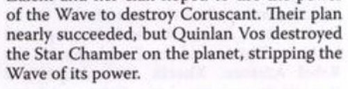

## p.103 (scan page 109)

Page contents: 1079 words, 35 paragraphs | headings/entries: InfoCore; Ingey; Inglet, Candobar; Ingo; Ingoda; Pngre, Herian; Inicus Mont; Inion, Shella

## p.104 (scan page 110)

Page contents: 1173 words, 36 paragraphs | headings/entries: Iniro, Falan; Infeshat; Innerdome Arena; Inner Hub; Inner Los; Inner Orbit; Inner Rim Mercenaries; Inner Rim Territories; Inner Systems Bank; Inner Wash; Inner Zuma; Innis, Tarn

- **Gallandro**: "Nearly half the Inner Circle was killed during its brief feud with Gallandro." Source: The Complete Star Wars Encyclopedia, Vol. II, p.104
  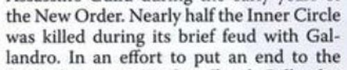

## p.105 (scan page 111)

Page contents: 1177 words, 33 paragraphs | headings/entries: Innk, Yo-Hann; Inondrar; Inquisitor; Inquisitor-4; Inquisitorius; Inrokini; Insiders; Inspra, Jabidus; Insta-7; Instigator; Insurrection

- **Anakin Solo**: "Inondrar The chief communications officer aboard the Star Destroyer Anakin Solo during the Galactic Alliance's war with the Confederation." Source: The Complete Star Wars Encyclopedia, Vol. II, p.105
  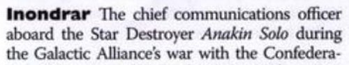

## p.106 (scan page 112)

Page contents: 1131 words, 27 paragraphs | headings/entries: Intamm; Inta'si'rin'na; IntCon; Integrity; Intellex; IntelStar Company

## p.107 (scan page 113)

Page contents: 1272 words, 27 paragraphs | headings/entries: Intergalactic Communications Center; Intergalactic Law Agency; Intergalactic Trade Mission; Intergalactic Zoological Society; Interior Region; Interloper Squadron; Intern; Internal Activities Committee; Internal Organization Bureau

- **General Grievous; Palpatine (Darth Sidious)**: "The IBC also financed the resurrection of Durge and General Grievous, actions that IBC leader San Hill believed made Darth Sidious indebted to the clan." Source: The Complete Star Wars Encyclopedia, Vol. II, p.107
  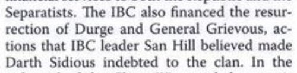

## p.108 (scan page 114)

Page contents: 1199 words, 40 paragraphs | headings/entries: Internal Security Branch; Internal Security Police; Interplanetary Acquisitions; Interrogator; Interstellar Collections Limited; Interstellar Droid Monitoring Incorporated; Interstellar Shipping; Interstellar Stock Exchange; IinterTribal Council; Intervention; InterWorld Marketplace

- **Antinnis Tremayne**: "Interrogator An Imperial Il-class Star Destroyer under the command of High Inquisitor Tremayne." Source: The Complete Star Wars Encyclopedia, Vol. II, p.108
  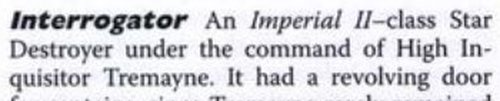

## p.109 (scan page 115)

Page contents: 1265 words, 29 paragraphs | headings/entries: Intimidator; Intran; Intruder; IntSec; Invader

- **Vima-Da-Boda; Han Solo**: "Invincible (1) The Star Destroyer used by Zasm Katth and Baddon Fass to go to Nar Shaddaa to kill Vima-Da-Boda and Han Solo." Source: The Complete Star Wars Encyclopedia, Vol. II, p.109
  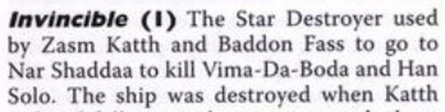

## p.110 (scan page 116)

Page contents: 988 words, 22 paragraphs | headings/entries: Invisec; Invisible Island; Invisible Sector

- **Grand Moff Tarkin**: "Invincible (4) The flagship of the small, independent war fleet amassed by Ranulph Tarkin before the Stark Hyperspace Conflict." Source: The Complete Star Wars Encyclopedia, Vol. II, p.110
  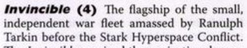
- **Grand Moff Tarkin**: "The Invincible survived the navigational computer virus developed by laco Stark and unleashed on Tarkin's ships." Source: The Complete Star Wars Encyclopedia, Vol. II, p.110
  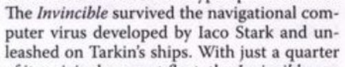
- **Grand Moff Tarkin**: "In short order, the /nvincible was destroyed, although many officers and crew managed to evacuate, including Tarkin." Source: The Complete Star Wars Encyclopedia, Vol. II, p.110
  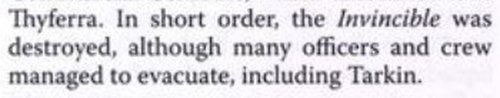
- **General Grievous; Palpatine (Darth Sidious)**: "Grievous nearly killed Gunray over the dispute; only Sidious's demand that the Trade Federation remain part of the Confederacy of Independent Systems kept him from killing the Viceroy." Source: The Complete Star Wars Encyclopedia, Vol. II, p.110
  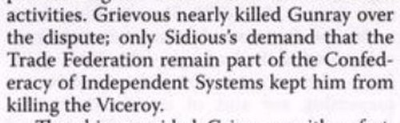

## p.111 (scan page 117)

Page contents: 978 words, 19 paragraphs | headings/entries: Invisible Star; Inwil; Inx, Jondrelll

- **Jaina Solo**: "At Terephon, the crew recovered Jaina Solo and Zekk, who had been on the planet doing their own investigation when the Ducha Galney ordered them killed." Source: The Complete Star Wars Encyclopedia, Vol. II, p.111
  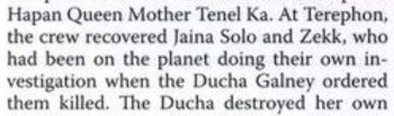
- **Mace Windu**: "When Jedi Master Mace Windu tried to help the Korunnai rid themselves of Balawai control by attacking the city of Pelek Baw, lolu and the Akk Guards were ordered to oppose him. lolu was killed by Nick Rostu during the fighting." Source: The Complete Star Wars Encyclopedia, Vol. II, p.111
  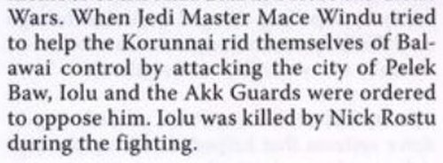
- **Ki-Adi-Mundi**: "Fortunately, they were rescued by Ki-Adi-Mundi before they could be incinerated." Source: The Complete Star Wars Encyclopedia, Vol. II, p.111
  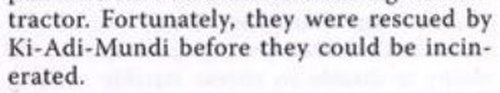

## p.112 (scan page 118)

Page contents: 1007 words, 29 paragraphs | headings/entries: 

- **Luke Skywalker; Han Solo; Chewbacca**: "The ship was captured by Luke Skywalker, Han Solo, and Chewbacca at Kessel, but Volz decided that it was too dangerous and destroyed it himself." Source: The Complete Star Wars Encyclopedia, Vol. II, p.112
  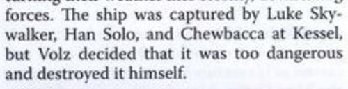

## p.113 (scan page 119)

Page contents: 1147 words, 32 paragraphs | headings/entries: IPKC

- **Darth Vader (Anakin Skywalker)**: "On Murkhana, Vader confronted the team and cut down two clones in short order." Source: The Complete Star Wars Encyclopedia, Vol. II, p.113
  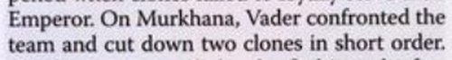

## p.114 (scan page 120)

Page contents: 1129 words, 37 paragraphs | headings/entries: Igobal; Igoon; IRD; Irden; War.; Iridescence

