# Owner Material 031 — The Complete Star Wars Encyclopedia, Vol. II (H–O): scan pages 121–160

- **Source:** *The Complete Star Wars Encyclopedia* by Stephen J. Sansweet and Pablo Hidalgo, with Bob Vitas, Daniel Wallace, Chris Cassidy, Mary Franklin and Josh Kushins (Del Rey, 2008), 3 vols. Secondary source (licensed Legends reference). Scan OCR'd on the box; the scan stays box-only and is **not** published.
- **Method:** every scanned page was OCR'd and machine-screened sentence by sentence for power-relevant statements (fights, kills, defeats, Force feats, rankings, superweapons) that name a character on our roster; each kept sentence is quoted verbatim from the OCR text and has a crop of the printed passage directly under it. Pages with nothing power-relevant are still listed with what is on them.
- **Citation:** "The Complete Star Wars Encyclopedia, Vol. II, p.X" by printed page ("scan p.X" where no printed number applies). **Weight:** Lucasfilm-licensed encyclopedia: a secondary, in-universe summary of Legends (and some film) material. It sums up feats from novels, comics and games; where the original story is in our notes, that source is the stronger citation.

## p.115 (scan page 121)

Page contents: 918 words, 22 paragraphs | headings/entries: Irmenu; Iron Citadel

## p.116 (scan page 122)

Page contents: 1223 words, 31 paragraphs | headings/entries: Iron Knights; Iron Will; Irregulars; War.

- **Grand Admiral Thrawn**: "Ironhand (1) This Imperial Star Destroyer, under the command of Captain Argona, was one of only 13 that remained in the Imperial Navy some 10 years after the death of Grand Admiral Thrawn." Source: The Complete Star Wars Encyclopedia, Vol. II, p.116
  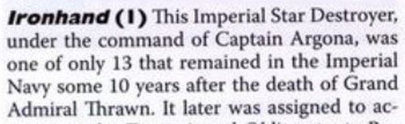

## p.117 (scan page 123)

Page contents: 1301 words, 23 paragraphs | headings/entries: Irrv, General; Irtanna; Isard, Ysanne; ISB-120

- **Darth Bane; Darth Zannah**: "She was killed during a rescue mission on the surface of Ruusan by Darth Bane's young apprentice, Zannah." Source: The Complete Star Wars Encyclopedia, Vol. II, p.117
  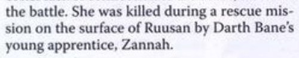

## p.118 (scan page 124)

Page contents: 1077 words, 26 paragraphs | headings/entries: ISBy; Isced; Iisde Naha; Isep; Iishedur, Keroth; Isher, Lungroiph; Ishi Tib

- **Leia Organa Solo; Chewbacca**: "ISBy This slicer droid, an ISB-120 model, was employed by the interrogation droid known as IT to break into a datapad that was owned by Leia Organa Solo, ISBy was destroyed when Chewbacca and his wife, Mallatobuck, tried to rescue their son Lumpawarrump from IT." Source: The Complete Star Wars Encyclopedia, Vol. II, p.118
  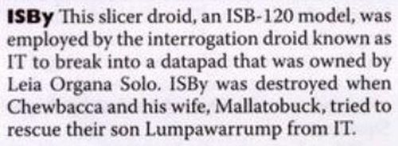

## p.119 (scan page 125)

Page contents: 1085 words, 24 paragraphs | headings/entries: Isilia; Isis; Isis, Governor; Iskaayuma; Iskadrell; Iiskalon Effect; Iskalonian

- **Quinlan Vos**: "Vos went to Tibrin during the Clone Wars and killed the pro-Republic leader, Suribran Tu." Source: The Complete Star Wars Encyclopedia, Vol. II, p.119
  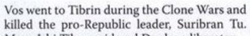

## p.120 (scan page 126)

Page contents: 1266 words, 23 paragraphs | headings/entries: Isken, Bran; Iskraker, Helm; Ismaren, Lagan; Iismaren, Roganda

- **Palpatine (Darth Sidious)**: "When the Eye of Palpatine later was destroyed, Irek managed to escape with his mother to Coruscant." Source: The Complete Star Wars Encyclopedia, Vol. II, p.120
  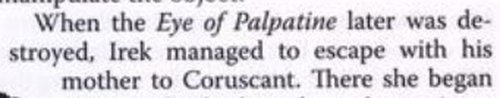
- **Luke Skywalker**: "Luke Skywalker infiltrated the ship and managed to destroy it from within." Source: The Complete Star Wars Encyclopedia, Vol. II, p.120
  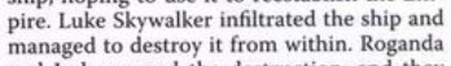

## p.121 (scan page 127)

Page contents: 1310 words, 22 paragraphs | headings/entries: 

- **Jacen Solo (Darth Caedus)**: "Caedus's arrival came during his attempt to destroy the Jedi Order's base in the Transitory Mists, and Isolder believed that his interrogation had finally come." Source: The Complete Star Wars Encyclopedia, Vol. II, p.121
  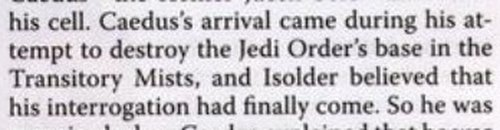
- **Jacen Solo (Darth Caedus)**: "Isolder's freedom was only guaranteed if he removed himself from the battle zone, since Caedus and his technicians had rigged the Beam Racer to explode if it was shot just once." Source: The Complete Star Wars Encyclopedia, Vol. II, p.121
  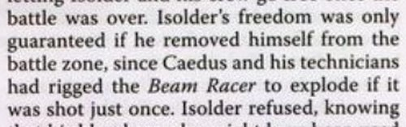
- **Jacen Solo (Darth Caedus)**: "Caedus then ordered the Beam Racer to be destroyed with all hands aboard." Source: The Complete Star Wars Encyclopedia, Vol. II, p.121
  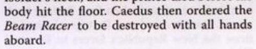

## p.122 (scan page 128)

Page contents: 1246 words, 39 paragraphs | headings/entries: Iss, Lafek; Issagra; Issen, Ensign; Iisshaddik; Issham Mining Corporation; IT; ITAC Authority; Itani Nebula

- **Chewbacca**: "Chewbacca managed to disable the IT, and his wife, Mallatobuck, destroyed it." Source: The Complete Star Wars Encyclopedia, Vol. II, p.122
  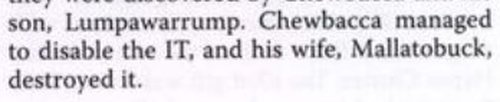

## p.123 (scan page 129)

Page contents: 1103 words, 28 paragraphs | headings/entries: Ithaqua Station; Ithh, Ror; Ithila; Ithona; Ithoon; Ithor; Ithorian

- **Corran Horn**: "Because of his part in destruction of the grand cruiser, Corran Horn was quickly targeted by the news agencies as "the man who destroyed Ithor."" Source: The Complete Star Wars Encyclopedia, Vol. II, p.123
  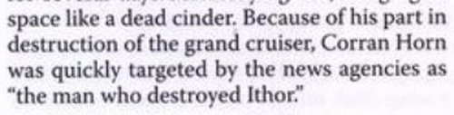

## p.124 (scan page 130)

Page contents: 968 words, 31 paragraphs | headings/entries: Ithorian SkyYards; Ithor Lady; Itipiniwi; IT-O; Itoklo, im; Ivatch; Ivey; Ivpikkis, Admiral

## p.125 (scan page 131)

Page contents: 986 words, 23 paragraphs | headings/entries: 1X-2A; 1X-44F; Ixiyen Fast Attack Craft; Ixlis, Yortal; Ixnoltah; Ixsan, Rogh'ma

## p.126 (scan page 132)

Page contents: 1178 words, 21 paragraphs | headings/entries: Pzak, Anise

## p.127 (scan page 133)

Page contents: 580 words, 12 paragraphs | headings/entries: 

- **General Grievous**: "The common bonds among them were their loyalty to Grievous and their desire to destroy the Huk occupation forces on their planet." Source: The Complete Star Wars Encyclopedia, Vol. II, p.127
  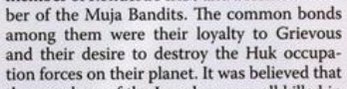
- **General Grievous**: "It was believed that the members of the Izvoshra were all killed in the crash of Grievous's shuttle, the Martyr, an event that nearly killed Grievous himself." Source: The Complete Star Wars Encyclopedia, Vol. II, p.127
  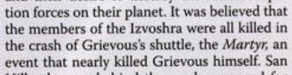

## p.128 (scan page 134)

Page contents: 0 words, 0 paragraphs | headings/entries: 

## p.129 (scan page 135)

Page contents: 786 words, 28 paragraphs | headings/entries: J-14; JIM; J-3PA; J-47; J-77 Event Horizon; J8Q-128 Finbat; J930 Dash-8; J9-5; J9-6; J-9SB; Jaan, Moff; Jaanu; Jaar; Jaarak; Jaaruls Street; Jaayza

- **Darth Vader (Anakin Skywalker)**: "She was defeated by Anakin Skywalker on Tatooine during the Clone Wars." Source: The Complete Star Wars Encyclopedia, Vol. II, p.129
  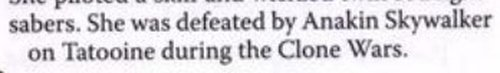

## p.130 (scan page 136)

Page contents: 1044 words, 17 paragraphs | headings/entries: Jab, JillJoo; Jabba; Jabba's Throne Room

- **Leia Organa Solo**: "As a fight erupted on and near Jabba's desert sail barge, Princess Leia Organa—who had been put in chains and a skimpy outfit by Jabba—pulled her chain leash around the Hutt's neck, strangling him." Source: The Complete Star Wars Encyclopedia, Vol. II, p.130
  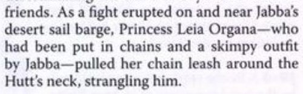

## p.131 (scan page 137)

Page contents: 1153 words, 22 paragraphs | headings/entries: Jabesq, Simon; Jabiim; Jabiim Congress; Jabitha; Jabi Town; Jabor

- **Darth Vader (Anakin Skywalker)**: "When the Republic sent a force to liberate the planet, many Jedi Masters were killed in battle, forcing Anakin Skywalker and a group of Padawans to carry on the fight." Source: The Complete Star Wars Encyclopedia, Vol. II, p.131
  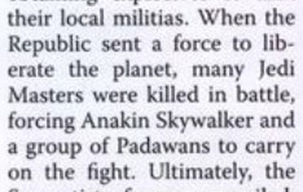
- **Darth Vader (Anakin Skywalker)**: "Because of the bonding with Anakin, the Jabitha was capable of incredible maneuvers under his piloting." Source: The Complete Star Wars Encyclopedia, Vol. II, p.131
  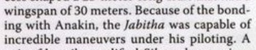

## p.132 (scan page 138)

Page contents: 1084 words, 30 paragraphs | headings/entries: Jabriel; Jacamden, Croig; Jaccoba; Jace, Bairdon; Jace, Bror; Jacelie; Jacipri; Jack; Jackal; Jacques; Jacynith; Jada, Deesra Luur; Jadai Motors; Jade; Jade, Mara; Jaded Jawa; Jade Moon

- **Darth Vader (Anakin Skywalker); Mara Jade Skywalker**: "But the Yuuzhan Vong were already on Dantooine, and they destroyed the Jade Sabre before Anakin and Mara could recover it." Source: The Complete Star Wars Encyclopedia, Vol. II, p.132
  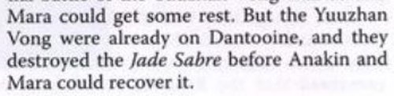

## p.133 (scan page 139)

Page contents: 1254 words, 30 paragraphs | headings/entries: Jade's Fire; Jade Shadow; Jade Simian; Jaeger, Oron; Jael City; Jaemus; Jaeth; Ja'Fai; Jagga W; Jagga VII; Jaggert, Colonel Randall; Jagg Island Detention Center; Jagi

- **Grand Admiral Thrawn**: "She used her beckon call to remotely send the Jade's Fire on a collision course with the hangar of the Hand of Thrawn complex, destroying it and most of the ships within." Source: The Complete Star Wars Encyclopedia, Vol. II, p.133
  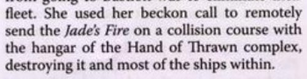
- **Canderous Ordo**: "Jagi This Mandalorian once challenged Canderous Ordo to a duel in the Dune Sea of Tatooine, a fight that Jagi lost." Source: The Complete Star Wars Encyclopedia, Vol. II, p.133
  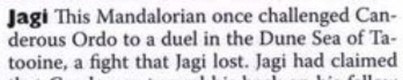

## p.134 (scan page 140)

Page contents: 989 words, 23 paragraphs | headings/entries: Jaguada; Jah, Ghazdik; Jahhnu; Jahibakti; Jahilid Drift; Jahnae Camp; Jahnar-Kooda; Jahren; Jai, Vun Merett; Jaijay Luxsub; Jaing

- **Darth Vader (Anakin Skywalker)**: "Jahren was killed by Darth Vader as a warning to the collectives." Source: The Complete Star Wars Encyclopedia, Vol. II, p.134
  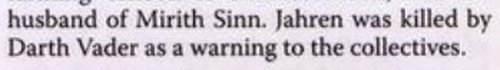
- **Plo Koon**: "Captain Jag simply placed his vessel behind Plo Koon's and fired on the Jedi fighter, causing it to crash into the side of a building and explode." Source: The Complete Star Wars Encyclopedia, Vol. II, p.134
  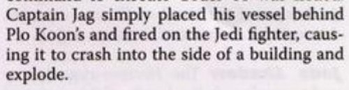

## p.135 (scan page 141)

Page contents: 978 words, 18 paragraphs | headings/entries: Jaing, Master; Jakaitis; Jakan; Jakan Arms; Jakien, Allania

## p.136 (scan page 142)

Page contents: 1055 words, 31 paragraphs | headings/entries: JAK Racing; Jal; Jal, Glor; Jalan; Jalay, Danith; Jalk Syndicate; Jallop, Preena; Jally; Jalor Docking Facilities; Jalose; Jal-Parra; Jalper; Jal Shey; Jalunn, Qar; Jam, Christoph; Jamer, Captain Dren; Jameson, Skorg; Jamillia, Queen

## p.137 (scan page 143)

Page contents: 1224 words, 24 paragraphs | headings/entries: Jaminere; Jaminere Marches; Jamiro, Tigran; Jamos, Hen; JAN; Jan, Janvar; Janah; Janako; Janara Wl; Jandi, Aellyn; Jandi, Riit; Jandier, Myle; Jandovar, Maxa; Janessa's Atlas

## p.138 (scan page 144)

Page contents: 1092 words, 26 paragraphs | headings/entries: Jangelile; Jangoed; Jango Fett Arena; Jangotat; Janguine; Janiidakara; Janissariad; Jankok; Janks; Jan-lo, Sunnar; Janna, Neile; Jannick, Jerus

- **Palpatine (Darth Sidious)**: "Although he hated the corruption that tore apart the Old Republic, and though he believed that Emperor Palpatine brought a level of pride and discipline back to the military, Jankar lived to serve the army itself, He also prided himself on being the toughest, most demanding drill instructor on Sirpar." Source: The Complete Star Wars Encyclopedia, Vol. II, p.138
  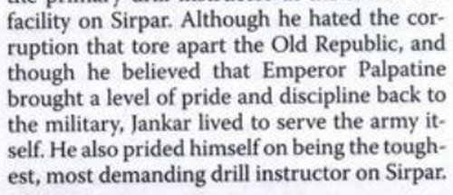

## p.139 (scan page 145)

Page contents: 1114 words, 34 paragraphs | headings/entries: Janos; Janren, Darred; Janse; Janse, Emily; Janson; Janson, Wes; Janss, Alto; Jante; Jantol; Jantos; Janus; Janusar; Januul; Janzor, Captain; Ja-Phelar Bay

- **Obi-Wan Kenobi**: "Janoo, Nanda-Ree {his Jedi Knight accompanied Obi-Wan Kenobi to Balamak during the early stages of the Clone Wars to help destroy an experimental communicationsjamming facility built by the Separatists." Source: The Complete Star Wars Encyclopedia, Vol. II, p.139
  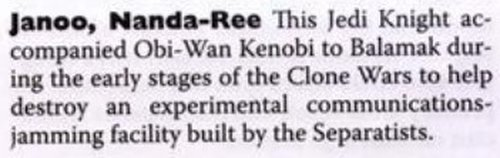

## p.140 (scan page 146)

Page contents: 1120 words, 29 paragraphs | headings/entries: Jappe; Jaraana; Jarael; Jarael-One; Jaratt; Jardeen IV; Jardra; Jarell; Jarellian; Jaresh; Jaret; Jarg; Jari'kyn; Jarin; Jar'Kai; Jarnek, Hartov

## p.141 (scan page 147)

Page contents: 1350 words, 30 paragraphs | headings/entries: Jarnolien; Jaro; Jaroona; Magar; Jarrad, Selby; Jarril; Jarroth, Captain; Jarrou, Commander; Jarrti'Klomas; Jarsa; Jarvashqiine; Jarvis, Alendar; Jasa; Jaset, Bal; Jaso Corporation; Jaspar, Trent; Jassa, Mroon; Jassar; Jasserak Engagement

- **Grand Moff Tarkin**: "According to Jarvis's report, Tarkin was traveling to the Tallaan Shipyard when his shuttle malfunctioned and exploded." Source: The Complete Star Wars Encyclopedia, Vol. II, p.141
  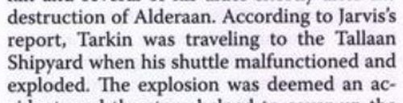
- **Palpatine (Darth Sidious)**: "He had a great deal of political and military support from Emperor Palpatine, which allowed Jaset to begin working to surpass House Mecetti as the dominant House in the Great Council." Source: The Complete Star Wars Encyclopedia, Vol. II, p.141
  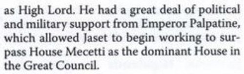

## p.142 (scan page 148)

Page contents: 1213 words, 37 paragraphs | headings/entries: Jasserak Highlands; Jasshi'rr; Jassim Design; Jastaal; Jaster's Legacy; Jaster's Legacy; Jastro Wl; Jatayus Outbound; Jatee; Jat'ho; Jatras; Jaub, Niev; Jauxson; Javeb, Zyn; Javeq, Lasro; Javik, Tenga; Javin; Javin, Andor; Javaal; Javis

- **Jaster Mereel** — entry/section: Jaster's Legacy: "However, before he could capture Fust and make his escape, Jaster's Legacy was destroyed by one of the prison's Firespray-class patrol ships." Source: The Complete Star Wars Encyclopedia, Vol. II, p.142
  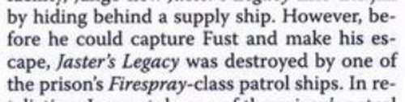
- **IG-88**: "Javin also reported that Klaggus Purgato survived the assault by the IG-88 assassin droids that wiped out Holowan Mechanicals, He was reported to have discovered 8,000-year-old Sullustan cave drawings that predicted the rise of the Empire." Source: The Complete Star Wars Encyclopedia, Vol. II, p.142
  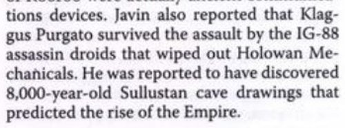

## p.143 (scan page 149)

Page contents: 1049 words, 26 paragraphs | headings/entries: Javis-12; Javriel; Javyar's Cantina; Jawa; Jawa Droid Traders; Jawa Raceway; Jawaswag; Jawa Traders

## p.144 (scan page 150)

Page contents: 864 words, 19 paragraphs | headings/entries: Jax, Carnor; Jax, Hukta; Jaxa; Jaxal, Solo; Jaxus; Jaxxon; Jay

- **Jax Pavan; Carnor Jax; Palpatine (Darth Sidious)** — entry/section: Jax, Carnor: "Jax was the son of a Thyrsian Sun Guard member who was killed by Darth Sidious." Source: The Complete Star Wars Encyclopedia, Vol. II, p.144
  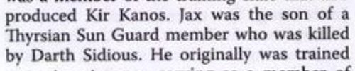
- **Jax Pavan; Carnor Jax; Kir Kanos** — entry/section: Jax, Carnor: "Carnor Jax (left) faces Kir Kanos in a duel to the death." Source: The Complete Star Wars Encyclopedia, Vol. II, p.144
  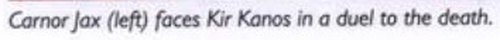
- **Jax Pavan; Carnor Jax; Palpatine (Darth Sidious)** — entry/section: Jax, Carnor: "When Palpatine's clones were destroyed at Byss, Jax made his bid for control of the Empire by creating the Imperial Interim Ruling Council and assuming its leadership." Source: The Complete Star Wars Encyclopedia, Vol. II, p.144
  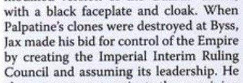
- **Jax Pavan; Carnor Jax; Kir Kanos** — entry/section: Jax, Carnor: "Jax learned that Kanos survived, and knew that he had to eliminate the threat he posed." Source: The Complete Star Wars Encyclopedia, Vol. II, p.144
  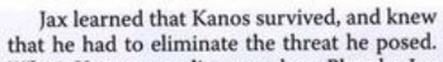
- **Jax Pavan; Carnor Jax; Kir Kanos** — entry/section: Jax, Carnor: "Kanos wiped out the entire squadron, leaving Jax to face him in one-on-one combat in the Squall." Source: The Complete Star Wars Encyclopedia, Vol. II, p.144
  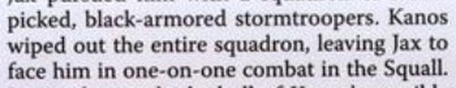
- **Jax Pavan; Carnor Jax; Kir Kanos** — entry/section: Jax, Carnor: "After Blim was eliminated by Mirith Sinn and Sish Sadeet, Jax nearly defeated Kanos." Source: The Complete Star Wars Encyclopedia, Vol. II, p.144
  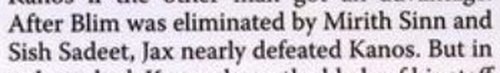
- **Jax Pavan; Carnor Jax; Kir Kanos** — entry/section: Jax, Carnor: "But in a short duel, Kanos drove the blade of his staff through Jax's breastplate, piercing his heart and killing him instantly." Source: The Complete Star Wars Encyclopedia, Vol. II, p.144
  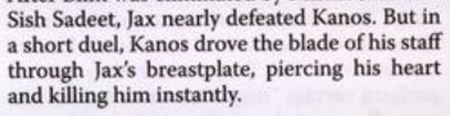
- **Han Solo**: "There he joined Han Solo and a ragtag team of starfaring adventurers to defeat Serji-X Arrogantus." Source: The Complete Star Wars Encyclopedia, Vol. II, p.144
  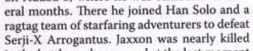
- **Jaxxon** — entry/section: Jaxxon: "Jaxxon was nearly killed in the battle, and was saved at the last moment by Amaiza Foxtrain." Source: The Complete Star Wars Encyclopedia, Vol. II, p.144
  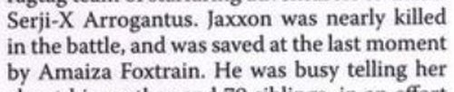

## p.145 (scan page 151)

Page contents: 1219 words, 26 paragraphs | headings/entries: Jaya; Jayhawk, Captain; Jaytee; Jayzaa; Jazbina; JC-671; Jcir, Standro; JCOS-1, JCOS-2; JE-99-DI-88-FOR-00-CE; Jebbis; Jebbiz'Foreanda; Jebble; Jedd Six

## p.146 (scan page 152)

Page contents: 1252 words, 28 paragraphs | headings/entries: Jedi Civil War; Jedi Coalition; Jedi; Jedi Command; Jedi Council

- **Darth Sion**: "The Jedi Order was nearly destroyed, and the Sith were reduced to Darth Sion's ravaged body and a handful of Sith devotees." Source: The Complete Star Wars Encyclopedia, Vol. II, p.146
  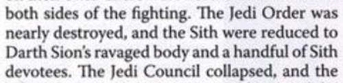

## p.147 (scan page 153)

Page contents: 948 words, 22 paragraphs | headings/entries: Jedi Council Chamber; Jedi Council Spire; Jedi Council Tower; Jedi Covenant; Jedi Credit; Jedidiah

## p.148 (scan page 154)

Page contents: 957 words, 15 paragraphs | headings/entries: Jedi Enclave; Jedi Exile; Jedi Flow

- **Luke Skywalker**: "Jedidiah went to help Luke, but was shot and killed by Captain Traal." Source: The Complete Star Wars Encyclopedia, Vol. II, p.148
  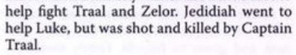
- **Meetra Surik; Darth Malak** — entry/section: Jedi Exile: "Jedi Exile An ancient Jedi warrior whose name was lost to history, she was a former Padawan stripped of her connection to the Force and set adrift in the galaxy in the years after the defeat of Darth Malak." Source: The Complete Star Wars Encyclopedia, Vol. II, p.148
  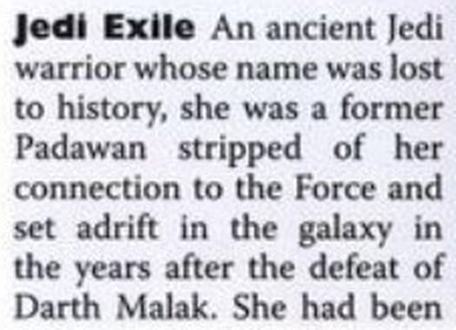
- **Meetra Surik; Kreia** — entry/section: Jedi Exile: "After the Jedi Civil War nearly destroyed the order, the Exile discovered a renewed link to the Force when her ship, the Ebon Hawk, was discovered in deep space by a group of Sith devotees and Jedi Master Kreia." Source: The Complete Star Wars Encyclopedia, Vol. II, p.148
  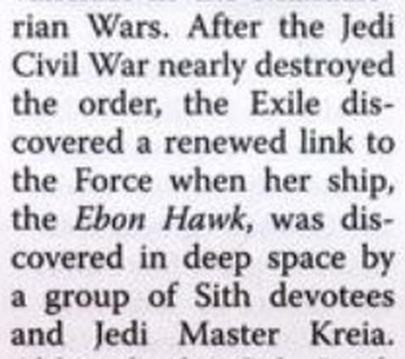
- **Meetra Surik; Darth Sion** — entry/section: Jedi Exile: "After escaping Darth Sion at Peragus II and learning that five Jedi Masters had survived the Jedi Civil War, the Exile set out to locate them in an effort to begin rebuilding the Jedi Order." Source: The Complete Star Wars Encyclopedia, Vol. II, p.148
  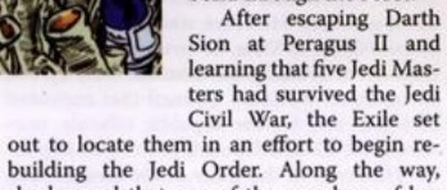
- **Meetra Surik; Darth Nihilus; Darth Sion** — entry/section: Jedi Exile: "She set out to hunt them down, defeating Darth Nihilus at Telos and Darth Sion on Malachor V before confronting her teacher." Source: The Complete Star Wars Encyclopedia, Vol. II, p.148
  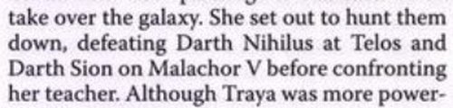
- **Meetra Surik; Kreia** — entry/section: Jedi Exile: "Although Traya was more powerful, the Exile managed to defeat her in combat." Source: The Complete Star Wars Encyclopedia, Vol. II, p.148
  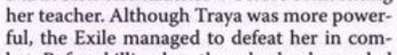
- **Meetra Surik** — entry/section: Jedi Exile: "The Jedi Explorer was destroyed when the cloned Emperor's dark side aides mounted an all-out attack on the secret settlement codenamed New Alderaan." Source: The Complete Star Wars Encyclopedia, Vol. II, p.148
  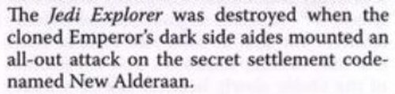

## p.149 (scan page 155)

Page contents: 1126 words, 26 paragraphs | headings/entries: Jedi Focus Disciplines; Jedi Forge; Jedi Giant; Jedi-Gon; Jedi Holocron; Jedi Hunters; Jedi Interceptor; Jedi Jewels; Jedi Killer; Jedi Killers

- **Palpatine (Darth Sidious)**: "Most Jedi Holocrons were created prior to the Battle of Ruusan, and very few survived the era of the New Order, as Emperor Palpatine collected all manner of holocrons—both Sith and Jedi—in order to garner new information about the use of the Force." Source: The Complete Star Wars Encyclopedia, Vol. II, p.149
  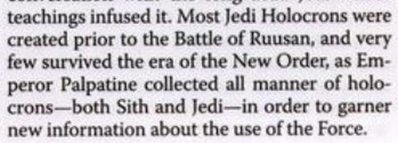

## p.150 (scan page 156)

Page contents: 1341 words, 31 paragraphs | headings/entries: Jedilore; Jedi Master; Jedi Meld; Jedi Mind Juice; Jedi Order

- **Palpatine (Darth Sidious); Obi-Wan Kenobi; Yoda**: "When Senator Palpatine assumed the throne of galactic Emperor, he realized that the Jedi Knights were the only ones who could truly stand between himself and the galaxy, so he eradicated them, The most notable Jedi to have survived were Obi-Wan Kenobi and Jedi Master Yoda." Source: The Complete Star Wars Encyclopedia, Vol. II, p.150
  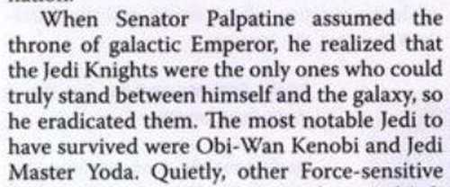
- **Palpatine (Darth Sidious)**: "After Emperor Palpatine killed most of the Jedi Knights with the execution of Order 66, the Order was all but eliminated for decades." Source: The Complete Star Wars Encyclopedia, Vol. II, p.150
  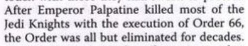

## p.151 (scan page 157)

Page contents: 1227 words, 22 paragraphs | headings/entries: Jedi Prophecies; Jedi Rebellion; Jedi Revolt; Jedi's Fire; Jedi Shadows; Jedi-Sith War

- **Kyp Durron**: "This philosophy didn't provide the New Republic's government with a good sense of security, especially after Kyp Durron destroyed the Carida system." Source: The Complete Star Wars Encyclopedia, Vol. II, p.151
  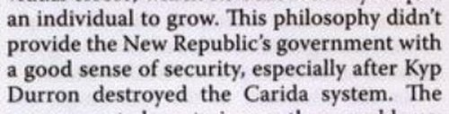
- **Darth Vader (Anakin Skywalker); Palpatine (Darth Sidious)**: "With the help of Anakin Skywalker, Palpatine was able to destroy the Jedi Masters, then went to the Galactic Senate and described the battle as an attempt by the Jedi to seize control—the so-called Jedi Rebellion." Source: The Complete Star Wars Encyclopedia, Vol. II, p.151
  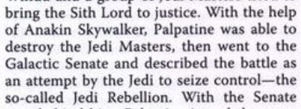

## p.152 (scan page 158)

Page contents: 1348 words, 23 paragraphs | headings/entries: Jedi Underground; Jedi Weapons Master; Jedi Who Was Shaped, the; Jeen, Kibh

## p.153 (scan page 159)

Page contents: 1316 words, 30 paragraphs | headings/entries: Jeera, Naktu; Jeffrey; Jeh; Je'har; Jeh Bonegnawer; Jeht, Darrus; Jeisel, Sian; Jek; Jekk'Jekk Tarr; Jela'han; Jelasi; Jelavan, Shad

## p.154 (scan page 160)

Page contents: 1053 words, 22 paragraphs | headings/entries: Jelavan, Shel; Jelidar; Jelirek, Antoll; Jellyfish Cove; Jelok; Jelon, Commander; Jelwick; Jemba; Jemmy; Jempa; Jen; Jen'ari; Jenbean, Lieutenant

- **Zayne Carrick**: "Only Zayne survived, having arrived late to the ceremony." Source: The Complete Star Wars Encyclopedia, Vol. II, p.154
  
- **Zayne Carrick**: "Goaded by Jedi Covenant member Raana Tey, Shel almost succeeded in her mission, but the truth eventually surfaced that it was the Covenant that had killed her brother and not Zayne." Source: The Complete Star Wars Encyclopedia, Vol. II, p.154
  
