# Owner Material 031 — The Complete Star Wars Encyclopedia, Vol. II (H–O): scan pages 161–200

- **Source:** *The Complete Star Wars Encyclopedia* by Stephen J. Sansweet and Pablo Hidalgo, with Bob Vitas, Daniel Wallace, Chris Cassidy, Mary Franklin and Josh Kushins (Del Rey, 2008), 3 vols. Secondary source (licensed Legends reference). Scan OCR'd on the box; the scan stays box-only and is **not** published.
- **Method:** every scanned page was OCR'd and machine-screened sentence by sentence for power-relevant statements (fights, kills, defeats, Force feats, rankings, superweapons) that name a character on our roster; each kept sentence is quoted verbatim from the OCR text and has a crop of the printed passage directly under it. Pages with nothing power-relevant are still listed with what is on them.
- **Citation:** "The Complete Star Wars Encyclopedia, Vol. II, p.X" by printed page ("scan p.X" where no printed number applies). **Weight:** Lucasfilm-licensed encyclopedia: a secondary, in-universe summary of Legends (and some film) material. It sums up feats from novels, comics and games; where the original story is in our notes, that source is the stronger citation.

## p.155 (scan page 161)

Page contents: 881 words, 24 paragraphs | headings/entries: Jendar Campaign; Jendirian Valley; Jendon, Colonel; Jendorn; Jendowanian, Greeata; Jenet; Jeng, Sarrissa; Jengardin Millennial Warriors; Jengus; Jen'jidai; Jenks; Commander; Jenks, Losibaru

## p.156 (scan page 162)

Page contents: 1079 words, 26 paragraphs | headings/entries: Jenn, Commander; Jennir, Dass; Jenny; Jenreal, Sersae; Jens; Jensaarai; Jensen; Jentari; Jentawui; Jenth-44; Jenth Grek 51; Jenton, Evitch; Jenuwaa Sea; Jenwald, Lyndelah; Jeodu; Jeolocas; Jeratai, Admiral

- **General Grievous**: "San Hill told General Grievous that his body had been recovered from the banks of the Jenuwaa Sea after his shuttle was sabotaged and exploded." Source: The Complete Star Wars Encyclopedia, Vol. II, p.156
  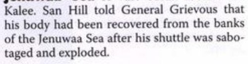
- **Alema Rar**: "Alema Rar and a team of Jedi were aboard the ship when it was turned over to the Yuuzhan Vong, but the Jedi managed to overpower the crew and intercept the aliens." Source: The Complete Star Wars Encyclopedia, Vol. II, p.156
  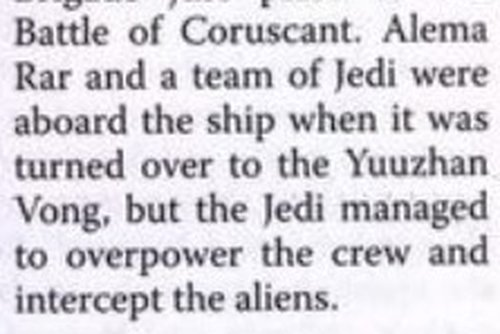

## p.157 (scan page 163)

Page contents: 1025 words, 19 paragraphs | headings/entries: Jerec; Jerel; Jerell; Jeremos; Jerev; Jerg; Jerga

- **Jerec; Palpatine (Darth Sidious)** — entry/section: Jerec: "Rather than allow himself to be killed, Jerec pledged his allegiance to the Empire and obtained training from the Dark Side Adepts of Palpatine's own Prophets of the Dark Side." Source: The Complete Star Wars Encyclopedia, Vol. II, p.157
  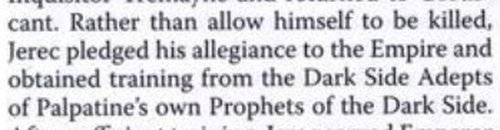
- **Jerec** — entry/section: Jerec: "It was unknown how Jerec survived the explosion, but he managed to escape in a Starfly and ordered a recovery team to pick up the pieces of the Vengeance." Source: The Complete Star Wars Encyclopedia, Vol. II, p.157
  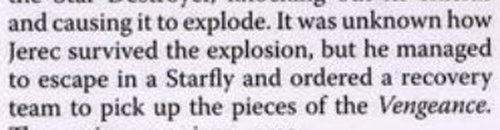
- **Jerec; Kyle Katarn** — entry/section: Jerec: "Jerec himself briefly experienced the true power of the Valley, but his rapturous connection was severed by Katarn." Source: The Complete Star Wars Encyclopedia, Vol. II, p.157
  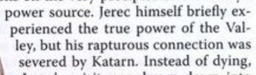

## p.158 (scan page 164)

Page contents: 1211 words, 32 paragraphs | headings/entries: Jergo; Jericho; Jerimott, Hower; Jerius; Jerjerrod, Moff; Jerm; Jerne; Jerrahg; Jerresk; Jerriko, Dannik; Jerrilek; Jerriman, Lieutenant; Jerrist V1; Jerrit, Lieutenant; Jerritech; Jerru; Jes

- **Palpatine (Darth Sidious); Grand Moff Tarkin**: "He was chosen for the position because Palpatine wanted to avoid the hubris that killed Wilhuff Tarkin and lost the first Death Star." Source: The Complete Star Wars Encyclopedia, Vol. II, p.158
  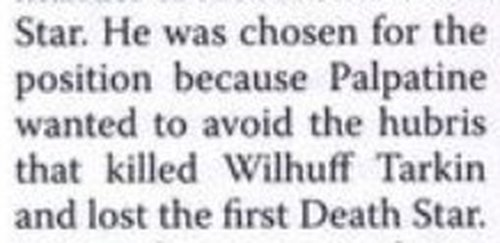

## p.159 (scan page 165)

Page contents: 1018 words, 23 paragraphs | headings/entries: Jesa Corporation; Jesart Desert; Jeseej; Jesfa; Jesi; Jess; Jessel; Jestan; Jestefad; Jester; Jeswandi; Jeth, Arca

- **Queen Amanoa**: "Master Jeth later assisted them there when Queen Amanoa was revealed to have been one of the most powerful Naddists on the planet." Source: The Complete Star Wars Encyclopedia, Vol. II, p.159
  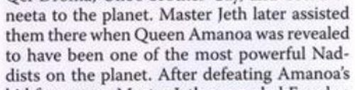
- **Queen Amanoa; Freedon Nadd**: "After defeating Amanoa's bid for power, Master Jeth concealed Freedon Nadd's Sith lore in a tomb on the Dxun moon." Source: The Complete Star Wars Encyclopedia, Vol. II, p.159
  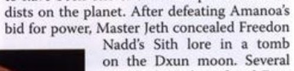

## p.160 (scan page 166)

Page contents: 1123 words, 22 paragraphs | headings/entries: Jetters Bar; Jett's Chute; Jettster, Dexter; Jev; Jev, Colonel Ilo; Jevax

## p.161 (scan page 167)

Page contents: 1165 words, 36 paragraphs | headings/entries: Jewel, The; Jewett, Darvon; Jex; Jeyell; Jez; JGS1; JG-8; Jhakva; Jhaveek; Jhemiti; Jhensrus; Jhepar; Jhoff, Controller

## p.162 (scan page 168)

Page contents: 1376 words, 28 paragraphs | headings/entries: Jhompfi; Jhonems, Wil; Jhordvar; Jhorn, Sergeant Pfilbee; Jhosa; Jhunia Snow Plains; Ji; Ji, Phow; Jiaan; Jiaasjen; Jiaguin; Jiaozi; Jid'yda, Admiral; Jielu; Jigani Port; Jigoba

- **Phow Ji**: "Just before the Clone Wars, Phow Ji won the tournament in Aslaja, defeating the Jedi Knight Joclad Danva in a 47-minute fight." Source: The Complete Star Wars Encyclopedia, Vol. II, p.162
  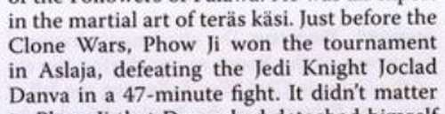

## p.163 (scan page 169)

Page contents: 1079 words, 21 paragraphs | headings/entries: Jiir; Jiivahar; Jikat, Vrrk; Jillsarian; Jin; Jinart; Jinathik

## p.164 (scan page 170)

Page contents: 1136 words, 21 paragraphs | headings/entries: Jinda; Jinder, J'an Ane; Jinet; Jing; Jin-Jin; Jinkins; Jinn, Qui-Gon

- **Qui-Gon Jinn** — entry/section: Jinn, Qui-Gon: "Jinn, Qui-Gon A Jedi Master who was known as one of the Order's most formidable members, but his recklessness and his devotion to bizarre causes kept him from becoming a member of the Jedi Council." Source: The Complete Star Wars Encyclopedia, Vol. II, p.164
  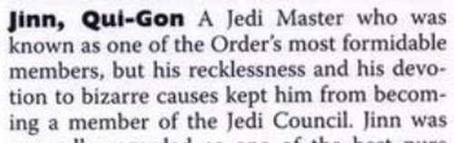
- **Qui-Gon Jinn** — entry/section: Jinn, Qui-Gon: "He claimed that Xanatos had been killed in battle, and vowed never to take another Padawan." Source: The Complete Star Wars Encyclopedia, Vol. II, p.164
  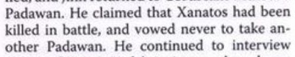

## p.165 (scan page 171)

Page contents: 1143 words, 24 paragraphs | headings/entries: Chosen; Jinn, Tyla; Jin'ri Trade Syndicate; Jintar; Jinwa Raiders; Jinzier, Dean

- **Obi-Wan Kenobi; Darth Maul**: "Obi-Wan defeated Maul once freed from the lasers, but it was too late to save his Master." Source: The Complete Star Wars Encyclopedia, Vol. II, p.165
  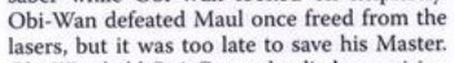

## p.166 (scan page 172)

Page contents: 1171 words, 26 paragraphs | headings/entries: Jinzter, Lorana; Jiod; Jion, Shep; Jiprirr; Jir, Commander Daine; Jira; Jiramma; Jiree; Jiroch-Reslia; Jisasu

- **Grand Admiral Thrawn; Joruus C'baoth**: "Lorana only survived Thrawn's attack because she had been ordered by C'baoth to lock up a group of rebellious engineers in the central core of the ship." Source: The Complete Star Wars Encyclopedia, Vol. II, p.166
  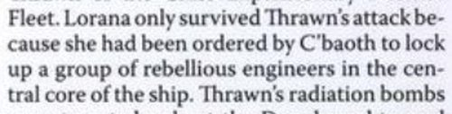
- **Grand Admiral Thrawn**: "Thrawn's radiation bombs were targeted only at the Dreadnaughts, and wiped out all beings in the large ships." Source: The Complete Star Wars Encyclopedia, Vol. II, p.166
  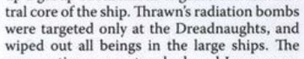
- **Luke Skywalker; Mara Jade Skywalker**: "Luke and Mara were forced to use Lorana's lightsaber in a desperate attempt to destroy the droideka that was protecting Estosh and his Vagaari aboard the D-Four Dreadnaught." Source: The Complete Star Wars Encyclopedia, Vol. II, p.166
  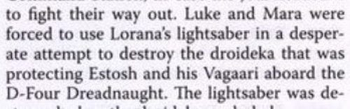

## p.167 (scan page 173)

Page contents: 1204 words, 21 paragraphs | headings/entries: Jiss, Vinna; Jith, Hiksri; Jiton, Tyrn; Jjitte; Jivrak, General Reesen; Jivv Space City; Jixton, Wrenga; Jjerrol; Jjorg; JK-13; Jkarta, Telmun

- **Darth Vader (Anakin Skywalker)**: "When Vader nearly died in the explosion of the Iron Tower, Jix found him and would have killed the Dark Lord in revenge, but decided it was better not to risk the wrath of the Empire." Source: The Complete Star Wars Encyclopedia, Vol. II, p.167
  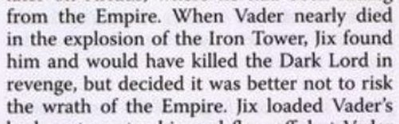
- **Kit Fisto**: "After defeating a droideka and ARC trooper CT-36/732 in one-on-one combat, JK-13 was pitted in battle against Jedi Master Kit Fisto." Source: The Complete Star Wars Encyclopedia, Vol. II, p.167
  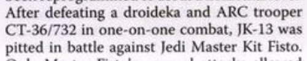
- **Kit Fisto**: "Only Master Fisto's unusual attacks allowed him to defeat the droid." Source: The Complete Star Wars Encyclopedia, Vol. II, p.167
  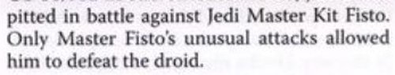

## p.168 (scan page 174)

Page contents: 1162 words, 20 paragraphs | headings/entries: JL-12-F; JL7 Elixir; J'Lan; J'Mikel; Jmin Survival Academy; Jmmaar; JN-66; Joaa'n; Joanson, Ariq

- **General Grievous**: "Jmmaar This Viraanntesse Jedi Master, a native of Vvaw, was killed during the Clone Wars by General Grievous on Vandos." Source: The Complete Star Wars Encyclopedia, Vol. II, p.168
  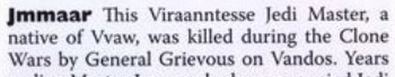
- **General Grievous**: "Grievous, who was known during the Huk Wars as Qymaen jai Sheelal, never forgot the role of the two Jedi in the virtual subjugation of his people, and happily cut down Master Jmmaar when he had the chance." Source: The Complete Star Wars Encyclopedia, Vol. II, p.168
  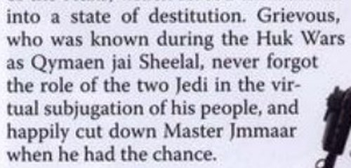

## p.169 (scan page 175)

Page contents: 1388 words, 30 paragraphs | headings/entries: Joben, Thall; Jobin, Corporal; Jobreth Plains; Jobril; Jocelll; Jocund, Deidre; Jode, Binna; Jodeen, Captain; Jofoger; Johans, Colonel Zel; Johder; Johin

## p.170 (scan page 176)

Page contents: 1085 words, 21 paragraphs | headings/entries: Joh's Shipyard; Joiner; Joining, the; Joint Council; Joint Defense Operations Staff; Joiol; Jojo; Jok, D'Trel B'Rar; Joker Squad; Joker Squadron; Jokhalli

- **Lando Calrissian**: "His skills in trade languages, coupled with his defeat of the Jokhalli masters in Divot, earned Lando a measure of respect among the Jokhalli, who helped him escape Quaffug." Source: The Complete Star Wars Encyclopedia, Vol. II, p.170
  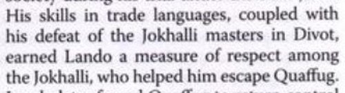

## p.171 (scan page 177)

Page contents: 1139 words, 28 paragraphs | headings/entries: Jokoflow; Joli; Jolli; Jolie; Jolsz; Jo-Mau-Rinti; Jombo; Jomo; Jomon; Jon, Colonel Davod; Jonat, Lieutenant

- **Revan**: "However there were reports that indicated former Sith Lord Revan killed many of the mercenaries in selfdefense." Source: The Complete Star Wars Encyclopedia, Vol. II, p.171
  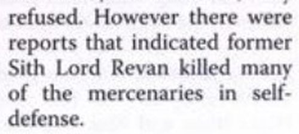

## p.172 (scan page 178)

Page contents: 1177 words, 28 paragraphs | headings/entries: Jones, Domo; Joness, Davis; Jonex; Jonn, Jobekk; Jonndril, Simms; Jonsey; Jonson; Jonton; Jontz Freight; Jonus, Captain; Joo, Klis; Joodsen, Maceb; Jooj; Jool, Queen

## p.173 (scan page 179)

Page contents: 1194 words, 34 paragraphs | headings/entries: Joraan Drive Yards; Jorak; Joralla; Joran; Joran Station; Jord; Jordan, Caal; Jordi; Jorir, Major; Joris, Rax; Jorien, Captain Mak; Jornisae; Jorran; Jorshmin; Jorsk

- **Admiral Ackbar**: "Ackbar as a gunnery officer during the blockade of the Murgo Choke about a year after the Qoribu crisis." Source: The Complete Star Wars Encyclopedia, Vol. II, p.173
  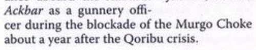

## p.174 (scan page 180)

Page contents: 1289 words, 38 paragraphs | headings/entries: Jortan; Jos; Jos, Mebara; Josall, Sephjet; Josen, Kardash; 's Honor; Joshi, Captain; Jostrian; Journeyman Protector; Jotane, Trevas; Jotay; Jotsen's Island; Jova; Jovan Station; Joventusek; Jovvitz

## p.175 (scan page 181)

Page contents: 1065 words, 19 paragraphs | headings/entries: Jjowa; Jowar, Moff; Jowdrri; Joy; Joylin; J'Pel; JR-4; JR-8

## p.176 (scan page 182)

Page contents: 1060 words, 27 paragraphs | headings/entries: Jrade-Daders Concourse; JRD-33; Jrul; JTHW; J'tt'sa; J-type; J-type 327 Nubian; Juaka Canyon; Jubal; Jubben, Senator; Jubieck; Jubilar; Jubilee

- **Boba Fett**: "Fifteen years before the Battle of Hoth, Boba Fett killed a spice dealer named Hallolar Voors on Jubilar." Source: The Complete Star Wars Encyclopedia, Vol. II, p.176
  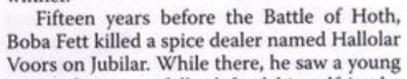

## p.177 (scan page 183)

Page contents: 1055 words, 23 paragraphs | headings/entries: Jubnuk; Judgment Circle; Judgment Guides; Judicial Department; Judicial Forces; Judiie; Juggadoo

## p.178 (scan page 184)

Page contents: 1006 words, 19 paragraphs | headings/entries: Juggernaut; Jugsmuk; Juhani; Jukassa, Zett; Jular, Pelav

- **Cin Drallig**: "However, she was killed in battle during the Clone Wars, and Jukassa's training fell to Cin Drallig." Source: The Complete Star Wars Encyclopedia, Vol. II, p.178
  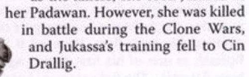
- **Palpatine (Darth Sidious); Mace Windu; Darth Vader (Anakin Skywalker)**: "In the wake of the Battle of Coruscant, after Darth Sidious revealed his true nature and killed Mace Windu, Jukassa was one of the few younglings to survive the initial attack of Anakin Skywalker on those Jedi still in the Temple." Source: The Complete Star Wars Encyclopedia, Vol. II, p.178
  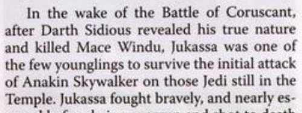

## p.179 (scan page 185)

Page contents: 1163 words, 38 paragraphs | headings/entries: Julept; Juliupper; Jump; Jumper; Juloff; Julpa, Mon; Julstan IV, Alexander; Julsujod H1; Jumerian; Jumka, Mavikk; Jumus; Jun; Jun, Glee; Jun, Victor

## p.180 (scan page 186)

Page contents: 1155 words, 38 paragraphs | headings/entries: Junavex Hotel; Junction; Junction, the; Junction City; Junction Port; Jundland; Jundiand, Lieutenant; Jundiand Banshee; Jundiand Wastes; Jundop, Ground Marshal Haras; Jungen; Jungle Café; Jungle Cantina; Jungle Clans

## p.181 (scan page 187)

Page contents: 1212 words, 45 paragraphs | headings/entries: Ghost; Jungle Lust; Jungle Vault; Junior Galaxy Scouts; Junior Palace Guard; Junior Saber-Twirler; Junkard; Junker; Junkfort Station; Junk Junction; Junktown; Junkyard, the; Junno; Juno; Juno; Juntrack; Puoch

## p.182 (scan page 188)

Page contents: 1402 words, 33 paragraphs | headings/entries: Jurahi; Jural; Jurfel; Jurokk, Jedi Master; Jurrinex6; Jurvi; Jusik, Bardan

- **Darth Vader (Anakin Skywalker)**: "Master Jurokk was killed by Anakin Skywalker when he exterminated every Jedi in the Temple." Source: The Complete Star Wars Encyclopedia, Vol. II, p.182
  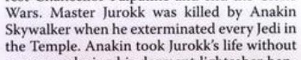

## p.183 (scan page 189)

Page contents: 1191 words, 30 paragraphs | headings/entries: Jussafet Four; Just, Dixon; Justa; Justahl; Just Armor; Justic, Geon; Justice; Justice Crusader; Justice Droid; Justice Systems; Justiss, Kai

- **Darth Zannah**: "However, Bane and his apprentice, Zannah, managed to destroy the Jedi and flee to Ambria." Source: The Complete Star Wars Encyclopedia, Vol. II, p.183
  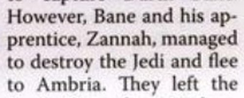

## p.184 (scan page 190)

Page contents: 1223 words, 25 paragraphs | headings/entries: Juteau Settlement; Juuus; Juvani; Juyo

## p.185 (scan page 191)

Page contents: 958 words, 27 paragraphs | headings/entries: JV-Z1/D; VII; Jwlio; JX-09; JX; Jyaima; Jydan; Jygat; Jymbud, Captain; Oskar; Jyrenne Base; Jyvus

## p.186 (scan page 192)

Page contents: 0 words, 0 paragraphs | headings/entries: 

## p.187 (scan page 193)

Page contents: 613 words, 26 paragraphs | headings/entries: K-12; K-14; K-18; K-1B; K21; K-3PO; K-3PX; K4; K8-LR; Ka, Queen Mother Tenel

## p.188 (scan page 194)

Page contents: 1251 words, 37 paragraphs | headings/entries: Kaa, Chom Frey; Kaa, Tee Wat; Ka'aa; Kaachtari; Kaadara; Kaadi

- **Jacen Solo (Darth Caedus)**: "The timely intervention of a Galactic Alliance fleet led by Solo helped defeat the Heritage Fleet and reaffirmed Tenel Ka's rule, but it also strained her relationship with Jacen." Source: The Complete Star Wars Encyclopedia, Vol. II, p.188
  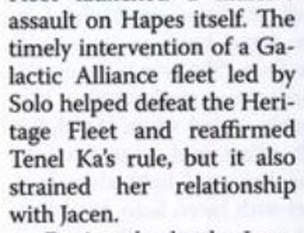

## p.189 (scan page 195)

Page contents: 1173 words, 20 paragraphs | headings/entries: Kaaldar, Dr.; Kaan, Loiric; Kaan, Lord; Kaantay; Kaarenth Dissension; Kabaira; Kabal; Kabat

- **Lord Kaan** — entry/section: Kaan, Lord: "Kaan, Lord One of the few Sith Lords who survived the internal violence that tore the Sith Order apart during the New Sith Wars." Source: The Complete Star Wars Encyclopedia, Vol. II, p.189
  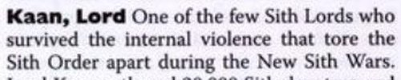
- **Lord Kaan** — entry/section: Kaan, Lord: "So Bane sent Kaan the incantations necessary to form a devastating thought bomb, as a last-ditch effort to destroy the Jedi." Source: The Complete Star Wars Encyclopedia, Vol. II, p.189
  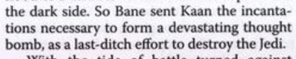
- **Lord Kaan** — entry/section: Kaan, Lord: "Lord Kaan, and virtually every Sith and Jedi warrior in the battle, was obliterated." Source: The Complete Star Wars Encyclopedia, Vol. II, p.189
  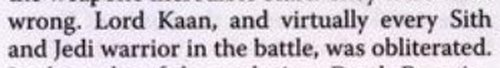
- **Grand Admiral Thrawn**: "Kaarenth Dissension An Imperial splinter group in the Corva sector formed after the defeat of Grand Admiral Thrawn at Bilbringi, it was created by Meres Ulcane and an anonymous Imperial supporter." Source: The Complete Star Wars Encyclopedia, Vol. II, p.189
  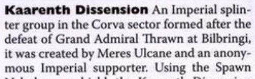

## p.190 (scan page 196)

Page contents: 1146 words, 22 paragraphs | headings/entries: Kabir, Zev; Kabul, Arista; Kabul, Seth; Kabul Industries; Kabus-Dabeh; Kachirho; Kad, Tolo; Kadann

- **King Ommin**: "In his fury, Ommin destroyed Kad with a ball of flame conjured from the dark side of the Force." Source: The Complete Star Wars Encyclopedia, Vol. II, p.190
  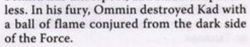

## p.191 (scan page 197)

Page contents: 1122 words, 27 paragraphs | headings/entries: Kadas'sa'Nikto; Kad'ika; Kadir, Moff; Kadok Regions; Kador, Mab; Kadorto, Halley; Kadril; Kael, Captain; Kaeli 116; Kaellin Hl; Kaelta; Kaerobanii; Kaer Orbital Platform; Kaesii

- **Palpatine (Darth Sidious); Darth Vader (Anakin Skywalker)**: "Using an intense barrage of Force lightning, Palpatine killed Kadir while Vader executed the troops." Source: The Complete Star Wars Encyclopedia, Vol. II, p.191
  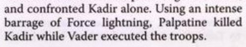
- **Palpatine (Darth Sidious)**: "It was said that the Kadok Regions had little regard for the Old Republic, and that the Jedi Knights were defeated in the area in a battle shortly before the rise of Emperor Palpatine." Source: The Complete Star Wars Encyclopedia, Vol. II, p.191
  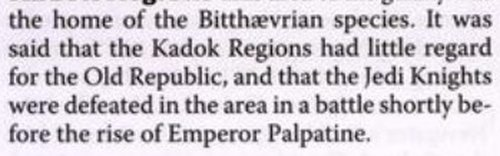
- **Admiral Daala**: "But when the two later warned of a possible imminent Imperial attack, the complacent Kaell 116 ignored them—much to the peril of the planet, which was nearly annihilated in the attack ordered by Admiral Natasi Daala." Source: The Complete Star Wars Encyclopedia, Vol. II, p.191
  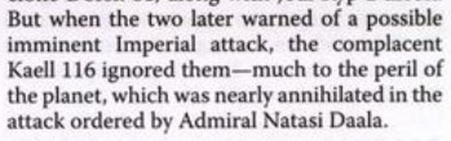

## p.192 (scan page 198)

Page contents: 962 words, 27 paragraphs | headings/entries: Kagi, Captain; Kaguya; Kahiyuk; Kahorr, Ssk; Kahranna; Kahr'corvh; Kai; Kai, Tamith; Kai-Kan

- **Darth Maul; Obi-Wan Kenobi**: "Kahmf, Drell Stories spread that this Iridonian scientist was able to recover the brain and part of the spinal cord of Darth Maul after the Sith apprentice was killed by Obi-Wan Kenobi." Source: The Complete Star Wars Encyclopedia, Vol. II, p.192
  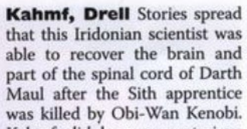
- **Naga Sadow**: "The ship was targeted and destroyed by Sith Lord Naga Sadow, killing Kahorr." Source: The Complete Star Wars Encyclopedia, Vol. II, p.192
  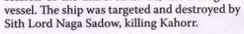

## p.193 (scan page 199)

Page contents: 1089 words, 28 paragraphs | headings/entries: Kail; Kaileel, Detien; Kailio Entertainments; Kailor V; Kaim; Kai Mir; Kaine, Grand Moff Ardus; Kaink; Kaird; Kairn; Kairn, Reess

- **Kaird** — entry/section: Kaird: "However, Thula and Squa Tront double-crossed him, and Kaird would have been killed if he hadn't discovered their trap." Source: The Complete Star Wars Encyclopedia, Vol. II, p.193
  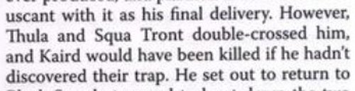

## p.194 (scan page 200)

Page contents: 920 words, 25 paragraphs | headings/entries: Kaj, Obs; Kajain'sa'Nikto; Kajiin Swamp; Kal; KajLa; Kalakar Six; Kalarba; Kala'uun Starport; Kaldani Spires Residential Apartments; Kalenda, Belindi

- **Darth Vader (Anakin Skywalker); Darth Maul**: "Kalakar Six A moon reputed to be the site of a climactic confrontation between Darth Vader and a resurrected Darth Maul." Source: The Complete Star Wars Encyclopedia, Vol. II, p.194
  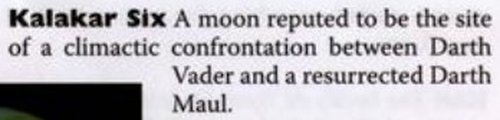
