# Owner Material 031 — The Complete Star Wars Encyclopedia, Vol. II (H–O): scan pages 201–240

- **Source:** *The Complete Star Wars Encyclopedia* by Stephen J. Sansweet and Pablo Hidalgo, with Bob Vitas, Daniel Wallace, Chris Cassidy, Mary Franklin and Josh Kushins (Del Rey, 2008), 3 vols. Secondary source (licensed Legends reference). Scan OCR'd on the box; the scan stays box-only and is **not** published.
- **Method:** every scanned page was OCR'd and machine-screened sentence by sentence for power-relevant statements (fights, kills, defeats, Force feats, rankings, superweapons) that name a character on our roster; each kept sentence is quoted verbatim from the OCR text and has a crop of the printed passage directly under it. Pages with nothing power-relevant are still listed with what is on them.
- **Citation:** "The Complete Star Wars Encyclopedia, Vol. II, p.X" by printed page ("scan p.X" where no printed number applies). **Weight:** Lucasfilm-licensed encyclopedia: a secondary, in-universe summary of Legends (and some film) material. It sums up feats from novels, comics and games; where the original story is in our notes, that source is the stronger citation.

## p.195 (scan page 201)

Page contents: 1302 words, 34 paragraphs | headings/entries: Kalevala; Kal Fas, Hrchek; Kal Fas, Sai'torr; Kalibac Industries; Kalidor Crescent; Kaliida Shoals Med Station; Kalist VI; Kalkovak; Kalla; Kallaarac; Kallarak Amphitheater; Kalla's Stanchion; Kallea, Freia; Kallic, Captain

- **Darth Vader (Anakin Skywalker)**: "Kallic, Captain An Imperial Navy captain who was given temporary command of the flagship Super Star Destroyer Executor shortly after the Battle of Hoth, when Darth Vader was called to Coruscant by the Emperor." Source: The Complete Star Wars Encyclopedia, Vol. II, p.195
  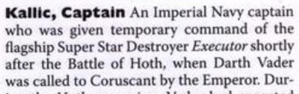

## p.196 (scan page 202)

Page contents: 1028 words, 21 paragraphs | headings/entries: Kallidahin; Kalmec, the; Kalpana, Supreme Chancellor; Kalta, Jurgan; Kal-Tan-Shi; Kamar; Kamaran, Willum; Kamida, Princess; Kamino; Kamino Accords; Kaminoan

## p.197 (scan page 203)

Page contents: 1067 words, 28 paragraphs | headings/entries: Kamilin; Kammia; Kamparas; Kandah; Kandela, Entha; Kandon

- **Canderous Ordo**: "A former bounty hunter associate of Kang, Canderous Ordo, helped the fugitives escape Taris by infiltrating Kang's compound and stealing his ship, the Ebon Hawk, Kang was killed trying to stop the fugitives." Source: The Complete Star Wars Encyclopedia, Vol. II, p.197
  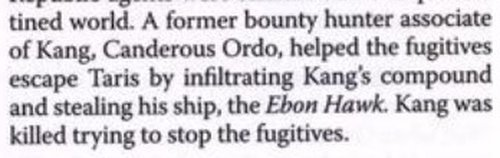

## p.198 (scan page 204)

Page contents: 1136 words, 22 paragraphs | headings/entries: Kanz Disorders; Kaon; Ka'Pa; Karathas, Admiral Vara; Karda, Abal; Kardem

- **Palpatine (Darth Sidious); Kir Kanos**: "Even after Palpatine was defeated at Endor, Kanos and his fellow Royal Guardsmen remained true to the Imperial ideal." Source: The Complete Star Wars Encyclopedia, Vol. II, p.198
  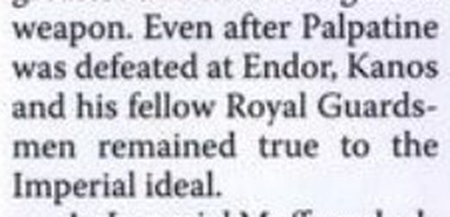
- **Count Dooku**: "Tyranus, however, used his mastery of the Force to alter his internal chemistry as a defense against the virus." Source: The Complete Star Wars Encyclopedia, Vol. II, p.198
  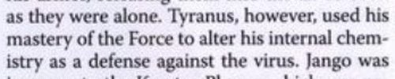

## p.199 (scan page 205)

Page contents: 1090 words, 30 paragraphs | headings/entries: Karena; Karf; Karflo Corporation; Karg, Commander; Kari; Karin, Baron; Kark, Kith; Karl, Dr. Anet; Karn

- **Quinlan Vos; Volfe Karkko**: "Vos returned to Kiffex with the Jedi Knights, however, and defeated Karkko in combat." Source: The Complete Star Wars Encyclopedia, Vol. II, p.199
  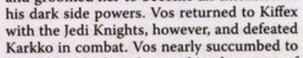

## p.200 (scan page 206)

Page contents: 1129 words, 18 paragraphs | headings/entries: Karoc; Karr, Hondo; Karra; Karrde, Talon

- **Darth Vader (Anakin Skywalker)**: "Both brothers were killed after the Battle of Geonosis by Anakin Skywalker, who was searching for the source of the cortosis-based battle droids being produced on Metalorn." Source: The Complete Star Wars Encyclopedia, Vol. II, p.200
  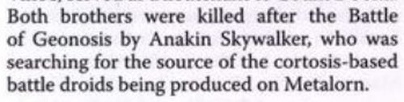
- **Darth Talon** — entry/section: Karrde, Talon: "Karrde, Talon The lawless shadows of the underworld spawned despicable characters possessed of greed, vice, and a lack of scruples—kingpins like Jabba the Hutt, capable of killing without compunction." Source: The Complete Star Wars Encyclopedia, Vol. II, p.200
  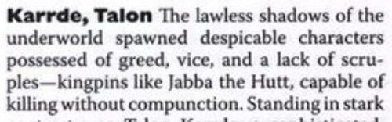
- **Grand Admiral Thrawn**: "This group provided vital support to the New Republic that helped spell Thrawn's defeat at the Battle of Bilbringi." Source: The Complete Star Wars Encyclopedia, Vol. II, p.200
  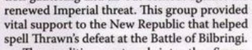

## p.201 (scan page 207)

Page contents: 1012 words, 25 paragraphs | headings/entries: Karreio; Karsh, Komm; Karsk, Amil; Kartan, Race; Kartha, Captain; Kasarax; Kash, Samish; Kashi Mer; Kashir; Kashoon; KashyCorp; Kashyyyk

- **Jacen Solo (Darth Caedus)**: "Peace didn't last long, however, and during the Confederation—GA War, after Jacen Solo declared the Jedi enemies of the state, Karrde provided his organization's information and equipment to help the Jedi successfully raid Solo's Star Destroyer." Source: The Complete Star Wars Encyclopedia, Vol. II, p.201
  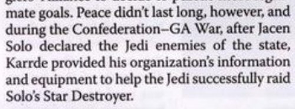

## p.202 (scan page 208)

Page contents: 1121 words, 24 paragraphs | headings/entries: Kas'im; Kaskutal; Kassa, Ossk; Kast, Jodo; Katarkus, Ludwin; Katarn, Kyle

- **Kyle Katarn** — entry/section: Katarn, Kyle: "While Kyle was at the Academy, his father was killed." Source: The Complete Star Wars Encyclopedia, Vol. II, p.202
  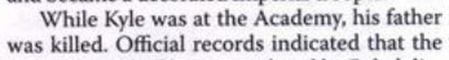
- **Kyle Katarn** — entry/section: Katarn, Kyle: "Kyle learned the truth, however, from a Rebel agent named Jan Ors: His father had been captured by the Empire for treason, and killed by the Dark JediJerec." Source: The Complete Star Wars Encyclopedia, Vol. II, p.202
  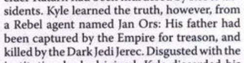

## p.203 (scan page 209)

Page contents: 1146 words, 29 paragraphs | headings/entries: Katarn, Morgan; Katarn Clan; Katarra; Katharsis; Kathol Republic; Kattada

- **Kyle Katarn; Jerec** — entry/section: Katarn, Kyle: "Deep in the Valley of the Jedi, Kyle confronted Jerec, the very man who had killed his father." Source: The Complete Star Wars Encyclopedia, Vol. II, p.203
  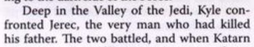
- **Kyle Katarn; Jerec** — entry/section: Katarn, Kyle: "The two battled, and when Katarn slew Jerec, he fulfilled an ancient prophecy." Source: The Complete Star Wars Encyclopedia, Vol. II, p.203
  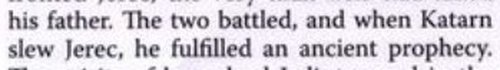
- **Kyle Katarn; Plo Koon** — entry/section: Katarn, Kyle: "He also traveled to Sarm with Master Skywalker, on the mission to eliminate Lomi Plo and force UnuThul to sever his contact with the Colony." Source: The Complete Star Wars Encyclopedia, Vol. II, p.203
  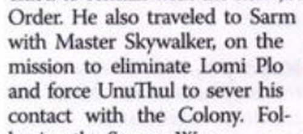
- **Kyle Katarn** — entry/section: Katarn, Kyle: "Katarn survived the attack, although he spent many weeks on the Forest Moon of Endor recovering." Source: The Complete Star Wars Encyclopedia, Vol. II, p.203
  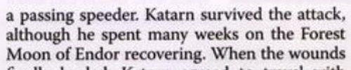
- **Jerec**: "When Morgan was trying to protect the Valley of the Jedi from being exploited by Jerec, the Dark Jedi decapitated him and placed his severed head on a pike." Source: The Complete Star Wars Encyclopedia, Vol. II, p.203
  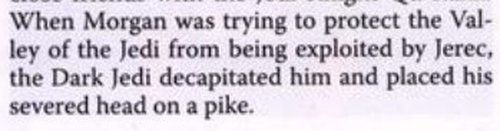

## p.204 (scan page 210)

Page contents: 823 words, 22 paragraphs | headings/entries: Katth, Zasm; Katuunko, King; Kaudine; Kaul; Kauri; Kauron; Kavar; Kavil; Kavila; Kavila, Harido; K'avor; Kayniph, Macus

- **Vima-Da-Boda**: "Second, they were to hunt down and destroy Vima-Da-Boda." Source: The Complete Star Wars Encyclopedia, Vol. II, p.204
  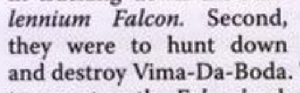
- **Lando Calrissian**: "The Kauri was destroyed when the vagabond fled into hyperspace after Lando Calrissian breached its inner hull." Source: The Complete Star Wars Encyclopedia, Vol. II, p.204
  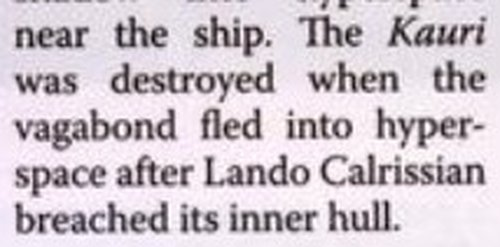
- **Kavar; Meetra Surik** — entry/section: Kavar: "After Vaklu was defeated, Kavar chose to teach the Exile new lightsaber combat techniques before setting out for Dantooine to rebuild the Jedi Order." Source: The Complete Star Wars Encyclopedia, Vol. II, p.204
  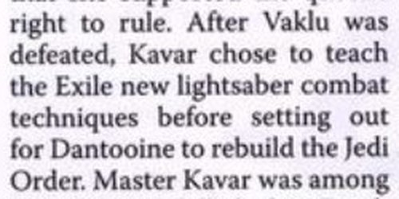
- **Kavar; Kreia** — entry/section: Kavar: "Master Kavar was among the many Jedi killed when Darth Traya attacked and destroyed the Jedi enclave on Dantooine." Source: The Complete Star Wars Encyclopedia, Vol. II, p.204
  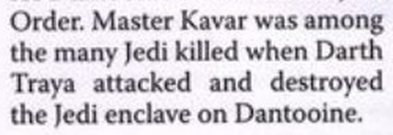

## p.205 (scan page 211)

Page contents: 904 words, 38 paragraphs | headings/entries: Kazak; Kazz, Admiral; Kceaj, Coleman; KD49; KD57; Ke, Halli; KE-8 Enforcer; KE-829; Kebla Yurt's Equipment Emporium; Kech, Nakk; Ke'dem Ramp; Kee, Habba; Kee, Neva; Kee, Tas; Keed'kak, Kitik; Keeg, Baniss; Keeheen; Keek; Keek, Inspector; Keela, Gyr

- **Luke Skywalker; Leia Organa Solo**: "Kee (2) A Yuzzem miner on the planet Mimban, he helped Luke Skywalker, Princess Leia Organa, and the old woman Halla retrieve the legendary Kaiburr crystal from the Temple of Pomojema." Source: The Complete Star Wars Encyclopedia, Vol. II, p.205
  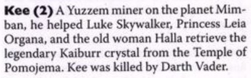
- **Darth Vader (Anakin Skywalker)**: "Kee was killed by Darth Vader." Source: The Complete Star Wars Encyclopedia, Vol. II, p.205
  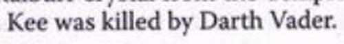

## p.206 (scan page 212)

Page contents: 1066 words, 38 paragraphs | headings/entries: Keely, Jobe; Keeper; Keeper; Kee-Piru; Keeramak; Keesa; Kegan; Kei; Keiffler Brothers; Keitumite Mutual Military Treaty; Kek, Bolton; Kel, Waxarn; Kelad'den; Keldabe

## p.207 (scan page 213)

Page contents: 872 words, 28 paragraphs | headings/entries: Kel Dor; Keldor, Dr. Ohran; Kelkko, Rath; Kell; Keller, Commander; Kellering, Dr.; Keller's Void; Kel-Mar; Kelmont, Lieutenant; Kelrodo-Ai; Kelsome, Corporal Maren; Keltric, Colonel; Keluda; Kelvyyn, Graxol; Kemp, Lott

- **Leia Organa Solo**: "Keldor was killed on Belsavis when he fell from a mobile vinecoffee bed while trying to capture Princess Leia Organa." Source: The Complete Star Wars Encyclopedia, Vol. II, p.207
  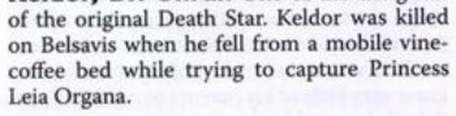
- **Luke Skywalker**: "Kell survived on Dathomir for the next three centuries, and eventually turned the reader tapes over to Luke Skywalker before dying of old age." Source: The Complete Star Wars Encyclopedia, Vol. II, p.207
  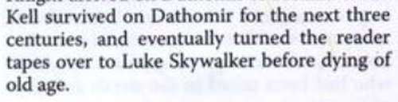

## p.208 (scan page 214)

Page contents: 1301 words, 19 paragraphs | headings/entries: Kemplex Nine; Ken; Kenb, Commander; Kendalina; Kendamari Casinos; Kenlin, Bors; Kennede, Master Ved

- **Luke Skywalker**: "But Luke and Ken combined their Force powers to defeat the Supreme Prophet." Source: The Complete Star Wars Encyclopedia, Vol. II, p.208
  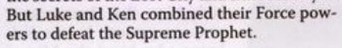
- **Palpatine (Darth Sidious)**: "There she met and fell in love with the mutant three-eyed son of Emperor Palpatine, Triclops, and bore him a son, Ken, before she was killed." Source: The Complete Star Wars Encyclopedia, Vol. II, p.208
  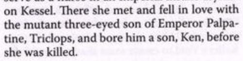
- **Kir Kanos**: "Kennede, Tav Although not an Imperial Royal Guardsman himself, he allied himself with Kir Kanos to gain vengeance on those who had killed his father." Source: The Complete Star Wars Encyclopedia, Vol. II, p.208
  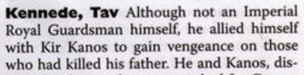
- **Obi-Wan Kenobi**: "Kenobi, Obi-Wan (Ben) A dedicated and legendary Jedi Knight, Obi-Wan Kenobi had a long and tumultuous career that helped shape the fate of an entire galaxy." Source: The Complete Star Wars Encyclopedia, Vol. II, p.208
  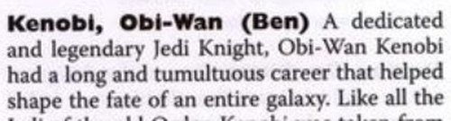

## p.209 (scan page 215)

Page contents: 1071 words, 14 paragraphs | headings/entries: 

- **Obi-Wan Kenobi; Qui-Gon Jinn**: "As the duel progressed, Obi-Wan and Qui-Gon became separated." Source: The Complete Star Wars Encyclopedia, Vol. II, p.209
  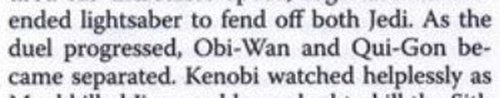
- **Obi-Wan Kenobi; Darth Maul**: "Kenobi watched helplessly as Maul killed Jinn, and he rushed to kill the Sith Lord in turn." Source: The Complete Star Wars Encyclopedia, Vol. II, p.209
  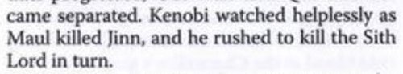

## p.210 (scan page 216)

Page contents: 1169 words, 11 paragraphs | headings/entries: 

- **Obi-Wan Kenobi**: "Jedi fell by the dozens, but Obi-Wan fought valiantly and survived." Source: The Complete Star Wars Encyclopedia, Vol. II, p.210
  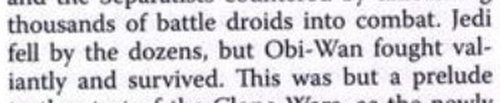
- **Count Dooku**: "Skywalker and Dooku dueled, but again the Count proved his superiority." Source: The Complete Star Wars Encyclopedia, Vol. II, p.210
  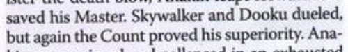
- **Yoda; Count Dooku; Obi-Wan Kenobi; Darth Vader (Anakin Skywalker)**: "Though Yoda's withering lightsaber attack nearly defeated the former Jedi, Dooku was able to distract the diminutive Master by endangering Obi-Wan and Anakin with a fallen pillar torn free by the Force." Source: The Complete Star Wars Encyclopedia, Vol. II, p.210
  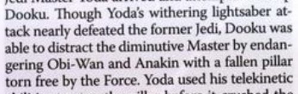
- **Yoda; Count Dooku**: "Yoda used his telekinetic abilities to stop the pillar before it crushed the two younger Jedi, and Dooku escaped." Source: The Complete Star Wars Encyclopedia, Vol. II, p.210
  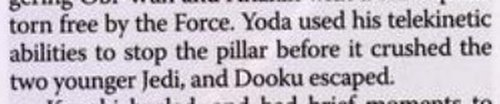
- **Count Dooku**: "Dooku proved a formidable opponent." Source: The Complete Star Wars Encyclopedia, Vol. II, p.210
  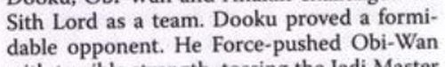
- **Darth Vader (Anakin Skywalker); Count Dooku**: "Out cold, he never saw the final moments of the duel, when Anakin killed an unarmed Dooku in cold blood at the Chancellor's goading." Source: The Complete Star Wars Encyclopedia, Vol. II, p.210
  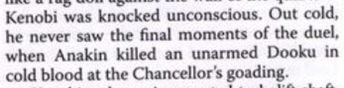
- **Obi-Wan Kenobi; Darth Vader (Anakin Skywalker)**: "Obi-Wan and Anakin were able to break their bonds and overpower their captors." Source: The Complete Star Wars Encyclopedia, Vol. II, p.210
  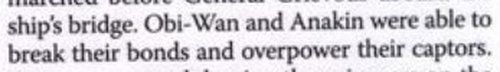

## p.211 (scan page 217)

Page contents: 1199 words, 16 paragraphs | headings/entries: 

- **Obi-Wan Kenobi; General Grievous**: "Kenobi was nearly bested, but in the course of the brawl, the Jedi had loosened the plates that protected Grievous's organic innards." Source: The Complete Star Wars Encyclopedia, Vol. II, p.211
  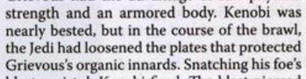
- **Darth Vader (Anakin Skywalker); Padmé Amidala**: "Anakin accused Padmé of betraying him, and used the Force to start to strangle her." Source: The Complete Star Wars Encyclopedia, Vol. II, p.211
  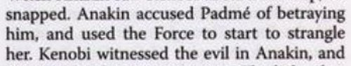
- **Obi-Wan Kenobi; Darth Vader (Anakin Skywalker)**: "The duel spilled over onto Mustafar's fiery surface, with Kenobi and Vader clashing atop automated platforms floating on the molten rivers of lava." Source: The Complete Star Wars Encyclopedia, Vol. II, p.211
  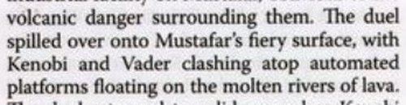
- **Obi-Wan Kenobi**: "The duel returned to solid ground as Kenobi jumped to the black-sand shores of one of the lava flows." Source: The Complete Star Wars Encyclopedia, Vol. II, p.211
  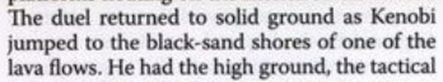

## p.212 (scan page 218)

Page contents: 1377 words, 40 paragraphs | headings/entries: Kenobi Offensive; Kenow, Colonel; Kensaric, Corporal; Kentas, Julynn; Keoulkeech; Kepporra, Wynt; Kerane; Kerilt; Kerkoiden

- **Obi-Wan Kenobi**: "As the Jedi's ranks were wiped out by the machinations of the emergent Empire, Obi-Wan went into hiding on Tatooine." Source: The Complete Star Wars Encyclopedia, Vol. II, p.212
  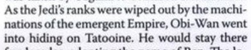
- **Obi-Wan Kenobi; Darth Vader (Anakin Skywalker); Luke Skywalker**: "Although Kenobi felt that the dark side could only be defeated by bringing about the deaths of Anakin and the Emperor, Luke strongly believed that his father still had good in him." Source: The Complete Star Wars Encyclopedia, Vol. II, p.212
  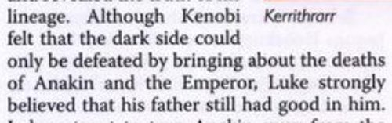
- **Obi-Wan Kenobi; Yoda**: "His spectral form joined that of Kenobi and Yoda during the Rebel Alliance's celebration of the Empire's defeat." Source: The Complete Star Wars Encyclopedia, Vol. II, p.212
  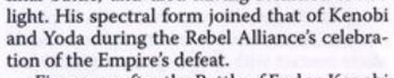
- **Lando Calrissian**: "Kenow was discovered by Lando Calrissian, who killed him in self-defense." Source: The Complete Star Wars Encyclopedia, Vol. II, p.212
  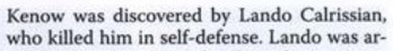

## p.213 (scan page 219)

Page contents: 1090 words, 26 paragraphs | headings/entries: Kern; Kerrithrarr; Kessel; Kesselrook, Serja; Kessel Run; Kestic Station; Kestrel; Kestrel Nova; Ketaris; Keten; Kether, Ran; Kethor; Keto, Aleema; Keto, Satal

- **Moruth Doole; Admiral Daala**: "Kessel's moon, which once held an Imperial garrison and Doole's ragtag defensive fleet (decimated in a battle with Admiral Daala's Star Destroyers), was destroyed by a Death Star prototype from Maw Installation." Source: The Complete Star Wars Encyclopedia, Vol. II, p.213
  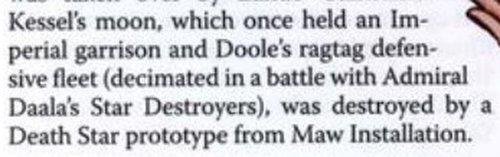
- **Aleema Keto; Ulic Qel-Droma** — entry/section: Keto, Aleema: "Jedi Knight Ulic Qel-Droma traveled to the system in order to learn the Krath's secrets, but he succumbed to the dark side himself and helped Aleema defeat her enemies." Source: The Complete Star Wars Encyclopedia, Vol. II, p.213
  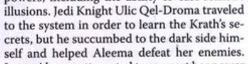
- **Aleema Keto** — entry/section: Keto, Aleema: "Later, Aleema attempted to reassert her power over Krath forces by abandoning Qel-Droma during an attack on Coruscant, but he was rescued and eventually had Aleema killed." Source: The Complete Star Wars Encyclopedia, Vol. II, p.213
  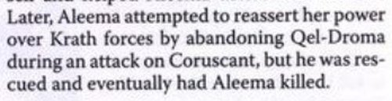

## p.214 (scan page 220)

Page contents: 1162 words, 29 paragraphs | headings/entries: Keto, Sebban; Keto, Serra; Ketwol; Kev, Dayla; Khaddar, Ob; Khakraim; Khal, Sinsor; Khalii, Drosh; Khamar; Khan, Lo; Kharrus, Senator

- **Satal Keto; Ulic Qel-Droma; Arca Jeth** — entry/section: Keto, Satal: "He eventually was killed by Jedi Ulic Qel-Droma for instigating the death of Qel- Droma's teacher, Jedi Master Arca Jeth." Source: The Complete Star Wars Encyclopedia, Vol. II, p.214
  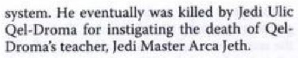
- **Darth Vader (Anakin Skywalker)**: "She later was expelled from the Jedi Order for her defiant attitudes, and was killed by Darth Vader." Source: The Complete Star Wars Encyclopedia, Vol. II, p.214
  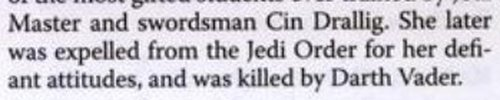
- **Leia Organa Solo**: "The other Noghri on the team were killed, but Leia let Khabarakh go, and later lived up to her promise to visit the Noghri homeworld, Honoghr, to present the cause of the Alliance." Source: The Complete Star Wars Encyclopedia, Vol. II, p.214
  
- **Leia Organa Solo; Darth Vader (Anakin Skywalker)**: "But the other Noghri soon learned that Leia, or "Lady Vader,' was telling the truth, and they rose up against the Imperial forces that had long dominated them." Source: The Complete Star Wars Encyclopedia, Vol. II, p.214
  

## p.215 (scan page 221)

Page contents: 1101 words, 25 paragraphs | headings/entries: Kharys; Khetanna; Khim'bar; Khomm; Kho Nai; Khorda, General Ashaar; Khral'Nas; Khuiumin; Khurgee, Captain; Ki-Adi-Mundi

- **Dorsk 81**: "The following year, Dorsk 81 returned to Khomm; his warnings of an Imperial attack were ignored, and the planet was devastated by Colonel Cronus and his fleet of Victory-class Star Destroyers." Source: The Complete Star Wars Encyclopedia, Vol. II, p.215
  
- **Jango Fett; Yarael Poof**: "General Khorda nearly succeeded in destroying the Infant near Coruscant's central power core, but was killed in a struggle with Jango Fett and Jedi Master Yarael Poof." Source: The Complete Star Wars Encyclopedia, Vol. II, p.215
  
- **Ki-Adi-Mundi** — entry/section: Ki-Adi-Mundi: "He eventually escaped using the Force and defeated her." Source: The Complete Star Wars Encyclopedia, Vol. II, p.215
  

## p.216 (scan page 222)

Page contents: 1158 words, 28 paragraphs | headings/entries: Kickback; Kid Dxo'In; Kiffar; Kiffex; Kiffu; Kiffu, Senni; Kihotay, Don-Wan; Kikow

- **Qui-Gon Jinn**: "For its failure to detect the Sith menace in time, the Jedi suffered the loss of one its greatest Masters, Qui-Gon." Source: The Complete Star Wars Encyclopedia, Vol. II, p.216
  
- **Ki-Adi-Mundi** — entry/section: Ki-Adi-Mundi: "Many Jedi died that day, though Ki-Adi-Mundi survived." Source: The Complete Star Wars Encyclopedia, Vol. II, p.216
  
- **Han Solo**: "When Zavval was killed during Han Solo's escape from Ylesia, Aruk installed Kibbick in his place as manager of the spice-processing centers on the planet." Source: The Complete Star Wars Encyclopedia, Vol. II, p.216
  

## p.217 (scan page 223)

Page contents: 998 words, 27 paragraphs | headings/entries: KiLargo's Cantina; Kile; Killee Wasteland; Killik; Killik Twilight; Killing House; Kilo Squad; Kim, Chankar; Kim, Norym; Kim, Ronhar

- **Grand Admiral Thrawn**: "The painting ended up in the personal collection of Imperial Grand Admiral Thrawn, and many of the Imperials who knew of its existence believed it had been lost when Thrawn was killed." Source: The Complete Star Wars Encyclopedia, Vol. II, p.217
  

## p.218 (scan page 224)

Page contents: 1104 words, 25 paragraphs | headings/entries: Kim, Vidar; Kimdyara, Kin; Kimsh; Kinahay, Zyne; Kindar, Colonel Pejanes; Kine; Kiner; Kinesworthy, Dr. Nycolai; Kintan

- **Palpatine (Darth Sidious)**: "Kim, Vidar The father of Jedi Master Ronhar Kim, he was Naboo's representative to the Galactic Senate prior to Senator Palpatine, but was killed in an assassination plot while on Coruscant." Source: The Complete Star Wars Encyclopedia, Vol. II, p.218
  
- **Lando Calrissian**: "Despite his background, Kine was recruited by Lando Calrissian to locate and defeat a group of pirates who were ambushing New Republic convoys from a base on Radix in the Abraxas system." Source: The Complete Star Wars Encyclopedia, Vol. II, p.218
  
- **Lando Calrissian**: "Kiela revealed that Kine was a former Imperial captain, To ensure the success of his mission, Kine shot Lando, but Calrissian survived and surprised Kine long enough for Isolde Siro to kill him." Source: The Complete Star Wars Encyclopedia, Vol. II, p.218
  
- **Darth Vader (Anakin Skywalker); Luke Skywalker**: "Darth Vader created one in an effort to destroy Luke Skywalker on Circarpous V, but Luke was able to deflect it and send it back at Vader." Source: The Complete Star Wars Encyclopedia, Vol. II, p.218
  

## p.219 (scan page 225)

Page contents: 827 words, 25 paragraphs | headings/entries: Kinyen; Kip; Kiph, Dmaynel; Kir; Kira, Drokko; Kira, Modon; Kira, Oron; Kira Run; Kirdo Hl; Kirima; Kiris Asteroid Cluster; Kirl; Kiro

## p.220 (scan page 226)

Page contents: 919 words, 21 paragraphs | headings/entries: Kirrek; Kirske, Osika; Kirst; Kirtania; Kit; Kithaba; Kithra; Kitonak; Kkak, Hrar; Kkak, Tteel; K'Kruhk

- **Luke Skywalker; Kyp Durron; Sun Crusher (superweapon)**: "It was Kithra who intercepted Luke Skywalker and Kyp Durron when they arrived at the Maw on a mission to destroy the Sun Crusher." Source: The Complete Star Wars Encyclopedia, Vol. II, p.220
  

## p.221 (scan page 227)

Page contents: 1059 words, 23 paragraphs | headings/entries: Kktkt; Kiaatu; Kliatooine; Klaymor 4-2; Klev, Captain Titus; Kieyvits

- **K'Kruhk; Asajj Ventress** — entry/section: K'Kruhk: "Master K'Kruhk was badly injured in a lightsaber duel with Ventress." Source: The Complete Star Wars Encyclopedia, Vol. II, p.221
  
- **K'Kruhk; General Grievous** — entry/section: K'Kruhk: "During a mission to destroy the droid foundries on Hypori, K'Kruhk was gravely wounded by General Grievous." Source: The Complete Star Wars Encyclopedia, Vol. II, p.221
  
- **K'Kruhk** — entry/section: K'Kruhk: "Masters K'Kruhk and Jeisel were placed in charge of the ground forces that attacked the Separatist stronghold on the planet, ultimately destroying the primary shield generator that protected the cloning facilities for the Shadow Army." Source: The Complete Star Wars Encyclopedia, Vol. II, p.221
  
- **Luke Skywalker**: "He was killed after Luke Skywalker tampered with the master control signal that guided the Devastators, causing Silencer-7 to crash into the Mon Calamari ocean." Source: The Complete Star Wars Encyclopedia, Vol. II, p.221
  

## p.222 (scan page 228)

Page contents: 1029 words, 23 paragraphs | headings/entries: Kline; Kloper; Kluggerhorn, Zack; Kneesaa, Princess; Knife, Commander

## p.223 (scan page 229)

Page contents: 1200 words, 31 paragraphs | headings/entries: KnobHead; Knolstee; Knossa Spaceport; Koba; Koboth; Kodai; Kogo, Vess; Kohima; Koh'shak; Kohvrekhar; Kolader; Kolaff, Captain; Kolar, Agen

- **Yaddle; Tulak Hord**: "After defeating Polvin Kut and Yaddle in battle, Tulak retired and eventually died." Source: The Complete Star Wars Encyclopedia, Vol. II, p.223
  
- **Luke Skywalker; Darth Vader (Anakin Skywalker)**: "After learning that Luke had survived the encounter, Vader ordered Kohvrekhar to Tatooine to ensure that Jabba the Hutt and his henchmen didn't capture or kill Skywalker." Source: The Complete Star Wars Encyclopedia, Vol. II, p.223
  
- **Agen Kolar** — entry/section: Kolar, Agen: "Kolar, Agen A Zabrak Jedi Knight and member of the Jedi Council, he was one of the few Jedi who survived the initial stages of the Battle of Geonosis." Source: The Complete Star Wars Encyclopedia, Vol. II, p.223
  

## p.224 (scan page 230)

Page contents: 917 words, 20 paragraphs | headings/entries: Kolb, Sidris; Kole; Komad, Koyi; Kono; Konur, Dal; Koon, Plo

- **Agen Kolar; Palpatine (Darth Sidious); Mace Windu** — entry/section: Kolar, Agen: "However, the Jedi were unprepared for Palpatine's powers, and Agen Kolar was quickly killed during the fighting, leaving Mace Windu to face Palpatine alone." Source: The Complete Star Wars Encyclopedia, Vol. II, p.224
  

## p.225 (scan page 231)

Page contents: 1260 words, 17 paragraphs | headings/entries: Koon, Sha; Koong, Governor

- **Palpatine (Darth Sidious)**: "When Chancellor Palpatine betrayed the Jedi and executed Order 66, Koon's troops turned to open fire on him, shooting his starfighter from the sky and destroying the Jedi Master." Source: The Complete Star Wars Encyclopedia, Vol. II, p.225
  

## p.226 (scan page 232)

Page contents: 1215 words, 18 paragraphs | headings/entries: Koozar, Fendrilon; Kopatha, Jib; Kopecz, Lord; Kordulian Kriss; Kore, Ulaha; Korenn; Kornov, Captain; Koros Major; Korr, Drama; Korr, Jaden

- **Darth Vader (Anakin Skywalker)**: "Darth Vader was dispatched to ensure Kopatha's continued cooperation and loyalty, which could be demonstrated if he could obtain viable information on the Rebel Alliance forces that had destroyed the first Death Star." Source: The Complete Star Wars Encyclopedia, Vol. II, p.226
  
- **Darth Vader (Anakin Skywalker)**: "Solo proved to be much stronger than Kopatha's interrogation expert, Choba, had anticipated, and Kopatha decided that he would be better off just turning Solo over to Vader for further interrogation." Source: The Complete Star Wars Encyclopedia, Vol. II, p.226
  
- **Darth Vader (Anakin Skywalker)**: "Vader was not pleased, and beheaded Kopatha with a swipe of his lightsaber." Source: The Complete Star Wars Encyclopedia, Vol. II, p.226
  
- **Lord Kopecz** — entry/section: Kopecz, Lord: "It was Kopecz who turned the opening battle for the Sith when he singlehandedly flew a starfighter into the hangar of a Republic flagship and slew the Jedi Master who was controlling the Republic's battle meditation." Source: The Complete Star Wars Encyclopedia, Vol. II, p.226
  
- **Lord Kopecz** — entry/section: Kopecz, Lord: "However, when the Sith massed to destroy the Jedi's main camp, Kopecz and many others began to worry that events were conspiring against them." Source: The Complete Star Wars Encyclopedia, Vol. II, p.226
  
- **Lord Kopecz** — entry/section: Kopecz, Lord: "When he finally realized that the combined strength of the Sith Lords would not prevent their annihilation, Kopecz decided that he didn't want to die without a fight." Source: The Complete Star Wars Encyclopedia, Vol. II, p.226
  
- **Lord Kopecz; Valenthyne Farfalla** — entry/section: Kopecz, Lord: "After delivering a warning about the impending detonation, Kopecz challenged Farfalla to a duel." Source: The Complete Star Wars Encyclopedia, Vol. II, p.226
  
- **Obi-Wan Kenobi; Count Dooku; Asajj Ventress; Darth Vader (Anakin Skywalker)**: "According to information gathered from Xist on Trigalis, Obi-Wan Kenobi learned that Dooku had sent his "best assassin" after Korr, Obi-Wan believed that Dooku sent Asajj Ventress, despite the fact that she apparently had been killed on Coruscant several weeks earlier by Anakin Skywalker." Source: The Complete Star Wars Encyclopedia, Vol. II, p.226
  
- **Darth Vader (Anakin Skywalker)**: "Hidden in her hand was a bomb that exploded when Anakin tried to pry it free." Source: The Complete Star Wars Encyclopedia, Vol. II, p.226
  
- **Obi-Wan Kenobi**: "In the resulting chaos, Kenobi learned that it was Durge who had killed Korr." Source: The Complete Star Wars Encyclopedia, Vol. II, p.226
  
- **Jaden Korr** — entry/section: Korr, Jaden: "She cut down Penin before attacking Korr, but was no match for his skills." Source: The Complete Star Wars Encyclopedia, Vol. II, p.226
  

## p.227 (scan page 233)

Page contents: 1043 words, 19 paragraphs | headings/entries: Korriban; Korriz; Korrot, Del; Korteen Asteroid Beit; Korunnai; Korus

- **Jaden Korr; Marka Ragnos** — entry/section: Korr, Jaden: "He confronted Tavion, and was able to defeat her in combat just as she reawakened the spirit of Marka Ragnos." Source: The Complete Star Wars Encyclopedia, Vol. II, p.227
  
- **Jaden Korr; Marka Ragnos** — entry/section: Korr, Jaden: "Jaden defeated the ancient undead Sith spirit, destroying the Scepter of Ragnos and cutting off any pathway to the spirit world." Source: The Complete Star Wars Encyclopedia, Vol. II, p.227
  
- **King Adas**: "Some 27,000 years before the Battle of Yavin, in the wake of King Adas's defeat of the Rakata, Korriban was abandoned as a base for the Sith." Source: The Complete Star Wars Encyclopedia, Vol. II, p.227
  

## p.228 (scan page 234)

Page contents: 989 words, 22 paragraphs | headings/entries: Kosh, Captain; Kosk, Lieutenant Reynol; Kossex; Kota, Rahm; Kothlis; Ko Vari

- **Aleema Keto**: "Not long after, Aleema directed so much dark force at Korus that his body exploded." Source: The Complete Star Wars Encyclopedia, Vol. II, p.228
  
- **Rahm Kota** — entry/section: Kota, Rahm: "Few in the Order bonded with the gruff Kota, but none doubted his strong commitment to the Republic, his undoubting loyalty to the Jedi Order, or his legendary courage: He often volunteered for the Order's most dangerous missions and never abandoned those in need." Source: The Complete Star Wars Encyclopedia, Vol. II, p.228
  
- **Rahm Kota** — entry/section: Kota, Rahm: "His misgivings about the clones saved Kota's life | Kouhun when Order 66 was issued and most of his fellow Jedi were slain by their clone squadrons." Source: The Complete Star Wars Encyclopedia, Vol. II, p.228
  
- **Darth Vader (Anakin Skywalker)**: "Vader arrived on the scene and destroyed a suspected Rebel base on one of the Kothlis moons." Source: The Complete Star Wars Encyclopedia, Vol. II, p.228
  

## p.229 (scan page 235)

Page contents: 1011 words, 26 paragraphs | headings/entries: Kraaken, Deputy Commander; Kraal, Charat; Krag, Urzan; Krail, Davish; Krakai; Krake Data Vault; Kram, Stiv; Kras'dohk; Krass, Harper

## p.230 (scan page 236)

Page contents: 1117 words, 14 paragraphs | headings/entries: Krath; Krax, General; Krayn; Krayt, Darth

- **Admiral Daala**: "Kratas was one of the few members to survive a series of defeats suffered under Daala." Source: The Complete Star Wars Encyclopedia, Vol. II, p.230
  
- **Darth Vader (Anakin Skywalker)**: "Anakin chased down Krayn and fought him, eventually disarming the larger man." Source: The Complete Star Wars Encyclopedia, Vol. II, p.230
  
- **Obi-Wan Kenobi; Darth Vader (Anakin Skywalker)**: "Despite Obi-Wan's cries to keep Krayn alive, Anakin drove his lightsaber through Krayn's chest and killed him." Source: The Complete Star Wars Encyclopedia, Vol. II, p.230
  
- **Darth Krayt** — entry/section: Krayt, Darth: "Despite his hatred of the alien invaders, Krayt was among the first beings who openly accepted the bioengineering of the Yuuzhan Vong, using implants and grafts to augment his already formidable body." Source: The Complete Star Wars Encyclopedia, Vol. II, p.230
  

## p.231 (scan page 237)

Page contents: 1164 words, 21 paragraphs | headings/entries: Krayt's Honor; Kreet'ah; Kre'fey, Karka; Kre'fey, Laryn; Kre'fey, Traest; Kreia

- **Kreia; Darth Malak; Meetra Surik** — entry/section: Kreia: "About five years after the defeat of Darth Malak, Kreia discovered the Jedi Exile onboard the damaged starship Ebon Hawk and brought it to Peragus IL." Source: The Complete Star Wars Encyclopedia, Vol. II, p.231
  
- **Kreia** — entry/section: Kreia: "She barely survived the encounter, in which she lost the use of one hand." Source: The Complete Star Wars Encyclopedia, Vol. II, p.231
  
- **Kreia; Meetra Surik** — entry/section: Kreia: "Kreia was also surprised to find that the Exile's severed connection to the Force had begun to return, and she vowed to train her in an effort to help restore the Jedi Order." Source: The Complete Star Wars Encyclopedia, Vol. II, p.231
  
- **Kreia; Atris** — entry/section: Kreia: "Having retaken the title of Darth Traya, she fled to Telos with Atris and set out to destroy the planet." Source: The Complete Star Wars Encyclopedia, Vol. II, p.231
  

## p.232 (scan page 238)

Page contents: 1038 words, 20 paragraphs | headings/entries: Krell, Admiral Damon; Krenn, Josala; Kressh, Ludo; Krickle; Krieg, Ganner

- **Palpatine (Darth Sidious)**: "Luckily for Krennel, Emperor Palpatine had been killed at Endor before he could pass judgment." Source: The Complete Star Wars Encyclopedia, Vol. II, p.232
  
- **Grand Admiral Thrawn**: "He personally executed the former adviser by strangling him with his cybernetic hand, then usurped control of the Ciutric Hegemony for himself and paid lip service to Thrawn's call for support during his rise to power." Source: The Complete Star Wars Encyclopedia, Vol. II, p.232
  
- **Ludo Kressh; Naga Sadow** — entry/section: Kressh, Ludo: "Kressh, Ludo An ancient Sith magician, he was Naga Sadow's contemporary and rival for the position of Dark Lord of the Sith." Source: The Complete Star Wars Encyclopedia, Vol. II, p.232
  
- **Naga Sadow**: "Kressh was believed to have been killed over Khar Delba, where Naga Sadow's fleet destroyed Kressh's forces." Source: The Complete Star Wars Encyclopedia, Vol. II, p.232
  
- **Naga Sadow**: "In the end, though, Sadow was able to use the dark side of the Force to coerce one of his own starship captains to ram Kressh's flagship, destroying the ship and killing Kressh in the explosion." Source: The Complete Star Wars Encyclopedia, Vol. II, p.232
  

## p.233 (scan page 239)

Page contents: 1274 words, 30 paragraphs | headings/entries: Kriek; Kritkeen, Sinick; Kronos-327; Krova, Lieutenant; Kru, Glie'oleg; Kryli, General; Krytollak; Krytos; K'sar, Thal; Ksstarr; KT-10; KT-18; Ktriss; Ku, Denua

- **Anakin Solo**: "Krova, Lieutenant A communications officer in the Galactic Alliance military assigned to the Star Destroyer Anakin Solo during the Alliance's war with the Confederation." Source: The Complete Star Wars Encyclopedia, Vol. II, p.233
  

## p.234 (scan page 240)

Page contents: 1190 words, 16 paragraphs | headings/entries: Kuan; Kuar; Kuari Princess; Kuat

- **Luke Skywalker**: "During an attack led by Luke Skywalker, Ku fell from a destroyed catwalk and impaled himself on a length of rebar." Source: The Complete Star Wars Encyclopedia, Vol. II, p.234
  
