# Owner Material 031 — The Complete Star Wars Encyclopedia, Vol. II (H–O): scan pages 241–280

- **Source:** *The Complete Star Wars Encyclopedia* by Stephen J. Sansweet and Pablo Hidalgo, with Bob Vitas, Daniel Wallace, Chris Cassidy, Mary Franklin and Josh Kushins (Del Rey, 2008), 3 vols. Secondary source (licensed Legends reference). Scan OCR'd on the box; the scan stays box-only and is **not** published.
- **Method:** every scanned page was OCR'd and machine-screened sentence by sentence for power-relevant statements (fights, kills, defeats, Force feats, rankings, superweapons) that name a character on our roster; each kept sentence is quoted verbatim from the OCR text and has a crop of the printed passage directly under it. Pages with nothing power-relevant are still listed with what is on them.
- **Citation:** "The Complete Star Wars Encyclopedia, Vol. II, p.X" by printed page ("scan p.X" where no printed number applies). **Weight:** Lucasfilm-licensed encyclopedia: a secondary, in-universe summary of Legends (and some film) material. It sums up feats from novels, comics and games; where the original story is in our notes, that source is the stronger citation.

## p.235 (scan page 241)

Page contents: 1219 words, 20 paragraphs | headings/entries: Kubindi; Kuhgo; Kuhru, Major

- **Luke Skywalker; Leia Organa Solo; Kueller; Han Solo**: "Together Luke and Leia faced down Kueller, and when his dark side powers were curtailed by several ysalamiri that Han Solo brought to Almania, Leia killed Kueller with a blaster shot to the head." Source: The Complete Star Wars Encyclopedia, Vol. II, p.235
  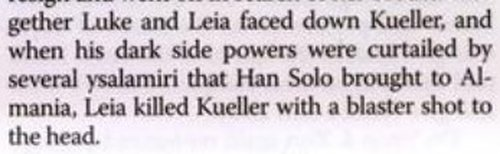
- **Exar Kun**: "Kun, Exar Once the most powerful and dangerous of the Dark Lords of the Sith, he was responsible for the deaths of millions four millennia before the rise of the Empire." Source: The Complete Star Wars Encyclopedia, Vol. II, p.235
  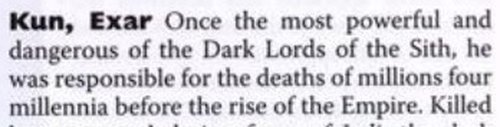
- **Exar Kun; Luke Skywalker**: "Killed by an overwhelming force of Jedi, the dark spirit of Exar Kun survived across the vastness of time to challenge Luke Skywalker and a new group of Jedi trainees." Source: The Complete Star Wars Encyclopedia, Vol. II, p.235
  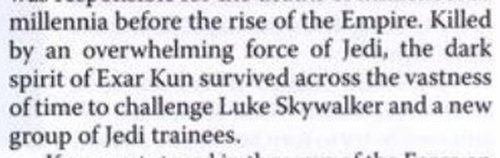

## p.236 (scan page 242)

Page contents: 1320 words, 23 paragraphs | headings/entries: Kunra; Kur-hashan; Kurin, Peate

- **Freedon Nadd**: "Then he headed for the Empress Teta system to destroy Nadd's final Sith followers." Source: The Complete Star Wars Encyclopedia, Vol. II, p.236
  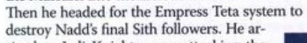
- **Aleema Keto; Ulic Qel-Droma**: "But Aleema and fallen Jedi Ulic Qel-Droma survived." Source: The Complete Star Wars Encyclopedia, Vol. II, p.236
  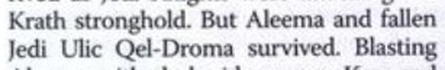
- **Aleema Keto**: "Blasting Aleema with dark side power, Kun and Qel-Droma engaged in a blistering lightsaber duel." Source: The Complete Star Wars Encyclopedia, Vol. II, p.236
  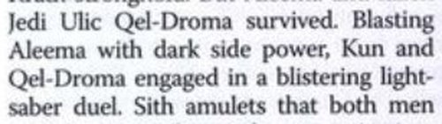

## p.237 (scan page 243)

Page contents: 1255 words, 28 paragraphs | headings/entries: Kuro, An'ya; Kurp, Kosh; Kurtzen; Kushal Vogh; Kwaad, Kae; Kwannot; Kwazel Maw; Kwenn Space Station; Kwerve, Bidlo; Kwis, Captain Vortia; Kybacca; Kyber, Natas; Kyber, Torino; Kybo, Flynn

- **Qui-Gon Jinn; Obi-Wan Kenobi**: "Kwannot A remote planet where Aurra Sing killed Jedi Master Mana Veridi and nearly took the lives of Qui-Gon Jinn and Obi-Wan Kenobi before the Battle of Naboo." Source: The Complete Star Wars Encyclopedia, Vol. II, p.237
  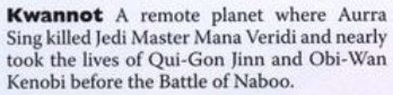
- **General Grievous**: "Tone was killed while trying to delay Grievous." Source: The Complete Star Wars Encyclopedia, Vol. II, p.237
  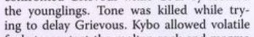

## p.238 (scan page 244)

Page contents: 0 words, 0 paragraphs | headings/entries: 

## p.239 (scan page 245)

Page contents: 615 words, 27 paragraphs | headings/entries: L8-L9; Laa; Laabann, Count Arian; Laait; Laakteen Depot; LAAT/i, LAAT/c; Laboi Il; Labreezie, Claria; Labria

- **Asajj Ventress**: "Tagge submitted the prototype to the Rattataki warlords as a gladiator combatant to prove that the droid was the superior warrior—but Asajj Ventress quickly destroyed L8-L9 in the Cauldron arena." Source: The Complete Star Wars Encyclopedia, Vol. II, p.239
  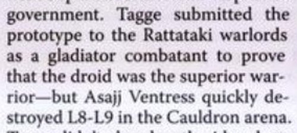

## p.240 (scan page 246)

Page contents: 1085 words, 31 paragraphs | headings/entries: Lachichuk; Lachton; Lado, Slaag; Lady Fate Casino; Lafoe, Garouf; Lafrarian; Lagard, Nap; Lago, fan; Lago, Prime Counselor Kun; Lah, Czulkang; Lah, Khalee; Lah, Liaan

## p.241 (scan page 247)

Page contents: 1132 words, 19 paragraphs | headings/entries: Lah, Maal; Lah, Qau; Lah, Qurang; Lah, Tsavong; Lah, Zhat; Lahag Erli; Lahsbee

- **Anakin Solo**: "Lah, Qau A Yuuzhan Vong warrior who took the place of Shok Choka after Anakin Solo defeated Choka in combat aboard a space station orbiting Yag'Dhul." Source: The Complete Star Wars Encyclopedia, Vol. II, p.241
  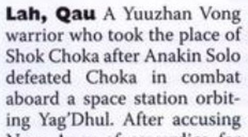
- **Leia Organa Solo; Jacen Solo (Darth Caedus)**: "However, Randa the Hutt sacrificed himself to help Leia escape, and Lah was nearly killed in battle with Leia and her son Jacen." Source: The Complete Star Wars Encyclopedia, Vol. II, p.241
  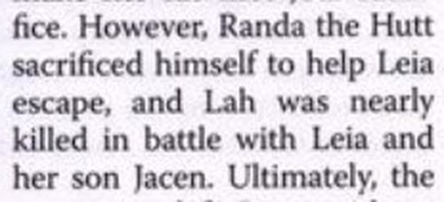
- **Jaina Solo**: "He nearly destroyed the Solo twins and many other Jedi, but Jaina was able to defeat him in combat." Source: The Complete Star Wars Encyclopedia, Vol. II, p.241
  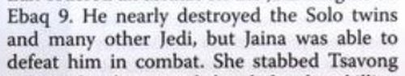

## p.242 (scan page 248)

Page contents: 957 words, 26 paragraphs | headings/entries: Lahzar, King; Lai, Ros; Lajaie, Evram; Laka, Yuka; Lake Country; Lake Natth; Lake Paonga; Lake Umberbool; Lakky, Grodon; Lalasha, Janet; Lamar, Master Vrook; Lambarian Crab

- **Valenthyne Farfalla**: "Lahzar and his forces were soundly defeated, but they delayed Farfalla sufficiently to allow the Sith to begin their attacks on Ruusan." Source: The Complete Star Wars Encyclopedia, Vol. II, p.242
  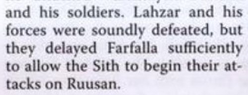
- **Quinlan Vos**: "Using an illusion—that she had killed Vos—enabled her to get close enough to her mother to kill her." Source: The Complete Star Wars Encyclopedia, Vol. II, p.242
  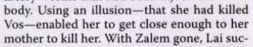
- **Quinlan Vos**: "After she was injured in Vos's successful destruction of the Infinity Gate, which could have destroyed Coruscant, Vos sensed the light side within Lai and brought her back with him to the Jedi Temple on the capital planet." Source: The Complete Star Wars Encyclopedia, Vol. II, p.242
  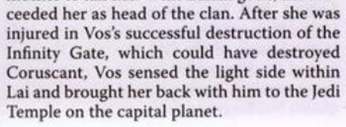
- **Luke Skywalker**: "After careful analysis, Lajaie discovered a fatal flaw that made it possible for Luke Skywalker to destroy the battle station." Source: The Complete Star Wars Encyclopedia, Vol. II, p.242
  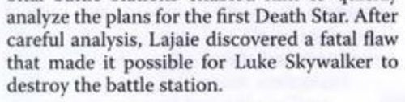
- **Chewbacca; Han Solo**: "He was killed at the Maw by Nawruun, who rose up against his master when Chewbacca and Han Solo fled the Installation during the New Republic's attempt to take control." Source: The Complete Star Wars Encyclopedia, Vol. II, p.242
  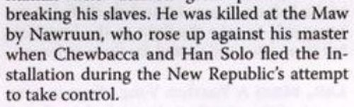
- **Vrook Lamar; Darth Malak** — entry/section: Lamar, Master Vrook: "When Darth Malak attacked and destroyed the Jedi Enclave on Dantooine, Master Vrook went into hiding for many years, until he was captured by Azkul and his mercenaries." Source: The Complete Star Wars Encyclopedia, Vol. II, p.242
  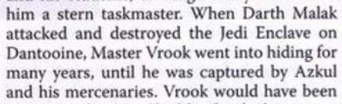
- **Vrook Lamar; Kreia** — entry/section: Lamar, Master Vrook: "Master Vrook was among the many Jedi who were killed when Darth Traya attacked and destroyed the Enclave 3,952 years before the Battle of Yavin." Source: The Complete Star Wars Encyclopedia, Vol. II, p.242
  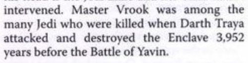

## p.243 (scan page 249)

Page contents: 865 words, 35 paragraphs | headings/entries: Lamproid; Lamuir IV; Lan Barell; Lancer Battalion; Landing, the; Landing Platform 327; Landkiller; Lando's Commandos

## p.244 (scan page 250)

Page contents: 1006 words, 24 paragraphs | headings/entries: Lando's Folly; Lands, Roan; Lang, Adion; Lanius; Lanthrym; Lao-Mon; Lar, Kira; Larado, Incavi

- **Lando Calrissian** — entry/section: Lando's Folly: "The racecourse was actually a way for Lando to get to Kerane's Folly, the legendary platinum asteroid hidden in Hoth's asteroid belt." Source: The Complete Star Wars Encyclopedia, Vol. II, p.244
  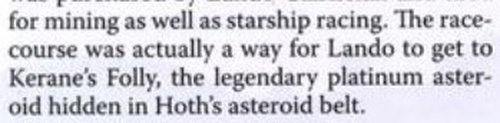

## p.245 (scan page 251)

Page contents: 1106 words, 22 paragraphs | headings/entries: Lark; Larker, Aaren; Larkhess; Larm, Admiral; LaRone, Daric; Lars, Bail; Lars, Cliegg

## p.246 (scan page 252)

Page contents: 1005 words, 28 paragraphs | headings/entries: Lars, Shmi Skywalker; Lasavvou; Laseema; Last Hope; Latara; Lathaam; Lashowe; Latham, Marsden; Lathe; Last Cail

- **Adalric Brandl**: "Brandl became angry and killed Arruna with the Force." Source: The Complete Star Wars Encyclopedia, Vol. II, p.246
  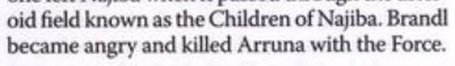
- **Uthar Wynn**: "Lashowe was among the students who joined Kel Algwinn in an attempt to destroy the Jedi Knights who had infiltrated the Sith Academy and killed Master Uthar Wynn shortly after the Great Hunt." Source: The Complete Star Wars Encyclopedia, Vol. II, p.246
  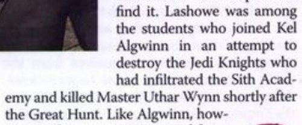
- **Count Dooku**: "The Ginivex-class starfighter was one of several ships Dooku gave her after the previous vessels had either been lost or destroyed." Source: The Complete Star Wars Encyclopedia, Vol. II, p.246
  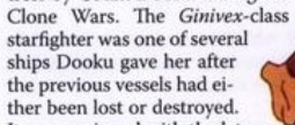

## p.247 (scan page 253)

Page contents: 1260 words, 39 paragraphs | headings/entries: Latt, Sharr; Lavin, Gana; Lavint, Uran; LE-4D0; Leafy Green; LE-BO2D9

- **Jacen Solo (Darth Caedus)**: "Jacen surprised her by taking possession of the Breathe My Jets, leaving her with enough credits to pay off her debts and purchase a stock YV-666 freighter known as the Duracrud." Source: The Complete Star Wars Encyclopedia, Vol. II, p.247
  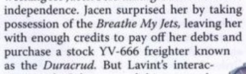
- **Darth Vader (Anakin Skywalker)**: "When Vanis crash-landed on an unidentified jungle world and was captured by Darth Vader, he ordered Ellie to destroy the tapes if help didn't come within two days." Source: The Complete Star Wars Encyclopedia, Vol. II, p.247
  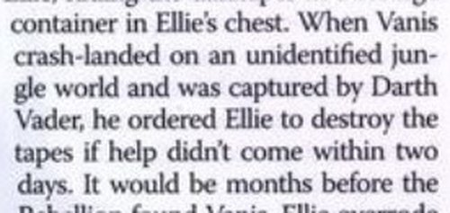
- **Leia Organa Solo; Han Solo**: "Ludlo didn't want to expose his own plans, so he agreed, but then he tried to have Leia and Han Solo killed before they could leave the planet." Source: The Complete Star Wars Encyclopedia, Vol. II, p.247
  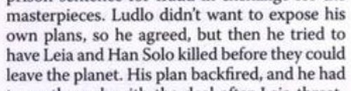

## p.248 (scan page 254)

Page contents: 1238 words, 31 paragraphs | headings/entries: Lecersen; Ledweliow, Senator Danry; Leed; Leeda, Sobo; Leeds, Ocandra; Leektar; Leem, Maks; Leeni; Leffingite; Lefrani; Legorburu, Ixidro; Leh, Fa'ale

- **Corran Horn**: "After Shedao Shai's death in his duel with Jedi Knight Corran Horn, Yuuzhan Vong warrior Deign Lian seized command of Legacy of Torment and used it to deliver lethal bioweapons that destroyed the jungles of Ithor." Source: The Complete Star Wars Encyclopedia, Vol. II, p.248
  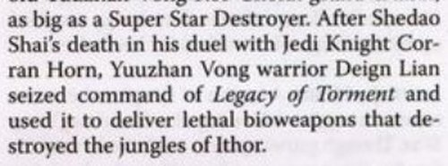

## p.249 (scan page 255)

Page contents: 1235 words, 33 paragraphs | headings/entries: Lehesu; Lehon; Leids, Nabrun; Leiger, Vin; Lekauf, Lieutenant Erv; Lekket; Lelila; Leimra

- **Rokur Gepta**: "Lehesu caught up to the courier and destroyed it, thereby cutting off Gepta's fleet from the rest of the Empire and ensuring that the ThonBoka would remain isolated and free." Source: The Complete Star Wars Encyclopedia, Vol. II, p.249
  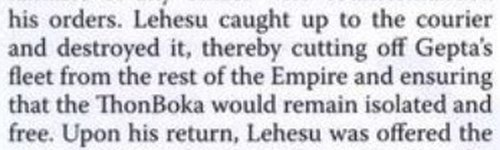
- **Palpatine (Darth Sidious); Darth Vader (Anakin Skywalker)**: "Palpatine planned to pit the Lekauf clones, without any Force sensitivity, against the Force-sensitive Cuis clones, to show Darth Vader that the Force was no match for the loyalty of well-trained soldiers." Source: The Complete Star Wars Encyclopedia, Vol. II, p.249
  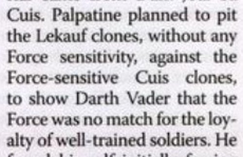
- **Darth Vader (Anakin Skywalker)**: "He found himself initially fearing Lord Vader's disapproval, especially when his clones were regularly defeated by the Dark Jedi clones." Source: The Complete Star Wars Encyclopedia, Vol. II, p.249
  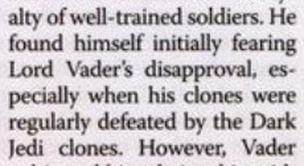

## p.250 (scan page 256)

Page contents: 1108 words, 30 paragraphs | headings/entries: Lemelisk, Bevel; Lemo; Lensi; Lennox, Captain Xamuel; Lenso, Tenk; Leobund XI, Bodé; Leong; Leonie; Lepi; Lens

- **Lando Calrissian**: "After a brief struggle with Lando Calrissian and Barpotomous Drebble, Lemo found himself in possession of the Minstrel." Source: The Complete Star Wars Encyclopedia, Vol. II, p.250
  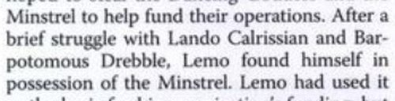
- **Jacen Solo (Darth Caedus)**: "During Jacen Solo's attempt to capture Centerpoint Station, Lensi was shot down and killed in the fighting—ironically by Antilles, who was flying as Rakehell Leader ona mission for the Jedi Order." Source: The Complete Star Wars Encyclopedia, Vol. II, p.250
  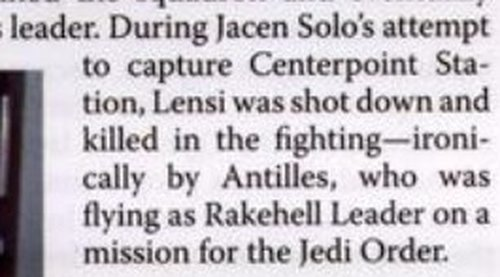

## p.251 (scan page 257)

Page contents: 1097 words, 24 paragraphs | headings/entries: Lepido Program; Leresai; Leria Kerisil; Lesh; Lesim, Major; Leska; Lessev, Kerri; Lessor, Jakohaul; Lestin, Zhar; Letaki; Leth, Umak; Lethos, Daxtorn

- **Palpatine (Darth Sidious)**: "When her parents were rounded up and executed on trumped-up charges of treason against the Empire, she was "adopted" by Emperor Palpatine, along with the children of other parents who were killed." Source: The Complete Star Wars Encyclopedia, Vol. II, p.251
  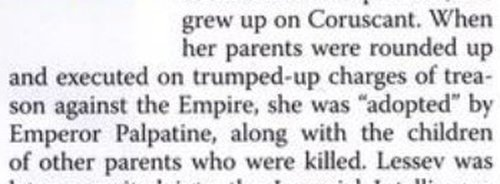
- **Revan**: "Using their skills, the Jedi wiped out Revan's knowledge of his past and replaced it with a new identity." Source: The Complete Star Wars Encyclopedia, Vol. II, p.251
  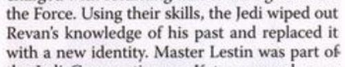
- **Darth Nihilus**: "Master Lestin was part of the Jedi Convocation on Katarr several years later, and was killed when Darth Nihilus and the forces of the Sith attacked the planet and laid waste to its surface." Source: The Complete Star Wars Encyclopedia, Vol. II, p.251
  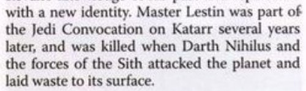

## p.252 (scan page 258)

Page contents: 909 words, 23 paragraphs | headings/entries: Levare, Dael; Leveler; Leviathor; Leyli, Lady; Uhnnar, Shandria; Lhosan Industries; Li, Tungo; Liam; Lian, Deign

## p.253 (scan page 259)

Page contents: 1012 words, 26 paragraphs | headings/entries: Liav, Leth; Liberation Day; Liberator; Liberty Star; Librarian's Assembly; Library Galactica; Lifath; Life Day

- **Luke Skywalker**: "Liberator One of two Imperial Star Destroyers captured by the Rebel Alliance during the Battle of Endor, the former Adjudicator was placed under the command of Luke Skywalker." Source: The Complete Star Wars Encyclopedia, Vol. II, p.253
  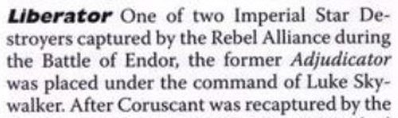
- **Boba Fett**: "Young Boba stole his miter-like hat and fled the ship with the children, while Durge set out to destroy Libkath." Source: The Complete Star Wars Encyclopedia, Vol. II, p.253
  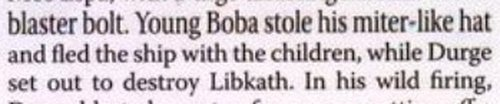

## p.254 (scan page 260)

Page contents: 1349 words, 38 paragraphs | headings/entries: Lifehold, Dannen; Lifewell; Light Festival; Li Gibbon

## p.255 (scan page 261)

Page contents: 5 words, 2 paragraphs | headings/entries: 

## p.256 (scan page 262)

Page contents: 1051 words, 27 paragraphs | headings/entries: Explorer; Lightsider; Lihnn, Mahwi; Lij, Drif; Li-Li, Jang; Lillald; Lilli; Limba; LiMerge Power; Limm; Limmer, Z.; Limoth, Garlan

- **Luke Skywalker; Kam Solusar**: "Luke Skywalker once bested Kam Solusar at it during the early years of the New Republic." Source: The Complete Star Wars Encyclopedia, Vol. II, p.256
  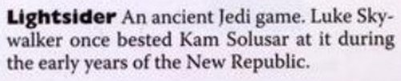
- **Asajj Ventress; Count Dooku**: "Ventress claimed that Jang Li-Li was the 16th Jedi she had killed in one-on-one combat, and that Master Maruk would have been the 17th if Dooku hadn't allowed him to live." Source: The Complete Star Wars Encyclopedia, Vol. II, p.256
  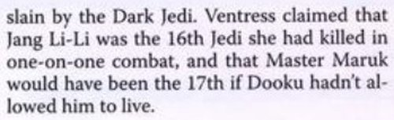
- **Prince Xizor; Guri**: "When Ororo tried to overturn the XTS domination of the spice trade in the Bajic sector, Xizor's trusted aide, the replica droid Guri, killed a number of top Ororo executives, including Z." Source: The Complete Star Wars Encyclopedia, Vol. II, p.256
  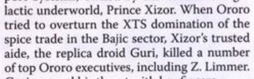

## p.257 (scan page 263)

Page contents: 1010 words, 39 paragraphs | headings/entries: Limpan, Tarla; Lin, Berd; Lin, Myoris; Lindy; Lingsnot, Po Ruddle; Linkup; Linuri; LIN-V8K; LIN-V8M; Liok; Lishma; Lissahl; Lisstik; Lisst'n; Little Bivoli; Little Killer; Livette, General; Lizil; Piahsh; Liewebum; Liez; Liitishi

## p.258 (scan page 264)

Page contents: 1159 words, 30 paragraphs | headings/entries: Linewe, Captain Deyd; Liokay; Lioyn, Pefederan; Lo, Hat; Loag; Lobi, Tresina; Lochett, Uidir

- **Obi-Wan Kenobi; Darth Vader (Anakin Skywalker); Ahsoka Tano**: "He was outsmarted by Obi-Wan Kenobi on Christophsis, The Jedi Master stalled the general long enough during a supposed surrender parley for Anakin Skywalker and Ahsoka Tano to disable the deflector shields protecting his forces." Source: The Complete Star Wars Encyclopedia, Vol. II, p.258
  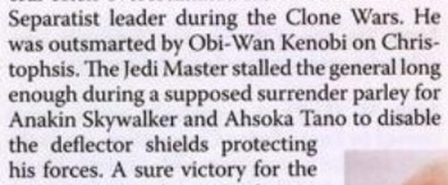
- **Lumiya**: "Lumiya used her lightwhip to take off the Jedi's legs at the knees, and then Rar beheaded the Chev with her lightsaber." Source: The Complete Star Wars Encyclopedia, Vol. II, p.258
  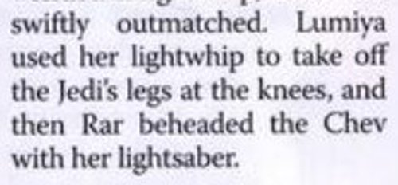
- **Lando Calrissian**: "Calrissian repaired the damage, and Lobot then disarmed bombs that the Ugnaughts had planted all over the city." Source: The Complete Star Wars Encyclopedia, Vol. II, p.258
  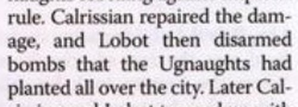

## p.259 (scan page 265)

Page contents: 1188 words, 27 paragraphs | headings/entries: Loctob, Cycy; Lod; Lodi; Lodrel, Captain; Loedorvian Brain Plague; Lo-Farr, Brann; Lofryyhhn; Lo'gaan, Drake; Logray; Lo-Jad

- **General Grievous**: "General Grievous used the Loedorvian Brain Plague to eliminate all the clone troopers of the Grand Army of the Republic in the Weemell sector, and nearly killed the sector's entire human population as well." Source: The Complete Star Wars Encyclopedia, Vol. II, p.259
  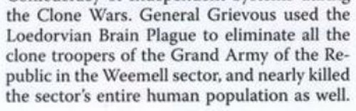
- **Prince Xizor; Darth Vader (Anakin Skywalker)**: "After the encounter with Xizor, Zonder was captured and brought before Darth Vader, who challenged the Selonian to a duel." Source: The Complete Star Wars Encyclopedia, Vol. II, p.259
  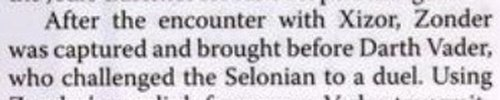
- **Darth Vader (Anakin Skywalker)**: "Using Zonder's comlink frequency, Vader transmitted the fight to Drake and Ekria, who were forced to listen as their fellow Padawan was beheaded by the Dark Lord." Source: The Complete Star Wars Encyclopedia, Vol. II, p.259
  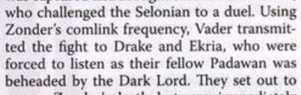

## p.260 (scan page 266)

Page contents: 924 words, 29 paragraphs | headings/entries: Lok; Loli; Lom, Cabet; Lomabu 1; Lonay; Londrah; Loneozner, Camie; Long, Gee; Long, Hokkor; Longknife, Kéral; Longnose

## p.261 (scan page 267)

Page contents: 1278 words, 34 paragraphs | headings/entries: Longshot; Long Shot; Longspar, Gideon; Lonn; Lonnaw; Loor, Kirtana; Loorne, Sares; Lopaki, Kyril; Loquasin; Lor, Gaton; Loratus Manufacturing

- **Luke Skywalker**: "When Longspar was defeated in combat by Luke Skywalker, Darial Anglethorn was able to destroy water-holding tanks and restore the planet's water supply." Source: The Complete Star Wars Encyclopedia, Vol. II, p.261
  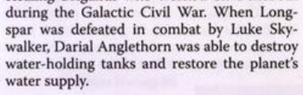
- **Luke Skywalker; Leia Organa Solo**: "He nearly captured Luke and Leia, but he was killed by the Sentinel creature that was dispatched to eliminate them." Source: The Complete Star Wars Encyclopedia, Vol. II, p.261
  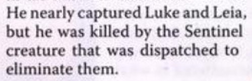

## p.262 (scan page 268)

Page contents: 955 words, 25 paragraphs | headings/entries: Lorell Raiders; Loren, Lady; Loro, Elscol; Loronar Corporation; Lorrd Logistician Liberation League; Lorso, Jana; Lortan; Loruss; Lost Hope; Lost Lady

- **Meetra Surik**: "They were unable to complete the mission, however, as they were defeated by the Jedi Exile." Source: The Complete Star Wars Encyclopedia, Vol. II, p.262
  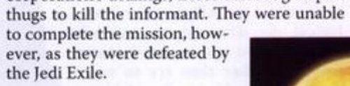

## p.263 (scan page 269)

Page contents: 969 words, 19 paragraphs | headings/entries: Lost Ones; Lost Twenty, the; Lotide; Lotor, Mak; Love Commander; Love Is Waiting; Lowbacca

## p.264 (scan page 270)

Page contents: 1113 words, 26 paragraphs | headings/entries: Loyal Defender; Loyalist Committee; L'pwacc Den Port; Lsu, Raskta; L'toth, Been; L'toth, Kiles; Lucazec; Lucian, Tyler; Lucid Voice; Lucky Despot; Lucky Dragon

- **Raskta Lsu** — entry/section: Lsu, Raskta: "Raskta Lsu was named in honor of Raskta Fenni, a noted Echani duelist, and she lived up to her namesake by becoming the Jedi Order's most skilled martial artist." Source: The Complete Star Wars Encyclopedia, Vol. II, p.264
  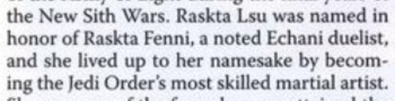
- **Darth Zannah**: "After Bane's apprentice, Zannah, killed Sarro Xaj, she ran Master Lsu through with her lightsaber, killing her almost instantly." Source: The Complete Star Wars Encyclopedia, Vol. II, p.264
  
- **Luke Skywalker**: "Its agents nearly captured Akanah, but they were cut down by Luke Skywalker." Source: The Complete Star Wars Encyclopedia, Vol. II, p.264
  
- **Darth Vader (Anakin Skywalker); Beilert Valance**: "Vader had come to wring out information about the pilot who had destroyed the first Death Star, and Valance had come to ensure Vader didn't get it." Source: The Complete Star Wars Encyclopedia, Vol. II, p.264
  
- **Beilert Valance; Darth Vader (Anakin Skywalker)**: "After Valance was defeated by Vader in combat, Lucian decided that he could not let Vader have the information he sought." Source: The Complete Star Wars Encyclopedia, Vol. II, p.264
  
- **General Grievous**: "Lucid Voice A Providence-class destroyer, it was one of two sister ships of the Invisible Hand. \t often was deployed throughout the Mid Rim in order to confuse intelligence agents of the Galactic Republic about the exact whereabouts of General Grievous during the Clone Wars." Source: The Complete Star Wars Encyclopedia, Vol. II, p.264
  

## p.265 (scan page 271)

Page contents: 914 words, 33 paragraphs | headings/entries: Lucky Star; Lugus; Luka; Lumat; Lumiya

- **Master Dominus**: "She was turned to the dark side, and killed Dominus during the Sith War." Source: The Complete Star Wars Encyclopedia, Vol. II, p.265
  
- **Han Solo; Luke Skywalker**: "With morale crushed after the abandonment of Echo Base and the capture of Han Solo, the Rebels faced the unthinkable possibility that Luke Skywalker had killed a fellow Rebel pilot." Source: The Complete Star Wars Encyclopedia, Vol. II, p.265
  
- **Luke Skywalker**: "Brie almost succeeded when Luke destroyed her fighter, but Skywalker was able to prove his innocence and reveal Brie's past." Source: The Complete Star Wars Encyclopedia, Vol. II, p.265
  

## p.266 (scan page 272)

Page contents: 972 words, 23 paragraphs | headings/entries: Lumus; Lunasa; Lundi, Murk

- **Lumiya** — entry/section: Lumiya: "Though Lumiya sustained a_ blaster wound, she survived the battle to swear vengeance on the Alliance." Source: The Complete Star Wars Encyclopedia, Vol. II, p.266
  
- **Lumiya** — entry/section: Lumiya: "Skywalker and Lumiya were finally reunited, and the two engaged in a spectacular duel." Source: The Complete Star Wars Encyclopedia, Vol. II, p.266
  
- **Lumiya; Luke Skywalker** — entry/section: Lumiya: "At first, Lumiya bested Luke and brutally wounded his allies Dani and Kiro." Source: The Complete Star Wars Encyclopedia, Vol. II, p.266
  
- **Lumiya** — entry/section: Lumiya: "In their second battle, Skywalker managed to defeat Lumiya, shattering her armor and revealing her to be Shira Brie." Source: The Complete Star Wars Encyclopedia, Vol. II, p.266
  
- **Lumiya** — entry/section: Lumiya: "In the nebulous and shifting alliances that plagued Imperial fragments during the Nagai invasion, Lumiya lent her Imperial resources—which included three Star Destroyers, two frigates and four corvettes—to the fleet belonging to the Tofs." Source: The Complete Star Wars Encyclopedia, Vol. II, p.266
  
- **Jacen Solo (Darth Caedus); Mara Jade Skywalker**: "As part of Caedus's rise to power, he killed Mara Jade Skywalker, though his guilt as the murderer remained unknown for some time." Source: The Complete Star Wars Encyclopedia, Vol. II, p.266
  
- **Lumiya; Luke Skywalker** — entry/section: Lumiya: "In his anguish, Luke Skywalker mistakenly believed Lumiya was the killer, and slew her in turn, an act of vengeance that put him on the precipice of the dark side." Source: The Complete Star Wars Encyclopedia, Vol. II, p.266
  

## p.267 (scan page 273)

Page contents: 1088 words, 20 paragraphs | headings/entries: Lunis; Lupo; Luptoomian; Lur; Lurmen; Lusa; Lusankya; Luscen; Luure, M'yet

- **Meetra Surik**: "His perfect record came to an end when the Exile managed to defeat the droid." Source: The Complete Star Wars Encyclopedia, Vol. II, p.267
  
- **Palpatine (Darth Sidious)**: "Lusankya A Super Star Destroyer, it was constructed in secret at Kuat Drive Yards under the false name Executor, It immediately was buried beneath Imperial Center during Emperor Palpatine's reign to serve as his emergency evacuation vehicle." Source: The Complete Star Wars Encyclopedia, Vol. II, p.267
  

## p.268 (scan page 274)

Page contents: 996 words, 33 paragraphs | headings/entries: Luwingo; Luxum; Lwhekk; Lwothin; Lwyll; Ly'alu, Tensh; Lyari; Lycan; Lycoming; Lyll, Darak; Lyn, Arden

## p.269 (scan page 275)

Page contents: 549 words, 12 paragraphs | headings/entries: Lyric; Lys, Borna; Lyshaa; Lyster Innovations; Lyu'kij, Bem

- **Palpatine (Darth Sidious)**: "She was eventually hunted down and killed by Palpatine himself." Source: The Complete Star Wars Encyclopedia, Vol. II, p.269
  
- **Meetra Surik**: "Lys grew frustrated, however, when a virtually unbeatable swoopracing droid began appearing at Lupo Shar's swoop-racing track, and enlisted the aid of the Jedi Exile in defeating the droid." Source: The Complete Star Wars Encyclopedia, Vol. II, p.269
  
- **Shaak Ti**: "After being granted her freedom to help the Jedi bring down planetary leader Shogar Tok, she betrayed the Jedi and shot Shaak Ti, who survived." Source: The Complete Star Wars Encyclopedia, Vol. II, p.269
  

## p.270 (scan page 276)

Page contents: 0 words, 0 paragraphs | headings/entries: 

## p.271 (scan page 277)

Page contents: 742 words, 35 paragraphs | headings/entries: M-12; M13; M-18; M2934738; M-317; M3-D2; M-3P0; M4; A Ma, Keelen

## p.272 (scan page 278)

Page contents: 951 words, 39 paragraphs | headings/entries: Maa, Sel; Maag, Orth; Maak, Chidee Na; Maalet, Moria; Ma'ar Shaddam; Maarwraawroo; Maas, Nima; Maashan; Mabari; Mabettye, Commodore; Mabob, Brother; Macander Heavy Ores; Macatten, Maddie; Maccabe, Oll; Maccabree

- **Greedo**: "She hired Greedo to find Temo Dionisio, but then was killed by the Rodian bounty hunter after she threatened to kill him." Source: The Complete Star Wars Encyclopedia, Vol. II, p.272
  

## p.273 (scan page 279)

Page contents: 970 words, 37 paragraphs | headings/entries: Macemillian-winduarté; Machees, Seed; Machill'Tr, Kendrick; Machineville; Mack; Mackar; Mackenni, Jorm Whistler; Maclain, Governor Jerrod; MacMillian, Brandy; Macroon Mesa; Madak, Elforrs; Madak, Olev; Madak, Sava Brec; Madakor, Maoi; Madame Vansitt's Charm Academy; Mad Anghus's Fun Public House; Maddaan, Zeb; Madine, General Crix

- **Obi-Wan Kenobi; Qui-Gon Jinn**: "She perished along with her copilot when the ship was destroyed after she delivered Obi-Wan Kenobi and Qui-Gon Jinn to the Trade Federation ship Saakak in orbit around Naboo." Source: The Complete Star Wars Encyclopedia, Vol. II, p.273
  

## p.274 (scan page 280)

Page contents: 1216 words, 31 paragraphs | headings/entries: Madiry, Hela; Madis, Captain; Madoom, Ten-Sucker'ss; Madorin, Hyris-Well; Madra Teene; Ma-dred, Ashala; Ma-dred, Sha-Mar; Madurrin; Maelibi; Maelstrom; Maendin, Lar; Maer, Corporal; Maetrecis, N'do; Maga; Magaloof

