# Owner Material 031 — The Complete Star Wars Encyclopedia, Vol. II (H–O): scan pages 281–320

- **Source:** *The Complete Star Wars Encyclopedia* by Stephen J. Sansweet and Pablo Hidalgo, with Bob Vitas, Daniel Wallace, Chris Cassidy, Mary Franklin and Josh Kushins (Del Rey, 2008), 3 vols. Secondary source (licensed Legends reference). Scan OCR'd on the box; the scan stays box-only and is **not** published.
- **Method:** every scanned page was OCR'd and machine-screened sentence by sentence for power-relevant statements (fights, kills, defeats, Force feats, rankings, superweapons) that name a character on our roster; each kept sentence is quoted verbatim from the OCR text and has a crop of the printed passage directly under it. Pages with nothing power-relevant are still listed with what is on them.
- **Citation:** "The Complete Star Wars Encyclopedia, Vol. II, p.X" by printed page ("scan p.X" where no printed number applies). **Weight:** Lucasfilm-licensed encyclopedia: a secondary, in-universe summary of Legends (and some film) material. It sums up feats from novels, comics and games; where the original story is in our notes, that source is the stronger citation.

## p.275 (scan page 281)

Page contents: 1057 words, 36 paragraphs | headings/entries: Magcannon Max; Magg; Maggie; Maggis, Lieutenant; Maggli, Dairn; Maggrit, Alysssa; Magister; Magi'Ikkan Temple; Magminds; MagnaGuard

## p.276 (scan page 282)

Page contents: 1146 words, 28 paragraphs | headings/entries: Magneta, Captain; Magnus; Magon; Magore, Tilas; Magresh; Magrody, Nasdra; Magus; Mah Dalila; Mahl

## p.277 (scan page 283)

Page contents: 1058 words, 30 paragraphs | headings/entries: 1 Mahn; Mai, Shu; Maill; Mairan; Maires; Maitell Base; Majan; Majestic; Majestic Gundark; Majjvara; Maj-Odo-Nomor; Mak; Mak, Elan; Makati, Afsheen

- **Palpatine (Darth Sidious); Darth Vader (Anakin Skywalker)**: "After hiding on Utapau, the Separatist leadership was taken to Mustafar, It was there, after Darth Sidious had lured Anakin Skywalker to the dark side, that Darth Vader quickly killed Shu Mai before going after the rest of the Separatist leaders." Source: The Complete Star Wars Encyclopedia, Vol. II, p.277
  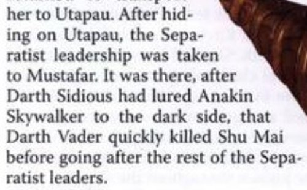
- **Ki-Adi-Mundi**: "While briefly involved with Sylvn, the daughter of Jedi Ki-Adi-Mundi, Maj stole the Jedi's lightsaber and accidentally killed another Cerean, then fled." Source: The Complete Star Wars Encyclopedia, Vol. II, p.277
  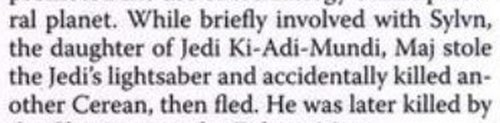
- **Darth Vader (Anakin Skywalker)**: "Mak An Imperial general who accompanied Darth Vader and Nas Ghent when they set out to find the Star Destroyer Crucible during the Galactic Civil War." Source: The Complete Star Wars Encyclopedia, Vol. II, p.277
  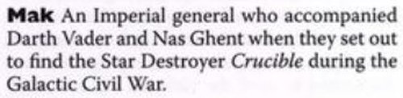
- **Palpatine (Darth Sidious)**: "Makati, Afsheen One of the 12 Grand Admirals who served Emperor Palpatine during the last years of the New Order, he was commander of the Star Destroyer Steadfast." Source: The Complete Star Wars Encyclopedia, Vol. II, p.277
  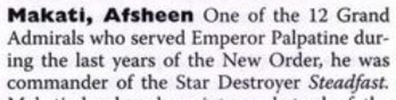

## p.278 (scan page 284)

Page contents: 1250 words, 29 paragraphs | headings/entries: Makem Te; Makezh; Makin, Admiral; Ma'kis'shaalas; Mako; Makor, Piu; Makrin City; Maktites; Mala, Mistress Mala; Mal'aa

## p.279 (scan page 285)

Page contents: 1226 words, 25 paragraphs | headings/entries: Malachor Depths; Malacia; Maladi, Darth; Maladori, Cynith; Malani; Malarian Alliance; MaPary'ush; Malas, Moor; Malastare

- **Revan; Darth Malak**: "Details of the ensuing battle were never clarified; Darth Revan was captured and many Jedi were killed, yet Darth Malak managed to escape." Source: The Complete Star Wars Encyclopedia, Vol. II, p.279
  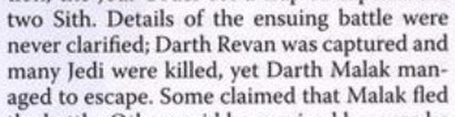
- **Revan**: "Others said he survived because he was stronger than Revan." Source: The Complete Star Wars Encyclopedia, Vol. II, p.279
  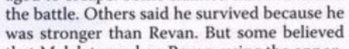
- **Revan; Darth Malak**: "In a break from the Sith forays that Revan led against Republic systems, Darth Malak destroyed worlds rather than capturing them, ensuring that vital resources were no longer available to either side of the battle." Source: The Complete Star Wars Encyclopedia, Vol. II, p.279
  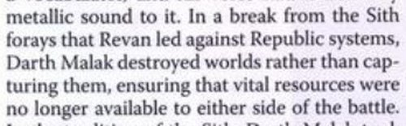
- **Darth Malak**: "With the defection of Admiral Saul Karath, Darth Malak acquired the Leviathan, which served as his personal flagship, and he appeared to be invincible." Source: The Complete Star Wars Encyclopedia, Vol. II, p.279
  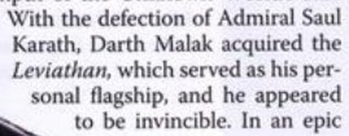
- **Darth Malak**: "The battle was waged for months until Darth Malak was killed and the Star Forge destroyed." Source: The Complete Star Wars Encyclopedia, Vol. II, p.279
  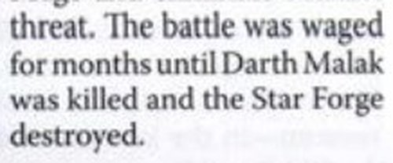
- **Luke Skywalker**: "With the help of Lady Valarian, he tried to have the rancor smuggled offworld, but on the morning the escape was to take place the rancor was killed by Luke Skywalker." Source: The Complete Star Wars Encyclopedia, Vol. II, p.279
  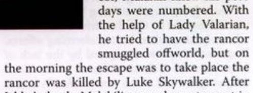

## p.280 (scan page 286)

Page contents: 1073 words, 34 paragraphs | headings/entries: Maildeen, Bim; Maldrod; Malé-Dee; Maledoth; Males-Who-Die-For-The-Hive- Mother; Malgio; Malia; Malicar 3; Malice; Malicious; Malignant; Malik

- **General Grievous**: "The ship, under the command of General Grievous, had destroyed the Republic's Fourth Fleet and counted a dozen vessels among its victims." Source: The Complete Star Wars Encyclopedia, Vol. II, p.280
  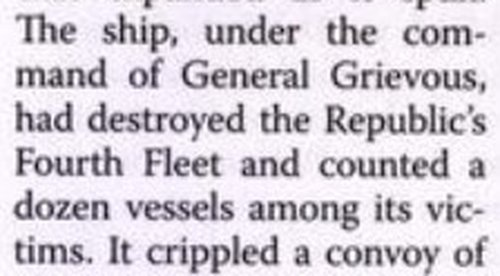

## p.281 (scan page 287)

Page contents: 1055 words, 24 paragraphs | headings/entries: Maliss, Ket; Malkite Poisoners; Mallar, Plat; Mallat, Zeven; Mallif Cove; Mallixer; Malo, Lanah; Malorm Family; Malorum; Malreaux

- **Grand Inquisitor Malorum** — entry/section: Malorum: "In an effort to appease the Emperor, Malorum set about destroying Solace and her underground hideout, but he failed at that, too." Source: The Complete Star Wars Encyclopedia, Vol. II, p.281
  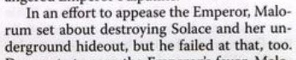
- **Grand Inquisitor Malorum** — entry/section: Malorum: "He plummeted into the core of the Theed Palace power generator station, and was killed." Source: The Complete Star Wars Encyclopedia, Vol. II, p.281
  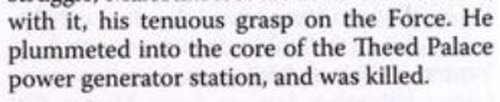

## p.282 (scan page 288)

Page contents: 1140 words, 27 paragraphs | headings/entries: Malreaux, Whie; Maltaz, General; Maltha Obex; Malvarra, Moris; Mamia's; Manaan; Managing Council; Manailin; Manaroo

## p.283 (scan page 289)

Page contents: 969 words, 22 paragraphs | headings/entries: Manazar; Manchisco, Captain Tessa; Mandallian Giant; MandaliMotors; Mandalore

- **Boba Fett**: "In the wake of the Galactic Civil War, Boba Fett took on the role of Mandalor for the scattered Mandalorians who survived throughout the galaxy, although he was never regarded as a true Mandalorian." Source: The Complete Star Wars Encyclopedia, Vol. II, p.283
  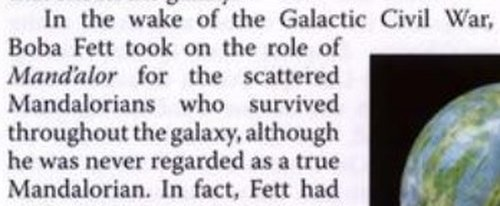

## p.284 (scan page 290)

Page contents: 914 words, 21 paragraphs | headings/entries: Mandalorian Civil War; Mandalorian Crusaders; Mandalorian Death Watch

- **Mandalore the Indomitable; Ulic Qel-Droma**: "Mandalor, or Mandalore the Indomitable as his warriors called him, was defeated by Ulic Qel-Droma during the fighting, and agreed to help him during the Sith War." Source: The Complete Star Wars Encyclopedia, Vol. II, p.284
  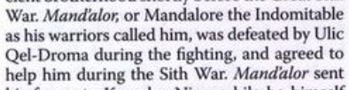
- **Jango Fett**: "A handful of Death Watchmen survived, as did the True Mandalorian Jango Fett." Source: The Complete Star Wars Encyclopedia, Vol. II, p.284
  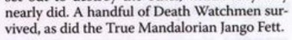

## p.285 (scan page 291)

Page contents: 1170 words, 32 paragraphs | headings/entries: MandalTech; Mandrell, Ody; Mandian; Mandie; Mandjur; Mando'a; Mando-Verpine Assault Fighter; Manech, Treyz; Manellan Jasper; Manes, Tomathy; Maneuver 717; Manex; Mangol; Maniid; Ma'Ning, Justyn

- **Joruus C'baoth**: "With his last breath, Ma'Ning told C'baoth's Padawan, Lorana Jinzler, that a more devastating attack was coming now that C'baoth had given himself over to the dark side of the Force." Source: The Complete Star Wars Encyclopedia, Vol. II, p.285
  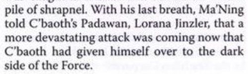

## p.286 (scan page 292)

Page contents: 1102 words, 34 paragraphs | headings/entries: Manka, Siolo Ur; Manks, Gris; Mankvim-814 Interceptor; Manos, Lord; Manpha; Manr, Rostat; Mantan Wanderer; Mantessa; Manticore

- **Palpatine (Darth Sidious); Darth Maul**: "Darth Sidious ordered his apprentice Darth Maul to assassinate Master Manka, but the Twi'lek managed to disarm Darth Maul with little more than a wooden stick." Source: The Complete Star Wars Encyclopedia, Vol. II, p.286
  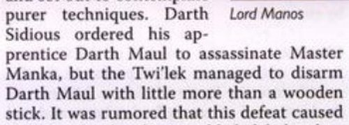
- **Darth Maul**: "It was rumored that this defeat caused Maul to develop his two-bladed lightsaber, since the single-bladed weapon he had used against the Jedi had been so ineffective." Source: The Complete Star Wars Encyclopedia, Vol. II, p.286
  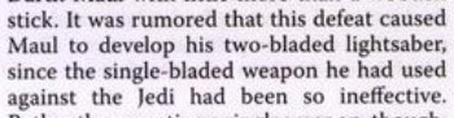
- **Darth Maul**: "When Master Manka again bested Maul in combat, the Sith apprentice activated the second blade and killed the Twi'lek." Source: The Complete Star Wars Encyclopedia, Vol. II, p.286
  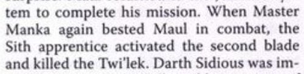
- **Grand Moff Tarkin**: "Manticore One of the four Star Destroyers stationed at the Maw Installation by Grand Moff Tarkin during the New Order." Source: The Complete Star Wars Encyclopedia, Vol. II, p.286
  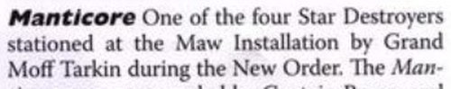

## p.287 (scan page 293)

Page contents: 1071 words, 32 paragraphs | headings/entries: Mantid, Di; Mantoid; Mantologo; Mantooine; Mantooine; Mantooine Medallion; Mantooine Minuet; Manx; Mara; Marais, The; Marakoloon; Maramere

- **Admiral Ackbar; Admiral Daala; Grand Moff Tarkin**: "The Manticore never completed its mission, however: It was destroyed when Admiral Ackbar recognized Daala's tactics as those of Tarkin." Source: The Complete Star Wars Encyclopedia, Vol. II, p.287
  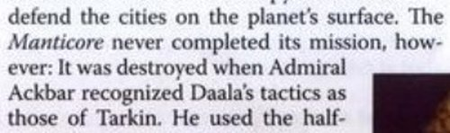

## p.288 (scan page 294)

Page contents: 1042 words, 32 paragraphs | headings/entries: Marat V; Marath, Eyar; Marauder; Marauders; Marauders' Masquerade; Marauder Starjacker; Marca; March, Reina; Mastigophorous; Marcino, Shel; Marcopious, Yeoman; Marcross, Saberan; Marcus, Kori

## p.289 (scan page 295)

Page contents: 1243 words, 26 paragraphs | headings/entries: Marduk; Marec, Makin; Marek, Galen; Mar'ek; Margath, Kina; Margrave; Mariana; Maridun; Marilla; Maristo; Marit; Marius; Mark 10; Mark 15

- **Mara Jade Skywalker; Lumiya**: "While on Caprioril, Mara encountered Lumiya for the first time and was forced to defeat her in combat." Source: The Complete Star Wars Encyclopedia, Vol. II, p.289
  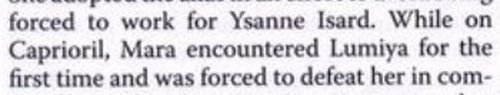

## p.290 (scan page 296)

Page contents: 1094 words, 35 paragraphs | headings/entries: Marka; Mark; Markota, Selwin; Marksman-H; Markus, Len

## p.291 (scan page 297)

Page contents: 1117 words, 36 paragraphs | headings/entries: Marook, Senator Cian; Marr, Brezzic; Marr, Nichos; Marrab, Gron; Marshak; Marshian; Marskan, Casal; Marskan, Captain Ernek; Marso's Demons; Marspa; Martaff; Marty; Martyr; Maruk, Jai

- **Palpatine (Darth Sidious)**: "He also helped Skywalker locate the Eye of Palpatine, a prototype Imperial battle station that had mysteriously been reactivated, Cray and Marr accompanied Skywalker and C-3PO to the ship to destroy it before it could carry out its preprogrammed plan of destruction." Source: The Complete Star Wars Encyclopedia, Vol. II, p.291
  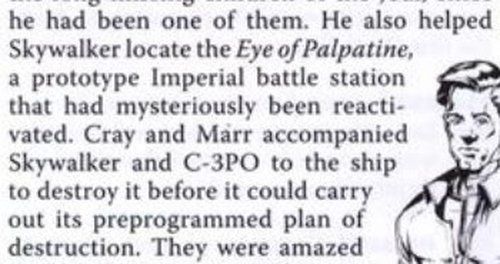
- **Palpatine (Darth Sidious)**: "The Eye of Palpatine could be destroyed, but only if someone would stay behind to be destroyed with it." Source: The Complete Star Wars Encyclopedia, Vol. II, p.291
  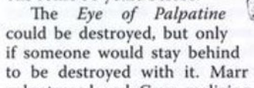

## p.292 (scan page 298)

Page contents: 1037 words, 28 paragraphs | headings/entries: Marut; Mary; Maryb Wastes; Maryo; Maryx Minor; Ma'Shraid; Mas Ramdar; Massassi; Massassi

- **Asajj Ventress; Count Dooku**: "Maruk was forced to duel with Ventress, who would have killed him if Dooku hadn't stepped in." Source: The Complete Star Wars Encyclopedia, Vol. II, p.292
  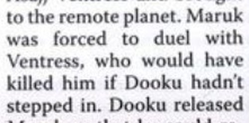
- **Asajj Ventress**: "When Maruk eventually was cut down by Ventress in battle, he swore to Scout that he would remain with her forever, at least in spirit." Source: The Complete Star Wars Encyclopedia, Vol. II, p.292
  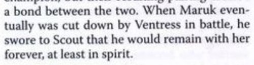
- **Luke Skywalker**: "After Raggold's assassination, Mary suggested that Luke Skywalker be named Solay ruler—a representative of both the New Republic and the democracy Solay natives so desperately wanted, Mary and the rest of her group had just a few days of freedom before Imperial warships arrived, Mary was shot and killed in the initial wave of attacks." Source: The Complete Star Wars Encyclopedia, Vol. II, p.292
  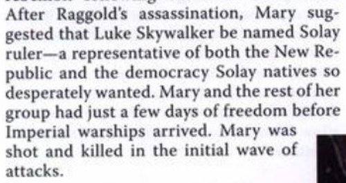
- **Naga Sadow**: "After his defeat, Sadow and his warriors fled to the far reaches of the galaxy, eventually landing on Yavin 4." Source: The Complete Star Wars Encyclopedia, Vol. II, p.292
  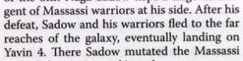
- **Exar Kun**: "Many Massassi were killed by Exar Kun in one final sacrifice and others fled for parts unknown, but they left behind a creature known as the night beast to protect their territory." Source: The Complete Star Wars Encyclopedia, Vol. II, p.292
  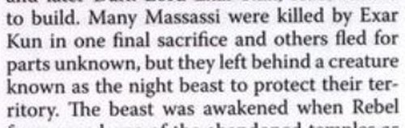

## p.293 (scan page 299)

Page contents: 1162 words, 35 paragraphs | headings/entries: Master-Com; Master Marksman; Master Stroke; Matale; Matarcher, Bosbit; Matchstick; Mateil, Koyi; Mathal

- **Jacen Solo (Darth Caedus)**: "The base was soon abandoned in the wake of the Second Battle of Fondor, when Jacen Solo made a concerted ef- | fort to locate and destroy the Jedi." Source: The Complete Star Wars Encyclopedia, Vol. II, p.293
  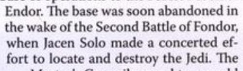
- **Bleyd**: "Bleyd had no intention of bowing to Black Sun, and killed Mathal, later arranging for it to appear that the agent had died after leaving MedStar." Source: The Complete Star Wars Encyclopedia, Vol. II, p.293
  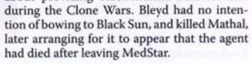

## p.294 (scan page 300)

Page contents: 1129 words, 24 paragraphs | headings/entries: Mathilde; Mathos; Mating Call; Mati, Rigard; Matrin, Quori; Matta; Mattac; Matthews, Ty; Matukai; Mauit'ta, Colonel; Maul, Darth

## p.295 (scan page 301)

Page contents: 1289 words, 19 paragraphs | headings/entries: Mauler; Maur, Dovin; Mavrille Street; Mavron, Lieutenant; Mavron, Osira; Maw; Mawan; Mawat; Mawbo's Performance Halil; Maw Casino; Maw Cluster

- **Darth Maul; Obi-Wan Kenobi** — entry/section: Maul, Darth: "Darth Maul duels Obi-Wan Kenobi." Source: The Complete Star Wars Encyclopedia, Vol. II, p.295
  
- **Darth Maul; Qui-Gon Jinn** — entry/section: Maul, Darth: "When the Jedi became separated, Maul killed Qui-Gon with a wellplaced saber strike." Source: The Complete Star Wars Encyclopedia, Vol. II, p.295
  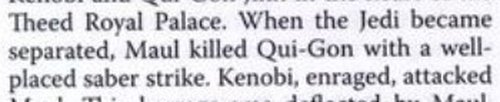
- **Darth Maul; Obi-Wan Kenobi** — entry/section: Maul, Darth: "This barrage was deflected by Maul, who used Obi-Wan's touching of the dark side as a conduit for a Force attack; with the Force, Maul pushed Obi-Wan into a deep mining pit." Source: The Complete Star Wars Encyclopedia, Vol. II, p.295
  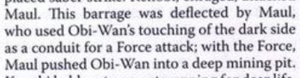
- **Palpatine (Darth Sidious)**: "Maur, Dovin An old man claiming to have survived the birth of the New Order and the destruction of the Jedi Knights at the hands of Emperor Palpatine." Source: The Complete Star Wars Encyclopedia, Vol. II, p.295
  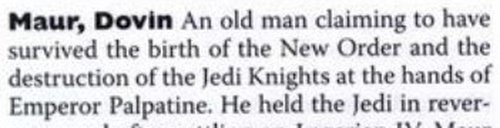
- **Jerec**: "Maw was one of the few Jedi who survived the devastating Jedi Purge, but he was hunted down by Jerec and turned to the dark side of the Force." Source: The Complete Star Wars Encyclopedia, Vol. II, p.295
  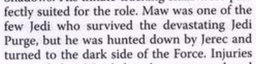
- **Kyle Katarn**: "For all his power, though, Maw was defeated in combat by Kyle Katarn during the search for the Valley of the Jedi." Source: The Complete Star Wars Encyclopedia, Vol. II, p.295
  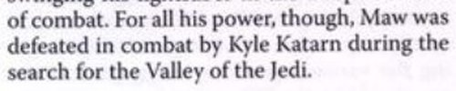
- **Yaddle**: "The Jedi were successful in restoring peace to Mawan but paid a high price: Master Yaddle died after using the Force to absorb a deadly chemical weapon so that others could live." Source: The Complete Star Wars Encyclopedia, Vol. II, p.295
  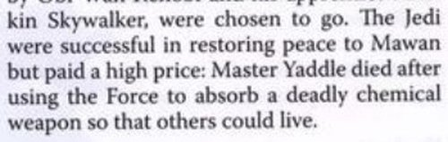
- **Obi-Wan Kenobi**: "It was one of Mawat's snipers who killed Obi-Wan Kenobi's friend Cerasi and started the ensuing firefight." Source: The Complete Star Wars Encyclopedia, Vol. II, p.295
  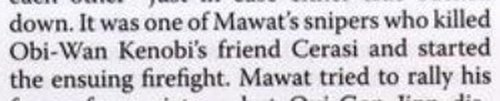

## p.296 (scan page 302)

Page contents: 1153 words, 41 paragraphs | headings/entries: Mawhonic; Mawin; Maw Installation; Maw Irregular Fleet; Mawrunner; Maw Shipyards; Ma'w'shiye; Maxim; Maximum; Maximus; Maxiti; Max Rebo Band; MaxSec Eight; MaxSec Orbital Facility; Max's Flangth House; Maya Kovel

- **Darth Vader (Anakin Skywalker)**: "During the Boonta Eve Classic, which was eventually won by young Anakin Skywalker, Mawhonic's green GPE-3130 Podracer was disabled when the Gran swerved to avoid Sebulba—but crashed into a massive rock formation and exploded." Source: The Complete Star Wars Encyclopedia, Vol. II, p.296
  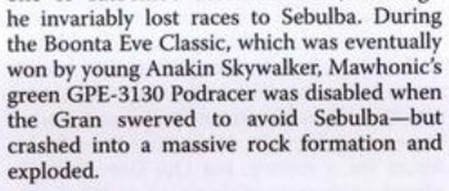

## p.297 (scan page 303)

Page contents: 1262 words, 26 paragraphs | headings/entries: Maydh; Mayhem; Mayn, Todra; Mayvitch 7; Mazanga; Mazara; Mazariyan Citadel; Maze; Maze, the; Mazie; Mazong; Mazzic; M'Bardi Prison; M'Beg, Barada; MB-RA-7; M'Buele, Katya; MC80a Star Cruiser

## p.298 (scan page 304)

Page contents: 935 words, 32 paragraphs | headings/entries: MC9O Cruiser; McCool, Droopy; Megrrrr, Opun; M'challa Order; McKnives, Jasper; McKumb, Drub; McMerrit, Turbo; McPhersons; McQuarrie, General Pharl; MC Utility Sub; MD-OC6

- **Asajj Ventress**: "Unfortunately for McKnives, he was placed into the Cauldron on Rattatak at the same time as Asajj Ventress, and was soon cut down by the lightsaber-wielding warrior." Source: The Complete Star Wars Encyclopedia, Vol. II, p.298
  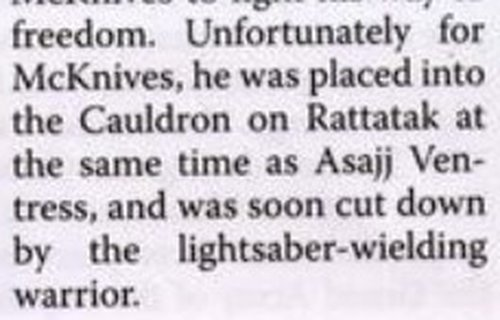

## p.299 (scan page 305)

Page contents: 1175 words, 32 paragraphs | headings/entries: Mdimu; MDS-50; MDS-500; M'dweshuu Nova; Meandering Star; Meccha; Mechanical Allies; Mechanical Liberation Front; Mechis Hf; Mecht; Mechtech Iilustrated

- **Darth Vader (Anakin Skywalker)**: "After meeting with Vader on the Super Star Destroyer Executor, 1G-88 ordered the Mechis III factories to produce a duplicate of the second Death Star's computer core, which his droid consciousness would then inhabit." Source: The Complete Star Wars Encyclopedia, Vol. II, p.299
  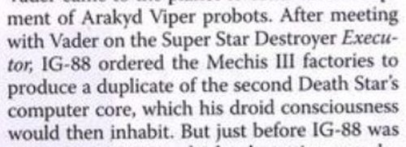

## p.300 (scan page 306)

Page contents: 941 words, 27 paragraphs | headings/entries: Mecrosa Order; Med-Beq, Achk; Med Evac 1014; Mediator; Medical Circle; Medical Corps; Medic Guide

- **Jacen Solo (Darth Caedus); Tahiri Veila**: "Med Evac 1014 A Galactic Alliance med runner deployed during the Second Battle of Fondor, Jacen Solo commandeered the ship to rescue Tahiri Veila from the Bloodfin, knowing that the ship's identity as a medical rescue vessel would allow him access to the destroyer." Source: The Complete Star Wars Encyclopedia, Vol. II, p.300
  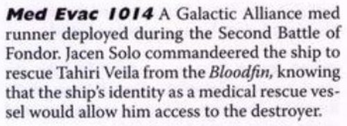

## p.301 (scan page 307)

Page contents: 834 words, 28 paragraphs | headings/entries: Medis, Varen; Medijev, Markre; MedNet; Medon, Tion

- **Darth Vader (Anakin Skywalker)**: "Darth Vader kept a personal chamber aboard the Super Star Destroyer Executor." Source: The Complete Star Wars Encyclopedia, Vol. II, p.301
  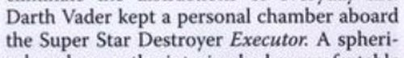
- **Naga Sadow**: "The sphere was ultimately destroyed, although Sadow escaped unharmed." Source: The Complete Star Wars Encyclopedia, Vol. II, p.301
  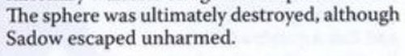
- **General Grievous; Obi-Wan Kenobi; Palpatine (Darth Sidious)**: "Grievous was defeated by Obi-Wan Kenobi, but then the clone commandos were told to execute Order 66 by Darth Sidious." Source: The Complete Star Wars Encyclopedia, Vol. II, p.301
  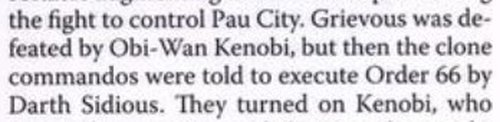

## p.302 (scan page 308)

Page contents: 959 words, 37 paragraphs | headings/entries: MedStar Four; MedStar Nineteen; Medxec; Mee, Yeesre; Meego's Starship Emporium; Meekerdin-maa; Meeknu; Meelto; Meenon; Meen-tris; Meerian; Meese Caulf; Meeshal, Captain; Meeto, Orso

- **Lando Calrissian**: "Lando later realized the Meeks had been more clever than expected, using the fake statuettes to lure him to their settlement, knowing that he would defeat the rancor." Source: The Complete Star Wars Encyclopedia, Vol. II, p.302
  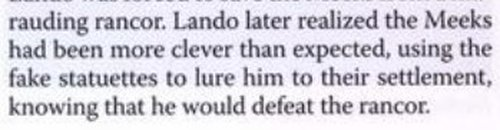
- **Darth Stryfe**: "His stormtroopers made several passes through the Jedi Temple facilities and found no trace of the Jedi, prompting Darth Stryfe to order that the Jedi Temple building be destroyed from orbit." Source: The Complete Star Wars Encyclopedia, Vol. II, p.302
  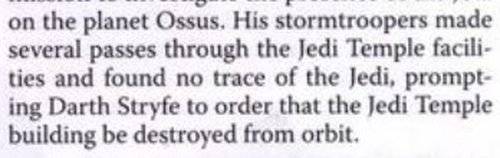

## p.303 (scan page 309)

Page contents: 1254 words, 41 paragraphs | headings/entries: Meeva; Meewath; Megador; Megalith; Megos; Meh, Reseros; Mehndra, Bingo; Meido; Meimonda, Dana; Meirana; Meis; Mekket, Hayca; Mekuun; Melan, Koth

- **Jacen Solo (Darth Caedus); Anakin Solo; Luke Skywalker**: "After the Second Battle of Fondor, the Megador accompanied Darth Caedus and the Anakin Solo into the Transitory Mists on a mission to hunt and destroy Luke Skywalker and the new Jedi Order." Source: The Complete Star Wars Encyclopedia, Vol. II, p.303
  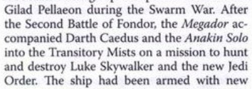
- **Leia Organa Solo; Han Solo**: "After being elected to the Inner Council by an overwhelming majority, Meido put together the committee that led an independent investigation into the explosion in the Senate Hall and supported the idea that Leia's husband, Han Solo, was involved in the bombing." Source: The Complete Star Wars Encyclopedia, Vol. II, p.303
  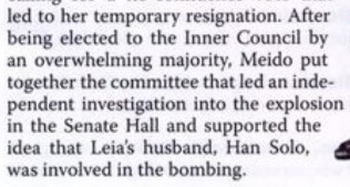

## p.304 (scan page 310)

Page contents: 1219 words, 44 paragraphs | headings/entries: Melanani; Meldark; Meldazar; Melee; Melida/Daan; Melida/Daan Unified Congress Building; Melida; Melihat; Melisma; Meine, Lieutenant Dren; Melinor Spear; Melody Fellowship; Meloque

## p.305 (scan page 311)

Page contents: 1215 words, 33 paragraphs | headings/entries: Meltdown; Meltdown Cafe, The; Melivar, General; Memm, Gallo; Memorial Corridor; Knights.

- **Gethzerion; Han Solo**: "Melvar was killed on Dathomir by Gethzerion when she used the dark side of the Force to eliminate an entire platoon of Imperial stormtroopers and their officers who were poised to bring Han Solo to Zsinj." Source: The Complete Star Wars Encyclopedia, Vol. II, p.305
  

## p.306 (scan page 312)

Page contents: 1177 words, 33 paragraphs | headings/entries: Mendicat; Mendo; Menges; Mengjini; Menndo; Mer, Duttes; Merai; Merast, Thulian; Merchant's Row; Merchant's Square; Merciless; Mercy, Bruce; Merdeon; Mereel

- **Luke Skywalker; Lumiya**: "He was killed when the Iskalonian Kiro—who was on Kinooine with Luke Skywalker to investigate the loss of an Alliance of Free Planets scouting team—infiltrated Lumiya's stronghold to rescue Dani." Source: The Complete Star Wars Encyclopedia, Vol. II, p.306
  

## p.307 (scan page 313)

Page contents: 1239 words, 30 paragraphs | headings/entries: Mereel, Jaster; Merenzane Gold; Merf; Merglyn; Merick; Meridian; Meridian; Meriko, Miracle; Merikon; Merili; Merisee Hope; Merit, Klo; Merkon, Dr.; Merkon, Tem

- **Jaster Mereel** — entry/section: Mereel, Jaster: "Mereel, Jaster A Journeyman Protector from the planet Concord Dawn, he killed another Protector in the line of duty." Source: The Complete Star Wars Encyclopedia, Vol. II, p.307
  
- **Jango Fett**: "Vizsla tried to destroy the True Mandalorians on Concord Dawn, but Mereel and a small force managed to survive, thanks in part to the efforts of a young Jango Fett." Source: The Complete Star Wars Encyclopedia, Vol. II, p.307
  

## p.308 (scan page 314)

Page contents: 1046 words, 28 paragraphs | headings/entries: Meri; Merle; Merrick, Ace; Merrik; Trommer.; Merrik, Tal; Merriweather; Merry Havoc, the; Merry Miner; Mers, Lawra; Mersel Kebir; Merson

- **Jaina Solo; Jacen Solo (Darth Caedus)**: "Merry Miner The vessel used by Jaina and Jacen Solo to maneuver a stylus ship into position over Helska 4 during the New Republic's first attempt to destroy the Yuuzhan Vong invasion force." Source: The Complete Star Wars Encyclopedia, Vol. II, p.308
  
- **Count Dooku; Palpatine (Darth Sidious)**: "Dooku had received orders from his own Master, Darth Sidious, to wipe out the mission to Merson, after hearing of Master Kim's plans to test the Galactic Senate for midi-chlorians." Source: The Complete Star Wars Encyclopedia, Vol. II, p.308
  

## p.309 (scan page 315)

Page contents: 1156 words, 37 paragraphs | headings/entries: Merson Slavers; Merte; Merthyog Communications; Merumeru; Mesa, Colonel Kavel; Mesa Flats; Mesan; Mesoriaam, Barid; Message, the; Messenger; Mester Reef; MetaCannon

## p.310 (scan page 316)

Page contents: 1063 words, 27 paragraphs | headings/entries: Metalorn; Metalsmiths' Guild; Meteor-class Aerial Fort; Meteor Racer; Meteor Way; Metron Burner; Metta Drop; Metternich; Mettier, Lag; Mettio, Obron; Meyer, Lips; Mezdec; Mezer, Sergeant; Mezgraf; Mezza; Mezzicanley Wave; MG-3; MG9; M'haeli

## p.311 (scan page 317)

Page contents: 1002 words, 30 paragraphs | headings/entries: Mi, Celjo; Mica; Micamberlecto; Middie Distance

## p.312 (scan page 318)

Page contents: 1032 words, 24 paragraphs | headings/entries: Mid Rim Territories; Mig, Yerka; Mighella; Might Squadron; Mignay, Captain; Migress; Miilarta, Lol; Mika; Mikki

- **Mighella** — entry/section: Mighella: "Mighella One of the more powerful Witches of Dathomir, she was taken from Dathomir by Alexi Garyn, the leader of the criminal organization Black Sun, to serve as his personal bodyguard on Ralltiir." Source: The Complete Star Wars Encyclopedia, Vol. II, p.312
  
- **Mighella; Darth Maul; Palpatine (Darth Sidious)** — entry/section: Mighella: "She used a combination of Force lightning and other dark side tactics to keep Maul at bay until he revealed that he was, in fact, the apprentice to Darth Sidious." Source: The Complete Star Wars Encyclopedia, Vol. II, p.312
  

## p.313 (scan page 319)

Page contents: 1095 words, 21 paragraphs | headings/entries: Miktha; Milagro; Military Advisory Council; Milko; Millavec, Dorin; Millennial, Darth; Millennium Falcon

- **Luke Skywalker**: "As a result of the conflict, an Imperial Super Star Destroyer was captured and Luke Skywalker was promoted to general." Source: The Complete Star Wars Encyclopedia, Vol. II, p.313
  
- **Luke Skywalker**: "Luke defeated him in combat, and Milko broke down and begged for mercy." Source: The Complete Star Wars Encyclopedia, Vol. II, p.313
  
- **Darth Vader (Anakin Skywalker)**: "Ghent survived, and Millavec lied to him, claiming that it was Vader himself who ordered Maneuver 717 as part of his assignment." Source: The Complete Star Wars Encyclopedia, Vol. II, p.313
  

## p.314 (scan page 320)

Page contents: 949 words, 19 paragraphs | headings/entries: Millennium Falsehood; Millennium Fist; Millennium Hawk

