# Owner Material 031 — The Complete Star Wars Encyclopedia, Vol. II (H–O): scan pages 321–360

- **Source:** *The Complete Star Wars Encyclopedia* by Stephen J. Sansweet and Pablo Hidalgo, with Bob Vitas, Daniel Wallace, Chris Cassidy, Mary Franklin and Josh Kushins (Del Rey, 2008), 3 vols. Secondary source (licensed Legends reference). Scan OCR'd on the box; the scan stays box-only and is **not** published.
- **Method:** every scanned page was OCR'd and machine-screened sentence by sentence for power-relevant statements (fights, kills, defeats, Force feats, rankings, superweapons) that name a character on our roster; each kept sentence is quoted verbatim from the OCR text and has a crop of the printed passage directly under it. Pages with nothing power-relevant are still listed with what is on them.
- **Citation:** "The Complete Star Wars Encyclopedia, Vol. II, p.X" by printed page ("scan p.X" where no printed number applies). **Weight:** Lucasfilm-licensed encyclopedia: a secondary, in-universe summary of Legends (and some film) material. It sums up feats from novels, comics and games; where the original story is in our notes, that source is the stronger citation.

## p.315 (scan page 321)

Page contents: 1370 words, 29 paragraphs | headings/entries: Milito, Yor; Milmit; Miinn; Milvayne; Mimban Cloudrider; Mina; Minch; Mindemir; Minder; Mindharp

## p.316 (scan page 322)

Page contents: 1305 words, 33 paragraphs | headings/entries: Mindor; Minelayer; Mine Mine Mine; Minestra

- **Admiral Daala**: "She commandeered a TIE bomber and landed it on the Knight Hammer, quickly sabotaging the ship's complement of TIE bombers by detonating their payloads and ripping out the Super Star Destroyer's engines, She confronted Daala to try to kill her, allowing the dark side to wash over her." Source: The Complete Star Wars Encyclopedia, Vol. II, p.316
  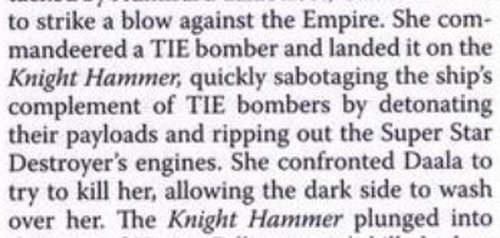

## p.317 (scan page 323)

Page contents: 1128 words, 29 paragraphs | headings/entries: Mingla, Cray; MiniMag; Mining Corps; Ministry Council; Minka; Minkring; Minnau, Teckla; Minnisiat; Minnix; Minntooine

## p.318 (scan page 324)

Page contents: 1203 words, 35 paragraphs | headings/entries: Minstrel; Minx, Lunae; Mipps, Deena; Miradyne Limited; Mirage; Mirage; Miraluka; Mird'ika; Mirialan; Mirror Caverns; Mirshaf; Mirx; Misanthrope; Misch'an; Miser; Mishra, The

- **Asajj Ventress**: "She was no match for Ventress's skills, and was quickly killed in battle." Source: The Complete Star Wars Encyclopedia, Vol. II, p.318
  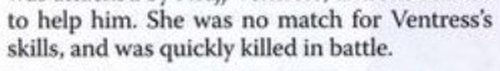

## p.319 (scan page 325)

Page contents: 1305 words, 37 paragraphs | headings/entries: Miskara; Missa, Lena; Mission, the; Mission Commander; Missira; Miss Mylla's Saloon; Missur, Mas; Miss Vix; Mist; Mistal; Mistflier, Dusque; Mistress Dragon

- **Anakin Solo**: "Although the Mission ultimately succeeded in destroying the voxyn queen, Anakin Solo sacrificed his life to save his brother, and many other Jedi were killed in battle." Source: The Complete Star Wars Encyclopedia, Vol. II, p.319
  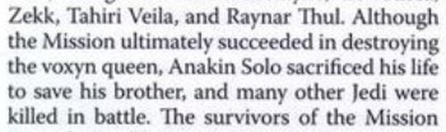

## p.320 (scan page 326)

Page contents: 1119 words, 24 paragraphs | headings/entries: Mistress Mnemos; Mithel, Mauler; Mithipsin; Mithric, Thann; Mitsun, Creed; Mitt'swe'kleoni; MixRMastR; Miza; Mizobon Spaceport; MK221

- **Boba Fett**: "Mit, N'haz Boba Fett tracked Mit to the planet Necropolis, where he killed him." Source: The Complete Star Wars Encyclopedia, Vol. II, p.320
  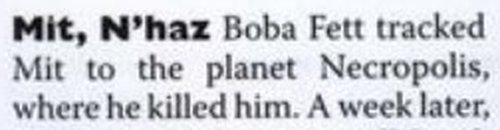

## p.321 (scan page 327)

Page contents: 1074 words, 41 paragraphs | headings/entries: M'Kae, Warrant Officer; M'kim; MLC-3; MM; MMR-9; MOB; Mobari, Sora; Mnuue, Kijo; Moappa

## p.322 (scan page 328)

Page contents: 1150 words, 30 paragraphs | headings/entries: Moburi; Mobus; Mobvekhar; Mochot Steep; Mod-3; Modal Nodes, the; Modan; Model 16; Modeler, the; Moderation; Modi, Bask; Modo; Moe, Aks; Moegantz, Saul; Moegid; Moff; Moff Assembly Hall

- **Han Solo; Grand Admiral Thrawn; Leia Organa Solo; Winter Celchu; Jaina Solo; Jacen Solo (Darth Caedus)**: "When Han Solo joined the mission to destroy Grand Admiral Thrawn's cloning facility on Wayland, Cakhmaim protected Leia, Winter, and the children, Jaina and Jacen Solo." Source: The Complete Star Wars Encyclopedia, Vol. II, p.322
  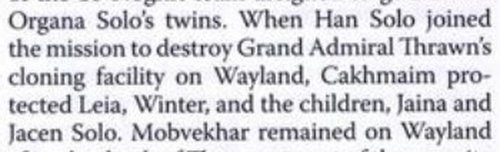

## p.323 (scan page 329)

Page contents: 1104 words, 30 paragraphs | headings/entries: Moffett, Jozzel; Moffship; Moff's Own, the; Moff Weblin; Moggonite; Mohc, General Rom; Mohrgan; Mohris; Mohs

- **Jacen Solo (Darth Caedus)**: "Pellaeon survived, however, and threatened to take the entire Imperial fleet with him to join the Galactic Alliance if the Moffs didn't accept Jacen's terms to join." Source: The Complete Star Wars Encyclopedia, Vol. II, p.323
  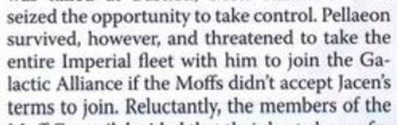
- **Kyle Katarn**: "Mohc himself wore the phase-three dark trooper exoskeleton into battle against Katarn, but was killed by the Alliance agent." Source: The Complete Star Wars Encyclopedia, Vol. II, p.323
  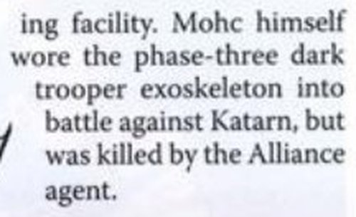

## p.324 (scan page 330)

Page contents: 950 words, 34 paragraphs | headings/entries: Molan, Wilst; Molavar; Moldy Crow; Mole; Moleese; Moliom; Molly's Merchants; Moltok

- **Kyle Katarn; Jerec**: "Katarn used the ship for many years, until the Moldy Crow was destroyed during a mission to defeat Jerec." Source: The Complete Star Wars Encyclopedia, Vol. II, p.324
  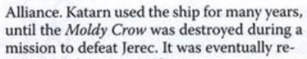

## p.325 (scan page 331)

Page contents: 895 words, 23 paragraphs | headings/entries: Momen, Reija; Mon, Ephant; Mon, Sol; Mon Adapyne; Monarc C-4; Monarch; Mon Cal

- **Admiral Ackbar; Grand Moff Tarkin**: "Many Mon Calamari were enslaved by the Empire, including Ackbar, who was forced to be the personal servant of Grand Moff Tarkin." Source: The Complete Star Wars Encyclopedia, Vol. II, p.325
  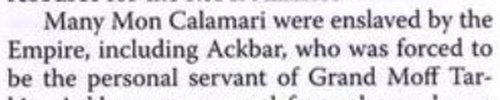

## p.326 (scan page 332)

Page contents: 895 words, 20 paragraphs | headings/entries: Mon Calamari Ballet; Mon Calamari Communications Control; Mon Calamari Extreme; Mon Calamari Knights; Mon Calamari Sea

- **Luke Skywalker**: "With the help of Jedi Knight Luke Skywalker, the Devastators were defeated." Source: The Complete Star Wars Encyclopedia, Vol. II, p.326
  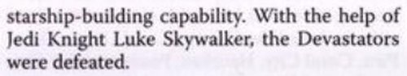
- **Kit Fisto**: "With the help of Jedi Master Kit Fisto, the Mon Calamari Knights managed to defeat the Quarren and restore peace to Mon Calamari." Source: The Complete Star Wars Encyclopedia, Vol. II, p.326
  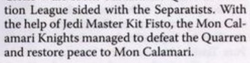

## p.327 (scan page 333)

Page contents: 1050 words, 26 paragraphs | headings/entries: Mon Calamari Star Defender; Mon Casima; Monchar, Hath; Mondaran; Mondeo Modernist; Mondo-Mod; Mon Eron; Monevy, Tar; Money Lane; Mon Karren; Mon Mothma

- **Luminara Unduli**: "Mondo-Mod agreed to turn over the information if Master Unduli vanquished his three strongest gladiators in the Arena of Doom." Source: The Complete Star Wars Encyclopedia, Vol. II, p.327
  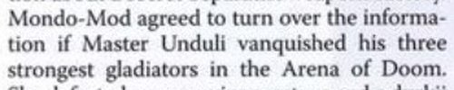

## p.328 (scan page 334)

Page contents: 815 words, 22 paragraphs | headings/entries: Monn, Vooivif; Monor IW; Mon Remonda; Monsoon Mesa; Monsua Nebula; Montellian Serat; Montross; Monument; Monument Park; Monument Plaza

- **Palpatine (Darth Sidious)**: "The Mon Remonda was later destroyed in a battle with the World Devastator Silencer-7 during the campaign by the cloned Emperor Palpatine." Source: The Complete Star Wars Encyclopedia, Vol. II, p.328
  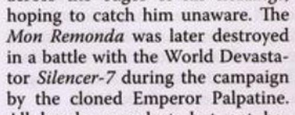

## p.329 (scan page 335)

Page contents: 1130 words, 38 paragraphs | headings/entries: Mon Vaile; Moola, Romi; Moolis, Tamaab; Moolis, Umwaw; Mooney; Moon Falls; Moonlight Cruise; Moonstone Lake; Moonstrike; Moonstruck Pass; Moonus Mandel; Moor, Kasan

- **Leia Organa Solo; Saba Sebatyne**: "The parasite bombs were destroyed by Leia Organa Solo and her Master, Saba Sebatyne, before they could deploy their deadly payloads." Source: The Complete Star Wars Encyclopedia, Vol. II, p.329
  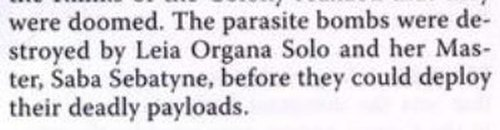

## p.330 (scan page 336)

Page contents: 849 words, 24 paragraphs | headings/entries: Moore, Sly; Moorlu; Moorsh; Mo'r, Tech; Morag; Morano, Captain; Morasil; Morbo, Voralla; Mordi, Krdys; Mordon, Admiral; Mordur, Admiral; Morgo

- **Morag** — entry/section: Morag: "Morag's evil magic was a potent match for Logray's good magic." Source: The Complete Star Wars Encyclopedia, Vol. II, p.330
  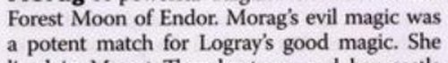
- **Luke Skywalker; Han Solo**: "Morgavi, Luke Han Solo used this alias when he returned to Jubilar some 30 years after he survived the All-Human Free-For-All there." Source: The Complete Star Wars Encyclopedia, Vol. II, p.330
  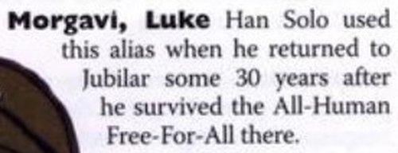

## p.331 (scan page 337)

Page contents: 983 words, 31 paragraphs | headings/entries: Morgot; Morgukai Warriors; Morishim; Morjakar; Morjanssik City; Morn; Morningstar; Moro Ill; Morobe; Morota, Ayo; Morro; Morrs, Lieutenant

- **Quinlan Vos**: "Vos fought his way to freedom, and Morota admitted that she had been defeated." Source: The Complete Star Wars Encyclopedia, Vol. II, p.331
  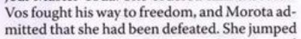

## p.332 (scan page 338)

Page contents: 1018 words, 31 paragraphs | headings/entries: Mors, Opeli; Morseerian; Morto; Morvogodine; Morv'vyal; Morwan, Lady Lalu; Morymento; Mosa, Linjak; Mos Eisley

## p.333 (scan page 339)

Page contents: 1216 words, 31 paragraphs | headings/entries: Mos Entha

## p.334 (scan page 340)

Page contents: 787 words, 22 paragraphs | headings/entries: Mos Espa Circuit; Mos Gamos; Mosh; Mos Nytram; Mos Osnoe; Mossak

## p.335 (scan page 341)

Page contents: 1064 words, 29 paragraphs | headings/entries: Mos Taike; Mos Zabu; Mota; Motamba; Moteé; Motempe, Jarse; Motesta; Motesta Oasis; Mother's Valkyrie

## p.336 (scan page 342)

Page contents: 1247 words, 36 paragraphs | headings/entries: Mothma 5-0; Mothma Squadron; Motti, Admiral Conan Antonio

- **Admiral Ackbar**: "Mothma, along with Crix Madine and the Mon Calamarian Ackbar, devised the plan to destroy the second Death Star at Endor, which eventually succeeded." Source: The Complete Star Wars Encyclopedia, Vol. II, p.336
  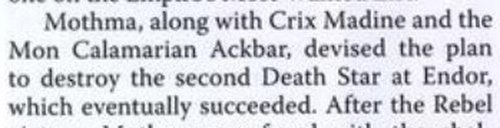

## p.337 (scan page 343)

Page contents: 858 words, 34 paragraphs | headings/entries: Mott's Nostril; Moudama, Foul; Mount Avos; Mount Dagger; Mount Ison; Mount Sorrow; Mount Ste'vshuulsz

- **Grand Moff Tarkin**: "Had the Rebels not destroyed the Death Star when they did, it's possible that the power structure of the Empire could have vastly changed with Tarkin and Motti in command." Source: The Complete Star Wars Encyclopedia, Vol. II, p.337
  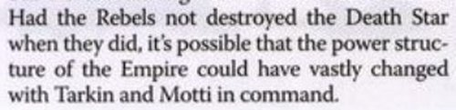
- **Lando Calrissian**: "Lando Calrissian destroyed water tanks in the mine, forcing the revolutionaries to flee." Source: The Complete Star Wars Encyclopedia, Vol. II, p.337
  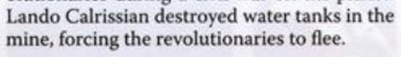
- **Joruus C'baoth**: "Crazed Jedi clone Joruus C'baoth arrived on Wayland, defeated the Guardian, and took control of the Imperial interests." Source: The Complete Star Wars Encyclopedia, Vol. II, p.337
  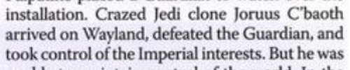

## p.338 (scan page 344)

Page contents: 884 words, 22 paragraphs | headings/entries: Mount Umate; Mount Yeroc; Mount Yoda; Mouse; Mousul, Senator; Moyan; Moz; M'rak, Yade; Mrisst; Mrissi

- **Leia Organa Solo**: "Neither Moyan nor Admiral Limpan knew that Leia would do everything in her power to ensure that the Corellian pilots of Operation Noble Savage, including her own husband, Han, completed their mission without being killed by GA pilots." Source: The Complete Star Wars Encyclopedia, Vol. II, p.338
  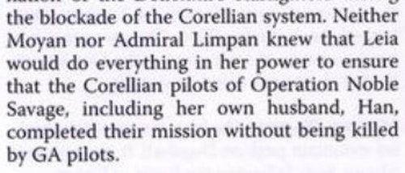
- **Grand Admiral Thrawn**: "At one point Grand Admiral Thrawn planned an assault on Mrisst, partly to try to lure and defeat the New Republic fleet." Source: The Complete Star Wars Encyclopedia, Vol. II, p.338
  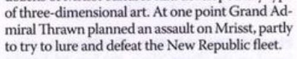

## p.339 (scan page 345)

Page contents: 1187 words, 29 paragraphs | headings/entries: Mrisst; Mrisst; Mrrov; MRX-BR Pacifier; M'sadaar; MSE-6-P303K; MSE-X-PR6; M'shinn; Msst

## p.340 (scan page 346)

Page contents: 1033 words, 24 paragraphs | headings/entries: M'truli; MU-12; Mub'at, Kud'ar; Mubbin; Mudilath, Captain

- **Jacen Solo (Darth Caedus)**: "The small droid was destroyed in the crash, although its carcass was later discovered in the Unknown Regions by Jacen Solo when he visited the site of the crash." Source: The Complete Star Wars Encyclopedia, Vol. II, p.340
  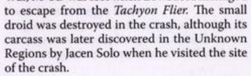

## p.341 (scan page 347)

Page contents: 1108 words, 38 paragraphs | headings/entries: Mudmub; Mud Puddle, the; Muehling, Baroness; Mueum; Muftak; Muja, Kav; Mukit; Mukmuk, Pikk; Mulacks, Kruy; Mulako Corporation Primordial Water Quarry

## p.342 (scan page 348)

Page contents: 1320 words, 32 paragraphs | headings/entries: Mull, Swanny; Mulleshar, Troye; Mullinore, Captain; Muin, Garen; Multitude, the; Multycorp; Mumbri Storve Cantina; Muna, Ivo; Munilali Mafir

- **Admiral Daala**: "Mullinore, Captain The Imperial captain of the Star Destroyer Basilisk, he was a classmate of Admiral Daala on Carida during the early years of the New Order." Source: The Complete Star Wars Encyclopedia, Vol. II, p.342
  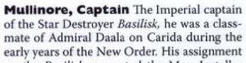

## p.343 (scan page 349)

Page contents: 1075 words, 24 paragraphs | headings/entries: Murgo Choke; Murkhana; Murkhana Bay; Murkhana City; Murleen, Ru; Murninkam; Murno, Kot; Murra; Murtceps; Murthé, Dr. Leonis

- **Luke Skywalker; Kam Solusar**: "Murra A tribesman of the Ysanna on Ossus, Murra was the first to help Okko attempt to defeat Luke Skywalker and Kam Solusar when they arrived on the planet." Source: The Complete Star Wars Encyclopedia, Vol. II, p.343
  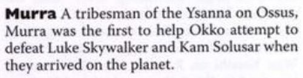
- **Palpatine (Darth Sidious)**: "Murthé, Dr. Leonis A depraved Imperial scientist known to have been one of the staunchest supporters of Emperor Palpatine's High Human Culture, Dr. Murthé and his partner, Admiral Mir Tork, spent much of their careers subjugating and destroying entire alien civilizations." Source: The Complete Star Wars Encyclopedia, Vol. II, p.343
  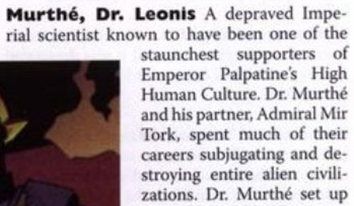
- **Boba Fett**: "Murthé was later hunted down and killed by Boba Fett, who had been hired by Slique Brighteyes to avenge the Gulmarids." Source: The Complete Star Wars Encyclopedia, Vol. II, p.343
  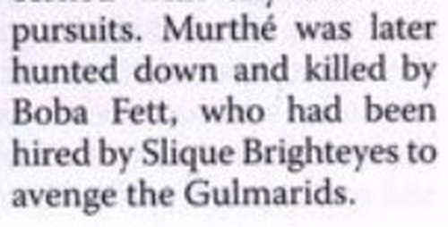

## p.344 (scan page 350)

Page contents: 914 words, 21 paragraphs | headings/entries: Murzz; Mushkil; Mushroom Mesa

- **Count Dooku**: "Museum of Light A wondrous museum located on Tandis Four until it was destroyed by Count Dooku's Separatist forces during the Clone Wars." Source: The Complete Star Wars Encyclopedia, Vol. II, p.344
  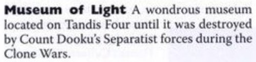

## p.345 (scan page 351)

Page contents: 1102 words, 21 paragraphs | headings/entries: Mutant Zombie Cooler; Mutdah, Bohhuah

- **Obi-Wan Kenobi; Darth Vader (Anakin Skywalker)**: "A geyser of lava erupted, dropping molten rock on one of the outrigger collection arms of the facility where Kenobi and Vader dueled." Source: The Complete Star Wars Encyclopedia, Vol. II, p.345
  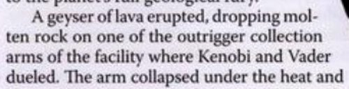
- **Darth Vader (Anakin Skywalker); Obi-Wan Kenobi**: "Before the severed collection arm succumbed to the pull of a lava fall, Vader and Kenobi leapt from the doomed structure onto a nearby worker droid and harvesting platform, respectively." Source: The Complete Star Wars Encyclopedia, Vol. II, p.345
  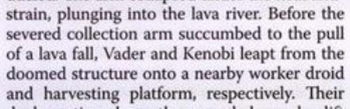
- **Obi-Wan Kenobi; Darth Vader (Anakin Skywalker)**: "There Kenobi bested Vader, leaving the Dark Lord to die on the Mustafar riverbanks." Source: The Complete Star Wars Encyclopedia, Vol. II, p.345
  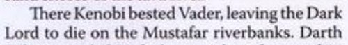

## p.346 (scan page 352)

Page contents: 1166 words, 29 paragraphs | headings/entries: Muun; Muun, General; Muuurgh; Muvon If; Muvunc, Ral'Rai; Muzara; Muzzle; MX; Mxil, Mister

## p.347 (scan page 353)

Page contents: 1028 words, 35 paragraphs | headings/entries: Mygeeto; Myke; Myles; Mylok IV; Habeen.; Mylore, Yndis

- **Jango Fett**: "Myles A Mandalorian shock trooper who served under Jango Fett, Myles was killed when he was cut in half by a Jedi Knight during the Battle of Galidraan." Source: The Complete Star Wars Encyclopedia, Vol. II, p.347
  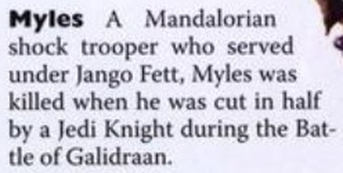

## p.348 (scan page 354)

Page contents: 1014 words, 28 paragraphs | headings/entries: Mynock; Mynock Cloud City; Mynock Hole; Mynockra; Mynock's Haven; Myo; Myrat'ur; Myris Pictures; Mystic; Mystifying Hoop Trick

## p.349 (scan page 355)

Page contents: 449 words, 12 paragraphs | headings/entries: Mytus VII

- **Han Solo**: "Stars' End was destroyed by Han Solo and his companions during an attempted jailbreak." Source: The Complete Star Wars Encyclopedia, Vol. II, p.349
  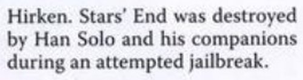

## p.350 (scan page 356)

Page contents: 0 words, 0 paragraphs | headings/entries: 

## p.351 (scan page 357)

Page contents: 906 words, 24 paragraphs | headings/entries: N-09; N-10; N-I1; N-12; N2-3P0; Na, Noirah; Na'al, Voren; Naan, Kova; Naap, Tolok; Naagq, Vee; Naatan

## p.352 (scan page 358)

Page contents: 1024 words, 21 paragraphs | headings/entries: Nabat; Nabatu; Naberrie, Padmé; Nabon, Fenig; Naboo

## p.353 (scan page 359)

Page contents: 928 words, 27 paragraphs | headings/entries: Naboo, the; Naboo Embassy; Naboo Essentials Provider; Naboo Palace Guard; Naboo Queen, The; Naboo Royal Cruiser

## p.354 (scan page 360)

Page contents: 1034 words, 28 paragraphs | headings/entries: Naboo Royal Security Forces; Naboo Royal Starship; Naboo Wastelands; Nabyl, Bock; Nachkt, Gha; Nackhar; Na-Coth, Deamos; Nadad, Lora; Nadar, T'nadar

