# Owner Material 031 — The Complete Star Wars Encyclopedia, Vol. II (H–O): scan pages 361–400

- **Source:** *The Complete Star Wars Encyclopedia* by Stephen J. Sansweet and Pablo Hidalgo, with Bob Vitas, Daniel Wallace, Chris Cassidy, Mary Franklin and Josh Kushins (Del Rey, 2008), 3 vols. Secondary source (licensed Legends reference). Scan OCR'd on the box; the scan stays box-only and is **not** published.
- **Method:** every scanned page was OCR'd and machine-screened sentence by sentence for power-relevant statements (fights, kills, defeats, Force feats, rankings, superweapons) that name a character on our roster; each kept sentence is quoted verbatim from the OCR text and has a crop of the printed passage directly under it. Pages with nothing power-relevant are still listed with what is on them.
- **Citation:** "The Complete Star Wars Encyclopedia, Vol. II, p.X" by printed page ("scan p.X" where no printed number applies). **Weight:** Lucasfilm-licensed encyclopedia: a secondary, in-universe summary of Legends (and some film) material. It sums up feats from novels, comics and games; where the original story is in our notes, that source is the stronger citation.

## p.355 (scan page 361)

Page contents: 979 words, 24 paragraphs | headings/entries: Nadd, Freedon; Nadiem; Nadill, Memit; Nadon Farms; Nad'Ris; Naduarr

- **Freedon Nadd; Antinnis Tremayne** — entry/section: Nadd, Freedon: "In his anger, Nadd struck down his Master, Matta Tremayne, and succumbed to the dark side of the Force." Source: The Complete Star Wars Encyclopedia, Vol. II, p.355
  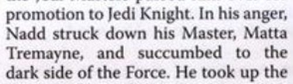
- **Freedon Nadd; Naga Sadow** — entry/section: Nadd, Freedon: "When he felt strong enough, Nadd destroyed Sadow's spirit and set out to become the next Sith Lord." Source: The Complete Star Wars Encyclopedia, Vol. II, p.355
  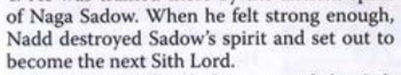
- **Freedon Nadd** — entry/section: Nadd, Freedon: "There was a pitched battle, and eventually Freedon Nadd was defeated." Source: The Complete Star Wars Encyclopedia, Vol. II, p.355
  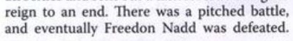
- **Luminara Unduli; Barriss Offee**: "Clone troopers led by Jedi Luminara Unduli and Barriss Offee were able to defeat the Separatist forces and free the settlers." Source: The Complete Star Wars Encyclopedia, Vol. II, p.355
  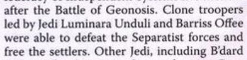

## p.356 (scan page 362)

Page contents: 995 words, 36 paragraphs | headings/entries: Naeco; Naescorcom; Naga, Asa; Nagag, Saduu; Nagelson, Sleepy; Nagua, Mercevian; Nagwa; Nahkee; Nahrunba; Nahsu Minor; Naia; Nailati, Evilo; Naima; Naithol; Nakay, Keela

- **Darth Maul**: "Maul, however, followed him and killed him to eliminate any trace of his involvement." Source: The Complete Star Wars Encyclopedia, Vol. II, p.356
  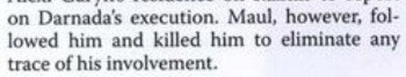
- **Saesee Tiin**: "She later repaid his kindness by destroying a battle droid that was about to shoot him, Master Tiin and Na-Jia were later apprehended by a squad of snow droids and thrown into prison at a Separatist laboratory." Source: The Complete Star Wars Encyclopedia, Vol. II, p.356
  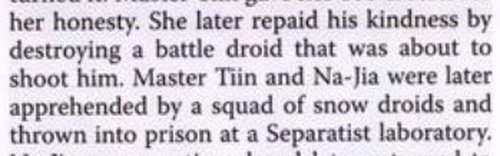

## p.357 (scan page 363)

Page contents: 1224 words, 27 paragraphs | headings/entries: Nakay, Pell; Naked Hutt Cantina; N'a-kee-tula; Nak'har; Nakhym, Golov; Nakk, Urman; Nalan; Naldar; Nale, Kam; Nalgol; Nal Hutta; Nal Hutta Kal'tamok; Nali-Erun; Nalju; Nalju, Count

- **Mace Windu**: "Terrel, distraught after learning his father had been killed, flew into a rage when Master Windu revealed that he was a Jedi." Source: The Complete Star Wars Encyclopedia, Vol. II, p.357
  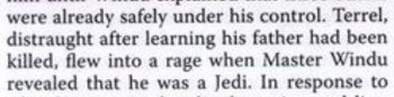

## p.358 (scan page 364)

Page contents: 1073 words, 34 paragraphs | headings/entries: Nallastia; Nalo; Naltree, Linna; Nalual, Deran; Nam; Na Maak, Chidee; Namarhe; Name It, Claim It Law

- **Roan Shryne**: "Nalual managed to escape unharmed, but Forte and Iwo Kulka were killed before Roan Shryne sacrificed his own life to allow others to escape." Source: The Complete Star Wars Encyclopedia, Vol. II, p.358
  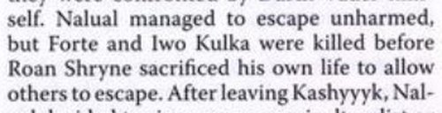
- **Leia Organa Solo**: "After a series of confrontations, Leia killed Beldorion; Dzym escaped but was destroyed along with the other drochs; Moff Getelles, who had invaded the sector as part of Dzym's vast conspiracy, was forced to retreat at the Battle of Nam Chorios; and Callista decided to stay on the planet awhile longer." Source: The Complete Star Wars Encyclopedia, Vol. II, p.358
  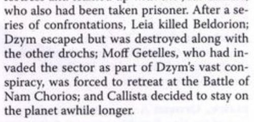

## p.359 (scan page 365)

Page contents: 1242 words, 45 paragraphs | headings/entries: Nammon, Ran; Nampi; Nan, Ogo; Nancer; Nandon, Tendau; Nandreeson; Nania; Nanna; Nannat; Nantama; Nanta-Ri; Nantz, Admiral

- **Cilghal**: "Once they were discovered in Mothma's system, the Jedi healer Cilghal was able, cell by cell, to eradicate the nano-destroyers that had threatened the life of the onetime Chief of State." Source: The Complete Star Wars Encyclopedia, Vol. II, p.359
  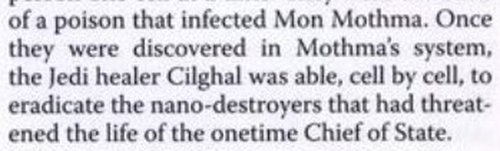

## p.360 (scan page 366)

Page contents: 1236 words, 29 paragraphs | headings/entries: Naos Ill Mercantile; Napdu; Naplousean; Naps Fral Cluster; NaQuoit Bandits; Nar, Melaan; Narcassan, Vyn; Nard, Junix; Nardix; Narec, Ky; Narees; Narek-ag; Nar Hej Shipping Company; Nar Hekka; Narik; Naritus

- **Darth Maul; Palpatine (Darth Sidious)**: "Narees was killed at Garyn's fortress on Ralltiir when Darth Maul was dispatched by Darth Sidious to eliminate any evidence linking Hath Monchar to Sidious." Source: The Complete Star Wars Encyclopedia, Vol. II, p.360
  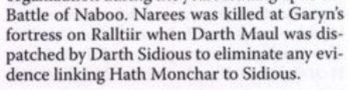

## p.361 (scan page 367)

Page contents: 1141 words, 29 paragraphs | headings/entries: Nar Kreeta; Narmox; Narol; Narra; Narra, Commander Arhul; Narsacc Habitat; Nar-Somo-Dali; Nartissteu; Narvath; Narvis, Gille

- **Luke Skywalker**: "Luke Skywalker was then promoted to the rank of commander and placed in charge of the fighter group, which evolved into the legendary Rogue Squadron." Source: The Complete Star Wars Encyclopedia, Vol. II, p.361
  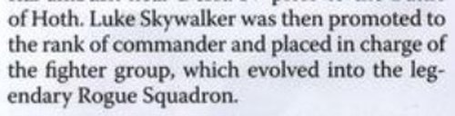

## p.362 (scan page 368)

Page contents: 920 words, 37 paragraphs | headings/entries: Nashtah; Nashtah Bite; Nasirii; Nass, Boss Rugor; Nassin, Qatya; Natalon Core Bandits; Natamee; Natara; Nataz, Dyyz; Nate; Nate, Pori; Nath, Jamur

- **Greedo**: "There they were almost killed by a mercenary named Gorm the Dissolver, but a young Rodian named Greedo shot Gorm, disabling him and letting the trio escape." Source: The Complete Star Wars Encyclopedia, Vol. II, p.362
  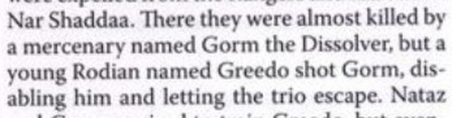

## p.363 (scan page 369)

Page contents: 1113 words, 40 paragraphs | headings/entries: Nativum; Natrom, Lieutenant; Na'ts, Doikk; Nat-Sem; Naturian; Nautag; VN Navett, Drend; Navi, Senator

- **Yoda**: "Navi returned to Coruscant, told the Senate that Yoda had been killed, and called for the elimination of the Jedi Order." Source: The Complete Star Wars Encyclopedia, Vol. II, p.363
  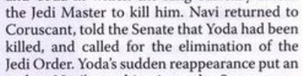
- **Asajj Ventress**: "Nauton IV On this planet, Jedi Master Ruati was believed to have been beheaded by Asajj Ventress." Source: The Complete Star Wars Encyclopedia, Vol. II, p.363
  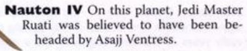

## p.364 (scan page 370)

Page contents: 1098 words, 39 paragraphs | headings/entries: Navy, Imperial; Naweenan Fate Rooms; Nawling, Gareth; Nawnam; Nawruun; Nay'sro, Velst; Nazzer; Nazfar Metalworks Guild; Nazish; Nazwa; NCW-86; N'dian; Ne, Koa; Near Wash

## p.365 (scan page 371)

Page contents: 1078 words, 27 paragraphs | headings/entries: Neb, Buwon; Nebo; Nebula Chaser; Nebula-class Star Destroyer; Nebula Flight; Nebula Front; Nebula Orchid; Nebula Queen; Nebula Rangers; Nebulba; Nebulon Ranger

- **King Ommin; Queen Amanoa; Freedon Nadd**: "Nebo and his father, fellow zealot Rask, then attempted to protect the sarcophagi of King Ommin, Queen Amanoa, and Freedon Nadd from Kun, who killed them both." Source: The Complete Star Wars Encyclopedia, Vol. II, p.365
  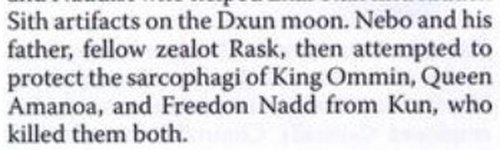
- **Leia Organa Solo**: "The ship was eventually destroyed in an effort to sway Leia Organa Solo to the aliens' position." Source: The Complete Star Wars Encyclopedia, Vol. II, p.365
  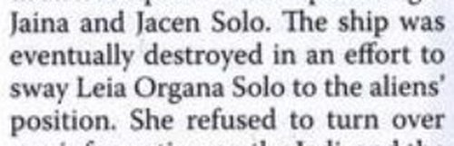

## p.366 (scan page 372)

Page contents: 1269 words, 28 paragraphs | headings/entries: Nechel, Dap; Necr'ygor Omic; Ned; Nedmak, Kaj; Neebo; Neece; Neechak; Needa, Captain Lorth; Needa, Virar; Needalb, Dedro

- **Darth Vader (Anakin Skywalker)**: "The apology was accepted in a way, as Needa was executed on the spot by Vader's Force choke." Source: The Complete Star Wars Encyclopedia, Vol. II, p.366
  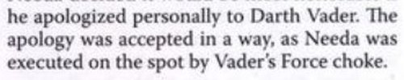

## p.367 (scan page 373)

Page contents: 1036 words, 31 paragraphs | headings/entries: Needles, the; Needles Mountains; Neela; Neelah; Neelanon; Neelgaimon; Neesh; Neeyutnee, Queen; Neff, Major; Neff, Officer; Nefra Canyons; Nefta

- **Greedo**: "Neela and her brother Nok realized | that the Tetsus clan was in trouble after Navik the Red killed Greedo the Elder, and they fled Rodia." Source: The Complete Star Wars Encyclopedia, Vol. II, p.367
  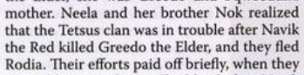
- **Greedo**: "Neela was killed in an Imperial ambush in Nar Shaddaa's Corellian sector when Greedo was just a teenager." Source: The Complete Star Wars Encyclopedia, Vol. II, p.367
  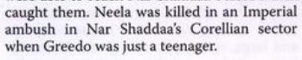
- **Palpatine (Darth Sidious)**: "Neelgaimon A forsaken planet where the designers of the Eye of Palpatine battlemoon were reassigned to punitive duty at the sand mines after the ship failed to destroy a Jedi enclave on Belsavis." Source: The Complete Star Wars Encyclopedia, Vol. II, p.367
  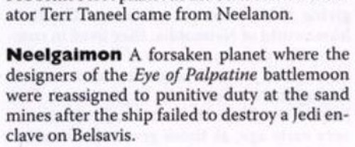

## p.368 (scan page 374)

Page contents: 858 words, 24 paragraphs | headings/entries: Neftali; Nega, Anniha; Negotiator, the; Negra Star; Neimie; Neimoidian Home Defense Legions; Neimoidian Inner Circle

- **Palpatine (Darth Sidious)**: "They hadn't known that Palpatine had already entered a new clone body." Source: The Complete Star Wars Encyclopedia, Vol. II, p.368
  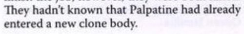
- **Obi-Wan Kenobi**: "Negotiator Obi-Wan Kenobi's Venatorclass Star Destroyer flagship during the Clone Wars." Source: The Complete Star Wars Encyclopedia, Vol. II, p.368
  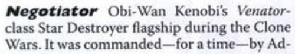

## p.369 (scan page 375)

Page contents: 1065 words, 33 paragraphs | headings/entries: Nek; Nelfrus; Nelthal Industries; Nella, Loje; Nellac Kram; Nelori Marauders; Nelprin, Shalla; Neluenf, Ben; Neluenf, Will; Nelvaan; Nelvaanian; Nematiec Gang; Nemesis

- **Arca Jeth**: "The Nelori Marauders were eventually defeated by Jedi including Arca Jeth and were forced to retreat to their homeworld." Source: The Complete Star Wars Encyclopedia, Vol. II, p.369
  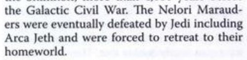
- **Darth Vader (Anakin Skywalker)**: "Anakin, in a trial ordered by the natives, destroyed the Separatist facility and freed the males." Source: The Complete Star Wars Encyclopedia, Vol. II, p.369
  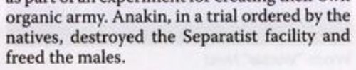
- **Grand Admiral Thrawn**: "Nemesis An Imperial I-class Star Destroyer, the Nemesis was part of Grand Admiral Thrawn's fleet five years after the Battle of Endor." Source: The Complete Star Wars Encyclopedia, Vol. II, p.369
  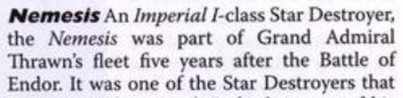
- **Grand Admiral Thrawn**: "It was one of the Star Destroyers that Thrawn used to attack Bpfassh in one of his first moves against the New Republic." Source: The Complete Star Wars Encyclopedia, Vol. II, p.369
  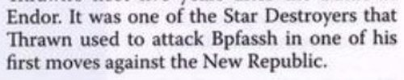

## p.370 (scan page 376)

Page contents: 1059 words, 23 paragraphs | headings/entries: Nemesis; Nemonus; Nemphas; Spiker.; Nena; Nentan; Neo-Crusaders, Mandalorian; Neolsse; Nep, Dilr; Nep, Zey; Nepto, Karsunn

- **Mandalore the Ultimate**: "After three long and bloody years, the reigning Neo-Crusader chieftain Mandalore the Ultimate was killed and the Mandalorians defeated." Source: The Complete Star Wars Encyclopedia, Vol. II, p.370
  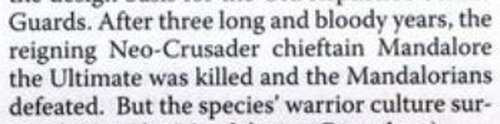

## p.371 (scan page 377)

Page contents: 1041 words, 30 paragraphs | headings/entries: Nereus, Wilek; Nerit; Nermani, Ashii; Alliance.; Nesdin; Neskroff; Nespis VIll; Nessie; Nessin; Nest, the; Netbers, Radaf

## p.372 (scan page 378)

Page contents: 1207 words, 28 paragraphs | headings/entries: Nethermost Abyss; Netus; Neufie; Neuro-Saav Technologies; Neutral Jedi Zone; Neva; Neva, Huoba

- **Ood Bnar; T'ra Saa**: "It was believed that Ood Bnar was the only surviving member of the species, being offworld when the planet Ryyk was destroyed, until T'ra Saa was discovered by other Jedi centuries before the Clone Wars." Source: The Complete Star Wars Encyclopedia, Vol. II, p.372
  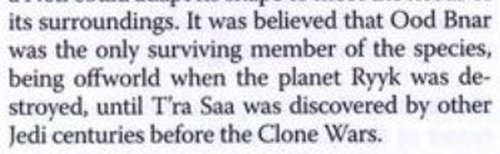

## p.373 (scan page 379)

Page contents: 1252 words, 26 paragraphs | headings/entries: Never Die; Nev Ice Flow; Nevil, Turl; New Agamar; New Alderaan; New Bakstre; New Coronet; New Cov

- **Anakin Solo**: "In the peace that followed the Yuuzhan Vong War, Nevil was promoted several times, eventually taking a command position on the Star Destroyer Anakin Solo in the wake of Captain Twizzl's death." Source: The Complete Star Wars Encyclopedia, Vol. II, p.373
  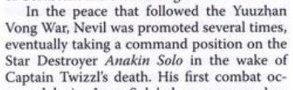
- **Anakin Solo; Jacen Solo (Darth Caedus)**: "Sadras Koyan and Corellia's leader fired the Centerpoint Station repulsor at the Anakin Solo, Captain Nevil and Jacen Solo survived the blast, but Nevil's son, Turl, was killed in the fighting." Source: The Complete Star Wars Encyclopedia, Vol. II, p.373
  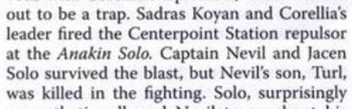

## p.374 (scan page 380)

Page contents: 993 words, 17 paragraphs | headings/entries: New Dawn; New Downtime; New History Squad; New Holgha; New Holstice; New Hope; New Imperial Diplomatic Corps

## p.375 (scan page 381)

Page contents: 1278 words, 30 paragraphs | headings/entries: Newmark; New Marketplace; New Nystao; New Oldtown; New Order; New Polokia; Newport; New Regime; New Republic; New Republic Advisory Council; New Republic Archaeological Corps; New Republic Bounty Hunter License; New Republic Cabinet; New Republic Cantina; New Republic City; New Republic Defense Fleet

- **Grand Admiral Thrawn**: "New Nystao A settlement that sprang up at the base of Mount Tantiss, on Wayland, after the New Republic defeated Grand Admiral Thrawn and took control of the facility." Source: The Complete Star Wars Encyclopedia, Vol. II, p.375
  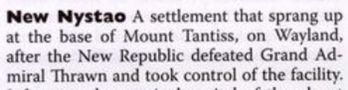
- **Grand Admiral Thrawn**: "New Republic Cabinet The New Republic's governing body, established in the wake of the defeat of Grand Admiral Thrawn." Source: The Complete Star Wars Encyclopedia, Vol. II, p.375
  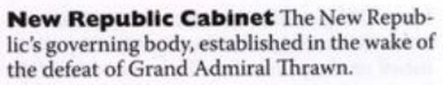

## p.376 (scan page 382)

Page contents: 1114 words, 31 paragraphs | headings/entries: New Republic Fleet Infirmary; New Republic Fleet Intelligence; New Republic Historical Archive; New Republic Honor Guard; New Republic Medical Institute; New Republic Military Oversight Committee; New Republic Military Police; New Republic Obelisk; New Republic Observers; New Republic Prime Newsgrid; New Republic Reference Service; New Republic Senate; New Republic Space Academy; New Route; NewsNet; New Town; New Vertica; Next Chance; Nexu

## p.377 (scan page 383)

Page contents: 1248 words, 25 paragraphs | headings/entries: Nexu Grin; Nexus; Neyo, Commander; Nez Peron; Nezriti Organization; NFQ; Ngaaluh; NGC-1710; Ng'rhr; Nha, Mnor; Nhari; Nhazz; Nhor, Ezam; Nhoras; Nia

## p.378 (scan page 384)

Page contents: 1399 words, 33 paragraphs | headings/entries: Niathal, Admiral Cha; Nichen; Nickel; Nickel; Nicta; Nictoh, Wilyam; Nidder, Ari; Nidifer; Nidésh; Nield

- **Admiral Daala**: "Admiral Niathal and her faction of the Alliance then joined the Jedi Coalition and took part in the Second Battle of Roche alongside the Maw Irregular Fleet of Admiral Daala, but they were defeated and Niathal went missing in action." Source: The Complete Star Wars Encyclopedia, Vol. II, p.378
  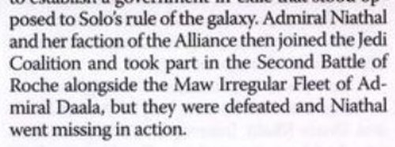
- **Jacen Solo (Darth Caedus)**: "Not to be cut off from a primary munitions source, several planetary fleets from the Confederation arrived too, hoping to take advantage of the situation to destroy Caedus and take the Roche asteroid field for themselves." Source: The Complete Star Wars Encyclopedia, Vol. II, p.378
  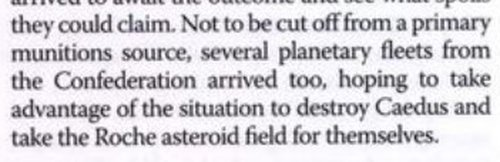
- **Grand Admiral Thrawn**: "When Grand Admiral Thrawn, disguised as Jodo Kast, infiltrated Thyne's base in Coronet, a firefight erupted and Nidder was killed." Source: The Complete Star Wars Encyclopedia, Vol. II, p.378
  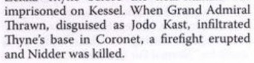

## p.379 (scan page 385)

Page contents: 1337 words, 32 paragraphs | headings/entries: Nierport Seven; Nie-Tan, Tieren; Nigekus, Negus; Night Blades Squadron; Night Caller; Nightfall; Nighthawk

- **Obi-Wan Kenobi; Qui-Gon Jinn**: "He and Obi-Wan managed to defeat Mawat's forces when Qui-Gon showed them all a hologram of Cerasi pleading for peace shortly before her death." Source: The Complete Star Wars Encyclopedia, Vol. II, p.379
  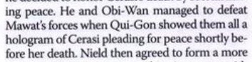

## p.380 (scan page 386)

Page contents: 1069 words, 23 paragraphs | headings/entries: Night Herald; Nightmare Machine; NightRunner; Night Shade; Nightsister'ss; Night Spirit; Night Terror; Night Whispers; Nightwing; Nigiro; Nihil; Nihilus, Darth

- **Luke Skywalker; Alema Rar**: "According to the former Jedi, BedaGorog was the original Night Herald, but after she was killed on Kr by Luke Skywalker, Alema took on her role." Source: The Complete Star Wars Encyclopedia, Vol. II, p.380
  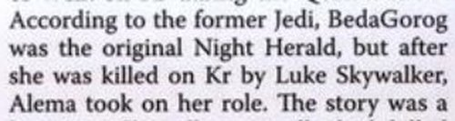
- **Luke Skywalker**: "They were supposedly wiped out during the Clone Wars, but Luke Skywalker encountered the demon Reist on Lapez 3." Source: The Complete Star Wars Encyclopedia, Vol. II, p.380
  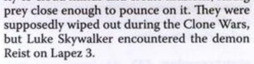
- **Darth Nihilus; Kreia; Darth Sion** — entry/section: Nihilus, Darth: "Nihilus, Darth One of three Sith Lords, along with Darth Traya and Darth Sion, who survived the Jedi Civil Wars and fled to Malachor V nearly 4,000 years before the Galactic Civil War." Source: The Complete Star Wars Encyclopedia, Vol. II, p.380
  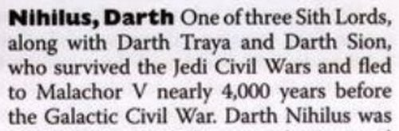
- **Darth Nihilus** — entry/section: Nihilus, Darth: "Darth Nihilus began his Jedi purge by obliterating the planet Katarr, where a secret conclave of the most powerful Jedi was taking place." Source: The Complete Star Wars Encyclopedia, Vol. II, p.380
  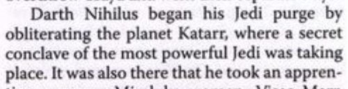

## p.381 (scan page 387)

Page contents: 1208 words, 25 paragraphs | headings/entries: Nihil, Darth; Niik, Li-Suun; Nikals, Lieutenant Gerrin; Nikk, Hatras; Ni'Korish; Niktha; Nikto

- **Darth Nihilus; Meetra Surik** — entry/section: Nihilus, Darth: "On the mission to destroy Telos, Darth Nihilus finally was confronted by the Exile and her team." Source: The Complete Star Wars Encyclopedia, Vol. II, p.381
  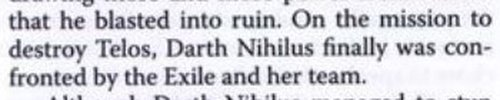
- **Darth Nihilus** — entry/section: Nihilus, Darth: "The Sith Lord was no match for their combined might, and he fell in battle." Source: The Complete Star Wars Encyclopedia, Vol. II, p.381
  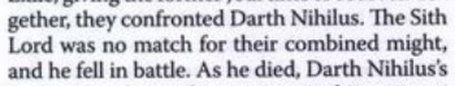

## p.382 (scan page 388)

Page contents: 1282 words, 24 paragraphs | headings/entries: Nil; Nim; Nim, Oso; Niman; Nima'tar; Nimbi, Jasper; Nimondro, Chief; Nim' Ri

## p.383 (scan page 389)

Page contents: 1340 words, 39 paragraphs | headings/entries: Nine; Nine Corellian Hells; Niner; Ningal's Droid Repair; Ningo, Dua; Nink; Ninn; Ninth Fleet; Ninx, Shug; Niopua, thu; Nippet; Nirama; Nirauan

- **Han Solo; Boba Fett**: "Shug Ninx and Salla Zend left the spaceport after Han Solo accidentally destroyed one of their prized cruisers escaping from Boba Fett, and after Zasm Katth and Baddon Fass had ransacked the garage." Source: The Complete Star Wars Encyclopedia, Vol. II, p.383
  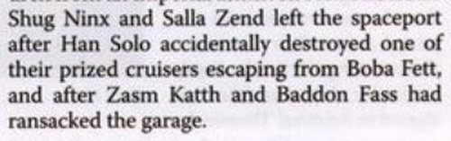

## p.384 (scan page 390)

Page contents: 1116 words, 34 paragraphs | headings/entries: Niriz, Captain Dagon; Niro; Nirrelz, Nathanjo; Nirsh; Niru; Niruu Plateau; Nisewarner, Semmac; Niskooen, Osos; Nist, Xecr; Niuv, Niuk; Nive, Jacob; Nivek; Nivers, Grand Moff; Nixor; Nizon; Niinska's Tavern; Nkik, Het

- **Palpatine (Darth Sidious)**: "Nist, Xecr One of the reborn Emperor Palpatine's personal advisers, Nist was promoted to Military Executor of Operation Shadow Hand after Sedriss and Vill Goir were killed on Ossus." Source: The Complete Star Wars Encyclopedia, Vol. II, p.384
  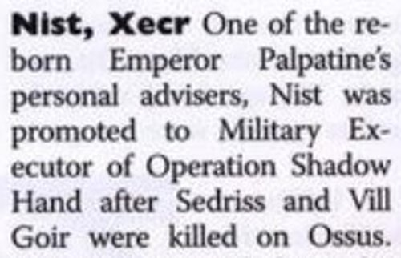
- **Leia Organa Solo**: "When Leia Organa Solo petitioned the Senate to address the Yuuzhan Vong crisis, Niuk Niuv accused her of trying to deflect the issue of renegade Jedi with wildly exaggerated views of the threat." Source: The Complete Star Wars Encyclopedia, Vol. II, p.384
  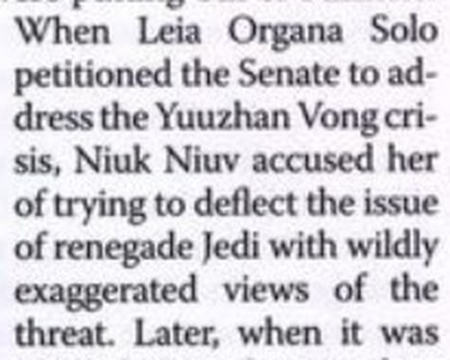

## p.385 (scan page 391)

Page contents: 1237 words, 29 paragraphs | headings/entries: Nkik, Jek; N-K Necrosis; NL-6; Niora; Nnaksta, Xenon; Noa; Nob, Neb; Nobis, Ona; Noble Sacrifice; Nobody's Inn; Nobu; Nociv; Nocombackie Law

- **Obi-Wan Kenobi**: "In the end, Arbor was captured and Nobis was killed in a fall while battling Kenobi." Source: The Complete Star Wars Encyclopedia, Vol. II, p.385
  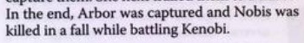

## p.386 (scan page 392)

Page contents: 1294 words, 29 paragraphs | headings/entries: Nod, Seib; Noga River; Noga-ta; Nogdra; Noimm, Cair Tok

- **Grand Admiral Thrawn**: "In a daring act of vengeance, Rukh killed Thrawn aboard the Grand Admiral's command ship with an assassin's blade." Source: The Complete Star Wars Encyclopedia, Vol. II, p.386
  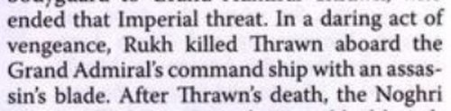

## p.387 (scan page 393)

Page contents: 1122 words, 34 paragraphs | headings/entries: Nok; Nokko; Nol, Nobam; Nolaan; Nolar; Noloth; Nolyds, Burr; Nomad; Nomar; Nomo; Nonak; Nonam, Captain; No-Name; Nonce; Nonnah; NonSonic; Noob; Nooch

- **Jax Pavan**: "After Jax was killed on Yinchorr, Nolyds took control of the Council." Source: The Complete Star Wars Encyclopedia, Vol. II, p.387
  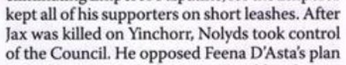

## p.388 (scan page 394)

Page contents: 1436 words, 23 paragraphs | headings/entries: Nooma, Vosdia; Noon, Larad; Noonb, Snem; Noone, Cecil; Noopiths; Noor, Tetengo An; Noorg, Aalos; Noorr, Vol; Nootka, Lai; Nopces Prime; Nor, Moritz; N'oram, Jyn; Norand, Isela Talsava

## p.389 (scan page 395)

Page contents: 1093 words, 25 paragraphs | headings/entries: Norat Sovereignty; Norbet's Nest; Norcuna; Nord, Colonel; Nordieus; Nordoxicon; Norello, Captain; Norg Bral; Norgor; Norley, Cee

- **Bastila Shan; Darth Malak**: "He dogged Bastila Shan, Carth Onasi, and the Jedi Knights who were searching for the Star Forge along with Darth Malak, and was believed to have been killed on Taris." Source: The Complete Star Wars Encyclopedia, Vol. II, p.389
  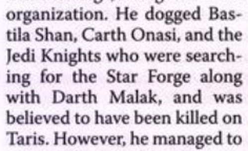
- **Grand Moff Tarkin; Luke Skywalker; Leia Organa Solo**: "However, when Nord decided to use the ionic cannon aboard the Tarkin to take out Luke Skywalker and Leia Organa, the superweapon exploded." Source: The Complete Star Wars Encyclopedia, Vol. II, p.389
  
- **Ulic Qel-Droma**: "Norgor was sent to assassinate Jedi Ulic Qel-Droma but ended up being killed by the Jedi." Source: The Complete Star Wars Encyclopedia, Vol. II, p.389
  

## p.390 (scan page 396)

Page contents: 1189 words, 39 paragraphs | headings/entries: Norquest; Norric's; Norsh, Galinda; Northaykk; North Barris Spaceport; North Beach; North Conical Mountains; Northeast Refineries; Northern Bands; Northern Dune Sea; Northern Lakes; Northern Province; Northern Sea; North Horn Flightknife; North Market; Norveel, Jax; Norufu; Norulac; Norys; Norval W

- **Lando Calrissian**: "Norulac This planet was home to a gang of bandits who raided Taanab every year, until they were wiped out by Lando Calrissian in the famous Battle of Taanab." Source: The Complete Star Wars Encyclopedia, Vol. II, p.390
  
- **Lando Calrissian**: "Calrissian single-handedly accounted for 19 kills of the Norulac band." Source: The Complete Star Wars Encyclopedia, Vol. II, p.390
  

## p.391 (scan page 397)

Page contents: 1189 words, 23 paragraphs | headings/entries: Nose, The; Notak; Notch, the; Nothos, Commander Bane; Notoganarech; Notsil, Lara; Notsil, Tavin; Nouane; Novacom

- **Admiral Ackbar**: "Nothos, Commander Bane This Imperial district commander was charged with locating and destroying Admiral Ackbar's Shantipole Project—then building a new starfighter, the B-wing." Source: The Complete Star Wars Encyclopedia, Vol. II, p.391
  

## p.392 (scan page 398)

Page contents: 1109 words, 32 paragraphs | headings/entries: Nova Crystal; Nova Demons; Nova Force; Nova Level; Novar; Novarr, Fiana; Nova Squadron; Novastar; Novastar Corporation; Nova Station; Nova Viper; Novus; NR-S5; NRI; NR-N99 Persuader; Nrogu; Nrross; Ne-s6; NT 600

- **Novar** — entry/section: Novar: "The king, in a great fit of rage, destroyed Kad with Sith magic and promoted Novar in his place." Source: The Complete Star Wars Encyclopedia, Vol. II, p.392
  

## p.393 (scan page 399)

Page contents: 1203 words, 23 paragraphs | headings/entries: NTB-630; N'ton; Ntthan; Nu, Jocasta; Nu, Kelbis; Nu, Koobis; Nu, Risso; Nuala Marauders; Nu-Ar, Fem; Nub; Nubblyk; Nubia; Nub Saar

- **Darth Vader (Anakin Skywalker); Palpatine (Darth Sidious)**: "In the wake of the Clone Wars, Madame Nu was among the many Jedi killed by Anakin Skywalker after he pledged his allegiance to Darth Sidious and became Darth Vader." Source: The Complete Star Wars Encyclopedia, Vol. II, p.393
  
- **Jango Fett**: "Fett survived a missile blast, and got the back-up set of armor—once worn by Jango Fett—that he kept on Ma'ar Shaddam." Source: The Complete Star Wars Encyclopedia, Vol. II, p.393
  

## p.394 (scan page 400)

Page contents: 1144 words, 18 paragraphs | headings/entries: Nudo, Po; Nuffin; Nugek; Nugtosh; Nukkels, Spleed; Null; Null, Warb; Nullada

- **Darth Vader (Anakin Skywalker)**: "Po Nudo was later placed in charge of the Hyper-Communications Cartel, but was among the Separatist leaders who were killed on Mustafar by Darth Vader at the end of the Clone Wars." Source: The Complete Star Wars Encyclopedia, Vol. II, p.394
  
- **Count Dooku**: "During his attempt to gain possession of the Station 88 Spaceport for the Separatists, Count Dooku suggested that representatives from Junction 5, Delaluna, Bezim, and Vicondor all meet on Null to negotiate a deal." Source: The Complete Star Wars Encyclopedia, Vol. II, p.394
  
- **Warb Null; Arca Jeth; King Ommin; Freedon Nadd** — entry/section: Null, Warb: "When Jedi Master Arca Jeth appealed to King Ommin for aid in recovering the remains of Freedon Nadd, Ommin and Warb Null attacked, overpowering the Jedi and taking him captive." Source: The Complete Star Wars Encyclopedia, Vol. II, p.394
  
- **Warb Null; Ulic Qel-Droma** — entry/section: Null, Warb: "Warb Null, however, was struck down and killed by Ulic Qel-Droma." Source: The Complete Star Wars Encyclopedia, Vol. II, p.394
  
