# Owner Material 031 — The Complete Star Wars Encyclopedia, Vol. II (H–O): scan pages 401–440

- **Source:** *The Complete Star Wars Encyclopedia* by Stephen J. Sansweet and Pablo Hidalgo, with Bob Vitas, Daniel Wallace, Chris Cassidy, Mary Franklin and Josh Kushins (Del Rey, 2008), 3 vols. Secondary source (licensed Legends reference). Scan OCR'd on the box; the scan stays box-only and is **not** published.
- **Method:** every scanned page was OCR'd and machine-screened sentence by sentence for power-relevant statements (fights, kills, defeats, Force feats, rankings, superweapons) that name a character on our roster; each kept sentence is quoted verbatim from the OCR text and has a crop of the printed passage directly under it. Pages with nothing power-relevant are still listed with what is on them.
- **Citation:** "The Complete Star Wars Encyclopedia, Vol. II, p.X" by printed page ("scan p.X" where no printed number applies). **Weight:** Lucasfilm-licensed encyclopedia: a secondary, in-universe summary of Legends (and some film) material. It sums up feats from novels, comics and games; where the original story is in our notes, that source is the stronger citation.

## p.395 (scan page 401)

Page contents: 1213 words, 21 paragraphs | headings/entries: Nullip; Null Space; Numb, Ten; Numbers; Nunb, Aril; Nunb, Nien

- **Jango Fett**: "She wanted them destroyed, but Orun Wa stepped in and asked Jango Fett to evaluate them." Source: The Complete Star Wars Encyclopedia, Vol. II, p.395
  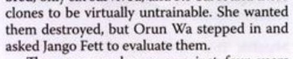

## p.396 (scan page 402)

Page contents: 1327 words, 27 paragraphs | headings/entries: Nuni; Nunurra; Nur, Raglath; Nuralee; Nuri; Nureo; Nursery; Nuruodo; Nuruodo, Shawnkyr; Nushk; Nutrofit; Nuum, Cabrool

## p.397 (scan page 403)

Page contents: 1348 words, 19 paragraphs | headings/entries: Nuum, Rusk; Nuur, Shaela; Nuyu; Ny; Nyasko; Nyax, Lord; Nye; Nyiestra; NyKI; Nyklas, Commander; Nyl, Darca

- **Darca Nyl** — entry/section: Nyl, Darca: "He later realized that Jaren was harboring a fugitive, her brother Ament who had killed dozens of people because he was prone to fits of rage." Source: The Complete Star Wars Encyclopedia, Vol. II, p.397
  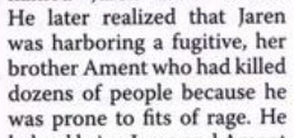

## p.398 (scan page 404)

Page contents: 1200 words, 20 paragraphs | headings/entries: N Ayddar; Nym; Nym's Stronghold Cantina; Nynie; Nyny; Nyras, Adrianna; Nyrkar; Nyroska

## p.399 (scan page 405)

Page contents: 959 words, 23 paragraphs | headings/entries: Nyrvona; Nysshyyyk; Nystammall; Nystao; Nyth, Volu; Nytinite; Nyxy; N'zoth

- **General Grievous**: "Nystammall This Vuvrian was one of the many Jedi Masters killed by General Grievous during the Clone Wars." Source: The Complete Star Wars Encyclopedia, Vol. II, p.399
  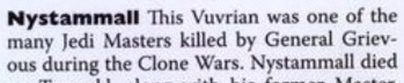

## p.400 (scan page 406)

Page contents: 0 words, 0 paragraphs | headings/entries: 

## p.401 (scan page 407)

Page contents: 922 words, 29 paragraphs | headings/entries: 1O0lst Regiment; 105th Stormtrooper Platoon; 127th Gunship Wing; 132nd Forward Division; 044; Oakie; Oa Park; Oasis; Oasis Mining Colony; Obah, Jyn; Obas; Oberk, Corporal

## p.402 (scan page 408)

Page contents: 1146 words, 46 paragraphs | headings/entries: Obersken; Obex; Obigon, Captain; O-Bin; Obinipor; Obitoki; Obi-Wan; Objurium; Obligon Nebula; Obliterator; OboRin Comet Ciuster; Obredaan; Obrim, Jailer; Obroa-held; Observer; Obstacle; Ocheron; Ockbur

- **Obi-Wan Kenobi** — entry/section: Obi-Wan: "Obi-Wan The first Defender-class Star Destroyer produced for the New Republic Navy, named for Obi-Wan Kenobi." Source: The Complete Star Wars Encyclopedia, Vol. II, p.402
  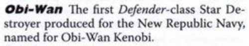
- **Luke Skywalker**: "The old hag nearly defeated Singing Clan witch Teneniel Djo and Luke Skywalker with one of her spells—she sucked the wind from their lungs and barraged them with Force lightning." Source: The Complete Star Wars Encyclopedia, Vol. II, p.402
  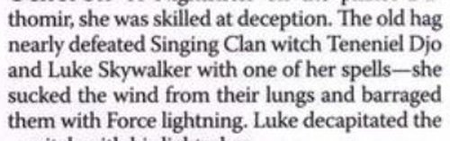

## p.403 (scan page 409)

Page contents: 1132 words, 21 paragraphs | headings/entries: Odala, Sheel; Odan-Urr; Odd Ball; Odell, Beuga; Odik I; Odie, Hermi

- **Odan-Urr** — entry/section: Odan-Urr: "There Odan-Urr used Jedi battle meditation to unify Empress Teta's forces and push back the resistance on the planet Kirrek." Source: The Complete Star Wars Encyclopedia, Vol. II, p.403
  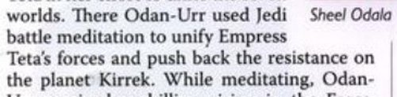
- **Odan-Urr** — entry/section: Odan-Urr: "Remembering his master's insistence that he pass on what he learned, Odan-Urr decided to build a repository of Jedi knowledge on the world of Ossus, a library that eventually grew to legendary proportions." Source: The Complete Star Wars Encyclopedia, Vol. II, p.403
  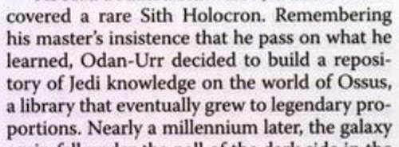
- **Odan-Urr** — entry/section: Odan-Urr: "Kun killed Odan-Urr with the power of the dark side." Source: The Complete Star Wars Encyclopedia, Vol. II, p.403
  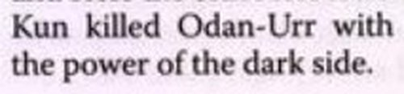

## p.404 (scan page 410)

Page contents: 1215 words, 32 paragraphs | headings/entries: Odosk, General; Odovrera, Joon; Odrion, Mors; Odryn; ODT; Odumin; Off-Canau; Off Chance; Offdurmin, Bescat; Offee, Barriss

- **Admiral Daala**: "Odosk's men secured T'nun Bdu's corvette and rigged it to explode after Bdu spread word of Daala's return." Source: The Complete Star Wars Encyclopedia, Vol. II, p.404
  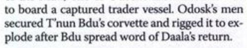
- **Barriss Offee** — entry/section: Offee, Barriss: "She was killed by an AT-TE when the clone troopers under her command carried out Order 66." Source: The Complete Star Wars Encyclopedia, Vol. II, p.404
  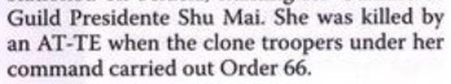

## p.405 (scan page 411)

Page contents: 1109 words, 32 paragraphs | headings/entries: Offen; Offshoot; Offworld Mining Corporation; OG-9; Ogden Minor; Ogomoor; Ogoth Tiir; Ohann; Ohma-D'un; Oicunn, Lieutenant Barrow; Oissan, Colonel; Ojai; Okand, Hol; Okanor, Galidon

- **Obi-Wan Kenobi; Darth Vader (Anakin Skywalker)**: "Obi- Wan Kenobi, Anakin Skywalker, Glaive, and Zule—along with a small contingent of clone troopers—arrived to investigate, and found the entire colony wiped out." Source: The Complete Star Wars Encyclopedia, Vol. II, p.405
  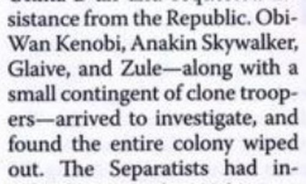

## p.406 (scan page 412)

Page contents: 1055 words, 24 paragraphs | headings/entries: Okeco, Anjet; Okeefe, Platt; Okfili; Okikuti; Okins, Admiral; Okko, Great; Oko E; Olafsen; Olan, Firith

## p.407 (scan page 413)

Page contents: 1221 words, 42 paragraphs | headings/entries: Twi'lek.; Olanet; Olanji/Charubah; Olanji Fleet; Olanz; Ola's; Olbeg, Han; Olbeg, Sal; Old City; Old Codger; Old Corellian; Old Folks Home; Old High Squibbian; Old High Trammic; Old Law; Olid Mankoo; Old Quarter; Old Republic; Old Sith Wars; Great Sith War.; Oldsong, Abbela; Oldtimers; Old Town; Old Trusty; Oleg; Olemp; Oleson, General

- **Qui-Gon Jinn**: "His lifeless body was discovered by Qui-Gon Jinn shortly afterward, shot and killed by one of the probe droids that had been outlawed on the planet." Source: The Complete Star Wars Encyclopedia, Vol. II, p.407
  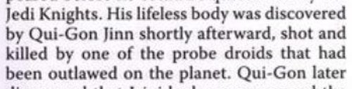

## p.408 (scan page 414)

Page contents: 1128 words, 19 paragraphs | headings/entries: Olié, Ric; Oliet; Olin, Ferus

- **Grand Inquisitor Malorum**: "Olin convinced her to return to the Jedi Temple, in an effort to stop Malorum from destroying the settlement." Source: The Complete Star Wars Encyclopedia, Vol. II, p.408
  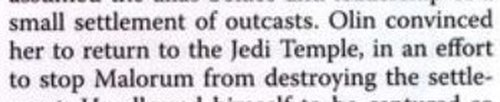

## p.409 (scan page 415)

Page contents: 1245 words, 26 paragraphs | headings/entries: Olinor; Oll, Lari; Olmahk; Olmondo; Ologat, Mychael; Olok, Ithes; Olovin; OLR-4; Omal; Omano, Commander; Oma-Oma; Omar; Omas, Cal

- **Leia Organa Solo**: "He also traveled with Leia to Ord Mantell, Gyndine, and finally Duro, where he was killed trying to cover Leia's escape from the alien invaders." Source: The Complete Star Wars Encyclopedia, Vol. II, p.409
  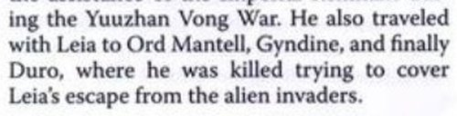

## p.410 (scan page 416)

Page contents: 1226 words, 23 paragraphs | headings/entries: Omega, Granta; Omega Exercise; Omega Frost; Omega Signal; Omega Squad; O-Melie; Omin, Isaru

- **Jacen Solo (Darth Caedus); Mara Jade Skywalker**: "When Ben confronted Omas, the beleaguered Chief of State revealed that he believed Jacen had been the one who killed Mara." Source: The Complete Star Wars Encyclopedia, Vol. II, p.410
  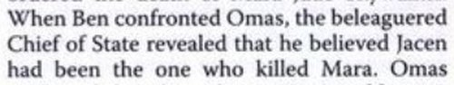
- **Darth Vader (Anakin Skywalker); Palpatine (Darth Sidious)**: "During a scheme on Haariden, Omega captured Padawan Anakin Skywalker and revealed that he was working to destroy the Jedi Knights in order to curry favor with the mysterious Sith Lord Darth Sidious." Source: The Complete Star Wars Encyclopedia, Vol. II, p.410
  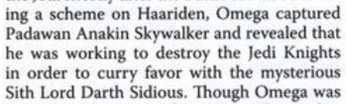
- **Obi-Wan Kenobi**: "He especially hoped to destroy Kenobi, and got his chance in one of the many tombs in the Valley of the Sith Lords." Source: The Complete Star Wars Encyclopedia, Vol. II, p.410
  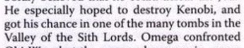
- **Luke Skywalker**: "The plan was thwarted by Luke Skywalker, who destroyed one of the conductor towers before the fleet arrived." Source: The Complete Star Wars Encyclopedia, Vol. II, p.410
  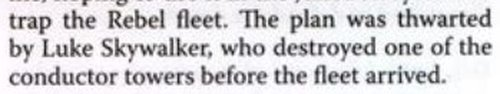

## p.411 (scan page 417)

Page contents: 1178 words, 30 paragraphs | headings/entries: Ominaz, Ignar; Omin-Oreh; Ommin, King; Ommis, Kesin; Omnino, Baroness; Omogg; Omonda, Canna; Omonoth; Omwat

- **Darth Vader (Anakin Skywalker)**: "Autem fled, avoiding Darth Vader's grip, but the frustrated Dark Lord of the Sith cut down Omin in his anger." Source: The Complete Star Wars Encyclopedia, Vol. II, p.411
  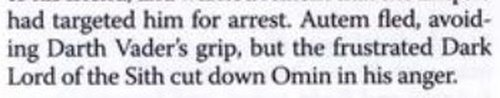
- **King Ommin; Freedon Nadd** — entry/section: Ommin, King: "The spirit of Freedon Nadd absorbed Ommin's final gasps of life and drew him to the dark side." Source: The Complete Star Wars Encyclopedia, Vol. II, p.411
  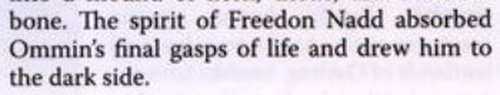

## p.412 (scan page 418)

Page contents: 1108 words, 27 paragraphs | headings/entries: On, Reesa; Onacra; Onadax; Onaka, Hondo; Onasi, Carth

- **Guri**: "Allegedly founded by Dash Rendar and the human replica droid Guri, the company offered a practical form of immortality for a hefty fee." Source: The Complete Star Wars Encyclopedia, Vol. II, p.412
  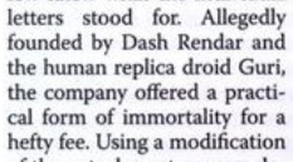
- **Jaina Solo**: "Rather than have Jaina halt the enterprise, Stanton took his knowledge and fled Onadax, destroying the entire ODT facility as he left." Source: The Complete Star Wars Encyclopedia, Vol. II, p.412
  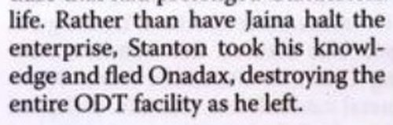
- **Bastila Shan**: "He found himself unable to trust anyone, particularly the inscrutable Jedi he was often teamed with during his missions, He still carried out his duty, escaping from the Endar Spire over Taris and freeing the captive Jedi Bastila Shan before that world was also destroyed by the Sith." Source: The Complete Star Wars Encyclopedia, Vol. II, p.412
  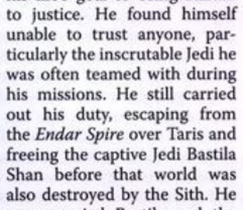

## p.413 (scan page 419)

Page contents: 1239 words, 29 paragraphs | headings/entries: Ondi, Candace; One Below; One Scourge; One Sith; Ongree; Oni; Onoh; Onoma, Captain; Onslaught

## p.414 (scan page 420)

Page contents: 1145 words, 25 paragraphs | headings/entries: Onslaught; OnSon, Skot; Onyx Squadron; Onyx Star; Oochee; Oodoc; Oodonnaa; Oojoh; Oola; Oolidi; Qolos, Dr. Ism; OOM-9

- **Zayne Carrick**: "In a preemptive move to prevent this cataclysm, the Jedi slew their Padawans, though Zayne Carrick survived." Source: The Complete Star Wars Encyclopedia, Vol. II, p.414
  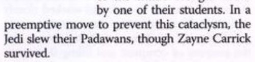
- **Darth Vader (Anakin Skywalker)**: "He was deactivated, along with the rest of the battle droid army, when young Anakin Skywalker destroyed the Droid Control Ship." Source: The Complete Star Wars Encyclopedia, Vol. II, p.414
  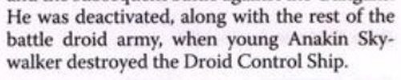

## p.415 (scan page 421)

Page contents: 1160 words, 30 paragraphs | headings/entries: Gon Tien; Oonaar, Ziece; Oo-ta Goo-ta; OP-S5; Opee Fleer; Ooya

## p.416 (scan page 422)

Page contents: 1157 words, 29 paragraphs | headings/entries: Operation Blue Harvest; Operation Blue Plug; Operation Case White; Operation Durge's Lance; Operation Emperor's Hammer; Operation Emperor's Spear; Operation Flotsam; Operation Hammerblow; Operation Joystick; Operation Katabatic; Operation Noble Savage

## p.417 (scan page 423)

Page contents: 1293 words, 30 paragraphs | headings/entries: Roundabout.; Restbreak; Retribution; Operation Roundabout; Operation Safe Passage; Operation Starlancer; Operation Strike Fear; Operation Strong Hand; Operation Trinity; Operation Yavin Kill Two; Opquis; Opreka, Kalzutan; Opuh, N. J.

- **Luke Skywalker**: "A desolate world under the control of the Serpent Master Tyrann, until Luke Skywalker and Tanith Shire defeated him." Source: The Complete Star Wars Encyclopedia, Vol. II, p.417
  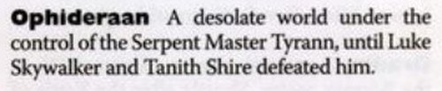
- **Admiral Ackbar**: "The Alliance cruisers, commanded by Admiral Ackbar, defeated the Imperials." Source: The Complete Star Wars Encyclopedia, Vol. II, p.417
  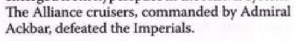

## p.418 (scan page 424)

Page contents: 1140 words, 31 paragraphs | headings/entries: Oracle Stone; Orade, Ghes; Oradin; Orame; Oran, Communications Chief; Orange District; Orax

- **Han Solo**: "Zsinj threatened to destroy the planet unless Han Solo was delivered to him." Source: The Complete Star Wars Encyclopedia, Vol. II, p.418
  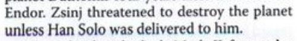

## p.419 (scan page 425)

Page contents: 1198 words, 31 paragraphs | headings/entries: Orbitblade-2000; Orbiting Shipyard Alpha; Orbot; Orbus, Evar; Ord; Ord Antalaha; Ord Biniir; Ord Bueri; Ord Canfre; Ord Cantrell; Ord Cestus; Ord Dorlass; Order 66

## p.420 (scan page 426)

Page contents: 1187 words, 27 paragraphs | headings/entries: Ord Grovner; Ord Ibanna; Ord Jjanon; Ord Klina; Ord Lithone; Ord Mantell, Battle of; Ord Manurt; Ordo, Canderous

## p.421 (scan page 427)

Page contents: 1200 words, 32 paragraphs | headings/entries: Ord Pedrovia; Ord Radama; Ord Sabaok; Ord Sedra; Ord Segra; Ord Sigatt; Ord Simres; Ord Tessebok; Ord Thoden; Ord Tiddell; Ord Traga; Ord Varee; Ord Vaug; Ord Vaxal; Ord Zat; Ord Zeuol

- **Canderous Ordo** — entry/section: Ordo, Canderous: "He was pragmatic enough to take no insult from the defeat of his people." Source: The Complete Star Wars Encyclopedia, Vol. II, p.421
  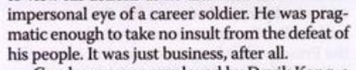
- **Revan; Darth Malak**: "The traitorous actions of Sith Lords Revan and Malak and the continued aggression of the Sith distracted the citizens of the Republic to the point that they were no longer concerned about the defeated Mandalorians." Source: The Complete Star Wars Encyclopedia, Vol. II, p.421
  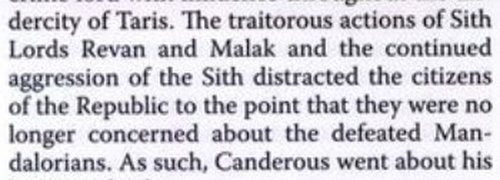

## p.422 (scan page 428)

Page contents: 1011 words, 17 paragraphs | headings/entries: Orelion; Orfite; Organa, Bail

## p.423 (scan page 429)

Page contents: 1153 words, 31 paragraphs | headings/entries: Organa, Celly, Rouge, and Tia; Organa, Leia; Organa, Queen Breha; Organa Hl, Leia; Orgege, Moff Yref; Oridin City; Orilitha; Orin; Orinackra; Orinda

- **Leia Organa Solo**: "In a scuffle that ensued, Leia killed Lord Tion." Source: The Complete Star Wars Encyclopedia, Vol. II, p.423
  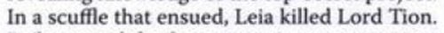
- **Anakin Solo**: "Oridin City A major metropolitan center on Fondor bombarded by the Star Destroyer Anakin Solo during the war between the Galactic Alliance and the Confederation." Source: The Complete Star Wars Encyclopedia, Vol. II, p.423
  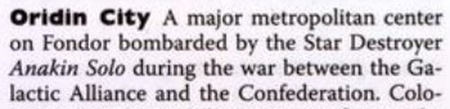
- **Jacen Solo (Darth Caedus)**: "Colonel Jacen Solo used the Force to influence the minds of the shield operators on Oridin, tricking them into lowering the protective shield and allowing for the devastating attack." Source: The Complete Star Wars Encyclopedia, Vol. II, p.423
  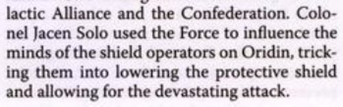

## p.424 (scan page 430)

Page contents: 1153 words, 31 paragraphs | headings/entries: Orion IV; Ori'ramikade; Orjul, Farr; Orko SkyMine Asteroid Processing Corporation; Orianis, Trista; Orleon; Orloc, the Mighty; Oriok, Commander; Orlopp; Orma; Orn, Kalebb; Oroko; Ororo Transportation

- **IG-88**: "But when IG-88 took over the production plant and caused newly assembled labor droids to rebel against their masters and wreak havoc on the plant, Orn was among the first killed." Source: The Complete Star Wars Encyclopedia, Vol. II, p.424
  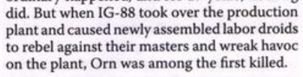

## p.425 (scan page 431)

Page contents: 1055 words, 32 paragraphs | headings/entries: Orou'cya, Ceok; Orowood Tower; Orren, Yotts; Orrimaarko; Orrk, Guildmaster; Orr-Om; Orron Wl; Orr'UrRuuR'R; Orryxian; Ors, Jan; Orsk, Captain; Orthavan; Orto

- **Palpatine (Darth Sidious); Darth Vader (Anakin Skywalker)**: "Palpatine sent Vader to destroy the Rebels' base, which in truth was an Ororo shipyard." Source: The Complete Star Wars Encyclopedia, Vol. II, p.425
  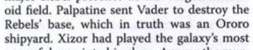
- **Prince Xizor**: "Xizor had played the galaxy's most powerful men into his plans." Source: The Complete Star Wars Encyclopedia, Vol. II, p.425
  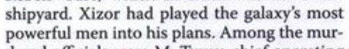

## p.426 (scan page 432)

Page contents: 1203 words, 26 paragraphs | headings/entries: Ortugg; Orvak, Commander; Orvax IV; Orvos; Oryon; Or'Zee, Chamberlain Kaja; OS-72-10; OS-72-8; Osa-Prime; Osarian; Oscuro, Seri; Osentay, Ryk; Oseon

- **Darth Vader (Anakin Skywalker); Obi-Wan Kenobi**: "Orvos The aged Nelvaanian shaman of the Rokrul villages on Nelvaan, he foresaw that Anakin Skywalker and Obi-Wan Kenobi would assist the Nelvaanians in removing the Separatists who had arrived on the planet during the Clone Wars." Source: The Complete Star Wars Encyclopedia, Vol. II, p.426
  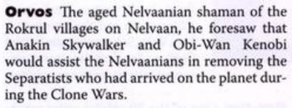

## p.427 (scan page 433)

Page contents: 1197 words, 32 paragraphs | headings/entries: Oseon, Gadfrey; OSETS; Oshay; Oshetti IV; Osilumpex V; Osman; Ossan; Ossel Wf; Ossi; Ossiki Confederacy Army; Ossilege, Admiral Hortel

## p.428 (scan page 434)

Page contents: 1142 words, 22 paragraphs | headings/entries: Ossus Project; Ostega; Oswaft; Ota; Otana

- **Odan-Urr**: "Before he departed, Kun killed Master Odan-Urr and stole a Sith Holocron from the Jedi library." Source: The Complete Star Wars Encyclopedia, Vol. II, p.428
  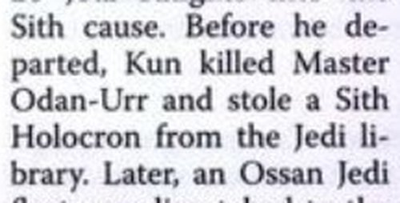
- **Ulic Qel-Droma; Cay Qel-Droma**: "Meanwhile, Ulic confronted and killed his brother, Cay, and was seized with horror and regret over what he had done." Source: The Complete Star Wars Encyclopedia, Vol. II, p.428
  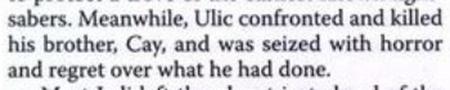

## p.429 (scan page 435)

Page contents: 957 words, 28 paragraphs | headings/entries: Othone, Johun; Othrem, Raf; OTIA; Otoh Gunga; Otoh Gunga Bongameken Cooperative; Otoh Sancture; Otondon, Gleed

- **Darth Bane**: "Johun confronted Darovit, who had firsthand evidence that Sith Lord Darth Bane had indeed survived the Battle of Ruusan." Source: The Complete Star Wars Encyclopedia, Vol. II, p.429
  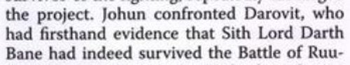

## p.430 (scan page 436)

Page contents: 1115 words, 18 paragraphs | headings/entries: Otranto; Ottdefa; Otto, General; Ourn, Belezaboth; Outbound Flight Project

- **Palpatine (Darth Sidious)**: "Sidious worked behind the scenes with his agent, Kinman Doriana, to gather a huge, 15-ship task force that would intercept and destroy Outbound Flight." Source: The Complete Star Wars Encyclopedia, Vol. II, p.430
  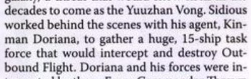

## p.431 (scan page 437)

Page contents: 1151 words, 20 paragraphs | headings/entries: Outer Expansion Zone; Outer Rim Communications Center; Outer Rim Sieges; Outer Rim Territories; Outlander Club

## p.432 (scan page 438)

Page contents: 1201 words, 31 paragraphs | headings/entries: Outland Mining; Outland Transit Station; Outpost; Outpost Beta; Outrider; OV600; Ova; Overden; Overracer; Oviedo Engineering; O-Vieve; Ovkhevam; Ovrax IV; Ov Taraba; Ovvit

## p.433 (scan page 439)

Page contents: 1091 words, 22 paragraphs | headings/entries: Ow-Chee-2; Owell; OWO-1I; Oxbel; Oxon; Ozio; Ozz, King

- **Ben Skywalker**: "Ovvit was killed on Ziost by Ben Skywalker, who managed to use the Force to dislodge several heavy boulders and drop them on Ovvit's TIE fighter." Source: The Complete Star Wars Encyclopedia, Vol. II, p.433
  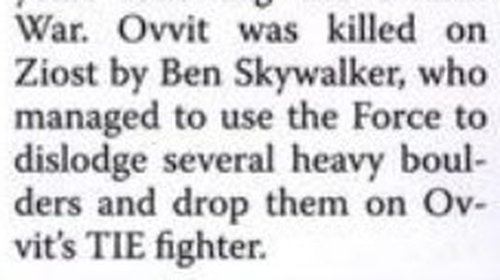
- **Qui-Gon Jinn; Obi-Wan Kenobi**: "OWO-1I One of the command battle droids sent by Nute Gunray to check to see if Qui-Gon Jinn and Obi-Wan Kenobi had been killed by poison gas aboard the Trade Federation flagship in charge of the blockade of Naboo." Source: The Complete Star Wars Encyclopedia, Vol. II, p.433
  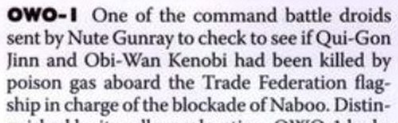
- **Darth Vader (Anakin Skywalker)**: "Vader killed Ozzel for his failure, promoting Captain Piett to his position." Source: The Complete Star Wars Encyclopedia, Vol. II, p.433
  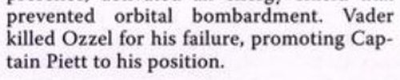

## p.434 (scan page 440)

Page contents: 0 words, 0 paragraphs | headings/entries: 

