# Owner Material 032 — The Complete Star Wars Encyclopedia, Vol. III (P–Z): scan pages 1–40

- **Source:** *The Complete Star Wars Encyclopedia* by Stephen J. Sansweet and Pablo Hidalgo, with Bob Vitas, Daniel Wallace, Chris Cassidy, Mary Franklin and Josh Kushins (Del Rey, 2008), 3 vols. Secondary source (licensed Legends reference). Scan OCR'd on the box; the scan stays box-only and is **not** published.
- **Method:** every scanned page was OCR'd and machine-screened sentence by sentence for power-relevant statements (fights, kills, defeats, Force feats, rankings, superweapons) that name a character on our roster; each kept sentence is quoted verbatim from the OCR text and has a crop of the printed passage directly under it. Pages with nothing power-relevant are still listed with what is on them.
- **Citation:** "The Complete Star Wars Encyclopedia, Vol. III, p.X" by printed page ("scan p.X" where no printed number applies). **Weight:** Lucasfilm-licensed encyclopedia: a secondary, in-universe summary of Legends (and some film) material. It sums up feats from novels, comics and games; where the original story is in our notes, that source is the stronger citation.

## scan p.1 (scan page 1)

Page contents: 10 words, 4 paragraphs | headings/entries: 

## scan p.2 (scan page 2)

Page contents: 6 words, 4 paragraphs | headings/entries: 

## scan p.3 (scan page 3)

Page contents: 0 words, 0 paragraphs | headings/entries: 

## scan p.4 (scan page 4)

Page contents: 32 words, 7 paragraphs | headings/entries: 

## scan p.5 (scan page 5)

Page contents: 84 words, 7 paragraphs | headings/entries: 

## scan p.6 (scan page 6)

Page contents: 0 words, 0 paragraphs | headings/entries: 

## p.1 (scan page 7)

Page contents: 4 words, 3 paragraphs | headings/entries: 

## p.2 (scan page 8)

Page contents: 0 words, 0 paragraphs | headings/entries: 

## p.3 (scan page 9)

Page contents: 670 words, 24 paragraphs | headings/entries: P-6; Pa'aal; Paaerduag; Paak; Paal, Nadin; PaAR; Paarin Minor

## p.4 (scan page 10)

Page contents: 844 words, 19 paragraphs | headings/entries: Pablo-Jill; Pablo-Jill Pabs, Rhe; Paca, Magir; Pacanth Reach; Pacci; Pace, Dr. Anki; Pachwenko; Pacithhip; Pad; Padaunete, Thrynka; Padawan; Padawan Massacre

- **General Grievous**: "There he was slain by General Grievous." Source: The Complete Star Wars Encyclopedia, Vol. III, p.4
  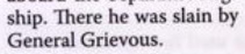
- **Lord Kaan**: "When the Sith were wiped out by Lord Kaan's use of a terrible thought bomb weapon, Pad was among the mercs left behind." Source: The Complete Star Wars Encyclopedia, Vol. III, p.4
  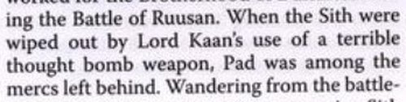

## p.5 (scan page 11)

Page contents: 1012 words, 24 paragraphs | headings/entries: Padawan Pack; Paddie, ister; Paecian Empire; Pag, Mirip; Pagalies, Teemto; Page, Glip; Page, Judder; Paig; Paige-Tarkin, Shayla; Pakka; Pakkpekatt, Colonel Ejagga

## p.6 (scan page 12)

Page contents: 1159 words, 25 paragraphs | headings/entries: Pakmillu, Captain; Pak Pak; Palazidar; Palbert, Firris; Palesia; Pall, Ajunta; Pall, Tobias; Palle, Lieutenant Eri; Pailin, Lieutenant; Palmer, RSF Officer; Pal-Nada

- **Lando Calrissian**: "When he was given the order to terminate the mission even though Calrissian and his companions were aboard the vagabond, the colonel exploded with rage, saying that "a Hortek does not leave the bodies of comrades in the hands of the enemy—ever."" Source: The Complete Star Wars Encyclopedia, Vol. III, p.6
  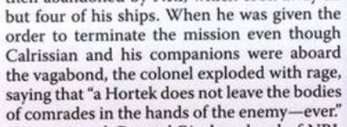

## p.7 (scan page 13)

Page contents: 906 words, 22 paragraphs | headings/entries: Palo; Pa'lowick

## p.8 (scan page 14)

Page contents: 1285 words, 21 paragraphs | headings/entries: 

- **Darth Vader (Anakin Skywalker)**: "During the Clone Wars, Anakin Skywalker grew to be a legendary hero among the Jedi." Source: The Complete Star Wars Encyclopedia, Vol. III, p.8
  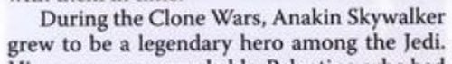
- **Darth Vader (Anakin Skywalker)**: "The Sith Lord goaded Anakin into rage, and the young Jedi took revenge against the warrior who had severed his arm years before." Source: The Complete Star Wars Encyclopedia, Vol. III, p.8
  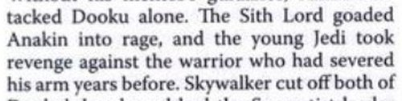
- **Count Dooku**: "Skywalker's blade seared through flesh and bone, and Dooku's severed head soon littered the deck." Source: The Complete Star Wars Encyclopedia, Vol. III, p.8
  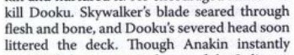
- **Mace Windu; Palpatine (Darth Sidious); Darth Vader (Anakin Skywalker)**: "Windu overpowered Palpatine the instant Anakin Skywalker came running into the offices." Source: The Complete Star Wars Encyclopedia, Vol. III, p.8
  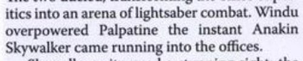
- **Palpatine (Darth Sidious); Mace Windu**: "Palpatine unleashed a torrent of Sith lightning at the Jedi Master, but Windu was able to deflect it back at the Chancellor." Source: The Complete Star Wars Encyclopedia, Vol. III, p.8
  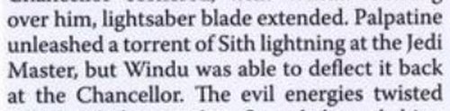

## p.9 (scan page 15)

Page contents: 1258 words, 31 paragraphs | headings/entries: Palpatones; Palsaang; Paltonae, Baroness

- **Palpatine (Darth Sidious)**: "Palpatine allowed Rebel spies to learn of the location of the second Death Star and foresaw their strike team and fleet assault." Source: The Complete Star Wars Encyclopedia, Vol. III, p.9
  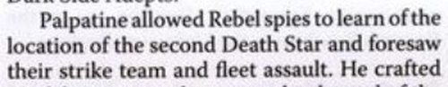
- **Palpatine (Darth Sidious); Darth Plagueis**: "Palpatine scoured ancient Sith texts seeking a path to eternal life, a continuation of a quest for immortality begun by Darth Plagueis." Source: The Complete Star Wars Encyclopedia, Vol. III, p.9
  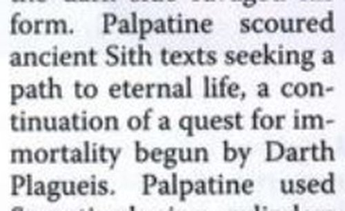
- **Luke Skywalker; Palpatine (Darth Sidious)**: "Luke refused the Emperor's newfound dark side power, and so Palpatine used his deadly Force lightning to attack the young Jedi." Source: The Complete Star Wars Encyclopedia, Vol. III, p.9
  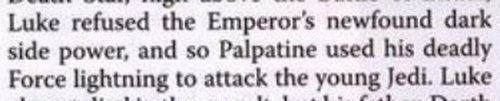
- **Luke Skywalker; Darth Vader (Anakin Skywalker)**: "Luke almost died in the assault, but his father, Darth Vader, returned to the light side of the Force and hurled the Emperor into the Death Star's reactor core, killing him." Source: The Complete Star Wars Encyclopedia, Vol. III, p.9
  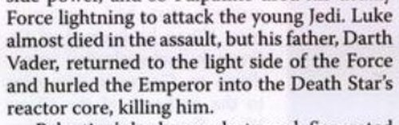
- **Palpatine (Darth Sidious)**: "Palpatine's body was destroyed." Source: The Complete Star Wars Encyclopedia, Vol. III, p.9
  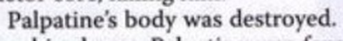
- **Darth Vader (Anakin Skywalker)**: "He barely survived Darth Vader's treachery." Source: The Complete Star Wars Encyclopedia, Vol. III, p.9
  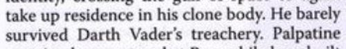
- **Grand Admiral Thrawn**: "Spurred on by Thrawn's victories, the remaining Inner Circle of Imperial warlords staged a devastating attack on Coruscant." Source: The Complete Star Wars Encyclopedia, Vol. III, p.9
  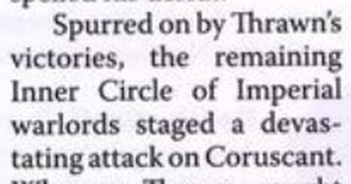
- **Palpatine (Darth Sidious); Luke Skywalker**: "Using his dark powers to invoke a Force storm of great magnitude, Palpatine swept Jedi Master Luke Skywalker to Byss." Source: The Complete Star Wars Encyclopedia, Vol. III, p.9
  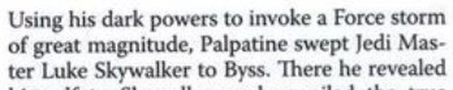
- **Palpatine (Darth Sidious)**: "Faced with an immortal enemy, Skywalker did the unthinkable—in order to defeat the dark side from within, Skywalker knelt before Palpatine and declared himself his new apprentice." Source: The Complete Star Wars Encyclopedia, Vol. III, p.9
  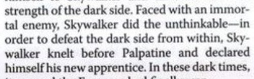

## p.10 (scan page 16)

Page contents: 1132 words, 27 paragraphs | headings/entries: Pammant; Pampy; Pam; Panaka; Panat, Ligg; Panatha; Pangay Ous; Panib, Grell

## p.11 (scan page 17)

Page contents: 872 words, 20 paragraphs | headings/entries: Panno, Major; Panteer, Raal; Panther Star; Paol, Jace; Papanoida, Baron N.; Papeega, Ban; Paploo

- **Leia Organa Solo**: "A former intimate of Leia Organa, Raal and his older brother Heeth were in the Ryloth system when their homeworld was destroyed by the first Death Star." Source: The Complete Star Wars Encyclopedia, Vol. III, p.11
  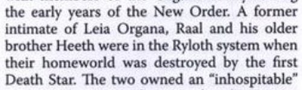
- **Luke Skywalker**: "Papeega, Ban This one-eyed, bird-like being conducted the interrogation of the Rebel pilot who revealed Luke Skywalker as the individual who destroyed the Death Star." Source: The Complete Star Wars Encyclopedia, Vol. III, p.11
  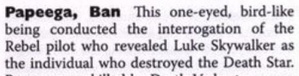
- **Darth Vader (Anakin Skywalker)**: "Papeega was killed by Darth Vader to ensure that Skywalker's identity remained a secret." Source: The Complete Star Wars Encyclopedia, Vol. III, p.11
  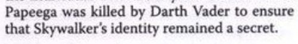

## p.12 (scan page 18)

Page contents: 872 words, 26 paragraphs | headings/entries: Pappfak; Paqwepori; Par, Baco; Paramita, Slide; Parcelus Minor

- **Leia Organa Solo**: "Leia was able to relay information about the parasite bombs to the other Jedi, and almost single-handedly ensured that the only two bombs to reach the surface of Tenupe were destroyed before they could deploy their deadly payloads." Source: The Complete Star Wars Encyclopedia, Vol. III, p.12
  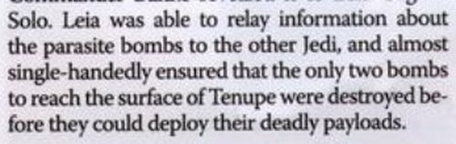

## p.13 (scan page 19)

Page contents: 1183 words, 45 paragraphs | headings/entries: Parck, Voss; Pardon, Mais; Parein HW; Paret, Jian; Parfadi; P'arghat, Lieutenant; Pargo; Parjai Squad; Parlan, Captain; Parnet, General; Parq, Colonel; Parrlay; Parrot; Parry, Bril; Parshoone; Par'tah

- **Antinnis Tremayne**: "Parnet, General An Imperial officer serving beneath High Inquisitor Tremayne aboard the Star Destroyer /nterrogator." Source: The Complete Star Wars Encyclopedia, Vol. III, p.13
  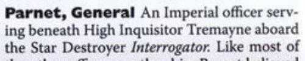

## p.14 (scan page 20)

Page contents: 975 words, 30 paragraphs | headings/entries: Partu, Cedo; Pashvi; Pasiq, Lanu; Pasmin; Paspro; Pastoral Collective; Patameene District; Pathfinders; Pa Tho; Patrick, Faye; Patriot Fist; Pau'an; Pau City; Paulsen, Drake; Pavan, Jax

## p.15 (scan page 21)

Page contents: 1195 words, 42 paragraphs | headings/entries: Pavan, Lorn; Holocron.; Pazz, Borth; Pavillion; Pavo Prime; Paws; Payback; PD-28; PDA-2; PDA6; PDT-8; PDV; Peace Brigade; Peacebringer; Peacebringer, Aron

## p.16 (scan page 22)

Page contents: 852 words, 27 paragraphs | headings/entries: Peace City Ylesia's Colony; Peerless; Peacekeeper; Peacekeepers; Peg Shar I; Pek; Peacemaker; Pekt; Peckhum; Pelagia; Peel, Gorvan; Peerce

## p.17 (scan page 23)

Page contents: 1181 words, 28 paragraphs | headings/entries: Pelek Baw; Peigrin; Pell, Akanah Norand

- **Grand Admiral Thrawn**: "When Thrawn was killed by a treacherous bodyguard, the Imperial momentum sputtered." Source: The Complete Star Wars Encyclopedia, Vol. III, p.17
  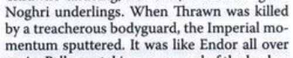
- **Grand Admiral Thrawn**: "They lacked the refinement of Thrawn's tactical mind, and rather than take the capital intact, they destroyed much of it." Source: The Complete Star Wars Encyclopedia, Vol. III, p.17
  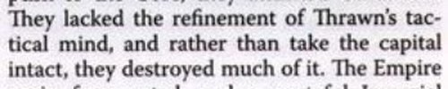
- **Admiral Daala**: "Daala was defeated, and Pellaeon stepped in to fill the power vacuum." Source: The Complete Star Wars Encyclopedia, Vol. III, p.17
  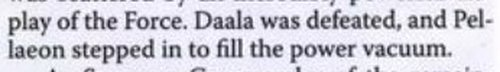

## p.18 (scan page 24)

Page contents: 1198 words, 27 paragraphs | headings/entries: Pellaeon-class Star Destroyer; Pellaeon-Gavrisom Treaty

## p.19 (scan page 25)

Page contents: 881 words, 27 paragraphs | headings/entries: Pembric Hl; Pend, Hexler; Pendarran Warriors; Pendath; Pengalan IV; Penga Rift; Penin, Rosh; Pent, Zegmon; Pentastar Alignment; People's Inquest; Peppel

## p.20 (scan page 26)

Page contents: 1164 words, 28 paragraphs | headings/entries: Peralli; Peramis, Senator Tig; Pereg, Hunti; Peremptory; Pergola's Bridge; Perhi, Dal; Peridon's Folly; Perilix; Perit; Permondiri Explorer; Pernicar

- **Lando Calrissian**: "Solo and Lando Calrissian managed to ram a Dreadnaught into the Peremptory, completely destroying both ships." Source: The Complete Star Wars Encyclopedia, Vol. III, p.20
  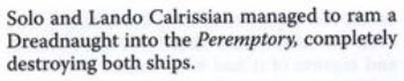
- **Darth Maul**: "Perhi, Dal A representative of Black Sun who was dispatched to clean up the remains of Yanth the Hutt, a Vigo killed by Darth Maul at the Tusken Oasis cantina in Coruscant's infamous Crimson Corridor." Source: The Complete Star Wars Encyclopedia, Vol. III, p.20
  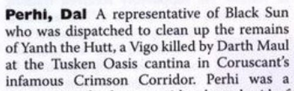

## p.21 (scan page 27)

Page contents: 1050 words, 27 paragraphs | headings/entries: Pernon, Count Rial; Gror; Perosei, Officer; Perris, Commander; Perrive; Perseverance; Persha; Perspicacity; Persuader-class Droid Enforcer; Pesfavri; Pesitiin; Pesktda; Pesmenben IV

- **Grand Admiral Thrawn**: "After Force Commander Thrawn disabled the Outbound Flight and killed its crew, Admiral Ar'alani directed Syndic Thrass to take the vessel to Pesfavri before the massive ship could be impounded by Aristocra Chaf'orm'bintrano." Source: The Complete Star Wars Encyclopedia, Vol. III, p.21
  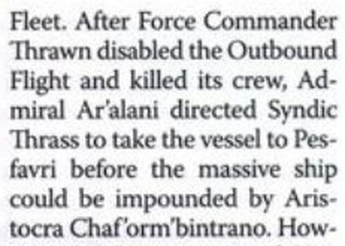

## p.22 (scan page 28)

Page contents: 1054 words, 24 paragraphs | headings/entries: Petikkin, Soth; Petja; Petrakis; Petro; Pezzle; Phaath, Yal; Phaeda

- **Jacen Solo (Darth Caedus)**: "Yal Phaath was killed aboard the Baanu Rass by Jacen Solo." Source: The Complete Star Wars Encyclopedia, Vol. III, p.22
  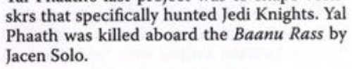

## p.23 (scan page 29)

Page contents: 1213 words, 32 paragraphs | headings/entries: Phalanx; Phanan, Ton; Phanius; Phantom TIE V-38; Phaseera; Phedroi; Phelarion; Phemis; Phemiss; Phenaru Prime; Phenets, Lee; Phindar; Phin-Mar, Ermin; Phiegmin

## p.24 (scan page 30)

Page contents: 1020 words, 53 paragraphs | headings/entries: Phiutdroid; Phoebos; Ph'Olla, Senator; Phonstom, Lady Lapema; Phootie; Pho Ph'eah; Phoriliss; Photo-Optic Replicator; Phracas; Phraetiss; Ph'ton; Phuna, T. Lund

## p.25 (scan page 31)

Page contents: 1050 words, 25 paragraphs | headings/entries: Phylion Transport; Piani; Pic; Pica Thundercioud; Pichaff; Pickaxe; Picutorian, Vensell; Picutorion; Piell, Even; Pietrangelo, Captain

- **Gorc and Pic; Kyle Katarn**: "Gorc and Pic were defeated by Kyle Katarn during the search for the Valley of the Jedi, when they tried to apprehend him aboard the Sulon Star." Source: The Complete Star Wars Encyclopedia, Vol. III, p.25
  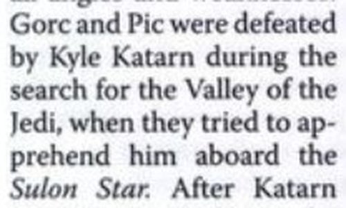
- **Even Piell** — entry/section: Piell, Even: "Even Piell single-handedly defeated seven attackers and saved Gallia's parents, although he did lose his left eye in the battle." Source: The Complete Star Wars Encyclopedia, Vol. III, p.25
  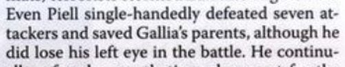
- **Darth Vader (Anakin Skywalker)**: "He advanced to first officer on Darth Vader's flagship Executor, an especially dangerous position given the Dark Lord's legendary capriciousness, Piett aided Admiral Kendal Ozzel in overseeing the crew as well as helping to direct the entire fleet." Source: The Complete Star Wars Encyclopedia, Vol. III, p.25
  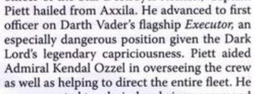

## p.26 (scan page 32)

Page contents: 1061 words, 26 paragraphs | headings/entries: Piggy; Pikil, Atresh; Pikk; Piksoar, Knezex Hral; Pi-Lippa; Pillik; Pilus; Pina, Awdrysta; Pinnacle, the

- **Qwi Xux**: "He ordered the four surviving students—including young Qwi Xux—to look out the windows of their orbital education facility as he ordered his Star Destroyer to destroy Pillik's village." Source: The Complete Star Wars Encyclopedia, Vol. III, p.26
  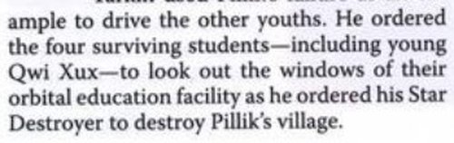

## p.27 (scan page 33)

Page contents: 864 words, 27 paragraphs | headings/entries: Pinnacle Base; Pirik; Pirin; Piringiisi; Piris, Captain; Pirtonna; Piru, Chase; Pisces Base; Pitann; Pitta, Grand Admiral Danetta

- **Mara Jade Skywalker**: "Mara wanted nothing to do with such small-time antics and quickly disarmed him before he could do any damage." Source: The Complete Star Wars Encyclopedia, Vol. III, p.27
  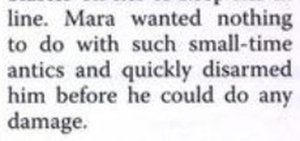
- **K'Kruhk**: "K'Kruhk and Piru defeated the criminals and transported the clan elsewhere." Source: The Complete Star Wars Encyclopedia, Vol. III, p.27
  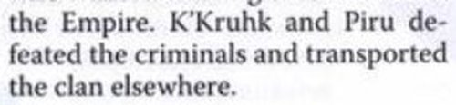

## p.28 (scan page 34)

Page contents: 870 words, 27 paragraphs | headings/entries: Pix; Pixelito; Pizztov; PL-37; Plaan; Plagueis, Darth; Piah

- **Yoda**: "After Tyr was killed on Thustra, she remained with the clone forces while Yoda and Padawan Cal attended a parlay with King Alaric." Source: The Complete Star Wars Encyclopedia, Vol. III, p.28
  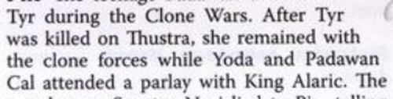
- **Boba Fett**: "Sintas Vel and Boba Fett confronted Pizztov, and Fett killed him." Source: The Complete Star Wars Encyclopedia, Vol. III, p.28
  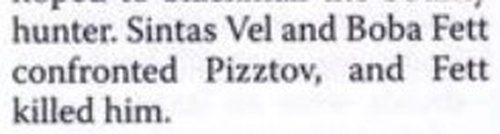
- **Darth Plagueis; Palpatine (Darth Sidious)** — entry/section: Plagueis, Darth: "Obsessed with immortality and the bringing about of a perfect vessel for the Force conceived by the midi-chlorians, Plagueis was blind to Sidious's treachery." Source: The Complete Star Wars Encyclopedia, Vol. III, p.28
  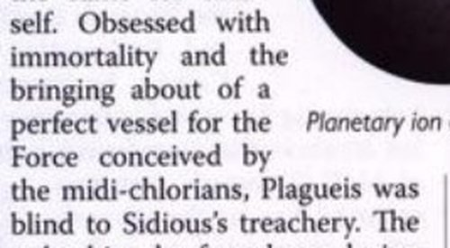
- **Palpatine (Darth Sidious)**: "Sidious killed him in his sleep." Source: The Complete Star Wars Encyclopedia, Vol. III, p.28
  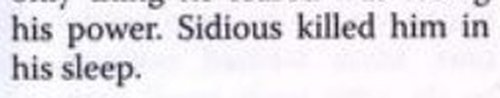

## p.29 (scan page 35)

Page contents: 765 words, 28 paragraphs | headings/entries: Planet Dreams, Incorporated; Platinum Valor Cross; Plattahr; Plaushe, Kar; Plawal; Pleader; Pleck; Plee, Doctor; Pleni; Plenty's; Plessus, Ghon

- **Mara Jade Skywalker**: "Despite wearing an armored vest, Plattahr was killed by Mara Jade in Gorb Drig's cantina." Source: The Complete Star Wars Encyclopedia, Vol. III, p.29
  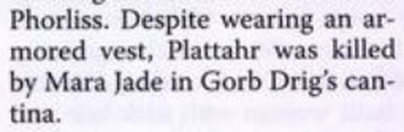
- **Palpatine (Darth Sidious)**: "Some 18 years before the Battle of Yavin, the Emperor commissioned the battlemoon Eye of Palpatine to wipe out the Jedi enclave, but the ship never arrived." Source: The Complete Star Wars Encyclopedia, Vol. III, p.29
  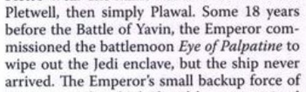
- **Obi-Wan Kenobi; Qui-Gon Jinn**: "When Obi-Wan Kenobi and Bant Eerin were dispatched to confront her, they found her dead, shot and killed by a probe droid that was later traced to Qui-Gon Jinn." Source: The Complete Star Wars Encyclopedia, Vol. III, p.29
  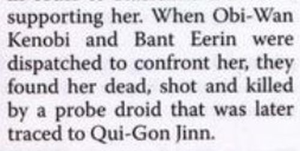

## p.30 (scan page 36)

Page contents: 1261 words, 40 paragraphs | headings/entries: Plett's Well; Plevitz; Plex; Piexgrove Combine; Plibene Rock; Plif; Plikk, Captain; Plirr, Loreza; Pio, Lomi; Plooriod Hl; Plooriod IV; Plooriod Bodkin; Ploovo Two-For-One

- **Darth Vader (Anakin Skywalker)**: "Freed by Anakin's team, Lomi and Welk agreed to help the Jedi infiltrate the worldship and destroy the voxyn." Source: The Complete Star Wars Encyclopedia, Vol. III, p.30
  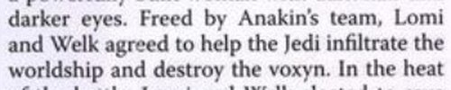
- **Plo Koon; Mara Jade Skywalker**: "Plo nearly overpowered Skywalker, who was rescued by Mara—she literally scraped the Dark Jedi off him with her X-wing." Source: The Complete Star Wars Encyclopedia, Vol. III, p.30
  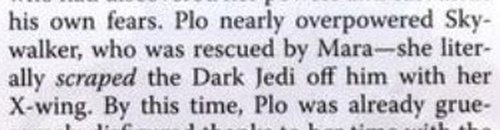
- **Darth Vader (Anakin Skywalker)**: "Darth Vader visited Ghorin here and killed him for his apparent double cross of the Empire in the period following the Battle of Yavin." Source: The Complete Star Wars Encyclopedia, Vol. III, p.30
  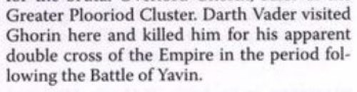

## p.31 (scan page 37)

Page contents: 812 words, 31 paragraphs | headings/entries: Piort; Plothis; Piourr; Ploven; Plug-2 Behemoth; Plug-8G; Plug-F Mammoth; Piumba; Pnorr, Venlyss; Poborandurannum; Pochi

## p.32 (scan page 38)

Page contents: 51 words, 5 paragraphs | headings/entries: 

## p.33 (scan page 39)

Page contents: 931 words, 33 paragraphs | headings/entries: Poderis; Podrace; Podracing Quarterly; Poe; Poesy

## p.34 (scan page 40)

Page contents: 896 words, 27 paragraphs | headings/entries: Pohtarza; Poinard, Ark; Point 5; Point Bleak; Point Down; Point Modie; Poison Moon; Poison Moon; Poista, Elea; Pok; Polearm Squadron; Polidor, Yamele; Polikex, Shae; Polipe

- **Count Dooku**: "Poggle, in possession of top-secret plans for an ultimate weapon that the Geonosians were contracted to construct, returned the blueprints to Count Dooku, who fled Geonosis to courier the plans to his dark master." Source: The Complete Star Wars Encyclopedia, Vol. III, p.34
  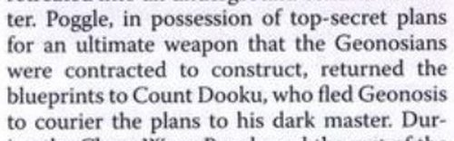
