# Owner Material 032 — The Complete Star Wars Encyclopedia, Vol. III (P–Z): scan pages 41–80

- **Source:** *The Complete Star Wars Encyclopedia* by Stephen J. Sansweet and Pablo Hidalgo, with Bob Vitas, Daniel Wallace, Chris Cassidy, Mary Franklin and Josh Kushins (Del Rey, 2008), 3 vols. Secondary source (licensed Legends reference). Scan OCR'd on the box; the scan stays box-only and is **not** published.
- **Method:** every scanned page was OCR'd and machine-screened sentence by sentence for power-relevant statements (fights, kills, defeats, Force feats, rankings, superweapons) that name a character on our roster; each kept sentence is quoted verbatim from the OCR text and has a crop of the printed passage directly under it. Pages with nothing power-relevant are still listed with what is on them.
- **Citation:** "The Complete Star Wars Encyclopedia, Vol. III, p.X" by printed page ("scan p.X" where no printed number applies). **Weight:** Lucasfilm-licensed encyclopedia: a secondary, in-universe summary of Legends (and some film) material. It sums up feats from novels, comics and games; where the original story is in our notes, that source is the stronger citation.

## p.35 (scan page 41)

Page contents: 855 words, 22 paragraphs | headings/entries: Polis Massa; Politrix; Poll, Unut; Pollar, Reme; Pollard, Lieutenant; Pollillus

- **Palpatine (Darth Sidious); Yoda; Obi-Wan Kenobi; Darth Vader (Anakin Skywalker)**: "Having failed to thwart Palpatine, Yoda fled to Polis Massa with Bail Organa to recover, Obi-Wan Kenobi, having defeated Darth Vader on Mustafar, soon joined them." Source: The Complete Star Wars Encyclopedia, Vol. III, p.35
  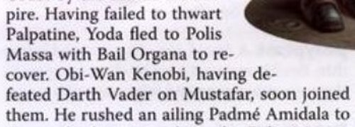

## p.36 (scan page 42)

Page contents: 1139 words, 32 paragraphs | headings/entries: Poimanar; Polos; Polpot, Zokor; Pols Anaxes; Polters, Trace; Polydroxol; Poly Pyramid; Pommel, Dreed; Pomojema

## p.37 (scan page 43)

Page contents: 1141 words, 31 paragraphs | headings/entries: Pomt, Victor; Ponchar, Raala; Pondo; Ponds, Commander; Poodoo Lounge; Poof, Yarael; Poorf, Nam; Poot, Una; Pops; Poqua, Commodore; Porasca Prize; Porcelius; Porg

- **Luke Skywalker; Darth Vader (Anakin Skywalker)**: "The Temple of Pomojema was the site of Luke Skywalker's first duel with Darth Vader." Source: The Complete Star Wars Encyclopedia, Vol. III, p.37
  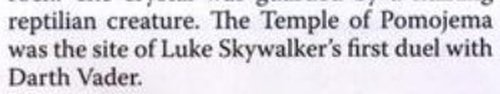
- **Yarael Poof** — entry/section: Poof, Yarael: "He could also use the Force to trigger fires by telekinetically exciting molecules of volatile substances." Source: The Complete Star Wars Encyclopedia, Vol. III, p.37
  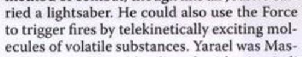
- **Yarael Poof** — entry/section: Poof, Yarael: "About five years prior to the Clone Wars, Yarael Poof was killed by the Anoo-dat radical General Ashaar Khorda, stabbed by a vibroblade." Source: The Complete Star Wars Encyclopedia, Vol. III, p.37
  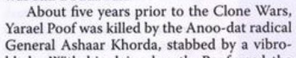
- **Kyle Katarn**: "In a three-way firefight, Porg was shot and killed by an Aqualish bounty hunter, who was later killed by Katarn." Source: The Complete Star Wars Encyclopedia, Vol. III, p.37
  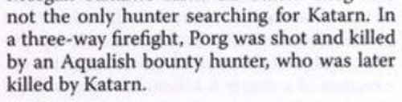

## p.38 (scan page 44)

Page contents: 1104 words, 30 paragraphs | headings/entries: Porkins, Jek; Pormfil; Porporite; Porpu, Zan; Por Ral, Nij; Por'ste Island; Port, Chairman; Port Duggan; Por'Ten; Porter; Port-Esta; Port Evokk; Portha; Port Haven; Portho Hill; Port Landien; Portom, Lom; Port Pevaria; Posondum, Nil

- **Yun (Dark Jedi)**: "Disgusted by his spinelessness, Dark Jedi Yun killed Por Ral with a swift lightsaber blow to the head." Source: The Complete Star Wars Encyclopedia, Vol. III, p.38
  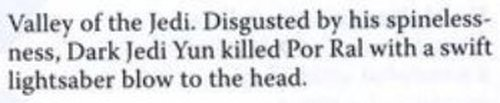

## p.39 (scan page 45)

Page contents: 1101 words, 24 paragraphs | headings/entries: Post, Avan; Post, Jlir; Pothman, Triv; Potin, Lieutenant; Potkin, Shadday; Potorr, Vax; Potts, Danzigoro; Pouffra Circuit

## p.40 (scan page 46)

Page contents: 664 words, 22 paragraphs | headings/entries: Power Dive

## p.41 (scan page 47)

Page contents: 881 words, 30 paragraphs | headings/entries: Poxall; Poy; Pqweeduk; Pradeux, Alec; Praesitiyn; Praetor; Praetorite Vong; Praidaw; Praji, Nahdonnis; Praji, Onnelly; Praji, Tannon

- **Darth Vader (Anakin Skywalker)**: "The combined forces of Zozridor Slayke, Nejaa Halcyon, and Anakin Skywalker protected the facility and defeated the Separatists." Source: The Complete Star Wars Encyclopedia, Vol. III, p.41
  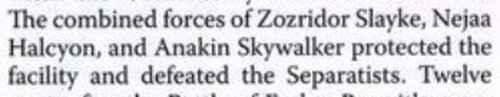
- **Darth Vader (Anakin Skywalker)**: "Praji, Nahdonnis An Imperial commander and part of the influential Praji family, he was Darth Vader's aide on the Star Destroyer Devastator, Praji graduated with honors from the Imperial Naval Academy." Source: The Complete Star Wars Encyclopedia, Vol. III, p.41
  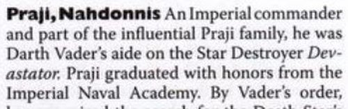

## p.42 (scan page 48)

Page contents: 1123 words, 25 paragraphs | headings/entries: Prak City; Prammi, Wila; Prana Lexander; Prann, Erli; Prard'enc'iflar; Prard'ras'kleoni; Pratuhr, Artuo; Praxlis; Praysh, Chay; Precht; Predominance; Prefsbelt IV

- **Grand Admiral Thrawn**: "Prann, Erli A pirate leader who took control of one of the Golan II defense platforms protecting the Imperial shipyards at Bilbringi in the aftermath of Grand Admiral Thrawn's defeat." Source: The Complete Star Wars Encyclopedia, Vol. III, p.42
  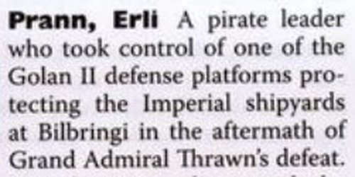
- **Darth Vader (Anakin Skywalker)**: "Ultimately, Anakin Skywalker out-piloted him and destroyed his tank, killing the Chistori on the planet Thule." Source: The Complete Star Wars Encyclopedia, Vol. III, p.42
  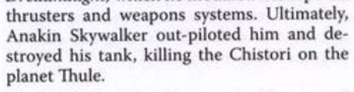

## p.43 (scan page 49)

Page contents: 815 words, 23 paragraphs | headings/entries: Premier Provisions; Prennert, Osleo; Prepredenko, Lord; Prescott, Corporal; Preservers; Pressin, Major; Prevaro; Preza; Pria; Priam; Priam, Admiral; Priamsta

- **Leia Organa Solo**: "He was killed during the rescue of Princess Leia Organa." Source: The Complete Star Wars Encyclopedia, Vol. III, p.43
  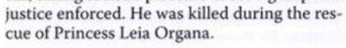

## p.44 (scan page 50)

Page contents: 1077 words, 46 paragraphs | headings/entries: Pri-Andylan Shipyard; Pricina, Dom; Priest, Dred; Primal; Prime Clone; Primor; Primus Goluud

## p.45 (scan page 51)

Page contents: 774 words, 23 paragraphs | headings/entries: Priole Danna Festival; Privitt, Private; Procopia; Profiteer

- **Darth Vader (Anakin Skywalker)**: "Privitt, Private A new recruit to the Imperial Relay Outpost V-798 at Vaal as of the Battle of Yavin, he was killed when Darth Vader led a pack of hyenax into the outpost." Source: The Complete Star Wars Encyclopedia, Vol. III, p.45
  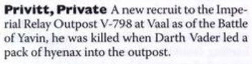
- **Luke Skywalker; Darth Vader (Anakin Skywalker)**: "Luke Skywalker and Darth Vader dueled through various sections of a processing vane, culminating in Skywalker's defeat at the edge of an observation platform." Source: The Complete Star Wars Encyclopedia, Vol. III, p.45
  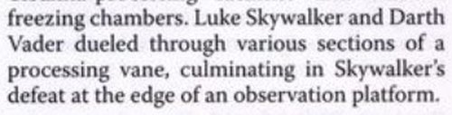

## p.46 (scan page 52)

Page contents: 1018 words, 36 paragraphs | headings/entries: Profus, Glorii; Proi, Lieutenant Norda; Project Aralia; Project Asteroid; Project Dead Eye; Project Decoy; Project Funeral; Project Minefield; Project Orrad; Project Phiutdroid; Project Second Chance; Project Starscream; Proko, Qid; Prolik, Rulaan; Prophetess; Prosecutor; Prosperity; Prosperous

- **Grand Admiral Thrawn**: "Force Commander Thrawn returned fire, destroying Progga's vessel." Source: The Complete Star Wars Encyclopedia, Vol. III, p.46
  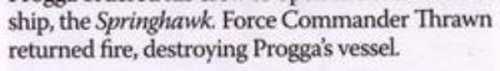
- **General Grievous**: "Prominence (2) A Galactic Republic Dreadnaught destroyed during the Clone Wars when General Grievous's task force invaded Duro." Source: The Complete Star Wars Encyclopedia, Vol. III, p.46
  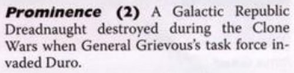
- **Palpatine (Darth Sidious)**: "Emperor Palpatine grew dissatisfied with the Prophets and dispatched Inquisitors to destroy them; the Prophets fled to Bosthirda." Source: The Complete Star Wars Encyclopedia, Vol. III, p.46
  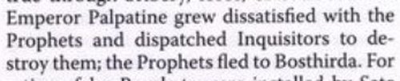
- **Lumiya**: "The true Prophets surfaced during the campaigns of Trioculus and were finally destroyed by Azrakel and Lumiya." Source: The Complete Star Wars Encyclopedia, Vol. III, p.46
  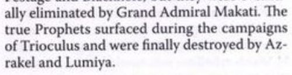

## p.47 (scan page 53)

Page contents: 770 words, 27 paragraphs | headings/entries: Protas; Protazk; Protean; Protodeka; Proto; Prouk

- **Gallandro**: "Though proficient at laying traps, he was accidentally killed by Anja Gallandro's explosives." Source: The Complete Star Wars Encyclopedia, Vol. III, p.47
  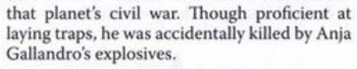

## p.48 (scan page 54)

Page contents: 808 words, 23 paragraphs | headings/entries: Provisional Council, New Republic; Provocateur; Proxima Dibal; PROXY; Proy'skyn; Prrt, Miaria; Prudii; Prune Face; PS-29-2; PS-29-3; Psadan

## p.49 (scan page 55)

Page contents: 795 words, 35 paragraphs | headings/entries: Ptaa, Eet; P'taan, Fargednim; P'tan, Professor; P'Ton, Admiral Spitar; Ptor; Public Safety Service; Puddra; Pudundruh, Quatrain; Pugwis; Puhr, Djas; Pulsar

## p.50 (scan page 56)

Page contents: 969 words, 26 paragraphs | headings/entries: Pulsar Skate; Pulsar Station; Pulsar Supertanker; Pulsipher; Punishing; Pure Sabacc; Purity; Purnham; Puroth; Purpsh; Purr

- **General Grievous**: "Puroth A four-armed Eirrauc Jedi Master killed by General Grievous during the Galactic Civil War, alongside her former Padawan Nystammall on the flame-grass plains of Tovarskl." Source: The Complete Star Wars Encyclopedia, Vol. III, p.50
  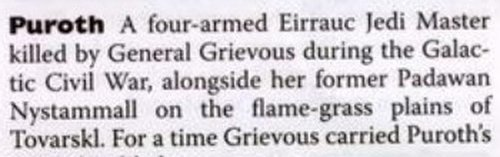

## p.51 (scan page 57)

Page contents: 853 words, 22 paragraphs | headings/entries: Puth; P'w'eck; Pwoe; Pydyr; Pylokam; Pyn'gani; Pypin; Pzob

- **Kueller**: "Pydyr One of the moons of Almania, it was where the Dark Jedi Kueller killed 1,651,305 people during the first bombing campaign in his reign of terror against the New Republic." Source: The Complete Star Wars Encyclopedia, Vol. III, p.51
  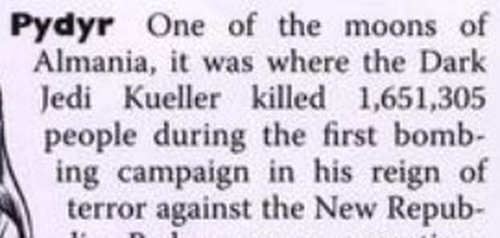

## p.52 (scan page 58)

Page contents: 0 words, 0 paragraphs | headings/entries: 

## p.53 (scan page 59)

Page contents: 827 words, 31 paragraphs | headings/entries: Q9-X2; QS5A7 Bacta Refinement Plant; Qade, Sergeant; Q-7N; Qalita Prime; Qalu, Tsaa; Qalydon

## p.54 (scan page 60)

Page contents: 1151 words, 26 paragraphs | headings/entries: Q'Anilia; Qaqquaqqy, Lord; Qaresi Squadron; Qat, Hul; Qat, Vintul; Qat Chrystac; Qa'till; Qeegq; Qektoth Confederation; Qel, Tsun; Qel-Bertuk, Lanius; Qel-Droma; Qel-Droma, Cay

- **Zayne Carrick**: "The Covenant preemptively killed the graduating class of Padawans at the satellite academy on Taris, but one luckless apprentice—Zayne Carrick—survived by being late." Source: The Complete Star Wars Encyclopedia, Vol. III, p.54
  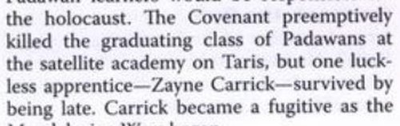

## p.55 (scan page 61)

Page contents: 1095 words, 17 paragraphs | headings/entries: Qel-Droma, Duron; Qel-Droma, Ulic; Qelia

- **Ulic Qel-Droma; Cay Qel-Droma; Arca Jeth** — entry/section: Qel-Droma, Ulic: "Trained along with his younger brother, Cay, on the mining world of Arkania by Jedi Master Arca Jeth, Ulic Qel-Droma quickly mastered the art of lightsaber dueling." Source: The Complete Star Wars Encyclopedia, Vol. III, p.55
  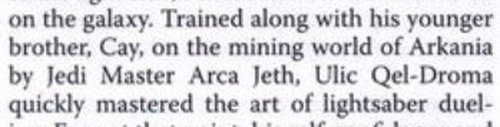
- **Ulic Qel-Droma** — entry/section: Qel-Droma, Ulic: "Ulic decided that the only way to truly defeat the Krath was to infiltrate them and learn their secrets." Source: The Complete Star Wars Encyclopedia, Vol. III, p.55
  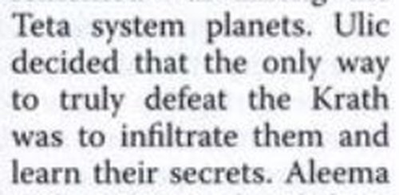
- **Ulic Qel-Droma; Satal Keto; Nomi Sunrider** — entry/section: Qel-Droma, Ulic: "He survived an assassination attempt by Satal and saw Nomi escape imprisonment by Satal just hours before Ulic had agreed to kill her to prove his loyalty to the Krath." Source: The Complete Star Wars Encyclopedia, Vol. III, p.55
  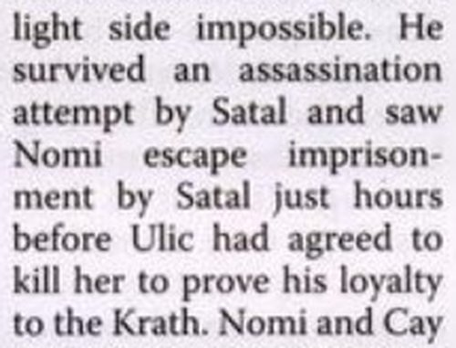
- **Ulic Qel-Droma; Satal Keto** — entry/section: Qel-Droma, Ulic: "Anger inside Ulic exploded, leading him to kill Satal." Source: The Complete Star Wars Encyclopedia, Vol. III, p.55
  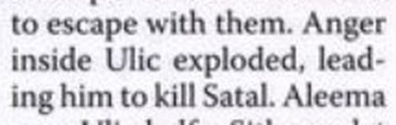
- **Ulic Qel-Droma; Exar Kun** — entry/section: Qel-Droma, Ulic: "Years later, Ulic reappeared with tremendous dark side powers and set out to plunder and destroy large parts of the galaxy with a large and bloodthirsty army serving alongside Exar Kun." Source: The Complete Star Wars Encyclopedia, Vol. III, p.55
  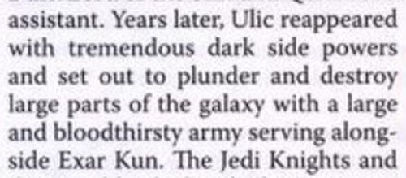

## p.56 (scan page 62)

Page contents: 1156 words, 27 paragraphs | headings/entries: Qennto, Dubrak; Qetix IV; Qetora, Epo; Qe'u; Qexi's; Qexis; Qiaxx; Qieg; Qiemal; Qiemo Adrangar; Qiilura; Qiina, Master; Qimtig; Qinx, Mentis; Qiqah, Tih; Qiraash; Qiyn, Khaat; Qlothos

- **Anakin Solo**: "However, Rapuung had faked his death, and later killed Qe'u to gain access to the Yuuzhan Vong complex for himself and Anakin Solo." Source: The Complete Star Wars Encyclopedia, Vol. III, p.56
  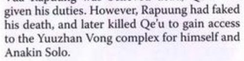
- **Jacen Solo (Darth Caedus); Luke Skywalker; Ben Skywalker**: "The Bith tended to injuries Jacen sustained after dueling with Luke and Ben Skywalker." Source: The Complete Star Wars Encyclopedia, Vol. III, p.56
  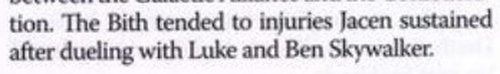

## p.57 (scan page 63)

Page contents: 1182 words, 23 paragraphs | headings/entries: Q'Maere; Q'nithian; Qogo; Qonet; Qordis; Qoribu; Qornah; Qotile

- **Lord Qordis** — entry/section: Qordis: "Bane killed Qordis with the Force, although his spirit lived on to hound Bane for a time, reaching from beyond the grave to cause Bane to crash-land the Valcyn in the wilderness of Dxun." Source: The Complete Star Wars Encyclopedia, Vol. III, p.57
  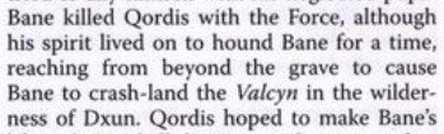
- **Lord Qordis** — entry/section: Qordis: "Qordis hoped to make Bane's life a living hell but, as with many other trials, Bane emerged stronger and more powerful for having survived the incident." Source: The Complete Star Wars Encyclopedia, Vol. III, p.57
  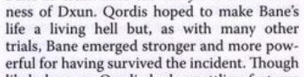
- **Luke Skywalker**: "The Qoribu crisis was believed to have been resolved when Welk was killed by Jedi Master Luke Skywalker, an event that supposedly marked the end of the Dark Nest." Source: The Complete Star Wars Encyclopedia, Vol. III, p.57
  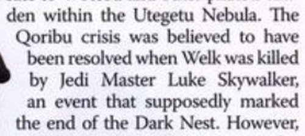

## p.58 (scan page 64)

Page contents: 1041 words, 24 paragraphs | headings/entries: Qretu-Five; QS-2D; QT-3PO; Qua, Dezono; Quadex; Quadinaros, Ben; Quad-Lo; Quadrant Seven; Quadrex Corestar; Quaestor

## p.59 (scan page 65)

Page contents: 870 words, 24 paragraphs | headings/entries: Quagga; Qual; Qualo, the; Quaitrough; Quamar Messenger; Quandary; Quannith, Governor; Quantana; Quantill City; Quanto; Quanton; Quara

- **Andur Sunrider; Nomi Sunrider**: "Andur's wife, Nomi, then killed Quanto with Andur's lightsaber in self-defense." Source: The Complete Star Wars Encyclopedia, Vol. III, p.59
  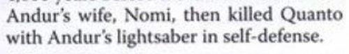

## p.60 (scan page 66)

Page contents: 1027 words, 20 paragraphs | headings/entries: Quarg, Governor; Quarmall; Quarren Industrial; Quarren Isolation League

- **Luke Skywalker**: "Governor Quarg, his son and successor, continued the space-wrecking operation from the planet until he was killed by Luke Skywalker in the war against the Dragon Lords." Source: The Complete Star Wars Encyclopedia, Vol. III, p.60
  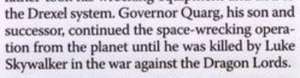
- **Kit Fisto**: "The Jedi Kit Fisto and his clone troopers were able to defeat the league, and brought peace again to Mon Calamari." Source: The Complete Star Wars Encyclopedia, Vol. III, p.60
  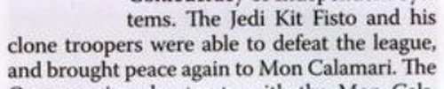

## p.61 (scan page 67)

Page contents: 856 words, 26 paragraphs | headings/entries: Quarrr-tellerrra; Quarry; Quartermain Hl; Quasar, Captain; Quatra; Quatreen River; Quay; Quecks, Major; Quedilifu, Senator; Quee, Danni; Queen Aeinari; Queen Jool

- **Kit Fisto**: "The Republic soon arrived, and with clone trooper forces led by General Kit Fisto, they defeated the Quarren Isolation League." Source: The Complete Star Wars Encyclopedia, Vol. III, p.61
  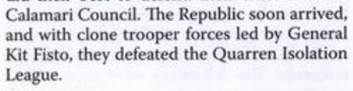

## p.62 (scan page 68)

Page contents: 1139 words, 29 paragraphs | headings/entries: Queen's Monument; Quegh, Captain; Quella; Quellor; Quenfis; Quenno; Quenton, Commander; Quermia; Quermian; Quersey, Bren; Quest, Sarcev

- **Han Solo; Leia Organa Solo**: "However, when he noticed that a Devaronian and a Twi'lek—actually Han Solo and Leia Organa Solo, in disguise—were trying to destroy the artwork, Quenton and his men opened fire in Mawbo's Performance Hall in an effort to secure the work." Source: The Complete Star Wars Encyclopedia, Vol. III, p.62
  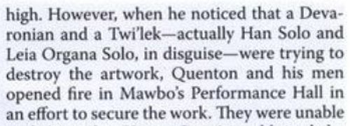
- **Jax Pavan**: "When Jax was killed, Quest was ostracized by the Ruling Council and went into hiding." Source: The Complete Star Wars Encyclopedia, Vol. III, p.62
  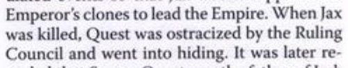

## p.63 (scan page 69)

Page contents: 1049 words, 31 paragraphs | headings/entries: Questal; Queyta; Quick 6; Quick Ship; Quicksnap 36T; Quien, Corman; QuietSnipe; Quig; Quill, Caiza; Quill, Magris; Quill, Raina

## p.64 (scan page 70)

Page contents: 1112 words, 35 paragraphs | headings/entries: Quillan, Moff; Quille, Moff; Quiller, Joak; Quill-Face, Hideaz; Quin, Sixtus; Quirt, Colonel; Quincey's Girl; Quincu, Nontal; Quink; Quist; Quint; Quist, Admiral; Quintar Nebula; Quist, Van P.; Quintas, Lord Xerxes; Quintell, Pallas

- **Boba Fett**: "Led by Vitor Reige, the crew forced the Moffs to lock themselves in the ship's command center, where they were wiped out by Boba Fett and his Mandalorian supercommandos." Source: The Complete Star Wars Encyclopedia, Vol. III, p.64
  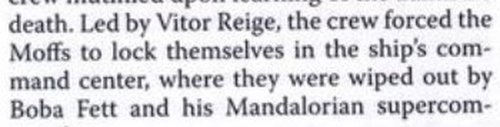

## p.65 (scan page 71)

Page contents: 744 words, 29 paragraphs | headings/entries: Quiyyen, Ambassador; Quiok's Fist; Qu'mock; Quockra IV; Quockran; Quoreal; Quor'sav; Quyste; Quy'Tek; Q-Varx, Senator

## p.66 (scan page 72)

Page contents: 0 words, 0 paragraphs | headings/entries: 

## p.67 (scan page 73)

Page contents: 600 words, 28 paragraphs | headings/entries: Ri-G4; R2-BI; R2-C4

## p.68 (scan page 74)

Page contents: 1113 words, 18 paragraphs | headings/entries: 

- **Darth Vader (Anakin Skywalker)**: "He served as onboard astromech to Anakin Skywalker, a young rookie pilot who, despite not being authorized to do so, flew an N-1 starfighter into the Battle of Naboo and destroyed the Droid Control Ship orchestrating the occupation of the planet." Source: The Complete Star Wars Encyclopedia, Vol. III, p.68
  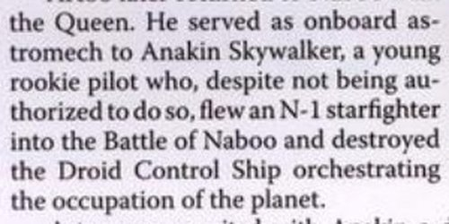
- **Palpatine (Darth Sidious); General Grievous**: "During the rescue of Chancellor Palpatine from General Grievous's clutches, R2-D2 destroyed super battle droids in a melee that erupted in the hangar bay of Grievous's flagship." Source: The Complete Star Wars Encyclopedia, Vol. III, p.68
  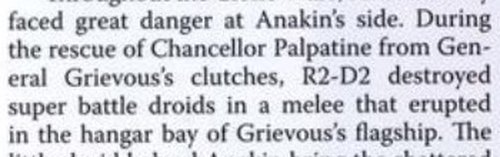

## p.69 (scan page 75)

Page contents: 1026 words, 22 paragraphs | headings/entries: 

- **Palpatine (Darth Sidious); Luke Skywalker**: "When the clone of Emperor Palpatine surfaced and brought Luke under his dark side tutelage, several of R2's files were wiped out." Source: The Complete Star Wars Encyclopedia, Vol. III, p.69
  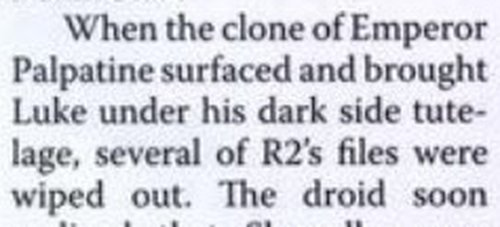
- **Luke Skywalker**: "Luke refused to wipe out R2's memory, and decided to search the old Imperial archives for the Intellex IV design manual." Source: The Complete Star Wars Encyclopedia, Vol. III, p.69
  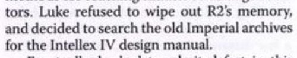

## p.70 (scan page 76)

Page contents: 821 words, 31 paragraphs | headings/entries: R2-D7; R2-MS5; R2-Q2; R2-Q5; R2-R7; R2-R9; R2-TO; R2-X2; R3-D3; R3-S6

## p.71 (scan page 77)

Page contents: 669 words, 32 paragraphs | headings/entries: R3-T7; R-41 Starchaser; R4-A22; R4-D6; R4-El; R4-H5S; R4-El R4-KS5; R4-M17; R4-M6; R4-M9; R4-P22; R4-P44; R5-A2; RS5-D2; R5-D8; R5-F7

- **Darth Vader (Anakin Skywalker); Asajj Ventress**: "R4-P22 A small astromech used aboard Anakin Skywalker's modified Jedi starfighter, Azure Angle, it was destroyed when Asajj Ventress blew up the starfighter on Yavin 4 during the Clone Wars." Source: The Complete Star Wars Encyclopedia, Vol. III, p.71
  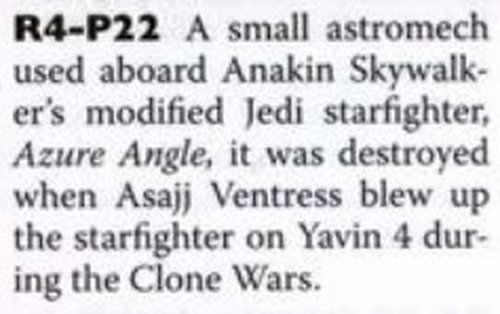

## p.72 (scan page 78)

Page contents: 670 words, 35 paragraphs | headings/entries: R5-X2; R7-T1i; Ra, Vonnda; Raabakyysh; Raalk, Proctor Ton; Raatu, Gwad; Rab, Mot Not; Rabad; Rabb, Admiral; Rabé; Rabin; Rabutz; Rachott; Rach'talik

## p.73 (scan page 79)

Page contents: 835 words, 28 paragraphs | headings/entries: Racine, Delva; Rackus, Mazer; Racto, Lannik; Raddadugh Gnasp; Raders, Ram; Radiance; Radiant Vii; Radiant IX; Radiant; Radnor; Radnoran; Radon-Vizer; Rae, Alyn; Raed-7; Raef, Koedi; Raegar, Dr.

- **Sunstar**: "Raegar, Dr. An Imperial scientist whose ambitious studies revealed the possible existence of the Sunstar, a mystical gem possessed by the Ewoks." Source: The Complete Star Wars Encyclopedia, Vol. III, p.73
  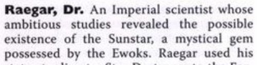
- **Sunstar**: "Raegar used his status to divert a Star Destroyer to the Forest Moon of Endor in a bid to capture the Sunstar and place himself as the master of the universe." Source: The Complete Star Wars Encyclopedia, Vol. III, p.73
  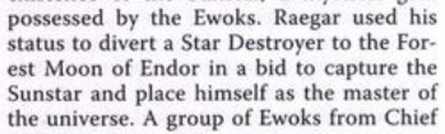

## p.74 (scan page 80)

Page contents: 1149 words, 39 paragraphs | headings/entries: Raelo, Loo; Rafe's Gambit; Raff, Tactician; Raffin, Vanter; Rafft; Ragab; Rage; Ragga Hocce; Ragith I; Ragmar V; Ragna I; Ragnos, Marka; Ragoon-6; Rago Run; Ragsall, Lieutenant

- **Sunstar**: "Chirpa's tribe, allied with a renegade droid, infiltrated Raegar's Destroyer and battled with stormtroopers to reclaim the Sunstar." Source: The Complete Star Wars Encyclopedia, Vol. III, p.74
  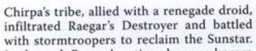
- **Marka Ragnos; Ludo Kressh; Naga Sadow** — entry/section: Ragnos, Marka: "Soon after his demise, his ghostly visage appeared before Ludo Kressh and Naga Sadow, who were engaged in a duel to determine who would succeed Ragnos; the spirit urged the two aspiring Dark Lords to make peace in order to advance the Sith Empire." Source: The Complete Star Wars Encyclopedia, Vol. III, p.74
  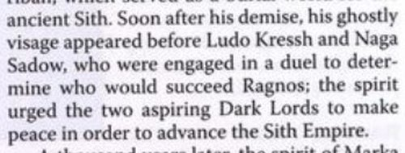
- **Marka Ragnos** — entry/section: Ragnos, Marka: "In the time of the New Republic, a decade after the Battle of Endor, the Dark Jedi Tavion Axmis acquired the Scepter of Ragnos—an archaeological relic—and used it in an effort to resurrect the Dark Lord's spirit." Source: The Complete Star Wars Encyclopedia, Vol. III, p.74
  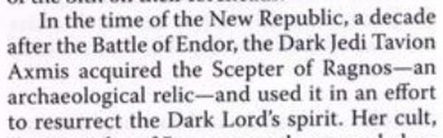
- **Marka Ragnos; Jaden Korr** — entry/section: Ragnos, Marka: "Her cult, the Disciples of Ragnos, nearly succeeded on Korriban, but they were defeated by Jaden Korr." Source: The Complete Star Wars Encyclopedia, Vol. III, p.74
  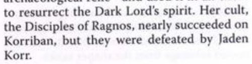
