# Owner Material 032 — The Complete Star Wars Encyclopedia, Vol. III (P–Z): scan pages 81–120

- **Source:** *The Complete Star Wars Encyclopedia* by Stephen J. Sansweet and Pablo Hidalgo, with Bob Vitas, Daniel Wallace, Chris Cassidy, Mary Franklin and Josh Kushins (Del Rey, 2008), 3 vols. Secondary source (licensed Legends reference). Scan OCR'd on the box; the scan stays box-only and is **not** published.
- **Method:** every scanned page was OCR'd and machine-screened sentence by sentence for power-relevant statements (fights, kills, defeats, Force feats, rankings, superweapons) that name a character on our roster; each kept sentence is quoted verbatim from the OCR text and has a crop of the printed passage directly under it. Pages with nothing power-relevant are still listed with what is on them.
- **Citation:** "The Complete Star Wars Encyclopedia, Vol. III, p.X" by printed page ("scan p.X" where no printed number applies). **Weight:** Lucasfilm-licensed encyclopedia: a secondary, in-universe summary of Legends (and some film) material. It sums up feats from novels, comics and games; where the original story is in our notes, that source is the stronger citation.

## p.75 (scan page 81)

Page contents: 1245 words, 34 paragraphs | headings/entries: Rahhdool, Paouoish; Rahmma, Ahnjai; Rahn, Qu; Rahz, Major Stafuz; Rain; Rainbow Nebulae; Raines, Major; Rajan; Rajana; Rak, Bastori

- **Roan Fel**: "Raider Sith assassin Jor Torlin's starship during the time of Emperor Roan Fel, it was stolen by Morrigan Corde after she killed him." Source: The Complete Star Wars Encyclopedia, Vol. III, p.75
  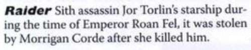
- **Alema Rar**: "Alema Rar attacked and killed him, while his crew was wiped out by YVH 1 battle droids." Source: The Complete Star Wars Encyclopedia, Vol. III, p.75
  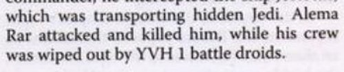

## p.76 (scan page 82)

Page contents: 1119 words, 32 paragraphs | headings/entries: Rakata Prime; Rak'k; Rakrir; Rakul, Barada; Ra-Lee; R'all; Grallia Spaceport.; Ralls, Agent

- **Darth Malak**: "The few barbaric Rakata who survived were wiped out by the battle for the Star Forge, during the time of Darth Malak." Source: The Complete Star Wars Encyclopedia, Vol. III, p.76
  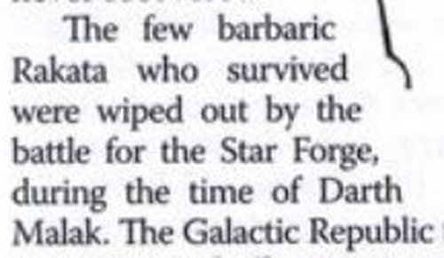
- **Han Solo**: "Along with his sister, the unscrupulous R'all competed with Han Solo to be the first to find the lost treasures of the legendary ship Queen of Ranroon." Source: The Complete Star Wars Encyclopedia, Vol. III, p.76
  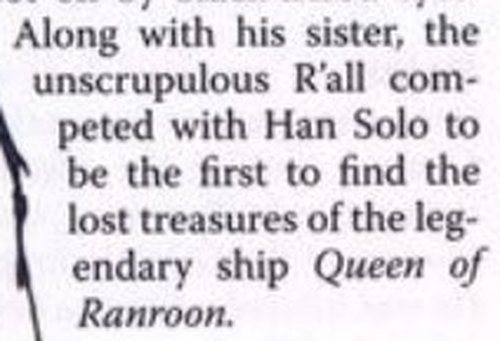

## p.77 (scan page 83)

Page contents: 1098 words, 31 paragraphs | headings/entries: Raion; Ralpe; Ralroost; Ralter, Dack; Raltharan; Ram; Ramic, High General Sutt; Ramis, Dak; Ramoan; Ramodi; Rampa; Rampage; Rampart; Ramsees Hed; Rana; Rana, Queen; Rancisis, Oppo

- **Jaina Solo**: "Ralpe was shot and killed by Jaina Solo." Source: The Complete Star Wars Encyclopedia, Vol. III, p.77
  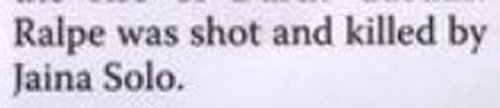
- **Lumiya**: "Rampage One of three Imperial Star Destroyers under Lumiya's command following the Battle of Endor." Source: The Complete Star Wars Encyclopedia, Vol. III, p.77
  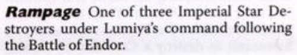

## p.78 (scan page 84)

Page contents: 993 words, 23 paragraphs | headings/entries: Rancor Rising; Rancor's Tooth; Randa; Rand Ecliptic; Random, Sarl; Randon; Ranga, Alta

- **Oppo Rancisis; Quinlan Vos** — entry/section: Rancisis, Oppo: "When Rancisis was placed in command of Republic operations on Saleucami to destroy a Confederacy cloning operation involving Morgukai warriors, Rancisis chose Vos as his second in command." Source: The Complete Star Wars Encyclopedia, Vol. III, p.78
  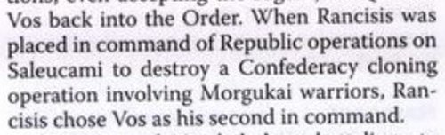
- **Oppo Rancisis** — entry/section: Rancisis, Oppo: "Rancisis was trained in the ancient art of Jedi battle meditation, and was soon deep in contemplation, subtly altering the will of the fighting forces to coax victory for the Republic." Source: The Complete Star Wars Encyclopedia, Vol. III, p.78
  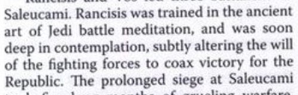
- **Oppo Rancisis** — entry/section: Rancisis, Oppo: "Though the Republic ultimately stopped the Confederacy plot on the planet, Rancisis was killed by the traitorous Jedi Sora Bulg." Source: The Complete Star Wars Encyclopedia, Vol. III, p.78
  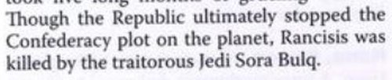
- **Luke Skywalker**: "The towering monster was killed by Luke Skywalker when the Jedi was forced into the pit by Jabba's treachery." Source: The Complete Star Wars Encyclopedia, Vol. III, p.78
  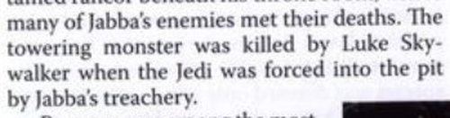

## p.79 (scan page 85)

Page contents: 985 words, 28 paragraphs | headings/entries: Range Squadron; Ranjiyn; Rankin, Pek; Ranklinge; Ransa, Senator Bicon; Ransen, Moff Kyl; Ransom, Tait; Ranth, Ta'laam; Rao; Raol; Raort, Romort; Raph-Elan, Yoshi; Rappapor; Rappertunie; Raprice, Lieutenant

## p.80 (scan page 86)

Page contents: 1090 words, 21 paragraphs | headings/entries: Rapuung, Hul; Rapuung, Laph; Rapuung, Vua

- **Alema Rar**: "Five years after the defeat of the Yuuzhan Vong, Alema Rar was one of seven young Jedi veterans of the Myrkr mission who responded to the telepathic call of Unu- Thul, the joined consciousness of Raynar Thul and the Killik hive that had found and nurtured him back to health." Source: The Complete Star Wars Encyclopedia, Vol. III, p.80
  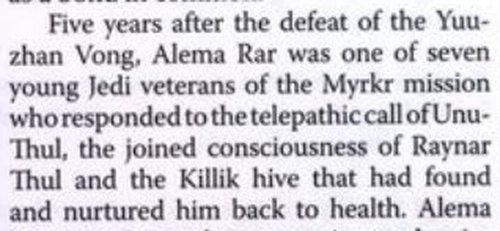
- **Luke Skywalker; Mara Jade Skywalker; Alema Rar**: "Luke and Mara Jade Skywalker confronted Alema there, and engaged in a lightsaber duel." Source: The Complete Star Wars Encyclopedia, Vol. III, p.80
  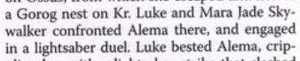
- **Luke Skywalker; Alema Rar**: "Luke bested Alema, crippling her with a lightsaber strike that slashed her from shoulder to sternum." Source: The Complete Star Wars Encyclopedia, Vol. III, p.80
  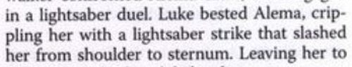
- **Alema Rar**: "Alema survived, however, maimed and further twisted by her experiences." Source: The Complete Star Wars Encyclopedia, Vol. III, p.80
  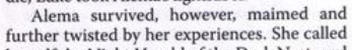
- **Leia Organa Solo; Alema Rar**: "Leia managed to disfigure Alema, severing one of her lekku from her skull." Source: The Complete Star Wars Encyclopedia, Vol. III, p.80
  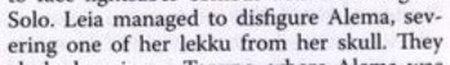

## p.81 (scan page 87)

Page contents: 1207 words, 30 paragraphs | headings/entries: Rar, Numa; Rarefied Air Cavalry; Ras; Ras, Bar; Rashon, Civé; Rashtah; Rask; Raska Hill; Raskar; Raslan, Captain; Rastur; Rath

- **Leia Organa Solo**: "She had survived, even further disfigured and even hungrier for vengeance against Leia Organa Solo and her family." Source: The Complete Star Wars Encyclopedia, Vol. III, p.81
  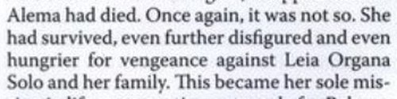
- **Tresina Lobi; Alema Rar; Lumiya; Luke Skywalker; Mara Jade Skywalker**: "Together they killed the Jedi Tresina Lobi; Alema also fought by Lumiya's side at Rooqoo Depot, where they attempted to defeat Luke and Mara Jade Skywalker." Source: The Complete Star Wars Encyclopedia, Vol. III, p.81
  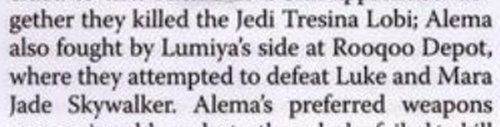

## p.82 (scan page 88)

Page contents: 1135 words, 39 paragraphs | headings/entries: Rathba, Tonkoss; Rationalist Party; Ratobo, Admiral; Ra'tre; Rattatak; Ratts Tyerell Foundation; ' Ratty; Rav; RAV; Ravaath; Ravagor

- **Darth Nihilus**: "Darth Nihilus's dark will held the vessel and its crew together, and he took the ship to Telos to destroy the planet." Source: The Complete Star Wars Encyclopedia, Vol. III, p.82
  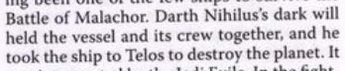
- **Darth Nihilus**: "In the fighting that followed, Nihilus was destroyed, and the Ravager was rigged to explode." Source: The Complete Star Wars Encyclopedia, Vol. III, p.82
  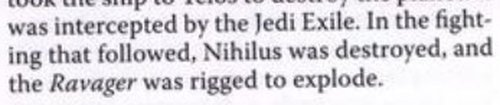

## p.83 (scan page 89)

Page contents: 897 words, 25 paragraphs | headings/entries: Ravine Squadron; Rawd, Mij; Rawst; Raxus Prime

- **Darth Vader (Anakin Skywalker); Galen Marek**: "Darth Vader's secret apprentice, Starkiller, faced Kazdan on Raxus Prime and defeated him." Source: The Complete Star Wars Encyclopedia, Vol. III, p.83
  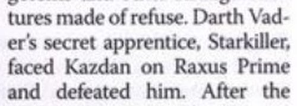

## p.84 (scan page 90)

Page contents: 1113 words, 61 paragraphs | headings/entries: R'aya, Noor; Raymeuz, Commander; Raynar; Raynor, Baron Dominic; Raystel, Halcor; Raze; Razelfiin; Razor Coast; Razor Eater; Razor's Kiss; Ra-Zyrth; RC-; R'Dawc, Peawp; R-Duba; Reactor Core; Reaper; Reassignment Council; Reath, Naat

## p.85 (scan page 91)

Page contents: 793 words, 23 paragraphs | headings/entries: Reath, Stam; Reaver; Rebaxan Columni; Rebel Alliance; Rebel Blockade Runner; Rebel; Rebels; Rebel Star; Rebirth; Rebirth Architecture; Rebo, Max; Reboam; Reborn, the; Rebus, Moff; Recalcitrant

- **Sev'rance Tann; Count Dooku**: "Reath, Stam The Padawan learner of Echuu Shen-Jon, he was slain by Sev'Rance Tann when he impetuously attempted to pursue Count Dooku during the Battle of Geonosis." Source: The Complete Star Wars Encyclopedia, Vol. III, p.85
  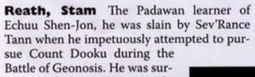
- **Leia Organa Solo**: "Rebel Dream Princess Leia Organa Solo's flagship, it was formerly the Star Destroyer Tyrant, which had been captured from the Imperial Navy after the Bacta War." Source: The Complete Star Wars Encyclopedia, Vol. III, p.85
  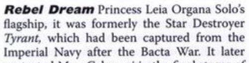

## p.86 (scan page 92)

Page contents: 882 words, 30 paragraphs | headings/entries: Reckless Abandon; Reckoning; Reconstruction; Recopia; Record Time; Red; Red Bush Grove; Redcap; Reddjak; Red Eight

- **Admiral Ackbar**: "The Reckoning was destroyed by Admiral Ackbar's fleet at Ciutric, and Krennel died in the explosion." Source: The Complete Star Wars Encyclopedia, Vol. III, p.86
  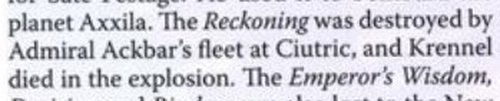

## p.87 (scan page 93)

Page contents: 1182 words, 52 paragraphs | headings/entries: Redesign; Red Flame; Red Four; Red Gauntlet; Red Ghost; Redhand, Craxtet; Red Hand Squadron; Red Harvest; Redhaven; Red Heart; Red Hills Clan; Red List; Redma; Rednax; Red Nebula; Red; Redoubt; Redoubt, the; Redoubtable; Red Rancor

## p.88 (scan page 94)

Page contents: 988 words, 32 paragraphs | headings/entries: Red Shadow; Red Six; Red Squadron; Redstar; Red Star Shipping Lanes; Red Sword Flight; Red Ten; Red Terror; Red Three; Red Twelve; Red Twins; Red Watch; Red Zero; Reecee; Reef Fortress; Reef Home; Reef Home; Reeft; Reegesk

- **Luke Skywalker**: "A childhood friend of Luke Skywalker, Biggs was killed while helping Luke in his run at the Death Star." Source: The Complete Star Wars Encyclopedia, Vol. III, p.88
  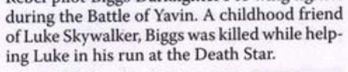
- **Admiral Daala**: "Reef Home One of the majestic Mon Calamarian cities that floated on water, it was destroyed in Admiral Daala's attack on Mon Calamari." Source: The Complete Star Wars Encyclopedia, Vol. III, p.88
  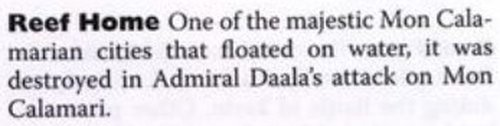

## p.89 (scan page 95)

Page contents: 875 words, 32 paragraphs | headings/entries: 'reekcat; Reekeene's Roughnecks; Reel, Dyemma; Reen, Meeka; Reeos, Ngyn; Rees, Bojam; Reesbon; Reeven Clan; Ree-Yees; Reeza; Reezen, Corporal; Reflection Gardens; Reflex Amendment; Refuge City; Refugee Facility 17; Refugee Relief Movement; Refugee Resettlement Coalition

## p.90 (scan page 96)

Page contents: 1192 words, 39 paragraphs | headings/entries: Regga; Reggs, Darnell; Galas; Regional Governor; Regional Sector Four's All-Human Free-For-All Extravaganza; Reglia, Miko; Rego, Vance; Regolith Prime; Regrap, Mik; Reh'mwa; Reige, Vitor; Rei'kas; Reis; Reist; Reject Alley; Rejuvenator; Rejuvenator-class Star Destroyer; Rekab, Captain Teyora; Rekker; Rekkon

- **Darth Vader (Anakin Skywalker)**: "Regga An Ithorian Podracer killed during the preliminaries leading up to the Boonta Eve Podrace that saw the liberation of Anakin Skywalker." Source: The Complete Star Wars Encyclopedia, Vol. III, p.90
  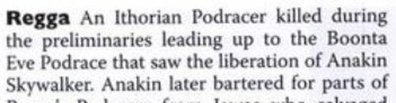
- **Han Solo**: "A young Han Solo bested three much larger opponents when he was forced to participate in the event." Source: The Complete Star Wars Encyclopedia, Vol. III, p.90
  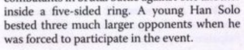
- **Andur Sunrider; Nomi Sunrider**: "He was involved in the conspiracy to kill Jedi Andur Sunrider at the Stenness hyperspace terminal and was, in turn, killed by Andur's wife, Nomi." Source: The Complete Star Wars Encyclopedia, Vol. III, p.90
  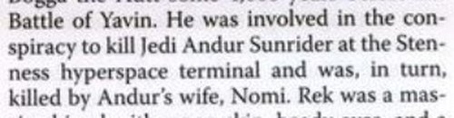

## p.91 (scan page 97)

Page contents: 1059 words, 36 paragraphs | headings/entries: Relentless; Relephon; Reliable; Reliance; Reliant; Rell, Mother; Rella; Reilias Channel; Rellidir; Relsted, Minor; Reltooine; Reluctant; Remember Derra Squadron; Remiout; Remy, Sergeant; Ren, Kybo; Renaant; Renalem, Lili

- **Han Solo**: "Rekkon's work eventually was continued by Han Solo, who destroyed Stars' End and freed the prisoners, including Tchaka." Source: The Complete Star Wars Encyclopedia, Vol. III, p.91
  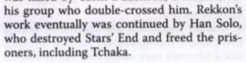
- **Luke Skywalker**: "He prepared the ship as an escape vessel for Ashgad and the droch Dzym, but it was destroyed after Luke Skywalker used the Force to communicate with the intelligent crystals on Nam Chorios, which in turn ordered the crystals aboard the Reliant to destroy it." Source: The Complete Star Wars Encyclopedia, Vol. III, p.91
  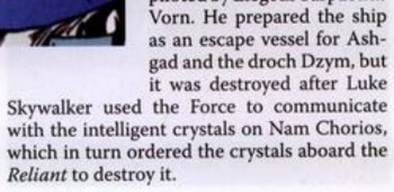
- **Asajj Ventress**: "The two squared off in one-on-one combat, and though Remlout lasted several minutes, Asajj soundly defeated him, splitting his shell in a swift attack." Source: The Complete Star Wars Encyclopedia, Vol. III, p.91
  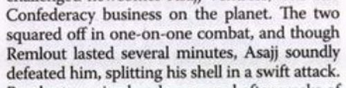

## p.92 (scan page 98)

Page contents: 1135 words, 26 paragraphs | headings/entries: Renatyi; Rend V; Rendar, Dash; Rendili

- **Palpatine (Darth Sidious); Prince Xizor**: "Enraged at the loss of his priceless Jedi and Sith artifacts, Palpatine banished the Rendar family and transferred their holdings to the rival Xizor Transport Systems." Source: The Complete Star Wars Encyclopedia, Vol. III, p.92
  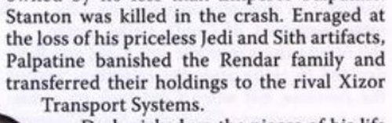
- **Guri**: "He was resurrected as a human replica droid by Dash and Guri, becoming the head of ODT on Onadax." Source: The Complete Star Wars Encyclopedia, Vol. III, p.92
  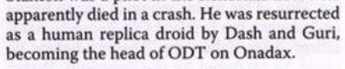

## p.93 (scan page 99)

Page contents: 1049 words, 44 paragraphs | headings/entries: Republic.; Renegade Flight; Renegade Leader; Renegade Squadron; Renei; Renforra; Renhoek; Renkel, Zazana; Rennik; Renno, Dav-Wes; Ren-Quarr; Renthal, Drea; Renthal's Fist; Renthal's Vengeance; Renz, Colonel Tyneir; Renz, Lieutenant; Renzii; Reo, Lieutenant Commander; Rep Council; RePlanetHab; Repness, Colonel Atton; Reprieve; Reproduction Center

- **Admiral Ackbar**: "Reo, Lieutenant Commander An engineer in the Galactic Alliance military, he was stationed aboard the Admiral Ackbar and was killed by a swarm of Gorog assassin bugs during the Swarm War." Source: The Complete Star Wars Encyclopedia, Vol. III, p.93
  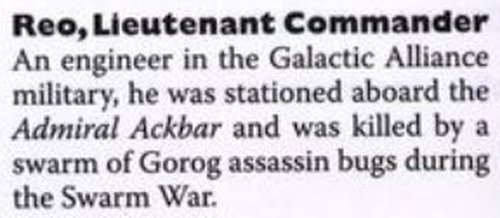

## p.94 (scan page 100)

Page contents: 873 words, 23 paragraphs | headings/entries: Republica House; Republic City; Republic Constitution; Republic Day; Republic Enforcement Datacore; Republic Engineering Corporation

## p.95 (scan page 101)

Page contents: 1057 words, 56 paragraphs | headings/entries: Republic Executive Building; Republic Fleet Systems; HoloCommunications Commission; Republic HoloNet News; Republic Intelligence; Republic Military Benefit Association; Force; Republic Redux; Republic Sienar Systems; Republic Starfleet; Republic War-Bond; Requiem Squadron; Resbin, Senator Jollin; Resh, Shaalir

## p.96 (scan page 102)

Page contents: 981 words, 48 paragraphs | headings/entries: Reshad, Palejo; Resol'nare; Resolution; Ret; Retail Caucus; Retaliator; Resolve; Respectable; Respite; Rest, the; Retep V; Reth, Yakown; Retheur, Nalan; Reti; Retrac, Sheltay; Retribution; Return

## p.97 (scan page 103)

Page contents: 1007 words, 29 paragraphs | headings/entries: Retwin, Chief; Revanchists; Revessa Global Shipping; Revenant; Revenue; Revery; Revival; Revol Leap; Revoltist; Revos; Revwien; Rex

## p.98 (scan page 104)

Page contents: 891 words, 27 paragraphs | headings/entries: Rex, Captain; Rex, Et; Rey, Tamizander; Reybn, Sergeant; Reytha; Rezodar, Hidu; RGA-972; RH7 CardShark; R'han; Rhara, Clee; Rhee, Fyn; Rhelg; Rhen-Orm Biocomputer; Rhigar-3

- **Darth Vader (Anakin Skywalker)**: "Having survived the Battle of Yavin and the destruction of the Death Star, Darth Vader crashed his TIE fighter on Vaal, and took the sole shuttle at the Vaal outpost to reestablish contact with the Empire." Source: The Complete Star Wars Encyclopedia, Vol. III, p.98
  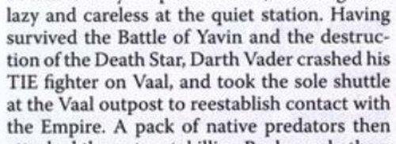
- **Aayla Secura**: "Aayla Secura severed the antenna during her duel with Aurra Sing on Devaron." Source: The Complete Star Wars Encyclopedia, Vol. III, p.98
  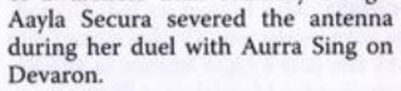
- **Count Dooku**: "Count Dooku defended the world to keep the Republic from uncovering ancient Jedi lore that might reveal how to defeat his Dark Reaper superweapon." Source: The Complete Star Wars Encyclopedia, Vol. III, p.98
  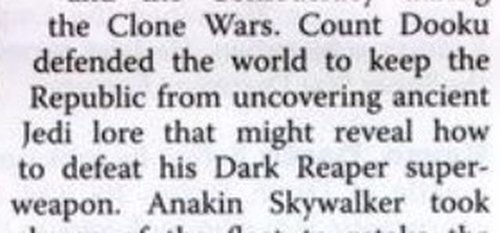

## p.99 (scan page 105)

Page contents: 839 words, 23 paragraphs | headings/entries: Rho, Myhr; Rhoden, Clode; Rhysode, Ganner; Rianitus Period; Rich; Richbium, Onila

## p.100 (scan page 106)

Page contents: 1171 words, 36 paragraphs | headings/entries: Ridge; Riemann, Gayla; Rifle Worlds; Riflor; Righim, Caldera; Rigo; Rigovian Technical University; Riiken; Riileb; Riizolo, Phan; Rijel Xf; Rikkar-Du; Rikummee, Prince; Rilla; Rillao

## p.101 (scan page 107)

Page contents: 1221 words, 40 paragraphs | headings/entries: Rim, tan; Rimcee Station; Rimkar; Rimkin; Rimma; Rimma Trade Route; Rim Merchant Einem; Rimmer's Rest; RiMPack; Rimrider; Rimsen, Captain; Rimsoo; Rin, Nei; Rin, Obo; Rindian; Ringali Nebula; Rinn; Rintatta City; Riome; Risant, Tendra; Rishi

- **Kyp Durron**: "Rim, tan A lieutenant in the Kyp's Dozen starfighter squadron during the Yuuzhan Vong invasion, he was killed in battle against the alien invaders over Coruscant as the Dozen provided protection for Danni Quee's ship." Source: The Complete Star Wars Encyclopedia, Vol. III, p.101
  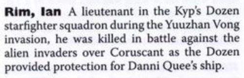

## p.102 (scan page 108)

Page contents: 998 words, 30 paragraphs | headings/entries: Rishi Maze; Rising Star; Riske, Jerv; Rithgar; Ritsomas, Bufus; Rivan, Darth; Rivan, Dix; Rivers, Meghan; River Solleu; River Weeping; Rivi-Anu; Riwwel, Admiral

## p.103 (scan page 109)

Page contents: 1170 words, 36 paragraphs | headings/entries: Rizaron; RK-7; Rkk'tI'kt; R'lyek; Ro, Ambassador Loreli; Roa; Roaming Ronto; Robber Baron; Robida Colossus; Roche

- **Boba Fett; Jango Fett; Mace Windu**: "Boba Fett used a robot scoop to carry away the body of his father, Jango Fett, from the arena where he was beheaded by Mace Windu." Source: The Complete Star Wars Encyclopedia, Vol. III, p.103
  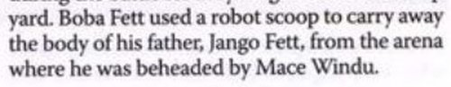

## p.104 (scan page 110)

Page contents: 837 words, 30 paragraphs | headings/entries: Rock Dragon; Rodan, Fyor; Rodan, Tormak; Rodd, Senator

## p.105 (scan page 111)

Page contents: 771 words, 22 paragraphs | headings/entries: Rodian Hunting Grounds; Rodian Salvage Cartel; Rodisar; Rodo; Roeg; Roenni

## p.106 (scan page 112)

Page contents: 1130 words, 28 paragraphs | headings/entries: Rogoe, Boss; Rogriss, Admiral Teren; Rogua; Rogue Eight; Rogue Eleven; Rogue Flight; Rogue Four; Rogue Group; Rogue Leader; Rogue Nine; Rouge Seven; Rogue Six; Rogue Shadow; Rogue Squadron

- **Kit Fisto; General Grievous**: "It was killed by Kit Fisto and Nahdar Vebb during the Clone Wars, when they infiltrated Grievous's sanctuary." Source: The Complete Star Wars Encyclopedia, Vol. III, p.106
  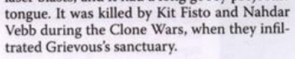
- **Galen Marek**: "Capable of transporting Starkiller virtually anywhere in the galaxy, the starship's layout included a fully functional medical bay, crew quarters, a workshop, and a meditation chamber that could double as a training room." Source: The Complete Star Wars Encyclopedia, Vol. III, p.106
  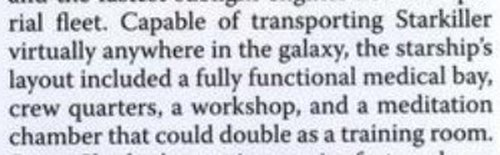

## p.107 (scan page 113)

Page contents: 810 words, 32 paragraphs | headings/entries: Rogue Ten; Rogue Three; Rogue Twelve; Rogue Two; Rogue Wing; Roh; Rohair Biochemical Clinic; Roi, Fitz; Roite, Major Barst; Roj; Rojahn, Captain; Rojo, Warshack; Roke, Boss; Rokk, Redkihl; Roko; Rokrul; Rolado, Corporal Vyn

- **Darth Vader (Anakin Skywalker)**: "Anakin Skywalker destroyed the Confederacy laboratory, returning warmth to Rokrul and freeing the captive warriors." Source: The Complete Star Wars Encyclopedia, Vol. III, p.107
  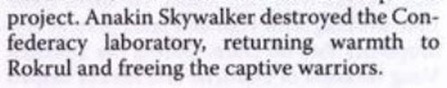

## p.108 (scan page 114)

Page contents: 1031 words, 38 paragraphs | headings/entries: Rol'Waran; Romany; Romar; Romba; Romey, Major Belyssa; Romin; Romodi, Senator; Romodi Interstellar; Rondai Hl; Rone, Pastav; Ronika; Ronson; RonTha; Roofoo; Roogak, Captain

## p.109 (scan page 115)

Page contents: 1001 words, 28 paragraphs | headings/entries: Rookie; Roon; Roona; Roonadan; Roon Colonial Games; Roonstone; Roor, Boles; Root; Roothes, Memah; Rootrock, General

## p.110 (scan page 116)

Page contents: 1166 words, 39 paragraphs | headings/entries: Rooty; Ropplie, Gru'um; Roqoo; Rordis City; Rorgam; Rori; Rori Spice Mining Collective; Rorg; Rosha; Roshton, Commander; Roshuir, Captain Kale; Roshu Sune; Rosk, Commander; Rosset, Moff; Rossik, Captain Todrin; Rotas V

- **Lando Calrissian**: "Rooty once bested Lando Calrissian in a game of sabacc." Source: The Complete Star Wars Encyclopedia, Vol. III, p.110
  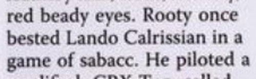
- **Palpatine (Darth Sidious)**: "Emperor Palpatine feared that the two worlds would pool their advancements to create jamming technology capable of defeating Imperial hardware." Source: The Complete Star Wars Encyclopedia, Vol. III, p.110
  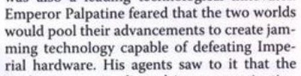

## p.111 (scan page 117)

Page contents: 1060 words, 28 paragraphs | headings/entries: Rotham, Dr. Heilan; Rothana Heavy Engineering; Ro-ti-Mundi; Rotramel, Timi; Rotsino, Esu; Roty, Adier; Rover; Rover; Rovieda, Ixian; Rowel; Rowrakruk; Royal Academy; Royal Chalcedony Shield; Royal Guard; Royal Intelligence Service; Royal Protectors; Royce

- **Darth Vader (Anakin Skywalker)**: "Rotramel attempted to gain Tiss'sharl president Si-Di-Ri's support for the Rebellion, but was discovered and killed by Darth Vader." Source: The Complete Star Wars Encyclopedia, Vol. III, p.111
  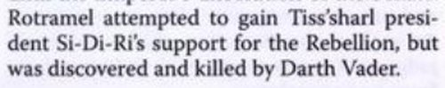
- **Anakin Solo**: "Rover A recon skiff attached to the Galactic Alliance Star Destroyer Anakin Solo." Source: The Complete Star Wars Encyclopedia, Vol. III, p.111
  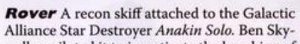

## p.112 (scan page 118)

Page contents: 741 words, 23 paragraphs | headings/entries: Rozess, Jude; Rozhdenst, Commander Gennad; Rrr'ur'R; Rrudobar; RR'uruurrr; Rryatt Trail

## p.113 (scan page 119)

Page contents: 876 words, 31 paragraphs | headings/entries: Ruati, Master; Rubogean Gambit; Ruby Gulch; Ruby Nebula; Ruda, Palee; Rudd, Jerris; Rudrig; Rue, Aehrriey; Rue, Elyhek; Rufarr

- **Grand Admiral Thrawn**: "R8 unit: Produced after the defeat of Grand Admiral Thrawn, it was, for a time, intended to have a standard Basic-speaking vocabulator, but this design feature was discarded before release." Source: The Complete Star Wars Encyclopedia, Vol. III, p.113
  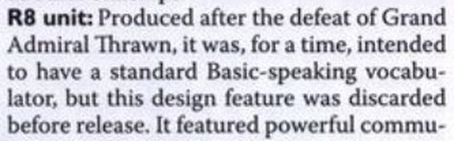

## p.114 (scan page 120)

Page contents: 1102 words, 27 paragraphs | headings/entries: Rugosa; Ruhe; Ruillia's Insulated Rooms; Ruisto; Rujj, Anj; Rukh; Rukil; Rula, Captain; Rulacamp; Rule KR27

- **Yoda**: "Yoda and his clone troopers were faced with overwhelming odds against an entire droid army, yet nonetheless succeeded." Source: The Complete Star Wars Encyclopedia, Vol. III, p.114
  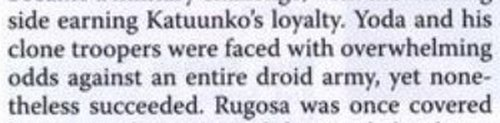
- **Darth Zannah**: "With the annihilation of the Brotherhood of Darkness, Bane started anew under the Rule of Two, taking on an apprentice, Darth Zannah." Source: The Complete Star Wars Encyclopedia, Vol. III, p.114
  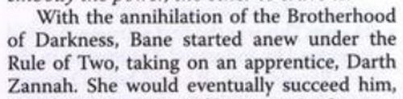
