# Owner Material 032 — The Complete Star Wars Encyclopedia, Vol. III (P–Z): scan pages 121–160

- **Source:** *The Complete Star Wars Encyclopedia* by Stephen J. Sansweet and Pablo Hidalgo, with Bob Vitas, Daniel Wallace, Chris Cassidy, Mary Franklin and Josh Kushins (Del Rey, 2008), 3 vols. Secondary source (licensed Legends reference). Scan OCR'd on the box; the scan stays box-only and is **not** published.
- **Method:** every scanned page was OCR'd and machine-screened sentence by sentence for power-relevant statements (fights, kills, defeats, Force feats, rankings, superweapons) that name a character on our roster; each kept sentence is quoted verbatim from the OCR text and has a crop of the printed passage directly under it. Pages with nothing power-relevant are still listed with what is on them.
- **Citation:** "The Complete Star Wars Encyclopedia, Vol. III, p.X" by printed page ("scan p.X" where no printed number applies). **Weight:** Lucasfilm-licensed encyclopedia: a secondary, in-universe summary of Legends (and some film) material. It sums up feats from novels, comics and games; where the original story is in our notes, that source is the stronger citation.

## p.115 (scan page 121)

Page contents: 897 words, 29 paragraphs | headings/entries: Rulffe; Ruling Families; Ruling Power; Ruluwoor, Chertyi; Runaway Prince; Running Crimson Flightknife; Rurgavean Sleight; Rushing, Corporal; Rustibar; Rutan

## p.116 (scan page 122)

Page contents: 911 words, 21 paragraphs | headings/entries: Rutian; Rutu; Ruu; Ruuin; Ruuk, Harro; Ruuq, Bhasu; Ruuria; RuuR'Ur; Ruusan; Ruusan, Battle of

- **Lord Kaan**: "This resulted in a furious explosion of energy that annihilated every last member of Hoth's Army of Light and Kaan's Brotherhood of Darkness." Source: The Complete Star Wars Encyclopedia, Vol. III, p.116
  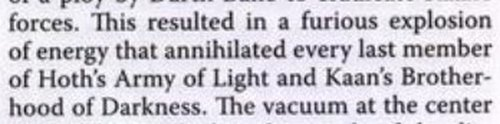

## p.117 (scan page 123)

Page contents: 709 words, 23 paragraphs | headings/entries: Ruusan Reformations; Ruwein; Ruyn, Darth; R'vanna; Rwookrrorro; RX-4-9; Rycar's Run; Rydonni Prime

- **General Grievous; Darth Vader (Anakin Skywalker)**: "A captive R2-D2 was taken here by General Grievous for dissection, but was rescued by Anakin Skywalker and his clone troopers, who also destroyed the post." Source: The Complete Star Wars Encyclopedia, Vol. III, p.117
  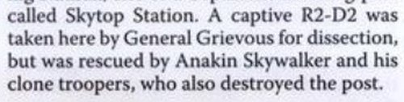

## p.118 (scan page 124)

Page contents: 1015 words, 24 paragraphs | headings/entries: Ry-Gaul; Ryjerd, Raye; Ryjerd, Rycar; Ry-Kooda; Rylle'vak; Ryloon; Ryloth; Ryloth; Ryn

- **Yoda; Mace Windu**: "He survived the wars by taking on an undercover mission known only to Yoda and Mace Windu." Source: The Complete Star Wars Encyclopedia, Vol. III, p.118
  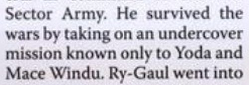

## p.119 (scan page 125)

Page contents: 789 words, 24 paragraphs | headings/entries: Ryndellia; Rys; Rysto, Lord; Ryuk; Ryvellia; Ryyder, Horox; RZ-1

## p.120 (scan page 126)

Page contents: 0 words, 0 paragraphs | headings/entries: 

## p.121 (scan page 127)

Page contents: 781 words, 23 paragraphs | headings/entries: 2nd Airborne Company; 2nd Platoon; 2nd Sector Army; 7th Legion; Saa, T'ra; Saak'ak; Saarai-kaar; Saarrj, Lieutenant Izbela; Saarn

- **Quinlan Vos; Tholme**: "She teamed with Quinlan Vos and two Jedi Masters, Tholme and Zao, to defeat the Anzati Sith magician." Source: The Complete Star Wars Encyclopedia, Vol. III, p.121
  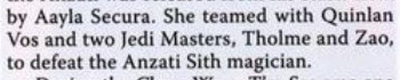
- **Grand Admiral Thrawn**: "Five years after the Battle of Endor, one of Grand Admiral Thrawn's Star Destroyers, the Stormhawk, executed a hit-and-fade attack on Saarn, wiping out New Republic personnel." Source: The Complete Star Wars Encyclopedia, Vol. III, p.121
  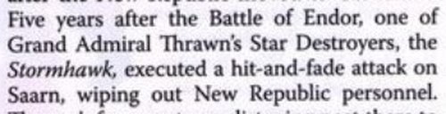

## p.122 (scan page 128)

Page contents: 903 words, 25 paragraphs | headings/entries: Sabé; Sabodor; Sacul, Jorg; Sadeet, Sish; Sadow, Naga

- **Admiral Ackbar**: "Piggy flew as Wraith Twelve, and survived being shot during an assassination attempt on Admiral Ackbar." Source: The Complete Star Wars Encyclopedia, Vol. III, p.122
  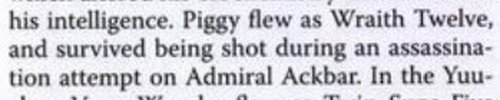
- **Kir Kanos**: "When Sadeet ran at them, Kanos killed the Trandoshan instantly." Source: The Complete Star Wars Encyclopedia, Vol. III, p.122
  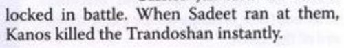

## p.123 (scan page 129)

Page contents: 997 words, 34 paragraphs | headings/entries: Saelt-Marae; Saffalore; Sage, Vana; Sah, Joc; Sai, Ko; Saijo

- **Palpatine (Darth Sidious)**: "Palpatine quietly sought a genetic solution to immortality." Source: The Complete Star Wars Encyclopedia, Vol. III, p.123
  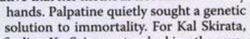
- **Darth Vader (Anakin Skywalker); Count Dooku**: "Sai cha was a beheading move, used by Anakin Skywalker to dispatch Count Dooku." Source: The Complete Star Wars Encyclopedia, Vol. III, p.123
  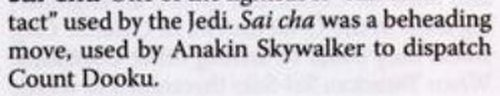

## p.124 (scan page 130)

Page contents: 1021 words, 19 paragraphs | headings/entries: Saiy, Barit; Saiculd; Saleucami; Salis D'aar; Salliche; Sallowe, Sardu; Salm, Horton; Salporin

- **Luke Skywalker; Leia Organa Solo; Han Solo**: "It was during just such a celebration that the sail barge was destroyed when Luke Skywalker, Princess Leia Organa, and others staged a daring rescue of Han Solo." Source: The Complete Star Wars Encyclopedia, Vol. III, p.124
  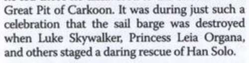

## p.125 (scan page 131)

Page contents: 1102 words, 21 paragraphs | headings/entries: Salvo; Samaria; Samuro; Sancor; Sanctuary Moon

## p.126 (scan page 132)

Page contents: 868 words, 27 paragraphs | headings/entries: Sand People; Sandral, Nurik; Sandskimmer, Falynn; Sanjin; Sant, Rystall; Santhe

## p.127 (scan page 133)

Page contents: 1245 words, 33 paragraphs | headings/entries: Sanvia Vitajuice Bar; Sanyassan Marauders; Saquesh; Sarahwiee; Sarapin; Saras; Sarcophagus; Saren, Rianna; Saresh, Guun Han; Sarge; Sariss; Sark, Robbyn; Sarkan; Sarkin, Tyria; Sarlace

- **Grand Admiral Thrawn**: "After the Battle of Endor, a few Imperial fleet captains equipped and supplied the base until the defeat of Grand Admiral Thrawn, when it became necessary for free traders to handle the cargo shipments." Source: The Complete Star Wars Encyclopedia, Vol. III, p.127
  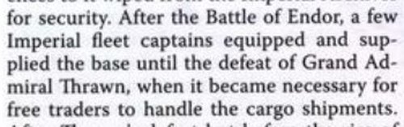
- **Grand Admiral Thrawn; Luke Skywalker**: "After Thrawn's defeat but before the rise of the clone Emperor, a New Republic commando team including Luke Skywalker and led by Lieutenant Page was sent to Sarahwiee to destroy the facility and erase its computer records." Source: The Complete Star Wars Encyclopedia, Vol. III, p.127
  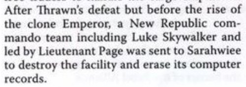
- **Sariss; Jerec** — entry/section: Sariss: "She also helped train the dark sider Merili, and was often part of the Secret Order entourage sent to the Super Star Destroyer Vengeance to confer with the Dark Jedi Jerec." Source: The Complete Star Wars Encyclopedia, Vol. III, p.127
  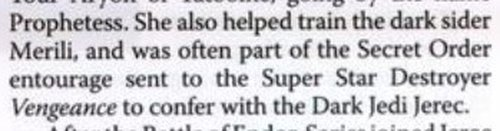
- **Sariss; Kyle Katarn; Yun (Dark Jedi)** — entry/section: Sariss: "In a fierce battle with Kyle Katarn, Sariss accidentally struck down Yun, and Katarn stabbed Yun's own lightsaber through Sariss's chest." Source: The Complete Star Wars Encyclopedia, Vol. III, p.127
  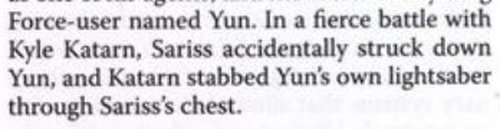

## p.128 (scan page 134)

Page contents: 1224 words, 31 paragraphs | headings/entries: Sarlacc Battalion; Sarlace Project; Sarm; Saurin; Sauro, Senator Sano; Sarne, Moff Kentor; Sarpentia; Sarreti, Moff Ephin; Savage Squadron; Sasso; Savan; Satine, Duchess

- **Plo Koon**: "Although the Gorog nest ship | was destroyed at Sarm, Lomi Plo escaped and rejoined the Colony's forces at Tenupe." Source: The Complete Star Wars Encyclopedia, Vol. III, p.128
  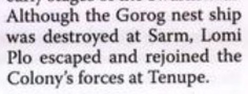

## p.129 (scan page 135)

Page contents: 1042 words, 22 paragraphs | headings/entries: Save, Whimper; Savvam Lake; Saxan, Aidel; Saxan's Pride; Sazz, Jak; Scarcheek; Scardia; Sceardia Voyager; Scarlet Thranta; Scaur, Director Dif

## p.130 (scan page 136)

Page contents: 1104 words, 24 paragraphs | headings/entries: Schurk-Heren, Captain; Scimitar; Sconn, Lieutenant Davith; Scorekeeper; Scotian, Pedna; Scotian, Will; Scout Enforcer; Scraf, Arvid; Scrambas, Pello

## p.131 (scan page 137)

Page contents: 860 words, 28 paragraphs | headings/entries: Screeger, Naxy; Scuppa; Scylla

- **Shaak Ti**: "During the Clone Wars, a scrange attacked Shaak Ti's team in the sewers of Brentaal IV, impaling the Wookiee Ryyk before Ti killed the creature with her lightsaber." Source: The Complete Star Wars Encyclopedia, Vol. III, p.131
  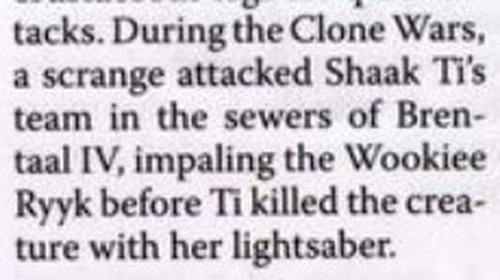

## p.132 (scan page 138)

Page contents: 1016 words, 17 paragraphs | headings/entries: Scy'rrep, Evet; Scythe Squadron; Sea Legacy; Seario, Pollard; Sebatyne, Saba; Sebatyne, Tesar

- **Anakin Solo**: "SD-XX accompanied Solo on the maiden voyage of the Star Destroyer Anakin Solo | during a mission to Hapes." Source: The Complete Star Wars Encyclopedia, Vol. III, p.132
  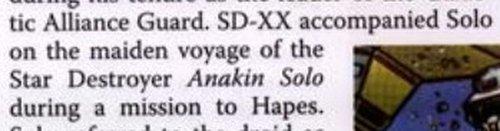
- **Mara Jade Skywalker**: "The droid even came to realize that it had been Solo who had killed Mara Jade Skywalker, although it remained loyal and did not divulge this information to any other being." Source: The Complete Star Wars Encyclopedia, Vol. III, p.132
  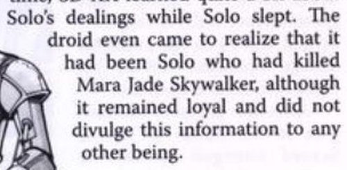

## p.133 (scan page 139)

Page contents: 1178 words, 24 paragraphs | headings/entries: Sebolto; Sebulba; Sebulba's Legacy; Second Fleet, Galactic Alliance; Second Great Schism; Second Imperium; Second Mistake Enterprises; Secret Apprentice; Secret Order; Sector Rangers; Sector Zero

- **Darth Vader (Anakin Skywalker)**: "Sebulba was Mos Espa's reigning Podrace champion until he entered the Boonta Eve Classic, where he was defeated by young Anakin Skywalker." Source: The Complete Star Wars Encyclopedia, Vol. III, p.133
  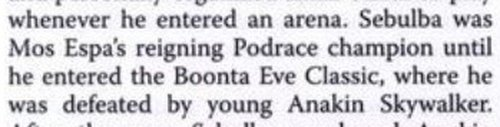

## p.134 (scan page 140)

Page contents: 1042 words, 30 paragraphs | headings/entries: Secura, Aayla; Secura, Nat; Sedesia; Sedrian

- **Aayla Secura; Quinlan Vos; Volfe Karkko** — entry/section: Secura, Aayla: "Vos killed Karkko, freeing Secura from his grasp." Source: The Complete Star Wars Encyclopedia, Vol. III, p.134
  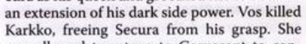
- **Aayla Secura** — entry/section: Secura, Aayla: "Secura defeated the bounty hunter Aurra Sing on Devaron by slicing off the antenna that sprouted from Sing's head." Source: The Complete Star Wars Encyclopedia, Vol. III, p.134
  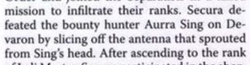
- **Aayla Secura** — entry/section: Secura, Nat: "Years later, Nat Secura suffered severe burns when Jabba the Hutt enslaved many natives of Ryloth, and Bib Fortuna brought him to Jabba's palace." Source: The Complete Star Wars Encyclopedia, Vol. III, p.134
  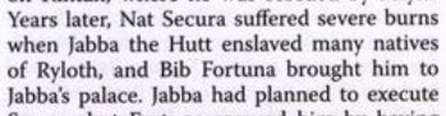

## p.135 (scan page 141)

Page contents: 1008 words, 25 paragraphs | headings/entries: Seeker; Seerdon, Moff Kohl; See-Threepio; Seezar's Planet; Seifax; Seii, Akku; Sei'lar, Asyr

- **Palpatine (Darth Sidious); Luke Skywalker; Ood Bnar**: "Palpatine ordered Sedriss to go to Ossus to get Luke Skywalker, but the Executor was destroyed by the power of an ancient Jedi, Ood Bnar." Source: The Complete Star Wars Encyclopedia, Vol. III, p.135
  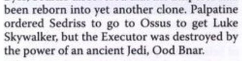
- **Tholme**: "When Tholme defeated his opponents, Akku Seii revealed that the entire battle had simply been a training session for his students." Source: The Complete Star Wars Encyclopedia, Vol. III, p.135
  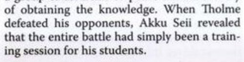

## p.136 (scan page 142)

Page contents: 938 words, 23 paragraphs | headings/entries: Sekot; Selab; Selaggis; Selaggis, Battle of; Select, the; Selestrine, Queen; Seline; Selkath

- **Mace Windu**: "Mace Windu singlehandedly destroyed a seismic tank on Dantooine during the Clone Wars." Source: The Complete Star Wars Encyclopedia, Vol. III, p.136
  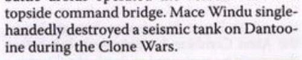
- **Han Solo**: "Selaggis A planet that was the location of a colony obliterated by Warlord Zsinj's Super Star Destroyer /ron Fist, Han Solo saw the destruction while on a five-month hunt to locate and destroy Zsinj's ship." Source: The Complete Star Wars Encyclopedia, Vol. III, p.136
  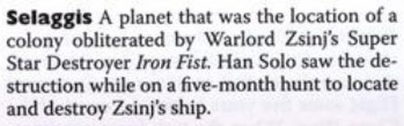
- **Boba Fett**: "Boba Fett tracked him there and killed Karda." Source: The Complete Star Wars Encyclopedia, Vol. III, p.136
  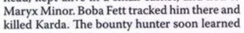
- **Darth Vader (Anakin Skywalker)**: "Darth Vader had hoped to harness Selestrine's abilities but decided to destroy Selestrine's head to keep it out of the hands of the Emperor." Source: The Complete Star Wars Encyclopedia, Vol. III, p.136
  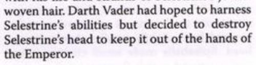

## p.137 (scan page 143)

Page contents: 1172 words, 22 paragraphs | headings/entries: Seinesh; Selonia; Selonian; Seluss; Selvaris; Sembla; Semtin, Captain Marl; Senali; Senate Guard

## p.138 (scan page 144)

Page contents: 980 words, 25 paragraphs | headings/entries: Senate Justice Council; Sencil Corporation; Sendo, General; Seneki; Senesca, Zev; Sennatt

- **Palpatine (Darth Sidious); Yoda**: "Darth Sidious used the Force to hurl spinning Senate platforms at Yoda during their duel in the Senate chamber." Source: The Complete Star Wars Encyclopedia, Vol. III, p.138
  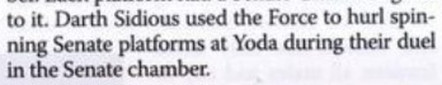
- **Han Solo; Leia Organa Solo**: "Seneki was killed when the Flakax known as Tito returned from his mission to eliminate Han Solo and his wife, Leia Organa Solo." Source: The Complete Star Wars Encyclopedia, Vol. III, p.138
  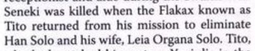

## p.139 (scan page 145)

Page contents: 802 words, 29 paragraphs | headings/entries: Sentinel; Sentinel; Seoul V; Separatist Alliance; Separatist Council; Sephi; Sera Plinck; Serdo; Serenno; Sereno, Prince

- **Palpatine (Darth Sidious); General Grievous**: "Following defeats at Metalorn and Muunilinst, Lord Sidious ordered that the entire Separatist Council be under the protection of General Grievous for the remainder of the war." Source: The Complete Star Wars Encyclopedia, Vol. III, p.139
  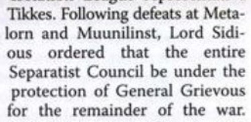
- **Darth Vader (Anakin Skywalker)**: "When Anakin Skywalker arrived at the Mustafar command center, he sealed off the exits and wiped out the entire Separatist Council." Source: The Complete Star Wars Encyclopedia, Vol. III, p.139
  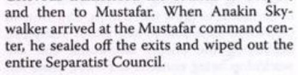

## p.140 (scan page 146)

Page contents: 1184 words, 35 paragraphs | headings/entries: Endor.; Sermeria; Sernpidal; Sern Prime; Serpa; Serper, Wyron; Serroco; Serth, Valence; Serv-O-Droid; Setor; Sette, Urior; Sevarcos

- **Chewbacca**: "They helped evacuate the planet, but Chewbacca was killed in the cataclysm." Source: The Complete Star Wars Encyclopedia, Vol. III, p.140
  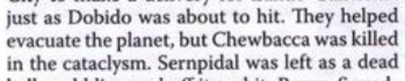
- **Kyp Durron; Jaina Solo**: "Kyp Durron convinced Jaina Solo to help attack Sernpidal, destroying the enemy shipwomb and the worldship being constructed there." Source: The Complete Star Wars Encyclopedia, Vol. III, p.140
  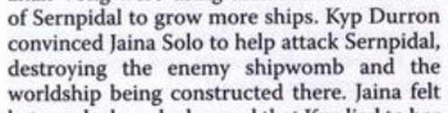
- **Jaina Solo**: "As Serpa raised a blaster to fire on Jaina, Zekk severed his arm with his lightsaber." Source: The Complete Star Wars Encyclopedia, Vol. III, p.140
  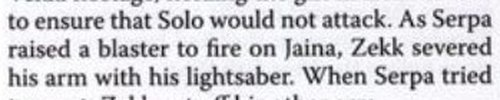
- **Luke Skywalker**: "The droid R2-D2 was able to duplicate the signals, which enabled Luke Skywalker to ride a serpent and defeat the Serpent Masters, freeing Tanith Shire's people from slavery." Source: The Complete Star Wars Encyclopedia, Vol. III, p.140
  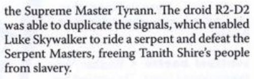

## p.141 (scan page 147)

Page contents: 1068 words, 19 paragraphs | headings/entries: Sevvets; Sey, Kadrian; Seyah, Toval; Seylott; Seyugi Dervishes; Sgauru

- **Quinlan Vos**: "On Kiffu, Quinlan Vos killed her when she tried to attack Sheyf Tinte." Source: The Complete Star Wars Encyclopedia, Vol. III, p.141
  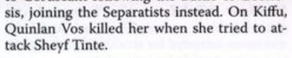

## p.142 (scan page 148)

Page contents: 1261 words, 35 paragraphs | headings/entries: Shaara; Shaardan; Shadda-Bi-Boran; Shadeshine; Shadow Academy; Shadow Assassins; Shadow AT-AT; Shadowcast; Shadow Chaser; Shadow Falls, A; Shadowmen

- **Padmé Amidala**: "Shadda-Bi-Boran The planet where Padmé's relief group was sent after it was discovered that its sun was imploding and the planet dying." Source: The Complete Star Wars Encyclopedia, Vol. III, p.142
  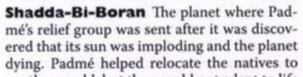
- **Brakiss**: "Finally the leaders of the Second Imperium, displeased with the progress of Brakiss, detonated the station and killed the Shadow Academy's leader." Source: The Complete Star Wars Encyclopedia, Vol. III, p.142
  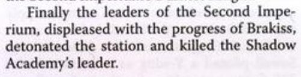
- **Palpatine (Darth Sidious)**: "Shadow Guards boasted limited Force powers and were capable of wielding lightsaber lances, leading some Imperials to speculate that they were Jedi who had been brainwashed into serving Palpatine." Source: The Complete Star Wars Encyclopedia, Vol. III, p.142
  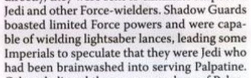

## p.143 (scan page 149)

Page contents: 1112 words, 23 paragraphs | headings/entries: Shai, Dranae; Shai, Shedao; Shaker; Shala, Ree; Shalam; Shalini; Shaliqua, Diva; Shalyvane; Shamed Ones

- **Corran Horn**: "In the end, Shedao turned Elegos into a statement: He killed him, prepared his corpse in the appropriate Yuuzhan Vong manner, and returned the artistically decorated skeleton to Corran Horn at Ithor." Source: The Complete Star Wars Encyclopedia, Vol. III, p.143
  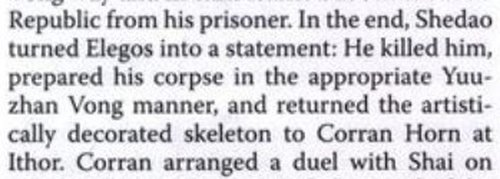
- **Corran Horn**: "Corran arranged a duel with Shai on Ithor, with the winner awarded control of the planet." Source: The Complete Star Wars Encyclopedia, Vol. III, p.143
  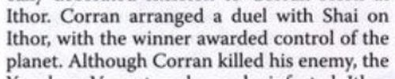

## p.144 (scan page 150)

Page contents: 1071 words, 25 paragraphs | headings/entries: Shan, Bastila; Shan, Deena; Shana; Shannador's Revenge; Shashay; Shattered Moon

- **Bastila Shan** — entry/section: Shan, Bastila: "Shan, Bastila A skilled Jedi from Talravin who specialized in Jedi battle meditation during the years of the Jedi Civil War." Source: The Complete Star Wars Encyclopedia, Vol. III, p.144
  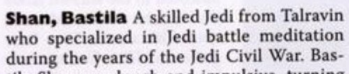
- **Bastila Shan** — entry/section: Shan, Bastila: "Bastila Shan was brash and impulsive, turning every fiber of her being toward defeating the Sith menace and proving herself to the leading Jedi." Source: The Complete Star Wars Encyclopedia, Vol. III, p.144
  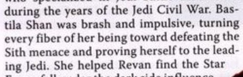
- **Saesee Tiin**: "Although the Sharp Spiral lacked deflector shields, Tiin was able to fly rings around the well-trained soldiers." Source: The Complete Star Wars Encyclopedia, Vol. III, p.144
  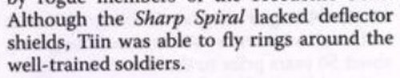

## p.145 (scan page 151)

Page contents: 1123 words, 32 paragraphs | headings/entries: Shaum Hii; Shawti; Shay; Shayoto; Shazeen; Despot.; Shee, Cian; Sheelal, Qymaen jai; Shell Hutts; Shen-Jon, Echuuw; Sherruk; Shelter; Shelvay, Corwin; Shenayag; Shesh, Viqi

- **Luke Skywalker**: "Luke Skywalker, Rik Duel, Dani, Chihdo, Plif, and Kiro went on a diplomatic mission to Shawken." Source: The Complete Star Wars Encyclopedia, Vol. III, p.145
  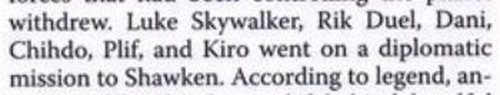
- **Leia Organa Solo**: "Shen-Jon, Echuuw A Jedi Master who survived the Purge and was later discovered by Princess Leia Organa on Krant." Source: The Complete Star Wars Encyclopedia, Vol. III, p.145
  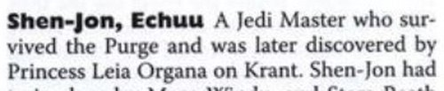
- **Sev'rance Tann**: "Shen-Jon led a Republic army to Krant, killed Separatist general Sev'Rance Tann and then disappeared into the Krant wilderness." Source: The Complete Star Wars Encyclopedia, Vol. III, p.145
  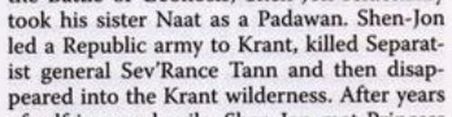
- **Antinnis Tremayne**: "Enraged, Shelvay attacked Tremayne, severing the Inquisitor's arm and forever scarring his face." Source: The Complete Star Wars Encyclopedia, Vol. III, p.145
  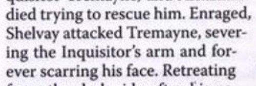

## p.146 (scan page 152)

Page contents: 1280 words, 36 paragraphs | headings/entries: Shessaun, Senator Silya; Shevu, Lon; Sheyf; Sheyvan; Shiak; Shiel, Riv; Shield; Shield, the

- **Mara Jade Skywalker; Jacen Solo (Darth Caedus)**: "He also revealed that he had killed Mara Jade Skywalker, although he firmly believed that the killing had been necessary to allow Jacen to continue his mission to save the galaxy." Source: The Complete Star Wars Encyclopedia, Vol. III, p.146
  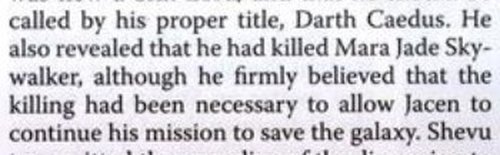
- **Darth Vader (Anakin Skywalker)**: "Darth Vader killed him for his treachery." Source: The Complete Star Wars Encyclopedia, Vol. III, p.146
  

## p.147 (scan page 153)

Page contents: 1144 words, 25 paragraphs | headings/entries: Shi'ido; Shild, Moff Sarn; Shili; Shimia; Shimmer; Shimrra, Supreme Overlord; Shindra's Veil, Battle of; Shiner; Shintel; Ship; Shire, Tanith; Shistavanen

- **Luke Skywalker; Jacen Solo (Darth Caedus); Onimi**: "Luke Skywalker beheaded Shimrra in a duel, while Jacen Solo eliminated Onimi." Source: The Complete Star Wars Encyclopedia, Vol. III, p.147
  
- **Darth Talon**: "When Shiner was destroyed in battle, Myn Donos experienced severe emotional trauma—the droid had been the only other surviving member of Donos's original Talon Squadron." Source: The Complete Star Wars Encyclopedia, Vol. III, p.147
  
- **Kyp Durron; Jaina Solo**: "The Yuuzhan Vong constructed a shipwomb at Sernpidal to grow a new worldship, which was ultimately destroyed by Kyp Durron and Jaina Solo." Source: The Complete Star Wars Encyclopedia, Vol. III, p.147
  
- **Luke Skywalker**: "After crash landing, Luke defeated the Serpent Masters and freed Shire's people." Source: The Complete Star Wars Encyclopedia, Vol. III, p.147
  

## p.148 (scan page 154)

Page contents: 1062 words, 33 paragraphs | headings/entries: Shiva IV; Shogun; Shooting Star; Shoran; Showolter, Captain

- **Chewbacca; Han Solo**: "Shoran A Wookiee cousin of Chewbacca, he was killed during the rescue of Han Solo aboard the Pride of Yevetha." Source: The Complete Star Wars Encyclopedia, Vol. III, p.148
  

## p.149 (scan page 155)

Page contents: 1305 words, 27 paragraphs | headings/entries: Shrike, Garris; Shrike; Shryne, Jula; Shryne, Roan; Shushin, Yag; Shusugaunt; Shyriiwook; Shysa, Fenn

- **Luke Skywalker**: "The Shriwirr was single-handedly captured by Luke Skywalker after the Ssi-ruuk evacuated the ship rather than face his Force abilities in battle." Source: The Complete Star Wars Encyclopedia, Vol. III, p.149
  
- **Roan Shryne; Darth Vader (Anakin Skywalker)** — entry/section: Shryne, Jula: "She survived, but her son died in a struggle with Vader on Kashyyyk." Source: The Complete Star Wars Encyclopedia, Vol. III, p.149
  
- **Roan Shryne; Darth Vader (Anakin Skywalker)** — entry/section: Shryne, Roan: "Shryne tried to rescue Senator Fang Zar on Alderaan, but Vader killed Zar." Source: The Complete Star Wars Encyclopedia, Vol. III, p.149
  
- **Roan Shryne; Darth Vader (Anakin Skywalker)** — entry/section: Shryne, Roan: "Ultimately, Shryne confronted Darth Vader on Kashyyyk and perished in the duel that followed." Source: The Complete Star Wars Encyclopedia, Vol. III, p.149
  
- **Roan Shryne** — entry/section: Shryne, Roan: "They were enslaved by the dominant Ssi-ruuk." Source: The Complete Star Wars Encyclopedia, Vol. III, p.149
  

## p.150 (scan page 156)

Page contents: 1174 words, 20 paragraphs | headings/entries: Sickener; Sidbam, Teak; Sidi Driss Inn; Sidious, Darth; Sienar, Raith

- **Luke Skywalker**: "The young man helped Luke escape from the Ssi-ruuk, but was mortally wounded as he killed his cruel masters, including the invasion leader, Elder Sh'tk'ith, in revenge." Source: The Complete Star Wars Encyclopedia, Vol. III, p.150
  
- **Palpatine (Darth Sidious)** — entry/section: Sidious, Darth: "Darth Sidious was the fulfillment of that prophecy, capable of exacting the Sith's revenge on the Jedi for having nearly eradicated the practitioners of the dark side of the Force." Source: The Complete Star Wars Encyclopedia, Vol. III, p.150
  
- **Palpatine (Darth Sidious); Darth Maul** — entry/section: Sidious, Darth: "Darth Sidious trained Darth Maul, the violent and predatory warrior who killed Qui- Gon Jinn, and joined forces with the Trade Federation prior to the Battle of Naboo." Source: The Complete Star Wars Encyclopedia, Vol. III, p.150
  
- **Darth Vader (Anakin Skywalker)**: "When Darth Vader arrived to introduce Commander Demmings as the new Imperial Moff of the system, Si-Di-Ri survived an assassination attempt the same night." Source: The Complete Star Wars Encyclopedia, Vol. III, p.150
  

## p.151 (scan page 157)

Page contents: 932 words, 25 paragraphs | headings/entries: Sienar Fleet Systems; Sienar Intelligence Systems; Sienn'rha; Sifo-Dyas; Sif-Uwana; Sikili, Sass; Silaban; Silais; Silas; Sileen; Silencer-7

- **Corran Horn**: "The Silaban's crew found that they were no match for the combined firepower of the two fugitives, especially when Corran Horn and Wedge Antilles arrived in X-wings to serve as escorts." Source: The Complete Star Wars Encyclopedia, Vol. III, p.151
  
- **Qui-Gon Jinn; Obi-Wan Kenobi**: "Qui-Gon Jinn and 13-year-old Obi-Wan Kenobi slew a silan on the planet Arorua about 12 years before the Battle of Naboo." Source: The Complete Star Wars Encyclopedia, Vol. III, p.151
  

## p.152 (scan page 158)

Page contents: 982 words, 30 paragraphs | headings/entries: Silentium; Silver Egg; Silver Speeder; Silver Station; Simonelie; Simoom; Simus; Sing, Aurra

- **Palpatine (Darth Sidious)**: "The key to the defeat of the monstrous World Devastators was Palpatine's fear that they could be turned against him, which led him to create a system that allowed him to seize control." Source: The Complete Star Wars Encyclopedia, Vol. III, p.152
  
- **Luke Skywalker; Palpatine (Darth Sidious)**: "Luke Skywalker provided Palpatine's control signals to R2-D2, who shut down the World Devastators during the Battle of Mon Calamari, allowing New Republic forces to destroy the helpless planet smashers." Source: The Complete Star Wars Encyclopedia, Vol. III, p.152
  
- **Naga Sadow**: "He was eventually betrayed by Naga Sadow, who crushed the Sith warlord's life-support crystal and killed the wizened magician instantly." Source: The Complete Star Wars Encyclopedia, Vol. III, p.152
  

## p.153 (scan page 159)

Page contents: 1229 words, 25 paragraphs | headings/entries: Singing Mountain Clan; Singularity; Sinidic; Sinn, Mirith; Sinya; Sion, Darth; Sionia; Sirak; Siralt, Moff

- **Darth Sion** — entry/section: Sion, Darth: "Sion was exceedingly difficult to kill, because his mastery over his own body lent him supernatural vitality." Source: The Complete Star Wars Encyclopedia, Vol. III, p.153
  
- **Darth Sion** — entry/section: Sion, Darth: "Sion led a sect of Sith assassins sent to wipe out the Jedi Order." Source: The Complete Star Wars Encyclopedia, Vol. III, p.153
  
- **Sirak** — entry/section: Sirak: "An arrogant individual with a strong connection to the dark side, Sirak was the strongest and most powerful of the three Zabrak." Source: The Complete Star Wars Encyclopedia, Vol. III, p.153
  
- **Sirak** — entry/section: Sirak: "Indeed, some felt that Sirak had achieved his potential after soundly defeating Bane in the lightsaber training ring." Source: The Complete Star Wars Encyclopedia, Vol. III, p.153
  

## p.154 (scan page 160)

Page contents: 1225 words, 19 paragraphs | headings/entries: Sirdar; Sirin, Leesub; Siro, Isolde; Sirpar; Sirrakuk; Sisar Run; Sisar Runners; Sisk; Sith; Second Great Schism.

- **Exar Kun**: "The last remaining true-blooded Sith were wiped out by Exar Kun during the Great Sith War, when he stole their life energy in an effort to defend his fortress on Yavin 4 against the forces of the Old Republic." Source: The Complete Star Wars Encyclopedia, Vol. III, p.154
  
- **Darth Plagueis**: "Plagueis was one of the most powerful Sith Masters, and was believed to have found a way to control midi-chlorians to create life." Source: The Complete Star Wars Encyclopedia, Vol. III, p.154
  
- **Darth Maul; Obi-Wan Kenobi; Palpatine (Darth Sidious); Count Dooku**: "When Darth Maul was destroyed by Obi-Wan Kenobi during the Battle of Naboo, Sidious found the charismatic former Jedi, Count Dooku, to be a worthy replacement." Source: The Complete Star Wars Encyclopedia, Vol. III, p.154
  
