# Owner Material 032 — The Complete Star Wars Encyclopedia, Vol. III (P–Z): scan pages 161–200

- **Source:** *The Complete Star Wars Encyclopedia* by Stephen J. Sansweet and Pablo Hidalgo, with Bob Vitas, Daniel Wallace, Chris Cassidy, Mary Franklin and Josh Kushins (Del Rey, 2008), 3 vols. Secondary source (licensed Legends reference). Scan OCR'd on the box; the scan stays box-only and is **not** published.
- **Method:** every scanned page was OCR'd and machine-screened sentence by sentence for power-relevant statements (fights, kills, defeats, Force feats, rankings, superweapons) that name a character on our roster; each kept sentence is quoted verbatim from the OCR text and has a crop of the printed passage directly under it. Pages with nothing power-relevant are still listed with what is on them.
- **Citation:** "The Complete Star Wars Encyclopedia, Vol. III, p.X" by printed page ("scan p.X" where no printed number applies). **Weight:** Lucasfilm-licensed encyclopedia: a secondary, in-universe summary of Legends (and some film) material. It sums up feats from novels, comics and games; where the original story is in our notes, that source is the stronger citation.

## p.155 (scan page 161)

Page contents: 1030 words, 21 paragraphs | headings/entries: Sith Academy; Sith'ari; Sith Holocron; Sith-Imperial War

- **Darth Vader (Anakin Skywalker); Darth Krayt**: "Vader ultimately killed his Master, weakening the Sith Order until Darth Krayt slowly began to rebuild it to its former strength." Source: The Complete Star Wars Encyclopedia, Vol. III, p.155
  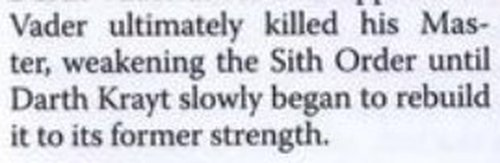
- **Revan; Darth Malak**: "Sith Destroyer (Leviathan-class) An ancient beak-shaped Sith capital ship used in the fleet led by Darth Revan and Darth Malak." Source: The Complete Star Wars Encyclopedia, Vol. III, p.155
  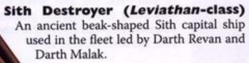

## p.156 (scan page 162)

Page contents: 1090 words, 29 paragraphs | headings/entries: Sith Marauder; Sith Shadows; Sith Speeder; Sith War, The; Siva, Den

## p.157 (scan page 163)

Page contents: 815 words, 22 paragraphs | headings/entries: Sivrak, Lak; Sixxa, Sol; Skahtul; Skako; Skee; Skelda; Skell, Choka

- **Tol Sivron**: "But Sivron killed them there, taking their meager possessions to increase his own chances for survival." Source: The Complete Star Wars Encyclopedia, Vol. III, p.157
  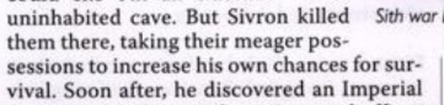

## p.158 (scan page 164)

Page contents: 1130 words, 42 paragraphs | headings/entries: Skell, Yoog; Skidder, Wurth; Skip; Skip 5; Skip 6

- **Luke Skywalker**: "Luke Skywalker and his companions escaped in a skiff just before the Hutt's sail barge exploded near the Great Pit of Carkoon." Source: The Complete Star Wars Encyclopedia, Vol. III, p.158
  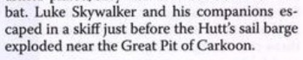

## p.159 (scan page 165)

Page contents: 1388 words, 31 paragraphs | headings/entries: Skirata, Jaing; Skirata, Kal; Sk; Skorponek; Skorr

- **Boba Fett**: "When Gev described the man to Boba Fett, the bounty hunter became intensely interested in finding him: He would have been one of the few clones to have survived the rapid aging that had been genetically coded into their cells." Source: The Complete Star Wars Encyclopedia, Vol. III, p.159
  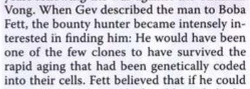

## p.160 (scan page 166)

Page contents: 944 words, 29 paragraphs | headings/entries: Skorr, Tol; Skreeka; Skrilling; Skritch; Skull Squadron; Skyclaw; Skydome Botanical Gardens; Skyhook; Skynx; Skynxnex, Arb

- **Quinlan Vos; Count Dooku**: "Quinlan Vos, on a mission to infiltrate the Separatists, was forced to defeat Skorr and Kadrian Sey in combat in order to gain an audience with Dooku." Source: The Complete Star Wars Encyclopedia, Vol. III, p.160
  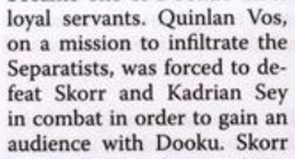
- **Darth Vader (Anakin Skywalker)**: "When Kharys returned to Skye under the Imperial title of Majestrix, she did so with an overwhelming force of starships and stormtroopers, ruling in the name of Darth Vader and the Empire from her aerie-fortress perched high atop Canaitith Mountain." Source: The Complete Star Wars Encyclopedia, Vol. III, p.160
  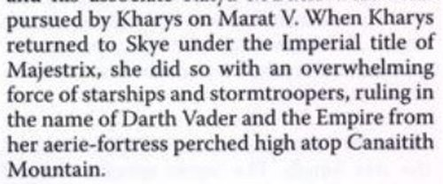

## p.161 (scan page 167)

Page contents: 964 words, 19 paragraphs | headings/entries: Skywalker, Anakin

- **Darth Vader (Anakin Skywalker); Obi-Wan Kenobi; Count Dooku** — entry/section: Skywalker, Anakin: "Obi-Wan and Anakin intercepted Count Dooku, mastermind of the Separatists, but Dooku incapacitated Kenobi and severed Anakin's arm before fleeing." Source: The Complete Star Wars Encyclopedia, Vol. III, p.161
  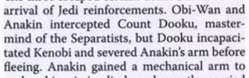
- **Darth Vader (Anakin Skywalker); Asajj Ventress** — entry/section: Skywalker, Anakin: "During the Battle of Muunilinst, Anakin led the space attack, pursuing Asajj Ventress's starfighter to the jungles of Yavin 4 and dueling her there." Source: The Complete Star Wars Encyclopedia, Vol. III, p.161
  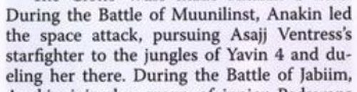
- **Darth Vader (Anakin Skywalker); Obi-Wan Kenobi** — entry/section: Skywalker, Anakin: "During the Battle of Jabiim, Anakin joined a group of junior Padawans after Obi-Wan was presumed killed." Source: The Complete Star Wars Encyclopedia, Vol. III, p.161
  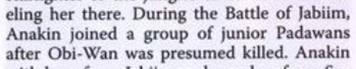
- **Darth Vader (Anakin Skywalker); Count Dooku** — entry/section: Skywalker, Anakin: "After Anakin beheaded Count Dooku during the Battle of Coruscant, it was hoped that the Clone Wars had come to an end." Source: The Complete Star Wars Encyclopedia, Vol. III, p.161
  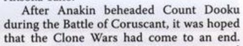
- **Padmé Amidala; Obi-Wan Kenobi**: "Padmé and Obi- Wan followed him to Mustafar, where he and Kenobi engaged in a vicious lightsaber duel." Source: The Complete Star Wars Encyclopedia, Vol. III, p.161
  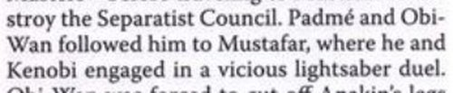
- **Darth Vader (Anakin Skywalker); Padmé Amidala; Palpatine (Darth Sidious)** — entry/section: Skywalker, Anakin: "Anakin's anger boiled over when he learned of Padmé's death, especially when Palpatine explained that it had been Anakin himself who killed her." Source: The Complete Star Wars Encyclopedia, Vol. III, p.161
  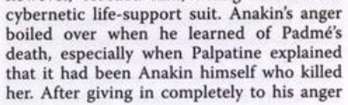

## p.162 (scan page 168)

Page contents: 1240 words, 20 paragraphs | headings/entries: Skywalker, Ben

- **Obi-Wan Kenobi; Ben Skywalker**: "Named to honor the memory of Obi-Wan "Ben" Kenobi, Ben Skywalker was born aboard the converted Star Destroyer Errant Venture during the Yuuzhan Vong War." Source: The Complete Star Wars Encyclopedia, Vol. III, p.162
  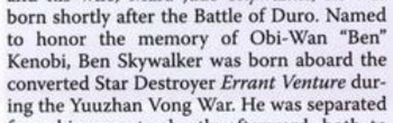
- **Luke Skywalker; Mara Jade Skywalker**: "With the defeat of the Yuuzhan Vong, Luke and Mara resolved to spend more time with their son, but the rigors of leading the new Jedi Order conspired to keep them apart." Source: The Complete Star Wars Encyclopedia, Vol. III, p.162
  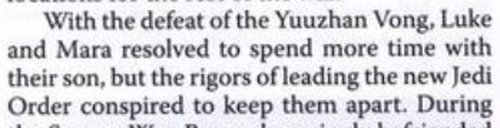
- **Luke Skywalker; Lumiya; Mara Jade Skywalker**: "Luke, who had killed Lumiya to avenge Mara, realized that she couldn't have been the culprit when Ben explained the circumstances of the Kavan incident." Source: The Complete Star Wars Encyclopedia, Vol. III, p.162
  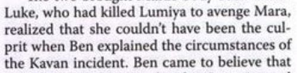
- **Jacen Solo (Darth Caedus)**: "Ben came to believe that Jacen had killed his mother, but Jacen instead implicated the former Galactic Alliance Chief of State, Cal Omas." Source: The Complete Star Wars Encyclopedia, Vol. III, p.162
  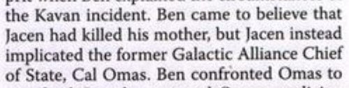
- **Jacen Solo (Darth Caedus); Anakin Solo; Luke Skywalker**: "Jacen placed him in the Embrace of Pain aboard the Star Destroyer Anakin Solo, but Luke infiltrated the ship and freed him." Source: The Complete Star Wars Encyclopedia, Vol. III, p.162
  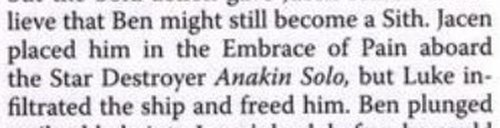
- **Jacen Solo (Darth Caedus); Luke Skywalker**: "Ben plunged a vibroblade into Jacen's back before he could attack Luke, and the two left Jacen to die, although Jacen—now Darth Caedus—survived to continue his scourge." Source: The Complete Star Wars Encyclopedia, Vol. III, p.162
  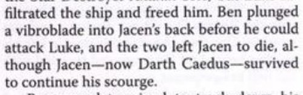
- **Jaina Solo; Jacen Solo (Darth Caedus)**: "Ben was elevated to the rank of Jedi Knight and assigned to accompany Jaina Solo on a Jedi-sanctioned mission to destroy Darth Caedus." Source: The Complete Star Wars Encyclopedia, Vol. III, p.162
  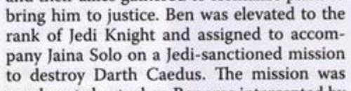

## p.163 (scan page 169)

Page contents: 1104 words, 23 paragraphs | headings/entries: Skywalker, Cade

- **Jacen Solo (Darth Caedus)**: "With Caedus's defeat imminent, Veila's options were vanishing." Source: The Complete Star Wars Encyclopedia, Vol. III, p.163
  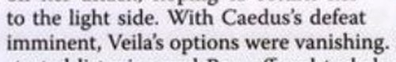
- **Cade Skywalker** — entry/section: Skywalker, Cade: "His training came to an end after the Jedi Temple on Ossus was destroyed in the Sith-Imperial War." Source: The Complete Star Wars Encyclopedia, Vol. III, p.163
  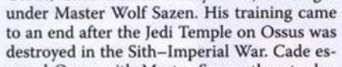
- **Cade Skywalker** — entry/section: Skywalker, Cade: "Cade survived the explosion of his fighter, and the Feeorin pirate Rav took him in, mistaking him for a fellow looter." Source: The Complete Star Wars Encyclopedia, Vol. III, p.163
  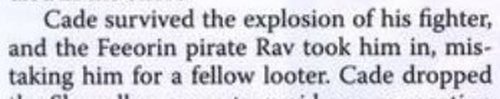

## p.164 (scan page 170)

Page contents: 1113 words, 21 paragraphs | headings/entries: 

- **Darth Vader (Anakin Skywalker)**: "Vader struck down the old Jedi, whose body disappeared." Source: The Complete Star Wars Encyclopedia, Vol. III, p.164
  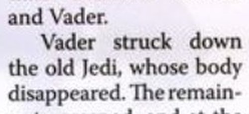
- **Cade Skywalker** — entry/section: Skywalker, Cade: "They destroyed the Death Star." Source: The Complete Star Wars Encyclopedia, Vol. III, p.164
  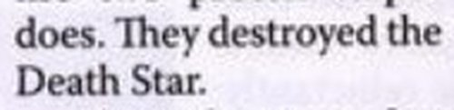
- **Luke Skywalker**: "The Emperor attacked Luke, assaulting him with blue Force lightning, and prepared to kill him." Source: The Complete Star Wars Encyclopedia, Vol. III, p.164
  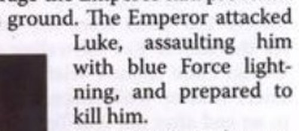
- **Luke Skywalker; Darth Vader (Anakin Skywalker); Obi-Wan Kenobi; Yoda**: "After the second Death Star was destroyed, Luke lit a pyre to burn Darth Vader's garb, He saw a vision of Anakin Skywalker, Ben Kenobi, and Yoda, standing together as luminous beings infused with the light of the Force." Source: The Complete Star Wars Encyclopedia, Vol. III, p.164
  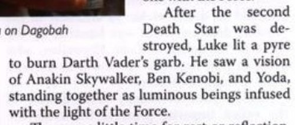

## p.165 (scan page 171)

Page contents: 1354 words, 27 paragraphs | headings/entries: Skywalker, Luuke

- **Leia Organa Solo**: "Together, he and Leia destroyed the clone." Source: The Complete Star Wars Encyclopedia, Vol. III, p.165
  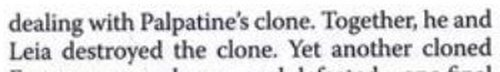
- **Cade Skywalker; Luke Skywalker** — entry/section: Skywalker, Cade: "It killed one trainee, seduced another to the dark side, and nearly murdered Luke, who was eventually saved when his trainees combined their powers." Source: The Complete Star Wars Encyclopedia, Vol. III, p.165
  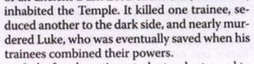
- **Admiral Daala; Leia Organa Solo**: "Still, he helped defeat the threats from Imperial Admiral Daala and her superweapons; discovered the spirit of a Jedi woman, Callista, trapped in a computer on an Imperial battle station, and saw her made human through a transfer of essences with an eminent scientist; and helped rescue Han and Leia's children from dark side practitioners." Source: The Complete Star Wars Encyclopedia, Vol. III, p.165
  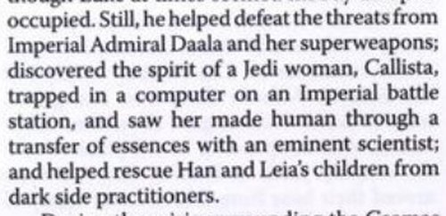
- **Luke Skywalker**: "In battle with Shimrra, Luke used two lightsabers to sever the Supreme Overlord's huge head from his body." Source: The Complete Star Wars Encyclopedia, Vol. III, p.165
  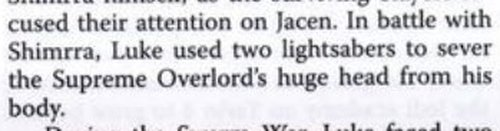
- **Luke Skywalker; Plo Koon**: "During the Swarm War, Luke faced two former Force-users, Raynar Thul and Lomi Plo, who had become absorbed into the hivemind of the Killiks that made up the Colony." Source: The Complete Star Wars Encyclopedia, Vol. III, p.165
  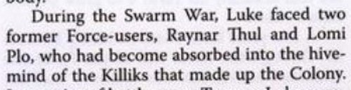
- **Cade Skywalker** — entry/section: Skywalker, Cade: "He convinced the younger man that his continued connection to the Colony would only lead to more conflict, which would ultimately destroy the entire galaxy." Source: The Complete Star Wars Encyclopedia, Vol. III, p.165
  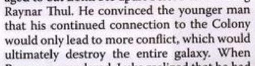
- **Lumiya; Mara Jade Skywalker; Luke Skywalker**: "On Terephon, Lumiya claimed to have killed Mara, and Luke beheaded her after a struggle." Source: The Complete Star Wars Encyclopedia, Vol. III, p.165
  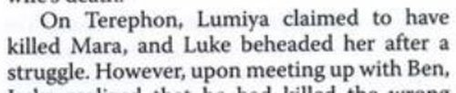
- **Luke Skywalker**: "However, upon meeting up with Ben, Luke realized that he had killed the wrong person." Source: The Complete Star Wars Encyclopedia, Vol. III, p.165
  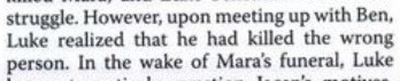
- **Jacen Solo (Darth Caedus)**: "The two of them left Jacen— now the self-proclaimed Darth Caedus—to die... but he survived the blow." Source: The Complete Star Wars Encyclopedia, Vol. III, p.165
  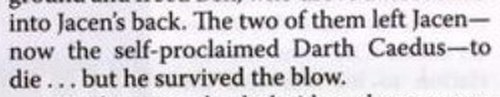
- **Jacen Solo (Darth Caedus)**: "Ben was determined to prove beyond any doubt that Jacen Solo killed his mother, not out of vengeance, but out of justice." Source: The Complete Star Wars Encyclopedia, Vol. III, p.165
  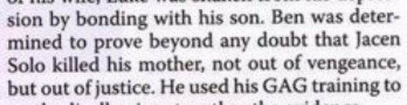
- **Luke Skywalker; Jacen Solo (Darth Caedus)**: "With new resolve, Luke set plans into motion to finally confront and defeat Caedus." Source: The Complete Star Wars Encyclopedia, Vol. III, p.165
  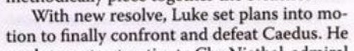
- **Jaina Solo; Luke Skywalker; Jacen Solo (Darth Caedus)**: "Jaina defeated her brother, ending his attacks against the Jedi, while Luke and Han stopped the opportunistic Moffs of the Imperial Remnant from their attempts at conquest that accompanied Caedus's rise." Source: The Complete Star Wars Encyclopedia, Vol. III, p.165
  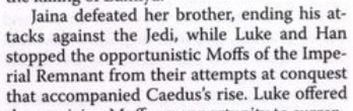
- **Luke Skywalker; Darth Vader (Anakin Skywalker)**: "Skywalker, Luuke A clone of Luke Skywalker, it was created from cells—sample B-2332-54—taken from the hand that Luke had lost in his lightsaber duel with Darth Vader at Cloud City." Source: The Complete Star Wars Encyclopedia, Vol. III, p.165
  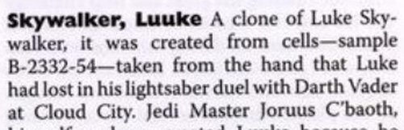
- **Luke Skywalker**: "Using the lightsaber that Luke had lost along with his hand, the clone nearly destroyed Skywalker." Source: The Complete Star Wars Encyclopedia, Vol. III, p.165
  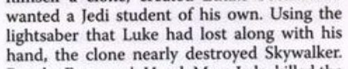

## p.166 (scan page 172)

Page contents: 1299 words, 20 paragraphs | headings/entries: 

- **Luke Skywalker**: "She beat him to Jabba's palace and went undercover as "Arica," but she failed in her mission, and Luke went on to help destroy the Emperor along with his second Death Star battle station." Source: The Complete Star Wars Encyclopedia, Vol. III, p.166
  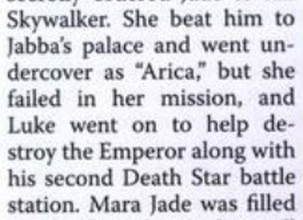
- **Joruus C'baoth; Luke Skywalker; Mara Jade Skywalker; Leia Organa Solo**: "When the mad Jedi clone Joruus C'baoth called both Luke and Mara to him, then unleashed Skywalker's clone, Luuke, Mara killed the Skywalker clone—and finally C'baoth, too, with help from Luke and Leia Organa Solo." Source: The Complete Star Wars Encyclopedia, Vol. III, p.166
  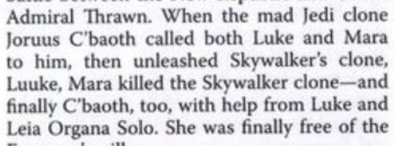
- **Han Solo; Luke Skywalker; Leia Organa Solo; Kueller**: "Later, at Han Solo's request, Jade and Karrde located and brought to the planet Almania several Force-bending ysalamiri, which Solo used to help Luke and Leia defeat the Dark Jedi Kueller." Source: The Complete Star Wars Encyclopedia, Vol. III, p.166
  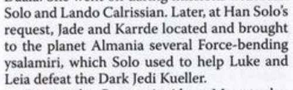
- **Kam Solusar**: "They realized that their relationship was now stronger than ever, and they were soon wed; once in a Jedi ceremony performed by Kam Solusar, and again in a public ceremony on Coruscant." Source: The Complete Star Wars Encyclopedia, Vol. III, p.166
  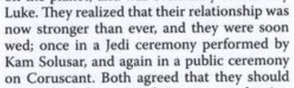
- **Jacen Solo (Darth Caedus); Mara Jade Skywalker; Ben Skywalker**: "Just as Jacen showed up, Mara's body disappeared, becoming one with the Force—a sure sign to Ben Skywalker that his mother was revealing that she had been killed by Jacen." Source: The Complete Star Wars Encyclopedia, Vol. III, p.166
  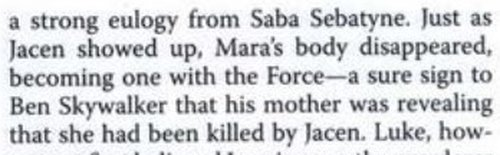
- **Luke Skywalker; Lumiya**: "Luke, however, at first believed Lumiya was the murderer and killed her." Source: The Complete Star Wars Encyclopedia, Vol. III, p.166
  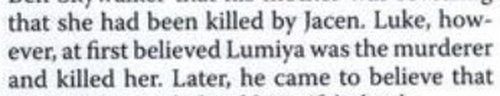
- **Jacen Solo (Darth Caedus)**: "Ben was determined to prove that Jacen had killed his mother, but he sought justice, not vengeance." Source: The Complete Star Wars Encyclopedia, Vol. III, p.166
  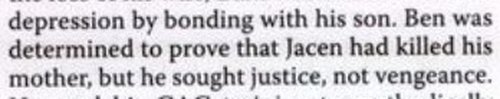
- **Luke Skywalker; Jacen Solo (Darth Caedus)**: "With new resolve, Luke developed plans to finally confront and defeat Caedus." Source: The Complete Star Wars Encyclopedia, Vol. III, p.166
  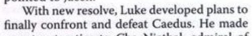
- **Jaina Solo; Luke Skywalker**: "Jaina defeated her brother while Luke and Han stopped the opportunistic Moffs of the Imperial Remnant." Source: The Complete Star Wars Encyclopedia, Vol. III, p.166
  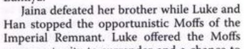

## p.167 (scan page 173)

Page contents: 1233 words, 28 paragraphs | headings/entries: Slashtown; Slave 1; Stave IV

- **Darth Vader (Anakin Skywalker)**: "Anakin killed the Tusken clan and buried his mother on the Lars homestead next to the graves of Cliegg's first wife and parents." Source: The Complete Star Wars Encyclopedia, Vol. III, p.167
  
- **Jaster Mereel**: "His original ship, Jaster's Legacy, was destroyed during the mission." Source: The Complete Star Wars Encyclopedia, Vol. III, p.167
  

## p.168 (scan page 174)

Page contents: 1039 words, 23 paragraphs | headings/entries: Slayke, Captain Zozridor; Sleazebaggano, Elan; Slice, the; Slick; Sligh; Sijee

## p.169 (scan page 175)

Page contents: 1102 words, 31 paragraphs | headings/entries: Slosin, Mox; Sluissi; Slusk, Loppak; Slyssk; Slythor; Sma'Da, Drawmas; Smarteel; Smotil

- **Dengar**: "Sma'Da had little faith in Dengar, but the bounty hunter survived, and Sma'Da was forced to pay a handsome return on Manaroo's bet." Source: The Complete Star Wars Encyclopedia, Vol. III, p.169
  

## p.170 (scan page 176)

Page contents: 964 words, 25 paragraphs | headings/entries: Smugglers' Alliance; Smuggler's; Smuggler's Run; Snapit, Torr; Sneaker; Sneaky; Sneerzick, Xalto; Sneevel; Snevu, Battle of; Snibit, Tutti; Snit; Snitkin, Pote; Snivvian

- **Lando Calrissian**: "When Calrissian arrived at the Run to check on Solo, he was captured and nearly killed by Nandreeson." Source: The Complete Star Wars Encyclopedia, Vol. III, p.170
  
- **Jaina Solo**: "Sneaker was later destroyed on Terephon when Jaina and Zekk questioned the Ducha Galney about an assassination attempt on the life of the Queen Mother, Tenel Ka." Source: The Complete Star Wars Encyclopedia, Vol. III, p.170
  
- **Jaina Solo**: "In the chaos that ensued, Jaina's StealthX was blown up by a remote-launched missile, obliterating the droid." Source: The Complete Star Wars Encyclopedia, Vol. III, p.170
  
- **Jaina Solo**: "Sneaky was destroyed several years after the end of the Yuuzhan Vong War, when Jaina was shot down over Tenupe by Jagged Fel." Source: The Complete Star Wars Encyclopedia, Vol. III, p.170
  
- **Admiral Ackbar**: "In the Battle of Snevu, the Killiks in command of the stolen Star Destroyer Admiral Ackbar attacked and leveled the Chiss base on Snevu." Source: The Complete Star Wars Encyclopedia, Vol. III, p.170
  
- **Luke Skywalker; Han Solo; Leia Organa Solo**: "Pote Snitkin piloted one of Jabba's skiffs and was among those killed during Luke Skywalker's rescue of Han Solo and Princess Leia from the Hutt." Source: The Complete Star Wars Encyclopedia, Vol. III, p.170
  

## p.171 (scan page 177)

Page contents: 899 words, 25 paragraphs | headings/entries: Snoil, Doolb; Snootles, Sy; Snoova; Snunb, Captain Syub; Snutib; Snyffulnimatta, Lynaliskar K'ra

## p.172 (scan page 178)

Page contents: 1349 words, 38 paragraphs | headings/entries: Soach, Qual'om; SoBilles, Jenssar; Socorro; Sodonna; Soft Heart Cantina; Sokan; Sol, Jorin; Solace; Solis

- **Grand Inquisitor Malorum**: "However, when Olin explained that Inquisitor Malorum had planted a spy in her midst, Solace agreed to return to the Jedi Temple with him and discover the spy's identity before her un d settlement could be destroyed." Source: The Complete Star Wars Encyclopedia, Vol. III, p.172
  
- **Darth Vader (Anakin Skywalker); Anakin Solo; Han Solo; Leia Organa Solo**: "Solo, Anakin Born six years after the death of his grandfather Anakin Skywalker, Anakin Solo was the youngest of Han Solo and Princess Leia Organa Solo's three children, and the strongest in the Force." Source: The Complete Star Wars Encyclopedia, Vol. III, p.172
  

## p.173 (scan page 179)

Page contents: 1073 words, 19 paragraphs | headings/entries: Solo, Han

- **Darth Vader (Anakin Skywalker)**: "The New Republic hoped to use the repulsors aboard the massive station to wipe out the Yuuzhan Vong fleet, but Anakin refused to be the wielder of such power." Source: The Complete Star Wars Encyclopedia, Vol. III, p.173
  
- **Darth Vader (Anakin Skywalker)**: "Anakin became a glowing extension of the Force itself, almost invincible as he cut down Yuuzhan Vong warriors in order to get his comrades closer to the voxyn queen." Source: The Complete Star Wars Encyclopedia, Vol. III, p.173
  

## p.174 (scan page 180)

Page contents: 1037 words, 21 paragraphs | headings/entries: 

## p.175 (scan page 181)

Page contents: 1259 words, 27 paragraphs | headings/entries: Solo, Jacen

- **Jacen Solo (Darth Caedus); Exar Kun; Luke Skywalker** — entry/section: Solo, Jacen: "Later, Jacen joined forces with the other Jedi students in destroying Exar Kun's spirit forever and freeing Luke's spirit." Source: The Complete Star Wars Encyclopedia, Vol. III, p.175
  
- **Jacen Solo (Darth Caedus)** — entry/section: Solo, Jacen: "When Thrackan Sal-Solo fired it instead and destroyed the Hapan fleet, Jacen felt himself lost in his struggle to understand the Force." Source: The Complete Star Wars Encyclopedia, Vol. III, p.175
  
- **Jacen Solo (Darth Caedus)** — entry/section: Solo, Jacen: "Shortly afterward, Jacen and his siblings joined the Jedi strike team to Myrkr to destroy the voxyn queen." Source: The Complete Star Wars Encyclopedia, Vol. III, p.175
  
- **Jacen Solo (Darth Caedus); Lumiya; Luke Skywalker; Mara Jade Skywalker** — entry/section: Solo, Jacen: "Jacen fled to Ziost, where Lumiya agreed to make Luke believe that she had killed Mara." Source: The Complete Star Wars Encyclopedia, Vol. III, p.175
  

## p.176 (scan page 182)

Page contents: 1410 words, 27 paragraphs | headings/entries: Solo, Jaina

- **Jacen Solo (Darth Caedus); Jaina Solo; Boba Fett** — entry/section: Solo, Jacen: "Jaina trained under Boba Fett, learning Mandalorian combat techniques to effectively surprise and defeat Jacen." Source: The Complete Star Wars Encyclopedia, Vol. III, p.176
  
- **Jacen Solo (Darth Caedus); Jaina Solo** — entry/section: Solo, Jacen: "In a pitched battle, brother and sister dueled, and in the end, Jaina plunged her lightsaber into Jacen's chest, cutting through his ribs until she sliced through his heart." Source: The Complete Star Wars Encyclopedia, Vol. III, p.176
  
- **Jaina Solo; Han Solo** — entry/section: Solo, Jaina: "She was also capable of cobbling together mechanical devices for just about any purpose, and like Han Solo, her impulsiveness, spirit, and self-confidence sometimes got her into trouble." Source: The Complete Star Wars Encyclopedia, Vol. III, p.176
  
- **Jaina Solo; Luke Skywalker; Jacen Solo (Darth Caedus)** — entry/section: Solo, Jaina: "When Luke was unable to defeat Jacen, Jaina became convinced that her role as the Sword of the Jedi was to defeat her brother and restore peace to the galaxy." Source: The Complete Star Wars Encyclopedia, Vol. III, p.176
  
- **Jacen Solo (Darth Caedus)**: "With one savage blow, she cleaved off her brother's arm but was so surprised she was flung against the far wall by Caedus's Force lightning." Source: The Complete Star Wars Encyclopedia, Vol. III, p.176
  
- **Jaina Solo** — entry/section: Solo, Jaina: "Jaina gained the upper hand when she severed the tendon in her brother's leg, and then drove her lightsaber into his chest, killing him." Source: The Complete Star Wars Encyclopedia, Vol. III, p.176
  

## p.177 (scan page 183)

Page contents: 1245 words, 23 paragraphs | headings/entries: 

- **Obi-Wan Kenobi**: "Near Tatooine, on a mission to recruit the Jedi Obi-Wan Kenobi, she and her ship were captured by the Star Destroyer Devastator." Source: The Complete Star Wars Encyclopedia, Vol. III, p.177
  
- **Leia Organa Solo; Grand Moff Tarkin**: "Taken aboard the Death Star, Leia was able to block interrogation probes, but the battle station's commander, Grand Moff Tarkin, threatened to destroy Leia's planet of Alderaan—home to her father and billions of other residents—if she didn't reveal the site of the secret Rebel base." Source: The Complete Star Wars Encyclopedia, Vol. III, p.177
  
- **Grand Moff Tarkin**: "Quietly, she named Dantooine, a lie that Tarkin believed, but he ordered Alderaan to be destroyed anyway." Source: The Complete Star Wars Encyclopedia, Vol. III, p.177
  
- **Jaina Solo; Leia Organa Solo** — entry/section: Solo, Jaina: "It was obliterated before Leia's eyes, and Leia was scheduled for execution." Source: The Complete Star Wars Encyclopedia, Vol. III, p.177
  
- **Luke Skywalker; Chewbacca**: "Luke, Han, and Chewbacca—along with the droids R2-D2 and C-3PO—became a second family to her, helping to ease some of the shock and pain left by the annihilation of Alderaan." Source: The Complete Star Wars Encyclopedia, Vol. III, p.177
  
- **Leia Organa Solo; Luke Skywalker; Darth Vader (Anakin Skywalker)**: "Leia and the others fled, and helped rescue Luke, who had narrowly survived a lightsaber duel with Darth Vader." Source: The Complete Star Wars Encyclopedia, Vol. III, p.177
  
- **Prince Xizor**: "Despite his charismatic advantages, Xizor was defeated." Source: The Complete Star Wars Encyclopedia, Vol. III, p.177
  
- **Jaina Solo** — entry/section: Solo, Jaina: "She eventually killed Jabba by strangling him with the very chain that bound her." Source: The Complete Star Wars Encyclopedia, Vol. III, p.177
  
- **Jaina Solo; Darth Vader (Anakin Skywalker); Palpatine (Darth Sidious)** — entry/section: Solo, Jaina: "She used all her diplomatic skills to gain the help of a primitive tribe of Ewoks; the Rebels persevered, and the second battle station was destroyed—along with Vader and Emperor Palpatine." Source: The Complete Star Wars Encyclopedia, Vol. III, p.177
  

## p.178 (scan page 184)

Page contents: 990 words, 17 paragraphs | headings/entries: Solomahal; Solusar, Kam

- **Kueller**: "Crises—and self-doubts—were never far away, spurred by the likes of Yevethan strongman Nil Spaar or the Dark Jedi Kueller, whom she personally killed in battle." Source: The Complete Star Wars Encyclopedia, Vol. III, p.178
  
- **Leia Organa Solo**: "During the Yuuzhan Vong War, Leia was one of the New Republic's strongest voices in identifying the threat and ensuring there was room for refugees fleeing the war zones." Source: The Complete Star Wars Encyclopedia, Vol. III, p.178
  
- **Leia Organa Solo; Jacen Solo (Darth Caedus)**: "When the Yuuzhan Vong attacked Duro, Warmaster Tsavong Lah nearly killed Leia until her son Jacen drove him off." Source: The Complete Star Wars Encyclopedia, Vol. III, p.178
  
- **Jaina Solo; Leia Organa Solo; Ben Skywalker; Jacen Solo (Darth Caedus); Mara Jade Skywalker** — entry/section: Solo, Jaina: "In the days that followed, Leia and Jaina met with Ben Skywalker, encouraging him to find evidence that would prove that Jacen had killed Mara Jade Skywalker." Source: The Complete Star Wars Encyclopedia, Vol. III, p.178
  
- **Kam Solusar; Exar Kun** — entry/section: Solusar, Kam: "Solusar united with Skywalker's other Jedi students in defeating Exar Kun's spirit." Source: The Complete Star Wars Encyclopedia, Vol. III, p.178
  

## p.179 (scan page 185)

Page contents: 1396 words, 22 paragraphs | headings/entries: Solusar, Ranik; Solusar, Tionne; Somerce, Akeeli; Sommos, Noma; Somoril, Vak; Somov Rit; Sonniod; Sonsen, Jenica; Sooflie 1X, Prince R'cardo; Sookcool, Avaro

- **Kam Solusar; Darth Vader (Anakin Skywalker)** — entry/section: Solusar, Ranik: "He escaped the slaughter of Order 66, but was later killed by Darth Vader during the Empire's Purge of Jedi survivors." Source: The Complete Star Wars Encyclopedia, Vol. III, p.179
  

## p.180 (scan page 186)

Page contents: 1192 words, 28 paragraphs | headings/entries: Soothfast; Sorannan, Major Sil; S'orn, Senator Uta; SoroSuub Corporation; Soulless; Sorrus; Soulless; Southern Underground; Sovereign; Sovereign Protectors; Sovv, Admiral Sien; Spaar, Nil

- **Obi-Wan Kenobi**: "The analysis droids SP-4 and JN- 66 helped Jedi Knight Obi-Wan Kenobi when he asked them to identify the small toxic dart that killed Zam Wesell." Source: The Complete Star Wars Encyclopedia, Vol. III, p.180
  

## p.181 (scan page 187)

Page contents: 958 words, 23 paragraphs | headings/entries: Spacers' Garage; Space Station Kwenn; Space Station Scardia

- **Han Solo**: "When Han Solo, the husband of the Chief of State, was sent to take command of the New Republic's Fifth Fleet, Spaar kidnapped Solo, killed his engineer in cold blood, and savagely beat Solo until he was nearly dead." Source: The Complete Star Wars Encyclopedia, Vol. III, p.181
  
- **Palpatine (Darth Sidious)**: "The entire Spaarti Creations plant was destroyed in a Separatist attack, although a few thousand clone tanks were left intact and transferred to Palpatine's secret stronghold on Wayland." Source: The Complete Star Wars Encyclopedia, Vol. III, p.181
  

## p.182 (scan page 188)

Page contents: 1124 words, 27 paragraphs | headings/entries: Sparkle Run; Sparky; Special Task Force; Specter Squadron; Spefik; Spero

- **Jango Fett**: "After the outbreak of the Clone Wars and the death of Jango Fett, Spar went to work rebuilding Jango's supercommandos from local police on Mandalore, where rumor spread that the son of Jango Fett, the last True Mandalorian, had survived to lead them." Source: The Complete Star Wars Encyclopedia, Vol. III, p.182
  
- **Jaina Solo**: "He was destroyed when Jaina's X-wing was shot down at the Battle of Kalarba." Source: The Complete Star Wars Encyclopedia, Vol. III, p.182
  

## p.183 (scan page 189)

Page contents: 961 words, 21 paragraphs | headings/entries: Spicy Lady; Spider People; Spijek, Tanus; Spiker; Spindrift

## p.184 (scan page 190)

Page contents: 1149 words, 24 paragraphs | headings/entries: Spiner; Spinnerfish; Spira; Spirit Tree; Spore; Sprax; Springhawk; Spuma

- **Jerec**: "Prior to the Battle of Endor, the Dark Jedi Jerec sought out Spore in order to create an army of slaves, though the beast instead destroyed Jerec's Imperial Star Destroyer Vengeance." Source: The Complete Star Wars Encyclopedia, Vol. III, p.184
  

## p.185 (scan page 191)

Page contents: 1057 words, 29 paragraphs | headings/entries: Squab; Squad Seven; Squaitris; Squeak; Squeaky; Squid Head; Squid Lake; Squint; Sriluur; Srrors'tok

## p.186 (scan page 192)

Page contents: 989 words, 32 paragraphs | headings/entries: Ssoh; Ssty; Staable, Sammie; Stalker; Stalking Moon; Starbreaker 12; Star Chamber; Stanz, Captain; Star Chamber Café; Starerash Brigade; Star Destroyer

- **Naga Sadow**: "By the time the Sith mobilized, Starbreaker 12 was under the ownership of the unscrupulous merchant Ssk Kahorr, who was killed when Sadow, in his first act of aggression after entering the Koros system, ordered the ship's total destruction." Source: The Complete Star Wars Encyclopedia, Vol. III, p.186
  

## p.187 (scan page 193)

Page contents: 817 words, 19 paragraphs | headings/entries: Star Dream; Star Forge; Star Home; Star-Hoppers; Starhunter Intergalactic Menagerie; Stark, taco

- **Darth Vader (Anakin Skywalker)**: "Darth Vader's Executor was a Star Dreadnaught, commonly referred to as a Super Star Destroyer." Source: The Complete Star Wars Encyclopedia, Vol. III, p.187
  
- **Revan**: "The Star Forge was ultimately destroyed by Revan and a Republic fleet." Source: The Complete Star Wars Encyclopedia, Vol. III, p.187
  

## p.188 (scan page 194)

Page contents: 1196 words, 29 paragraphs | headings/entries: Stark Commercial Combine; Stark Hyperspace Conflict; Starkiller; Jedi.

- **Plo Koon**: "After losing control of the Combine, he was contacted by Plo Koon telepathically and learned that the Combine would be defeated." Source: The Complete Star Wars Encyclopedia, Vol. III, p.188
  
- **Plo Koon**: "Plo Koon was legendary for his leadership, rallying the disheartened Republic troops to an unlikely and miraculous victory." Source: The Complete Star Wars Encyclopedia, Vol. III, p.188
  
- **Galen Marek; Kento Marek; Darth Vader (Anakin Skywalker)** — entry/section: Starkiller: "Galen's mother was killed a few years later while trying to protect a group of Wookiees from slavers; Galen's father, Kento, died soon after, trying to protect the boy from Darth Vader, who had tracked the Jedi to Kashyyyk." Source: The Complete Star Wars Encyclopedia, Vol. III, p.188
  
- **Darth Vader (Anakin Skywalker)**: "With the boy corrupted, Vader revealed his master plan: He was grooming his secret apprentice to one day help him destroy the Emperor." Source: The Complete Star Wars Encyclopedia, Vol. III, p.188
  
- **Galen Marek; Shaak Ti; Darth Vader (Anakin Skywalker)**: "After Starkiller killed Jedi Council member Shaak Ti on Felucia, Darth Vader recalled him to the Executor, promising that they would at last confront the Emperor." Source: The Complete Star Wars Encyclopedia, Vol. III, p.188
  
- **Darth Vader (Anakin Skywalker)**: "Goaded on by the Emperor, Vader seemingly killed his Apprentice, proving his complete loyalty to the Emperor." Source: The Complete Star Wars Encyclopedia, Vol. III, p.188
  

## p.189 (scan page 195)

Page contents: 1334 words, 27 paragraphs | headings/entries: Starlight Intruder; Station; Star Map; Star Morning; Star Runner; Starry Ice; Star Saber; Star Sea Flower; Stars' End; Starspeeder 3000; Starstone, Olee; Starstorm I; Star Swan; Star Tours Travel Agency; Star-Wake

- **Galen Marek; Palpatine (Darth Sidious)**: "Lightsabers clashed inside the Emperor's observation dome, but Starkiller was ultimately no match for the power of Darth Sidious." Source: The Complete Star Wars Encyclopedia, Vol. III, p.189
  
- **Galen Marek**: "Bombarded by Force lightning, Starkiller did not fight back but instead unleashed all the power of the Force within him, causing a tremendous blast that shattered the Emperor's tower and caused enough of a distraction to allow Eclipse and the Rebel Senators to escape." Source: The Complete Star Wars Encyclopedia, Vol. III, p.189
  
- **Olee Starstone** — entry/section: Starstone, Olee: "This small success gave Starstone the idea of establishing a link to the Jedi Archives, then downloading information on the whereabouts of any Jedi who might have survived Order 66." Source: The Complete Star Wars Encyclopedia, Vol. III, p.189
  
- **Olee Starstone; Darth Vader (Anakin Skywalker)** — entry/section: Starstone, Olee: "She took them to Kashyyyk, where she confronted Darth Vader after the Dark Lord killed or injured her companions." Source: The Complete Star Wars Encyclopedia, Vol. III, p.189
  

## p.190 (scan page 196)

Page contents: 1119 words, 36 paragraphs | headings/entries: Starweird; Stassia; Statermast, Hinib; Station 88 Spaceport; Stazi, Admiral Gar; Steadfast; StealthX X-wing; Stec, Sergeant; Stele, Maarek; Stellar Web; Stelilskard; Stenax

## p.191 (scan page 197)

Page contents: 1171 words, 20 paragraphs | headings/entries: Stendaff; Steng; Stent, Commander; Stereb; Stic; Stihl, Nova; Stinex, Benits

## p.192 (scan page 198)

Page contents: 1070 words, 33 paragraphs | headings/entries: Stinger; Stockade; Stomper; Stopa, Kroddok; Stonebone, Finhead; Stone Needle; Storinal

- **Leia Organa Solo**: "Storinal The site of a battle where Princess Leia's flagship, the Rebel Dream, was mercilessly shelled by the Imperial Star Destroyer Peremptory and recaptured by the Empire." Source: The Complete Star Wars Encyclopedia, Vol. III, p.192
  

## p.193 (scan page 199)

Page contents: 858 words, 20 paragraphs | headings/entries: 

- **Obi-Wan Kenobi; Darth Vader (Anakin Skywalker)**: "The fleet was ultimately destroyed by Obi-Wan Kenobi and Anakin Skywalker with help from their clone trooper pilots." Source: The Complete Star Wars Encyclopedia, Vol. III, p.193
  

## p.194 (scan page 200)

Page contents: 1203 words, 23 paragraphs | headings/entries: Stratis Games; Stratus, Alto; Streen; Strok, Captain; Strom, Pleth

- **Streen; Luke Skywalker; Exar Kun** — entry/section: Streen: "Luke Skywalker found Streen to be Force-sensitive and invited him to join the other Jedi students at the Jedi academy, The spirit of Sith Lord Exar Kun influenced Streen into starting a tornado that threatened to destroy the near-lifeless body of Luke, but Streen was stopped in time." Source: The Complete Star Wars Encyclopedia, Vol. III, p.194
  
- **Streen; Exar Kun** — entry/section: Streen: "He later joined forces with the other Jedi students in destroying Exar Kun's spirit forever." Source: The Complete Star Wars Encyclopedia, Vol. III, p.194
  
